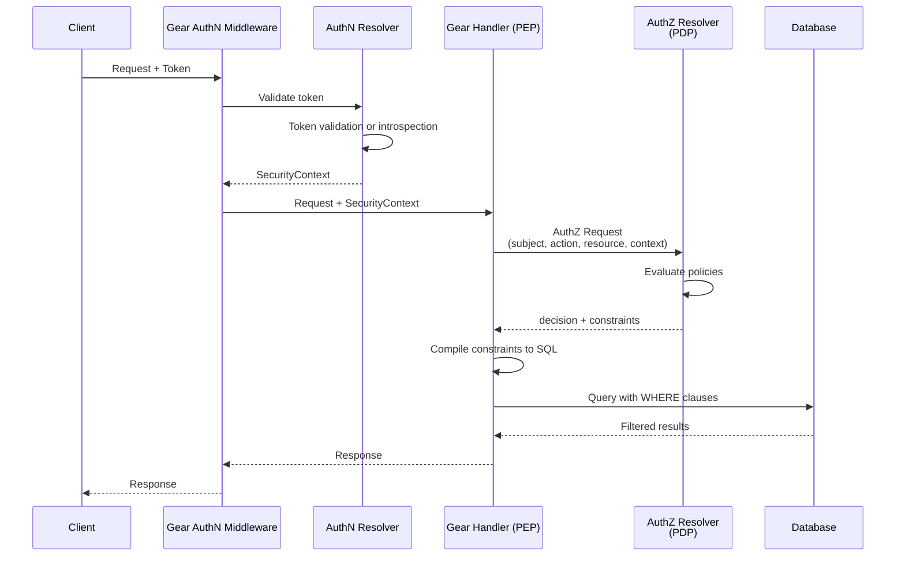
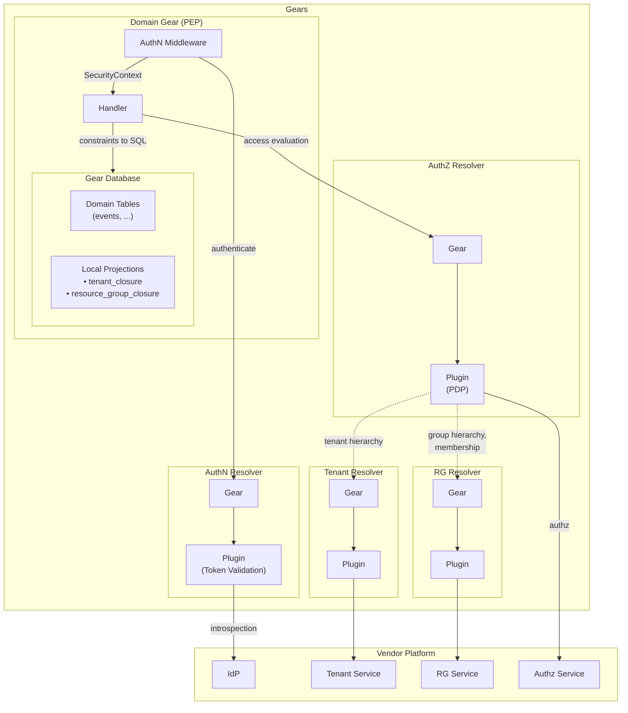
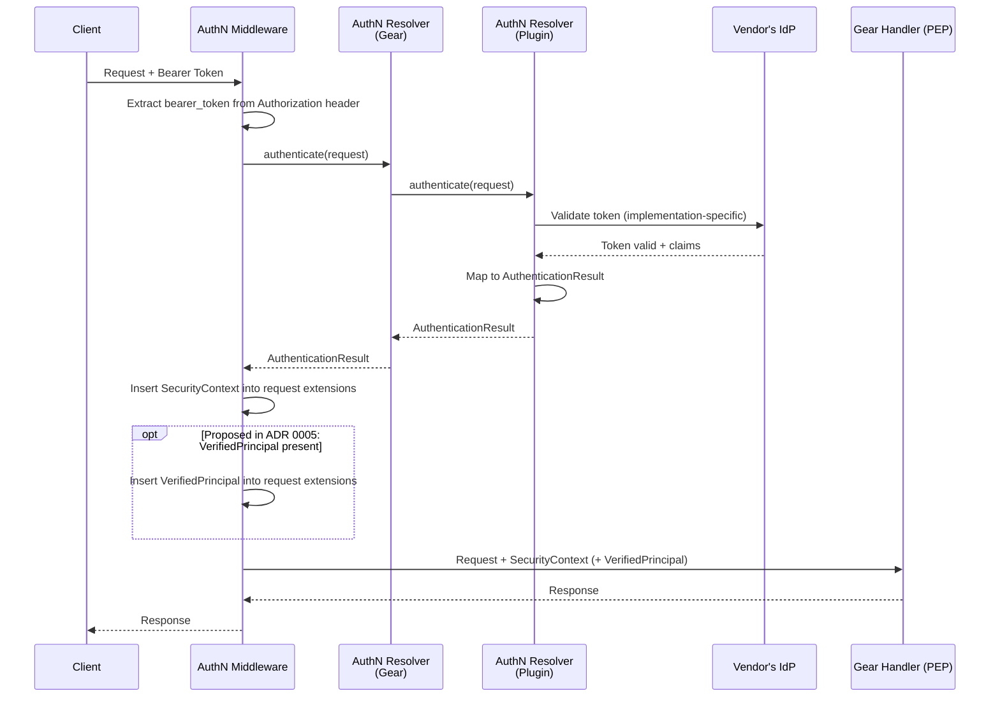
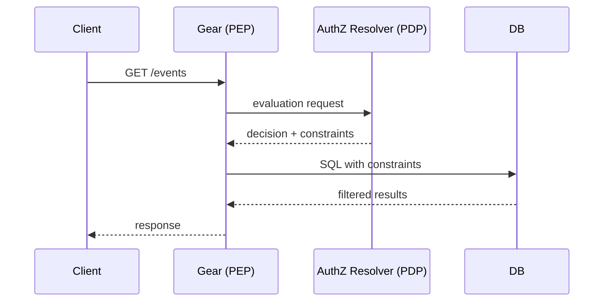
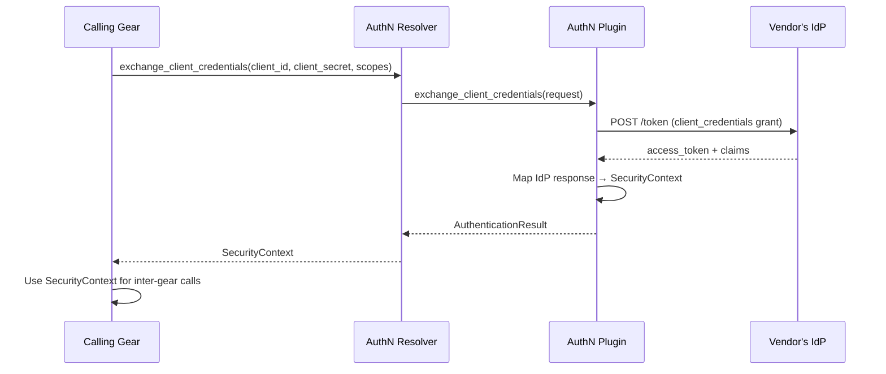

<!-- Updated: 2026-04-07 by Constructor Tech -->

# Authentication & Authorization Design

## Table of Contents

- [Overview](#overview)
- [Token Scopes](#token-scopes)
- [Authentication](#authentication)
- [Authorization](#authorization)
  - [Why AuthZEN (and Why It's Not Enough)](#why-authzen-and-why-its-not-enough)
  - [PEP Enforcement](#pep-enforcement)
  - [Authorization Decision Caching](#authorization-decision-caching)
  - [API Specifications](#api-specifications)
  - [Batch Evaluation (Access Evaluations API)](#batch-evaluation-access-evaluations-api)
  - [Predicate Types Reference](#predicate-types-reference)
  - [PEP Property Mapping](#pep-property-mapping)
  - [Capabilities -> Predicate Matrix](#capabilities---predicate-matrix)
  - [Table Schemas (Local Projections)](#table-schemas-local-projections)
  - [Usage Scenarios](#usage-scenarios)
- [S2S Authentication (Service-to-Service)](#s2s-authentication-service-to-service)
- [Open Questions](#open-questions)
- [References](#references)

---

## Overview

This document describes Gears' approach to authentication (AuthN) and authorization (AuthZ).

**Status:** The resource-condition contract below is a target design; see [implementation status](#implementation-status).

**Authentication** verifies the identity of the subject making a request. Gears use the **AuthN Resolver** gear to integrate with vendor's Identity Provider (IdP), validate access tokens, and extract subject identity into a `SecurityContext`.

**Authorization** determines what the authenticated subject can do. Gears use the **AuthZ Resolver** gear (acting as PDP) to obtain access decisions and query-level constraints. The core challenge: Gears need to enforce authorization at the **query level** (SQL WHERE clauses), not just perform point-in-time access checks.

See [ADR 0001](./ADR/0001-pdp-pep-authorization-model.md) for the authorization model and [ADR 0002](./ADR/0002-split-authn-authz-resolvers.md) for the rationale behind separating AuthN and AuthZ.

### PDP/PEP Model

This document uses the PDP/PEP authorization model (per NIST SP 800-162):

- **PDP (Policy Decision Point)** — evaluates policies and returns access decisions with constraints
- **PEP (Policy Enforcement Point)** — enforces PDP decisions at resource access points

In Gears' architecture:
- **AuthN Resolver** validates tokens and produces SecurityContext (separate concern from PDP)
- **AuthZ Resolver** (via vendor-specific plugin) serves as the **PDP**
- **Domain gears** act as **PEPs**, applying constraints to database queries

### Core Terms

- **Access Token** - Credential presented by the client to authenticate requests. Format is not restricted — can be opaque token (validated via introspection) or self-contained JWT. The key requirement: it must enable authentication and subject identification.
- **Subject** - Authenticated caller identity (user or API client) initiating the request, identified via access token (`sub` claim in OIDC/JWT terminology). *Note:* Some systems (e.g., AWS IAM) use the term **principal** for the same concept.
- **Tenant** - Domain of ownership/responsibility and policy (billing, security, data isolation). See [TENANT_MODEL.md](./TENANT_MODEL.md).
- **Subject Tenant** - Tenant the subject belongs to (home tenant).
- **Context Tenant** - Tenant scope root for the operation (may differ from subject tenant in cross-tenant scenarios)
- **Resource Tenant** - Tenant that owns the resource (data partition / isolation boundary).
- **Resource Owner Subject** - Optional subject bound to a resource instance for per-subject scoping (e.g., "my tasks"). Relationship semantics are domain-specific (creator, assignee, etc.) and do not imply administrative control.
- **Resource** - Object being accessed. Every resource belongs to a tenant and may optionally have a subject owner. Identified by type (GTS ID) and instance ID.
- **Resource Group** - Optional container for resources, used for access control. See [RESOURCE_GROUP_MODEL.md](./RESOURCE_GROUP_MODEL.md).
- **Permission** - `{ resource_type, action }` - allowed operation identifier. Canonical base GTS type: `gts.cf.toolkit.authz.permission.v1~`. See [PERMISSION_GTS_TYPE.md](./PERMISSION_GTS_TYPE.md) for the full schema, instance naming convention, and scenario examples.
- **Access Constraints** - Structured predicates returned by the PDP for query-time enforcement. NOT policies (stored vendor-side) or "grants" (OAuth flows, Zanzibar tuples), but compiled, time-bound enforcement artifacts computed at evaluation time.
- **Security Context** - Result of successful authentication containing subject identity, tenant information, and optionally the original bearer token. Flows from authentication to authorization. Required fields: `subject_id`, `subject_tenant_id`, `token_scopes`. Optional fields: `subject_type`, `bearer_token`.
- **Token Scopes** - Capability restrictions extracted from the access token. Act as a "ceiling" on what an application can do, regardless of user's actual permissions. See [Token Scopes](#token-scopes).

#### Ownership Model

In a multi-tenant system, resource access is defined along **two orthogonal dimensions**:

**Tenancy (mandatory, isolation boundary)**
Every resource belongs to exactly one tenant (`owner_tenant_id`). This is the primary data boundary.
For a tenant-owned resource, the PEP must enforce a tenant predicate on every allowed access path, including owner-only policies. The SDK compiler checks for a tenant predicate in branches with native group predicates. For ordinary `eq` or `in` branches it can compile an owner-only filter, so successful compilation alone does not establish tenant isolation. [PEP compiler](../../../gears/system/authz-resolver/authz-resolver-sdk/src/pep/compiler.rs)

**Subject scoping (optional, per-subject filtering)**
A resource may optionally be associated with a specific subject within the tenant via `owner_id`.
This enables "my resources" views (e.g., "show only my tasks"). Stored tenant-level shared objects may have `owner_id = NULL`. It aligns with AuthZEN's `resource.properties.ownerID` resource property convention (see [AuthZEN interop spec](https://authzen-interop.net/docs/scenarios/todo-1.1/)).

**Important semantics**
- `owner_tenant_id` is the isolation / partition key; `owner_id` is a nullable scoping attribute.
- `owner_id` MUST refer to a subject that belongs to the same tenant as `owner_tenant_id`.
- "Owner" here does **not** imply administrative control; it is used for scoping in policies/constraints.

**Policy usage**
PDP policies may rely on tenancy only (tenant-wide access) or combine it with subject scoping (owner-only access). If a domain requires multiple subject relationships (e.g., creator vs assignee), model them as separate resource properties (e.g., `creator_id`, `assignee_id`) and express policies/constraints on those properties instead of overloading `owner_id`.

### Request Flow



**Separation of concerns:**
1. **AuthN Middleware** — calls AuthN Resolver to validate token, produces `SecurityContext`
2. **Gear Handler (PEP)** — receives SecurityContext, builds AuthZ request, compiles constraints to SQL
3. **AuthZ Resolver (PDP)** — evaluates policies, returns decision + constraints

### AuthN Resolver and AuthZ Resolver: Gear + Plugin Architecture

Since IdP and PDP are vendor-specific, Gears cannot implement authentication and authorization directly. Instead, we use the **gear + plugin** pattern with two separate resolvers:

- **AuthN Resolver** — a Gear with plugins that defines a unified interface for authentication operations (token validation, introspection, SecurityContext production)
- **AuthZ Resolver** — a Gear with plugins that defines a unified interface for authorization operations (PDP functionality, policy evaluation, constraint generation)
- **Vendor Plugins** — implement the AuthN and/or AuthZ interfaces, integrating with vendor's IdP and Authorization API

This separation provides:
- **Separation of concerns** — OIDC/JWT standards (AuthN) vs AuthZEN standards (AuthZ)
- **Deployment flexibility** — AuthN on edge, AuthZ centralized in distributed scenarios
- **Security boundaries** — Credentials (tokens) isolated in AuthN layer, AuthZ works with validated identity
- **Mix & match vendors** — Use different vendors for IdP (AuthN) and Policy Engine (AuthZ)

Each vendor develops their own AuthN and AuthZ plugins (a unified plugin implementing both interfaces is a design option only and is not implemented — see [Unified Plugin Pattern](#plugin-roles)) that bridge to their specific systems. See [ADR 0002](./ADR/0002-split-authn-authz-resolvers.md) for the rationale behind this separation.

### Plugin Roles

**AuthN Plugin:**

The AuthN Resolver plugin bridges Gears to the vendor's IdP. The plugin is responsible for:
- **IdP communication** — calling introspection endpoints, handling IdP-specific protocols
- **Claim enrichment** — if the IdP doesn't include `subject_type` or `subject_tenant_id` in tokens, the plugin fetches this information from vendor services
- **Response mapping** — converting IdP-specific responses to `SecurityContext`
- **Token scope extraction** — detecting first-party vs third-party apps and setting `token_scopes` accordingly

**AuthZ Plugin:**

The AuthZ Resolver plugin bridges Gears to the vendor's Authorization Service (PDP). The plugin is responsible for:
- **Policy evaluation** — calling vendor's authorization API with subject, action, resource, context
- **Constraint generation** — translating vendor's policy decisions into SQL-compilable constraints
- **Hierarchy queries** — using Tenant Resolver and RG Resolver to query tenant and group hierarchies for constraint generation
- **Token validation** (optional) — a plugin with access to the caller’s bearer token can validate it independently. The internal evaluation REST request omits that token.

**Policy Storage and Retrieval (Out of Scope):**

How authorization rules are stored, represented, and retrieved within the PDP is entirely a vendor implementation detail. Gears define only the PDP-PEP contract (request/response format via AuthZEN-extended API).

Vendors may use any policy model and storage mechanism:
- **RBAC** — role-permission tables, role hierarchies
- **ABAC** — attribute-based rules, policy DSLs
- **ReBAC** — relationship tuples (Zanzibar-style), graph databases
- **Custom models** — proprietary formats, hybrid approaches

The AuthZ Resolver plugin may obtain policy information through any method:
- Call the vendor's centralized Authorization Service (PDP) via API
- Query the vendor's Policy Service or ACL storage directly
- Extract embedded permissions from the bearer token itself (if the token contains authorization claims)
- Use a hybrid approach (e.g., token for basic permissions + service call for fine-grained checks)

The plugin is responsible for evaluating policies (in whatever internal format and from whatever source the vendor uses) and translating the results into the standardized `constraints` JSON format that PEPs can compile to SQL. All policy computation, permission resolution, and authorization logic happens within the plugin based on the vendor's chosen authorization approach.

**Unified Plugin Pattern:**

Vendors with integrated AuthN+AuthZ APIs can provide a unified plugin implementing both interfaces, allowing single API calls to vendor services, shared caching between AuthN and AuthZ operations, and coordinated version updates. See [ADR 0002](./ADR/0002-split-authn-authz-resolvers.md) for details.

> **Not implemented:** there is no unified plugin trait or shared AuthN/AuthZ cache. Each resolver selects its own plugin independently by a single `vendor` config string, and a vendor wanting both must ship two plugins (one per resolver). See the implementation note in ADR 0002.

### Integration Architecture



**Communication flow:**
1. **AuthN Middleware → AuthN Resolver (Gear)** — Middleware calls `authenticate(bearer_token)` to validate token and get `AuthenticationResult`
2. **AuthN Resolver (Gear) → AuthN Resolver (Plugin)** — Gear delegates to vendor plugin
3. **AuthN Resolver (Plugin) → IdP** — Token validation (JWT signature verification or introspection)
4. **AuthN Middleware → Handler** — Middleware extracts `SecurityContext` from `AuthenticationResult` and passes to handler
5. **Handler → AuthZ Resolver (Gear)** — PEP derives the evaluation subject from `SecurityContext` and calls `AuthZResolverApi::evaluate` on the platform plane
6. **AuthZ Resolver (Gear) → AuthZ Resolver (Plugin)** — Gear delegates to vendor plugin (PDP)
7. **AuthZ Resolver (Plugin) → Authz Svc** — Policy evaluation
8. **AuthZ Resolver (Plugin) → Tenant Resolver (Gear)** — Tenant hierarchy queries
9. **AuthZ Resolver (Plugin) → RG Resolver (Gear)** — Group hierarchy and membership queries
10. **Tenant/RG Resolver (Gear) → Plugin → Vendor Service** — Gear delegates to plugin, plugin syncs from vendor

### Deployment Modes and Trust Model

A PEP can call the AuthZ Resolver in process or through its internal REST endpoint. AuthN consumers use the in-process `AuthNResolverClient`.

**In-Process (Plugin):**
- The PEP calls the resolver through its local `ClientHub`
- Communication via direct function calls
- Trust model: implicit — same process, same memory space
- No additional authentication required

**Out-of-Process (Separate Service):**
- Resolvers run as separate processes (same machine or remote)
- Communication via REST/HTTP — the gear's `#[toolkit::rest_contract]` projection. Internal clients resolve the AuthZ evaluation endpoints through the directory and call them directly; [batch evaluation](#batch-evaluation-access-evaluations-api) adds `POST /authz-resolver/v1/evaluations` (designed, not implemented)
- Trust model: explicit authentication required
- **Platform-plane authentication** — the caller presents an `X-ToolKit-Internal-Token`; network-level hardening such as mTLS is an optional, orthogonal transport concern

**Trust Boundaries:**

In both modes, AuthZ Resolver (PDP) trusts subject identity data from PEP. For a remote call, the Kubernetes authenticator identifies the caller’s service account. The development shared-secret authenticator assigns the same platform identity to every holder of the secret. In either configuration, the PEP supplies the subject claims derived from AuthN. [Shared-secret authenticator](../../../libs/toolkit-security/src/shared_secret.rs)

| Aspect | In-Process | Out-of-Process |
|--------|------------|----------------|
| PEP → AuthZ Resolver | Local client call | Internal REST call authenticated with `X-ToolKit-Internal-Token` |
| AuthZ Resolver → PDP plugin | Scoped plugin client from the resolver’s local `ClientHub` | Same scoped plugin lookup in the resolver process |
| Subject identity trust | Same process | PEP supplies the subject identity over an authenticated platform connection |
| Network exposure | none | internal network only |

## Token Scopes

### Overview

Token scopes provide capability narrowing for third-party applications. They act as a "ceiling" on what an application can do, regardless of user's actual permissions.

**Key principle:** `effective_access = min(token_scopes, user_permissions)`

### Scope vs Permission

| Aspect | Scope | Permission |
|--------|-------|------------|
| Granularity | Coarse (human-readable) | Fine (technical) |
| Example | `read:calendar` | `gts.cf.core.events.event.v1~:read` |
| Who defines | OAuth consent / IdP | PDP policies |
| Purpose | Limit app capabilities | Grant user access |

### First-party vs Third-party Apps

| App Type | Example | token_scopes | Behavior |
|----------|---------|--------------|----------|
| First-party | UI, CLI | `["*"]` | No restrictions, full user permissions |
| Third-party | Partner integrations | `["read:events"]` | Limited to granted scopes |

The AuthN plugin classifies the client during token validation or introspection, so each consuming gear can use the resulting scopes directly. The bundled OIDC AuthN plugin compares the validated JWT’s `azp` (falling back to `client_id`) with its configured first-party client list. A match produces `["*"]`. For other clients it reads the configured scope claim, which defaults to `scope`. [OIDC claim mapping](../../../gears/system/authn-resolver/plugins/oidc-authn-plugin/src/domain/claim_mapper.rs)

### Vendor Neutrality

Gears accept scopes as opaque strings (`Vec<String>`). Different vendors use
different formats:
- Google-style: `https://api.vendor.com/auth/tasks.read`
- Simple strings: `read_all`, `admin`
- No scopes: Some vendors encode everything in roles

AuthN Resolver plugin is responsible for:
1. Extracting scopes from token (JWT claim or introspection response)
2. Mapping vendor format to internal representation
3. Setting `["*"]` for first-party apps

### SecurityContext Integration

```rust
// Inside the AuthN plugin, after validating the token and mapping its claims.
let ctx = SecurityContext::builder()
    .subject_id(subject_id)
    .subject_tenant_id(tenant_id)
    .subject_type("gts.cf.core.security.subject_user.v1~")
    .token_scopes(token_scopes)
    .build()?;
```

### PDP Evaluation Flow

1. **PEP** includes `token_scopes` in evaluation request context
2. **PDP** applies scope restrictions (a vendor PDP responsibility; neither shipped plugin, `static-authz-plugin` or `tr-authz-plugin`, reads `token_scopes`):
   - If `token_scopes: ["*"]` → no scope-based restrictions
   - Otherwise → intersect with user permissions
3. **PDP** returns constraints reflecting both scopes and permissions

### Gateway Scope Enforcement (Optional)

For performance-critical paths, API Gateway can reject requests early based on
scope mismatch without calling PDP.

**Configuration:**
```yaml
api-gateway:
  config:
    route_policies:
      enabled: true
      rules:
        - path: "/admin/**"
          required_scopes: ["admin"]
        - path: "/events/v1/*"
          required_scopes: ["read:events", "write:events"]  # any of these
```

**Behavior:**
- Rules are evaluated in declaration order (first match wins)
- If `token_scopes: ["*"]` → always pass (first-party app)
- If `token_scopes` contains any of `required_scopes` → pass
- Empty `token_scopes` → 403 Forbidden (fail-closed)
- Otherwise → 403 Forbidden (before PDP call)

**Note:** This is coarse-grained optimization. Fine-grained permission checks still happen in PDP.

---

## Authentication

### Overview

Authentication is performed by **AuthN middleware** within the gear that accepts the request. The middleware:
1. Extracts the bearer token from the request
2. Calls **AuthN Resolver** to do authentication
3. Receives `AuthenticationResult` containing validated subject identity
4. Passes its `SecurityContext` to the gear's handler (PEP)

The current [SDK result](../../../gears/system/authn-resolver/authn-resolver-sdk/src/models.rs) contains only `security_context`. The optional `VerifiedPrincipal` field, constructors and request extension described below are the target design in [ADR 0005](./ADR/0005-verified-principal-request-extension.md).

Authentication is handled by the **AuthN Resolver** — a gear with plugins and a minimalist interface that validates bearer tokens and produces `AuthenticationResult`.

**Gear Structure:**

- **authn-resolver-sdk** — SDK package containing:
  - `AuthNResolverClient` trait (public API for other gears)
  - `AuthNResolverPluginClient` trait (API for plugins)
  - `AuthenticationResult`, `SecurityContext` models
  - `AuthNResolverError` error types

- **authn-resolver** — Main gear that:
  - Implements `AuthNResolverClient` trait
  - Discovers and delegates to vendor-specific plugins via GTS types-registry
  - Registers client in `ClientHub` for consumption by other gears

**Public Client Interface:**

```rust
#[async_trait]
pub trait AuthNResolverClient: Send + Sync {
    /// Forward the token and its cache policy to the selected plugin.
    async fn authenticate(&self, request: &AuthenticationRequest) -> Result<AuthenticationResult, AuthNResolverError>;

    /// Exchange OAuth2 client credentials for a SecurityContext (S2S authentication).
    /// See [S2S Authentication](#s2s-authentication-service-to-service) for details.
    async fn exchange_client_credentials(&self, request: &ClientCredentialsRequest)
        -> Result<AuthenticationResult, AuthNResolverError>;
}
```

**Plugin Client Interface:**

```rust
#[async_trait]
pub trait AuthNResolverPluginClient: Send + Sync {
    /// Validate the token according to the request's cache policy.
    async fn authenticate(&self, request: &AuthenticationRequest) -> Result<AuthenticationResult, AuthNResolverError>;

    /// Exchange client credentials for a SecurityContext (S2S authentication).
    /// See [S2S Authentication](#s2s-authentication-service-to-service) for details.
    async fn exchange_client_credentials(&self, request: &ClientCredentialsRequest)
        -> Result<AuthenticationResult, AuthNResolverError>;
}
```

Both resolver methods honour `RequestCacheControl`. `AllowCached` permits plugin-cache hits. Untagged `Refresh` requires fresh validation or acquisition. Tagged `Refresh` permits a hit only if the plugin can prove its result is newer. `AuthenticationRequest::new` requests an unconditional refresh, as used by the gateway, direct bearer adapter and step-up checks.

**Architecture:**
- **AuthN Middleware** — Extracts bearer token from request headers
- **AuthN Resolver (Gear)** — Delegates to vendor-specific plugin
- **AuthN Resolver Plugin** — Implements token validation logic (JWT, introspection, custom protocols, etc.)
- **Output** — `AuthenticationResult` containing `SecurityContext`

**Request Flow:**



### AuthenticationResult

A successful result carries the validated `SecurityContext` and the plugin's reuse policy.

```rust
let result = AuthenticationResult::new(security_context); // NoStore
let result = result.with_cache_control(CacheControl::until(cache_deadline));
```

SDK caches attach a private origin to the result so a downstream rejection can invalidate the exact result that was returned. The proposed verified profile extension is described in [ADR 0005](./ADR/0005-verified-principal-request-extension.md).

### SecurityContext

AuthN middleware extracts the validated `SecurityContext` from `AuthenticationResult` and passes it to the handler. [Rust definition](../../../libs/toolkit-security/src/context.rs)

```rust
use secrecy::SecretString;
use time::OffsetDateTime;
use uuid::Uuid;

#[derive(Debug, Clone, serde::Serialize, serde::Deserialize)]
pub struct SecurityContext {
    subject_id: Uuid,
    subject_type: Option<String>,
    subject_tenant_id: Uuid,
    #[serde(default)]
    token_scopes: Vec<String>,
    #[serde(skip)]
    bearer_token: Option<SecretString>,
    #[serde(default, with = "rfc3339_option")]
    expires_at: Option<OffsetDateTime>,
}
```

**Field Semantics:**

| Field | Required | Description | Used By |
|-------|----------|-------------|---------|
| `subject_id` | Yes | Unique identifier for the subject | All authorization decisions |
| `subject_type` | No | Subject classification string (e.g., `gts.cf.core.security.subject_user.v1~`) | PDP for role/permission mapping |
| `subject_tenant_id` | Yes | Subject Tenant — tenant the subject belongs to. Used as default `owner_tenant_id` for CREATE when the API has no explicit tenant field (see S06 in [AUTHZ_USAGE_SCENARIOS.md](./AUTHZ_USAGE_SCENARIOS.md)) | PDP for tenant context, PEP for resource ownership |
| `token_scopes` | No | Defaults to an empty list, which grants no token scopes (see [Token Scopes](#token-scopes)) | PDP for scope narrowing |
| `bearer_token` | No | Original bearer token (wrapped in `SecretString` from [secrecy](https://crates.io/crates/secrecy) crate) | PDP validation, external API calls |
| `expires_at` | No | Verified or exchanged credential expiry (UTC). Revocation may happen earlier. | SDK provider reuse boundary |

**Security Notes:**
- `expires_at` records the verified JWT `exp`, bounded by the OAuth deadline when available. A credential with unknown expiry can be reused only within a finite cache window.
- `bearer_token` uses `SecretString` from the `secrecy` crate, which redacts `Debug` output and zeroizes the value on drop. `SecretString` has no `Display` implementation.
- `bearer_token` MUST NOT be logged, serialized to persistent storage, or included in error messages
- An in-process PDP can use the original token if the AuthN plugin supplied it. Serialization skips the field, so the remote evaluation endpoint receives only the subject and context data sent by the PEP. The REST client authenticates the call with the workload credential.


  The token reaches AuthZ Resolver plugins only in-process: `EvaluationRequestContext.bearer_token` is `#[serde(skip)]`, so it is never sent over the REST route. Neither shipped plugin reads it.

### VerifiedPrincipal

`SecurityContext` is the **authorization** identity: it stays PDP-minimal and carries only what the PDP
needs to make a decision. But some handlers also need the caller's **verified profile** — email,
identity provider, anonymous flag, and token timestamps — for the *same* token that authenticated the
request. The canonical case is a product-facing `GET /me` endpoint that returns the backend-verified
profile so clients and downstream features rely on server-verified identity instead of trusting
client-supplied hints (the internal `subject_id`, for instance, is server-assigned and cannot be
computed by the client).

Those profile claims do **not** belong on `SecurityContext` (that would bloat the PDP identity and blur
the AuthN/AuthZ boundary — see [ADR 0002](./ADR/0002-split-authn-authz-resolvers.md)). Instead, the
AuthN Resolver may attach an optional, provider-agnostic `VerifiedPrincipal` to `AuthenticationResult`,
and the AuthN middleware inserts it into the request extensions alongside `SecurityContext`. Carrying it
on the request — rather than looking it up from a process-local cache — guarantees the handler reads the
profile derived from *this* request's token (correct across evictions, TTLs, and replicas).

```rust
pub struct VerifiedPrincipal {
    subject_id: Uuid,               // matches SecurityContext.subject_id
    external_subject: String,       // IdP `sub` / provider UID
    issuer: String,                 // token `iss`
    email: Option<String>,
    email_verified: Option<bool>,
    provider: String,               // identity provider / sign-in method
    is_anonymous: bool,
    issued_at: i64,                 // unix seconds (`iat`)
    auth_time: i64,                 // unix seconds
    expires_at: i64,                // unix seconds (`exp`)
}
```

**Notes:**
- **Optional** — most plugins/routes never need it, so plugins leave it `None` and the field costs them
  nothing (`AuthenticationResult::authenticated(ctx)`). Plugins that expose a profile use
  `AuthenticationResult::with_principal(ctx, principal)`.
- **Invariant** — when present, `principal.subject_id == security_context.subject_id()`.
- **Missing on a route that requires it** → treat as an internal error (5xx), not 401: absence is a
  wiring problem, not a failed credential, and a 401 would trigger client token-refresh loops.
- See [ADR 0005](./ADR/0005-verified-principal-request-extension.md) for the full rationale and rejected
  alternatives (extending `SecurityContext`, a process-local cache, a token-digest handoff).

### Plugin Responsibilities

The AuthN Resolver plugin bridges Gears to the vendor's IdP. Plugin responsibilities:

1. **Token Validation** — Implement vendor-specific validation logic (JWT signature verification, introspection, custom protocols)
2. **Claim Extraction** — Extract subject identity from token claims or introspection response
3. **Claim Enrichment** — Resolve the required home tenant from trusted identity data. A plugin may also supply a subject type
4. **Token Scope Detection** — Determine first-party vs third-party apps and set `token_scopes` accordingly (see [Token Scopes](#token-scopes))
5. **Response Mapping** — Convert vendor-specific responses to `AuthenticationResult` (containing `SecurityContext`)
6. **S2S Credential Exchange** — Implement `exchange_client_credentials()` for service-to-service authentication (see [S2S Authentication](#s2s-authentication-service-to-service))

### Rationale: Minimalist Interface

For the rationale behind this single-method interface design, see [ADR 0003: AuthN Resolver Minimalist Interface](./ADR/0003-authn-resolver-minimalist-interface.md).

### Implementation Reference

For the current OIDC AuthN Resolver plugin design (JWT local validation, OpenID Connect Discovery, JWKS caching, service-to-service token exchange), see **[gears/system/authn-resolver/plugins/oidc-authn-plugin/docs/DESIGN.md](../../../gears/system/authn-resolver/plugins/oidc-authn-plugin/docs/DESIGN.md)**.

This plugin design covers:
- JWT token validation
- OpenID Connect Discovery integration
- JWKS caching and refresh
- Service-to-service client credentials exchange
- Configuration examples for standard OIDC providers

---

## Authorization

### Why AuthZEN (and Why It's Not Enough)

We chose [OpenID AuthZEN Authorization API 1.0](https://openid.net/specs/authorization-api-1_0.html) (approved 2026-01-12) as the foundation for AuthZ Resolver. See [ADR 0001](./ADR/0001-pdp-pep-authorization-model.md) for the full analysis of considered options.

**Why AuthZEN:**
- Industry standard with growing ecosystem
- Vendor-neutral: doesn't dictate policy model (RBAC/ABAC/ReBAC)
- Clean subject/action/resource/context structure
- Extensible via `context` field

However, AuthZEN out of the box doesn't solve Gears' core requirement: **query-level authorization**.

#### Why Access Evaluation API Alone Isn't Enough

AuthZEN's Access Evaluation API answers: "Can subject S perform action A on resource R?" — a point-in-time check returning `decision: true/false`.

##### LIST Operations

For **LIST operations** with Access Evaluation API, we'd need an iterative process:

1. Fetch a batch of resources from DB (e.g., `LIMIT 100` to get candidates for a page of 10)
2. Send batch to PDP for evaluation (AuthZEN supports batching via Access Evaluations API)
3. Filter results based on decisions
4. If filtered result < requested page size → fetch next batch, repeat

**The core problem**: unpredictable number of iterations. If the user has access to only 1% of resources, fetching a page of 10 items might require 10+ round-trips (DB → PDP → filter → not enough → repeat). Worst case: user has access to nothing, and we scan the entire table before returning empty result.

**Additional problems:**
- **Pagination cursor invalidation** — cursor points to DB offset, but after filtering the mapping breaks
- **Total count impossible** — can't know total accessible count without evaluating all resources
- **Inconsistent page sizes** — hard to guarantee exactly N items per page

##### Point Operations (GET/UPDATE/DELETE)

For **point operations**, Access Evaluation API could technically work, but requires an inefficient flow:

1. Query database to fetch the resource
2. Send resource to PDP for evaluation
3. If denied, return 403/404

**The problem**: the subject might not have rights to access this resource type at all. The database query is wasteful — we should fail fast before touching the database.

**What we want instead:**
1. Ask PDP first: "Can subject S perform action A on resource type T?"
2. If denied → 403 immediately (fail-fast, no database query)
3. If allowed → get constraints, execute query with `WHERE id = :id AND (constraints)`
4. If 0 rows → 404 (hides resource existence from unauthorized users)

#### Why Search API Doesn't Work

AuthZEN's Resource Search API answers: "What resources can subject S perform action A on?" — returning a list of resource IDs.

This **assumes the PDP has access to resource data**. In Gears' architecture, resources live in the PEP's database — the PDP cannot enumerate what it doesn't have.

This creates an architectural mismatch:
- **PDP** knows "who can access what" (authorization policies)
- **PEP** knows "what exists" (resources in database)

To use Search API, we'd need to sync all resources to the PDP — defeating the purpose of keeping data local.

#### Our Solution: Extended Evaluation Response

We extend AuthZEN's evaluation response with optional `context.constraints`. Instead of returning resource IDs (enumeration), the PDP returns **predicates** that the PEP compiles to SQL WHERE clauses:

```jsonc
// PDP response
{
  "decision": true,
  "context": {
    "constraints": [
      {
        "predicates": [
          { "op": "in_tenant_subtree", "property": "owner_tenant_id", "root_tenant_id": "tenant123-uuid", "barrier_mode": "respect" }
        ]
      }
    ]
  }
}
// PEP compiles to: WHERE owner_tenant_id IN (SELECT descendant_id FROM tenant_closure WHERE ancestor_id = 'tenant123-uuid' AND barrier = 0)
// Result: SELECT * FROM events WHERE (constraints) LIMIT 10 — correct pagination!
```

This gives us:
- **One evaluation call per query.** The cost of resolving memberships and enforcing predicates depends on the scope.
- **Correct pagination** — constraints applied at SQL level before LIMIT
- **Accurate counts** — database handles filtering
- **Local resource data.** A native predicate can be evaluated against local tables. A PDP that expands group membership into explicit IDs needs access to that membership data.

---

### PEP Enforcement

#### Unified PEP Flow

Resource operations follow evaluation → validation → enforcement; this diagram illustrates a read:



LIST and point operations (GET/UPDATE/DELETE) share the same enforcement flow. Point operations identify a resource with `resource.id`; `resource.properties` always expresses required properties of the target resource (see [Scope Determination](#scope-determination)).

#### Constraint Compilation to SQL

When constraints are present, the PEP compiles each constraint to SQL WHERE clauses:

1. **Predicates within a constraint** (`predicates` array) are AND'd together
2. **Multiple constraints** (`constraints` array) are OR'd together
3. **Validation and matching are separate:** reject undecodable responses and discard semantically invalid branches whole. A nonempty constraints array requires a valid branch, which may match nothing.

#### Fail-Closed Rules

The PEP MUST apply these rules. On an allow response, requested-property validation (rule #12) precedes branch compilation or discard.

1. **Validate decision** - Deny `decision: false` (403 Forbidden); reject a missing `decision` as a decoding error.
2. **Enforce require_constraints** - An allow response with absent or empty outer constraints when `require_constraints: true` produces `EnforcerError::CompileFailed`. The recommended handler mapping is 500. [SDK error mapping](../../toolkit_unified_system/06_authn_authz_secure_orm.md#enforcererror-authz-errors)
3. **Apply constraints** - Compile and enforce valid branches on the operation; fail if none compiles. Empty scopes follow [empty-scope handling](#permission-gates-and-empty-scopes).
4. **Restrict decision-only authorization** — Use it only as defined by the [`require_constraints` flag](#require_constraints-flag).
5. **Handle unreachable PDP** — Stop the operation on transport failure or timeout. The SDK reports an evaluation failure, which handlers can distinguish from an explicit PDP denial.
6. **Handle unknown predicate operators** - Unknown `op` is a decoding error; reject the entire response.
7. **Handle empty predicate arrays** - `predicates: []` invalidates its branch; a missing `predicates` field rejects the response (rule #8).
8. **Handle structurally invalid responses** - Reject missing required fields or invalid wire types. Semantic errors (e.g. malformed group UUIDs) invalidate the entire branch.
9. **Validate properties and capabilities** — Discard branches that cannot be compiled against the advertised properties and capabilities; log contract violations. Reject the response if no valid branch remains.
10. **Handle absent or empty constraints** - With `decision: true`, absent or empty outer `constraints` yield `allow_all` only when `require_constraints: false`; otherwise reject. Empty `predicates` remain malformed (rule #7).
11. **Handle empty value lists in set predicates** - Empty `In`/`InGroup`/`InGroupSubtree` sets are valid `FALSE` predicates, never SQL `IN ()`. Existing validation still applies; remove whole false branches as described under [Normalized scopes](#normalized-scopes).
12. **Preserve requested equalities** — For every supplied `resource.properties` entry `P = V`, every returned branch in an allow response MUST contain `eq(P, V)` alongside policy restrictions. Compare typed, canonical values before branch compilation or discard, for fresh and cached responses alike. Any missing or mismatched equality rejects the entire response with a generic 403; log the violation. Never repair the response by inserting or substituting predicates.

---

#### Constraints Scope and Limitations

Constraints are designed for **data-scoping policies** — policies that can be expressed as SQL WHERE predicates. This includes:

- **Tenant isolation** — `owner_tenant_id = :tenant` or subtree membership
- **Subject scoping** — `owner_id = :subject_id` (resource belongs to a specific subject)
- **Resource group membership** — resource belongs to specific groups
- **Attribute-based filtering** — equality/IN checks on resource properties

Some policies cannot be expressed as SQL constraints (e.g., time-based access, IP restrictions, rate limiting, external data dependencies). For these, PDP returns `decision: false` or enforcement happens at a different layer (API Gateway, middleware).

**Design rationale:** Constraints solve the specific problem of efficient, paginated queries with authorization. Other policy types are orthogonal and handled at appropriate layers in the stack.

#### Scope Determination

- `subject.id` identifies the authenticated caller.
- `action.name` names an arbitrary domain action, such as `read`, `publish`, or `approve`. CRUD actions are examples, not a fixed protocol vocabulary.
- `resource.type` selects the resource policy; `resource.id` identifies a particular target when applicable.
- `resource.properties` supplies required equalities on the target resource. These are conditions to enforce, not verified facts or proof of permission.

`effective_scope = requested_conditions AND policy_scope`

Advertising `owner_id` in `context.supported_properties` means the PEP can enforce an owner predicate. The PDP chooses whether its policy requires one. For example, a `GET /tasks/my` endpoint can request `owner_id = subject.id` and use the domain action `list` or a policy-defined `list_own`. Neither the action name nor the selector grants access. No separate owner/tenant scope-mode flag is needed.

Omitting a condition leaves policy restrictions in effect. A requested owner never replaces caller identity or tenant isolation. Property value types belong to the resource domain contract shared by PEP and PDP; `supported_properties` advertises names only. PEP rejects names or value types it cannot enforce. For `owner_id`, only omission or a UUID string is valid: reject null, empty, malformed, or non-string client values with 400 before evaluation or cache lookup. PDP also rejects invalid evaluation input. Stored ownership may be nullable; an ownerless-only selector is not defined here.

PDP returns the intersection as constraints, and PEP checks every branch using [rule #12](#fail-closed-rules). If policy excludes all requested access paths, PDP denies; otherwise an authorized scope may simply match no resources. Domain checks such as owner existence still apply independently.

PEP enforces the scope at the point of access or effect, according to the operation's semantics. Reads apply constraints before pagination/counting, mutations constrain the affected rows atomically, and creation validates actual inserted values, including defaults and generated fields. Prefetch may inform conditions but cannot replace enforcement or overwrite explicit caller conditions. Changing ownership or tenant requires separate authorization of the source and destination and an atomic transition; reject such changes until that transition is supported.

See [S24–S32](./AUTHZ_USAGE_SCENARIOS.md#subject-owner-based-access) for detailed CRUD examples, including policy denial, no match, and ownership changes.

#### Implementation Status

The SDK forwards `resource.properties`. Endpoints must validate owner UUIDs, and a custom PEP must verify requested equalities before compilation. Endpoints with owner-based policies need a PDP that supports them. The bundled static and TR plugins scope access by tenant and ignore `owner_id` by design. Neither evaluates `context.token_scopes`. For a point request, TR returns the permitted tenant as a singleton `in`; a PEP checking a requested `owner_tenant_id` equality requires `eq`. [TR plugin](../../../gears/system/authz-resolver/plugins/tr-authz-plugin/src/domain/service.rs) · [Static plugin](../../../gears/system/authz-resolver/plugins/static-authz-plugin/src/domain/service.rs)

Migrating decision-only CRUD callers and implementing authorized ownership transfers are follow-up work. The current `users-info` GET may return a prefetched row, `secure_update_with_scope` checks the scope before issuing a primary-key update, and INSERT validation skips unset columns in live branches. See the [CRUD guide](../../toolkit_unified_system/06_authn_authz_secure_orm.md#get--prefetch-pattern). Resource Group CREATE also uses `resource.properties` for provisioning inputs such as `parent_id` and `is_tenant`, which its resource descriptor cannot enforce as equalities. [Group creation](../../../gears/system/resource-group/resource-group/src/domain/group_service.rs)

Decision caching is tracked in [#5502](https://github.com/constructorfabric/gears-rust/issues/5502).

#### Permission gates and empty scopes

`AccessRequest::allow_empty_scope` is PEP-local (never sent to the PDP), defaults to `false`, and is independent of `require_constraints`:

| Compiled scope | Default (`false`) | `true` |
|---|---|---|
| Has live branches | Normalized scope | Same |
| All branches are empty | `EnforcerError::AccessDenied(AccessDenial::ScopeMatchesNothing)` (403) | Empty scope with its originals |

The current SDK discards invalid branches individually, so `[valid-empty, invalid]` is a valid empty scope; strict rejection is separate work in [#5958](https://github.com/constructorfabric/gears-rust/issues/5958).

The low-level `compile_to_access_scope` also refuses empty scopes (`ConstraintCompileError::ScopeMatchesNothing`; `EnforcerError::from` classifies it as `AccessDenial::ScopeMatchesNothing`). Opt in with `compile_to_access_scope_with_options` and `CompileOptions::new().allow_empty_scope(true)`.

Keep the default for point operations and action gates. Opt in for:

- **Scoped queries:** AND the whole scope with caller filters and execute against empty input to preserve backend semantics (e.g. an ungrouped `COUNT(*)` returns one row with `0`). Do not synthesize `[]`.
- **Catalog gates:** return an empty catalog when `matches_nothing()` holds; otherwise apply catalog visibility rules.

Row access must enforce the returned scope even when it is nonempty. Never widen it through caller-ID fallbacks or `allow_all()`. Empty outer `constraints: []` in a PDP response still follow `require_constraints` (rule #10).

#### Normalized scopes

Every `AccessScope` constructor removes whole branches made false by empty membership sets. General contradictions and data-dependent emptiness are not detected; empty `InTenantSubtree.descendant_status` disables the status filter.

- `constraints()` contains live branches in input order and is used by enforcement and grant helpers. `original_constraints()` replays all input branches, including removed ones, for diagnostics or structural checks. Compiled originals are validated branches, not raw PDP JSON.
- Live and removed branches (with their original positions) are stored once, without cloning payloads. No removed branches means no extra allocation; replay also allocates nothing.
- With `is_unconstrained() == false`, no live branches means `is_deny_all()` and `matches_nothing()` are true. Equality compares both lists, positions and the flag, so an all-empty scope can differ from `deny_all()`.
- Transforms (`tenant_only`, `tenant_and_owner`, `ensure_owner`, gear-local projections) start fresh from live branches: old removed branches are not inherited; new empty branches are retained in the result. `clone()` preserves both lists.

The compiler validates branches before normalization. Storage checks only live branches, so diagnostics for removed branches are lost without widening access. On scoped entities, INSERT rejects all-empty scopes even for `NotSet` columns. For live branches, see [INSERT validation and its limits](../../toolkit_unified_system/06_authn_authz_secure_orm.md#insert-secure_insert--secureconninsert).

**Consumer limitations:** file-storage enforces only a tenant pin on nonempty scopes; resource-group memberships are scoped through their owning group.

---

### Authorization Decision Caching

PEP implementations MAY cache authorization decisions returned by the PDP to reduce latency and PDP load.

**Status: Requires further design work.** This section outlines high-level considerations. Detailed caching protocol (cache-control metadata, TTL negotiation, invalidation signals) is not yet specified.

#### Critical Security Requirements

Any caching implementation MUST satisfy:

1. **Token expiration boundary** - Cached decisions MUST NOT outlive the token's validity period (`exp` claim). Cache TTL must be: `min(pdp_suggested_ttl, token_expires_at - now)`.

2. **Scope isolation** - Token scopes MUST be part of the cache key. A decision cached for a first-party token (broad scope `["*"]`) MUST NOT be reused for a third-party app token (narrow scopes like `["users:read"]`). This prevents privilege escalation via cache.

3. **Tenant isolation** - Cache key MUST include tenant context to prevent cross-tenant data leakage.

4. **Evaluation equivalence** — Include every decision-relevant input in the cache key: subject and attributes, action, resource type/ID/properties, tenant context, token scopes, supported properties, capabilities, `require_constraints`, and plugin-specific context or credentials. Never log or store credentials as plaintext keys.

Use deterministic serialization and canonical UUIDs. Preserve absent versus supplied properties (including the selected owner); normalize array order only where semantically irrelevant. Reject invalid conditions before lookup and do not reuse responses when equivalence is uncertain. TTL/invalidation and the same response validation as for fresh evaluations still apply.

#### Open Questions (TODO)

- Cache key encoding - Select a concrete canonical serialization, key format, and credential-safe fingerprinting scheme satisfying the equivalence requirements above.
- Cache-control protocol - Should PDP signal cacheability? TTL negotiation?
- Invalidation strategy - Proactive invalidation (policy version, WebSocket events) vs pure TTL expiration?
- Token expiration access - Add `token_expires_at` to `SecurityContext` or pass separately?
- Stale-while-revalidate - For zero-downtime policy updates?

---

### API Specifications

#### Access Evaluation API (AuthZEN-extended)

The SDK's [REST contract](../../../gears/system/authz-resolver/authz-resolver-sdk/src/rest.rs) exposes the internal platform-plane route `POST /authz-resolver/v1/evaluate` for a single evaluation. The PDP returns `decision` and may include row constraints in `context.constraints`. Batch evaluation, `POST /authz-resolver/v1/evaluations` with a decision and optional constraints for each evaluated input, is **designed, not implemented** — see [Batch Evaluation](#batch-evaluation-access-evaluations-api). [Authorization model ADR](./ADR/0001-pdp-pep-authorization-model.md)

#### Design Principles

1. **AuthZEN alignment** - Use same `subject`, `action`, `resource`, `context` structure
2. **Constraint requirement** - PEP selects the enforcement mode via [`require_constraints`](#require_constraints-flag); PDP must satisfy it for an allow response.
3. **Constraint-first** - Return predicates, not enumerated IDs
4. **Capability negotiation** - PEP declares enforcement capabilities
5. **Fail-closed** - Reject undecodable responses. For decoded branches, apply the [validation rules](#fail-closed-rules).
6. **OR/AND semantics** - Multiple constraints are OR'd (alternative access paths), predicates within constraint are AND'd
7. **Caller identity** - The PEP builds `subject` from the authenticated caller. The platform transport validates the calling service’s credential.
8. **Property schema contract** - PEP declares supported properties; PDP validates constraints use only supported properties

#### ID Conventions

The authorization wire model and Resource Group storage use these identifier types:

| ID | Type | Description |
|----|------|-------------|
| `subject.id` | UUID | Subject (user or API client) identifier |
| `subject.properties.tenant_id` | UUID | Subject's home tenant |
| `resource.id` | UUID | Resource instance identifier |
| `owner_tenant_id` | UUID | Tenant that owns a resource (resource property) |
| `owner_id` | UUID | Stored owner may be null; a request condition must be a UUID or omitted. |
| `group_id` | UUID | Resource group identifier |
| `tenant_closure` keys | UUID | `ancestor_id`, `descendant_id` |
| `resource_group_closure` keys | UUID | `ancestor_id`, `descendant_id` |
| `resource_group_membership` keys | Composite | UUID `group_id`, SMALLINT `gts_type_id`, and opaque text `resource_id` |

**Domain-specific identifiers** (e.g., `topic_id`) are **exceptions** — they are structured string identifiers from the Global Type System (e.g., `gts.cf.core.events.topic.v1~`), not UUIDs. How a domain gear stores GTS IDs internally is up to the gear: either as a string as-is, or as a deterministic UUIDv5 computed from the GTS ID string. PDP may return GTS IDs in constraint values (e.g., `topic_id`); PEP is responsible for mapping them to the storage format used by the gear.

#### Request / Response Example

**Scenario:** Event Broker gear handles `GET /events?topic=some_topic` request. The handler:
1. Receives `SecurityContext` from AuthN middleware
2. Builds AuthZ request from SecurityContext + HTTP request params + handler config
3. Sends to AuthZ Resolver (PDP)
4. Receives decision + constraints
5. Compiles constraints to SQL WHERE clause

#### Request

```
POST /authz-resolver/v1/evaluate
Content-Type: application/json
```

```jsonc
{
  // Subject — from SecurityContext (produced by AuthN Resolver)
  "subject": {
    "type": "gts.cf.core.security.user.v1~",          // optional - SecurityContext.subject_type
    "id": "a254d252-7129-4240-bae5-847c59008fb6",    // required - SecurityContext.subject_id
    "properties": {
      "tenant_id": "51f18034-3b2f-4bfa-bb99-22113bddee68"  // populated by PolicyEnforcer from SecurityContext.subject_tenant_id
    }
  },

  // Action — handler sets based on HTTP method / operation
  "action": {
    "name": "list"  // "list", "read", "update", "delete", "create"
  },

  // Resource — handler sets type; id/properties from HTTP request
  "resource": {
    "type": "gts.cf.core.events.event.v1~",               // handler: gear's resource GTS type
    "properties": {
      "topic_id": "gts.cf.core.events.topic.v1~z.app._.some_topic.v1"  // from query param ?topic=...
    }
  },

  // Context — mix of SecurityContext, request params, and handler config
  "context": {
    // Context Tenant (optional) — PDP, for example, can determine from token_scopes or subject.tenant_id if absent
    "tenant_context": {
      "mode": "subtree",           // "root_only" | "subtree", default: "subtree"
      "root_id": "51f18034-3b2f-4bfa-bb99-22113bddee68",  // optional - request param (URL query, header), handler can set
      "barrier_mode": "respect",       // default: "respect"
      "tenant_status": ["active", "suspended"]  // optional filter
    },

    "token_scopes": ["read:events", "write:tasks"],  // SecurityContext.token_scopes
    "require_constraints": true,   // handler config: LIST requires constraints
    "capabilities": ["tenant_hierarchy"],  // gear config: has tenant_closure table
    "supported_properties": ["owner_tenant_id", "topic_id", "id", "owner_id"]  // handler config: properties PEP can map to SQL
  }
}
```

#### Response

The response contains a `decision` and, when `decision: true`, optional `context.constraints`. Each constraint is an object with a `predicates` array that the PEP compiles to SQL.

**Allow Response:**

```jsonc
{
  "decision": true,
  "context": {
    // Multiple constraints are OR'd together (alternative access paths)
    // Each constraint's predicates are AND'd together
    "constraints": [
      {
        "predicates": [
          {
            // Tenant subtree predicate - uses local tenant_closure table
            "op": "in_tenant_subtree",
            "property": "owner_tenant_id",
            "root_tenant_id": "51f18034-3b2f-4bfa-bb99-22113bddee68",
            "barrier_mode": "respect",       // default: "respect"
            "descendant_status": ["active", "suspended"]
          },
          {
            // Equality predicate
            "op": "eq",
            "property": "topic_id",
            "value": "gts.cf.core.events.topic.v1~z.app._.some_topic.v1"
          }
        ]
      }
    ]
  }
}
```

**Deny Response:**

```jsonc
{
  "decision": false,
  "context": {
    // Structured denial diagnostics
    "deny_reason": {
      // GTS-formatted error code for programmatic handling (required when deny_reason is present)
      "error_code": "gts.cf.core.errors.err.v1~x.authz.errors.insufficient_permissions.v1",
      // Human-readable details for logging (optional)
      "details": "Subject lacks permission for action 'list' on resource type 'gts.cf.core.events.event.v1~'"
    }
  }
}
```

**Note on `bearer_token`:** In process, the SDK can carry the caller's `SecretString` in the evaluation context. The SDK skips that field during serialization. Never log or persist the token. Out-of-process evaluation authenticates the caller using the configured platform credential.

**Note on `tenant_context`:** The `context.tenant_context` object is optional. It defines the tenant context for the operation:

| Field | Required | Default | Description |
|-------|----------|---------|-------------|
| `mode` | No | `"subtree"` | `"root_only"` (single tenant) or `"subtree"` (tenant + descendants) |
| `root_id` | No | — | Root context tenant ID. If absent, PDP determines from `token_scopes`, `subject.properties.tenant_id`, or something else - it's fully up to the PDP implementation |
| `barrier_mode` | No | `"respect"` | `"respect"` (respect barriers) or `"ignore"` (ignore barriers) |
| `tenant_status` | No | — | Filter by tenant status (e.g., `["active", "suspended"]`) |

The `barrier_mode` and `tenant_status` parameters apply to any scope source — whether explicitly provided via `root_id` or derived from the token/subject.

#### PEP Decision Matrix

| `decision` | `constraints` | `require_constraints` | PEP Action |
|------------|---------------|----------------------|------------|
| `false` | (any) | (any) | **403 Forbidden** |
| `true` | absent or `[]` | `false` | Allow the decision-only gate |
| `true` | absent or `[]` | `true` | Reject (required constraints missing) |
| `true` | nonempty | (any) | Validate, compile, and enforce using [empty-scope handling](#permission-gates-and-empty-scopes) |

See the [`require_constraints` rules](#require_constraints-flag) for choosing the enforcement mode.

#### Operation-Specific Behavior

These CRUD examples illustrate enforcement; the action vocabulary is domain-defined.

**CREATE** (the PEP advertises the properties it can enforce on the inserted values):
```jsonc
// PEP -> PDP
{
  "action": { "name": "create" },
  "resource": {
    "type": "gts.cf.core.events.event.v1~",
    "properties": { "owner_tenant_id": "tenantB-uuid", "topic_id": "..." }
  },
  "context": { "require_constraints": true, "supported_properties": ["owner_tenant_id", "topic_id"] }
  // ... subject, tenant_context
}

// PDP -> PEP
{
  "decision": true,
  "context": {
    "constraints": [
      { "predicates": [
        { "op": "eq", "property": "owner_tenant_id", "value": "tenantB-uuid" },
        { "op": "eq", "property": "topic_id", "value": "..." }
      ] }
    ]
  }
}

// PEP: compiles constraints, validates INSERT against them
// INSERT INTO events ...
```

**LIST** (constraints required):
```jsonc
// PEP -> PDP
{
  "action": { "name": "list" },
  "resource": { "type": "gts.cf.core.events.event.v1~" }  // no id
  // ... subject, context
}

// PDP -> PEP
{
  "decision": true,
  "context": {
    "constraints": [
      {
        "predicates": [
          { "op": "in_tenant_subtree", "property": "owner_tenant_id", "root_tenant_id": "tenantA-uuid", "barrier_mode": "respect" }
        ]
      }
    ]
  }
}

// PEP: SELECT * FROM events WHERE (constraints)
```

**GET/UPDATE/DELETE** (constraints for SQL-level enforcement):
```jsonc
// PEP -> PDP
{
  "action": { "name": "read" },
  "resource": { "type": "gts.cf.core.events.event.v1~", "id": "evt123-uuid" }
  // ... subject, context
}

// PDP -> PEP
{
  "decision": true,
  "context": {
    "constraints": [
      {
        "predicates": [
          { "op": "in_tenant_subtree", "property": "owner_tenant_id", "root_tenant_id": "tenantA-uuid", "barrier_mode": "respect" }
        ]
      }
    ]
  }
}

// PEP: SELECT * FROM events WHERE id = :id AND (constraints)
// 0 rows -> 404 (hides resource existence)
```

#### Response with Resource Group Predicate

This separate example assumes no requested resource properties. The PEP advertises `tenant_hierarchy`, `group_membership`, and `group_hierarchy` and supports both `owner_tenant_id` and `id`.

```jsonc
{
  "decision": true,
  "context": {
    "constraints": [
      {
        "predicates": [
          {
            // Tenant subtree predicate
            "op": "in_tenant_subtree",
            "property": "owner_tenant_id",
            "root_tenant_id": "tenantA-uuid",
            "barrier_mode": "respect"  // default: "respect"
          },
          {
            // Group subtree predicate - uses resource_group_membership + resource_group_closure + gts_type tables
            "op": "in_group_subtree",
            "property": "id",
            "ancestor_ids": ["project-root-group-uuid"]
          }
        ]
      }
    ]
  }
}
```

#### Deny Response

The producer contract requires `decision: false` with a structured `context.deny_reason`. The SDK also accepts a bare denial. For example, `tr-authz-plugin` currently returns an empty context. Both responses stop the operation.

##### Deny Reason Structure

`context.deny_reason` provides structured diagnostics. The SDK represents `error_code` as a string. The following conventions apply to producers of structured reasons.

| Field | Required | Description |
|-------|----------|-------------|
| `error_code` | Yes | GTS-formatted error code from Type Registry. Used for programmatic handling (e.g., retry logic, user messaging, metrics) |
| `details` | No | Human-readable description for logging/debugging |

##### Standard Error Codes

> **Not implemented:** the codes below are proposed conventions only. They are not defined anywhere in the code, and no shipped plugin emits them.

| Code | When to use |
|------|-------------|
| `gts.cf.core.errors.err.v1~x.authz.errors.insufficient_permissions.v1` | No matching policy, scope restricted, tenant boundary violation, missing role/permission |
| `gts.cf.core.errors.err.v1~x.authz.errors.invalid_request.v1` | Malformed request (missing required fields, invalid format, unknown resource type) |

##### Vendor Extensibility

Vendors can define custom error codes via GTS namespace for domain-specific denial reasons:

```
gts.cf.core.errors.err.v1~vendor.acme.license_expired.v1
gts.cf.core.errors.err.v1~vendor.acme.quota_exceeded.v1
```

##### PEP Handling of Deny Reason

The SDK returns `AccessDenial::Pdp` with the optional reason. Deny the operation regardless of whether the plugin supplies one. Return a generic 403 to the client. When supplied, the machine-readable error code lets the PEP distinguish a malformed evaluation from insufficient permissions in internal metrics or audit logs. Keep `deny_reason.details` out of client responses: it may reveal policy, tenant structure, or resource existence.

---

### Batch Evaluation (Access Evaluations API)

> **Status: designed, not implemented** ([#5522](https://github.com/constructorfabric/gears-rust/issues/5522)). The implementation follows this section; rationale and rejected options are in [ADR 0006](./ADR/0006-batch-access-evaluation.md).

Batch evaluation lets a PEP submit many independent access evaluations in one call: bulk operations, and gears that compute per-row permitted actions for a response they serve (for example, edit and delete flags for 50 rows of a page). The AuthZ Resolver stays an internal service; UIs reach it only through the gears that call it. It implements the AuthZEN Access Evaluations API (§7): top-level default values and the `execute_all` and `deny_on_first_deny` evaluation semantics. `permit_on_first_permit` is deferred (see [Evaluation semantics](#batch-request)).

Batch evaluation answers explicit point checks. It does **not** replace constraint-based LIST authorization: a LIST still sends one evaluation and compiles the returned constraints to SQL, because fetch-then-filter loops break pagination and counts (see [LIST Operations](#list-operations)).

#### Contract and Route

```rust
#[toolkit::contract(gear = "authz-resolver", version = "v1")]
pub trait AuthZResolverApi: Send + Sync {
    #[idempotency(SafeRead)]
    async fn evaluate(&self, ctx: PlatformSecurityContext, req: EvaluationRequest)
        -> Result<EvaluationResponse, CanonicalError>;

    #[idempotency(SafeRead)]
    async fn evaluate_batch(&self, ctx: PlatformSecurityContext, req: EvaluationBatchRequest)
        -> Result<EvaluationBatchResponse, CanonicalError>;
}
```

| Operation | Route | AuthZEN default path |
|---|---|---|
| `evaluate` | `POST /authz-resolver/v1/evaluate` (unchanged) | `/access/v1/evaluation` |
| `evaluate_batch` | `POST /authz-resolver/v1/evaluations` | `/access/v1/evaluations` |

- Both routes are internal and platform-plane authenticated, with the same trust model (see [Isolation, Trust and Diagnostics](#isolation-trust-and-diagnostics)).
- The batch route keeps AuthZEN's resource name under the gear prefix. It follows the `/{service}/v{N}/{resource}` form that the DE0801 lint enforces; the REST guideline's `:batch` suffix is meant for batch writes and needs a lint exception.
- No `/access/v1/*` routes or aliases exist. AuthZEN §10.1 lets a PDP advertise non-default endpoint URLs, the routes are not exposed at the edge, and `#[toolkit::rest_contract]` serves one path per operation.
- Adding the batch route is a non-breaking change to the REST API within `v1`. `evaluate_batch` is a required method with no default body, which is a breaking change for Rust implementors (see [SDK and PEP Consumption](#sdk-and-pep-consumption)).
- `evaluate_batch` is not `#[retryable]`: one call is exactly one HTTP request, and the caller decides whether to retry.

#### Batch Request

```
POST /authz-resolver/v1/evaluations
Content-Type: application/json
```

```jsonc
{
  // Optional top-level default values (AuthZEN §7.1.1). Each applies to every item
  // that omits the same key.
  "subject": { "id": "a254d252-7129-4240-bae5-847c59008fb6", "properties": { "tenant_id": "51f18034-3b2f-4bfa-bb99-22113bddee68" } },
  "context": { "token_scopes": ["*"], "require_constraints": true, "supported_properties": ["owner_tenant_id", "id"] },

  // Required. 1 up to the resolver's item limit. Each item supplies the keys it does not
  // take from the defaults; a key present in an item replaces the default as a whole.
  "evaluations": [
    {
      "action": { "name": "update" },
      "resource": { "type": "gts.cf.core.events.event.v1~", "id": "e81307e5-5ee8-4c0a-8d1f-bd98a65c517e", "properties": { "owner_tenant_id": "51f18034-3b2f-4bfa-bb99-22113bddee68" } }
    },
    {
      "action": { "name": "delete" },
      "resource": { "type": "gts.cf.core.events.event.v1~", "id": "e81307e5-5ee8-4c0a-8d1f-bd98a65c517e", "properties": { "owner_tenant_id": "51f18034-3b2f-4bfa-bb99-22113bddee68" } }
    }
  ],

  // Optional. "execute_all" (default) or "deny_on_first_deny".
  "options": { "evaluations_semantic": "execute_all" }
}
```

**Default values.** The resolver turns every item into a complete `EvaluationRequest` before any plugin sees it:

| Key | Resolved value | Missing in both item and defaults |
|---|---|---|
| `subject` | the item's `subject`, else the top-level `subject` | `400`, naming the item index |
| `action` | the item's `action`, else the top-level `action` | `400` |
| `resource` | the item's `resource`, else the top-level `resource` | `400` |
| `context` | the item's `context`, else the top-level `context` | `400` (`context` is required, as on `/evaluate`) |

- **Replacement, not merging.** A key present in an item replaces the default as a whole (AuthZEN §7.1.1). An item `context` does not inherit fields from the top-level `context`; an item that sends `context: { "tenant_context": … }` gets `require_constraints: false`, empty `capabilities` and empty `supported_properties`, exactly as the same body would on `/evaluate`.
- **The PEP enforces its own inputs.** `PolicyEnforcer` compiles each result against its own `require_constraints`, `supported_properties` and negotiated capabilities, not against what reached the PDP, so a replaced context cannot widen what the PEP applies. Callers that use `evaluate_batch` directly and act on `decision` alone must send complete contexts.
- **`bearer_token`** is never serialized. In-process callers may set it on the top-level `context` or on an item `context`; it follows the same replacement rule.
- **Equality with single evaluation.** Result `i` of a batch is defined as the result of `evaluate` on resolved item `i`. The resolver passes only resolved requests to the plugin.
- **At least one item.** A missing `evaluations` key fails decoding (`422`), and an empty `evaluations` array is rejected with `400` before plugin lookup, whatever the top-level defaults or the semantic. This deliberately differs from AuthZEN §7.1, where an absent or empty array falls back to a single evaluation: here top-level defaults only supply fields for actual items, and a single check uses `/evaluate`. The OpenAPI schema declares `minItems: 1` for `evaluations`.

**Evaluation semantics** (`options.evaluations_semantic`, AuthZEN §7.1.2.1):

| Semantic | Evaluates | Stops after | Results returned |
|---|---|---|---|
| `execute_all` (default) | every item | — | one per item |
| `deny_on_first_deny` | items in order | the first denied item (an evaluation failure fails the whole batch instead; see [Errors](#errors)) | items `0..=k`, where `k` is the stopping item; all `n` if none stops |

- The short-circuit is decided by `decision` at the PDP. It says nothing about constraints: a `decision: true` result can still carry constraints that the PEP must apply, and that compile to nothing or fail.
- Items after the stopping item are **not evaluated** and have no result. A missing result is never an allow.
- An absent `options` (or `evaluations_semantic`) means `execute_all`; the SDK omits `options` when the semantic is `execute_all`.
- `deny_on_first_deny` answers "may the subject do all of these?" (logical AND), for example a bulk delete that needs `delete` on every selected item. It is a safe optimization: one denial already refuses the whole operation, and when every item is permitted the gear still enforces each item's constraints.
- `permit_on_first_permit` (logical OR) is **deferred**. The PDP stops on `decision: true` alone, but a permit can carry constraints even when the item sets `require_constraints: false` (a PDP may attach a filter on any property the PEP advertises, and `tr-authz-plugin` adds an `owner_tenant_id` filter to every permit). Such a scope can compile and still exclude the target: counting it as a yes could grant access wrongly, and if the PEP checks the target and finds it outside the scope, the PDP has already skipped the alternatives that might grant access. The SDK semantic enum has no variant for it, so a request naming it fails decoding (`422`). Adding it is tied to [Open Questions](#open-questions), item 10.
- To check alternatives ("may the subject do at least one of these?"), use `execute_all`: one round trip evaluates every alternative, and the PEP picks a permit whose constraints cover the target.

**Other rules:**

| Rule | Behavior |
|---|---|
| Item independence | Items may differ in subject, tenant context, token scopes, capabilities and supported properties, either directly or by overriding a default. |
| Unknown fields | Ignored, per AuthZEN §10.1.1. |

Defaults resolution, the item limit and the empty-batch check run in the AuthZ Resolver domain (`EvaluationBatchRequest::resolve`), so in-process and REST callers get the same outcome.

#### Batch Response

```jsonc
{
  // One entry per evaluated item, in request order (see Evaluation semantics for
  // how many items a short-circuit semantic evaluates).
  "evaluations": [
    // Item 0: allowed, with constraints (same fields as the single /evaluate response)
    {
      "decision": true,
      "context": {
        "constraints": [
          { "predicates": [
              { "op": "in", "property": "owner_tenant_id", "values": ["51f18034-3b2f-4bfa-bb99-22113bddee68"] },
              { "op": "eq", "property": "id", "value": "e81307e5-5ee8-4c0a-8d1f-bd98a65c517e" }
          ] }
        ]
      }
    },
    // Item 1: denied; a batch denial always carries its own error code
    {
      "decision": false,
      "context": {
        "deny_reason": {
          "error_code": "gts.cf.core.errors.err.v1~x.authz.errors.insufficient_permissions.v1",
          "details": "Subject lacks permission for action 'delete' on resource type 'gts.cf.core.events.event.v1~'"
        }
      }
    }
  ]
}
```

Each entry is an `EvaluationResponse`, the same decision format as a single evaluation, and every entry in a `200` response is an actual PDP decision:

- An allow carries any applicable constraints.
- A denial MUST carry its own `context.deny_reason.error_code`, with optional `details`. On `/evaluate` a denial may omit `deny_reason`; in a batch, a denial without an error code is a plugin contract violation and fails the whole batch (`500`). The shipped plugins deny without a reason, so the implementation adds error codes to them.
- A technical failure is never an entry. Any failure, including one while evaluating a single item, fails the whole batch with one canonical error and no `evaluations` array (see [Errors](#errors)). Partial results on failure are deliberately given up.

The SDK converts a batch response with `EvaluationBatchResponse::into_results(expected, semantic)`, which returns one entry per request item, `None` for items the semantic did not evaluate (see the [SDK README](../../../gears/system/authz-resolver/authz-resolver-sdk/README.md#batch-evaluation)):

| Item outcome | `decision` | `context` | `into_results` | PEP interpretation |
|---|---|---|---|---|
| Allowed | `true` | `constraints` (possibly empty) | `Some(EvaluationResponse)` | Validate and compile, as for a single evaluation |
| Denied | `false` | `deny_reason` with `error_code` | `Some(EvaluationResponse)` | Denial (`AccessDenied`) |
| Not evaluated (short-circuit) | — | — | `None` | No decision; never an allow |

- `into_results` returns `Err(Internal)` when the results do not have the shape the semantic allows (see [Correlation, Duplicates and Empty Batches](#correlation-duplicates-and-empty-batches)) or a denial lacks an error code.
- Callers of `AuthZResolverApi::evaluate_batch` MUST convert the response with `into_results`; the PEP helper does.
- The response has no top-level `decision` (AuthZEN §7.2 recommends omitting it).

#### Correlation, Duplicates and Empty Batches

- **Correlation is positional.** Result `i` answers request item `i`; there are no item IDs. Short-circuit semantics return a prefix of the items, never a subset with gaps.
- **Result shape.** For `n` items and `m` results, the resolver produces, and `into_results` accepts, only:

| Semantic | `m` | Results before the last | Last result when `m < n` |
|---|---|---|---|
| `execute_all` | `m = n` | — | — |
| `deny_on_first_deny` | `1 ≤ m ≤ n` | all allowed | denied |

  Any other shape fails the whole call.
- **Duplicates** are evaluated independently and each gets its own result. The resolver does not deduplicate.
- **Empty batch:** `{"evaluations": []}` is rejected with `400` before plugin lookup (see [Batch Request](#batch-request)). The PEP helper returns an empty result for an empty list of checks without calling the resolver.

#### Errors

Failures are returned as the operation's `CanonicalError` (an RFC 9457 problem over REST) for the whole batch; no item result is returned. A `200` response contains only PDP decisions.

| Condition | Level | Outcome |
|---|---|---|
| Body is not valid JSON | Whole request | `400` from the platform JSON extractor |
| Body is JSON but does not match the schema: missing `evaluations`, a key with a wrong type, an unknown `evaluations_semantic` value | Whole request | `422` from the platform JSON extractor (the same behavior as `/evaluate`; AuthZEN §10.1.1 asks for `400`) |
| An empty `evaluations` array; an item lacks `subject`, `action`, `resource` or `context` and no default supplies it; more items than the resolver's item limit | Whole request | `400` InvalidArgument from `EvaluationBatchRequest::resolve`, naming the limit; no item is evaluated |
| Body larger than the resolver's request size limit | Whole request | `413` |
| Missing or invalid platform-plane credential | Whole request | `401` |
| Plugin discovery: types registry unavailable, plugin not found, plugin unavailable | Whole request | `503` ServiceUnavailable |
| Plugin discovery: invalid plugin instance; internal error | Whole request | `500` Internal |
| The resolver's batch deadline expired before the batch finished | Whole request | `503` ServiceUnavailable; completed results are discarded |
| The plugin returns an error for the batch or for any item | Whole request | Classified as below; completed results are discarded |
| The plugin returns results whose shape the semantic does not allow, or a denial without `deny_reason.error_code` | Whole request | `500` Internal |
| The plugin denies one item | Item | `decision: false` with `deny_reason`; stops a `deny_on_first_deny` batch |

A plugin error is classified exactly as the single route classifies the same error:

| `AuthZResolverError` from the plugin | Single `/evaluate` | Batch (whole request) |
|---|---|---|
| `NoPluginAvailable` | `503` | `503` |
| `ServiceUnavailable(_)` | `503` | `503` |
| `Internal(_)` | `500` | `500` |

- The deadline maps to `503` rather than `504` (DeadlineExceeded), matching the PEP's own evaluation deadline, so `EnforcerError::is_pdp_unavailable` classifies both the same way.
- The resolver logs the underlying error with the index of the item that caused it (see [Isolation, Trust and Diagnostics](#isolation-trust-and-diagnostics)); the caller receives only the canonical problem.

**Fail-closed invariant:** no item that is missing, not evaluated, timed out, undecodable, or answered by a result list of the wrong shape can become an allow anywhere between the plugin and the PEP, and a technical failure never appears as a decision.

#### Limits

The AuthZ Resolver bounds every batch: the number of items, the request size, the number of item evaluations in flight, and the time the batch may take. A batch that exceeds a bound fails as a whole, and the PEP observes one of the outcomes in [Errors](#errors):

| Bound exceeded | PEP observes |
|---|---|
| Item limit | `400` InvalidArgument naming the limit; no item is evaluated |
| Request size limit | `413` |
| Batch deadline | `503` ServiceUnavailable; no item result is returned |

Concurrency bounds never fail a batch; they only delay item evaluations, within the deadline. The limit values, their configuration and their enforcement are part of the AuthZ Resolver implementation ([AuthZ Resolver README — Batch evaluation](../../../gears/system/authz-resolver/README.md#batch-evaluation)); callers size their batches by the item limit documented in the [SDK README](../../../gears/system/authz-resolver/authz-resolver-sdk/README.md#batch-evaluation).

When the caller disconnects, the deadline expires or a short-circuit semantic stops, outstanding item evaluations are cancelled. Plugin `evaluate` implementations are read-only and must tolerate being cancelled.

#### Plugin Execution

`AuthZResolverPluginClient` gains a required `evaluate_batch(requests, semantic, max_concurrency)` with no default body. It returns the decisions for the evaluated prefix of the requests in request order (all of them for `execute_all`), or one error for the whole batch; an error for any item is an error for the whole batch.

- **Why required.** A plugin whose `evaluate` calls a remote PDP would otherwise inherit a fallback and silently turn one 50-item batch into 50 outbound requests, even when the PDP supports batching. Every plugin decides explicitly how it evaluates a batch.
- **Shared fan-out helper (explicit).** The SDK provides a helper that evaluates each item with `evaluate` under bounded concurrency. Results follow request order, and each equals an independent `evaluate` of the same item, so batch and single evaluation agree by construction. For a short-circuit semantic it stops after the stopping item and cancels later evaluations still in flight. `static-authz-plugin`, `tr-authz-plugin` and the Orders test plugin call it explicitly.
- **Native batching.** A plugin may implement `evaluate_batch` against its PDP's own batch API or share work across items. It MUST return the prefix the semantic defines, in order, and every result MUST equal what `evaluate` would return for that request under the same policy state. Shared work MUST be keyed by every input that affects it. For `tr-authz-plugin`, Tenant Resolver lookups could be memoized per batch by `(anchor, candidate, barrier_mode)` for ancestry and `(tenant, barrier_mode, statuses)` for descendants; a key that omits barrier mode or the status filter would widen access. A cached failure stays a failure for every item that uses it. Native batching in `tr-authz-plugin` is deferred.
- An `Err` from the plugin fails the whole request; it is never spread into per-item allows.

#### Isolation, Trust and Diagnostics

- **Trust model.** Unchanged from [Deployment Modes and Trust Model](#deployment-modes-and-trust-model): the route is internal, the edge gateway does not expose it, and the platform-plane credential (`X-ToolKit-Internal-Token`) authenticates the calling workload. The PDP trusts each item's `subject` exactly as it trusts the subject of a single evaluation, so a batch grants a caller nothing it could not obtain with separate single calls.
- **Isolation.** Each resolved item is evaluated with its own subject, tenant context, token scopes, capabilities and supported properties. Default values are a wire-level shorthand that the resolver expands before evaluation; nothing derived from one item's evaluation influences another item's result. Short-circuit semantics decide only which items are evaluated, never an item's result.
- **Bearer tokens.** `bearer_token` is never serialized, so it never appears in a batch request body or response. The resolver passes in-process values to the plugin unchanged and never logs them.
- **Diagnostics.** The resolver records a batch span with the item count, the semantic, the number of evaluated items, the selected plugin instance, outcome counts (allowed / denied) and duration. It never records subject IDs, subject or resource properties, token scopes or bearer tokens. A failure is logged with the index of the item that caused it; the client receives one canonical problem for the whole batch. Request and response DTOs are not `Debug`-logged.

#### SDK and PEP Consumption

- **REST client.** The generated `AuthZResolverApiRestClient` sends exactly one HTTP request per `evaluate_batch` call; the client timeout applies to the whole batch. It never falls back to single `evaluate` calls: an older resolver without the route answers `404`, which surfaces as an evaluation failure. Deploy the resolver before PEPs use the batch API.
- **In-process client.** `AuthZResolverLocalClient::evaluate_batch` calls the resolver's batch execution directly, so in-process and REST callers get the same resolution, validation, limits, semantics and decisions.
- **Required method.** `AuthZResolverApi::evaluate_batch` has no default body. A resolver adapter that inherited a loop over `evaluate` would turn one batch into one request per item, so every implementor, including test doubles and the shared SDK mock, implements it explicitly. This is a breaking change to the Rust API; the SDK provides a sequential helper that test doubles may call deliberately.
- **PEP helper.** `PolicyEnforcer` gains `access_scope_batch` (`execute_all`, one result per check) and `access_scope_batch_with` (batch options, `None` for checks the PDP did not evaluate), the batch counterparts of `access_scope_with`. Both take one `SecurityContext` and a list of `AccessCheck`s (resource type, action, optional resource ID, `AccessRequest`). Batch-wide settings go in `AccessBatchOptions`, separate from each check's `AccessRequest`; its fields are private, it defaults to `execute_all`, and a builder selects the semantic: `AccessBatchOptions::default().with_semantic(EvaluationsSemantic::DenyOnFirstDeny)`.

| Step | Behavior |
|---|---|
| Build | One `SecurityContext` (one subject) per call. Each item is built by the same `build_request_with` path as `access_scope_with`, including capability negotiation for the item's `ResourceType`. The helper sends the subject once as the top-level default. It also sends `action` and `context` once when every item has the same value, and otherwise in each item; `resource` is always per item. Contexts built from one `SecurityContext` carry the same `bearer_token`, so comparing their serialized form decides equality. |
| Call | One `evaluate_batch` call under the enforcer's evaluation deadline (`with_deadline`, 30s default). An empty `checks` slice returns an empty result without a call. |
| Whole-call failure | Transport error, deadline, whole-request error, or a result shape rejected by `into_results` returns the outer `Err(EnforcerError::EvaluationFailed(..))`. |
| Item denied | `AccessDenied(AccessDenial::Pdp { reason })` |
| Item allowed | Validated and compiled with the item's `ResourceType` and `AccessRequest` options, exactly as `access_scope_with`: `AccessScope`, `CompileFailed`, or `AccessDenied(ScopeMatchesNothing)` |
| Item not evaluated | `None` |

A PEP that uses a short-circuit semantic as a gate grants the gated operation only from compiled results:

- `deny_on_first_deny` ("all of these"): proceed only if every entry is `Some(Ok(scope))`; any `None`, `Err` or failed compilation refuses the operation.
- Point operations still apply each `AccessScope` to the affected rows (for example in the `UPDATE … WHERE`), whatever the semantic.

Callers that need several subjects in one batch call `AuthZResolverApi::evaluate_batch` directly and convert the response with `into_results`. The shared AuthZ SDK mock ([#5519](https://github.com/constructorfabric/gears-rust/issues/5519)) implements `evaluate_batch` with the same resolution, semantics and decisions.

#### Deferred

- PDP-side reuse of work shared by items with the same subject or context, including native batching in `tr-authz-plugin` ([Open Questions](#open-questions), item 1).
- Returning completed results when the batch deadline expires.
- Decision caching ([#5502](https://github.com/constructorfabric/gears-rust/issues/5502)).
- `permit_on_first_permit`, until the PEP can tell whether a permit's constraints cover the target before the PDP stops ([Open Questions](#open-questions), item 10).

---

### Predicate Types Reference

Each predicate names a property advertised in `context.supported_properties`. Policy may constrain advertised properties even when the caller omits them from `resource.properties`.

**Wire format:** The SDK serializes the predicate discriminator as `op` and the target field as `property`. `type` remains the discriminator for subjects/resources, not predicates. `in_group_subtree` carries `ancestor_ids`, an array; `in_tenant_subtree` carries a single `root_tenant_id`. In a tenant predicate the optional status field is `descendant_status`; the request-side tenant context uses `tenant_status`.

**Extensibility:** The current SDK has a closed `Predicate` enum. Adding an operator requires compatible SDK serialization, validation, and enforcement support on both sides. An unknown `op` cannot be deserialized and rejects the response; a plugin cannot enable a custom operator merely by emitting it. For example, a vendor that needs a spatial predicate would need a negotiated wire representation and a matching PEP database operation before its PDP could issue it.

**Standard Predicate Types:**

| Type | Description | Required Fields | Optional Fields |
|------|-------------|-----------------|-----------------|
| `eq` | Property equals value | `property`, `value` | — |
| `in` | Property in value list | `property`, `values` | — |
| `in_tenant_subtree` | Tenant subtree via closure table | `property`, `root_tenant_id` | `barrier_mode`, `descendant_status` |
| `in_group` | Flat group membership | `property`, `group_ids` | — |
| `in_group_subtree` | Group subtree via closure table | `property`, `ancestor_ids` | — |

<a name="1-equality-predicate-type-eq"></a>

#### 1. Equality Predicate (`op: "eq"`)

Compares resource property to a single value.

**Schema:**
- `op` (required): `"eq"`
- `property` (required): Property name (e.g., `topic_id`, `owner_tenant_id`)
- `value` (required): Single value to compare

```jsonc
{ "op": "eq", "property": "topic_id", "value": "uuid123-uuid" }
// SQL: topic_id = 'uuid123-uuid'
```

<a name="2-in-predicate-type-in"></a>

#### 2. IN Predicate (`op: "in"`)

Compares resource property to a list of values.

**Schema:**
- `op` (required): `"in"`
- `property` (required): Property name (e.g., `owner_tenant_id`, `status`)
- `values` (required): Array of values

```jsonc
{ "op": "in", "property": "owner_tenant_id", "values": ["tenant1-uuid", "tenant2-uuid"] }
// SQL: owner_tenant_id IN ('tenant1-uuid', 'tenant2-uuid')

{ "op": "in", "property": "status", "values": ["active", "pending"] }
// SQL: status IN ('active', 'pending')

{ "op": "in", "property": "id", "values": [] }
// SQL: FALSE (or an equivalent predicate such as 1 != 2)
```

<a name="3-tenant-subtree-predicate-type-in_tenant_subtree"></a>

#### 3. Tenant Subtree Predicate (`op: "in_tenant_subtree"`)

Filters resources by tenant subtree using the closure table. The `property` specifies which property contains the tenant ID.

**Schema:**
- `op` (required): `"in_tenant_subtree"`
- `property` (required): Property containing tenant ID (e.g., `owner_tenant_id`)
- `root_tenant_id` (required): Root of tenant subtree
- `barrier_mode` (optional): Barrier handling mode, default `"respect"`. Values: `"respect"` (respect all barriers), `"ignore"` (ignore barriers)
- `descendant_status` (optional): Filter candidate tenants by their own status, including the root through its self-row. This predicate does not inspect intermediate ancestors or prune an active descendant because its parent is suspended. Tenant Resolver traversal can have different status-pruning behavior; see [Tenant Model](../../security/SECURITY.md#multi-tenancy--tenant-resolver).

```jsonc
{
  "op": "in_tenant_subtree",
  "property": "owner_tenant_id",
  "root_tenant_id": "tenantA-uuid",
  "barrier_mode": "respect",  // default: "respect"
  "descendant_status": ["active", "suspended"]
}
// SQL: owner_tenant_id IN (
//   SELECT descendant_id FROM tenant_closure
//   WHERE ancestor_id = 'tenantA-uuid'
//     AND barrier = 0  -- barrier_mode: "respect"
//     AND descendant_status IN (1, 2)  -- active, suspended
// )
// Note: barrier_mode: "ignore" omits the barrier clause
```

**Barrier Modes:**

| Mode | SQL Clause | Description |
|------|------------|-------------|
| `"respect"` | `AND barrier = 0` | (default) Respect all barriers. Stops traversal at `self_managed` tenants. |
| `"ignore"` | (omit clause) | Ignore barriers. Use for billing, tenant metadata, or other cross-barrier operations. |

**Future extensibility:** The `barrier` column is SMALLINT to allow future use as a bitmask for multiple barrier types (16 bits of headroom; portable across PostgreSQL and MySQL). Future modes (e.g., `"data_sovereignty_only"`) can be added with selective checks like `(barrier & mask) = 0` without breaking existing consumers.

**Relationship to request `tenant_context`:** The PDP uses `context.tenant_context` from the request to determine the tenant context, then generates `in_tenant_subtree` predicates in the response. The predicate's `root_tenant_id` comes from either the request's `tenant_context.root_id` or PDP's resolution from token/subject. A PDP issuing a native predicate must authorize the requested traversal and encode its effective barrier and status restrictions in `barrier_mode` and `descendant_status`. The SDK compiles the returned predicate fields. The tr-authz plugin instead uses Tenant Resolver for subtree expansion and returns explicit tenant IDs.

The SQL examples below use joins for readability. SecureORM emits an equivalent `gts_type_id IN (SELECT id FROM gts_type ...)` subquery. Native group queries qualify `resource_group_membership.gts_type_id` through RG's `gts_type.schema_id` using the exact canonical resource type. Group/resource UUID filters alone are insufficient. Native `in_group` requires both tables; `in_group_subtree` additionally requires `resource_group_closure`. See [native group opt-in and table prerequisites](../../toolkit_unified_system/06_authn_authz_secure_orm.md#defining-resource-types).

<a name="4-group-membership-predicate-type-in_group"></a>

#### 4. Group Membership Predicate (`op: "in_group"`)

Filters resources by explicit group membership. The `property` specifies which property is used for group membership join.

**Schema:**
- `op` (required): `"in_group"`
- `property` (required): Property for group membership join; native SDK compilation requires `id`
- `group_ids` (required): Array of group IDs

```jsonc
{ "op": "in_group", "property": "id", "group_ids": ["group1-uuid", "group2-uuid"] }
// SQL (membership predicate within the tenant-scoped branch):
// CAST(id AS TEXT) IN (
//   SELECT m.resource_id FROM resource_group_membership AS m
//   JOIN gts_type AS t ON t.id = m.gts_type_id
//   WHERE t.schema_id = :canonical_resource_type AND m.group_id IN ('group1-uuid', 'group2-uuid')
// )
```

<a name="5-group-subtree-predicate-type-in_group_subtree"></a>

#### 5. Group Subtree Predicate (`op: "in_group_subtree"`)

Filters resources by group subtree using the closure table. The `property` specifies which property is used for group membership join.

**Schema:**
- `op` (required): `"in_group_subtree"`
- `property` (required): Property for group membership join; native SDK compilation requires `id`
- `ancestor_ids` (required): Array of ancestor group UUIDs; membership in any descendant subtree matches. An empty array is a valid empty selection.

```jsonc
{ "op": "in_group_subtree", "property": "id", "ancestor_ids": ["rootgroup-uuid"] }
// SQL (membership predicate within the tenant-scoped branch):
// CAST(id AS TEXT) IN (
//   SELECT m.resource_id FROM resource_group_membership AS m
//   JOIN gts_type AS t ON t.id = m.gts_type_id
//   WHERE t.schema_id = :canonical_resource_type AND m.group_id IN (
//     SELECT descendant_id FROM resource_group_closure
//     WHERE ancestor_id IN ('rootgroup-uuid')
//   )
// )
```

#### Group Tenant Scoping

The PDP is responsible for verifying that the selected groups belong to the authorized tenant before issuing a group predicate. Native PEP enforcement checks resource membership and resource tenancy. The compiler requires an `eq`, `in`, or `in_tenant_subtree` predicate on `owner_tenant_id` in the same AND branch. Its SQL does not check the group's tenant.

The current [tr-authz plugin](../../../gears/system/authz-resolver/plugins/tr-authz-plugin/src/domain/service.rs) treats `group_ids` and `ancestor_group_ids` in request properties as group selectors. It checks their UUIDs and the advertised capabilities and appends group predicates to its tenant scope. These plugin-specific selectors produce membership predicates on `id`. They do not satisfy the target contract for equality conditions in `resource.properties`. The plugin also does not look up group ownership. Deployments requiring that guarantee need a PDP that performs the ownership check.

See [RESOURCE_GROUP_MODEL.md](./RESOURCE_GROUP_MODEL.md) for group data model details.

---

### PEP Property Mapping

The PEP declares its supported properties in every authorization request via `context.supported_properties`. This field contains the list of property names that the PEP can map to SQL columns. The PDP uses this information to validate that returned constraints only reference properties the PEP can enforce.

A predicate names an advertised resource property. Each gear (PEP) defines a mapping from property names to physical SQL columns. PDP uses property names — **it doesn't know the database schema**.

#### Standard Properties

The authorization model defines three well-known resource properties with reserved names. These align with common authorization patterns: `owner_tenant_id` for multi-tenancy isolation, `id` for row-level access, and `owner_id` for per-subject ownership.

PEP maps these to entity columns via the `#[secure(...)]` macro:

| Property | Purpose | Macro Attribute | Required |
|----------|---------|-----------------|----------|
| `owner_tenant_id` | Tenant that owns the resource (multi-tenancy isolation) | `tenant_col = "column"` | Yes (or `no_tenant`) |
| `id` | Resource primary key (row-level access) | `resource_col = "column"` | Yes (or `no_resource`) |
| `owner_id` | Subject who owns the resource (e.g. per-user filtering) | `owner_col = "column"` | Yes (or `no_owner`) |

Gears may also declare custom properties via `pep_prop(property_name = "column")`.

#### Example: Event Manager

**Property mapping:**

| Resource Property | SQL Column |
|-------------------|------------|
| `owner_tenant_id` | `events.tenant_id` |
| `owner_id` | `events.creator_id` |
| `id` | `events.id` |
| `topic_id` | `events.topic_id` |

**How PEP compiles predicates to SQL:**

| Predicate | SQL |
|-----------|-----|
| `{ "op": "eq", "property": "topic_id", "value": "v" }` | `events.topic_id = 'v'` |
| `{ "op": "eq", "property": "owner_id", "value": "user123-uuid" }` | `events.creator_id = 'user123-uuid'` |
| `{ "op": "in", "property": "owner_tenant_id", "values": ["t1-uuid", "t2-uuid"] }` | `events.tenant_id IN ('t1-uuid', 't2-uuid')` |
| `{ "op": "in_tenant_subtree", "property": "owner_tenant_id", ... }` | `events.tenant_id IN (SELECT descendant_id FROM tenant_closure WHERE ...)` |
| `{ "op": "in_group", "property": "id", "group_ids": ["g1-uuid", "g2-uuid"] }` | `CAST(events.id AS TEXT) IN (SELECT ... FROM resource_group_membership JOIN gts_type ...)` |
| `{ "op": "in_group_subtree", "property": "id", "ancestor_ids": ["g1-uuid"] }` | `CAST(events.id AS TEXT) IN (SELECT ... FROM resource_group_membership JOIN gts_type ... WHERE ... AND group_id IN (SELECT ... FROM resource_group_closure ...))` |

---

### Capabilities -> Predicate Matrix

The PEP declares its capabilities in the request. This determines what predicate types the PDP can return.

#### `require_constraints` Flag

The `require_constraints` field controls acceptance of absent or empty outer constraints; see the [PEP decision matrix](#pep-decision-matrix). It is separate from the capabilities array.

**Choose by operation semantics, not by `action.name`:**

- Operations that read or change resource data MUST require constraints and enforce them at the point of access or effect. CRUD is one set of examples; a domain action such as `publish` is subject to the same rule.
- A standalone decision-only gate may use `false` when no resource conditions need enforcement. Its permit does not authorize a subsequent unscoped resource read or mutation.

Any returned constraints must be enforced or the response rejected, regardless of the flag.

#### Capabilities Array

Capabilities declare what predicate types the PEP can enforce locally:

| Capability | Enables Predicate Types | Required Projection |
|------------|---------------------|---------------------|
| `tenant_hierarchy` | `in_tenant_subtree` | `tenant_closure` |
| `group_membership` | `in_group` | `resource_group_membership` + `gts_type` (project only when needed — see below) |
| `group_membership` + `group_hierarchy` | `in_group_subtree` | `resource_group_closure` + `resource_group_membership` + `gts_type` (project only when needed — see below) |

**Progressive projection guidance:**
- **Monolith** (single shared DB): no projections needed — PEP JOINs canonical tables directly.
- **Microservices** can omit local membership data when their PDP can resolve authorized resource IDs. A service that only traverses group hierarchy may project the smaller group and closure tables.
- **Microservices** with membership filtering/pagination where the two-request pattern causes unacceptable N-request fan-out: project `resource_group_membership`. This table grows as `M_resources × N_groups_per_resource` and is expected to be **10× or more larger** than hierarchy tables (see [RG production scale](../../../gears/system/resource-group/docs/PRD.md#65-expected-production-scale)) — only project after profiling confirms the need.

Do not add projections speculatively — each projection creates an additional database and synchronization load.

A PEP needs the tables listed above, a resource descriptor with the exact canonical type and `id` property, and explicit native group opt-in. The SDK uses the descriptor to decide which group capabilities to advertise. The service must ensure the tables exist.

**Predicate type availability by capability:**

| Predicate Type | Required Capability |
|-------------|---------------------|
| `eq`, `in` | (none — always available) |
| `in_tenant_subtree` | `tenant_hierarchy` |
| `in_group` | `group_membership` (requires membership and type dictionary tables) |
| `in_group_subtree` | `group_membership` + `group_hierarchy` (requires membership, type dictionary, and closure tables) |

**Capability degradation**: If a PEP lacks a capability, the PDP must either:
1. Expand the predicate to explicit IDs (may be large) — e.g., resolve group memberships into `in` predicate with explicit resource IDs
2. Return `decision: false` if expansion is not feasible

Neither bundled PDP expands group selectors to explicit resource IDs. The TR plugin denies them when the required native capability is missing. The static plugin denies requests with either selector.

---

### Table Schemas (Local Projections)

Account Management maintains the canonical tenant closure. Resource Group maintains the group hierarchy, memberships and type dictionary. A PEP can query these tables in a shared database or maintain local projections.

**Projectable to domain services:** `tenant_closure`, `resource_group`, `resource_group_closure`, `resource_group_membership`, and the `gts_type` identity dictionary required for native group predicates (progressively — see [Capabilities Array](#capabilities-array) for guidance on when to project each table).

#### `tenant_closure`

Denormalized closure table for tenant hierarchy. Enables efficient subtree queries without recursive CTEs.

| Column | Type | Nullable | Description |
|--------|------|----------|-------------|
| `ancestor_id` | UUID | No | Parent tenant in the hierarchy |
| `descendant_id` | UUID | No | Child tenant (the one we check ownership against) |
| `barrier` | SMALLINT | No | 0 = no barrier on path, 1 = barrier exists between ancestor and descendant (default 0) |
| `descendant_status` | SMALLINT | No | Status of descendant tenant, encoded as a small integer. Domain is **`{1=active, 2=suspended, 3=deleted}`** only — the internal `0=provisioning` code is **absent** from `tenant_closure` by construction (see the provisioning-exclusion note below). Int↔name translation is owned by the application layer. |

**Notes:**
- Status is denormalized into closure for query simplicity (avoids JOIN). When a tenant's status changes, all rows where it is `descendant_id` are updated.
- **Provisioning exclusion:** `tenant_closure` never contains a row for a tenant in `provisioning` state. Closure rows are inserted on the `provisioning → active` transition (end of the tenant-create saga) and removed on hard-deletion; the `0=provisioning` code is therefore not a legal value for `tenant_closure.descendant_status` even though it is legal for `tenants.status`. The database-level enforcement point is `CHECK (descendant_status IN (1, 2, 3))` on the `tenant_closure` table — see [`gears/system/account-management/docs/migration.sql`](../../../gears/system/account-management/docs/migration.sql) for the constraint and column COMMENT, and [AM ADR-0007 — Exclude Provisioning Tenants from `tenant_closure`](../../../gears/system/account-management/docs/ADR/0007-cpt-cf-account-management-adr-provisioning-excluded-from-closure.md) for the decision rationale. Consumers of `tenant_closure` (Tenant Resolver Plugin today, business-gear replicas later) therefore do **not** need a provisioning-specific filter — the invisibility is structural.
- **Barrier semantics:** The `barrier` column is defined over the interval **`(ancestor, descendant]`** — the ancestor endpoint is excluded, the descendant endpoint is included (canonical definition in [TENANT_MODEL.md §Closure Table](./TENANT_MODEL.md#closure-table)). For a walk starting at T2, T2’s own barrier is excluded. A self-managed tenant farther down that path still sets the row’s barrier to 1.
- The `barrier` column enables simple filtering: `barrier_mode: "respect"` adds `AND barrier = 0`, `barrier_mode: "ignore"` omits the clause.
- Self-referential rows exist: each tenant has a row where `ancestor_id = descendant_id`.
- **Predicate mapping:** `in_tenant_subtree` predicate compiles to SQL using this closure table.
- **Future extensibility:** The `barrier` column is SMALLINT to allow future use as a bitmask for multiple barrier types (16 bits of headroom, portable across PostgreSQL and MySQL; e.g., `(barrier & mask) = 0` for selective enforcement).

**Example query (in_tenant_subtree):**
```sql
SELECT * FROM events
WHERE owner_tenant_id IN (
  SELECT descendant_id FROM tenant_closure
  WHERE ancestor_id = :root_tenant_id
    AND barrier = 0  -- barrier_mode: "respect"
    AND descendant_status IN (1, 2)  -- active, suspended
)
```

#### `resource_group_closure`

Closure table for resource group hierarchy. Similar structure to tenant_closure but simpler (no barrier or status).

| Column | Type | Nullable | Description |
|--------|------|----------|-------------|
| `ancestor_id` | UUID | No | Parent group |
| `descendant_id` | UUID | No | Child group |

**Notes:**
- Self-referential rows exist: each group has a row where `ancestor_id = descendant_id`.
- **Predicate mapping:** `in_group_subtree` predicate compiles to SQL using this closure table.

#### `resource_group_membership` (RG-owned — project only when needed)

Association between resources and groups. A resource can belong to multiple groups. This table grows as `M_resources × N_groups_per_resource` and is expected to be **10× or more larger** than other projection tables — concrete estimates depend on vendor scale (see [RG production scale](../../../gears/system/resource-group/docs/PRD.md#65-expected-production-scale)). Project only after profiling confirms the two-request pattern causes unacceptable latency — see [Capabilities -> Predicate Matrix](#capabilities---predicate-matrix) for the progressive projection strategy.

| Column | Type | Nullable | Description |
|--------|------|----------|-------------|
| `resource_id` | TEXT | No | Opaque resource ID within the type identified by `gts_type_id` |
| `gts_type_id` | SMALLINT | No | Key in RG's local identity dictionary, resolved by canonical `schema_id` |
| `group_id` | UUID | No | ID of the group (FK to `resource_group.id`) |

**Notes:**
- Native group predicates compare the entity column mapped to `id`, cast to text, with `resource_group_membership.resource_id`.
- **Predicate mapping:** `in_group` and `in_group_subtree` use this table and `gts_type` to qualify the resource-to-group join; subtree predicates also need closure. Any PEP with the local tables and explicit native group opt-in can enforce them. For PEPs without those prerequisites, the PDP must resolve the authorized resource IDs or deny the request.

**Example query (in_group_subtree):**
```sql
SELECT * FROM events
WHERE tenant_id = :owner_tenant_id
  AND CAST(id AS TEXT) IN (
    SELECT m.resource_id FROM resource_group_membership AS m
    JOIN gts_type AS t ON t.id = m.gts_type_id
    WHERE t.schema_id = :canonical_resource_type
      AND m.group_id IN (
        SELECT descendant_id FROM resource_group_closure
        WHERE ancestor_id IN (:ancestor_ids)
      )
  )
```

---

### Usage Scenarios

For concrete examples demonstrating the authorization model in practice, see [AUTHZ_USAGE_SCENARIOS.md](./AUTHZ_USAGE_SCENARIOS.md).

---

## S2S Authentication (Service-to-Service)

### Overview

Platform gears communicate with each other outside the context of an HTTP request — inter-gear calls, background processing, scheduled tasks. These interactions require a `SecurityContext` to pass through AuthZ. AuthN Resolver provides S2S authentication via the [OAuth 2.0 Client Credentials Grant (RFC 6749 §4.4)](https://datatracker.ietf.org/doc/html/rfc6749#section-4.4) pattern.

A gear presents its OAuth2 credentials (`client_id`, `client_secret`, optional `scopes` as a validated `ScopeSet`; none means the IdP defaults) to AuthN Resolver. The AuthN plugin exchanges them with the vendor's IdP and returns a validated `SecurityContext` — the same `AuthenticationResult` that `authenticate()` returns for bearer tokens.

### How It Works



The calling gear knows only its credentials. The plugin owns the token endpoint URL, OAuth2 flow, and identity mapping — analogous to how `authenticate()` accepts only the bearer token while JWKS URL is configured in the plugin or obtained from the IdP's `.well-known` endpoint for the issuer (it's up to the plugin to determine the correct endpoint).

The returned `SecurityContext` contains the same fields as for bearer token authentication.

### Relationship to AuthZ

S2S `SecurityContext` flows through the standard AuthZ pipeline unchanged. The target gear's PEP evaluates authorization with the S2S subject, PDP applies policies (potentially using `subject_type` for service-specific rules), and constraints are compiled to `AccessScope` as usual. No changes to AuthZ Resolver or PEP are required.

### Key Principles

- **AuthN Resolver is the single owner of `SecurityContext`.** Gears do not construct `SecurityContext` directly. All identity mapping and OAuth2 logic is encapsulated in the plugin.
- **The platform does not issue tokens.** The plugin delegates to an external IdP and maps the response.
- **Credentials and endpoints are separated.** Gear configuration contains credentials; plugin configuration contains token endpoint / issuer URL.

### S2S caching provider

A `ClientCredentialsProvider` binds one set of client credentials at construction. Clones share one slot per exact scope set. Each slot shares acquisitions, refreshes on demand and backs off after failures. Only `ServiceUnavailable` permits fallback to a still-usable entry.

The plugin must supply a finite `cache_until` for caller reuse. The provider subtracts a safety margin from the earlier of that deadline and known credential expiry. Callers already waiting for the acquisition may collect the result until credential expiry, even after the reuse window closes.

A downstream rejection invalidates only the issuing slot's latest result. The next acquisition requests plugin refresh, as does the first acquisition in a newly admitted dynamic slot. This prevents eviction from restoring a rejected credential. For capacity, eviction, cancellation and configuration, see the [SDK guide](../../../gears/system/authn-resolver/authn-resolver-sdk/README.md#cached-s2s-credentials). AuthZ decision caching (#5502) and token exchange/delegation (#5643) are separate work.

### Inbound authentication caching (opt-in)

The gateway and default bearer adapter validate every request. For transports that opt into bounded reuse under [ADR-0008](../toolkit-oop/ADR/0008-cpt-cf-adr-two-plane-auth.md), `CachingAuthenticator` shares successful validations of the same token. OIDC also requires a positive `jwt.authenticate_result_cache_ttl` (default `0s`, maximum `300s`). It measures TTL from validation start and requires a future, verified JWT expiry.

New calls can reuse a result until the earliest of the producer's deadline, known credential expiry and the consumer's TTL. Revocation can go unnoticed during that window. Callers already waiting on validation may collect the result until credential expiry unless it is invalidated. Bound the call itself if every returned decision must meet an age limit.

Concurrent validations share work per token. Each new validation requests plugin refresh, using the latest retained tag when available. Failures are never cached. See the [SDK guide](../../../gears/system/authn-resolver/authn-resolver-sdk/README.md#cached-inbound-authentication-opt-in) for limits, overload and invalidation.

---

## Open Questions

These questions require further design work.

1. **Batch evaluation optimization** - Should a PDP reuse work across batch items that share a subject or context (natively in `tr-authz-plugin`), and how is that reuse keyed so it never mixes authorization-relevant inputs across items?

2. **Projection tables scalability** - Closure table approach works well for moderate scale, but may not perform for all scenarios. Key factors: tenant hierarchy depth (10+ levels), total object count (10M+), object distribution across tenants, and query patterns (root tenant queries are heavier than leaf). For large-scale deployments, vendors may need alternative strategies: denormalization (e.g., PostgreSQL ltree), materialized views, or sharding. This design doc describes the reference architecture; concrete optimization strategy depends on vendor's data model and scale requirements.

3. **Local projections sync** - How to keep projection tables (`tenant_closure`, `resource_group_closure`) in sync with vendor's source of truth? Possible approaches: event-based sync (requires event broker), CDC-based (Debezium-like), or periodic polling via Resolver APIs. Each has trade-offs in consistency, latency, and infrastructure complexity.

4. **Authorization decision caching** - See [Authorization Decision Caching](#authorization-decision-caching) section for detailed open questions: cache key structure, cache-control protocol, invalidation strategy, token expiration handling.

5. **Observability** - Logging, tracing, and metrics for authorization flow. What to log (decisions, constraint compilation, PDP latency)? How to correlate authorization events with request traces? What metrics to expose (decision rates, cache hit/miss, PDP response times)? Privacy considerations for audit logs.

6. **ABAC with related entity attributes** - Current predicates filter by resource's own properties (`owner_tenant_id`, `id`). Some ABAC policies require filtering by attributes of related entities (e.g., "tasks where project.status = 'active'" or "events where creator.department = 'engineering'"). This requires JOINs with other tables. Open questions: Should PDP return join-aware predicates? How to declare joinable relations in `supported_properties`? Performance implications of cross-table constraint compilation? Alternative: require denormalization of frequently-filtered attributes into the resource table.

7. **Closure table schema evolution** - How to handle schema changes in `tenant_closure` and `resource_group_closure` tables? Open questions:
   - **Schema versioning** — How are closure table schemas versioned? (semantic versioning, version column, schema_version table?)
   - **Migration protocol** — When closure table schema changes, how do PEPs discover and adapt? Is there a capabilities negotiation mechanism?
   - **Backward compatibility** — Can old PEPs work with new schema, or is coordinated upgrade required? What's the compatibility matrix?

8. **Multi-Factor Authentication (MFA) support** — How should Gears handle MFA across both AuthN and AuthZ layers? Industry standards and best practices to study:
    - **AuthN side:**
      - **OIDC `acr` / `amr` claims** — [OpenID Connect Core §2 (acr, amr)](https://openid.net/specs/openid-connect-core-1_0.html#IDToken) defines Authentication Context Class Reference (`acr`) and Authentication Methods References (`amr`) claims. Should AuthN Resolver extract and propagate these in `SecurityContext`?
      - **NIST SP 800-63B** — Authenticator Assurance Levels (AAL1/AAL2/AAL3). Should Gears be aware of AAL and map `acr` values to AAL levels?
      - **Step-up authentication** — [RFC 9470: OAuth 2.0 Step-Up Authentication Challenge Protocol](https://datatracker.ietf.org/doc/html/rfc9470) defines how a resource server can signal that a higher authentication level is required. Should AuthN Middleware or PEP be able to trigger step-up challenges (e.g., `WWW-Authenticate: Bearer ... acr_values="..."`)? How does this interact with the current single-method `authenticate()` interface?
      - **SecurityContext changes** — Should `SecurityContext` include `acr`, `amr`, or an abstracted `authentication_assurance_level` field?
    - **AuthZ side:**
      - **MFA-aware policies** — Should PDP be able to require MFA for specific actions or resources (e.g., "delete operations require AAL2+")? How to pass authentication assurance level to PDP in the evaluation request context?
      - **Constraint-level MFA** — Can MFA requirements be expressed as constraints, or is this a pre-constraint check (deny before constraint evaluation)?
      - **Dynamic step-up** — If PDP determines MFA is needed but the current session lacks it, what should the PEP response be? HTTP 401 with step-up challenge vs 403?
    - **Open sub-questions:**
      - Should MFA enforcement be purely IdP-side (transparent to Gears), or do Gears need explicit awareness?
      - How do industry multi-tenant platforms (Azure AD Conditional Access, AWS IAM, Google Cloud IAP) handle MFA in the context of delegated authorization?
      - What is the interaction between MFA and token scopes? Should third-party apps be able to request MFA-elevated scopes?

9. **S2S SecurityContext caching** — Resolved for client credentials in #5566. See [S2S caching provider](#s2s-caching-provider).

10. **Mandatory enforcement of returned constraints** - The SDK `PolicyEnforcer` always compiles returned constraints, but nothing forces a PEP to use the result. Decision-only gates drop the compiled `AccessScope` and treat a conditional permit as a plain yes (for example event-broker's gates, OAGW proxy calls and the mini-chat catalog), and direct callers of `AuthZResolverApi::evaluate` need not compile constraints at all. Should the platform require every PEP to compile returned constraints and to verify that the target satisfies the full `AccessScope`, or explicitly allow gates that touch no rows to ignore it? The answer also decides whether `permit_on_first_permit` can be added to batch evaluation, which is deferred because the PDP would stop on a permit before the PEP knows whether its constraints cover the target.

---

## References

### Authentication
- [gears/system/authn-resolver/plugins/oidc-authn-plugin/docs/DESIGN.md](../../../gears/system/authn-resolver/plugins/oidc-authn-plugin/docs/DESIGN.md) — OIDC AuthN Resolver plugin design
- [RFC 6749: OAuth 2.0 Authorization Framework](https://datatracker.ietf.org/doc/html/rfc6749) (§4.4 Client Credentials Grant — S2S authentication)
- [RFC 7519: JSON Web Token (JWT)](https://datatracker.ietf.org/doc/html/rfc7519)
- [RFC 7662: OAuth 2.0 Token Introspection](https://datatracker.ietf.org/doc/html/rfc7662)
- [OpenID Connect Core 1.0](https://openid.net/specs/openid-connect-core-1_0.html)
- [OpenID Connect Discovery 1.0](https://openid.net/specs/openid-connect-discovery-1_0.html)

### Authorization
- [OpenID AuthZEN Authorization API 1.0](https://openid.net/specs/authorization-api-1_0.html) (approved 2026-01-12)
- [ADR 0001: PDP/PEP Authorization Model](./ADR/0001-pdp-pep-authorization-model.md)
- [ADR 0002: Split AuthN and AuthZ Resolvers](./ADR/0002-split-authn-authz-resolvers.md)
- [ADR 0006: Batch Access Evaluation](./ADR/0006-batch-access-evaluation.md)

### Internal
- [TENANT_MODEL.md](./TENANT_MODEL.md) — Tenant topology, barriers, closure tables
- [RESOURCE_GROUP_MODEL.md](./RESOURCE_GROUP_MODEL.md) — Resource group topology, membership, hierarchy
- [AUTHZ_USAGE_SCENARIOS.md](./AUTHZ_USAGE_SCENARIOS.md) — Authorization usage scenarios
- [PERMISSION_GTS_TYPE.md](./PERMISSION_GTS_TYPE.md) — Canonical permission GTS type (`gts.cf.toolkit.authz.permission.v1~`), schema, instance naming, scenarios
- [Gears GTS (Global Type System)](../../../gears/system/types-registry/)
