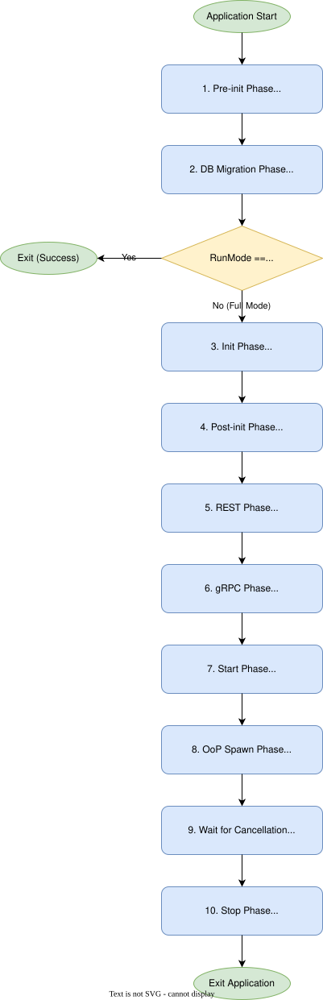

## Capabilities

A gear declares what it needs and what it exposes as **capabilities** in its
`#[toolkit::gear(...)]` attribute:

- `db` — needs a database; implements `DatabaseCapability` (and provides migrations).
- `rest` — exposes a REST API; implements `RestApiCapability`.
- `grpc` — exposes a gRPC service (used by out-of-process gears).
- `stateful` — runs background work with a managed lifecycle.
- `system` — selects the early system startup group; see [the system capability](#the-system-capability).

The runtime discovers every gear at link time (via `inventory`), builds a dependency-ordered
registry from the declared `deps`, and wires the system from those declarations.

### The system capability

The **system gear group** contains gears declaring `system` in `capabilities = [...]`.
Currently only Types Registry, Service Discovery, Cluster and gRPC Hub declare it.
**Core gears** means all gears under `gears/system/`; that directory may be renamed
to `gears/core/` in the future. Most core gears have no `system` capability and run
in the application gear group, including the API Gateway, resolvers and plugins.

The `system` capability means:

1. **Early startup.** The system gear group's lifecycle completes before application
   preparation begins. Hooks run in dependency order within the group.
2. **Availability during GTS admission.** Gears in this group remain running while
   application publications await admission. Refusal or expiry stops the process
   after cleanup, allowing its supervisor to restart it.
3. **Dependency restrictions.** A gear in this group cannot declare `deps` or `consumes`
   on an application gear in the same process.
4. **No managed GTS publication.** A gear in this group cannot declare
   `gts_publication(...)`: it starts before that admission barrier.
5. **Runtime wiring.** The runtime calls `SystemCapability::wire_runtime` with
   `SystemContext` before `Gear::pre_init`. Service Discovery receives the gear
   manager; gRPC Hub receives the installer store and process instance ID.
6. **Shutdown ordering.** Gears in this group stop after the application gear group, in reverse
   dependency order within their group. Only gears whose `start` was called are stopped.

System gRPC services can serve during application preparation. Both embedded and OoP
hosts bind framework probes before gear startup, then serve system platform and
anonymous routes during application preparation. Tenant operations become available
once application routes and tenant authentication are installed.

The legacy registry also uses the temporary
`legacy_finalize_after_application_init` hook, after application `init` and client
wiring. It will be removed with the legacy in-memory ready mode.

## The lifecycle

The runtime (`HostRuntime`) drives gears in two groups. The **system gear group** — gears
with the `system` capability — runs its whole startup first; the **application gear group** (every
other gear) follows. Each group runs the same ordered phases, every gear's hooks once, in
dependency order:

```text
system gear group:      pre_init → DB migration → init → client wiring → post_init → gRPC → start
application gear group: pre_init → DB migration → GTS publication (admission barrier) → init
                        → client wiring → post_init → REST/gRPC → start
                        → OoP spawn → wait for cancellation → stop (application gear group, then system gear group)
```

- **`pre_init`** — optional hook of any gear before its group's migrations run.
- **DB migration** — gear-owned migrations executed by the runtime (gears with `db` capability).
- **GTS publication** — the GTS types and instances application gears declare with `gts_publication(...)`
  are published concurrently and admitted before any application `init`.
- **`init`** — build the gear's own services and register its own SDK implementation in the
  `ClientHub`. Ordinary consumed clients are wired only after every `init` of the group, so
  keep handles for lazy use (or resolve them in `post_init`) rather than calling another gear.
- **`post_init`** — optional hook of any gear; a **barrier** within its group: it begins only
  after every `init` of the group completed and its consumed clients are wired.
- **REST / gRPC wiring** — routes and gRPC services are registered. The API Gateway
  serves probes and system platform routes during preparation, then the full
  authenticated API on the same listener after application initialization.
- **`start`** — background work starts for stateful gears.
- **`OoP spawn`** — out-of-process gears are spawned after the parent has completed
  application startup and advertised its REST endpoints. Parent GTS publication must use
  a local or already available external registry and must not depend on its children.
- **Wait for cancellation** — the runtime blocks until a cancellation signal is received
  (Ctrl-C, SIGTERM, or programmatic).
- **`stop`** — shutdown runs in **reverse dependency order** with a platform deadline.
  Cancellation tokens propagate so background tasks cooperate with shutdown rather than
  outliving the host.

This gives every gear one predictable operational model — stable ordering, shared
cancellation semantics, and consistent startup/shutdown — instead of ad-hoc lifecycle code.



## Async boundaries

Gears are async Rust. The framework keeps async correctness enforceable at compile time:
strict Clippy rules (e.g. `await_holding_lock`, `await_holding_refcell_ref`,
`async_yields_async`) are denied across the workspace, so an entire class of async bugs is
caught in CI rather than in production. Background tasks are cancellation-aware and bounded
by the shutdown deadline (see the lifecycle above).

## The cluster plane

For multi-instance deployments the Cluster core gear exposes three coordination primitives behind
stable contracts — **distributed cache**, **leader election**, and **distributed locks** —
where a consumer declares what it needs and the platform resolves it against an
operator-selected backend.

Cluster has the `system` capability, so its configured backends start before application
preparation. Applications consume its SDK contracts after system startup.
