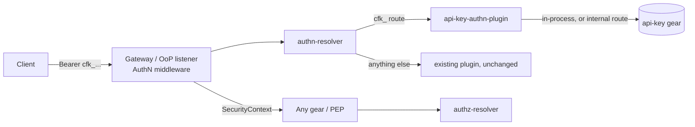
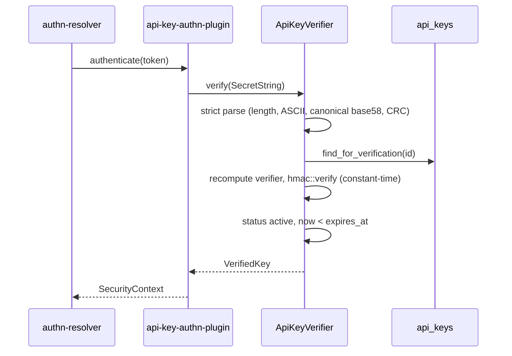

Updated: 2026-11-17 by Constructor Tech

# Intent — API Key Gear (`api-key`)

> **Free-format intent document.** This `INTENT.md` is automatically invalidated when the upcoming `PRD.md` and `DESIGN.md` documents are added.

**Status**: Draft. Once agreed, this proposal will be split into `PRD.md`, `DESIGN.md` and ADRs. Phases: p1 is the demo scope; p2 is the production MVP and must close the §10 risks marked p2; p3–p5 are enhancements.

<!-- toc -->

- [1. Summary](#1-summary)
- [2. P1 scope](#2-p1-scope)
- [3. Architecture](#3-architecture)
- [4. Authentication with an API key](#4-authentication-with-an-api-key)
- [5. Keys and storage](#5-keys-and-storage)
- [6. Management API](#6-management-api)
- [7. Non-functional requirements](#7-non-functional-requirements)
- [8. Configuration](#8-configuration)
- [9. Implementation plan](#9-implementation-plan)
- [10. P1 risks and how later phases address them](#10-p1-risks-and-how-later-phases-address-them)
- [11. Later phases (ideas only)](#11-later-phases-ideas-only)
- [Appendix A. Comparison with Ory Talos](#appendix-a-comparison-with-ory-talos)

<!-- /toc -->

## 1. Summary

`api-key` lets a user create long-lived, revocable API keys that authenticate **as that user**. Clients send `Authorization: Bearer cfk_…` to any authenticated endpoint, and the platform turns it into the owner's normal `SecurityContext`. **No consuming gear code changes**: OoP binaries only link the plugin and add config (§3), and gears that forward the caller's bearer token are the exception (§10).

The design has three parts:

- **API**: create, list, get and revoke keys at `/api-key/v1/keys`.
- **Auth**: a new AuthN plugin, with prefix routing in `authn-resolver`.
- **Storage**: the plaintext key is never stored. The DB holds a bound, peppered HMAC verifier, so someone who reads or even writes the DB can't use, mint, re-target or revive a key.

## 2. P1 scope

| In p1 | Not in p1 (see §11) |
|---|---|
| Create a key (secret returned once) | Custom scopes per key |
| Expiration: required, default 30d, max 365d | Rotation, rename |
| List and get key metadata | JWT exchange |
| Revoke (irreversible) | Keys for service accounts; admin access to other users' keys |
| Use a key on every authenticated endpoint | Bulk revoke, deprovisioning hooks, purge |
| Embedded and OoP deployments (profiles 1–3; OoP hardening in p2) | Import, IP allowlist, metadata |
| Fixed key prefix `cfk_` | Per-vendor key prefix; rate limits, cache, `last_used_at`, CLI |
| Secure storage on SQLite, PostgreSQL and MySQL | `Idempotency-Key` |

## 3. Architecture

```text
gears/api-key/
├── api-key-sdk/                  # ApiKeyVerifier trait, VerifiedKey, errors, remote verifier client
├── api-key/                      # gear: REST, domain (format, crypto, service), infra (SeaORM, migrations)
└── plugins/api-key-authn-plugin/ # ApiKeyVerifier → AuthNResolverPluginClient
```

- **`api-key` gear**:
  - capabilities `[db, rest]`, deps `[types_registry, authz_resolver]`;
  - registers **only** `dyn ApiKeyVerifier` in ClientHub. Management is REST-only, so the HTTP-level create checks (§6.2) can't be bypassed in-process;
  - serves the same verifier to other processes on an internal route (§4.3). It is the only process that holds the DB and the pepper.
- **`api-key-authn-plugin`**: a thin crate with no storage, needed wherever `authn-resolver` runs, because ADR-0008 re-validates on every hop. AuthN plugins are chosen at build time, so it must be linked into every such binary (the embedded host, Flight Control and each OoP server binary), and each one's config needs the `cfk_` route (§8). It registers an AuthN plugin instance claiming the fixed prefix `cfk_` (§5.1) and calls the local `ApiKeyVerifier` if the gear is in-process, otherwise the remote client.



## 4. Authentication with an API key

### 4.1 Prefix routing in `authn-resolver`

Today the resolver uses exactly one plugin: the one with the lowest priority for the configured vendor. A second plugin would be ignored or would replace OIDC. P1 adds routing:

- Plugins may declare `token_prefixes` in `AuthNResolverPluginSpecV1`. This is a new, optional property.
- A route is active only if **the resolver's own config** lists it in `prefix_routes` (prefix → GTS instance id), **and** the instance claims that prefix, **and** the instance has the resolver's vendor. Claiming a prefix alone does nothing, so no plugin can capture other plugins' tokens, for example by claiming `ey` to get every JWT.
- Prefix syntax is `^[a-z][a-z0-9]{1,15}(_[a-z0-9]+)*_$`. It can never match a JWT, which starts with `eyJ`.
- **A routed prefix goes only to its plugin, with no fallback.** A bad key is a plain `401` and never reaches OIDC or an external IdP.
- **Reserved prefixes.** The resolver always reserves `cfk_` through a code constant, a plain string with no dependency on api-key. Config can't remove it: `additional_reserved_prefixes` can only add prefixes, which pass the same syntax check, and the effective set is the built-in set plus the additions. A token with a reserved prefix but no enabled route gets `401` and never reaches the default plugin, so a binary without the `cfk_` route still can't leak keys to an IdP that introspects opaque tokens.
- A misconfigured route (overlapping prefixes, or a missing or wrong-vendor instance) fails closed with `503`, but only for that prefix.
- Other tokens go to the default plugin, chosen exactly as today among instances without routes.
- `exchange_client_credentials` always goes to the default plugin.

### 4.2 Verification



- **Uniform failure.** Every failure returns the same `Unauthorized`. Internally it carries only a fixed reason code (`malformed`, `unknown`, `mismatch`, `revoked`, `expired`); the token never appears in errors or logs.
- **Fail closed.** If the DB or, for remote callers, the api-key gear is unreachable, verification returns `503`; it never allows the request.
- **One fenced unscoped read.** Verification happens before any `SecurityContext` exists, so it reads without an `AccessScope`. `find_for_verification(id)` is the gear's only such read:
  - PK only, no filters;
  - `pub(crate)`, with a single call site;
  - its SQL shape is pinned by a test.
- **Identity produced** (the `SecurityContext` fields):
  - `subject_id` = owner;
  - `subject_tenant_id` = the key's tenant;
  - `subject_type` = owner type;
  - `token_scopes` = `["*"]`;
  - `bearer_token` = `None`, so the raw key is never handed to the PDP;
  - `auth_method` = `api_key` and `key_id` = the key's id. These are new optional `SecurityContext` fields. Only this plugin sets `api_key`, and other plugins leave the method unspecified. Any gear can use them to reject API keys on sensitive operations.
- **Permissions stay live.** The PDP evaluates the owner's permissions on every request, so role changes apply immediately.
- **Tenant, same as a JWT.** The subject tenant comes only from the key. The target tenant comes from the request through the PEP, and the PDP decides, so a tenant-A key against tenant-B resources gets the same answer as the owner's JWT. The platform has no host- or subdomain-based tenant selection.

### 4.3 Remote verification

The plugin in a process without the api-key gear calls `POST /api-key/v1/internal/verify`:

- **Platform plane only.** The route uses `platform_authenticated()`: only a valid `X-ToolKit-Internal-Token` (ADR-0006) admits it, a bearer alone is refused, and discovery excludes it.
- **Requires `internal_auth`** on the api-key host and on every caller: `provider: shared_secret` in Profile 2 (bootstrap tokens aren't implemented yet), `kube` in Profile 3. Without it the route answers `401`, so keys fail closed in remote processes.
- **Key in the body only**, never in the URL, and the body is never logged. A 256-byte body cap is p2 hardening (§11).
- **Transport is platform-owned** (ADR-0006), with no TLS stack in this gear. P1 adds no confidentiality guarantee beyond the platform's: UDS or loopback in Profile 2 single-node, and in Profile 3 whatever the cluster provides, which Kubernetes doesn't encrypt by default. This is acceptable only for the p1 demo with test tenants. Multi-node Profile 2 over plain TCP is not supported. Encrypted internal transport is a p2 deployment prerequisite (§10).
- **Same contract as local.** The reply is a `VerifiedKey` or the uniform `Unauthorized` (§4.2), never a reason code.
- The client is the generated `ApiKeyVerifier` remote client, so the plugin code is the same in every process.

## 5. Keys and storage

### 5.1 Key format

```text
cfk_2Xk9pQ7vRmT4wYbN8cLfHs_7hG3kPq9XwLmN2vB8sD4fJ6tY1rE5uA9cZ3xK7mQhdT9pa4Wz8
cfk_{key_id: 22, padded base58 UUIDv7}_{secret: 44, padded base58 of 32 CSPRNG bytes}{crc: 6, padded base58 CRC32}
```

- **Prefix** `cfk_` is a code constant shared by the gear (verifier and create rules) and the plugin. Only the resolver route is configured, and a wrong route fails closed with `503`.
- `key_id` is public: it's the DB primary key and is safe in logs and UIs. The UI shows `cfk_2Xk9pQ7v…`, and no part of the secret is ever stored or shown.
- `crc` is not a security control. It rejects typos before the DB read and lets secret scanners validate a leaked key offline. It is the CRC32 (IEEE) of the ASCII string `cfk_{key_id}_{secret}`, encoded as 4 big-endian bytes.
- **Fixed width.** Plain base58 is variable-length (a 2026 UUIDv7 encodes to 21 chars, 32 random bytes to 43–44, a CRC32 to 5–6), so each field is left-padded with `1`, the base58 zero digit, to 22, 44 and 6 chars. These are the maximum widths, so every key is exactly 77 bytes.
- **Strict parsing**, done before any DB access:
  - reject anything over 96 bytes or not ASCII;
  - parse fixed-width segments only;
  - decode each segment as a fixed-width big-endian integer into exactly 16, 32 or 4 bytes. `bs58::decode` alone is not enough, because it turns leading `1`s into extra zero bytes;
  - accept only the padded form, so each key has exactly one textual form.
- **Bearer header only.** Keys are accepted only in `Authorization: Bearer`, never in a query string, cookie or body.
- **No new crates.** `bs58` and `crc32fast` are already in `Cargo.lock` and get promoted to workspace dependencies.

### 5.2 Verifier

```text
mac_key  = HKDF-SHA256(pepper[pepper_id], info = "cf.api-key/verifier/v1")
verifier = HMAC-SHA256(mac_key, encode("cf.api-key.v1",
             key_id, tenant_id, owner_id, owner_type, scopes, expires_at, secret))
```

| Attacker can… | Result |
|---|---|
| Read the DB | No usable key. The secret is never stored, and the verifier is useless without the pepper |
| Write the DB, without the pepper | Can't mint a key, swap verifiers, re-point a key to another owner or tenant, widen its scopes or extend its expiry: every bound field breaks the MAC. Can't un-revoke, because revoke overwrites the verifier with a sentinel |
| Steal the pepper, without the DB | Nothing: forging a key also needs a matching row |
| Guess or time keys online | 256-bit secret; constant-time `hmac::verify` in the app, never in SQL |

- **Immutable fields.** All bound fields are fixed at creation.
- **Canonical encoding.**
  - UUIDs as 16 raw bytes;
  - `expires_at` as big-endian i64 Unix seconds. It is truncated to whole UTC seconds once, at creation, before both the MAC and the insert, so every DB stores and returns exactly the MAC input whatever its native precision;
  - variable fields length-prefixed;
  - scopes sorted and deduplicated.
- **Primitives.** HKDF and HMAC come from `aws-lc-rs`, which is already a workspace dependency and keeps the build FIPS-compatible. Secrets come from the OS CSPRNG.

**Pepper rules.**

- **Source:** ≥32 random bytes, base64-encoded, from an env var read through `config_expanded`. It must **never** be stored in the `api_keys` DB.
- **In memory:** held as `SecretString` (redacted in `Debug`) and never logged.
- **Startup fails if:**
  - a pepper decodes to fewer than 32 bytes, is uniform (all one byte value) or is duplicated;
  - no pepper is configured.
- **Rotation:**
  1. Add a new `current` pepper.
  2. Keep the old one until its keys expire (≤ `max_ttl`).
  3. Then remove it.

  A key whose `pepper_id` is not configured fails verification, so removing a pepper early is the emergency kill switch for every key made with it.

### 5.3 Table `api_keys`

| Column | Type | Notes |
|---|---|---|
| `id` | UUID PK | Equals the wire `key_id` |
| `tenant_id`, `owner_id` | UUID | `Scopable` tenant and owner columns; bound |
| `owner_type` | VARCHAR(255) | Bound |
| `name` | VARCHAR(100) | 1–100 printable characters |
| `verifier` | CHAR(64) | Hex; a sentinel after revoke |
| `pepper_id` | SMALLINT | — |
| `scopes` | TEXT | Canonical JSON `["*"]`; bound; already there for p2 |
| `status` | SMALLINT | active / revoked. Expired is computed at read time |
| `expires_at` | TIMESTAMP | Required; bound |
| `revoked_at`, `revoked_by`, `revocation_reason` | NULL columns | — |
| `created_at`, `updated_at` | TIMESTAMP | — |

Index: `(tenant_id, owner_id, status, created_at DESC, id DESC)`.

## 6. Management API

### 6.1 Endpoints

| Method and path | PDP action | Result |
|---|---|---|
| `POST /api-key/v1/keys` `{ name, ttl? \| expires_at? }` | `create` | `201`, body includes `secret` **once** |
| `GET /api-key/v1/keys` | `list` | Metadata only, never secret or verifier. Cursor pagination, `$filter` on `status`, `expires_at`, `owner_id` |
| `GET /api-key/v1/keys/{id}` | `get` | Metadata (prefetch pattern) |
| `POST /api-key/v1/keys/{id}/revoke` `{ reason? }` | `revoke` | `200`, idempotent |

- **No caching.** Every response sets `Cache-Control: no-store`.
- **Bounded bodies.** Management request bodies are capped at 4 KB.
- **Create is never repeated.** There is no `Idempotency-Key` in p1, and OpenAPI documents create as non-idempotent so clients don't auto-retry it. No layer ever has a reason to persist the response containing the secret.
- **Errors:**
  - `InvalidArgument`: bad `name` or TTL.
  - `NotFound`: also used for out-of-scope ids, so the response is not an existence oracle.
  - `PermissionDenied`: a PDP denial or a failed create rule (§6.2).
  - `ResourceExhausted`: more than 20 active keys per owner. A key counts as active when `status = active AND expires_at > now`, so expired keys never block new ones.

```json
201 Created
Cache-Control: no-store

{ "id": "0193a5c2-…", "name": "ci-pipeline", "prefix": "cfk_", "status": "active",
  "scopes": ["*"], "created_at": "2026-11-17T10:00:00Z", "expires_at": "2026-12-17T10:00:00Z",
  "secret": "cfk_2Xk9pQ7vRmT4wYbN8cLfHs_7hG3k…hdT9pa4Wz8" }
```

### 6.2 Authorization rules

- **PDP resource and policy.**
  - Resource: `gts.cf.core.api_key.api_key.v1~` (`owner_tenant_id`, `id`, `owner_id`).
  - **Owner-only, enforced by the gear.** The shipped PDP plugins emit tenant constraints only, so list, get and revoke also add `owner_id = subject_id` to the scope, and create takes the tenant and owner from the caller, never the request. Without this, any user could see and revoke every key in the tenant.
  - There is no tenant-admin access to other users' keys in p1 (§10).
- **API-key detection** reads `auth_method` and `key_id` from `SecurityContext` (§4.2), never from headers, so it is the same on the gateway and on OoP listeners.
- **Create rules**, checked by the gear before the PDP call. Each failure returns `PermissionDenied`:

| Rule | Prevents |
|---|---|
| The caller is not an API key | A leaked key minting replacements and surviving its own revocation |
| The caller's `token_scopes` is exactly `["*"]` (first-party session) | A third-party app with a narrow token creating a full-power key |
| The caller is not anonymous, and `subject_type` is in `allowed_owner_types` (default: user, as both the GTS id and the bare `user` that Keycloak emits) | Service-to-service or guest identities turning short-lived tokens into long-lived keys, as far as `subject_type` tells them apart (§10) |

- **API-key callers** may list and get. They may revoke **only themselves**, so a leaked key can kill itself but not its owner's other keys.
- **Audit.** `api_key.created` and `api_key.revoked` are written as structured logs with `key_id`, `owner_id`, the actor, its credential kind and the reason. They never include the secret or verifier.

## 7. Non-functional requirements

| Area | Requirement |
|---|---|
| Secrets | The plaintext exists only in the create response. It never appears in logs, traces, metric labels, errors, events or the DB. The middleware never records `Authorization` |
| Tenant isolation | All access goes through `SecureConn`. A key authenticates only into its own tenant. Users see only their own keys |
| Latency | Verify p99 ≤5 ms on top of one PK read, plus one internal hop when the gear is in another process. Verify reads the primary, with no cache and no replica, so revocation is immediate |
| Availability | Fail closed. Other credential types never depend on this gear |
| Portability | Identical SeaORM migrations on SQLite, PostgreSQL and MySQL; no JSON operators |
| Limits | 20 active (unrevoked and unexpired) keys per owner, TTL default 30d and max 365d, no non-expiring keys. The per-owner limit is checked in the create transaction; a slight overshoot under concurrency is acceptable |

## 8. Configuration

```yaml
oop_http:                                                # every OoP process (gateway `internal_auth` when embedded)
  internal_auth: { provider: shared_secret }             # Profile 2, secret from APP__OOP_HTTP__INTERNAL_AUTH__SECRET; `kube` in Profile 3
gears:
  api-key:
    config:
      ttl: { default: "30d", max: "365d" }
      max_active_keys_per_owner: 20
      allowed_owner_types: ["gts.cf.core.security.subject_user.v1~", "user"]
      verifier:
        current_pepper_id: 1
        peppers:
          - { id: 1, secret: "${API_KEY_PEPPER_1}" }   # base64 of ≥32 random bytes
  api-key-authn-plugin:                                  # in every process running authn-resolver
    config: { vendor: "constructorfabric" }
  authn-resolver:
    config:
      vendor: "constructorfabric"
      prefix_routes: { "cfk_": "<api-key-authn-plugin GTS instance id>" }
      additional_reserved_prefixes: []                     # `cfk_` is always reserved
  oidc-authn-plugin:                                     # existing config, a prerequisite
    config:
      jwt:
        first_party_clients: ["platform-portal", "platform-cli"]   # clients whose users may create keys
```

**Prerequisite.** Create requires `token_scopes = ["*"]` (§6.2), and the OIDC plugin grants `["*"]` only to clients listed in `jwt.first_party_clients`. If the portal or CLI client a user signs in with isn't listed, every create returns `PermissionDenied`.

## 9. Implementation plan

The estimates assume one engineer who already knows ToolKit. Each task includes its own tests.

| # | Task | Scope | Depends on | Complexity | Prod / test LOC | Man-days |
|---|---|---|---|---|---|---|
| T1 | Prefix routing in `authn-resolver` | Spec property and `prefix_routes` config; allowlist, vendor, syntax and overlap checks; no fallback; `503` only for a broken prefix; built-in reserved `cfk_` plus `additional_reserved_prefixes`, `401` when unrouted, and a test that empty additions still reserve `cfk_`. Short ADR | — | Medium | 280 / 400 | 3 |
| T2 | `api-key-sdk` | `ApiKeyVerifier`, `VerifiedKey`, errors with fixed reason codes | — | Low | 150 / 50 | 0.5 |
| T3 | Key format and crypto | Generation; strict parser; canonical encoding; HKDF and HMAC verifier; `hmac::verify`; pepper validation. Tests: proptest, padded round-trip of edge values (0, 1, max) per field, tamper tests for each bound field, a parser fuzz target (`.clusterfuzzlite`) | T2 | Medium, security-critical | 350 / 450 | 3 |
| T4 | Persistence | `Scopable` entity; migration for 3 DBs; scoped create, list, get and revoke (status change + verifier wipe); fenced `find_for_verification`. Tested on all 3 DBs via `test-containers`, including a create → read → verify round-trip of `expires_at` | T3 | Medium | 350 / 350 | 2.5 |
| T5 | Service and authorization | PEP resource and actions, permission GTS instances; owner-only scope on list, get and revoke; create rules using `auth_method`; TTL, name and limit checks; self-only revoke via `key_id`; audit events; `ApiKeyVerifier` implementation | T4, T15 | Medium–High | 520 / 600 | 3.5 |
| T6 | REST layer | `OperationBuilder` routes, DTOs (never expose the verifier), OpenAPI, `no-store`, 4 KB body cap, non-idempotent create, error mapping | T5 | Low–Medium | 300 / 250 | 2 |
| T7 | Gear wiring | `gear.rs`; config with `SecretString`; startup pepper checks; ClientHub registration | T3, T4 | Low | 200 / 150 | 1 |
| T8 | `api-key-authn-plugin` | GTS registration; `VerifiedKey` → `SecurityContext` (`bearer_token = None`, `auth_method = api_key`, `key_id`); error mapping | T1, T2, T15 | Low | 250 / 250 | 1.5 |
| T9 | Leak tests | Log and span capture through the gateway: no key, verifier, pepper or `Authorization` anywhere. OoP listener and internal route are p2 | T6, T8 | Low | 30 / 100 | 0.5 |
| T10 | E2E (pytest) | Create → use → revoke → `401`; routing isolation; each create rule; self-only revoke; cross-user and tenant isolation, including a tenant-A key against tenant-B resources; reserved prefix without a route → `401`; expiry. Profiles 1 and 2 with keys used on an OoP gear; SQLite and PostgreSQL | T6–T8, T13, T14 | Medium | — / 600 (Python) | 3 |
| T11 | Docs | PRD, DESIGN, ADRs (routing, storage, remote verification, credential kind); ops runbook for pepper generation, rotation, kill switch and DB revoke | parallel | Low | — | 1.5 |
| T12 | Security review | Review of T1, T3, T5, T8 and T15; `cargo deny` with the FIPS profile; fuzz run; fixes. Remote verification is reviewed in p2 | all | Medium | — | 1.5 |
| T13 | Remote verification | Internal `verify` route (`platform_authenticated()`, body-only key, uniform reply); generated remote `ApiKeyVerifier` client; plugin picks local or remote. Body cap and gear-level negative tests are p2 | T5, T7, T8 | Medium | 220 / 200 | 2 |
| T14 | OoP packaging | Link `api-key-authn-plugin` (as a feature) into Flight Control and each OoP server binary; `cfk_` route and `internal_auth` in their deploy and e2e configs | T8 | Low | 100 / 50 | 1 |
| T15 | Credential kind in `SecurityContext` | `toolkit-security`: optional `auth_method` (non-exhaustive enum, unspecified by default) and `key_id`, with builder and accessors; `serde(default)`, so in-process metadata stays compatible; no change for existing plugins | — | Low–Medium | 120 / 150 | 1 |

| Totals | |
|---|---|
| Code | ~2,870 prod Rust + ~3,000 test Rust + ~600 Python ≈ **6,470 LOC** |
| Effort | **~27.5 man-days**, ~33 with contingency |
| Critical path | T2 → T3 → T4 → T5 → T13 → T10 → T12, ~16 man-days |
| Parallel track | T15 → T1 → T8 → T14, can start on day 1. Get the `SecurityContext` change reviewed first, since every gear compiles against it. Get the routing ADR reviewed early, since it touches a system gear |
| Calendar | 1 engineer ~6.5 weeks; 2 engineers ~4 weeks |

## 10. P1 risks and how later phases address them

P1 is for the initial demo only: test tenants, no real data. Rotating the pepper at the p2 cutover invalidates every p1 key.

| Risk in p1 | P1 containment | Addressed in |
|---|---|---|
| **SEC-01, credential kind.** The PDP and the gateway don't see that the caller is an API key | `auth_method` and `key_id` are in `SecurityContext` (§4.2), so gears and the create rules can reject keys | **p2**: credential kind in the PDP and gateway context |
| **SEC-02, unrestricted keys.** Every key has `["*"]` and its owner's full power, including sensitive admin operations | Created only from first-party user sessions; 30d default TTL; audit events | **p2**: custom scopes per key, where the effective permission is the owner's PDP decision AND the key's scopes; sensitive actions deny API keys by default |
| **SEC-03, stale identity.** Keys keep working until expiry for a disabled or deleted owner, an owner removed from the tenant, or a suspended tenant. Verify reads only the key row | Ops DB revoke runbook; live PDP evaluation | **p2**: owner, membership and tenant status checked on verify; **p3**: auto-revoke on deprovision events; bulk revoke by owner |
| **SEC-05, weak issuance check.** `["*"]` and `subject_type` don't prove a recent interactive login. A stolen session, or a service token with a user `subject_type` claim from a first-party client, can create a full-power key that survives logout, password reset and session revocation | Not the default IdP setup; the owner can see and revoke; audit events | **p2**: the IdP plugin sets a trusted interactive-login marker and `auth_time` in `SecurityContext` (`amr` is only an input to the marker); create requires both, with `auth_time` no older than a configured limit; notify the owner; lower `max_ttl` |
| No tenant-admin access: an admin can't list or revoke another user's keys | Ops DB revoke runbook; pepper kill switch | **p2**: owner- and role-aware PDP policy replaces the gear-side owner scope |
| Gears that forward `ctx.bearer_token()` downstream (e.g. products catalog client, event-broker SDK) call out unauthenticated for API-key callers | Fails closed with a downstream `401`; the demo avoids those flows | **p2**: JWT exchange gives them a forwardable token that keeps the API-key identity (§11); never fall back to service credentials |
| The long-lived key reaches every internal hop (`Authorization` is forwarded to OoP gears), and each hop re-verifies it over the internal route | `Authorization` and the verify body are never logged (by design; T9 tests the gateway in p1); the route needs a platform-plane token. With `shared_secret` (Profile 2) any holder of that one secret can call it, but still needs a valid key to get an identity back | **p2**: exchange the key for a short-lived JWT at the gateway, so OoP hops never see or verify the key; per-workload platform identity (`kube`, mTLS) instead of a shared secret |
| Internal transport isn't guaranteed to be encrypted. Kubernetes doesn't encrypt pod-to-pod traffic by default, so in Profile 3 the forwarded key and the verify body may cross the network in clear text, like every forwarded JWT today | Test tenants only; Profile 2 single-node uses UDS or loopback; multi-node Profile 2 over plain TCP is not supported | **p2**: deployment prerequisite of encrypted internal transport (service-mesh mTLS, CNI encryption, or ADR-0006's mTLS phase) |
| The OoP path works but isn't hardened: no body cap on the internal route, no gear-level negative tests, no leak tests through OoP listeners, no Profile 3 E2E, and no security review of remote verification | Fails closed; the route is platform-plane only; test tenants only | **p2**: OoP hardening (§11) |
| Key usage isn't auditable: no per-key auth events, `last_used_at` or source IP, and other gears can't attribute actions to a key | The gear's own create and revoke logs | **p2**: per-key auth success and failure events, `last_used_at`; **p3**: ADR-0005 `VerifiedPrincipal`, full audit pipeline |
| Pepper exposure: it sits in an env var (`/proc/*/environ`, crash dumps), and pepper plus DB write mints keys for anyone. Removing it by mistake silently kills its keys | Startup checks; removal as the kill switch | **p2**: pepper in credstore/KMS with rotation tooling and a retired-vs-missing check |
| DB load from well-formed fake keys. Brute force is infeasible with 256-bit secrets, but each attempt costs a DB read. Gateway throttling is opt-in per operation, and an operation bound to an identity-keyed zone has no pre-auth limit, so failed authentications aren't limited gateway-wide | One PK read per attempt; demo traffic only | **p2**: deployment prerequisite of a per-IP rate limit at the edge; **p3**: verification and negative cache; failure rate limits |
| A lost create response can't be recovered | Create a new key and revoke the orphan | **p3**: dedup-only `Idempotency-Key` that never returns the secret |
| No self-service rotation | Create the new key, deploy it, then revoke the old one | **p3**: `rotate` with a grace period |
| Restoring a pre-revocation DB snapshot revives a key | Needs DB write access plus an old snapshot; bounded by `max_ttl` | **p4**: a revocation epoch stored outside the DB |

## 11. Later phases (ideas only)

- **p2** (production MVP; closes every §10 risk marked p2):
  - credential kind in the PDP and gateway context (SEC-01);
  - custom scopes, a subset of the creator's and bound into the verifier; sensitive actions deny API keys by default (SEC-02). The effective permission is the owner's PDP decision AND the key's scopes. Key scopes are carried in `token_scopes`, so both the gateway route policies and the PDP enforce them. Unknown scopes are rejected at create. Tests show that a key can't exceed its scopes even when its owner can. The scope format is defined in DESIGN;
  - owner, membership and tenant status check on verify (SEC-03);
  - trusted interactive-login marker and fresh `auth_time` required on create, owner notification, lower `max_ttl` (SEC-05);
  - owner- and role-aware PDP policy, with tenant-admin list and revoke;
  - JWT exchange plus JWKS at the gateway. The exchanged JWT carries signed claims for credential kind, `key_id`, tenant and effective scopes, and the JWT plugin maps them back to `auth_method = api_key` and `key_id`. An exchanged JWT is never a new interactive login, so the create rules still reject it. Without this, a leaked key could be exchanged for a JWT that passes the create rules and mints a key that survives the original's revocation. DESIGN defines the trust boundary: the issuer, the audience, and how these JWTs differ from OIDC tokens. Only the gateway's own issuer may set these claims, and IdP claims never map to `auth_method` or `key_id`;
  - a revocation SLA equal to the exchanged JWT's TTL (≤5 min): a revoked key's already-issued JWTs stay valid until they expire;
  - per-key auth audit events and `last_used_at`;
  - pepper in credstore/KMS;
  - per-workload platform identity for the internal route;
  - OoP hardening: a 256-byte body cap on the internal route; tests that a bearer alone or a missing internal token is refused; leak tests through an OoP listener and the internal route; Profile 3 E2E; security review of remote verification;
  - deployment prerequisites: encrypted internal transport and a per-IP rate limit at the edge.
- **p3** (operations):
  - rotation with a grace period;
  - rename;
  - deprovisioning hooks and bulk revoke;
  - purge of old rows;
  - `VerifiedPrincipal` and a full audit pipeline;
  - dedup `Idempotency-Key`;
  - verification and negative cache;
  - failure rate limits via `quota-enforcement`.
- **p4** (reach):
  - service-account keys;
  - per-vendor key prefix, one config value that the gear owns;
  - IP allowlist (needs client IP in the AuthN contract);
  - metadata;
  - CLI;
  - revocation epoch outside the DB;
  - self-revoke by proof of possession.
- **p5** (migration and compatibility):
  - import and bulk import;
  - `X-API-Key` alias.

## Appendix A. Comparison with Ory Talos

[Ory Talos](https://github.com/ory/talos) (local copy in `.talos/`, checked at commit `8d8d26f`) is a standalone API-key server. We adopt its good ideas and fix its weak points. Statements below are taken from its code, not only its docs, because the two disagree in places.

**How a Talos key works.** An issued key is `{prefix}_v1_{identifier}_{checksum}`:

- `identifier` is base58 of the ASCII string `"{unix_seconds}:{uuid_v4}"`, and the UUID is the DB key id (`internal/crypto/keys.go`);
- `checksum` is `HMAC-SHA256(secrets.hmac.current, "{prefix}_v1_{identifier}_")`.

The key has no random secret of its own: it is fully determined by the public key id, a timestamp, the prefix and one server-wide HMAC secret. Verify checks the checksum against the current and every retired secret, checks the timestamp against `max_ttl`, checks the prefix allowlist, then reads the row by key id and checks `status` and `expires_at` (`internal/verifier/verifier.go`). `issued_api_keys` stores no hash or verifier at all, even though the Talos docs say "only a hash remains".

**Adopted.**

- A recognizable prefix and a public key id embedded in the key, so verification is one primary-key read.
- A fast HMAC-SHA256 keyed by a secret held outside the DB, instead of bcrypt or argon2. Keys are high-entropy, so slow hashing buys nothing (Talos's "Why HMAC over bcrypt").
- Current and retired secrets for rotation without downtime. Talos tries every secret on each verify. We store `pepper_id` on the row and pick the pepper directly.
- Expiry checked against `expires_at` at read time, with no background job. Talos does this only in verify: its get and list keep returning the stored `ACTIVE` status for an expired key.
- Irreversible revocation with a reason. Talos uses a reason enum plus free text.
- Hiding why verification failed, taken further. Talos maps malformed, wrong-checksum, wrong-prefix, out-of-range-timestamp and unknown keys to one `NOT_FOUND`. Revoked and expired keys still get their own `error_code`, as do IP and rate-limit rejections. Here every failure is the same `Unauthorized` on every path, including the internal route (§4.2, §4.3).

**Where this design is stronger.**

| Aspect | Talos | This design | Why it's better |
|---|---|---|---|
| What makes a key valid | An HMAC over public data: the key id, a timestamp and the prefix. There's no per-key secret, and nothing is stored to check it against | A per-key 256-bit random secret, checked against a stored, bound verifier | With Talos, a leaked HMAC secret alone lets an attacker **silently forge a working key for any active key id**. Key ids appear in list responses, logs and audit events. The timestamp is chosen by the attacker and never compared with `created_at`. Here a leaked pepper forges nothing without DB write access, and a DB read doesn't help either |
| Derived tokens | The macaroon root key is derived from that same HMAC secret. Macaroon verify reads no DB, takes actor, scopes and key id from the token, and checks `exp` only if it's present | None in p1. The p2 JWT exchange is verified against a published JWKS | With Talos, the same leaked secret also mints **macaroons for any actor and scopes, with no DB row, that never expire** |
| Metadata integrity | `actor_id`, scopes, `expires_at`, `status` and the CIDR list are plain columns, and the admin API can edit scopes, CIDRs and rate limits after issue | All bound fields are in the MAC and fixed at creation, and revoke overwrites the verifier | With Talos, DB write access lets an attacker re-point a key to another actor, widen its scopes, extend it (up to `max_ttl` from the embedded timestamp, 1 year by default) or un-revoke it by setting `status = 1`. Here every such change fails closed |
| Management access | The admin API has **no built-in authentication** and must sit behind a network boundary or an authenticating proxy. Verify is on the same admin surface | Platform AuthN plus the PDP on every call, and strict create rules. Verify is a separate, platform-plane-only route | With Talos, every service that verifies keys needs network access to an API that can also issue and revoke them. That model needs a trusted network, and a multi-tenant self-service platform doesn't have one |
| Who can create keys | Anyone who can reach the admin API, for any `actor_id` they put in the request body | Only first-party user sessions, and only for the caller. Never API keys or scoped tokens | Blocks a leaked key minting replacement keys, scope escalation and minting keys for other users |
| Tenancy | Commercial edition only. The tenant comes from the request hostname, and OSS is single-tenant | Every row is tenant-scoped via `SecureConn`, and the tenant comes from the caller's `SecurityContext` | Tenant isolation is enforced by the platform, not by deployment |
| Integration | A separate service: your API calls `apiKeys:verify` on every request, or a commercial-only `talos proxy` sidecar with its own cache. Only derived JWTs verify locally, against the JWKS | A native plugin in every process, so every gear accepts keys unchanged | No per-gear integration. A network hop happens only when the api-key gear runs in another process |
| Routing safety | n/a: one service that guesses the type from the format (JWT, macaroon prefix, issued format, otherwise an imported key) | Resolver-owned allowlist, no fallback | A routed key never reaches the IdP (a reserved prefix covers missing routes), and plugins can't capture other plugins' tokens |
| Databases | OSS: SQLite only. PostgreSQL, MySQL and CockroachDB are commercial | SQLite, PostgreSQL and MySQL in p1 | — |

**Not adopted, and lessons for later phases.**

- Imported-key storage. Talos stores `SHA-512/256(nid, 0x00, raw_key)` with no secret key, so a DB leak allows offline guessing of low-entropy imported keys. Import (p5) will use the peppered verifier.
- A rate limiter that fails open. If the Talos (commercial) limiter errors, verify lets the request through.
- Derived tokens outlive their parent. A Talos derived token stays valid until its `exp` (default 1h) after the parent key is revoked. The p2 JWT exchange has the same property, so its TTL (≤5 min) is the revocation SLA (§11).

**Where Talos is ahead today:**

- in OSS: rotation (a new key id, with the old key revoked immediately and no grace period), derived JWTs and macaroons, imported keys (with batch import), custom per-key scopes, metadata, IP allowlists, `last_used_at`, idempotent create (`request_id`; a replay returns metadata without the secret), self-revocation by proof of possession on a public endpoint, publishable ("public visibility") keys, and a CLI;
- in the commercial edition only: verification caching (OSS has only a no-op cache), rate-limit enforcement (OSS stores limits as metadata only) and an edge proxy.

All of these are planned for p2–p5 (§11) except macaroons, publishable keys and the edge proxy. Our rotation (p3) adds the grace period that Talos lacks.