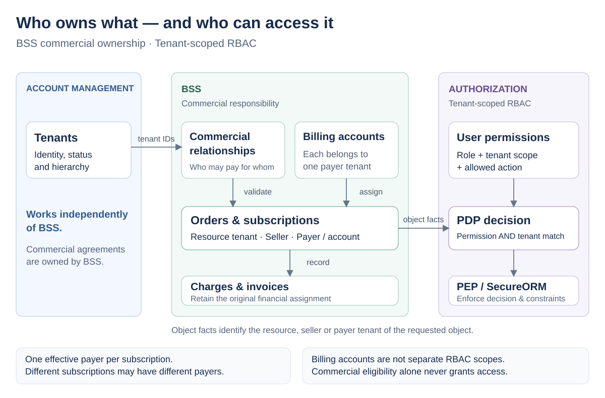

# Keep Commercial Relationships in BSS and Use Tenant-Scoped RBAC

**ID**: `cpt-cf-adr-bss-commercial-ownership-tenant-rbac`

## Table of Contents

- [Context and Problem Statement](#context-and-problem-statement)
- [Decision Drivers](#decision-drivers)
- [Considered Options](#considered-options)
- [Decision Outcome](#decision-outcome)
  - [Consequences](#consequences)
  - [Confirmation](#confirmation)
- [Pros and Cons of the Options](#pros-and-cons-of-the-options)
  - [BSS Ownership with Tenant-Scoped RBAC](#bss-ownership-with-tenant-scoped-rbac)
  - [Commercial Relationships in Account Management](#commercial-relationships-in-account-management)
  - [BSS Ownership with Billing-Account Authorization Scopes](#bss-ownership-with-billing-account-authorization-scopes)
- [More Information](#more-information)
- [Traceability](#traceability)

## Context and Problem Statement

A resource tenant can consume services sold and paid for by different organizations, so organizational ancestry alone cannot describe its commercial relationships. We need to decide who owns those relationships and whether introducing a billing account also requires a new authorization scope. Account Management (AM) must remain usable without BSS, and no confirmed requirement currently demands access isolation between billing accounts belonging to the same payer tenant.

## Decision Drivers

- Preserve the boundary between shared tenant management and BSS business rules.
- Separate commercial eligibility, the actual financial assignment of a service, and a user's authority to perform an action.
- Support different payers and sellers across a resource tenant's subscriptions without changing tenant topology.
- Retain tenant-scoped RBAC role assignments and the platform PDP/PEP enforcement path.
- Introduce billing accounts for financial organization without speculative account-level authorization.
- Preserve financial history when a payer assignment or commercial relationship changes.

## Considered Options

- **BSS ownership with tenant-scoped RBAC:** BSS owns commercial relationships and billing accounts; role assignments remain tenant-scoped.
- **Commercial relationships in Account Management:** AM owns payer and seller relationships consumed by BSS; role assignments remain tenant-scoped.
- **BSS ownership with billing-account authorization scopes:** BSS owns the business entities and users receive roles on individual billing accounts.

## Decision Outcome

Chosen option: **BSS ownership with tenant-scoped RBAC**, because commercial agreements belong to the business domain, while independent permissions for each billing account are not a confirmed requirement. This is an accepted architecture direction, not a claim that the entities or all authorization paths are already implemented.

**Ownership boundary.** AM remains the source of truth for tenant identity, lifecycle, organizational hierarchy, and administrative mode. Its existing identity and generic metadata responsibilities remain intact. BSS owns commercial eligibility between tenants, approval and termination of those relationships, billing accounts, and the financial assignment of orders and subscriptions. AM does not gain payer/seller relationship entities, commercial approval workflows, or a dependency on BSS. Generic AM metadata is not an alternative authoritative store for these agreements.

**Billing account.** A billing account is a BSS business entity associated with one payer tenant. It organizes financial assignments and billing information; it is neither a tenant nor a new RBAC role-assignment scope. A payer tenant can have multiple billing accounts, and one account can serve multiple subscriptions. A subscription has one effective billing assignment at a time; different subscriptions of the same resource tenant can use different accounts and payers. This decision does not introduce splitting a single financial obligation across several payers.

**Commercial relationship.** BSS records whether a named payer may pay for a named resource tenant, independently of their position in the tenant tree. Seller-related eligibility also stays in BSS. An eligible payer is not automatically the payer of every subscription: the actual assignment belongs to the individual purchase/subscription and its financial facts. Commercial eligibility is not a user permission and must not itself grant access or authorize a caller to commit another tenant's money.

**Authorization.** No new billing-account or seller-specific role-assignment scope is introduced. RBAC roles grant actions within tenant scopes. For a BSS object, authorization evaluates the role's action permission together with the object's authoritative resource-tenant, seller-tenant, or payer-tenant relationship. Each access path must be completely authorized; the existence of a business relationship alone is insufficient. Multiple allowed paths may be combined for the same action only while preserving all platform restrictions and applicable data constraints.

| User and tenant scope | Intended access, subject to explicitly granted permissions | No automatic access to |
|---|---|---|
| Customer employee in the resource tenant | The customer's orders and subscriptions, including services paid for by another tenant | Another payer's unrelated billing data or spending authority |
| Seller operator in the seller tenant | Orders and subscriptions sold by that seller, for the actions permitted to that role | Customer VMs, service administration, or another seller's sales |
| Finance employee in the payer tenant | That payer's billing accounts, charges, invoices, and permitted details of related orders/subscriptions | All services of a resource tenant or resource administration |

The payer path spans billing accounts associated with that payer tenant, subject to the role's action permissions. Account labels, reporting filters, and separate invoice groupings do not provide confidentiality boundaries between those accounts. Any hierarchy-derived access still follows the existing platform policies; this decision grants no blanket access to ancestors or platform roles.

**Enforcement boundary.** BSS supplies trusted object relationships and performs commercial checks. The PDP evaluates user authorization through `PolicyEnforcer`; the PEP and SecureORM enforce the returned constraints. This ADR does not authorize a second business-owned permission engine, manually constructed `AccessScope`, or filtering unauthorized rows only after loading a collection. The detailed mapping of the three tenant relationships to PDP constraints remains a design responsibility; tenant-scoped assignments do not prove that the current implementation already supports every path.

**Boundary diagram.** Arrows below indicate information or enforcement dependencies, not permission grants.

Editable companion: [draw.io diagram](diagrams/bss-commercial-ownership-tenant-rbac.drawio). Preview: [SVG diagram](diagrams/bss-commercial-ownership-tenant-rbac.svg).

### Consequences

- A BSS design must name the concrete gear that owns billing-account lifecycle and the owner of commercial relationships. The domain boundary is decided here; a new standalone gear, storage schema, currency model, and invoice-consolidation rules are not prescribed.
- BSS must define approval, expiry, revocation, and caller spending authority before enabling purchases on another payer's account. Revocation cannot silently reassign existing obligations or erase historical attribution; its effects on new purchases and ongoing service need explicit design rules.
- Effective-dated payer transfers must retain the original financial assignment on historical charges and invoices. Access to current subscriptions and retained historical documents must be evaluated separately; a new payer must not inherit the former payer's unrelated financial history.
- The upstream payer-resolution assumption in Ledger payment-allocation rule P6 must be reconciled: neither ancestry nor `self_managed` determines financial responsibility. The invariant of one payer per journal entry remains unchanged.
- The earlier Orders direction assigning commercial relationship ownership to AM must be reconciled in its design and upstream requirements. This ADR records the revised boundary without claiming those documents or the implementation have already changed.
- No separation of user access between two billing accounts of one payer tenant is promised. Revisit this decision through a superseding ADR when a concrete confidentiality or delegated account-management requirement is established; separate reports alone are not such a requirement.
- Permission checks must remain efficient for both individual objects and collections. The follow-on design must address trusted fact resolution, consistency during reassignment, revocation freshness, and scoped query execution without introducing per-row authorization calls as an assumed solution.
- AM-only deployments require no BSS entities or commercial services. BSS failures must not block ordinary AM hierarchy operations. Financial changes require retained audit evidence; this ADR does not define retention periods or assert regulatory compliance.

### Confirmation

Confirm this decision through design review and implementation acceptance scenarios:

- AM can be deployed and used without BSS or commercial-relationship storage.
- Billing accounts and commercial agreements have explicit owners inside BSS; no equivalent authoritative copies or business workflows are introduced into AM.
- A customer can access permitted details of its compute and backup subscriptions even when their payers differ. The holding-company finance role can access its compute billing data but cannot access the customer's unrelated backup billing through the payer path.
- The backup seller's role cannot access another seller's sales or administer customer VMs solely because it sold the subscription.
- A valid commercial relationship with no matching role permission grants no access. A user-supplied payer/account identifier is not trusted authorization evidence.
- A finance role in a payer tenant applies consistently across that tenant's billing accounts; the interface does not present a report filter as a security restriction.
- List and detail operations enforce equivalent constraints, including reassignment races. Payer transfers preserve old charges and invoices and do not grant the new payer access to the former payer's unrelated history.
- Failures to establish required authorization facts or commercial eligibility fail closed for the affected operation; implementations do not bypass `PolicyEnforcer` or `SecureConn`.

These are future confirmation criteria, not tests executed by creating this ADR.

## Pros and Cons of the Options

### BSS Ownership with Tenant-Scoped RBAC

BSS owns commercial state while tenant roles authorize actions over objects related to those tenants.

- Good, because AM remains independent of billing terminology and commercial workflows.
- Good, because billing accounts can organize financial data without expanding role-assignment scope types.
- Good, because actual financial responsibility can differ across subscriptions and remain stable in historical records.
- Bad, because BSS-to-PDP object relationship mapping and secure collection queries still require explicit design and implementation.
- Bad, because separate financial teams within one payer tenant cannot be isolated by billing account under this decision.

### Commercial Relationships in Account Management

AM stores payer/resource and seller-related eligibility, and BSS consumes it.

- Good, because several consumers could share one relationship registry if common semantics were established.
- Good, because it follows the commercial-profile ownership proposed in the earlier Orders design.
- Bad, because the common tenant service acquires BSS-specific approval, validity, and revocation semantics without a demonstrated non-BSS consumer.
- Bad, because changes to billing agreements would require coordination with a platform component that must also serve deployments without BSS.

### BSS Ownership with Billing-Account Authorization Scopes

Commercial state stays in BSS, and each billing account can receive its own role assignments.

- Good, because financial teams could receive access to individual accounts within one payer tenant.
- Bad, because account-level grants, administration, inheritance, and related-document access add policy and UX complexity before that isolation requirement is confirmed.
- Bad, because defining an account scope alone does not resolve access to related orders, subscriptions, or historical documents.

## More Information

The decision was accepted in the architecture discussion on 2026-11-05: keep billing accounts and commercial relationships in BSS, keep AM independent of BSS, and do not introduce new RBAC assignment scopes for this model. Earlier diagrams assigning a finance role directly to one billing account are superseded by the boundary diagram in this ADR.

The example is one ACME resource tenant with compute paid by a holding company and backup paid by ACME itself. It demonstrates distinct financial assignments, not split payment of one obligation. A billing account identifies the responsible payer's billing arrangement; it does not establish that the organization physically remitting funds must be the same party.

Orders decision D-215 and its upstream requirements describe an AM-provided commercial profile. Those artifacts are present in this checkout and require reconciliation with the BSS ownership boundary established here. The existing Ledger P6 assumption is present locally and conflicts with the chosen direction. No earlier ADR or downstream design is silently rewritten by this addition.

## Traceability

- **AM PRD**: [Account Management PRD](../../../system/account-management/docs/PRD.md) — tenant administration remains a platform responsibility; billing integration must not be expanded into ownership of commercial agreements.
- **AM DESIGN**: [Account Management DESIGN](../../../system/account-management/docs/DESIGN.md) — tenant, hierarchy, and generic metadata responsibilities remain independent of BSS.
- **Authorization DESIGN**: [PDP/PEP design](../../../../docs/arch/authorization/DESIGN.md) — existing authorization decision and enforcement boundary.
- **Tenant topology ADR**: [Single-root tenant model](../../../../docs/arch/authorization/ADR/0004-single-root-tenant-model-topology.md) — commercial relationships do not add parents or change the organizational tree.
- **Orders decisions**: [D-215](../../orders/docs/DECISIONS.md) — commercial eligibility is a business rule; relationship ownership must be reconciled with this decision.
- **Orders upstream requirements**: [Commercial payer profile](../../orders/docs/UPSTREAM_REQS.md) — reconcile the earlier AM-provided relationship contract with BSS ownership.
- **Ledger PRD**: [Billing Ledger PRD](../../ledger/docs/PRD.md) — preserve single-payer financial isolation and historical facts.
- **Ledger DESIGN**: [Payments and allocation, P6](../../ledger/docs/design/03-payments-allocation.md) — replace hierarchy-derived payer resolution in the affected design contract.
- **Platform baseline**: [Security and scoped database access](../../../../docs/toolkit_unified_system/06_authn_authz_secure_orm.md) — authorization through `PolicyEnforcer` and enforcement through SecureORM.

This decision constrains `cpt-cf-account-management-nfr-tenant-isolation` and the payer-resolution input to `cpt-cf-bss-ledger-flow-payment-settlement`. It does not create new product requirement IDs or claim completion of downstream reconciliation.
