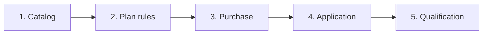

# Decomposition: Commercial Quotas

<!-- toc -->

- [1. Overview](#1-overview)
- [2. Entries](#2-entries)
  - [2.1 Quota catalog onboarding - HIGH](#21-quota-catalog-onboarding---high)
  - [2.2 Plan quota authoring and acceptance - HIGH](#22-plan-quota-authoring-and-acceptance---high)
  - [2.3 Purchase attribution and quota exclusivity - HIGH](#23-purchase-attribution-and-quota-exclusivity---high)
  - [2.4 Quota application and recovery - HIGH](#24-quota-application-and-recovery---high)
  - [2.5 Adapter qualification - HIGH](#25-adapter-qualification---high)
- [3. Feature Dependencies](#3-feature-dependencies)

<!-- /toc -->

**Overall implementation status:**
- [ ] `p1` - **ID**: `cpt-cf-bss-quotas-status-lifecycle`

## 1. Overview

This package covers BSS work across gears and its contracts with selected adapters. [PRD](PRD.md) defines outcomes. [DESIGN](DESIGN.md) defines architecture and public contracts. Five features describe the behavior assigned to each owner.

The first qualified allocation profile requires all five features. Checkboxes track implementation, not document completion.

The Entitlements contracts are pending in [PR #5744](https://github.com/constructorfabric/gears-rust/pull/5744). Each adapter design selects its OSS components and defines their connections, APIs, permissions and recovery.

## 2. Entries

### 2.1 [Quota catalog onboarding](features/0001-catalog.md) - HIGH

- [ ] `p1` - **ID**: `cpt-cf-bss-quotas-feature-catalog`

- **Purpose**: Publish reviewed, versioned definitions from authorized provider evidence for plan authors to select.
- **Owner**: Products and catalog administrators.
- **Depends On**: None
- **Scope**: Discovery, registered resource definitions, candidate approval, immutable history and authorized catalog reads.
- **Out of scope**: Prices, purchased entitlements, live customer quotas and physical stock.

**Requirements Covered**:

- [ ] `p1` - `cpt-cf-bss-quotas-fr-catalog`
- [ ] `p1` - `cpt-cf-bss-quotas-fr-catalog-gts`
- [ ] `p1` - `cpt-cf-bss-quotas-fr-catalog-presentation`
- [ ] `p1` - `cpt-cf-bss-quotas-fr-catalog-approval`
- [ ] `p1` - `cpt-cf-bss-quotas-fr-catalog-classification`
- [ ] `p1` - `cpt-cf-bss-quotas-fr-catalog-history`
- [ ] `p1` - `cpt-cf-bss-quotas-fr-catalog-policies`
- [ ] `p1` - `cpt-cf-bss-quotas-fr-catalog-compatibility`
- [ ] `p1` - `cpt-cf-bss-quotas-fr-plan-catalog`
- [ ] `p1` - `cpt-cf-bss-quotas-nfr-isolation`
- [ ] `p1` - `cpt-cf-bss-quotas-interface-management`
- [ ] `p1` - `cpt-cf-bss-quotas-contract-provider`
- [ ] `p1` - `cpt-cf-bss-quotas-usecase-buy`

**Design Principles Covered**:

- [ ] `p1` - `cpt-cf-bss-quotas-principle-single-authority`

**Design Constraints Covered**:

- [ ] `p1` - `cpt-cf-bss-quotas-constraint-qualified-profiles`

**Domain Model Entities**:

- [ ] `p1` - `cpt-cf-bss-quotas-entity-evidence-chain`

**Design Components**:

- [ ] `p1` - `cpt-cf-bss-quotas-component-commercial-chain`

**API**: ProductsQuotaDiscoveryPluginClientV1 and ProductsQuotaCatalogClientV1 (DESIGN §3.3.1–3.3.1.1).

**Sequences**:

- [ ] `p1` - `cpt-cf-bss-quotas-seq-purchase`

**Data**:

- [ ] `p1` - `cpt-cf-bss-quotas-db-owner-state`

**Design coverage**: DESIGN §3.3.1, 3.3.1.1 and 3.3.1.3; `cpt-cf-bss-quotas-interface-owner-contracts`, `cpt-cf-bss-quotas-tech-owner-boundaries`, `cpt-cf-bss-quotas-topology-existing-gears` and `cpt-cf-bss-quotas-design-lifecycle` cover these owner contracts.

**Completion**: Record passing owner-contract evidence for the feature's definitions of done and acceptance criteria. Document approval alone does not prove implementation or qualification.

### 2.2 [Plan quota authoring and acceptance](features/0002-plan-rules.md) - HIGH

- [ ] `p1` - **ID**: `cpt-cf-bss-quotas-feature-plan-rules`

- **Purpose**: Attach allocation rules to plan revisions and freeze the selected rules with accepted charging terms.
- **Owner**: Pricing and plan authors.
- **Depends On**: `cpt-cf-bss-quotas-feature-catalog`
- **Scope**: Draft replacement, concurrency, copy/clone, approval, publication and accepted quota evidence.
- **Out of scope**: Runtime counters, quota provisioning and billing calculation.

**Requirements Covered**:

- [ ] `p1` - `cpt-cf-bss-quotas-fr-plan-rules`
- [ ] `p1` - `cpt-cf-bss-quotas-fr-plan-amount`
- [ ] `p1` - `cpt-cf-bss-quotas-fr-plan-absence`
- [ ] `p1` - `cpt-cf-bss-quotas-fr-plan-revision`
- [ ] `p1` - `cpt-cf-bss-quotas-fr-charging-separation`
- [ ] `p1` - `cpt-cf-bss-quotas-fr-plan-edit`
- [ ] `p1` - `cpt-cf-bss-quotas-fr-plan-edit-conflict`
- [ ] `p1` - `cpt-cf-bss-quotas-fr-plan-governance`
- [ ] `p1` - `cpt-cf-bss-quotas-fr-qualification-recheck`
- [ ] `p1` - `cpt-cf-bss-quotas-nfr-isolation`
- [ ] `p1` - `cpt-cf-bss-quotas-interface-management`
- [ ] `p1` - `cpt-cf-bss-quotas-usecase-buy`
- [ ] `p1` - `cpt-cf-bss-quotas-usecase-change`

**Design Principles Covered**:

- [ ] `p1` - `cpt-cf-bss-quotas-principle-single-authority`

**Design Constraints Covered**:

- [ ] `p1` - `cpt-cf-bss-quotas-constraint-qualified-profiles`

**Domain Model Entities**:

- [ ] `p1` - `cpt-cf-bss-quotas-entity-evidence-chain`

**Design Components**:

- [ ] `p1` - `cpt-cf-bss-quotas-component-commercial-chain`

**API**: PricingQuotaAuthoringClientV1 and Pricing's quota-rule endpoints, PricingReadV1::resolve and SellabilityV1::check (DESIGN §3.3.1.2 and §3.6.1).

**Sequences**:

- [ ] `p1` - `cpt-cf-bss-quotas-seq-purchase`

**Data**:

- [ ] `p1` - `cpt-cf-bss-quotas-db-owner-state`

**Design coverage**: DESIGN §3.3.1.1–3.3.1.3; `cpt-cf-bss-quotas-interface-owner-contracts`, `cpt-cf-bss-quotas-tech-owner-boundaries`, `cpt-cf-bss-quotas-topology-existing-gears` and `cpt-cf-bss-quotas-design-lifecycle` cover these owner contracts.

**Completion**: Record passing owner-contract evidence for the feature's definitions of done and acceptance criteria. Document approval alone does not prove implementation or qualification.

### 2.3 [Purchase attribution and quota exclusivity](features/0003-purchase.md) - HIGH

- [ ] `p1` - **ID**: `cpt-cf-bss-quotas-feature-purchase`

- **Purpose**: Keep accepted quota evidence through purchase and prevent conflicting ownership of the same quota domain.
- **Owner**: Orders, Subscriptions and Entitlements.
- **Depends On**: `cpt-cf-bss-quotas-feature-plan-rules`
- **Scope**: Accepted receipts, protected domain admission, committed effective quantity and transfer of purchase evidence.
- **Out of scope**: A new activation or payment workflow, resource-scope creation and runtime reservations.

**Requirements Covered**:

- [ ] `p1` - `cpt-cf-bss-quotas-fr-quantity`
- [ ] `p1` - `cpt-cf-bss-quotas-fr-quantity-provenance`
- [ ] `p1` - `cpt-cf-bss-quotas-fr-quantity-no-duplication`
- [ ] `p1` - `cpt-cf-bss-quotas-fr-quantity-compatibility`
- [ ] `p1` - `cpt-cf-bss-quotas-fr-scope-continuity`
- [ ] `p1` - `cpt-cf-bss-quotas-fr-purchase-exclusivity`
- [ ] `p1` - `cpt-cf-bss-quotas-fr-claim-retention`
- [ ] `p1` - `cpt-cf-bss-quotas-fr-acceptance`
- [ ] `p1` - `cpt-cf-bss-quotas-fr-purchase-replay`
- [ ] `p1` - `cpt-cf-bss-quotas-fr-accepted-history`
- [ ] `p1` - `cpt-cf-bss-quotas-fr-attribution`
- [ ] `p1` - `cpt-cf-bss-quotas-fr-scope-binding`
- [ ] `p1` - `cpt-cf-bss-quotas-fr-new-purchase-isolation`
- [ ] `p1` - `cpt-cf-bss-quotas-fr-complete-evidence`
- [ ] `p1` - `cpt-cf-bss-quotas-nfr-isolation`
- [ ] `p1` - `cpt-cf-bss-quotas-nfr-durability`
- [ ] `p1` - `cpt-cf-bss-quotas-interface-management`
- [ ] `p1` - `cpt-cf-bss-quotas-usecase-buy`
- [ ] `p1` - `cpt-cf-bss-quotas-usecase-change`

**Design Principles Covered**:

- [ ] `p1` - `cpt-cf-bss-quotas-principle-single-authority`

**Design Constraints Covered**:

- [ ] `p1` - `cpt-cf-bss-quotas-constraint-qualified-profiles`

**Domain Model Entities**:

- [ ] `p1` - `cpt-cf-bss-quotas-entity-evidence-chain`

**Design Components**:

- [ ] `p1` - `cpt-cf-bss-quotas-component-commercial-chain`

**API**: AcceptanceRef, PricingAcceptanceV1::acceptance and CommercialPostureV1 quota extensions (DESIGN §3.3.2 and §3.6.1).

**Sequences**:

- [ ] `p1` - `cpt-cf-bss-quotas-seq-purchase`

**Data**:

- [ ] `p1` - `cpt-cf-bss-quotas-db-owner-state`

**Design coverage**: DESIGN §3.3.2–3.3.3 and 3.6.1; `cpt-cf-bss-quotas-interface-owner-contracts`, `cpt-cf-bss-quotas-tech-owner-boundaries`, `cpt-cf-bss-quotas-topology-existing-gears` and `cpt-cf-bss-quotas-design-lifecycle` cover these owner contracts.

**Completion**: Record passing owner-contract evidence for the feature's definitions of done and acceptance criteria. Document approval alone does not prove implementation or qualification.

### 2.4 [Quota application and recovery](features/0004-application.md) - HIGH

- [ ] `p1` - **ID**: `cpt-cf-bss-quotas-feature-application`

- **Purpose**: Apply a complete desired quota set and recover its outcome without duplicate allowance or stale grants.
- **Owner**: Entitlements and quota application adapter owners.
- **Depends On**: `cpt-cf-bss-quotas-feature-purchase`
- **Scope**: Durable intake, ordering, application, readiness contribution, lifecycle changes and escalation.
- **Out of scope**: OSS internal application routing, resource cleanup orchestration and commercial remedies.

**Requirements Covered**:

- [ ] `p1` - `cpt-cf-bss-quotas-fr-quantity-increase`
- [ ] `p1` - `cpt-cf-bss-quotas-fr-committed-authority`
- [ ] `p1` - `cpt-cf-bss-quotas-fr-readiness`
- [ ] `p1` - `cpt-cf-bss-quotas-fr-readiness-no-resources`
- [ ] `p1` - `cpt-cf-bss-quotas-fr-application-state`
- [ ] `p1` - `cpt-cf-bss-quotas-fr-application-outcomes`
- [ ] `p1` - `cpt-cf-bss-quotas-fr-application-recovery`
- [ ] `p1` - `cpt-cf-bss-quotas-fr-application-copies`
- [ ] `p1` - `cpt-cf-bss-quotas-fr-lifecycle`
- [ ] `p1` - `cpt-cf-bss-quotas-fr-terminal-closure`
- [ ] `p1` - `cpt-cf-bss-quotas-fr-closed-recovery`
- [ ] `p1` - `cpt-cf-bss-quotas-fr-validity`
- [ ] `p1` - `cpt-cf-bss-quotas-fr-financial-separation`
- [ ] `p1` - `cpt-cf-bss-quotas-fr-visibility`
- [ ] `p1` - `cpt-cf-bss-quotas-fr-discrepancy`
- [ ] `p1` - `cpt-cf-bss-quotas-fr-visibility-freshness`
- [ ] `p1` - `cpt-cf-bss-quotas-fr-recovery`
- [ ] `p1` - `cpt-cf-bss-quotas-fr-recovery-authority`
- [ ] `p1` - `cpt-cf-bss-quotas-fr-accepted-ordering`
- [ ] `p1` - `cpt-cf-bss-quotas-fr-refusal-replay`
- [ ] `p1` - `cpt-cf-bss-quotas-fr-superseded-evidence`
- [ ] `p1` - `cpt-cf-bss-quotas-fr-failure-handoff`
- [ ] `p1` - `cpt-cf-bss-quotas-fr-failure-no-remedy`
- [ ] `p1` - `cpt-cf-bss-quotas-fr-provider-outage`
- [ ] `p1` - `cpt-cf-bss-quotas-nfr-isolation`
- [ ] `p1` - `cpt-cf-bss-quotas-nfr-durability`
- [ ] `p1` - `cpt-cf-bss-quotas-nfr-operations`
- [ ] `p1` - `cpt-cf-bss-quotas-interface-management`
- [ ] `p1` - `cpt-cf-bss-quotas-contract-provider`
- [ ] `p1` - `cpt-cf-bss-quotas-usecase-buy`
- [ ] `p1` - `cpt-cf-bss-quotas-usecase-change`
- [ ] `p1` - `cpt-cf-bss-quotas-usecase-end`

**Design Principles Covered**:

- [ ] `p1` - `cpt-cf-bss-quotas-principle-single-authority`

**Design Constraints Covered**:

- [ ] `p1` - `cpt-cf-bss-quotas-constraint-qualified-profiles`

**Domain Model Entities**:

- [ ] `p1` - `cpt-cf-bss-quotas-entity-evidence-chain`

**Design Components**:

- [ ] `p1` - `cpt-cf-bss-quotas-component-commercial-chain`

**API**: apply_quota_state, read_quota_state and read_operation_result (DESIGN §3.3.4).

**Sequences**:

- [ ] `p1` - `cpt-cf-bss-quotas-seq-change`
- [ ] `p1` - `cpt-cf-bss-quotas-seq-recovery`

**Data**:

- [ ] `p1` - `cpt-cf-bss-quotas-db-owner-state`

**Design coverage**: DESIGN §3.3.3–3.3.5, 3.6–3.8; `cpt-cf-bss-quotas-interface-owner-contracts`, `cpt-cf-bss-quotas-tech-owner-boundaries`, `cpt-cf-bss-quotas-topology-existing-gears` and `cpt-cf-bss-quotas-design-lifecycle` cover these owner contracts.

**Completion**: Record passing owner-contract evidence for the feature's definitions of done and acceptance criteria. Document approval alone does not prove implementation or qualification.

### 2.5 [Adapter qualification](features/0005-qualification.md) - HIGH

- [ ] `p1` - **ID**: `cpt-cf-bss-quotas-feature-qualification`

- **Purpose**: Enable a profile only after confirming the adapter contract and advertised quota semantics.
- **Owner**: Products and adapter owners.
- **Depends On**: `cpt-cf-bss-quotas-feature-application`
- **Scope**: Supported limits, scope binding, application/recovery conformance and sale availability.
- **Out of scope**: An OSS implementation design, a BSS allocation ledger and physical resource scheduling.

**Requirements Covered**:

- [ ] `p1` - `cpt-cf-bss-quotas-fr-shared-tenant`
- [ ] `p1` - `cpt-cf-bss-quotas-fr-aggregate-scope`
- [ ] `p1` - `cpt-cf-bss-quotas-fr-restriction-fallback`
- [ ] `p1` - `cpt-cf-bss-quotas-fr-visibility-oss`
- [ ] `p1` - `cpt-cf-bss-quotas-fr-qualification`
- [ ] `p1` - `cpt-cf-bss-quotas-fr-qualification-evidence`
- [ ] `p1` - `cpt-cf-bss-quotas-fr-qualification-changes`
- [ ] `p1` - `cpt-cf-bss-quotas-fr-qualification-withdrawal`
- [ ] `p1` - `cpt-cf-bss-quotas-fr-physical-capacity`
- [ ] `p1` - `cpt-cf-bss-quotas-nfr-isolation`
- [ ] `p1` - `cpt-cf-bss-quotas-nfr-durability`
- [ ] `p1` - `cpt-cf-bss-quotas-nfr-operations`
- [ ] `p1` - `cpt-cf-bss-quotas-interface-management`
- [ ] `p1` - `cpt-cf-bss-quotas-contract-provider`
- [ ] `p1` - `cpt-cf-bss-quotas-usecase-buy`
- [ ] `p1` - `cpt-cf-bss-quotas-usecase-change`
- [ ] `p1` - `cpt-cf-bss-quotas-usecase-end`

**Design Principles Covered**:

- [ ] `p1` - `cpt-cf-bss-quotas-principle-single-authority`

**Design Constraints Covered**:

- [ ] `p1` - `cpt-cf-bss-quotas-constraint-qualified-profiles`

**Domain Model Entities**:

- [ ] `p1` - `cpt-cf-bss-quotas-entity-evidence-chain`

**Design Components**:

- [ ] `p1` - `cpt-cf-bss-quotas-component-commercial-chain`

**API**: CapabilityQualification and adapter conformance boundaries (DESIGN §3.3.1, §3.3.6 and §4.2).

**Sequences**:

- [ ] `p1` - `cpt-cf-bss-quotas-seq-recovery`

**Data**:

- [ ] `p1` - `cpt-cf-bss-quotas-db-owner-state`

**Design coverage**: DESIGN §3.3.1.3, 3.3.6, 3.5 and 4.2–4.5; `cpt-cf-bss-quotas-interface-owner-contracts`, `cpt-cf-bss-quotas-tech-owner-boundaries`, `cpt-cf-bss-quotas-topology-existing-gears` and `cpt-cf-bss-quotas-design-lifecycle` cover these owner contracts.

**Completion**: Record passing owner-contract evidence for the feature's definitions of done and acceptance criteria. Document approval alone does not prove implementation or qualification.

## 3. Feature Dependencies

The chain shows delivery dependencies. Owner contracts and adapter contract fixtures can be developed in parallel once their inputs are agreed. The catalog stores qualification evidence from the start, but sales wait for Feature 5. This sale gate is separate from implementation order and creates no circular document dependency.

Features 1–3 cover commercial evidence and admission. Feature 4 implements the BSS-to-adapter contract. Feature 5 verifies the adapter contract and approved profile. OSS runtime tests belong to the adapter design.
