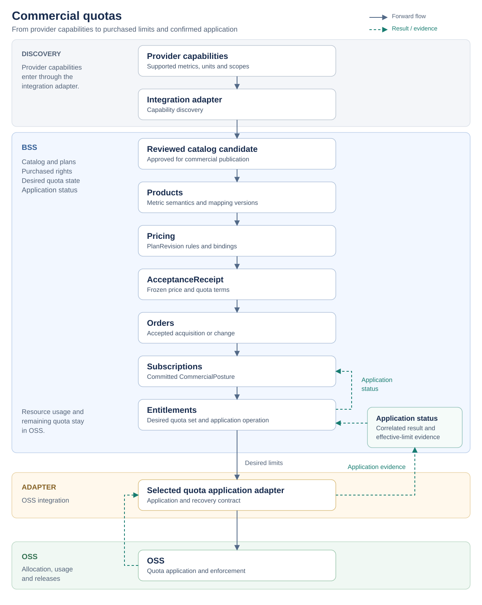

# Technical Design: Commercial Quotas


<!-- toc -->

- [1. Architecture Overview](#1-architecture-overview)
  - [1.1 Architectural Vision](#11-architectural-vision)
  - [1.2 Architecture Drivers](#12-architecture-drivers)
  - [1.3 Architecture Layers](#13-architecture-layers)
- [2. Principles & Constraints](#2-principles--constraints)
  - [2.1 Design Principles](#21-design-principles)
  - [2.2 Constraints](#22-constraints)
- [3. Technical Architecture](#3-technical-architecture)
  - [3.1 Domain Model](#31-domain-model)
  - [3.2 Component Model](#32-component-model)
  - [3.3 API Contracts](#33-api-contracts)
  - [3.4 Internal Dependencies](#34-internal-dependencies)
  - [3.5 External Dependencies](#35-external-dependencies)
  - [3.6 Interactions & Sequences](#36-interactions--sequences)
  - [3.7 Database schemas & tables](#37-database-schemas--tables)
  - [3.8 Deployment Topology](#38-deployment-topology)
- [4. Additional context](#4-additional-context)
  - [4.1 Future scope](#41-future-scope)
  - [4.2 Integration qualification gates](#42-integration-qualification-gates)
  - [4.3 Contract conformance criteria](#43-contract-conformance-criteria)
  - [4.4 Qualification evidence](#44-qualification-evidence)
  - [4.5 Adapter integration design boundary](#45-adapter-integration-design-boundary)
- [5. Traceability](#5-traceability)

<!-- /toc -->

- [ ] `p1` - **ID**: `cpt-cf-bss-quotas-design-lifecycle`

**Status: draft design.** These models and operations define the required contracts. [§4.2–4.4](#42-integration-qualification-gates) lists qualification gates and required evidence. [PRD §9](PRD.md#9-acceptance-criteria) defines business acceptance criteria.

## 1. Architecture Overview

### 1.1 Architectural Vision

Products defines resources. Pricing stores plan quota rules and freezes accepted terms. Subscriptions commits the purchased commercial state. Entitlements derives, applies and reconciles limits. OSS enforces these limits and owns resource allocation, usage counters and release accounting. BSS does not receive per-resource allocation or release events.

[DECOMPOSITION](DECOMPOSITION.md) organizes this package. DESIGN defines the architecture and public contracts. FEATURE documents cover detailed flows, recovery and conformance.

A provider capability describes technical support. A plan rule defines an offer. A receipt preserves accepted terms. An adapter result proves what was applied to that request. Each step still needs the next owner's authorization and readiness checks. The selected adapter may maintain several internal limits, but they represent one purchased allowance.

Each assignment uses one adapter selected by BSS. Entitlements sends the complete desired quota set as one operation and tracks it through that adapter. The adapter coordinates the required OSS systems and returns one result tied to the operation. Its internal calls and recovery steps belong to the adapter design.

### 1.2 Architecture Drivers

| Driver | Architectural response |
| --- | --- |
| Exact accepted rights | Immutable descriptor/rule/binding snapshots; derive from committed posture and retained receipt |
| Shared tenant allowance | Verified resource-owner mapping, one exclusive source and an adapter contract for the shared limit |
| Consistent application | One desired set, one adapter operation, complete-result confirmation and no duplicate allowance |
| Lost replies and stale commands | Stable source identity, provider fencing, durable observations and terminal tombstones |
| Small ownership surface | Commercial fulfillment in Entitlements; runtime accounting in OSS |

| NFR ID | Allocation | Verification |
| --- | --- | --- |
| `cpt-cf-bss-quotas-nfr-isolation` | Owner SDK admission, authorized resource bindings, source ownership and scoped reads | Q-C11, Q-C48 |
| `cpt-cf-bss-quotas-nfr-durability` | Transactional intake/outbox, source-head CAS, operation recovery, retained fences | Q-C08, Q-C09, Q-C23, Q-C25, Q-C41, Q-C43, Q-C51 |
| `cpt-cf-bss-quotas-nfr-operations` | Versioned profile bounds, platform task runtime, finding/escalation state | Q-C52, Q-C54 |

#### Key ADRs and pending owner contracts

[ADR-0001: Products owns the commercial quota catalog](ADR/0001-commercial-quota-catalog.md), `cpt-cf-bss-quotas-adr-commercial-catalog`, records catalog ownership and its alternatives.

This design follows the application boundary proposed by [Entitlements ADR-0001, pending in PR #5744](https://github.com/diffora/gears-rust/blob/abb2cf674cadae6cbd5bb6e4ec098007a6eca3b6/gears/bss/entitlements/docs/ADR/0001-application-boundary.md).

The proposed [decisions](https://github.com/diffora/gears-rust/blob/abb2cf674cadae6cbd5bb6e4ec098007a6eca3b6/gears/bss/entitlements/docs/DECISIONS.md) and [owner requirements](https://github.com/diffora/gears-rust/blob/abb2cf674cadae6cbd5bb6e4ec098007a6eca3b6/gears/bss/entitlements/docs/UPSTREAM_REQS.md) are still pending. Every `ENT-D-*` and `E-U*` reference points to that dependency. Check these references against its accepted version before qualifying an implementation.

GTS catalog identities define commercial meaning and map to OSS metrics. They do not create another runtime counter catalog. Cross-payer admission and consistent adapter application require extensions to the owner contracts. Their qualification gates remain open.

### 1.3 Architecture Layers

- [ ] `p1` - **ID**: `cpt-cf-bss-quotas-tech-owner-boundaries`



[Open the diagram](diagrams/architecture-layers.drawio.svg). The SVG includes the editable draw.io source.

Presentation uses owner SDKs. Commercial and application layers store immutable evidence and desired state. Adapters handle provider integration. OSS does not call Pricing or Subscriptions to admit each resource operation.

## 2. Principles & Constraints

### 2.1 Design Principles

- [ ] `p1` - **ID**: `cpt-cf-bss-quotas-principle-single-authority`

Each fact has one owner:

- Products owns metric meaning.
- Pricing owns accepted terms.
- Subscriptions owns current commercial posture and activation time T.
- Entitlements owns desired delivery and its manifest.
- The adapter confirms quota application.
- OSS owns resource state and usage.

An application observation cannot change purchased terms. Billing follows its own usage contracts.

### 2.2 Constraints

- [ ] `p1` - **ID**: `cpt-cf-bss-quotas-constraint-qualified-profiles`

The initial profile supports bounded allocation, one exclusive commercial source and one provider scope per assignment. An offer with vCPU and RAM requires confirmation of the complete quota set. The adapter contract must cover enforcement of the advertised limits. Resource admission and accounting are defined by the OSS and adapter designs.

The baseline follows [ToolKit](../../../../docs/toolkit_unified_system/README.md), [design review criteria](../../../../guidelines/DESIGN_REVIEW.md) and owner SDK boundaries. No external call occurs inside a local DB transaction or while holding a distributed lock. No direct provider-table mutation, manual AccessScope construction or unscoped service-principal bypass is introduced.

Service calls follow the [commercial model §3.4](../../../../docs/arch/bss-commercial-model/DESIGN.md#34-internal-dependencies). Each gear uses one service principal. Each call uses a single-target scope from the decision point. Until platform support is available, Subscriptions and Entitlements use their documented interim solutions: SUB-D-123, SUB-D-125 and ENT-D-04. This specification adds no exception.

## 3. Technical Architecture

### 3.1 Domain Model

- [ ] `p1` - **ID**: `cpt-cf-bss-quotas-entity-evidence-chain`

| Logical entity | Owner | Required content / invariant |
| --- | --- | --- |
| ProviderCapabilityCandidate | Products stores adapter evidence for catalog review | GTS-validated capability record, saved adapter target, complete discovery snapshot/revision, resolved reference digests and observation time; not sellable |
| MetricSemanticsVersion | Products | SKU/version, metric code, exact unit conversions, Allocation/Consumption support, subject/resource kinds, supported quota operations, immutable digest |
| EnforcementMappingVersion | Products with adapter owner evidence | Opaque versioned adapter mapping for metric and subject/scope translation, qualified profile and digest; retain historical mappings. Internal OSS identifiers and translation are specified by the adapter design |
| CapabilityQualification | Products stores adapter-owner evidence and catalog availability | Immutable qualification ID/revision, adapter and contract versions, applicable target/profile, metric/unit/mapping digests, jointly supported operations and constraints, measured bounds and evidence references; separately audited availability for new sales |
| PlanQuotaRule / QuotaBinding | Schema meaning: Entitlements; storage: Pricing. Until Entitlements publishes a rule schema, Pricing defines the v1 shape in `pricing-sdk`. | Rule version/digest, metric/accounting/scope policy evidence, scope selection, kind/unit, `Fixed` or `PerPlanUnit`, applicability, logical binding, `ExclusiveSource`, validity/restrict/revoke behavior, required profile |
| Accepted charging terms | Pricing / financial owner contracts | Versioned package/usage charge rules, billing-meter references, inclusion terms and applicable service/resource binding; frozen with the quota terms, interpreted by Rating/Billing |
| AcceptedQuotaSnapshot | Pricing | Rule/binding snapshots or durable immutable references with digests, original plan quantity, selected dimensions, tenant axes, terms/profile and purchase identity; frozen alongside price |
| CommercialPostureV1 | Subscriptions | Aggregate revision/digest, effective quantity, Granted/Restricted/Revoked, intervals, accepted provenance, operation/preparation identity and lifecycle posture |
| QuotaAccountingPolicy / QuotaScopePolicy | Adapter owner registers the named instances against Products' schemas and qualifies their interpretation; Products pins them in reviewed definitions | Immutable policy identity/content evidence, reviewed descriptions of what counts toward the limit and exact aggregation/dimension meaning; retained in plan/receipt/assignment evidence |
| QuotaExclusivityClaim | Subscriptions protected acquisition admission | Canonical cross-payer ownership domain, acquisition identity, scope/terms evidence, durable version and retained safe-reuse fence |
| QuotaAssignment | Entitlements | Stable identity of one acquisition, logical binding and preparation generation, resource owner/scope, source namespace, logical members, one saved adapter binding and current desired head |
| DesiredQuotaSet | Entitlements | Complete source-owned members, exact caps, restriction/tombstones, effective boundary, revision/digest and authority context |
| QuotaApplication | Entitlements | One operation ID, source revision/digest, complete desired member set, saved adapter binding and correlated application result |
| AdapterObservation | Entitlements journal, adapter evidence | Source/member, operation/revision/digest, ordered application and effective-restriction evidence, observation time and recoverable outcome |

These are logical entities. Section 3.3.1 defines the proposed GTS discovery contract for Products SDK. Its DTOs and registrations still need implementation. Owner SDK changes must preserve this meaning. Use GTS for extensible metric, subject and provider contracts where required. Closed lifecycle states remain closed enums. Stored GTS identifiers use the platform UUID representation.

### 3.2 Component Model

- [ ] `p1` - **ID**: `cpt-cf-bss-quotas-component-commercial-chain`

| Component | Owns | Does not own |
| --- | --- | --- |
| Products | Resource semantics, reviewed mappings, qualification evidence and availability, immutable history | Commercial cap, purchase, counter |
| Pricing | Plan rules, complete quota-set validation and atomic accepted price/quota snapshot | Live provider mutation, actual remaining |
| Orders / Workflow | Purchase/change orchestration with exact receipt/line identity | Arbitrary cap authority or counter adjustments |
| Subscriptions | Committed quantities/lots, posture, activation arbitration and recovery | Adapter selection or runtime usage accounting |
| Entitlements | Rule semantics, desired state, adapter operations, readiness, delivery and fulfillment findings | Pricing, operational quota usage/read models, physical allocation or private provider storage |
| OSS, behind the adapter | Enforce applied limits; own resource allocation, usage and operational reads | Commercial terms and BSS application state |
| Quota application adapters | Accept desired quotas from Entitlements, apply them through OSS and return correlated application/recovery evidence | Commercial terms and subscription lifecycle; OSS routing and application mechanisms are defined in each adapter design |

Products/Pricing own the commercial catalog and plan roles; Entitlements owns fulfillment intent. The adapter design assigns internal OSS management responsibilities and scoped permissions.

BSS requires the advertised limits to apply to the authorized scope. Resource operations and their accounting stay entirely behind the adapter boundary.

### 3.3 API Contracts

- [ ] `p1` - **ID**: `cpt-cf-bss-quotas-interface-owner-contracts`

These versioned operations belong to the owner SDKs. Wire types and endpoints must preserve their authorization, ordering, idempotency and recovery guarantees.

#### 3.3.1 Catalog onboarding and plan publication

Catalog input comes from manual authoring or adapter discovery. Discovery reads provider capabilities and stages candidates. Product engineering reviews identity, scope, units and enforcement support. It then publishes an immutable Products descriptor with a versioned adapter mapping.

The adapter design owns internal OSS registration and configuration. Later discovery can propose a new version or flag changed capabilities. It cannot edit accepted terms or live tenant caps.

Detailed intake, validation and picker behavior: [Feature 1: catalog](features/0001-catalog.md). Qualification and availability workflow: [Feature 5: qualification](features/0005-qualification.md).

**GTS capability discovery contract.** Products owns this contract in `products-sdk`. Adapters implement its discovery plugin interface. G02 requires schema registration and conformance before use. The contract describes allocation limits. It does not describe collected usage events or derived billing meters. Matching labels or units do not make their meanings equivalent.

| GTS schema | Role and ownership |
| --- | --- |
| `gts.cf.bss.products.quota_unit.v1~` | Products-owned, concrete final schema for named unit instances: `id`, `symbol`, `canonical_unit_ref`, `numerator`, `denominator`. Conversion is exact rational multiplication into the canonical unit. |
| `gts.cf.bss.products.quota_metric.v1~` | Products-owned, concrete extensible schema for named metric instances: `id`, `name`, localized `display_name` and `description`, `quota_kind`, `canonical_unit_ref`, `properties`. `quota_kind` is the closed value `allocation` in this contract version. |
| `gts.cf.bss.products.quota_accounting_policy.v1~` | Products-owned concrete final schema for descriptions of what counts toward a limit; required fields in §3.3.1.3. |
| `gts.cf.bss.products.quota_scope_policy.v1~` | Products-owned concrete final schema for named aggregation/dimension policies; required fields and binding rules in §3.3.1.3. |
| `gts.cf.bss.products.quota_capability.v1~` | Products-owned, concrete extensible schema for adapter discovery records. Invariant fields are specified below; derived schemas may add validated adapter metadata under `properties`. |
| `gts.cf.toolkit.plugins.plugin.v1~cf.bss.products.quota_discovery.v1~` | Products discovery plugin specification derived from the ToolKit plugin base; adapter instances implement the discovery interface and are selected by BSS configuration. |

Metric and capability base schemas allow direct instances. Derived schemas use `allOf` and a `gts://` base reference. They must preserve every required field. For example, an adapter owner can register `gts.cf.bss.products.quota_capability.v1~cf.compute.quota_adapter.allocation_capability.v1~` to add reviewed allocation metadata.

Extensions cannot override units, scope, bounds or operations. New metadata can be stored without a database migration. A profile cannot qualify if it needs behavior the implementation does not support.

Unit and policy schemas use `x-gts-final: true`. None of these schemas is abstract. Metric and capability schemas allow extensions only in `properties`. Unit and metric instance IDs must belong to their declared schema. A capability's `type_id` must name its registered schema. Schema-only `x-gts-*` keywords are invalid in instance metadata.

A metric or unit is a **well-known instance**. It is not a new schema for each CPU size, purchased quantity or tenant. Metric and unit instances belong to the adapter owner. It registers them in its own namespace against Products' schemas; Products registers none. Example IDs are `gts.cf.bss.products.quota_metric.v1~cf.compute.quota_adapter.vcpu.v1` and `gts.cf.bss.products.quota_unit.v1~cf.compute.quota_adapter.vcpu.v1`. The schema segment is Products'; the instance segment is the adapter owner's namespace. The last segment has no trailing `~`.

Capability observations are anonymous records with a UUID `id` and GTS `type_id`. Their registered schema declares that discriminator. References must name exact GTS identities. `latest` and wildcards are invalid. Publication and purchase also retain the resolved registry content, revision evidence and digests. A major-only ID does not freeze historical content.

**Plan-authoring presentation.** Each metric has a nonempty technical `name`. Required `display_name` and `description` maps contain locale tags and nonempty plain-text values. Both maps must include English (`en`). Other translations are optional.

For each field, the form uses the requested locale or falls back to `en`. The GTS instance ID remains the identity. Translated text is never a lookup key or an arithmetic input.

The reviewed text explains shared allocation semantics and profile-specific accounting conditions. [Feature 1: catalog](features/0001-catalog.md) defines presentation and validation behavior.

**Discovery operation and ownership.** Products resolves the proposed `ProductsQuotaDiscoveryPluginClientV1::list_capabilities(ctx, request)` through scoped ClientHub. This versioned SDK call is read-only. `ctx` carries the authorized catalog/integration context. The request includes the saved adapter target, an optional opaque cursor and a page size. The default page size is 50 and the maximum is 200.

The reply contains `snapshot_id` (UUID), `source_revision` (nonnegative integer encoded as a decimal string), `observed_at` (UTC timestamp), `item_count` (whole-snapshot nonnegative integer), `content_digest` (canonical whole-snapshot SHA-256), `items` and optional `next_cursor`. Count/digest verification follows §3.3.2; the snapshot digest excludes pagination cursors and the digest field itself. An immutable snapshot covers one adapter target; its revision is monotonic within that binding.

Continuation cursors bind the authorization scope, target and snapshot. If a snapshot expires, restart discovery. Never combine pages from different revisions. Failed or incomplete discovery does not mean capabilities were removed.

Each `items` entry has the following required fields unless marked optional:

| Field | Shape and meaning |
| --- | --- |
| `id`, `type_id` | Stable UUID for this record within the snapshot, and the registered capability schema or a compatible derived schema |
| `capability_key` | Opaque stable identity within the selected adapter target, distinct from a mutable display name |
| `metric_ref` | GTS instance reference narrowed to `quota_metric.v1~`; names the allocation metric, not a usage value |
| `unit_ref` | GTS instance reference narrowed to `quota_unit.v1~`; unit in which the adapter accepts the limit |
| `subject_type_ref`, `resource_type_refs` | Registered concrete GTS type references for the supported quota subject and affected resources; nonempty resource list. Type references describe kinds, not an actual tenant/resource identity. |
| `limits` | `min`, `step`, optional `max`, all exact nonnegative decimal integer strings; `step` is positive. Valid amounts are `min + n × step`, within `max` if supplied. Missing `max` means no advertised technical upper bound, not an unlimited purchased allowance. |
| `operations` | Closed v1 object with explicit booleans `apply`, `read_application`, `recover_operation`, `restrict`, `revoke`, `resume`; absent flags are invalid. No inference from a plugin name. |
| `mapping_key` | Opaque version-pinned adapter mapping reference for translating the catalog metric into OSS configuration; Products preserves it in the enforcement mapping. No provider API field or credential enters the plan rule. |
| `accounting_policy_ref`, `scope_policy_ref` | Registered named policy instances defined in §3.3.1.3; resolve actual type ancestry and retain content digests. |
| `change_support` | Explicit initial installation/increase support, as defined in §3.3.1.3; qualification is required before sale. |
| `properties` | Object validated against the concrete GTS schema; empty for the base example |

Discovery reports capabilities, not qualification or physical stock. Profiles must still qualify for the advertised limits, authorized scope and application contract. Discovery returns no tenant quota bindings or live values.

**Units and exact arithmetic.** A canonical unit references itself with numerator and denominator `1`. Other units reference that canonical instance directly with a positive, reduced rational factor. Reject chains, offsets, floating-point conversions and all cycles except the canonical self-reference.

The metric and adapter units must resolve to the same canonical identity. `GB` and `GiB` both resolve to bytes, with factors `1000000000/1` and `1073741824/1`. The symbol alone does not identify a unit.

Encode unit integers as decimal strings. Conversion must be exact and fit the supported bounds and adapter step. Matching names do not allow rounding or substitution.

The example instances use the example adapter namespace `cf.compute.quota_adapter`:

[quota-metric-unit.instances.json](schemas/quota-metric-unit.instances.json)

Example discovery reply. The subject and resource IDs represent owner schemas for the example deployment. They require no enforcement-specific base schema. Before intake, they must be registered and pass resolution, type and authority checks:

[quota-capability-discovery.example.json](schemas/quota-capability-discovery.example.json)

`1024` is an example technical bound, not a purchased limit. After review and qualification, a plan can sell `10` in that unit. Discovery contains no purchased amount.

**Registry and catalog storage.** Types-registry stores GTS schemas, named metrics and units with display text, and discovery plugin registrations. Products references those exact IDs. It stores discovery snapshots and candidates, product and enforcement mappings, reviews, qualification and sale availability.

Products retains immutable evidence for history, not a second GTS registry. Pricing stores plan rules and commercial amounts. Neither types-registry nor Products stores live tenant quota usage.

Schema revisions and capability observations have separate versions. Platform `gts.cf.*` schemas and instances use major-only IDs. Compatible schema revisions keep the ID and must pass compatibility checks. Breaking changes need a new major. A family starting at `v1~` cannot add `v1.0~` or `v1.1~`.

A major-only ID does not freeze content. Each approved definition and accepted snapshot retains the resolved registry revision and evidence, schema and dependency content, and digests.

A change to unit meaning, conversion, metric meaning or mapping needs a new immutable definition version and catalog review. This applies even if the JSON shape stays the same. Never reuse an ID with a different meaning.

Accepted purchases retain exact references, content and digests. Missing historical evidence blocks reinterpretation. `EnforcementMappingVersion` connects catalog metrics to OSS metrics. Matching names or units alone do not prove compatibility.

Registration and configuration of internal OSS metrics belong to the adapter integration design; publishing a catalog definition does not perform them.

**Quota rules and charging terms.** A plan has separate quota and charging rules for the same service/resource binding. `PlanQuotaRule` defines allocation and quantity scaling. Pricing defines package fees, usage rates and inclusions. Accepted terms retain their versioned references. Rating/Billing applies those rules through its contracts.

Quota metrics and capabilities have no `paid` field. Application requests need no price or tariff.

A 20-vCPU allocation ceiling can accompany package, usage or mixed charging. Allocated vCPU is distinct from the billing meter vCPU-hours; billing inclusions never authorize allocation above the cap.

| Example plan | Allocation rule | Charging terms for that metric |
| --- | --- | --- |
| Resource package | Tenant ceiling of 20 vCPU | Fixed package fee per period; allocated vCPU usage within the ceiling is included |
| Usage-priced service | Tenant ceiling of 20 vCPU | Charge allocated vCPU over time using the accepted billing meter and rate; no usage means no charge for that usage component |
| Mixed service | Tenant ceiling of 20 vCPU | Package fee includes a defined billing-usage allowance; further usage is charged under the accepted tariff while the allocation ceiling still applies |

##### 3.3.1.1 Catalog reads for plan authoring

The discovery plugin reads provider capabilities. The plan editor reads approved Products definitions through the proposed `ProductsQuotaCatalogClientV1` in `products-sdk`. G02 requires these methods to be implemented. Products owns their authenticated REST endpoints. The editor and Pricing use this catalog, not discovery or a scan of types-registry, to determine what can be sold.

| Proposed SDK method | REST projection | Request and result |
| --- | --- | --- |
| `list_quota_definitions(ctx, request)` | `GET /bss-products/v1/quota-definitions` | Required `sku_id` and exact `sku_version`; optional `subject_type_ref`, `resource_type_ref`, `profile_id`, locale and availability filter; bounded page size and opaque cursor. Returns approved definition versions applicable to that SKU and authorized catalog scope. Default availability is `enabled`; authorized `all` includes disabled/withdrawn definitions with reasons. |
| `get_quota_definition(ctx, definition_id, version, locale)` | `GET /bss-products/v1/quota-definitions/{id}/versions/{version}` | Returns the exact immutable definition plus its separately identified current availability observation. Disabled historical versions remain readable within the caller's scope. There is no automatic upgrade to the latest version. |
| `validate_quota_set(ctx, request)` | Internal Products SDK operation, called by Pricing | Receives exact definition references, amounts/units, logical bindings, selected SKU versions and validation purpose (`authoring` or `acceptance`) for one complete applicable set. Acceptance also supplies effective committed/purchased quantity as appropriate; validate the resulting Fixed/PerPlanUnit limits, not only their coefficients. Returns per-rule and cross-rule checks, qualification evidence and availability observations. It validates commercial compatibility; it neither reserves capacity nor applies quota. It answers every check it finds and the definitions it resolved; Pricing decides what each boundary refuses. Rules of one logical binding need equal profile content and one adapter target. |

A `QuotaDefinitionVersion` has a UUID `definition_id` and a positive decimal-string `version`. It combines an approved SKU/version, metric meaning, enforcement mapping and qualified profile for plan selection. It references existing GTS metrics and units instead of creating another metric identity.

Changed meaning or mapping needs a new definition version. Sale availability can change without changing that version's content.

A definition version applies to the SKU version it was approved against and to every later version of that SKU.

Each definition response contains:

| Field | Meaning |
| --- | --- |
| `definition_id`, `version`, `definition_digest` | Exact catalog identity and content digest, including the pinned definition dependencies |
| `sku_id`, `sku_version` | Product applicability: the SKU version the definition was approved against, which also covers later versions of that SKU; Pricing verifies these against the selected plan item |
| `metric_ref`, `metric_digest`, `quota_kind` | Registered metric instance, retained content digest and `allocation` kind |
| `display_name`, `description`, `locale` | Resolved reviewed text with the English fallback from §3.3.1; identity is independent of localization |
| `canonical_unit_ref`, `allowed_units` | Canonical unit and allowed plan units; each includes `unit_ref`, content digest, symbol, exact conversion and `min`/`step`/optional `max` in that unit |
| `subject_type_ref`, `resource_type_refs` | Supported ownership and resource types, validated through registry ancestry |
| `mapping_ref`, `profile_ref`, `qualification_ref` | Opaque immutable owner references, each `{id, version, digest}`; profile fixes aggregation, lifecycle and required operations; `qualification_ref` is null until qualification evidence is recorded (Feature 5) |
| `accounting_policy_ref`, `accounting_policy_digest`, `accounting_policy` | Exact registered policy identity, retained digest and resolved allocated-capacity accounting semantics. |
| `scope_policy_ref`, `scope_policy_digest`, `scope_policy`, `change_support` | Exact scope policy and supported qualified changes from §3.3.1.3; no runtime usage is exposed. |
| `profile_conditions`, `supported_bases` | Reviewed localized accounting conditions and supported `Fixed`/`PerPlanUnit` bases; the Products REST projection spells them `fixed`/`per_plan_unit` |
| `availability` | Current `{state, revision, observed_at, reason_code}`; state is `enabled`, `disabled` or `withdrawn`, reason is nullable when enabled |

SDK list results use `{items, next_cursor}`. REST uses the Products list envelope `{items, page_info: {next_cursor, prev_cursor, limit}}`. Page size defaults to 50 and is limited to 200. The REST names are `limit` and `cursor`, with `$top`/`$skiptoken` aliases; typed equality filters use `$filter` and the fields listed above. Conflicting aliases and unsupported filters are invalid. Order is ascending `(definition_id, version)` with numeric version comparison. Cursors bind authorized catalog scope, filters and order; changing them requires a fresh list.

Reauthorize every page. Availability is checked at read time. Paging neither reserves a sale nor freezes eligibility. If a dependency fails, return an error, not an empty successful catalog.

[Example catalog response](schemas/quota-catalog-list.example.json), an `availability=all` answer. UUIDs and 64-character lowercase SHA-256 digests are placeholders. Referenced records must be registered and validated.

##### 3.3.1.2 Pricing objects and authoring methods

Quota rules are a versioned extension of `PlanRevision`. They describe what a selected service grants, independently of the charge configuration. Draft mutation, concurrency, approval and copy behavior are defined in [Feature 2: plan-rules](features/0002-plan-rules.md).

| Pricing object | Quota extension |
| --- | --- |
| `Plan` | Stable plan identity; quota content belongs to its revisions. No mutable plan-wide cap overrides a published revision. |
| `PlanRevision` / `PricingPlanRevisionReadDto` | `quota_rules` collection and `quota_rules_digest`, included in the revision's content/version and approval evidence. Initial limit: 200 rules per revision. Empty means no quota declaration. |
| `PlanItem` | Referenced by `item_id` in each quota rule; supplies the selected SKU and existing dimension selection. It does not store a second copy of the cap. |
| `PriceBookEntry` / `Price` | Continue to describe charges. Quota amounts are not price quantities, rates, `included_qty` or usage-meter inclusions. |
| `PricingPlanChecksDto` | Existing checks include quota reference, numeric, applicability, qualification and complete-set checks. Check subjects gain optional `quota_rule_id` and `field` alongside the existing item/SKU references. |
| `ResolvedBindings` | Versioned read extension with the selected `quota_terms` and `selected_quota_digest`, resolved alongside the requested item/dimension bindings. It is a preview, not acceptance or authority to grant. |
| `AcceptanceReceipt` / `AcceptedQuotaSnapshot` | Exact selected rules, definition/dependency evidence, rule-set digest, binding selections and original quantity, frozen atomically with accepted charging terms. A receipt is purchase evidence, not a live plan lookup. |

`PricingQuotaAuthoringClientV1` in `pricing-sdk` and Pricing's REST endpoints below use the existing plan authoring service, storage and authorization, and both answer the same request identically. They extend existing routes and DTOs where noted.

| Method / operation | REST contract | Behavior |
| --- | --- | --- |
| `get_quota_rules(ctx, revision_id)` | New `GET /bss-pricing/v1/plan-revisions/{id}/quota-rules` | Returns `{revision_id, revision_version, quota_rules, quota_rules_digest}` with the same revision ETag as the full revision read. The bounded collection is returned whole. Full `GET /plan-revisions/{id}` also includes the quota fields. |
| `replace_quota_rules(ctx, revision_id, expected_version, operation_id, rules)` | New `PUT /bss-pricing/v1/plan-revisions/{id}/quota-rules`; required `If-Match` and `Idempotency-Key` | Body: `{quota_rules: [...]}`. Atomically replaces the draft's complete collection. Add by including a new rule, edit by retaining its `rule_id` with changed content, and remove by omitting it. An empty array explicitly removes all rules. Returns the normalized collection/digest and new revision ETag, HTTP 200. |
| `check_plan_revision(ctx, revision_id)` | Extend existing `GET /bss-pricing/v1/plan-revisions/{id}/checks` and batch `/plan-revisions/checks` | Checks the complete saved revision, including quotas; preserves the existing `checks`, `ready`, `sale_date` and quorum result. Reports the evaluated revision version and quota digest so the editor can detect stale results. |
| Submit / approve / publish | Extend existing `POST /plan-revisions/{id}/submit`, approval-unit operations and price-book publication/scheduled application | Quota content participates in the existing approval unit and immutable revision. No separate quota approval or publication endpoint. Recheck required quota evidence at each existing effect boundary; a stale green preview cannot authorize publication. A scheduled publication relies on acceptance's recheck of every sale. |
| Copy revision / clone plan | Extend existing `POST /plans/{id}/revisions` and `POST /plans/{id}/clone` | Copy quota terms and exact definition versions with the items. Remap item references to the copied items, retain logical binding identity within a copied plan, and recompute revision-specific evidence. Approval and current availability are rechecked, never copied as authorization. |

The last three rows use the `/bss-pricing/v1` prefix. Only unlocked drafts can be edited under the existing author/plan-write policy. The quota endpoint cannot change published, scheduled or pending content. A published plan needs a new draft and the usual approval flow.

Saving a draft changes no existing purchase or OSS state. A non-quota PATCH with no quota extension preserves the collection. Only explicit quota replacement with an empty array clears it. Legacy reads may omit the extension. Legacy writes cannot erase it or bypass its checks.

`PlanQuotaRuleV1` accepts the fields below. UUIDs are opaque. Owner versions are positive decimal strings. Amounts are canonical nonnegative decimal integers in the rule's unit, within the approved numeric bounds. Normalization is exact and belongs to the versioned digest contract.

| Field | Meaning and validation |
| --- | --- |
| `rule_id` | Client-generated UUID, unique within a revision and retained on retry/edit. It is not a tenant quota assignment ID. |
| `definition_ref` | `{id, version, digest}` selecting one exact Products quota definition. Pricing resolves it and verifies the digest. |
| `item_id` | Item in this same revision whose SKU matches the definition; foreign or missing items are refused. |
| `dimension_value` | Nullable requested dimension value: null for a dimensionless item. On an item with a dimension, an exact registered value for that item's dimension, or null for the item's explicit default rule for its quota. A quota is a metric (vCPU, RAM and so on), whatever the rule's `logical_binding_key`. Matching follows the requested selection, even when price resolution uses a default chain: for each metric of the item's rules, every rule of the item for the requested value and that metric, else the item's default rules for that metric. A metric with neither refuses acceptance (`QUOTA_RULE_MISSING`), and the revision checks show such a sellable selection red before publication. No wildcard/fallback rule is inferred: a default is authored. |
| `logical_binding_key` | Stable service/resource slot within this plan, 1–64 ASCII letters, digits, `_`, `-` or `.`. Rules for CPU and RAM in the same slot target the same eventual assignment scope. This key neither resolves a provider scope nor grants tenant authority. |
| `scope_selection` | Exact opaque dimension values required by the definition's scope policy (§3.3.1.3); retained from plan to receipt and adapter binding. |
| `subject_selector` | Closed v1 value `resource_owner`; the actual authorized tenant/scope is supplied by purchase and attribution contracts, not hard-coded into the reusable plan. |
| `amount`, `unit_ref`, `basis` | Commercial cap/coefficient, exact allowed GTS unit reference and `Fixed` or `PerPlanUnit` (REST spells them `fixed` and `per_plan_unit`); no `paid` flag or billing rate. |

The resolved definition supplies the metric, unit digests, mapping, qualification/profile and lifecycle behavior. The server retains this evidence. Request metadata cannot override it.

Each selected `(logical_binding_key, metric)` has at most one applicable rule, regardless of item or rule IDs. Alternative dimension selections may have different rules, but both cannot apply to one selection. A quota is a metric: an item's default rules for a metric apply only to a selection for which the item has no rule of that metric, whatever their bindings, and two bindings of one metric for one value both apply (two adapter targets). One binding carries one scope, so a quota scoped to the region sold uses one binding per region. Changing a metric creates a new rule. Changing its version, amount or profile changes the revision's accepted meaning.

Rules that apply together to a binding must share a supported profile qualified for the complete set. V1 requires one compatible profile across that binding's dimension alternatives. Publication must validate every sellable selection within the qualified bounds. If it cannot, refuse the combination. Checking only the default selection is insufficient. Pricing's revision checks show each selection sellable on the revision's sale date that selects no rule of a metric the item's rules carry as red `QUOTA_RULE_MISSING`, so such a revision cannot be submitted or approved; a selection that becomes sellable after the sale date is refused at acceptance with the same reason. Incomplete editor rows stay client-side until all required fields are present.

Illustrative PUT body: [plan-quota-rules.replace.example.json](schemas/plan-quota-rules.replace.example.json). The example headers carry the revision ETag and one stable operation UUID; neither belongs in the JSON body.

**Errors and permissions.** SDK methods return canonical errors. REST uses RFC 9457 problems. Catalog reads require scoped Products catalog-read authority. Access to history does not prove sale eligibility.

Pricing reads, writes and checks use existing plan permissions and draft-author rules. Indirect Products calls retain delegated catalog authority. Tenant/catalog query fields can only narrow the authorized scope. Proposed error codes:

| HTTP | Condition / stable reason |
| --- | --- |
| 400 | Invalid/missing input or precondition header; `QUOTA_RULE_INVALID`, `QUOTA_AMOUNT_INVALID`, `QUOTA_UNIT_INEXACT`, `QUOTA_SCOPE_UNSUPPORTED`, `QUOTA_SET_INCOMPATIBLE`, invalid cursor/filter. Include safe rule/item ID and field path for validation failures. |
| 401 / 403 / 404 | Existing unauthenticated/forbidden/not-found policy; `NOT_DRAFT_AUTHOR` where applicable. Foreign objects use the owner's concealment policy; errors must not expose foreign catalog contents. |
| 409 | `STALE_REVISION`, `REVISION_NOT_DRAFT`, `ITEM_HAS_QUOTA_RULES`, `QUOTA_RULE_DUPLICATE`, `QUOTA_DEFINITION_CHANGED`, `QUOTA_QUALIFICATION_UNAVAILABLE`, or conflicting idempotency content. The existing Pricing convention maps stale `If-Match` to 409. |
| 503 | Required registry, catalog or authorization evidence unavailable; do not report an empty catalog or `ready=true`. |

**Publication and purchase projection.** Quota edits change the revision content and approval digest even if prices do not change. Reference retention and copy/delete handling cover the pinned definition dependencies as well as existing SKU references, through the owners' recoverable reference contracts. A plan read can display its historical quota definition after catalog withdrawal.

Accepted-sale resolution selects rules by the same item/requested-dimension selections as the accepted commercial bindings, validates each applicable set and freezes a canonical `AcceptedQuotaSnapshot` with its digest.

Each digest has a defined scope:

- `quota_rules_digest` covers the revision's full rule collection.
- `selected_quota_digest` covers applicable normalized rules and pinned dependencies returned by the versioned `PricingReadV1::resolve` extension.
- `quota_snapshot_digest` also binds each selected rule's final limit and availability revision, the original accepted quantity, tenant axes and purchase provenance.

Selected-rule arithmetic identity excludes display text, locale and temporary availability observations. Their pinned source evidence is still retained.

The receipt's `terms_digest` includes both the quota snapshot digest and charging terms. The buyer sends `expected_quota_digest = selected_quota_digest` from the preview. Unchanged prices cannot hide changed caps.

`NewSaleQuery` and acceptance previews must carry this digest through a versioned compatibility contract. Legacy callers may accept quota-free plans. They cannot omit quotas when buying a quota-bearing plan.

Acceptance atomically retains price and quota evidence, including original quantity and tenant axes; Entitlements later uses Subscriptions' effective quantity. No authoring method provisions quotas or creates a runtime reservation.


##### 3.3.1.3 Required accounting, scope and change semantics

V1 requires these catalog contracts. Products reviews the registered policy instances into each definition. Adapters map their lifecycle and scope identities and provide conformance evidence. Pricing pins the policies to each definition. The receipt, posture provenance, desired set and adapter operation retain the same IDs and digests. A translated label or provider default cannot replace a policy.

[Feature 5: qualification](features/0005-qualification.md) and [Feature 2: plan-rules](features/0002-plan-rules.md) check approved commercial semantics, scope selection and supported changes.

| Contract | Required fields and v1 meaning |
| --- | --- |
| `QuotaAccountingPolicy` | Named GTS instance of `gts.cf.bss.products.quota_accounting_policy.v1~`; `id`, `quantity_basis = allocated_capacity`, `aggregation = sum`, and localized `description` with nonempty English (`en`) text. It explains what counts toward the purchased limit, including stopped-resource conditions where relevant. It defines no OSS state machine, release protocol or counter model. |
| `QuotaScopePolicy` | Named GTS instance of `gts.cf.bss.products.quota_scope_policy.v1~`; `id`, `subject_selector = resource_owner`, `aggregation = single_verified_scope`, `required_dimensions`. V1 dimension keys are `region` and `resource_pool`; the policy declares which must be supplied. Values are opaque canonical owner IDs, not display names. Extra keys, wildcards, null values and unresolved aliases are invalid. |
| `change_support` | Closed object with explicit booleans `initial_set` and `increase`. V1 requires initial installation; an enabled quantity-increase path additionally requires qualified increase. Numerical cap decreases are outside v1 and are not advertised by this contract. |

Both policy schemas are concrete and final. Their named instances follow the same registration, authority, reference-narrowing and history rules as metrics and units. Discovery uses `accounting_policy_ref` and `scope_policy_ref`. Definition responses include the resolved policies and retained digests so the editor can explain the offer.

A change in policy meaning needs a new immutable definition and buyer acceptance. Keeping the same metric label cannot hide that change.

The identifiers and example digests in [quota-policies.instances.json](schemas/quota-policies.instances.json) and the other examples illustrate an example adapter's registrations, not installed records.


#### 3.3.2 Acceptance, quantity and distribution

Pricing freezes the original purchase terms. Subscriptions supplies the current committed quantity and protects exclusive quota-domain ownership before commitment or capture. Entitlements scales each distinct `PerPlanUnit` binding once and applies `Fixed` once. [Feature 3: purchase](features/0003-purchase.md) defines acceptance, claim retention and quantity behavior.

The scope authority supplies a canonical `exclusivity_domain_id` for the shared quota boundary. Evidence includes the authority, resource tenant, canonical provider target/scope and generation.

Overlapping offers must resolve to the same domain across payers, sellers, SKUs, plans, adapter aliases and policy/schema versions. Those identities must not split exclusivity. Remapping or reusing a provider ID cannot bypass retained commercial ownership by creating a new domain. The integration must still assign ownership of scope resolution and creation. Without an authoritative domain, the profile cannot accept a purchase.

Durable `QuotaExclusivityClaim` evidence includes `claim_id`, authority, `domain_id`, domain generation, acquisition/attempt identity, resource tenant, scope-policy/selection digest, accepted terms reference and a monotonic claim version.

Recover it under the same purchase identity. It follows accepted acquisition provenance through `CommercialPostureV1` to the Entitlements assignment. A compatible increase validates and keeps its own claim. It neither competes with itself nor creates another source.

Claim evidence is checked against the saved scope before application; changed identity or missing evidence blocks dispatch. The adapter's effect-boundary ownership check remains mandatory.

**Complete quota evidence.** An embedded set or immutable snapshot reference carries `snapshot_id`, `item_count` and `content_digest`. Every page and cursor must bind to the same authorized snapshot. Completion requires the declared count and canonical whole-set digest.

The canonical hash is domain-separated by the versioned snapshot type. It includes snapshot identity and count, all member IDs and content, and policy/dependency evidence in deterministic order. It excludes the digest field and page cursors.

Discovery members are capability records. Accepted and desired sets use their rule/member records. Digests use lowercase hexadecimal SHA-256. Producer and consumer share the exact canonical encoding and verify it with contract fixtures.

Missing or expired pages, duplicate IDs, changed snapshot identity, or a count/digest mismatch leave intake unresolved. Missing or truncated input cannot mean revoke, clear or a complete empty set. Only an explicit authorized complete target can remove a member.

This applies to discovery snapshots, accepted snapshots and desired manifests; all receipt/assignment history stays recoverable under its owning contract.

#### 3.3.3 Subject attribution and adapter binding

Keep three distinct identities: authenticated actor, resource-owning tenant, and quota subject/provider scope. The resource authority proves tenant membership and authorizes the target. Tenant-scoped OSS attribution uses that tenant's subject, even when another authorized user performs the action. The caller's principal ID is not a substitute for the resource-owner ID.

Persist `AdapterBinding` before dispatch: contract/profile versions, adapter instance, stable provider target, verified provider scope identity and generation, authorized resource scope and observation authority. Select eligible bindings by product/profile/scope. Retry resolves the saved binding; it cannot rediscover a different backend on failure. Target migration or identity remapping requires a separate fenced transition; old in-flight commands retain their original binding.

No adapter receives a subscription ID. Entitlements maps internal subscription/posture provenance to assignment, source revision, operation and scope generation. Namespace credentials authorize a trusted projector, not arbitrary customer-specified caps. Source provenance strings are not security authority. Create, change, restriction and recovery reads all need the same delegated resource-tenant scope proof.

#### 3.3.4 Quota application adapter contract

Entitlements calls the quota application interface of the BSS-selected adapter. This design defines the request, observable guarantees and recoverable result at that boundary. The adapter design selects the receiving OSS component, downstream management APIs, authorization mapping and implementation of quota application. BSS does not select those internal OSS components or call their management APIs directly.

The versioned semantic operation is `apply_source_state(operation_id, source_key, source_revision, desired_digest, complete_target, effective_boundary, authority)`. Authorized operations also read the current application state and recover the outcome of an operation by its original identity. These are adapter contract operations; downstream OSS methods and receiving components are defined in the adapter design.

| Input | Contract meaning |
| --- | --- |
| `operation_id` | Stable identity for one application request and its recovery; retries retain the same content |
| `source_key` | `(authenticated namespace, resource tenant, assignmentId)` identifying the commercial assignment whose quotas are being applied |
| `source_revision` | Monotonic version of the desired state for that source |
| `desired_digest` | Content identity of the complete desired state in the agreed contract representation; provider translation does not change this identity |
| `complete_target` | All source-owned quota members for the request: logical binding, authorized subject/scope and generation, scope selection/policy and accounting policy references/digests, exact metric/amount/unit, validity and access posture; complete-set count/digest evidence from §3.3.2 |
| `effective_boundary` | Requested applicability boundary under the selected profile; actual effect timing is reported separately |
| `authority` | Authenticated, delegated authority for the source and resource scope; a claimed tenant or provenance string alone grants no permission |

A member is identified by logical binding and subject. Its metric, kind, unit and period/window identity are immutable. The adapter checks claim proof bound to the resolved exclusive domain. This proof is an opaque authority/domain/claim-version projection with no payer or purchase payload. The adapter must reject conflicting commercial ownership in that domain and must not modify another source's quotas.

**Accepted versus applied revision.** The adapter reports its highest durably accepted revision/digest separately from its last fully applied revision/digest. Acceptance requires an authenticated source/scope, a supported request and no operation/content conflict. Malformed, unauthorized or conflicting calls cannot advance the accepted head. The adapter acknowledges acceptance only after its ordering guarantee is durable.

A supported, authorized request may subsequently be refused by application validation or OSS; that refusal does not lower the accepted revision. Accepting a revision proves ordering, not successful application or availability of its requested limit.

The ordering decision table, refusal replay and closure behavior are defined in [Feature 4: application](features/0004-application.md). Closure is terminal for grants but retains application history, reads and recovery.

After a higher revision is accepted, delayed or in-flight older work cannot apply superseded state. Track unresolved older effects. Recovery and compensation must respect the latest accepted authority and cannot restore an old grant. The adapter design must provide this guarantee before acknowledging acceptance.

Each response or recovered observation identifies the operation, source, desired revision/digest, adapter binding, outcome and authoritative effect evidence. Source-state reads also return the highest accepted and last fully applied revision/digest. Advancing the accepted head cannot advance the applied head without evidence.

Acceptance does not confirm effective limits. A timeout or matching numeric cap alone does not prove this request was applied. Unknown outcomes remain recoverable. Success requires confirmation of the complete set for the authorized scope, without duplicate allowance.

**Application result states.** This is the Entitlements-to-adapter application/recovery contract, separate from the Products discovery contract. Its `status` is a closed enum with four values:

| Status | Meaning and required evidence |
| --- | --- |
| `pending` | The operation is accepted and incomplete. Known partial application remains here, with a reason such as `partial_application`; the adapter retains responsibility for completing or safely resolving its effects. |
| `applied` | The complete requested quota change is confirmed for the correlated operation/revision/digest. An internal sub-operation or dispatch receipt is insufficient. |
| `refused` | Definitive refusal with a reason. The operation has no unresolved effect or recovery obligation: either it was rejected before effects or the adapter authoritatively resolved all effects under its contract. Refusal does not imply cancellation of the commercial purchase. |
| `unknown` | The current effect/outcome cannot be established authoritatively. Recover through the same operation identity; uncertainty is neither success nor definitive refusal. |

The response includes those correlation fields, `status`, observation version and time, and recoverable evidence references. It also includes a structured `reason_code` for pending, refused or unknown outcomes and for discrepancies.

`partial` is not a fifth status. If any effect needed for completion is uncertain, report `unknown` and retain known partial-effect evidence. Exhausted retries cannot turn pending or unknown work into refusal. The adapter owns internal sequencing and compensation.

The adapter must ensure that delayed requests cannot restore an older grant after a newer restriction or closure. How it achieves this across OSS components, including conditional writes, transactions, durable records and fences, belongs to the adapter design. Adapter conformance demonstrates the externally visible guarantee, including after restart and a lost response.

Application-state reads show the requested limits and the adapter's matching confirmation or failure. Report restrictions that prevent fulfillment as discrepancies. Each discrepancy has its own ordered observation version, affected scope, reason and evidence time. Restrictions can change without a commercial revision.

For example, a ceiling of 60 blocking a purchased cap of 100 is a discrepancy. This evidence does not make BSS the owner of effective-limit or usage reads. Report missing enforcement capability too. Stored configuration alone does not prove fulfillment.

**Read responsibility.** BSS exposes purchased/desired limits through its commercial owner contracts and application status/discrepancies through Entitlements. Application evidence includes the operation, source revision, confirmation time and reason/evidence for unresolved fulfillment. Entitlements does not collect, persist or calculate an operational projection of used, reserved or remaining quota. OSS owns those values, current effective limits and admission decisions, and supplies them through OSS read contracts.

A portal may compose the two sources; this creates no requirement for a BSS usage API or synchronized usage store. Normal resource consumption does not change commercial fulfillment status.

#### 3.3.5 Consistent application through the adapter

The adapter must apply quotas consistently across its OSS systems. Report `applied` only after confirming the complete requested change. Acceptance, a partial update or one successful internal call is insufficient.

Known partial work is `pending` with a reason. Uncertain effects are `unknown` until recovered. Neither can become `refused` while effects or recovery obligations remain unresolved. Diagnostic details do not make internal OSS steps BSS workflow tasks.

| Change | Required observable behavior |
| --- | --- |
| Initial grant | Confirm the complete quota set before BSS treats quota delivery as complete; any preparation access remains bound to its explicit authority |
| Increase | Keep the previously effective safe allowance until the complete increase is applied; expose incomplete delivery to BSS |
| Suspend/revoke | Prevent newly prohibited actions, including fallback paths; retain incomplete or unknown outcomes for recovery |
| Resume | Make resumed rights available only after the complete permitted state is established; a stale completion cannot undo a newer restriction |
| `pending` / `unknown` | Retain operation recovery, including partial application; BSS keeps the change incomplete and never infers success or definitive refusal from elapsed time |

The adapter design specifies how these guarantees are achieved: selection and ordering of OSS calls, admission blocking, effect fencing, internal transactions, retries and compensation. This BSS design requires the observable guarantees without choosing an admission-barrier API or implementation. A profile that cannot meet them is not enabled.

Quota readiness requires confirmation that the complete desired set is applied and available for the authorized scope and revision. Entitlements uses that confirmation in its readiness contract. Buying limits alone requires no VM or other resource creation.

If the purchase includes deployment, the resource fulfillment contract owns resource readiness. Entitlements and Subscriptions own readiness aggregation, the activation manifest and activation. This package adds no activation protocol or internal OSS target list.

Durable delivery, readiness correlation and lifecycle recovery are defined in [Feature 4: application](features/0004-application.md).

#### 3.3.6 OSS responsibility boundary

After quota application, OSS handles resource creation, allocation, usage checks and release within the applied limits. BSS does not take part in those operations.

BSS stores purchased limits, desired state and adapter application results. It receives no per-resource allocation or release events and maintains no used, reserved or remaining counters. Application recovery concerns the quota command, not individual resource operations.

The adapter contract guarantees enforcement of the advertised limits and scope. The OSS and adapter designs define the accounting components, runtime APIs, permissions and tests. A customer-facing policy may explain what counts toward the limit; it does not specify the accounting implementation.

#### 3.3.7 SDK, HTTP and error boundary

Owner SDKs are the public interfaces through ClientHub; integration code alone talks to external systems using platform credential storage and outbound gateway facilities. Preserve SecurityContext and PolicyEnforcer checks for in-process and remote calls. SecureConn scopes come from authorization constraints, including recovery reads and operator repair.

Owner REST endpoints use OperationBuilder with authentication, standard errors, operation/action/resource metadata, matching OpenAPI and runtime registration. New operations register authorization and tenant/target properties. They cannot trust a tenant ID from the body alone.

RFC 9457 Problem is the wire error format. Safe errors distinguish unsupported profiles, invalid exact amounts, ownership conflicts, stale revisions, conflicting digests, unavailable providers and unknown effects. Never return provider error bodies or credentials to customers. Stored outcomes are separate from HTTP status. A timeout is not a definitive refusal.

Growing catalog/assignment/finding lists use the owner's cursor/OData conventions with bounded page sizes. This package proposes new Products and Pricing REST routes in §3.3.1.1–3.3.1.2 without introducing a separate quota HTTP service. Owner API specifications and implementation remain delivery gates.

### 3.4 Internal Dependencies

| Owner / facility | Used capability |
| --- | --- |
| Products, Pricing | Historical evidence and publication/acceptance SDKs; Products owns the GTS quota discovery interface |
| Types-registry | Schema and instance resolution, GTS ancestry/reference validation and compatibility checks for onboarding |
| Orders, Subscriptions | Owner purchase/change contracts, committed posture delivery and operation outcome recovery |
| Entitlements | Desired state and aggregate readiness feed/recovery |
| Quota application adapter | Apply desired quotas, read application state and recover operation outcomes under §3.3.4; OSS management routing belongs to its design |
| Authorization / resource authority | Acting-principal permission, verified target ownership and delegated scope |
| Event broker, outbox, task runtime, cluster facilities | Durable handoff, bounded background work and lifecycle cancellation; no private replacement scheduler |
| Credential storage / outbound gateway | Managed provider authentication, egress and safe retry policies |

Pricing uses the Entitlements schema through a versioned SDK/schema contract. Until that schema exists, Entitlements reads the frozen rules through `PricingAcceptanceV1::acceptance`. Entitlements reads immutable Pricing acceptance evidence. Keep shared models at the agreed contract boundary to avoid crate dependency cycles. Neither gear imports the other's implementation. Subscriptions has no provider-adapter dependency.

### 3.5 External Dependencies

#### 3.5.1 Provider capability contract

A resource provider exposes versioned capabilities through the Products-owned GTS discovery contract in §3.3.1, implemented by an integration adapter. Its validated records reference registered metric and unit instances, subject/resource types, exact conversions, technical bounds and supported operations. The adapter translates these capabilities into the platform model without exposing provider-specific identifiers or configuration structures to commercial rules.

Capability discovery produces technical evidence. Numerical capacity, feature permissions, monetary controls and retention settings have distinct meanings and owners. Only qualified numerical resource metrics enter quota rules. A provider-specific measurement unit requires an exact, versioned conversion or an offer explicitly expressed in that unit; no universal conversion is assumed.

Each profile must demonstrate ordered application, operation recovery and reports of restrictions that prevent fulfillment. The adapter owner confirms support for enforcement of the advertised limit and scope. BSS does not specify or run the OSS accounting tests.

#### 3.5.2 Provider scope binding

A provider scope is where a provider enforces a quota and accounts for allocations. BSS passes the authorized resource owner to the selected adapter. It receives a stable opaque scope ID, scope kind, generation, verified resource-tenant ownership and supported aggregation semantics.

The adapter may obtain this binding from an OSS identity or resource service. Ownership of scope resolution and creation is still open. This model does not assign creation to the quota adapter. Provider-specific identity structures stay behind the integration contract.

#### 3.5.3 Scope eligibility

[Feature 5: qualification](features/0005-qualification.md#34-scope-binding) checks the authorized binding and advertised scope. The adapter determines target eligibility. BSS does not inspect resource inventory or initialize usage counters. Existing-resource adoption remains outside the initial profile.

### 3.6 Interactions & Sequences

#### 3.6.1 From purchase to quota readiness

- [ ] `p1` - **ID**: `cpt-cf-bss-quotas-seq-purchase`

**Use case:** `cpt-cf-bss-quotas-usecase-buy`.

```mermaid
sequenceDiagram
    participant P as Pricing
    participant O as Orders / Workflow
    participant S as Subscriptions
    participant E as Entitlements
    participant A as Quota application adapter
    O->>P: resolve: selected price and quota terms
    P-->>O: Preview with selected quota digest
    O->>P: check: accepted selections, quantity, tenant axes and expected digest
    P-->>O: AcceptanceReceipt with frozen AcceptedQuotaSnapshot
    O->>S: Existing acquisition/change contract and AcceptanceRef
    S->>P: acceptance: recover and verify exact receipt
    P-->>S: Immutable accepted evidence
    Note over O,S: Purchase and lifecycle follow owner contracts
    Note over O,S: Protect resolved quota domains before purchase commitment
    S->>E: Posture delivery: CommercialPostureV1 with effective quantity and provenance
    E->>E: Derive complete quota set; persist operation and binding
    E->>A: apply_source_state: scope, complete limits, revision, digest and authority
    Note over A: OSS application belongs to adapter design
    A-->>E: Correlated application result and effective-limit evidence
    E->>E: Record quota outcome for readiness aggregation
    E-->>S: ReadinessObservationV1 under the owner contract
    Note over S,E: Aggregate readiness and activation follow owner contracts
```

**Pricing-to-adapter handoffs.** This table defines quota data at each boundary. Pricing's `SellabilityV1` and `PricingAcceptanceV1` need compatible versioned extensions. Their current SDKs are not assumed to carry these fields. Lifecycle admission, activation and financial decisions stay with their owners.

| From → to | Operation / transport | Quota data and receiver obligation |
| --- | --- | --- |
| Plan editor → Pricing | Authoring operations in §3.3.1.2, then existing revision submit/approval/publication | Persist the complete revision's quota rules and immutable content digest. Publication does not create tenant quota. |
| Buyer / Orders → Pricing | Extend `PricingReadV1::resolve(ctx, ResolveQuery)` | Return price bindings and selected quota terms/digest for the exact plan revision and requested selections. Display both to the buyer; this read grants no quota and creates no receipt. |
| Orders → Pricing | `SellabilityV1::check(ctx, NewSaleQuery, CommandMeta)` | Supply exact plan revision, requested item/dimension selections, original quantity, seller/payer/resource tenant axes, order/version/line and expected quota digest. Pricing independently selects and validates the matching rules and returns `AcceptanceReceipt` containing `AcceptedQuotaSnapshot`; it never accepts caller-supplied caps. Retry retains the same order identity and command key. |
| Orders / Workflow → Subscriptions | Existing create/change acquisition contract, carrying `AcceptanceRef {acceptance_id, terms_digest}` and exact order/version/line provenance | Subscriptions checks the receipt's tenant axes, selection, quantity and acquisition identity, and obtains/reuses the quota-domain protection required by §3.3.2 before commercial commitment. Resolve the immutable receipt through `PricingAcceptanceV1::acceptance`; the snapshot or a durable immutable reference plus digest must remain available. Neither an unverified embedded payload nor a current plan read substitutes for accepted evidence. Compatible additions retain their own receipts/lot provenance. |
| Subscriptions → Entitlements | Posture delivery, payload `CommercialPostureV1`. In this version the Subscriptions workers call the Entitlements client with a service-only SDK method (Subscriptions SUB-D-87, SUB-D-88, SUB-D-106); the `EntitlementPostureChanged` outbox event is the same contract on another transport and comes with its capability (SUB-D-121) | The complete posture carries ordering namespace, subscription/revision/digest, operation and acquisition identity, quota exclusivity claim evidence, authorized resource owner, lifecycle action/access posture, effective boundary/window, effective quantity, accepted snapshot references/digests and contributing lot IDs. Each logical binding identifies the accepted quota rules to use. Snapshot data may be embedded or fetched by exact authorized receipt reference; missing evidence leaves intake unresolved. |
| Entitlements → Entitlements | Durable posture intake and quota derivation | Deduplicate by authorized producer aggregate/revision, verify its digest, retain superseded outcomes, and derive `DesiredQuotaSet` from accepted rules plus current committed quantity/posture. Persist the assignment, saved adapter binding, source revision, desired digest, operation and outbox atomically, after verifying complete snapshot/policy and claim evidence. A receipt alone cannot trigger derivation or dispatch. |
| Entitlements → selected adapter | `apply_source_state(operation_id, source_key, source_revision, desired_digest, complete_target, effective_boundary, authority)` from §3.3.4 | Send the complete desired limits for one assignment with exact metric/unit/profile references, verified scope/generation and current authorized access posture. Include no prices, payer details, plan or subscription IDs. The adapter translates the pinned mappings and applies through OSS under its own design. |
| Adapter → Entitlements | Apply response; proposed `read_source_state(ctx, source_key)` and `recover_operation(ctx, source_key, operation_id)` | Return correlated `pending`/`applied`/`refused`/`unknown`, accepted and applied heads where appropriate, per-set effect evidence, ordered observation identity and reason. Recovery cannot create a new application attempt. All reads use the same saved binding and delegated authority. |
| Entitlements → Subscriptions | Existing `ReadinessObservationV1` owner contract | Feed verified quota assignment outcomes into the required-assignment manifest. Only Entitlements can publish aggregate readiness under its existing contract; one adapter's `applied` is not whole-service readiness or activation. Failed/unknown quota application remains visible and recoverable. |

Subscriptions publishes no posture event in this version (SUB-D-121). Its activation driver, withdrawal worker and posture worker call Entitlements. Delivery is accepted when Entitlements commits its intake transaction.

The later event transport reserves `gts.cf.core.events.event.v1~cf.bss.subscriptions.event.v1~cf.bss.subscriptions.entitlement_posture_changed.v1~` with payload type `gts.cf.bss.subscriptions.commercial_posture.v1~`.

Quota provenance extends that owner contract under its schema compatibility rules; it is not a parallel quota event or a direct Pricing-to-OSS command. The [Subscriptions consumer contract](../../subscriptions/docs/features/05-entitlements.md) defines publication and readiness semantics; the quota additions here must be adopted by that contract before G03 can close.

#### 3.6.2 Updates, expiry and termination

- [ ] `p1` - **ID**: `cpt-cf-bss-quotas-seq-change`

**Use cases:** `cpt-cf-bss-quotas-usecase-change`, `cpt-cf-bss-quotas-usecase-end`.

Updates preserve source/member identity. Restriction is an access posture; terminal closure retains BSS application history and unresolved adapter operations. Resource accounting continues in OSS independently. Detailed transition and failure behavior: [Feature 4: application](features/0004-application.md).

#### 3.6.3 Recovery matrix

- [ ] `p1` - **ID**: `cpt-cf-bss-quotas-seq-recovery`

[Feature 4: application](features/0004-application.md) specifies recovery for lost responses, stale work, partial effects, conflicting observations and retry exhaustion. Recovery retains the original operation and binding; no uncertain result creates a fresh grant.

### 3.7 Database schemas & tables

- [ ] `p1` - **ID**: `cpt-cf-bss-quotas-db-owner-state`

Each owner stores its own evidence.

- Products and Pricing retain descriptor, plan and receipt history.
- Subscriptions retains commercial revisions and activation outcomes.
- Entitlements persists intake, assignments, desired state, bindings, observations, findings and outbox delivery.

BSS stores no runtime accounting records. OSS storage belongs to its own design.

Owner designs define physical migrations. [Feature 4: application](features/0004-application.md) defines persistence and commit boundaries.

### 3.8 Deployment Topology

- [ ] `p1` - **ID**: `cpt-cf-bss-quotas-topology-existing-gears`

Use gear deployments and platform outbox/task infrastructure. Local and remote SDK topology preserve the same adapter contract and authorization. Partition BSS delivery by source key and retain the operation identity through retries. The adapter owns coordination and recovery of its internal OSS effects. Operational bounds, telemetry and durable escalation behavior are defined in [Feature 4: application](features/0004-application.md).

## 4. Additional context

Delivery proceeds through owner agreement, SDK schemas, metric/rule publication and adapter contract qualification. End-to-end tests cover purchase, readiness and quota application. The adapter design covers OSS enforcement and accounting tests. Enable only the qualified profile.

Disabled or unqualified profiles cannot pass publication or acceptance. This document closes no release gate. Each named owner must implement and adopt its required SDK, discovery, publication-validation and application extensions.

Entitlements persistence, readiness and recovery are required dependencies. Their implementation and passing contract tests must close the relevant gates.

Subscriptions owns purchased quantity and lifecycle. Entitlements owns desired application state. OSS owns counters. Rating values usage evidence. It does not decide admission or authoritative remaining quota.

### 4.1 Future scope

The following extensions are deferred and are not v1 delivery gates:

| Extension | Future contract to define |
| --- | --- |
| Before/after change preview | Display cap deltas, applicability dates, financial effects and reasons together. The existing accepted-terms preview and digest comparison remain mandatory in v1. |
| Explain and historical exploration API | Reconstruct and explain a customer's commercial limit at a chosen time, with a UI linking rule, receipt, posture and application evidence. V1 still retains audit/provenance and exposes purchased/desired limits, application status and discrepancy reasons; operational usage remains in OSS. |
| Multiple commercial sources | Define explicit composition/precedence for add-ons, promotions, negotiated overrides and several subscriptions. V1 uses `ExclusiveSource`; no automatic sum/max or override is implied. |
| Broader quota profiles | Define safe decreases, base-plan migrations, resource adoption, cross-provider pools, hierarchy/partitions, consumption windows and rate limits before enabling them. |

These features require their own accepted scope and owner-contract extensions. They cannot change accepted commercial meaning or weaken scope identity, qualified changes, pre-commit exclusivity, complete evidence or replay/recovery guarantees.

### 4.2 Integration qualification gates

These gates define the evidence needed to enable a profile. They do not claim completed tests or break implementation into tasks. Each profile must qualify under its owner contracts.

| Gate | Accountable owners | Required closure evidence | Initial status |
| --- | --- | --- | --- |
| G01 Cross-gear contracts | Entitlements, adapter/OSS owners, Subscriptions, Products, Pricing | Versioned SDK contracts implement the ownership, authority and data boundaries in DESIGN §3.1–3.4 | OPEN |
| G02 Catalog and terms | Products, types-registry, adapter owners, Pricing, Entitlements | Registered GTS schemas/instances and Products discovery SDK; schema/reference/authority validation, snapshot replay/conflict, exact conversions, localized metric presentation with fallback, reviewed metric/mapping publication, Products-owned qualification/availability and Pricing validation of the complete quota set, with frozen rule/receipt evidence; catalog list/detail, revision-owned quota authoring, approval/copy/clone and accepted-digest conformance (Q-C57–Q-C61); registered accounting/scope policies, major-only revision history and complete-snapshot evidence (Q-C63, Q-C64, Q-C67, Q-C68) | OPEN |
| G03 Purchase and quota readiness | Orders, Subscriptions, Entitlements | Accepted quota evidence and committed posture consumed through owner contracts; Atomic, recoverable cross-payer quota-domain protection before purchase commitment/capture (Q-C66), including authoritative domain resolution and safe claim retention/reuse; Pricing receipt → accepted acquisition → committed posture → Entitlements assignment → adapter operation provenance (Q-C62); complete correlated quota confirmation without resource creation; application-state continuity across owner-controlled activation and lifecycle transitions | OPEN |
| G04 Enforcement support | Adapter owner | Versioned confirmation that the adapter supports enforcement of the advertised limits, scope and commercial policy. OSS accounting mechanisms and tests belong to the adapter design | OPEN per profile |
| G05 Quota application adapter | Adapter owner and Entitlements | Versioned application/read/recovery contract with pending/applied/refused/unknown semantics, authorized scope mapping, replay and ordering guarantees, correlated effective-limit evidence; OSS recipient and application mechanism covered by the adapter design | OPEN per adapter |
| G06 Consistent application | Entitlements and quota application adapter owner | Separately qualified initial installation and compatible increase (Q-C65); one BSS operation for the complete set; incomplete/unknown outcomes and recovery; prior safe allowance retained during partial increases; OSS coordination covered by adapter conformance | OPEN per profile |
| G07 Application operations | Entitlements and adapter/service owners | Numeric profile bounds, restart/outage/overload tests, observations and freshness, durable failure handoff to the Entitlements recovery contract, source isolation and repair evidence | OPEN |
| G08 End-to-end offer | Products/Pricing, Orders, Subscriptions, Entitlements and provider owners | Recorded 10 vCPU / RAM plan journey with the provider's exact representable unit, all applicable PRD §9 criteria and §4.3 guarantees, and explicit refused-profile cases | OPEN |

The pending [Entitlements design in PR #5744](https://github.com/constructorfabric/gears-rust/pull/5744) defines E-U01 for G04–G06, E-U03/E-U04 for G02, and E-U06 for G03. G07 relies on its pending ENT-D-13/ENT-D-14 recovery contract. These are proposed owner dependencies, not merged or delivered capabilities.

Consumption, pooling, arbitrary budget partitions, numerical cap decreases/base-plan changes, unbounded capacity, resource adoption and provider migration are outside the initial profile. Guarantees that cover consumption apply only when that profile is separately qualified. Monetary/credit-trial and named-grant profiles also require their respective financial and licensing contracts.

### 4.3 Contract conformance criteria

The FEATURE documents below define technical criteria for BSS and the adapter contract. [PRD §9](PRD.md#9-acceptance-criteria) defines business criteria. Retained criteria keep their IDs; OSS runtime criteria are outside this package.

| Feature | Technical criteria |
| --- | --- |
| [Feature 1: catalog](features/0001-catalog.md) | Q-C37, Q-C38, Q-C57, Q-C67 |
| [Feature 2: plan-rules](features/0002-plan-rules.md) | Q-C02, Q-C58, Q-C59, Q-C60, Q-C61, Q-C65 |
| [Feature 3: purchase](features/0003-purchase.md) | Q-C10, Q-C40, Q-C62, Q-C66, Q-C68 |
| [Feature 4: application](features/0004-application.md) | Q-C08, Q-C09, Q-C16, Q-C17, Q-C19, Q-C23, Q-C25, Q-C28, Q-C29, Q-C41, Q-C42, Q-C43, Q-C51, Q-C52, Q-C56 |
| [Feature 5: qualification](features/0005-qualification.md) | Q-C18, Q-C21, Q-C45, Q-C48, Q-C50, Q-C54, Q-C63, Q-C64 |

### 4.4 Qualification evidence

[Feature 5: qualification](features/0005-qualification.md) defines the required implementation evidence and qualification workflow. Gate closure requires actual owner/adapter conformance; documentation approval alone cannot enable a profile.

### 4.5 Adapter integration design boundary

The BSS contract ends at the selected adapter. This package defines the desired quota set, authorized scope, ordering, application outcome and recovery guarantees. It does not select an OSS product, service or internal API.

Each adapter's own design specifies:

- The receiving OSS components and their supported versions and capabilities.
- Connection topology, protocols, downstream API contracts, credential handling and delegated permission mappings.
- Translation of catalog metrics, units, scope identities and lifecycle posture into that OSS implementation.
- Internal application ordering, effect fencing, admission controls, accounting, release settlement and recovery mechanisms.
- Implementation-specific limitations and evidence that the supported profile satisfies G04–G06 and the relevant conformance criteria.

The adapter design owns these details. Products stores its qualification reference and supported profile. Entitlements uses the adapter contract and matching outcomes. One OSS implementation's limitations restrict only that adapter's qualified profile.

[Feature 5](features/0005-qualification.md) defines the observable evidence needed before enabling a profile. A single BSS application operation may have recoverable `pending` or `unknown` outcomes; complete application and protection against stale effects remain required regardless of the OSS mechanism.

## 5. Traceability

[DECOMPOSITION](DECOMPOSITION.md) maps every PRD requirement, interface and use case to its owning feature and DESIGN elements. Each feature defines its technical Q-C criteria; business criteria remain in [PRD §9](PRD.md#9-acceptance-criteria).
