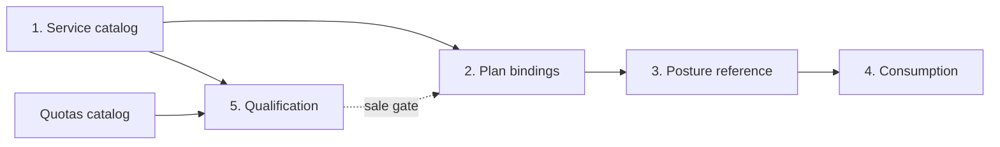

# Decomposition: Service Bindings

<!-- toc -->

- [1. Overview](#1-overview)
- [2. Entries](#2-entries)
  - [2.1 Service catalog - HIGH](#21-service-catalog---high)
  - [2.2 Plan service bindings and acceptance - HIGH](#22-plan-service-bindings-and-acceptance---high)
  - [2.3 Posture service binding reference - HIGH](#23-posture-service-binding-reference---high)
  - [2.4 Binding consumption - HIGH](#24-binding-consumption---high)
  - [2.5 Qualification and availability - HIGH](#25-qualification-and-availability---high)
- [3. Feature Dependencies](#3-feature-dependencies)

<!-- /toc -->

**Overall implementation status:**
- [ ] `p1` - **ID**: `cpt-cf-bss-service-bindings-status-lifecycle`

## 1. Overview

This package covers BSS work across Products, Pricing, Subscriptions and Entitlements and its contract with resource adapters. [PRD](PRD.md) defines outcomes. [DESIGN](DESIGN.md) defines the architecture and the owner contracts. Five features assign the behavior to owners.

The first sellable service needs all five features. Checkboxes track implementation, not document completion. NFRs, interfaces, contracts and use cases are cross-cutting: each feature that implements a part of one lists it. Each owner also adopts the text of [DESIGN §4.6](DESIGN.md#46-required-changes-to-owner-designs) in its own design, and writes its gear-local feature specification with its code, as the quotas track did.

## 2. Entries

### 2.1 [Service catalog](features/0001-service-catalog.md) - HIGH

- [ ] `p1` - **ID**: `cpt-cf-bss-service-bindings-feature-service-catalog`

- **Purpose**: Publish reviewed service types, resource capability profiles and service definitions that qualify SKU versions, and validate binding sets for Pricing.
- **Owner**: Products and catalog administrators; adapter owners register the instances.
- **Depends On**: None
- **Scope**: The two GTS schemas, proposals and review, immutable versions, availability slots, catalog reads and `validate_service_bindings`.
- **Out of scope**: Qualification evidence and enabling sale (feature 5), prices, bindings, purchases.

**Requirements Covered**:

- [ ] `p1` - `cpt-cf-bss-service-bindings-fr-service-type`
- [ ] `p1` - `cpt-cf-bss-service-bindings-fr-parameter-schema`
- [ ] `p1` - `cpt-cf-bss-service-bindings-fr-profile`
- [ ] `p1` - `cpt-cf-bss-service-bindings-fr-sku-qualification`
- [ ] `p1` - `cpt-cf-bss-service-bindings-fr-catalog-history`
- [ ] `p1` - `cpt-cf-bss-service-bindings-fr-catalog-read`
- [ ] `p1` - `cpt-cf-bss-service-bindings-nfr-isolation`
- [ ] `p1` - `cpt-cf-bss-service-bindings-nfr-retention`
- [ ] `p1` - `cpt-cf-bss-service-bindings-interface-owner-sdks`
- [ ] `p1` - `cpt-cf-bss-service-bindings-contract-resource-adapter`
- [ ] `p1` - `cpt-cf-bss-service-bindings-usecase-buy`
- [ ] `p1` - `cpt-cf-bss-service-bindings-usecase-catalog-change`

**Design Principles Covered**:

- [ ] `p1` - `cpt-cf-bss-service-bindings-principle-single-authority`

**Design Constraints Covered**:

- [ ] `p1` - `cpt-cf-bss-service-bindings-constraint-first-release`
- [ ] `p1` - `cpt-cf-bss-service-bindings-constraint-platform`

**Domain Model Entities**:

- [ ] `p1` - `cpt-cf-bss-service-bindings-entity-evidence-chain`

**Design Components**:

- [ ] `p1` - `cpt-cf-bss-service-bindings-component-commercial-chain`

**API**: `ProductsServiceCatalogClientV1` and the `/bss-products/v1` service endpoints (DESIGN §3.3.1–3.3.2).

**Sequences**:

- [ ] `p1` - `cpt-cf-bss-service-bindings-seq-purchase`

**Data**:

- [ ] `p1` - `cpt-cf-bss-service-bindings-db-owner-state`

**Design coverage**: DESIGN §3.3.1 and §3.3.2; `cpt-cf-bss-service-bindings-interface-owner-contracts`, `cpt-cf-bss-service-bindings-tech-owner-boundaries`, `cpt-cf-bss-service-bindings-topology-existing-gears` and `cpt-cf-bss-service-bindings-design-lifecycle` cover these owner contracts.

**Completion**: Record passing owner-contract evidence for the feature's definitions of done and acceptance criteria. Document approval alone does not prove implementation.

### 2.2 [Plan service bindings and acceptance](features/0002-plan-bindings.md) - HIGH

- [ ] `p1` - **ID**: `cpt-cf-bss-service-bindings-feature-plan-bindings`

- **Purpose**: Bind plan items to qualified services and freeze the selected bindings with the accepted prices.
- **Owner**: Pricing and plan authors.
- **Depends On**: `cpt-cf-bss-service-bindings-feature-service-catalog`
- **Scope**: Draft replacement, checks, governance, copy and clone, the preview, the expected digest, the acceptance freeze, receipt reads and the shared digest functions.
- **Out of scope**: Service meaning, qualification, posture and delivery.

**Requirements Covered**:

- [ ] `p1` - `cpt-cf-bss-service-bindings-fr-plan-binding`
- [ ] `p1` - `cpt-cf-bss-service-bindings-fr-binding-validation`
- [ ] `p1` - `cpt-cf-bss-service-bindings-fr-binding-edit`
- [ ] `p1` - `cpt-cf-bss-service-bindings-fr-binding-edit-conflict`
- [ ] `p1` - `cpt-cf-bss-service-bindings-fr-binding-governance`
- [ ] `p1` - `cpt-cf-bss-service-bindings-fr-binding-revision`
- [ ] `p1` - `cpt-cf-bss-service-bindings-fr-binding-coverage`
- [ ] `p1` - `cpt-cf-bss-service-bindings-fr-acceptance`
- [ ] `p1` - `cpt-cf-bss-service-bindings-fr-acceptance-digest`
- [ ] `p1` - `cpt-cf-bss-service-bindings-fr-acceptance-replay`
- [ ] `p1` - `cpt-cf-bss-service-bindings-fr-units`
- [ ] `p1` - `cpt-cf-bss-service-bindings-fr-parameters-resolved`
- [ ] `p1` - `cpt-cf-bss-service-bindings-fr-release-split`
- [ ] `p1` - `cpt-cf-bss-service-bindings-fr-target-scope`
- [ ] `p1` - `cpt-cf-bss-service-bindings-nfr-isolation`
- [ ] `p1` - `cpt-cf-bss-service-bindings-nfr-determinism`
- [ ] `p1` - `cpt-cf-bss-service-bindings-nfr-retention`
- [ ] `p1` - `cpt-cf-bss-service-bindings-interface-owner-sdks`
- [ ] `p1` - `cpt-cf-bss-service-bindings-usecase-buy`
- [ ] `p1` - `cpt-cf-bss-service-bindings-usecase-catalog-change`

**Design Principles Covered**:

- [ ] `p1` - `cpt-cf-bss-service-bindings-principle-single-authority`
- [ ] `p1` - `cpt-cf-bss-service-bindings-principle-frozen-evidence`

**Design Constraints Covered**:

- [ ] `p1` - `cpt-cf-bss-service-bindings-constraint-first-release`
- [ ] `p1` - `cpt-cf-bss-service-bindings-constraint-platform`

**Domain Model Entities**:

- [ ] `p1` - `cpt-cf-bss-service-bindings-entity-evidence-chain`

**Design Components**:

- [ ] `p1` - `cpt-cf-bss-service-bindings-component-commercial-chain`

**API**: `PricingServiceBindingAuthoringClientV1`, `PricingReadV1::resolve`, `SellabilityV1::check` and `PricingAcceptanceV1::acceptance` (DESIGN §3.3.3–3.3.4, §3.3.7).

**Sequences**:

- [ ] `p1` - `cpt-cf-bss-service-bindings-seq-purchase`

**Data**:

- [ ] `p1` - `cpt-cf-bss-service-bindings-db-owner-state`

**Design coverage**: DESIGN §3.3.3, §3.3.4, §3.3.7 and §3.3.8; `cpt-cf-bss-service-bindings-interface-owner-contracts`, `cpt-cf-bss-service-bindings-tech-owner-boundaries`, `cpt-cf-bss-service-bindings-topology-existing-gears` and `cpt-cf-bss-service-bindings-design-lifecycle` cover these owner contracts.

**Completion**: Record passing owner-contract evidence for the feature's definitions of done and acceptance criteria. Document approval alone does not prove implementation.

### 2.3 [Posture service binding reference](features/0003-posture-reference.md) - HIGH

- [ ] `p1` - **ID**: `cpt-cf-bss-service-bindings-feature-posture-reference`

- **Purpose**: Name the accepted bindings of each purchased component in the posture and admit only compatible changes.
- **Owner**: Subscriptions. Built with the Entitlements service fulfillment feature (owner, 2026-11-25).
- **Depends On**: `cpt-cf-bss-service-bindings-feature-plan-bindings`
- **Scope**: `serviceBindingRefs` on posture grants, the snapshot check at acquisition, the refusal of increases and additions until Pricing's change-delta acceptance exists (SVB-Q04, owner, 2026-11-25) and the admission rules that apply once it does.
- **Out of scope**: Service meaning, dispositions and their second-release authority.

**Requirements Covered**:

- [ ] `p1` - `cpt-cf-bss-service-bindings-fr-posture-reference`
- [ ] `p1` - `cpt-cf-bss-service-bindings-fr-compatible-increase`
- [ ] `p1` - `cpt-cf-bss-service-bindings-fr-change-refusal`
- [ ] `p1` - `cpt-cf-bss-service-bindings-nfr-determinism`
- [ ] `p1` - `cpt-cf-bss-service-bindings-interface-owner-sdks`
- [ ] `p1` - `cpt-cf-bss-service-bindings-usecase-buy`
- [ ] `p1` - `cpt-cf-bss-service-bindings-usecase-increase`

**Design Principles Covered**:

- [ ] `p1` - `cpt-cf-bss-service-bindings-principle-single-authority`

**Design Constraints Covered**:

- [ ] `p1` - `cpt-cf-bss-service-bindings-constraint-first-release`

**Domain Model Entities**:

- [ ] `p1` - `cpt-cf-bss-service-bindings-entity-evidence-chain`

**Design Components**:

- [ ] `p1` - `cpt-cf-bss-service-bindings-component-commercial-chain`

**API**: `CommercialPostureV1` grants and `ServiceBindingRefV1` (DESIGN §3.3.5, §3.3.7).

**Sequences**:

- [ ] `p1` - `cpt-cf-bss-service-bindings-seq-purchase`
- [ ] `p1` - `cpt-cf-bss-service-bindings-seq-change`

**Data**:

- [ ] `p1` - `cpt-cf-bss-service-bindings-db-owner-state`

**Design coverage**: DESIGN §3.3.5 and §3.3.7; `cpt-cf-bss-service-bindings-interface-owner-contracts`, `cpt-cf-bss-service-bindings-tech-owner-boundaries`, `cpt-cf-bss-service-bindings-topology-existing-gears` and `cpt-cf-bss-service-bindings-design-lifecycle` cover these owner contracts.

**Completion**: Record passing owner-contract evidence for the feature's definitions of done and acceptance criteria. Document approval alone does not prove implementation.

### 2.4 [Binding consumption](features/0004-consumption.md) - HIGH

- [ ] `p1` - **ID**: `cpt-cf-bss-service-bindings-feature-consumption`

- **Purpose**: Verify the frozen evidence and derive the service target that the adapter receives.
- **Owner**: Entitlements, under its feature 05.
- **Depends On**: `cpt-cf-bss-service-bindings-feature-posture-reference`
- **Scope**: Receipt and reference checks under the grant's evidence reference (ENT-D-27), completeness, unit computation, release refusals and the adapter inputs. The Entitlements SDK doc of `ServiceTypeRefV1` and its test IDs move to `gts.cf.bss.products.service_type.v1~` instances.
- **Out of scope**: Assignments, work orders, results and recovery, which the Entitlements design owns.

**Requirements Covered**:

- [ ] `p1` - `cpt-cf-bss-service-bindings-fr-explicit-selection`
- [ ] `p1` - `cpt-cf-bss-service-bindings-fr-complete-evidence`
- [ ] `p1` - `cpt-cf-bss-service-bindings-fr-adapter-boundary`
- [ ] `p1` - `cpt-cf-bss-service-bindings-nfr-isolation`
- [ ] `p1` - `cpt-cf-bss-service-bindings-nfr-determinism`
- [ ] `p1` - `cpt-cf-bss-service-bindings-contract-resource-adapter`
- [ ] `p1` - `cpt-cf-bss-service-bindings-usecase-buy`
- [ ] `p1` - `cpt-cf-bss-service-bindings-usecase-increase`

**Design Principles Covered**:

- [ ] `p1` - `cpt-cf-bss-service-bindings-principle-frozen-evidence`

**Design Constraints Covered**:

- [ ] `p1` - `cpt-cf-bss-service-bindings-constraint-first-release`

**Domain Model Entities**:

- [ ] `p1` - `cpt-cf-bss-service-bindings-entity-evidence-chain`

**Design Components**:

- [ ] `p1` - `cpt-cf-bss-service-bindings-component-commercial-chain`

**API**: `PricingAcceptanceV1::acceptance`, `verify_service_snapshot`, `service_units` and the Entitlements resource plugin (DESIGN §3.3.6).

**Sequences**:

- [ ] `p1` - `cpt-cf-bss-service-bindings-seq-purchase`
- [ ] `p1` - `cpt-cf-bss-service-bindings-seq-change`

**Data**:

- [ ] `p1` - `cpt-cf-bss-service-bindings-db-owner-state`

**Design coverage**: DESIGN §3.3.6–3.3.8; `cpt-cf-bss-service-bindings-interface-owner-contracts`, `cpt-cf-bss-service-bindings-tech-owner-boundaries`, `cpt-cf-bss-service-bindings-topology-existing-gears` and `cpt-cf-bss-service-bindings-design-lifecycle` cover these owner contracts.

**Completion**: Record passing owner-contract evidence for the feature's definitions of done and acceptance criteria. Document approval alone does not prove implementation.

### 2.5 [Qualification and availability](features/0005-qualification.md) - HIGH

- [ ] `p1` - **ID**: `cpt-cf-bss-service-bindings-feature-qualification`

- **Purpose**: Enable a service definition for sale only with adapter-owner evidence for its exact service type and profile versions.
- **Owner**: Products and adapter owners, in one build with the quotas package's qualification feature, for quota, license and service profiles (SVB-Q01, owner, 2026-11-25).
- **Depends On**: `cpt-cf-bss-service-bindings-feature-service-catalog` and the quotas package's [catalog feature](../quotas/features/0001-catalog.md): qualification starts after both catalogs exist.
- **Scope**: Qualification evidence records, enabling, disabling and withdrawal, and their effect on new sales.
- **Out of scope**: The adapter design, OSS tests and resource inventory.

**Requirements Covered**:

- [ ] `p1` - `cpt-cf-bss-service-bindings-fr-availability`
- [ ] `p1` - `cpt-cf-bss-service-bindings-nfr-retention`
- [ ] `p1` - `cpt-cf-bss-service-bindings-contract-resource-adapter`
- [ ] `p1` - `cpt-cf-bss-service-bindings-usecase-buy`

**Design Principles Covered**:

- [ ] `p1` - `cpt-cf-bss-service-bindings-principle-single-authority`

**Design Constraints Covered**:

- [ ] `p1` - `cpt-cf-bss-service-bindings-constraint-first-release`

**Domain Model Entities**:

- [ ] `p1` - `cpt-cf-bss-service-bindings-entity-evidence-chain`

**Design Components**:

- [ ] `p1` - `cpt-cf-bss-service-bindings-component-commercial-chain`

**API**: Products availability operations and the qualification evidence record (DESIGN §3.3.2.2, §4.2).

**Sequences**:

- [ ] `p1` - `cpt-cf-bss-service-bindings-seq-purchase`

**Data**:

- [ ] `p1` - `cpt-cf-bss-service-bindings-db-owner-state`

**Design coverage**: DESIGN §3.3.2.2, §3.5 and §4.2; `cpt-cf-bss-service-bindings-interface-owner-contracts`, `cpt-cf-bss-service-bindings-tech-owner-boundaries`, `cpt-cf-bss-service-bindings-topology-existing-gears` and `cpt-cf-bss-service-bindings-design-lifecycle` cover these owner contracts.

**Completion**: Record passing owner-contract evidence for the feature's definitions of done and acceptance criteria. Document approval alone does not prove implementation.

## 3. Feature Dependencies

The chain shows delivery dependencies. Features 1 and 2 are each one provider change in this repository, built in that order and reviewed as separate pull requests. Feature 2 builds on the quotas track's Pricing changes (D-540 to D-548). Features 3 and 4 are built together in the Entitlements service fulfillment unit (owner, 2026-11-25). They use the `pricing-sdk` types and functions once feature 2 is merged and vhp-core takes that gears-rust version. Before that they may build against a local mirror of feature 2's frozen shape and its digest vectors, which they replace with `pricing-sdk` before their gates close. Feature 3's increase and addition path waits for Pricing's change-delta acceptance (Subscriptions SUB-D-61, S-U16), which is not designed yet; until then Subscriptions refuses those changes before any effect (SVB-Q04, owner, 2026-11-25). Feature 5 is the sale gate. The owner ruled on 2026-11-25 (SVB-Q01) that it is built once for quota, license and service profiles, after both catalogs exist. Until then every definition stays disabled, and acceptance refuses the sale with `NOT_SELLABLE`. Authoring, checks and fakes work before it.

| Order | Feature | Owner change | Gate closed | What the SDK exposes |
| --- | --- | --- | --- | --- |
| 1 | Service catalog | Products | SVB-G02 | `products-sdk`: the two schemas; `ServiceTypeVersion`, `ResourceProfileVersion`, `ServiceDefinitionVersion` and their references; `ProductsServiceCatalogClientV1` with the reads and `validate_service_bindings`; the digest domains and canonical rendering |
| 2 | Plan bindings | Pricing | SVB-G03 | `pricing-sdk`: `PlanServiceBindingV1`, `PinnedServiceEvidence`, `ServiceTerms`, `AcceptedServiceSnapshot`, `AcceptedServiceBinding`; `PricingServiceBindingAuthoringClientV1`; `select_service_bindings`, `uncovered_services`, the five digest functions, `service_units`, `verify_service_snapshot`; `CommercialReason::ServiceBindingMissing`; digest test vectors |
| 3 | Posture reference | Subscriptions, inside the Entitlements unit | SVB-G04 | Subscriptions SDK: `PostureGrantV1.service_binding_refs`, `ServiceBindingRefV1`; the refusal reasons, with increases and additions refused until the change-delta acceptance exists |
| 4 | Consumption | Entitlements | SVB-G06 | Entitlements SDK: the service target and resource plugin request that carry Products references; no new provider type |
| 5 | Qualification, one build with the quotas package's feature 5 (SVB-Q01) | Products with the adapter owner | SVB-G05 | `products-sdk`: one qualification evidence record and availability decision for quota, license and service profiles |

SVB-G01 closes when the owners adopt DESIGN §4.6. SVB-G07 closes with the first recorded end-to-end offer.
