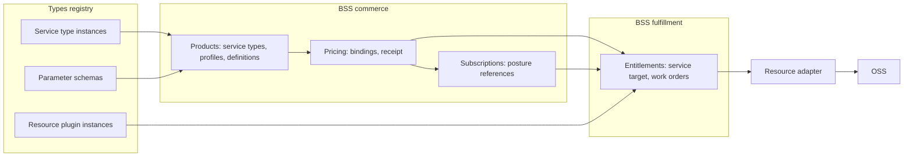

# Technical Design: Service Bindings


<!-- toc -->

- [1. Architecture Overview](#1-architecture-overview)
  - [1.1 Architectural Vision](#11-architectural-vision)
  - [1.2 Architecture Drivers](#12-architecture-drivers)
  - [1.3 Architecture Layers](#13-architecture-layers)
- [2. Principles & Constraints](#2-principles--constraints)
  - [2.1 Design Principles](#21-design-principles)
  - [2.2 Constraints](#22-constraints)
- [3. Technical Architecture](#3-technical-architecture)
  - [3.1 Domain Model](#31-domain-model)
  - [3.2 Component Model](#32-component-model)
  - [3.3 API Contracts](#33-api-contracts)
  - [3.4 Internal Dependencies](#34-internal-dependencies)
  - [3.5 External Dependencies](#35-external-dependencies)
  - [3.6 Interactions & Sequences](#36-interactions--sequences)
  - [3.7 Database schemas & tables](#37-database-schemas--tables)
  - [3.8 Deployment Topology](#38-deployment-topology)
- [4. Additional context](#4-additional-context)
  - [4.1 Future scope](#41-future-scope)
  - [4.2 Integration qualification gates](#42-integration-qualification-gates)
  - [4.3 Contract conformance criteria](#43-contract-conformance-criteria)
  - [4.4 Design decisions](#44-design-decisions)
  - [4.5 Open questions](#45-open-questions)
  - [4.6 Required changes to owner designs](#46-required-changes-to-owner-designs)
  - [4.7 Adapter integration design boundary](#47-adapter-integration-design-boundary)
- [5. Traceability](#5-traceability)

<!-- /toc -->

- [ ] `p1` - **ID**: `cpt-cf-bss-service-bindings-design-lifecycle`

**Status: draft design.** These models and operations define the required owner contracts. [§4.2](#42-integration-qualification-gates) lists the qualification gates. [PRD §9](PRD.md#9-acceptance-criteria) defines the business acceptance criteria. [§4.6](#46-required-changes-to-owner-designs) gives the exact text that the owner designs must adopt.

## 1. Architecture Overview

### 1.1 Architectural Vision

The adapter owner registers what the adapter can deliver. Products reviews it and qualifies SKUs for it. Pricing binds plan items to qualified services and freezes the selected bindings with the prices. Subscriptions names the accepted bindings of each purchased component in its posture. Entitlements verifies that evidence, derives the service intent and sends it to the selected adapter. OSS executes.

| Step | Owner | Result |
| --- | --- | --- |
| Register | Adapter owner | A GTS service type instance and its parameter schema under Products' schemas; a resource plugin instance under Entitlements' plugin type |
| Review | Products | An immutable service type version and a resource capability profile version |
| Qualify | Products, with adapter-owner evidence | An immutable service definition version for one SKU version, then sale availability |
| Bind | Pricing | Service bindings on a draft plan revision, validated by Products |
| Freeze | Pricing | The accepted service snapshot in the acceptance receipt |
| Reference | Subscriptions | The service binding references of each posture grant |
| Consume | Entitlements | A verified service target: service type, profile, units, parameters and access policy |
| Execute | Adapter and OSS | The native service, behind the adapter boundary |

[DECOMPOSITION](DECOMPOSITION.md) organizes this package. DESIGN defines the architecture and the public contracts. The features cover flows, checks and conformance.

This package follows the [commercial quotas package](../quotas/DESIGN.md). A service type plays the role of a quota metric, a service definition the role of a quota definition and a service binding the role of a plan quota rule. The same catalog versions, set validation, acceptance freeze and digest rules apply unless §4.4 gives a reason.

### 1.2 Architecture Drivers

| Driver | Architectural response |
| --- | --- |
| Exact accepted service | Immutable catalog versions; bindings pinned to them; a frozen snapshot in the receipt; derivation from that snapshot only |
| No inferred service | Explicit posture references and exact service type and profile references; names and labels are never identities |
| One owner per fact | Products owns service meaning and qualification; Pricing owns bindings and their freeze; Subscriptions owns the selection for a component |
| Release split | Fixed policy slots and profile checks that refuse second-release capabilities before any effect |
| Shared digests | One SDK function for each digest, with test vectors used by producers and consumers |

| NFR ID | Allocation | Verification |
| --- | --- | --- |
| `cpt-cf-bss-service-bindings-nfr-isolation` | Tenant-only PDP questions in Products and Pricing; tenant-filtered reads; foreign records absent | SVB-C07, SVB-C13, SVB-C24 |
| `cpt-cf-bss-service-bindings-nfr-determinism` | Products and Pricing SDK digest functions; shared vectors | SVB-C20, SVB-C27 |
| `cpt-cf-bss-service-bindings-nfr-retention` | Append-only catalog versions; immutable receipts; historical reads | SVB-C01, SVB-C12, SVB-C19 |

#### Key ADRs and owner contracts

- [ADR-0001: Products owns service types and SKU qualification](ADR/0001-service-type-catalog.md), `cpt-cf-bss-service-bindings-adr-service-catalog`.
- [ADR-0002: Pricing freezes service bindings in the acceptance receipt](ADR/0002-binding-freeze.md), `cpt-cf-bss-service-bindings-adr-binding-freeze`.

The [Entitlements design](../../entitlements/docs/DESIGN.md) is the consumer. Its [service fulfillment feature](../../entitlements/docs/features/05-resource-execution.md) defines assignments, work orders and recovery. Its gates E-U03, E-U04, E-U05 and E-U06 track the adoption of this package.

The Pricing and Products changes of the commercial quotas track are pending in [PR #6105](https://github.com/constructorfabric/gears-rust/pull/6105): Products P-D-266 to P-D-276 and Pricing D-540 to D-548. This package cites them and extends the same contracts. If that change is revised, the service changes follow its final shapes.

The [commercial ownership ADR](../ADR/0002-cpt-cf-bss-adr-commercial-ownership-tenant-rbac.md) applies. Catalog records and plans belong to the catalog tenant that Pricing's `CatalogRef` names. The service is delivered in the resource tenant. The payer axis never selects or authorizes a service. Permissions stay tenant-scoped.

### 1.3 Architecture Layers

- [ ] `p1` - **ID**: `cpt-cf-bss-service-bindings-tech-owner-boundaries`



The adapter owner writes only registry entries and qualification evidence. Commercial owners keep immutable evidence. Entitlements reads frozen evidence and the posture. OSS does not call Products, Pricing or Subscriptions.

## 2. Principles & Constraints

### 2.1 Design Principles

- [ ] `p1` - **ID**: `cpt-cf-bss-service-bindings-principle-single-authority`

Each fact has one owner:

- The adapter owner states what a service type means and which parameters it accepts.
- Products decides which service types, profiles and SKU qualifications are published and sellable.
- Pricing owns bindings, the selection of a sale and the frozen evidence.
- Subscriptions owns which accepted bindings a component carries, its committed quantity and its lifecycle.
- Entitlements owns the meaning of the quantity and target rules (ENT-D-03), the service target and its delivery.
- OSS owns the resources that implement a service.

- [ ] `p1` - **ID**: `cpt-cf-bss-service-bindings-principle-frozen-evidence`

Fulfillment uses frozen evidence only. Entitlements never reads a live plan, a live catalog version or a current default to decide what to deliver. Catalog versions are append-only, so a reference with a version and a digest identifies the same content forever.

### 2.2 Constraints

- [ ] `p1` - **ID**: `cpt-cf-bss-service-bindings-constraint-first-release`

The first release sells a service under a profile that supports provision, pause, restore and service-stop, with data-preserving pause, initial installation and, for preparation-enabled profiles, withdraw. Retention, export and disposal slots are `not_applicable`. A profile that requires fulfillment outputs is not sellable. The target rule is `resource_tenant`. Every owner refuses the rest before any effect (§3.3.8).

- [ ] `p1` - **ID**: `cpt-cf-bss-service-bindings-constraint-platform`

The baseline follows [ToolKit](../../../../docs/toolkit_unified_system/README.md), the [design review criteria](../../../../guidelines/DESIGN_REVIEW.md) and the [GTS guide](../../../../guidelines/GTS.md). No external call runs inside a local database transaction. Each gear uses its service principal and single-target scopes under the [commercial model §3.4](../../../../docs/arch/bss-commercial-model/DESIGN.md#34-internal-dependencies). This package adds no exception.

## 3. Technical Architecture

### 3.1 Domain Model

- [ ] `p1` - **ID**: `cpt-cf-bss-service-bindings-entity-evidence-chain`

| Logical entity | Owner | Required content / invariant |
| --- | --- | --- |
| ServiceType (registry instance) | Adapter owner registers; Products owns the schema | GTS instance of `gts.cf.bss.products.service_type.v1~`: name, localized text, commercial unit meaning, parameter schema reference, supported target rules |
| ServiceParameters schema | Adapter owner registers; Products owns the base schema | Final derived type of `gts.cf.bss.products.service_parameters.v1~` in the closed subset of §3.3.1 |
| ServiceTypeVersion | Products | Reviewed, immutable copy of one registry instance and its parameter schema, with registry content digests; `{id, version, digest}` |
| ResourceProfileVersion | Products | Immutable resource capability profile: operations, data-preserving pause, preparation, target rules, change support, required outputs; `{id, version, digest}` |
| ServiceDefinitionVersion | Products | Immutable qualification of one SKU version for one service type version under one profile version: unit bounds, bases, target rules, access policy, reviewed text; separate availability and qualification evidence |
| PlanServiceBinding | Shape: Pricing SDK; meaning: Entitlements; storage: Pricing | One item cell and one service key of a plan revision bound to one definition version, with basis, coefficient, target rule, complete parameters and policy slots |
| AcceptedServiceSnapshot | Pricing | Selected bindings with pinned evidence, binding digests, SKU versions, service units and availability revisions; original quantity, count and digests; a member of the acceptance receipt |
| ServiceBindingRef | Subscriptions | Acceptance reference, binding ID and binding digest, on each posture grant |
| Service target (derived) | Entitlements | Service type, profile, units, parameters, access policy and logical scope of one assignment; feature 05 of Entitlements |

These are logical entities. No entity is a Product parent or a Service catalog entity: a service definition is a catalog record like a quota definition. GTS is used for the extensible registry contracts. Closed lifecycle states stay closed enums.

### 3.2 Component Model

- [ ] `p1` - **ID**: `cpt-cf-bss-service-bindings-component-commercial-chain`

| Component | Owns | Does not own |
| --- | --- | --- |
| Adapter owner | Service type instances, parameter schemas, the resource plugin instance, qualification evidence | Commercial review, sale availability, prices, purchases |
| Products | Service schemas in `products-sdk`, service type, profile and definition versions, review, availability, reads, binding set validation | Bindings, prices, purchases, fulfillment |
| Pricing | Bindings on plan revisions, their checks and governance, the preview, the acceptance freeze and receipt reads | Service meaning, qualification, delivery |
| Orders / Workflow | Carry the acceptance reference through the acquisition, as today | Binding selection or service authority |
| Subscriptions | Posture references, committed quantity, admission of compatible increases and refusal of unsupported changes | Service meaning, adapter selection |
| Entitlements | Verification of the frozen evidence, the service target, assignments, work orders, results and recovery | Catalog, bindings, OSS resources |
| Resource adapter and OSS | Native offerings, resource selection and execution, behind the Entitlements contract | Commercial terms, posture |

### 3.3 API Contracts

- [ ] `p1` - **ID**: `cpt-cf-bss-service-bindings-interface-owner-contracts`

These versioned operations belong to the owner SDKs. Wire types and endpoints must keep their authorization, ordering, idempotency and recovery guarantees.

#### 3.3.1 GTS contract and adapter registration

Products declares two schemas in `products-sdk`. The toolkit inventory seeds types-registry with them, as for the quota schemas (products P-D-267).

| GTS schema | Role |
| --- | --- |
| `gts.cf.bss.products.service_type.v1~` | Concrete schema for named service type instances. Extensible only under `properties`. Not abstract. |
| `gts.cf.bss.products.service_parameters.v1~` | Concrete, open base schema of parameter schemas: `{"type": "object", "additionalProperties": true}` with no properties. Each service type derives one final schema (`x-gts-final: true`) from it; the derived overlay closes the object. |

**Service type instance.** The adapter owner registers each service type as a well-known instance in its own namespace, for example `gts.cf.bss.products.service_type.v1~cf.backup.resource_adapter.managed_backup.v1`. The last segment has no trailing `~`. Members:

| Member | Shape and meaning |
| --- | --- |
| `id` | The instance's own GTS ID |
| `name` | Technical name, 1 to 64 of `a-z`, `0-9` and `_` |
| `display_name`, `description` | Locale maps with a required English (`en`) entry; plain text of 1 to 255 and 1 to 4096 characters |
| `unit` | `{code, display_name, description}`: what one commercial service unit means, such as one protected workload. `code` is 1 to 64 of `a-z`, `0-9` and `_`; the texts are locale maps with `en` |
| `parameters_schema_ref` | GTS type ID narrowed to `gts.cf.bss.products.service_parameters.v1~` (`x-gts-type-ref`) |
| `target_rules` | Nonempty list without repeats of `resource_tenant` and `member_scope` |
| `properties` | Object validated by a derived schema; `{}` for the base schema |

**Parameter schema subset.** A derived parameter schema is final (`x-gts-final: true`) and stays inside this subset, so that every owner validates it with the registry's draft-07 validator and canonical digests stay exact:

- The derived schema is `allOf` with exactly two branches: the `$ref` to the base, and an overlay with `type: object`, `additionalProperties: false`, 0 to 32 `properties` and a `required` list. Beside `allOf` the top level holds only `$id`, `$schema`, `x-gts-final`, `title` and `description`. The open base accepts any object, so the closed overlay alone decides which members exist (`guidelines/GTS.md` §7 and §9).
- A property name is 1 to 64 of `a-z`, `0-9` and `_`.
- A property has exactly one of three forms: `{"type": "boolean"}`; `{"type": "string", "enum": [...]}` with 1 to 64 distinct values of 1 to 255 printable characters; or `{"type": "string", "maxLength": n}` with `n` from 1 to 255 and an optional `minLength` and `pattern`. A form may add `title`, `description` and `default`. A default must be valid for its property.
- Each property is in `required` or has a `default`.
- No other keyword: no `$ref` except the `allOf` reference to the base schema, no `oneOf`, `anyOf`, `patternProperties` or `format`, no numbers and no nested objects. A number is written as text with an `enum` or a `pattern`.

A parameter value is therefore a JSON string or boolean. The review rule of [feature 1](features/0001-service-catalog.md) refuses a property that carries a credential, a script, a URL with authority data or a native resource identifier.

**Resource plugin instance.** The adapter owner also registers its instance under the Entitlements resource plugin type `gts.cf.toolkit.plugins.plugin.v1~cf.bss.entitlements.resource_plugin.v1~` (Entitlements DESIGN §3.3.3). Its `supported_service_types` name Products service type versions and its `supported_profiles` name Products profile versions:

| Entitlements member | Products value |
| --- | --- |
| `ServiceTypeRefV1.descriptor_id` | The service type's GTS instance ID |
| `ServiceTypeRefV1.version`, `.digest` | The Products service type version, as decimal text, and its digest |
| `SupportedProfileV1.profile_ref` | The Products profile ID (UUID text) |
| `SupportedProfileV1.version`, `.digest` | The Products profile version, as decimal text, and its digest |

Registration proves nothing. Products qualification (§3.3.2.2) and the Entitlements route configuration decide what is sold and selected. Example: [service-type.instances.json](schemas/service-type.instances.json).

#### 3.3.2 Products service catalog

##### 3.3.2.1 Records and versions

Products keeps three append-only record kinds. Each version is immutable. Its digest is the lowercase hex SHA-256 of a domain line and the Products canonical rendering of its content (products P-D-267), one domain for each kind. Version numbers and approval metadata are not in the digest. An approved proposal whose content equals the latest version's publishes no new version and answers that version, as a quota definition reuses its version.

**`ServiceTypeVersion`** (domain `cf.bss.products.service_type.v1`):

| Field | Meaning |
| --- | --- |
| `service_type_id`, `version`, `digest` | The GTS instance ID, the positive Products version (decimal text) and the content digest |
| `instance_digest` | The registry content digest of the instance, kept at approval (the rendering alone, as registry evidence is hashed) |
| `name`, `display_name`, `description`, `unit`, `target_rules` | The instance content as approved, every locale kept |
| `parameters_schema_ref`, `parameters_schema_digest`, `parameters_schema` | The parameter schema's type ID, its registry content digest and its full content as approved |

A new registry content revision of the same instance needs a new reviewed version. Products never reads the current registry content for an approved version.

**`ResourceProfileVersion`** (domain `cf.bss.products.resource_profile.v1`), the resource capability profile:

| Field | Meaning |
| --- | --- |
| `profile_id`, `version`, `digest` | A Products UUID shared by the profile's versions, the positive version and the digest |
| `capability`, `contract_major` | `resource`, and `1` as canonical decimal text |
| `operations` | Closed object of explicit booleans `provision`, `withdraw`, `pause`, `restore`, `service_stop`, `export`, `delete`, `hold`; an absent flag is invalid |
| `pause_preserves_data` | The adapter keeps the service data and restoration identity during a pause |
| `preparation` | The adapter supports authorized preparation before activation (Entitlements feature 02) |
| `target_rules` | Nonempty subset of `resource_tenant` and `member_scope` |
| `change_support` | `{initial_set, increase}` booleans |
| `output_keys` | The fulfillment outputs the profile requires (Entitlements DESIGN §3.3.7); an empty list when none |
| `display_name`, `conditions` | Reviewed locale maps with `en` |

**`ServiceDefinitionVersion`** (domain `cf.bss.products.service_definition.v1`), the SKU qualification:

| Field | Meaning |
| --- | --- |
| `definition_id`, `version`, `definition_digest` | A Products UUID shared by the definition's versions, the positive version and the digest |
| `sku_id`, `sku_version` | The SKU and the SKU version it was approved at; it applies to that version and every later one (products P-D-270) |
| `service_type_ref` | `{id, version, digest}` of one service type version |
| `profile_ref` | `{id, version, digest}` of one profile version |
| `units` | `{min, step, max}`: canonical decimal integers of at most 39 digits; `min` from 0, `step` from 1, `max` at least `min` and required |
| `supported_bases` | Nonempty subset of `Fixed` and `PerPlanUnit` (REST: `fixed`, `per_plan_unit`) |
| `target_rules` | Nonempty subset of the intersection of the service type's and the profile's target rules |
| `access_policy` | `ServiceAccessPolicyV1`: `{on_restricted: "pause", on_revoked: "service_stop"}`; v1 has no other value |
| `display_name`, `profile_conditions` | Reviewed locale maps with `en` |
| `qualification_ref` | `{id, version, digest}` of the qualification evidence, or null until it is recorded. Not in the digest |
| `availability` | `{state, revision, observed_at, reason_code}`: the highest availability revision. Not in the digest |

A definition version's content never changes. Its availability and qualification evidence are separate observations. The approval writes availability revision 1, `disabled`, reason `qualification_pending`, as for quota definitions (products P-D-271). Examples: [resource-profile.example.json](schemas/resource-profile.example.json) and [service-definition.example.json](schemas/service-definition.example.json).

##### 3.3.2.2 Review and availability

One proposal path serves the three kinds. It follows the quota candidate review (products P-D-269): a proposal is `staged`, then `submitted`, then `approved` or `rejected`. The submitter and the author cannot decide it (`SOD_VIOLATION`). A decided proposal is frozen. Approval publishes the next version.

- A service type proposal names a registered instance ID. The submit resolves the instance and its parameter schema as the caller, checks the schemas, the subset of §3.3.1 and every reference, and pins the content and both registry digests. Approval publishes the pinned content. A registry change after the submit leaves the proposal as it is; it needs a new proposal.
- A resource profile proposal carries the profile content.
- A definition proposal names a SKU version the tenant holds, a service type version, a profile version and the remaining fields. The approval refuses a profile that the first release cannot sell (§3.3.8) with `SERVICE_PROFILE_UNSUPPORTED`, target rules outside both the service type's and the profile's with `SERVICE_TARGET_UNSUPPORTED`, and bounds that are not canonical with `SERVICE_UNITS_INVALID`.

Proposal bodies: `{kind: "service_type", instance_id}`; `{kind: "resource_profile", profile_id?, content}`; `{kind: "service_definition", definition_id?, sku_id, sku_version, service_type_ref, profile_ref, units, supported_bases, target_rules, access_policy, display_name, profile_conditions}`. An optional `profile_id` or `definition_id` names the record that the approval versions. A rejection needs a note (`NOTE_REQUIRED`).

Qualification evidence and availability decisions follow [feature 5](features/0005-qualification.md). They are built once for quota, license and service profiles, after both catalogs exist (SVB-Q01, owner, 2026-11-25). Enabling needs matching evidence. Disabling and withdrawal block submit, approval, immediate publication and new sales; they change no published revision or receipt.

##### 3.3.2.3 Catalog reads

`ProductsServiceCatalogClientV1` in `products-sdk` serves Pricing and plan editors. REST endpoints under `/bss-products/v1` answer the same shapes.

| SDK method | REST projection | Behavior |
| --- | --- | --- |
| `list_service_definitions(ctx, request)` | `GET /service-definitions` | `$filter` with `eq` terms joined by `and`: `sku_id` and `sku_version` (both required), `service_type_id` and `profile_id`; `availability` (`enabled` by default, or `all` with reasons) and `locale` as query parameters; `limit` 1 to 200, default 50; an opaque cursor bound to the tenant, the filters and the availability. The REST answer is `Page<T>` `{items, page_info}`; the SDK answer is `{items, next_cursor}` (as products P-D-272). Order: `(definition_id, version)` ascending |
| `get_service_definition(ctx, definition_id, version, locale)` | `GET /service-definitions/{id}/versions/{version}` | One exact version with its current availability. Disabled and withdrawn versions stay readable. |
| `get_service_type(ctx, service_type_id, version, locale)` | `GET /service-types/{service_type_id}/versions/{version}` | One exact service type version with its parameter schema |
| `get_resource_profile(ctx, profile_id, version, locale)` | `GET /resource-profiles/{id}/versions/{version}` | One exact profile version |
| `validate_service_bindings(ctx, request)` | None; Pricing runs in the same process | §3.3.2.4 |

Proposals use `POST /service-proposals`, `GET /service-proposals`, `GET /service-proposals/{id}` and `POST /service-proposals/{id}/submit`, `/approve` and `/reject`, with `If-Match` and an optional `Idempotency-Key`. The list answers newest first, filters on `kind` and `state`, and binds its cursor to the tenant and the filters. Texts are served in the requested locale or English. A dependency failure is an error, never an empty catalog.

| HTTP | Code |
| --- | --- |
| 400 | `VALIDATION`, `NOTE_REQUIRED`, `SERVICE_REFERENCE_FAMILY`, `SERVICE_REFERENCE_UNKNOWN`, `SERVICE_VERSION_UNSUPPORTED`, `SERVICE_SCHEMA_UNSUPPORTED`, `SERVICE_SKU_VERSION_UNKNOWN`, `SERVICE_RECORD_INVALID`, `SERVICE_UNITS_INVALID`, `SERVICE_TARGET_UNSUPPORTED`, `SERVICE_PROFILE_UNSUPPORTED` |
| 403 | `SOD_VIOLATION`, or a denied grant |
| 404 | A record of another tenant or outside the grant |
| 409 | `STALE_REVISION`, `SERVICE_PROPOSAL_STATE`, `CONTENDED`, `IDEMPOTENCY_CONFLICT` |
| 503 | `SERVICE_REGISTRY_UNAVAILABLE`, or the PDP unavailable |

**Permissions.** One authorization resource, `gts.cf.bss.products.service_catalog.v1~`, with `read`, `author`, `submit` and `approve`. Every request asks the PDP for the caller's tenant only (products P-D-265). A record of another tenant is 404. A row constraint of the grant names service definitions. Proposals, service types and resource profiles are read and written under the grant's tenant-only scope (as products P-D-273).

##### 3.3.2.4 Binding set validation

`validate_service_bindings(ctx, ServiceBindingSetRequest) -> ServiceBindingSetValidation` judges one complete set for Pricing. It asks `read` on the service catalog resource for the caller's tenant. It answers facts. Pricing decides what each boundary refuses, as with `validate_quota_set` (products P-D-275). Deployments give that grant, as they give SKU `read`, to every caller Pricing validates for: the authors who save bindings, the readers of a plan's checks (single and batch), the submitter, the final approver and the caller of an acceptance (Orders' principal). A non-final vote keeps a refusal as an observation (pricing D-503) and needs no grant (as products P-D-275 and pricing D-542, D-548).

The request carries the purpose (`Authoring` or `Acceptance`), the plan quantity (a canonical integer from 1, required for `Acceptance`), the locale and at most 200 bindings. Each binding carries its `binding_id`, `definition_ref`, the item's `sku_id` and the SKU version in force for the plan or the sale, `service_key`, `dimension_value`, `basis`, `coefficient`, `target_rule`, `parameters` and `policies`. The quantity is the one the units apply at: the purchased quantity of a sale and, for a change-delta acceptance (§3.3.7), the resulting committed quantity, never the added quantity, as the quota set validation's `Increase` change kind judges final limits (products P-D-276).

The answer holds one verdict per binding in request order and every check found. A verdict carries the resolved definition, service type and profile versions (absent when the caller's scope does not hold the definition), the normalized parameters and, with a quantity, the service units. Checks, in order for each binding:

| Check | Failure code and field |
| --- | --- |
| The exact definition version exists in the caller's scope | `SERVICE_BINDING_INVALID` on `definition_ref`; the binding's other checks are skipped |
| Its digest equals the binding's | `SERVICE_DEFINITION_CHANGED` on `definition_ref.digest` |
| The definition's SKU is the binding's, at the definition's SKU version or later | `SERVICE_BINDING_INVALID` on `definition_ref` |
| The basis is supported | `SERVICE_BINDING_INVALID` on `basis` |
| The coefficient is a canonical decimal integer. `Fixed`: on the grid `min + n × step` and at most `max`. `PerPlanUnit`: from 1 to `max` | `SERVICE_QUANTITY_INVALID` on `coefficient` |
| With a quantity, the units (§3.3.7) are on the grid and within the bounds; checked `u128` arithmetic | `SERVICE_QUANTITY_INVALID` on `quantity` |
| The target rule is one of the definition's and is `resource_tenant` in this release | `SERVICE_TARGET_UNSUPPORTED` on `target_rule` |
| The parameters validate against the pinned schema; defaults fill absent properties; the canonical text is at most 16 KiB | `SERVICE_PARAMETERS_INVALID` on `parameters.<name>` or `parameters` |
| Each policy slot is `not_applicable` | `SERVICE_POLICY_DEFERRED` on `policies.<slot>` |
| The availability is `enabled` | `SERVICE_QUALIFICATION_UNAVAILABLE` on `definition_ref`, with state and reason |

Only a malformed request is an error: 400 `VALIDATION` on its field. The judgement never stops at the first failure and never drops a binding. It reads the definitions, their availability, service types and profiles in a bounded number of statements and makes no registry call.

A malformed request is: more than 200 bindings; a repeated `binding_id`; a locale over 64 bytes; a `service_key` outside 1 to 64 bytes or a `dimension_value` over 512 bytes; a quantity that is not a canonical integer from 1, or an `Acceptance` request without one. Pricing's caps equal these bounds at compile time, so a body Pricing accepts is never a Products 400. Pricing sends, for each binding, the SKU version in force on the revision's sale date (`ReferenceRegistryV1::sku_version_as_of`, as pricing D-542); a SKU with no version that day is `SERVICE_BINDING_INVALID` on `item_id`, judged before the call. A binding that Products' verdict does not judge against the definition it names is Products' contract break: a logged 500 at the PUT and a red `SERVICE_BINDING_INVALID` row at the checks (as pricing D-543, D-544).

#### 3.3.3 Pricing plan service bindings

Bindings are a versioned extension of `PlanRevision`. Their shape lives in `pricing-sdk` as plain types, as the quota rule's does (pricing D-541); Entitlements owns their meaning (ENT-D-03). No GTS ID is registered for it.

| Pricing object | Service extension |
| --- | --- |
| `PlanRevision` | `service_bindings` and `service_bindings_digest`, in the revision's content, version and approval evidence. At most 200 bindings. Empty means the plan delivers no service. A revision without bindings keeps its approval content and fingerprint; its checks answer and revision read gain only `service_bindings_digest`, the empty set's digest (as pricing D-544, D-545). No stored revision or receipt is migrated; a stored receipt decodes with `service` absent. |
| `PlanItem` | Referenced by `item_id`. Deleting an item that has bindings is 409 `ITEM_HAS_SERVICE_BINDINGS`. |
| Checks | A revision with bindings gets these rows after the quota rows, in order: `SERVICE_BINDING_INVALID`, `SERVICE_DEFINITION_CHANGED`, `SERVICE_QUANTITY_INVALID`, `SERVICE_TARGET_UNSUPPORTED`, `SERVICE_PARAMETERS_INVALID`, `SERVICE_POLICY_DEFERRED`, `SERVICE_BINDING_DUPLICATE`, `SERVICE_QUALIFICATION_UNAVAILABLE`, `SERVICE_BINDING_MISSING`. Each failure names `service_binding_id` and `field`. `SERVICE_BINDING_MISSING` is red for each sellable cell of an item with bindings that `uncovered_services` names on the revision's sale date. Every checks answer carries `service_bindings_digest`. A code without its own row turns `SERVICE_BINDING_INVALID` red; a revision whose verdict was not read fails closed (as pricing D-544). |
| `ResolvedBindings` | `service_terms`: every binding with its pinned evidence and binding digest, and the set digest |
| `NewSaleQuery` | `expected_service_digest` |
| `AcceptanceReceipt` | `service`: the `AcceptedServiceSnapshot` |

`PlanServiceBindingV1`:

| Field | Meaning and validation |
| --- | --- |
| `binding_id` | Client UUID, unique in the revision and kept across edits |
| `service_key` | 1 to 64 of ASCII letters, digits, `_`, `-` and `.`. All bindings of one key name the same item |
| `definition_ref` | `{id, version, digest}` of one Products service definition version |
| `item_id` | An item of the same revision; its SKU must be the definition's |
| `dimension_value` | Null on an item without a dimension. On an item with one, a value of its key, or null for the item's default binding of the key. At most 512 bytes |
| `basis` | `fixed` or `per_plan_unit` (SDK `Fixed`, `PerPlanUnit`) |
| `coefficient` | Canonical decimal integer of at most 39 digits |
| `target_rule` | `resource_tenant` or `member_scope` |
| `parameters` | Object of parameter name to string or boolean. Stored complete: Pricing saves Products' normalized values |
| `policies` | `{retention, export, disposal}`, each `{"kind": "not_applicable"}` in this release. Required; an absent slot is invalid |

The pinned evidence (`PinnedServiceEvidence`) is what the definition pinned when the binding was saved. It holds the definition's `sku_id` and `sku_version`, `service_type` `{id, version, digest}`, `unit_code`, `parameters_schema_ref` and `parameters_schema_digest`, `profile` `{id, version, digest}`, `units_min`, `units_step` and `units_max`, `access_policy`, `initial_set_supported`, `increase_supported` and `preparation_supported`. It holds no text, locale or availability. Resolve and acceptance read it from storage and make no catalog call. A saved binding also keeps the availability observation its definition showed at the save (`SavedPlanServiceBindingV1`), as a saved quota rule does (pricing D-542); the checks judge the current one.

The proposed `PricingServiceBindingAuthoringClientV1` in `pricing-sdk` uses the plan authoring service, storage and authorization:

| Method / operation | REST contract | Behavior |
| --- | --- | --- |
| `get_service_bindings(ctx, revision_id)` | `GET /bss-pricing/v1/plan-revisions/{id}/service-bindings` | `{revision_id, revision_version, service_bindings, service_bindings_digest}`, with the revision ETag on REST. The full revision read also carries them. |
| `replace_service_bindings(ctx, revision_id, expected_version, operation_id, bindings)` | `PUT /bss-pricing/v1/plan-revisions/{id}/service-bindings`; required `If-Match` and `Idempotency-Key` | Body `{service_bindings: [...]}`. Replaces the draft's complete set atomically. An empty array removes all bindings. Answers the normalized set, its digest and the new ETag. |
| Checks | Extend `GET /plan-revisions/{id}/checks`, the batch checks and `check_plan_revision` (pricing D-544) | Every binding failure as a row; `ready` stays false while any fails |
| Submit, approve, publish | Extend the existing operations (pricing D-545) | Bindings join the approval unit. Submit, every vote and immediate publication recheck them through Products; a non-final vote keeps a refusal as an observation (pricing D-503). A scheduled revision is checked at its approval; its switch on the sale date makes no catalog call (pricing D-545). Acceptance rechecks every sale. |
| Copy revision, clone plan | Extend the existing operations | Copy bindings with their exact definition versions; remap `item_id`; keep `binding_id` and `service_key`; copy the pinned evidence and recompute the digests. Availability is rechecked, never copied as authority. |

Replacement follows the quota rule replacement (pricing D-543): the idempotency key is looked up before the version; a known key with the same content replays its result; other content under the key conflicts; the new set is parsed and validated through Products outside the transaction; one transaction rechecks the draft state, the version and the items and commits the normalized set, the evidence, the digest, the audit row, the new version and the key's result. A draft may hold a definition that is not enabled; submit, approval and acceptance refuse it.

Pricing's own checks, before Products: the body shape and unknown members (400 `VALIDATION`); at most 200 bindings; a repeated `binding_id`; an item outside the revision, a dimension value outside the item's key, a service key that names two items and a missing policy slot (`SERVICE_BINDING_INVALID` on the field); two bindings of one item, key and dimension value, null included (409 `SERVICE_BINDING_DUPLICATE`); a parameter value that is not a string or a boolean (`SERVICE_PARAMETERS_INVALID`).

| HTTP | Condition / stable reason |
| --- | --- |
| 400 | `SERVICE_BINDING_INVALID`, `SERVICE_QUANTITY_INVALID`, `SERVICE_PARAMETERS_INVALID`, `SERVICE_TARGET_UNSUPPORTED`, `SERVICE_POLICY_DEFERRED`, an invalid body or header. Each failure names the binding and the field. |
| 401 / 403 / 404 | The existing policy; `NOT_DRAFT_AUTHOR` where it applies |
| 409 | `STALE_REVISION`, `REVISION_NOT_DRAFT`, `SERVICE_BINDING_DUPLICATE`, `SERVICE_DEFINITION_CHANGED`, `ITEM_HAS_SERVICE_BINDINGS`, `IDEMPOTENCY_CONFLICT` |
| 503 | `SERVICE_CATALOG_UNAVAILABLE`; never an empty catalog or `ready = true` |

The PUT answers 409 when every failure is `SERVICE_BINDING_DUPLICATE` or `SERVICE_DEFINITION_CHANGED`, else 400 (as pricing D-543). `SERVICE_QUALIFICATION_UNAVAILABLE` is a red check row, not a save refusal. Example: [plan-service-bindings.replace.example.json](schemas/plan-service-bindings.replace.example.json).

#### 3.3.4 Preview, acceptance and the frozen snapshot

**Selection.** `select_service_bindings(terms, selections)` in `pricing-sdk` selects the bindings of a sale. For each selection (item and requested value) and each service key of the item: take the binding of that item and key for exactly the requested value; if none, take the item's default binding of the key (null value); if none, the key is uncovered. A selection without a value takes the default bindings. A selection given twice selects once. The price's default chain plays no part. `uncovered_services(terms, selections)` names each uncovered `(item, value, service_key)`. This follows the quota rule selection (pricing D-547).

**Digests.** Each digest uses Pricing's canonical JSON (pricing D-501) and its own domain. Each is computed once, at its write, and stored.

| Digest | Domain | Covers |
| --- | --- | --- |
| `service_bindings_digest` | `pricing.service-bindings.v1` | The revision's whole collection, ordered by `binding_id`; the empty set has its own digest |
| `binding_digest` | `pricing.service-binding.v1` | `plan_id`, `plan_revision_id`, the binding and its pinned evidence. It does not cover sale facts, so every sale of one revision freezes the same binding digest. Posture references name it. |
| `execution_digest` | `pricing.service-execution.v1` | What fulfillment uses: the evidence's `sku_id`, `service_type`, `profile`, `unit_code`, `parameters_schema_ref`, `parameters_schema_digest`, `units_min`, `units_step`, `units_max`, `access_policy`, `initial_set_supported`, `increase_supported` and `preparation_supported`, and the binding's `service_key`, `basis`, `coefficient`, `target_rule`, `parameters` and `policies`. It leaves out the plan, the revision, the binding ID, the item ID, the dimension value and the definition reference, so the same service in a later revision keeps the same execution digest. |
| `selected_service_digest` | `pricing.selected-service.v1` | The selected bindings' `{binding_id, binding_digest}`, ordered by `binding_id`; the empty selection has its own digest |
| `service_snapshot_digest` | `pricing.service-snapshot.v1` | The selected digest; each accepted binding's `binding_id`, `binding_digest`, `execution_digest`, `sku_version`, `service_units` and `availability_revision`, ordered by `binding_id`; `binding_count`; the original quantity as exact text; the tenant axes; `plan_id` and `plan_revision_id`; the order line (order ID, order version, line ID) |

Payloads, each canonical JSON (pricing D-501) in the `{domain, payload}` envelope, REST tokens throughout, versions, counts and quantities as canonical decimal text:

- `service_bindings_digest`: `{bindings}`, the array of `PlanServiceBindingV1` objects with every member and `dimension_value` as `null` when absent, without evidence, ordered by `binding_id`.
- `binding_digest`: `{plan_id, plan_revision_id, binding, evidence}`.
- `execution_digest`: `{binding: {service_key, basis, coefficient, target_rule, parameters, policies}, evidence}`, where `evidence` holds every `PinnedServiceEvidence` member except the definition's `sku_version`.
- `selected_service_digest`: `{bindings}`, the array of `{binding_id, binding_digest}`.
- `service_snapshot_digest`: `{selected_service_digest, bindings: [{binding_id, binding_digest, execution_digest, sku_version, service_units, availability_revision}], binding_count, original_quantity, tenant_axes: {seller_tenant_id, payer_tenant_id, resource_tenant_id}, plan_id, plan_revision_id, order_id, order_version, line_id}`.

`terms_digest` adds `service_snapshot_digest`, and `request_digest` adds `expected_service_digest`, only when they exist. A sale without bindings hashes the same bytes as before.

**Preview.** `PricingReadV1::resolve` answers `ResolvedBindings.service_terms`: null for a revision without bindings, else every binding with its evidence and binding digest and the revision's set digest. `GET /resolve` answers the same member, left out when null. The buyer's client shows the service terms beside the prices and sends `selected_service_digest` as `expected_service_digest`.

**Acceptance order.** After the price checks and the quota part (pricing D-548), outside the acceptance transaction:

1. The service terms and `expected_service_digest` are present together, else `RESOLUTION_CHANGED`.
2. Every service key of a selected item is covered, else `SERVICE_BINDING_MISSING` (400, an invalid argument on `commercial_terms`).
3. The expected digest equals the selected digest, else `RESOLUTION_CHANGED`.
4. A sale that selects a binding has a whole quantity from 1, else `QUANTITY_INVALID`.
5. Products validates the selected bindings with purpose `Acceptance`, the quantity and, for each binding, the SKU version of its item's accepted price binding. When Products answers checks for any selected binding, the first of these that applies wins: a definition that is not enabled is `NOT_SELLABLE`; else a changed definition is `RESOLUTION_CHANGED`; else any check other than `SERVICE_QUANTITY_INVALID` on `quantity` is `UNSUPPORTED_TERMS`; else `QUANTITY_INVALID`. A refusal that no quantity can fix wins over one that a new quantity can fix (pricing D-548). An outage is 503.
6. Products' normalized parameters must equal the stored ones, and its units must equal Pricing's own computation. A verdict that breaks its contract is a logged 500 and issues no receipt.
7. The freeze: the snapshot is written in the same receipt and transaction as the prices and quotas. `verify_service_snapshot` checks it before the receipt is issued.

**`AcceptedServiceSnapshot`** (`AcceptanceReceipt.service`, null for a revision without bindings):

| Field | Meaning |
| --- | --- |
| `selected_service_digest`, `service_snapshot_digest` | The digests above |
| `original_quantity` | The accepted plan quantity |
| `binding_count` | The number of accepted bindings, as canonical decimal text; equals the length of `bindings` |
| `bindings` | `AcceptedServiceBinding` entries ordered by `binding_id` |

`AcceptedServiceBinding` holds `binding` (the stored `PlanServiceBindingV1`), `evidence` (`PinnedServiceEvidence`), `binding_digest`, `execution_digest`, `sku_version` (the SKU version of the item's accepted price binding in the same receipt), `service_units` (at the original quantity) and `availability_revision` (the availability revision the acceptance saw). The snapshot's identity is the acceptance ID. It is a member of the existing receipt, not a second receipt. The receipt schema stays version 1 and the members are added in place (pricing D-532, D-548).

`verify_service_snapshot(receipt)` recomputes every binding and execution digest, the selection from the stored bindings and the query's selections, each service unit count, the selected digest and the snapshot digest, and checks the order, the count and the original quantity. Any mismatch is `ACCEPTANCE_MISMATCH`, a corrupt row. Pricing runs it before it issues a receipt and at fulfilment. Subscriptions and Entitlements run it on every copy they read. Example: [accepted-service-snapshot.example.json](schemas/accepted-service-snapshot.example.json).

#### 3.3.5 Posture reference

Subscriptions adds `serviceBindingRefs` to each posture grant (`PostureGrantV1`):

| Member | Meaning |
| --- | --- |
| `serviceBindingRefs` | The complete list of the component's accepted bindings, ordered by `bindingId`, without repeats. Left out when empty, so a posture stored before the member existed keeps its form and digest. |
| `serviceBindingRefs[].acceptance` | `AcceptanceRefV1 {acceptanceId, termsDigest}`: the grant's own `acceptance`, whose receipt froze the binding |
| `serviceBindingRefs[].bindingId` | The binding's `binding_id` |
| `serviceBindingRefs[].bindingDigest` | The binding's `binding_digest`, 64 lowercase hex characters |

Rules for Subscriptions:

- At acquisition, read the receipt (as today), run `verify_service_snapshot` and record one reference for each accepted binding of the snapshot. A snapshot that fails refuses the acquisition as `failed_precondition` (`accepted_terms_corrupt`).
- Write the same references on every posture revision of the component, lifecycle changes included, until the component ends.
- Admit or refuse changes under §3.3.7 before commitment. An addition of a new component comes through the change-delta acceptance and is refused while that acceptance does not exist (§3.3.7).

The posture's payload digest covers the member. Subscriptions decides nothing about service meaning. Entitlements' intake keeps the member and its feature 05 checks it. Example: the `posture_grant` part of [accepted-service-snapshot.example.json](schemas/accepted-service-snapshot.example.json).

#### 3.3.6 Consumption by Entitlements and the adapter request

For each grant that names references, Entitlements:

1. Builds the grant's evidence reference as Entitlements ENT-D-27 does (catalog tenant, acceptance, terms digest, order line), reads the receipt through `PricingAcceptanceV1::acceptance` and verifies it. Each `serviceBindingRefs[].acceptance` must equal the grant's `acceptance`; another receipt is an evidence mismatch. Until Subscriptions supplies the catalog tenant and the order line (E-U06), every reference is refused `evidence_reference_incomplete` and no service work derives. The catalog tenant is never taken from the seller axis, the caller or the resource tenant.
2. Runs `verify_service_snapshot`.
3. Finds each referenced binding by ID and compares its binding digest.
4. Checks that the binding's item and value are a SKU cell of the grant, with the same SKU ID and the `sku_version` of the accepted binding (`AcceptedServiceBinding.sku_version`, the sale's), not `evidence.sku_version`.
5. Checks completeness both ways: every binding of the snapshot is referenced, and every reference names a binding of the snapshot. A missing reference is incomplete input, not "no service".
6. Computes the units with `service_units` from the committed quantity of the grant (§3.3.7) and checks them against the frozen bounds.
7. Refuses any policy slot that is not `not_applicable` and any `member_scope` target before any effect (§3.3.8).

Steps 2 to 4 refuse with a final evidence mismatch. Step 5 blocks new fulfillment as incomplete input. Both open a finding. A known restriction or stop uses the retained service target and needs no fresh read.

The service target that Entitlements saves and sends holds only what the adapter needs:

| Adapter input | Source |
| --- | --- |
| `serviceTypeRef` | `ServiceTypeRefV1 {descriptor_id, version, digest}` from `evidence.service_type` |
| Profile | `SupportedProfileV1 {profile_ref, version, digest}` from `evidence.profile` |
| Service units | `service_units(binding, committed quantity)` |
| Parameters | `binding.parameters`, with `evidence.parameters_schema_ref` and `parameters_schema_digest` |
| Access policy | `evidence.access_policy` |
| Target | The target rule and the logical scope of the assignment |

SKU, plan, acceptance, price, payer and subscription identifiers stay in BSS. Route selection matches the profile and the service type exactly. The adapter maps the service type to its native offering.

The frozen evidence holds everything derivation needs. The references with digests identify the remaining catalog content, which stays readable through §3.3.2.3; derivation never reads it.

#### 3.3.7 Quantity, units and changes after purchase

**Units.** `service_units(binding, quantity)` in `pricing-sdk`:

- `Fixed`: the coefficient, whatever the quantity. Several items never multiply it, because a binding names one item cell.
- `PerPlanUnit`: the coefficient times the quantity, which must be a whole number from 1.
- The result must be a canonical integer on the grid `units_min + n × units_step` and at most `units_max`, in checked `u128` arithmetic. Otherwise the function refuses with the cause.

Acceptance computes the units at the original quantity. Subscriptions and Entitlements compute them at the committed quantity. A unit is the service type's commercial unit, never a VM count or a topology.

**Increases and additions.** The owner ruled on 2026-11-25 (SVB-Q04) that a quantity increase of a component with service bindings is refused before any effect until Pricing's change-delta acceptance exists. Subscriptions takes an increase or an addition only with that acceptance (Subscriptions SUB-D-61, S-U16); the acquisition acceptance (`NewSaleQuery`) is not reused for a delta. S-U16 is not designed yet, and Subscriptions also keeps same-cell increases closed until its lot profile opens (S-U08). Until both exist, Subscriptions refuses before any effect an increase of a component with service bindings, and an addition whose delta selects a binding, as `failed_precondition` (`service_increase_unsupported`).

When the change-delta acceptance carries a `service` member built by this package's rules, Subscriptions checks before commitment:

| Check | Refusal |
| --- | --- |
| The delta's service snapshot holds one binding for each of the component's references, with the same `service_key`, SKU and execution digest | `invalid_argument` (`service_binding_changed`) |
| Each `PerPlanUnit` binding's evidence has `increase_supported` | `failed_precondition` (`service_increase_unsupported`) |
| `service_units` at the resulting committed quantity succeeds for each binding | `invalid_argument` (`service_quantity_invalid`) |

Products judges the units of a delta at the resulting committed quantity, not at the delta quantity, as the quota set validation's `Increase` change kind does (products P-D-276); the delta's `service_units` are frozen at that quantity. The comparison uses the execution digest, not the binding digest: the binding digest covers the plan revision, and S-U16 pins bindings at the catalog version current when the change order is submitted, so a later revision with the same service must not block an increase. A `Fixed` binding keeps its units. The component keeps its references to its original acceptance. Entitlements recomputes the units at the committed quantity from the saved binding, for the same assignment, under a higher source revision. The previous units stay in effect until the adapter confirms the change.

**Unsupported changes.** In the first release, Subscriptions refuses before commitment: a quantity decrease of a component with a `PerPlanUnit` binding (`failed_precondition` (`service_decrease_unsupported`)); a change to another binding, another plan revision or another plan for a component with bindings (`invalid_argument` (`service_binding_changed`)). Subscriptions' initial change profile already refuses every decrease, removal and plan replacement (its feature 03); these service refusals apply when that profile opens such changes. Changing a service type, parameters or policies needs a new acceptance and a supported transition, which is future scope.

**Plan revisions and catalog changes.** A new revision copies bindings, but its binding digests differ because they cover the revision ID. A new catalog version reaches a plan only through a new revision. Accepted purchases keep their frozen bindings.

#### 3.3.8 Release split

| Second-release item | Refused by | Code |
| --- | --- | --- |
| A retention, export or disposal slot that is not `not_applicable` | Pricing at save, checks and acceptance (through Products); Entitlements before any effect | `SERVICE_POLICY_DEFERRED` |
| A profile with nonempty `output_keys` | Products at definition approval | `SERVICE_PROFILE_UNSUPPORTED` |
| A profile without provision, pause, restore, service-stop, data-preserving pause or initial installation, or a preparation profile without withdraw | Products at definition approval | `SERVICE_PROFILE_UNSUPPORTED` |
| The `member_scope` target rule | Products validation at authoring and acceptance; Entitlements before any effect | `SERVICE_TARGET_UNSUPPORTED` |
| A multi-tier chain whose legs freeze different bindings | Subscriptions at chain admission: a chain version whose legs' receipts select different execution digests for one component | `invalid_argument` (`service_binding_changed`) |
| An increase of a component with bindings, or an addition whose delta selects a binding, before the change-delta acceptance exists | Subscriptions before any effect (SVB-Q04) | `failed_precondition` (`service_increase_unsupported`) |

A profile may declare `export`, `delete` or `hold`. The declaration enables nothing in the first release. The second release adds policy kinds to the slots and lifts these refusals for qualified profiles. It cannot change accepted first-release bindings.

#### 3.3.9 SDK, HTTP and error boundary

Owner SDKs are the public interfaces through ClientHub. SecurityContext and PolicyEnforcer checks apply to in-process and remote calls. REST endpoints use OperationBuilder, versioned paths, OpenAPI and the owner's authorization metadata. RFC 9457 problems carry safe details; a registry or adapter error body never reaches a caller. A timeout is never a definitive refusal. Lists use the owner's cursor conventions with bounded pages.

### 3.4 Internal Dependencies

| Owner / facility | Used capability |
| --- | --- |
| Products, Pricing | Catalog versions, validation, authoring, preview, acceptance and receipt reads |
| Types-registry | Schema and instance resolution, content digests and draft-07 validation |
| Orders, Subscriptions | The acquisition with its acceptance reference; the committed posture and its admission rules |
| Entitlements | Intake, evidence checks, service targets, routes and work orders |
| Authorization | Tenant-scoped permissions; the Entitlements principal's receipt read (E-U08) |

Products and Pricing run in one process; Pricing calls `ProductsServiceCatalogClientV1` as its caller, as for quotas. Entitlements and Subscriptions depend on `pricing-sdk` for the shapes and the digest functions. No gear imports another gear's implementation.

### 3.5 External Dependencies

#### 3.5.1 Resource adapter registration

The adapter owner registers its service type instances, their parameter schemas and its resource plugin instance (§3.3.1). It supplies qualification evidence for exact service type and profile versions (feature 5). It maps each service type to its native offering and keeps the native association of each assignment. These obligations are E-U05 in the Entitlements design.

### 3.6 Interactions & Sequences

#### 3.6.1 From catalog to service intent

- [ ] `p1` - **ID**: `cpt-cf-bss-service-bindings-seq-purchase`

**Use case:** `cpt-cf-bss-service-bindings-usecase-buy`.

```mermaid
sequenceDiagram
    participant A as Adapter owner
    participant R as Types registry
    participant PD as Products
    participant PC as Pricing
    participant O as Orders / Workflow
    participant S as Subscriptions
    participant E as Entitlements
    participant AD as Resource adapter
    A->>R: Register service type and parameter schema
    PD->>R: Resolve instance and schema at proposal submit
    PD->>PD: Approve service type, profile and definition versions
    A->>R: Register the resource plugin instance with the approved versions
    A->>PD: Qualification evidence
    PD->>PD: Enable availability
    PC->>PD: validate_service_bindings (authoring)
    PC->>PC: Save, check, approve and publish the revision
    O->>PC: resolve: price and service terms
    PC-->>O: Preview with selected_service_digest
    O->>PC: check: selections, quantity, expected digests
    PC->>PD: validate_service_bindings (acceptance)
    PC-->>O: AcceptanceReceipt with AcceptedServiceSnapshot
    O->>S: Acquisition with AcceptanceRef
    S->>PC: acceptance: read and verify the receipt
    S->>S: Commit; record serviceBindingRefs
    S->>E: CommercialPostureV1 with serviceBindingRefs
    E->>PC: acceptance: read the receipt
    E->>E: Verify, derive the service target, persist
    E->>AD: Service work order: service type, profile, units, parameters
```

#### 3.6.2 Increase and lifecycle

- [ ] `p1` - **ID**: `cpt-cf-bss-service-bindings-seq-change`

**Use cases:** `cpt-cf-bss-service-bindings-usecase-increase`, `cpt-cf-bss-service-bindings-usecase-catalog-change`.

Until Pricing's change-delta acceptance exists, Subscriptions refuses an increase of a component with bindings before any effect (SVB-Q04). Once it exists, Subscriptions compares the delta's snapshot with the component's references by execution digest and checks the units at the resulting committed quantity before commitment, and Entitlements recomputes the units for the same assignment. Restriction, resume and stop postures carry the same references; Entitlements uses the retained target. Catalog changes reach new revisions only.

### 3.7 Database schemas & tables

- [ ] `p1` - **ID**: `cpt-cf-bss-service-bindings-db-owner-state`

Each owner stores its own evidence; its design defines the migration.

- Products: service type, profile and definition versions; availability observations; proposals; qualification evidence. Versions and decided proposals refuse updates. Availability is append-only.
- Pricing: the binding rows of each revision with their pinned evidence and the revision's set digest; the receipt's service snapshot inside the existing receipt storage.
- Subscriptions: the component's references inside its posture and component storage.
- Entitlements: the service target and assignment state under its feature 05.

### 3.8 Deployment Topology

- [ ] `p1` - **ID**: `cpt-cf-bss-service-bindings-topology-existing-gears`

The existing gears carry this package. No new gear or service is introduced. Products and Pricing share a process; Subscriptions and Entitlements call Pricing's receipt read through ClientHub.

## 4. Additional context

### 4.1 Future scope

| Extension | Contract to define |
| --- | --- |
| Retention, export, holds and disposal | Policy kinds for the slots; Subscriptions dispositions; adapter hold and disposal evidence |
| Fulfillment outputs | Profiles with `output_keys`; the Entitlements output contract |
| Member-scoped services | The posture's member scope and holder authority |
| Buyer-chosen parameters | A sale-time parameter selection frozen in the receipt |
| Multi-item bindings | One binding over several item cells with one service |
| Binding transitions | Moving an accepted service to another binding or plan revision |
| Increases and additions | Pricing's change-delta acceptance (Subscriptions S-U16) with a `service` member, judged at the resulting committed quantity (SVB-Q04) |
| Multi-tier chains with per-leg bindings | Which leg's binding a shared service uses, under BSS ADR 0003 |
| Service type discovery | An adapter discovery plugin feeding proposals |

These cannot change accepted first-release bindings.

### 4.2 Integration qualification gates

| Gate | Accountable owners | Required closure evidence | Initial status |
| --- | --- | --- | --- |
| SVB-G01 Cross-gear contracts | Products, Pricing, Subscriptions, Entitlements | The owners adopt the shapes of §3.3 and the text of §4.6 | OPEN |
| SVB-G02 Service catalog | Products, types-registry | Schemas registered; proposals, review, versions, reads, availability slots and validation pass feature 1's criteria | OPEN |
| SVB-G03 Plan bindings and freeze | Pricing, Products | Authoring, checks, governance, preview, acceptance and receipt reads pass feature 2's criteria; digest vectors published | OPEN |
| SVB-G04 Posture reference | Subscriptions | References written and admission rules enforced; feature 3's criteria pass | OPEN |
| SVB-G05 Qualification | Products, adapter owner | Evidence records and availability decisions; feature 5's criteria pass for the profile | OPEN per profile |
| SVB-G06 Consumption | Entitlements | Feature 4's criteria pass; Entitlements E-U03 and E-U06 service clauses close | OPEN |
| SVB-G07 End-to-end offer | All owners | A recorded managed-service purchase, restriction and stop, with refused second-release cases and a refused increase; an increase once the change-delta acceptance exists | OPEN |

### 4.3 Contract conformance criteria

| Feature | Technical criteria |
| --- | --- |
| [Feature 1: service catalog](features/0001-service-catalog.md) | SVB-C10, SVB-C11, SVB-C12, SVB-C13, SVB-C14 |
| [Feature 2: plan bindings](features/0002-plan-bindings.md) | SVB-C15, SVB-C16, SVB-C17, SVB-C18, SVB-C19, SVB-C20 |
| [Feature 3: posture reference](features/0003-posture-reference.md) | SVB-C21, SVB-C22, SVB-C23 |
| [Feature 4: consumption](features/0004-consumption.md) | SVB-C24, SVB-C25, SVB-C26, SVB-C27 |
| [Feature 5: qualification](features/0005-qualification.md) | SVB-C28, SVB-C29 |

### 4.4 Design decisions

| ID | Decision | Reason |
| --- | --- | --- |
| SVB-D01 | Products owns the service type and parameter schemas in `products-sdk`. The adapter owner registers instances in its namespace. Products reviews them into versions. | As for quota metrics (products P-D-267). Pricing and Products cannot depend on an Entitlements SDK. One owner decides sellability (ENT-D-22). See ADR-0001. |
| SVB-D02 | Products keeps resource capability profiles and service definitions as append-only versions. A definition qualifies a SKU version and is disabled until qualification. | As for quota definitions and profiles (products P-D-270, P-D-271). A version with a digest is an exact reference forever. |
| SVB-D03 | A binding names one item cell and one service key. | A plan item maps to one SKU, a sale selects one cell per item and dimension values express variants. Multi-item bindings add a cross-SKU qualification rule with no first-release need. The owner confirmed it on 2026-11-25 (SVB-Q03). |
| SVB-D04 | Pricing freezes the selected bindings as the `service` member of the existing receipt, with an expected digest, in the same transaction as prices and quotas. | As for quota rules (pricing D-548). One receipt is the purchase evidence. See ADR-0002. |
| SVB-D05 | The binding digest excludes sale facts; the execution digest also excludes the plan, the revision, the binding ID, the item ID, the dimension value and the definition reference. | Every sale of one revision freezes the same binding digest, which posture references name. A change-delta acceptance proves that it keeps the same service by the execution digest, which a later revision with the same service keeps (SVB-Q04). |
| SVB-D06 | The posture names a list of references on each grant. | A plan can bind two services to one component. An explicit, digest-covered list separates "no service" from missing evidence. |
| SVB-D07 | A SKU reference is `(catalog tenant, sku_id, sku_version)`. The catalog tenant is the one that the grant's evidence reference names and that the receipt's catalog owner matches (Entitlements ENT-D-27). | `SkuVersion` is append-only, so the pair is exact; the quota freeze uses the same pair. No SKU snapshot digest exists or is needed. |
| SVB-D08 | Parameters are flat strings and booleans in a closed schema subset. Products resolves defaults at save; Pricing stores and freezes complete values. The owner ruled on 2026-11-25 (SVB-Q02) that the buyer chooses no parameter in the first release; the plan revision fixes them and dimension values select variants. | Canonical digests stay exact across two codecs, and old purchases never see a new default. |
| SVB-D09 | The unit bounds come from the definition and `max` is required. The author sets the basis and the coefficient. | The adapter's limits are catalog facts; commercial scaling is the plan's. A bounded service has no "unlimited" meaning. |
| SVB-D10 | The access policy is a closed v1 value in the definition: pause on restriction, service-stop on revocation. | Subscriptions requires suspension to preserve data. The slot stays typed for the second release. |
| SVB-D11 | Second-release items are refused at the first owner boundary that sees them and again by Entitlements. | No deferred capability can reach an adapter. |
| SVB-D12 | No discovery plugin for service types in the first release. A proposal names a registered instance. | Registry content is digest-pinned and adapter-registered; a snapshot protocol adds nothing for a small set of types. |
| SVB-D13 | The Subscriptions posture change is built with the Entitlements service fulfillment unit. | The owner's ruling of 2026-11-25. |
| SVB-D14 | Departures from the quota pattern: resource profiles are their own proposal kind; the pinned evidence keeps no qualification reference; the unit bounds are named `units_min`, `units_step` and `units_max`. | Quota profiles are minted from an adapter mapping lineage (products P-D-270); services have no mapping record, and one profile serves several service types. Qualification is a sale-time fact: the snapshot keeps the availability revision the acceptance saw, and fulfillment needs no evidence reference. The bounds limit commercial service units, not a unit of measure. |
| SVB-D15 | The owner ruled on 2026-11-25 (SVB-Q01) that qualification records and sale availability are built once, for quota, license and service profiles, after both catalogs exist. | One qualification model serves every profile kind (ENT-D-22). Until then every service definition stays disabled, and acceptance refuses the sale with `NOT_SELLABLE`. |
| SVB-D16 | The owner ruled on 2026-11-25 (SVB-Q04) that a service-binding quantity increase is refused before any effect until Pricing's change-delta acceptance exists. | That acceptance is Subscriptions' SUB-D-61 / S-U16 dependency and is not designed yet. Units are judged at the resulting quantity, and compatibility uses the execution digest, so the rule opens without a redesign. |

### 4.5 Open questions

No question is open. The owner ruled on 2026-11-25 on SVB-Q01 to SVB-Q04.

| ID | Question | Ruling (owner, 2026-11-25) |
| --- | --- | --- |
| SVB-Q01 | Where are qualification records and availability decisions built? | (b) Once, for quota, license and service profiles, after both catalogs exist: feature 5 here and the quotas package's feature 5 are one build. Until then every service definition stays disabled (`qualification_pending`); authoring, checks and fakes work, and acceptance refuses the sale with `NOT_SELLABLE`. |
| SVB-Q02 | Can the buyer choose parameters at purchase? | (a) No, not in the first release. The plan revision fixes the parameters, and dimension values select variants. |
| SVB-Q03 | Can one binding span several plan items? | (a) No. One binding names one item cell (SVB-D03). |
| SVB-Q04 | Do components with service bindings take increases and additions in the first release? | (a) No. Subscriptions refuses them before any effect until Pricing's change-delta acceptance (Subscriptions SUB-D-61, S-U16) exists with a `service` member built by this package's rules. Recorded dependency: S-U16 is not designed yet. When it exists, units are judged at the resulting committed quantity and compatibility uses the execution digest (§3.3.7). |

### 4.6 Required changes to owner designs

The owners adopt the text below. Text in "Replace" is quoted from the current design. The Entitlements text is quoted from its newest copy; the copy merged in this repository holds the same lines except where marked. Links are written for the copies in this repository; a copy kept elsewhere uses its own path to this package.

#### 4.6.1 Entitlements

**Feature 05, step 1 (`inst-resource-work-order-1`).** Replace "Select service members through their explicit accepted `serviceBindingRef` under E-U06." with "Select service members through the explicit accepted `serviceBindingRefs` of each grant under E-U06."

**Feature 05, "Quota association".** Replace "A service-specific quota metric may point to this descriptor through its typed `service_type_ref`." with "A service-specific quota metric may point to a Products service type through its typed `service_type_ref`."

**Feature 05, "Service identity and accepted binding".** Replace the paragraph with: "**Service identity and accepted binding.** Products has SKUs and immutable `SkuVersion` snapshots, not a separate Service entity. A SKU identifies a commercial position. The adapter owner registers the execution service type it understands as an instance of the Products schema `gts.cf.bss.products.service_type.v1~`, and Products reviews it into immutable versions. A qualified capability profile defines the supported behavior; it is not an implicit substitute for that service type. Pricing freezes the explicit link below in the same acceptance as prices, quotas and grants. The `[service bindings package](../../../docs/service-bindings/DESIGN.md)` defines the provider contracts; this feature mirrors their frozen shape." (The link is written as Markdown in the target file.)

**Feature 05, the binding table.** Replace the rows from `ServiceTypeDescriptorV1` to Member `serviceBindingRef` with:

| Contract | Fields and rules |
| --- | --- |
| Service type version | Products `ServiceTypeVersion`: the GTS instance ID of `gts.cf.bss.products.service_type.v1~`, a Products version and digest, the instance and parameter schema registry digests, the commercial unit meaning and the supported target rules. The adapter owner registers the instance; Products reviews it. It defines execution meaning, not prices or OSS inventory. |
| `PlanServiceBindingV1` | Pricing's binding on a plan revision: `binding_id`, `service_key`, the Products service definition reference, one `item_id` and `dimension_value`, `basis`, `coefficient`, `target_rule`, complete `parameters` and the `policies` slots. Its pinned evidence names the definition's SKU, the service type and profile versions, the parameter schema, the unit bounds, the access policy and the change support. `binding_digest` covers the plan, the revision, the binding and its evidence. |
| `serviceTypeRef` | `ServiceTypeRefV1 {descriptor_id, version, digest}`: the service type's GTS instance ID, Products version and digest, from the frozen evidence. A display name, generic `resource` capability or SKU ID cannot replace it. |
| Quantity rule | `basis` `Fixed` or `PerPlanUnit` and an exact nonnegative integer `coefficient` as a decimal string; the frozen bounds `units_min`, `units_step` and `units_max`. Fixed applies once per binding. PerPlanUnit uses the member's committed quantity from Subscriptions; Entitlements does not sum lots. `service_units` in `pricing-sdk` computes the result: commercial service units, never a VM count or topology. |
| Target rule | `resource_tenant` or `member_scope`, matching the qualified definition. `member_scope` is refused before any effect until Subscriptions supplies the authorized logical member scope/generation. No physical target IDs. |
| Accepted parameters | The parameter schema reference and registry digest from the frozen evidence and complete values, strings or booleans, with defaults resolved by Products before acceptance. Unknown fields or invalid values fail validation. No scripts, native resource IDs or credentials. |
| Execution-policy evidence | Fixed slots `access`, `retention`, `export`, `disposal`. `access` is the frozen `ServiceAccessPolicyV1` of the definition. In v1 the other slots are explicitly `not_applicable`; any other value is refused before any effect. Missing evidence is not that declaration. Actual cutoff, hold, schedule and disposal authority still come from Subscriptions' `serviceDispositions`. |
| `AcceptedServiceSnapshot` | The `service` member of the Pricing acceptance receipt: `selected_service_digest`, `service_snapshot_digest`, `original_quantity`, `binding_count` and the accepted bindings, each with its evidence, binding digest, execution digest, the sale's SKU version, its service units and the availability revision seen. Its identity is the acceptance ID. `verify_service_snapshot` in `pricing-sdk` checks it. It is a member of the existing receipt, not a second purchase receipt. |
| Grant `serviceBindingRefs` | E-U06 fields on each posture grant: a complete list ordered by `bindingId`, each `{acceptance, bindingId, bindingDigest}`, where `acceptance` is the grant's own. Subscriptions also supplies committed member quantity, holder scope, access and lifecycle authority. The receipt resolves the binding's plan/item/SKU evidence. These fields are an owner SDK adoption requirement, not assumed present in today's wire type. |

**Feature 05, the paragraph after the table.** Replace "Products qualification records the exact SKU-to-service-type/profile mapping and validates supported parameter and policy schemas. It retains descriptor evidence supplied by the adapter. Pricing authoring selects from that qualification and validates the complete binding at publication and acceptance. It freezes all resolved execution inputs, including defaults. Commercial bindings and accepted snapshots are typed SDK/GTS records; they add no Product or Service catalog entity." with "Products qualification records the exact SKU-to-service-type/profile mapping as a service definition version and validates parameters against the reviewed schema. Pricing authoring selects from that qualification and validates the complete binding set through Products at save, submit, approval, publication and acceptance. It freezes all resolved execution inputs, including defaults. Commercial bindings and accepted snapshots are typed `pricing-sdk` records; they add no Product or Service catalog entity."

**Feature 05, the delivery paragraph.** Replace "Feature delivery includes the descriptor, binding and accepted-snapshot SDK/GTS models, validation and replay fixtures. E-U03/E-U04/E-U05/E-U06 jointly gate adoption (E-AC66). The adapter advertises exact supported descriptor/profile pairs; registry advertisement alone does not prove qualification." with "Feature delivery consumes the `pricing-sdk` binding and snapshot types and their digest functions, with validation and replay fixtures. E-U03/E-U04/E-U05/E-U06 jointly gate adoption (E-AC66). The adapter advertises exact supported service type and profile versions; registry advertisement alone does not prove qualification."

**Feature 05, the example.** Replace "a Backup SKU can bind to the adapter's managed-backup descriptor. On provision, the adapter maps that descriptor" with "a Backup SKU can bind to the managed-backup service type. On provision, the adapter maps that service type".

**Feature 05, acceptance criteria.** Replace "A SKU binds to an adapter-owned service descriptor and exact profile." with "A SKU binds to a Products service type version and exact profile through a frozen service binding." Replace "Multiple selected items do not duplicate a fixed binding; distinct purchases retain independent assignments." with "One binding names one item cell, so a fixed binding gives its units once; distinct bindings and distinct purchases retain independent assignments." Replace "A missing binding, descriptor, parameter schema or policy blocks new fulfillment." with "A missing binding reference, binding or frozen evidence blocks new fulfillment."

**Feature 01, "Required E-U03 extension" row.** Replace "The same receipt read must return complete frozen quota, grant and service evidence for the selected profile, with versioned schema, snapshot ID/count/digest." with "The same receipt read must return complete frozen quota, grant and service evidence for the selected profile: one optional member per capability kind, identified by the acceptance ID. The `service` member carries `binding_count` and `service_snapshot_digest`; the `quota` member carries its rules and `quota_snapshot_digest`. The receipt schema stays version 1 (Pricing D-532), so a member's presence, not a schema version, tells which evidence a receipt holds." In the same row, replace "Required referenced descriptors, schemas, mappings and policies resolve within this retained evidence." with "Required referenced service type, profile and parameter schema versions, mappings and policies resolve within this retained evidence."

**Feature 01, "Service member reference (E-U06)".** Replace "carry the exact `serviceBindingRef`" with "carry the exact `serviceBindingRefs`".

**Feature 01, route field `match.serviceTypeRef`.** Replace "Exact descriptor ID/version/digest" with "Exact service type ID/version/digest".

**Feature 03, "Service-specific metric identity" table.** Replace "`{id, version, digest}` of one immutable adapter-owned service descriptor from `[feature 05](05-resource-execution.md#work-order-sdk-contract)`. `id` is a GTS instance narrowed to `gts.cf.bss.entitlements.service_type.v1~`" with "`{id, version, digest}` of one Products service type version (`[service bindings package](../../../docs/service-bindings/DESIGN.md#331-gts-contract-and-adapter-registration)`). `id` is a GTS instance narrowed to `gts.cf.bss.products.service_type.v1~`" (links written as Markdown in the target file).

**DESIGN §3.1.** Replace the row `ServiceTypeDescriptor / ServiceBinding / AcceptedServiceSnapshot` with: "| ServiceTypeVersion / PlanServiceBinding / AcceptedServiceSnapshot | Products-reviewed execution service type registered by the adapter owner; Pricing's explicit qualified link from one plan item cell and a versioned Products SKU to that type, profile, quantity rule, target rule, parameters and policies. Pricing freezes the complete branch in its acceptance. The service bindings package defines the contract; no new Product/Service catalog entity or physical-resource model. |"

**DESIGN §3.3.3.** Replace "| Resource plugin `properties.supported_service_types[]` | Exact descriptor ID/version/digest from feature 05. Its descriptor lists supported profile pairs; generic profile support alone does not identify an execution service. |" with "| Resource plugin `properties.supported_service_types[]` | Exact service type ID/version/digest of a Products service type version. Products' service definitions pair it with profiles; generic profile support alone does not identify an execution service. |". Replace "A service-specific metric instance may contain an explicit versioned service-descriptor reference." with "A service-specific metric instance may contain an explicit versioned Products service type reference."

**DESIGN §4.3.** Remove the row `gts.cf.bss.entitlements.service_type.v1~`. Add after the table: "The service type schema is Products' `gts.cf.bss.products.service_type.v1~` (service bindings package); Entitlements registers no service type schema."

**PRD.** Replace "adapter-owned execution service type" with "Products-reviewed execution service type" in the service binding requirement, and "adapter-owned service type/profile" with "Products service type and profile versions" in E-AC66.

**UPSTREAM_REQS E-U03 row.** Replace "Revision-owned quota/grant/service-binding authoring, full-set publication and acceptance checks, atomic price/rule snapshot, immutable historical reads." with "Revision-owned quota/grant/service-binding authoring, full-set publication and acceptance checks, atomic price/rule snapshot, immutable historical reads. Service bindings follow the service bindings package (Pricing half)."

**UPSTREAM_REQS E-U04 row.** Replace "Also maintain license/resource qualification (ENT-D-22)." with "Also maintain license/resource qualification (ENT-D-22) and the service type, profile and service definition versions of the service bindings package."

**UPSTREAM_REQS "Service binding" paragraph.** Replace it with: "**Service binding (E-U03/E-U04/E-U05/E-U06).** The adapter owner registers its service types under the Products schema and its resource plugin instance. Products reviews service type and profile versions and qualifies SKU versions in service definitions. Pricing freezes the selected bindings with parameters, quantity rules and policies in the receipt's `service` member. Subscriptions names them in each grant's `serviceBindingRefs`. The service bindings package defines the provider contracts; feature 05 and E-AC66 define their use. Runtime selection never infers the service from a SKU name; native offering/instance IDs and their assignment mapping remain in the adapter."

**UPSTREAM_REQS "The entitlement branch the evidence check expects (E-U03)"** (newest copy only). Replace the whole paragraph with: "**The entitlement evidence the check expects (E-U03).** Pricing's receipt carries one optional member per capability kind, each identified by the acceptance ID: `quota` (the quotas track: its rules and `quota_snapshot_digest`) and `service` (the service bindings package: `binding_count` and `service_snapshot_digest`). A grant member follows. The receipt schema stays version 1, so each capability item checks the member of its own kind: an absent member where the posture expects one is `evidence_incomplete`, and a member that fails its pricing-sdk verification (`verify_quota_snapshot`, `verify_service_snapshot`) or does not match the expected references is `evidence_mismatch`. Each capability item checks only the grants of its own kind."

**UPSTREAM_REQS "Target confirmation and qualification"** (newest copy only). Replace "the descriptor ID, version and digest that E-U04 registers" with "the service type ID, version and digest of a Products service type version (E-U04)".

**UPSTREAM_REQS "Metric service reference".** Replace "to one adapter-owned service descriptor" with "to one Products service type version".

**UPSTREAM_REQS "Inputs the owner SDK lacks"** (newest copy only). Replace "- `serviceBindingRef`: resource execution (feature 05)." with "- `serviceBindingRefs`: resource execution (feature 05)."

**DECISIONS ENT-D-03.** Replace "A service-specific metric instance may carry `service_type_ref` to an exact adapter-owned service descriptor;" with "A service-specific metric instance may carry `service_type_ref` to an exact Products service type version;". Replace "Feature 05 pins selected SKU versions to the adapter-owned service type, profile, parameters and policies." with "Feature 05 consumes the frozen service bindings that pin SKU versions to Products service type and profile versions, parameters and policies."

**DECISIONS ENT-D-22.** Replace "For service fulfillment, Products qualifies the mapping from versioned SKUs to an adapter-owned service-type descriptor and exact profile. Pricing freezes that mapping and its resolved parameters/policies in an accepted service binding (feature 05). The descriptor supplies execution identity; Products adds no Service entity." with "For service fulfillment, Products qualifies versioned SKUs for a service type version and an exact profile version in service definitions. The adapter owner registers the service type under the Products schema. Pricing freezes the selected definition and its resolved parameters/policies in an accepted service binding (service bindings package; feature 05). The service type supplies execution identity; Products adds no Service entity."

**DECISIONS ENT-D-27, *Verification*** (newest copy only). After "Then its entitlement branch must exist with the supported schema and match the expected snapshot ID, count and digest." add: "For the receipt's `service` member the grant's `serviceBindingRefs` are the expected snapshot: the member must pass `verify_service_snapshot`, its bindings and the references must match one for one by binding ID and binding digest, and each reference must name the grant's acceptance."

**Feature 05, quantity changes.** After "Active quantity changes use the saved quantity rule and unchanged compatible binding." add: "Until Pricing's change-delta acceptance exists (Subscriptions SUB-D-61, S-U16), Subscriptions refuses an increase of a component with service bindings before any effect, so no such change reaches this feature (service bindings SVB-Q04)."

**Feature 05, acceptance criterion on later changes.** Replace "After purchase, SKU publication, descriptor/profile updates and changed defaults leave" with "After purchase, SKU publication, new service type or profile versions and changed defaults leave".

**Feature 03, the remaining descriptor text.** Replace "The service descriptor must resolve" with "The Products service type version must resolve"; "the accepted metric, service descriptor and qualified mapping" with "the accepted metric, Products service type version and qualified mapping"; "the service descriptor ID/version" with "the Products service type ID/version"; "validate its exact service descriptor" with "validate its exact Products service type version"; "retains its exact service descriptor" with "retains its exact Products service type version"; "service descriptor aliases or versions" with "service type aliases or versions".

**DECOMPOSITION, the service fulfillment entry.** Replace "adapter-owned service descriptors, frozen Pricing service bindings and accepted snapshots, explicit Subscriptions binding references," with "consumption of Products service type and profile versions, frozen Pricing service bindings and accepted snapshots, explicit Subscriptions `serviceBindingRefs`,".

**SDK and tests** (newest copy). The doc of `ServiceTypeRefV1` ("the adapter-owned service type descriptor") names a Products service type version, and the test IDs `gts.cf.bss.entitlements.service_type.v1~…` become instances of `gts.cf.bss.products.service_type.v1~`.

#### 4.6.2 Products

**PRD §5.** Add under the functional requirements:

```markdown
#### `fr-service-catalog`

- [ ] `p1` - **ID**: `cpt-cf-bss-products-fr-service-catalog`

Products shall keep the service catalog of the [service bindings package](../../docs/service-bindings/PRD.md#51-service-catalog): reviewed service type versions from adapter-registered instances, resource capability profile versions and service definition versions that qualify SKU versions. The versions are append-only, unavailable for sale until qualification, readable for history and validated for Pricing through `validate_service_bindings`.
```

**DESIGN §1.1.** Add: "Products also owns the service catalog of the service bindings package: service type, resource capability profile and service definition versions, their review, availability and reads, and the binding set validation that Pricing calls. These are catalog records like quota definitions, not a Product or Service entity."

**DESIGN §3.1.** Add the row: "| `ServiceTypeVersion`, `ResourceProfileVersion`, `ServiceDefinitionVersion` | Tenant, id, positive version and digest; append-only and immutable; members as in the service bindings package's DESIGN §3.3.2.1. A definition names one SKU and the SKU version it was approved at; its availability is a separate append-only observation that starts `disabled`, `qualification_pending`. |"

**DECISIONS.** Add these status-board rows and decisions at the next free IDs after the quotas track's P-D-276 (P-D-277 to P-D-282 at this writing):

- "| P-D-277 | H | Products owns the service catalog of the service bindings package | DECIDED · Owner, 2026-11-25 (service bindings track); service bindings ADR-0001 |". Decision: Products keeps service type, resource profile and definition versions, their review, availability and reads. Pricing owns bindings, Subscriptions the posture references, Entitlements fulfillment.
- "| P-D-278 | H | The service GTS contract lives in products-sdk; adapter owners register its instances | DECIDED · service bindings DESIGN §3.3.1 |". Decision: `gts.cf.bss.products.service_type.v1~` (concrete, extensible under `properties`) and `gts.cf.bss.products.service_parameters.v1~` (concrete open base of final, closed parameter schemas in the subset of the package's DESIGN §3.3.1). Products registers no instance. The digest domains are `cf.bss.products.service_type.v1`, `cf.bss.products.resource_profile.v1` and `cf.bss.products.service_definition.v1`.
- "| P-D-279 | H | Service catalog records are append-only versions reviewed with separation of duties | DECIDED · service bindings DESIGN §3.3.2.2 |". Decision: one proposal path for the three kinds, staged, submitted, approved or rejected, as P-D-269; the submitter and the author cannot decide; approval publishes the next version, or answers the latest version when the content is equal.
- "| P-D-280 | M | Every approved service definition is unavailable for sale until qualification | DECIDED · Owner, 2026-11-25 (SVB-Q01) |". Decision: availability revision 1 is `disabled`, `qualification_pending`, as P-D-271. Qualification records and availability decisions are built once for quota, license and service profiles, after both catalogs exist (owner, 2026-11-25).
- "| P-D-281 | H | Products validates a complete service binding set for Pricing | DECIDED · service bindings DESIGN §3.3.2.4 |". Decision: `validate_service_bindings` with the checks and the malformed-request list of the package's DESIGN §3.3.2.4, under `read` on `gts.cf.bss.products.service_catalog.v1~`; facts, not policy; the units at the quantity given, which is the resulting committed quantity for a change delta.
- "| P-D-282 | M | One service catalog resource with four grants | DECIDED · service bindings DESIGN §3.3.2.3 |". Decision: `gts.cf.bss.products.service_catalog.v1~` with `read`, `author`, `submit` and `approve`; tenant-only PDP questions (P-D-265); a row constraint names service definitions; the callers that Pricing validates for hold `read`, as P-D-275.

**DECOMPOSITION.** Add the entry: "### Service catalog - HIGH. Implements the service bindings package's [feature 1](../../docs/service-bindings/features/0001-service-catalog.md): the two GTS schemas, proposals and review, service type, resource profile and definition versions, availability slots, the catalog reads and `validate_service_bindings`. Requirement: the `fr-service-catalog` requirement above. Depends on the quota catalog. The gear-local feature `features/service-catalog.md` is written with its code."

#### 4.6.3 Pricing

**PRD §5.** Add under the functional requirements:

```markdown
#### `fr-plan-service-bindings`

- [ ] `p1` - **ID**: `cpt-cf-bss-pricing-fr-plan-service-bindings`

**Source:** the [service bindings package](../../docs/service-bindings/PRD.md#52-plan-service-bindings), §5.2.

A plan revision carries service bindings that bind one item cell and one service key to an exact Products service definition version. The complete set is replaced as one draft change and validated through Products at save, submit, every vote and immediate publication. A scheduled publication relies on the check at approval and the recheck at every acceptance.

#### `fr-service-acceptance`

- [ ] `p1` - **ID**: `cpt-cf-bss-pricing-fr-service-acceptance`

**Source:** the [service bindings package](../../docs/service-bindings/PRD.md#53-acceptance-and-evidence), §5.3.

Acceptance compares the buyer's expected service digest, refuses an uncovered service key, revalidates the selected bindings through Products at the quantity and freezes them in the receipt's `service` member in the same transaction as the prices.
```

**DESIGN §3.3.** Add to the plan contract: "| Service bindings | `GET` and `PUT /plan-revisions/{id}/service-bindings`; `PlanServiceBindingV1` and `PricingServiceBindingAuthoringClientV1` in `pricing-sdk`; the checks rows, governance and selection of the service bindings package's DESIGN §3.3.3–3.3.4 |". Add to the receipt description: "A receipt of a revision with bindings carries `service`, the `AcceptedServiceSnapshot` of the service bindings package's DESIGN §3.3.4; `terms_digest` covers its `service_snapshot_digest`."

**DECISIONS.** Add these status-board rows and decisions at the next free IDs after the quotas track's D-548 (D-549 to D-554 at this writing):

- "| D-549 | H | A plan revision carries service bindings; Pricing stores them | DECIDED · service bindings feature 2 |". Decision: `GET` and `PUT /plan-revisions/{id}/service-bindings` and `PricingServiceBindingAuthoringClientV1`, whose read answers `revision_version`; bindings carry no price; a revision without bindings keeps its approval content and fingerprint.
- "| D-550 | H | The binding's v1 shape lives in pricing-sdk | DECIDED · service bindings DESIGN §3.3.3 |". Decision: `PlanServiceBindingV1` and `SavedPlanServiceBindingV1` with the members and bounds of the package's DESIGN §3.3.3; no GTS ID; Entitlements owns the meaning (ENT-D-03); digest domain `pricing.service-bindings.v1`.
- "| D-551 | H | Service bindings are replaced as one set | DECIDED · extends D-543 |". Decision: the key before the version, Products validation outside the transaction, one fence, one commit; 409 only when every failure is a duplicate or a changed definition.
- "| D-552 | M | Checks, submit, votes, copy and clone carry the bindings | DECIDED · extends D-544, D-545 |". Decision: the nine service rows in order, `ITEM_HAS_SERVICE_BINDINGS`, the copy keeps the pinned evidence; the scheduled switch makes no catalog call and acceptance rechecks every sale.
- "| D-553 | H | The preview carries the service terms and the selected service digest | DECIDED · extends D-547 |". Decision: `ResolvedBindings.service_terms`, `select_service_bindings`, `uncovered_services`, `SERVICE_BINDING_MISSING`; domains `pricing.service-binding.v1`, `pricing.service-execution.v1` and `pricing.selected-service.v1`.
- "| D-554 | H | An acceptance freezes the selected service bindings with the price terms | DECIDED · extends D-548 |". Decision: `NewSaleQuery.expected_service_digest`, `AcceptanceReceipt.service`, the refusal order of the package's DESIGN §3.3.4, `service_units`, `verify_service_snapshot`, domain `pricing.service-snapshot.v1`; members added in place; receipt schema 1.

**Design slice and feature.** Add `design/09-plan-service-bindings.md` and `features/plan-service-bindings.md` with the code, as the quotas track added slice 08.

#### 4.6.4 Subscriptions

These changes apply to both Subscriptions copies; the SDK change is in the copy that holds `subscriptions-sdk`. Refusals follow the Subscriptions convention: a canonical category with a snake_case reason.

**Feature 05 (commercial posture), step 4 (`inst-publish-commercialposturev1-entitlements-outbox`).** Replace "carrying the operation id and provenance (acceptance id, rule/binding snapshot digests, contributing lot ids)" with "carrying the operation id and provenance (acceptance id, rule/binding snapshot digests, contributing lot ids) and, on each grant, the complete `serviceBindingRefs` of its accepted service bindings (`[service bindings package](../../../docs/service-bindings/DESIGN.md#335-posture-reference)`)" (the link written as Markdown in the target file).

**DESIGN, the GTS inventory row of `gts.cf.bss.subscriptions.commercial_posture.v1~`.** Add: "Each grant carries `serviceBindingRefs` (service bindings package)."

**DECISIONS.** Add at the next free SUB-D ID: "**Posture grants name their accepted service bindings.** Each `PostureGrantV1` carries `serviceBindingRefs`: one `{acceptance, bindingId, bindingDigest}` for each binding of the component's accepted service snapshot, ordered by `bindingId`, left out when empty; `acceptance` is the grant's own. Subscriptions verifies the snapshot with `verify_service_snapshot` at acquisition, refusing a broken one as `failed_precondition` (`accepted_terms_corrupt`), and writes the same references on every revision of the component. The owner ruled on 2026-11-25 that an increase of a component with service bindings, and an addition whose delta selects a binding, is refused before any effect as `failed_precondition` (`service_increase_unsupported`) until Pricing's change-delta acceptance (SUB-D-61, S-U16) carries a `service` member. When it does, Subscriptions refuses before commitment a delta whose bindings do not match the references by service key, SKU and execution digest (`invalid_argument` (`service_binding_changed`)), an increase of a `PerPlanUnit` binding without `increase_supported` (`failed_precondition` (`service_increase_unsupported`)) and a resulting quantity whose `service_units` fail (`invalid_argument` (`service_quantity_invalid`)). It also refuses a decrease of a component with a `PerPlanUnit` binding (`failed_precondition` (`service_decrease_unsupported`)), a change of binding, plan or plan revision for a component with bindings, and a chain version whose legs select different execution digests for one component (`invalid_argument` (`service_binding_changed`)). The initial change profile already refuses decreases, removals and plan replacement; these refusals apply when it opens them. Built with the Entitlements service fulfillment unit (owner, 2026-11-25)."

**SDK.** `PostureGrantV1` gains `service_binding_refs: Vec<ServiceBindingRefV1>` (`#[serde(default, skip_serializing_if = "Vec::is_empty")]`); `ServiceBindingRefV1 {acceptance: AcceptanceRefV1, binding_id: Uuid, binding_digest: String}`, camelCase.

**UPSTREAM_REQS (S-U16).** Add to the change-delta acceptance requirement on Pricing: "A delta of a component with service bindings carries a `service` member built by the service bindings package's rules, with each binding's execution digest and its `service_units` at the resulting committed quantity."

#### 4.6.5 Repository configuration

The change that adds this package registers it in `.cf-studio/config/artifacts.toml`: an autodetect block after the quotas block, with the same artifact kinds and validation settings, so that `cfs validate` checks the set. The `reason` of the `gears/bss/docs` ignore entry names both cross-gear packages.

### 4.7 Adapter integration design boundary

The BSS contract ends at the selected adapter. This package defines the commercial inputs of the service target. Each adapter design specifies the native offering of each service type, the meaning of parameters in OSS, the native association of each assignment, execution, recovery and the evidence that its profiles hold. Products stores the qualification reference. Entitlements uses the contract and the results.

## 5. Traceability

[DECOMPOSITION](DECOMPOSITION.md) maps every PRD requirement, interface and use case to its feature and DESIGN elements. Each feature defines its technical SVB-C criteria; business criteria stay in [PRD §9](PRD.md#9-acceptance-criteria).
