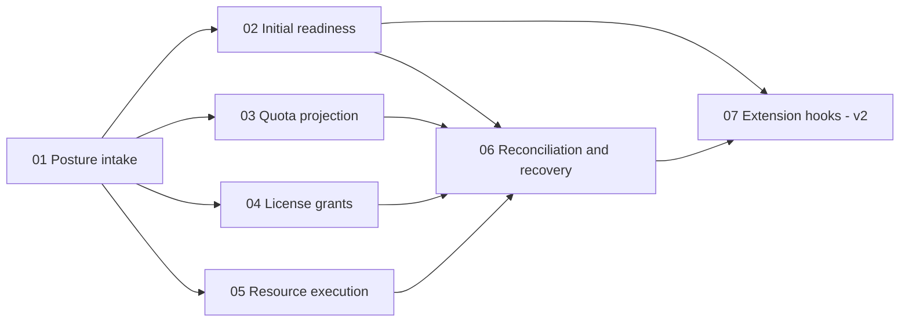

# Decomposition: Entitlements

<!-- toc -->

- [1. Overview](#1-overview)
- [2. Entries](#2-entries)
  - [2.1 Posture intake](#21-posture-intake)
  - [2.2 Initial readiness](#22-initial-readiness)
  - [2.3 Quota projection](#23-quota-projection)
  - [2.4 License grants](#24-license-grants)
  - [2.5 Resource execution](#25-resource-execution)
  - [2.6 Reconciliation and recovery](#26-reconciliation-and-recovery)
  - [2.7 Extension hooks](#27-extension-hooks)
- [3. Dependency order and delivery gates](#3-dependency-order-and-delivery-gates)
  - [Contract specification ownership](#contract-specification-ownership)
  - [External adoption and release evidence](#external-adoption-and-release-evidence)
- [4. Identifier register](#4-identifier-register)
- [5. Coverage and verification](#5-coverage-and-verification)

<!-- /toc -->

**Overall implementation status:**
- [ ] `p1` - **ID**: `cpt-cf-bss-entitlements-status-implementation`

## 1. Overview

This is the implementation allocation for the Entitlements [PRD](PRD.md) and [DESIGN](DESIGN.md). It makes no claim of delivered runtime. Each active FR and NFR has exactly one primary feature below. A feature can reference another requirement as supporting context without becoming its second primary owner. Numerical quota decreases, consumption profiles, pooling, partitions, rate limits and quota scope migration are outside v1.

Architecture definitions live in DESIGN; detailed SDK fields, validation, procedures and conformance cases live in features; cross-owner prerequisites in [UPSTREAM_REQS](UPSTREAM_REQS.md), and decisions in [DECISIONS](DECISIONS.md). All unchecked entries remain unimplemented. A documented target or passing document check never closes a production dependency.

**Release allocation.** V1 targets Q1. V2 adds fulfillment-output delivery, service dispositions with holds/export/disposal, and hooks. The complete specifications remain in their existing feature files. Mixed features identify their v2 parts below; a feature's p1 marker does not pull those parts into v1.

| Feature | v1 / p1 | v2 / p2 |
| --- | --- | --- |
| 01 Posture intake | Core intake, binding and fencing; reject unsupported v2 requirements | Service-disposition and extension input adoption |
| 02 Initial readiness | Required capabilities, held readiness, cleanup, pre-purchase binding | Required-output delivery and hook evaluation |
| 03 Quota projection | Qualified allocation quota contract | No additional quota profile assigned here |
| 04 License grants | Apply/read/recover grants and prove usable rights | Output descriptors, delivery and stream/link retrieval |
| 05 Service execution | Provision, withdraw, pause, restore, service-stop and recovery where needed | Export, retention/hold/disposal dispositions and their execution |
| 06 Reconciliation | Recovery for each enabled capability, findings, audit and local retention | Recovery/read surfaces for outputs, dispositions and hooks |
| 07 Extension hooks | None | Typed ToolKit hook plugins and their complete qualification |

A v1 profile requiring a deferred capability is refused before purchase; no required access or evidence is silently skipped.

## 2. Entries

### 2.1 [Posture intake](features/01-posture-intake.md)

- [ ] `p1` - **ID**: `cpt-cf-bss-entitlements-feature-posture-intake`

- **Purpose**: Accept `CommercialPostureV1` from Subscriptions workers, including replays. Authenticate the producer and tenant scope, then check revision and digest fences. Save the accepted posture and derivation work for each enabled capability in one transaction.
- **Scope**: Validate and retain purchase-component references covered by the digest. Read Pricing acceptance and check the exact catalog, purchase scope and complete evidence. Save intake decisions, deduplicated refusal/conflict findings and a separate accepted head. Define receipt recovery, scoped operator reads, fences, failure paths and acceptance cases. Provide shared SDK/plugin schemas, registration, versioned routes, atomic snapshot activation and adapter bindings. Intake never calls adapters.
- **Out of scope**: Deriving commercial posture (Subscriptions), deciding which capabilities a product needs (Products and the accepted snapshot), any adapter call.
- **Depends On**: None.
- **Provider prerequisites / launch gates**: E-U06 contract versions agreed with Subscriptions; authenticated producers and AuthZ/PolicyEnforcer scope for the posture stream under ENT-D-04, with the platform prerequisites of E-U08; public Tenant Resolver where identity/topology evidence is required.
- **Design Components**: `cpt-cf-bss-entitlements-component-posture-intake`.
- **Design Principles Covered**: `cpt-cf-bss-entitlements-principle-fenced-application`, `cpt-cf-bss-entitlements-principle-derive-not-decide`.
- **Design Constraints Covered**: `cpt-cf-bss-entitlements-constraint-rules-frozen-in-pricing`.
- **Domain Model Entities / Data**: CommercialPosture intake copy and AdapterBinding in DESIGN §3.1; the posture intake journal and the adapter-binding store in §3.7.
- **API / Sequences**: [DESIGN §3.3.1](DESIGN.md#331-commercial-posture-contract) and the posture apply sequence in DESIGN §3.6.

**Requirements Covered (primary)**:

- [ ] `p1` - `cpt-cf-bss-entitlements-fr-posture-intake`

### 2.2 [Initial readiness](features/02-initial-readiness.md)

- [ ] `p1` - **ID**: `cpt-cf-bss-entitlements-feature-initial-readiness`

- **Purpose**: Provider side of IA-2026-10-18: build the activation manifest, authenticate observations and report aggregate `ReadinessObservationV1` to Subscriptions. Capability features dispatch preparation. This feature owns the pre-purchase activation requirement/binding contract, empty-manifest handling, lost-result recovery, withdrawal and cleanup tracking.
- **Scope**: Define pre-purchase activation requirements and bindings (E-AC59), manifests, producers and observation validation. Aggregate classified receipts, observations, outputs and hooks, with discrepancy guards and held commitments. Recover terminal activation results through authorized Subscriptions reads; account for pauses when reporting overdue decisions. Keep resolution and desired-head fences separate. Adopt E-U06 schemas: lossless closure reasons, nested manifests, five-field rosters, commitment objects and integer codecs. Use separate readiness and closed result variants with one durable sequence. Define withdrawal, typed security blocks and authenticated clearance, incident recovery, cleanup records, local proof of no dispatch and adapter settlement. Bound preparation exposure, retain provenance and verify handoff latency.
- **Out of scope**: The activation commit, T and the consumer-side gate (Subscriptions); license objects and provisioning engines (adapters and providers); monetary valuation/accounting of platform-borne preparation (Rating/Billing under `ENT-Q13`; the exposure/evidence handoff remains in this feature).
- **Depends On**: `cpt-cf-bss-entitlements-feature-posture-intake`.
- **Provider prerequisites / launch gates**: E-U03/E-U04/E-U06/E-U10 cover pre-purchase configuration binding, with or without hooks. E-U02 or E-U05 cover required assignments. ENT-Q15/E-U01 cover quota application and safe reuse. Owners must agree and prove held readiness, resolution and emergency behavior (`ENT-Q11`); saved deadlines, timeout/failure closure and safe successor cleanup (`ENT-Q12`); and bounded preparation at platform cost (`ENT-Q13`).
- **Design Components**: `cpt-cf-bss-entitlements-component-readiness`.
- **Design Principles Covered**: `cpt-cf-bss-entitlements-principle-no-subscription-id-at-adapters`, `cpt-cf-bss-entitlements-principle-fenced-application`.
- **Design Constraints Covered**: `cpt-cf-bss-entitlements-constraint-no-counters`.
- **Domain Model Entities / Data**: ReadinessManifest, ReadinessCommitment, Assignment and Observation in DESIGN §3.1; the manifest and observation store and the preparation-resolution and readiness-commitment store in §3.7.
- **API / Sequences**: [DESIGN §3.3.2](DESIGN.md#332-readiness-observation-contract) and the initial readiness sequence in DESIGN §3.6.

**Requirements Covered (primary)**:

- [ ] `p1` - `cpt-cf-bss-entitlements-fr-initial-readiness`
- [ ] `p1` - `cpt-cf-bss-entitlements-nfr-handoff-latency`

### 2.3 [Quota projection](features/03-quota-projection.md)

- [ ] `p1` - **ID**: `cpt-cf-bss-entitlements-feature-quota-projection`

- **Purpose**: Define rule interpretation under `cpt-cf-bss-entitlements-fr-rule-schema`, with grant-specific contracts allocated to feature 04. Derive exact quota limits from frozen terms and current committed quantity. Apply the complete set through the selected quota adapter and recover its result.
- **Scope**: Products metric service-reference SDK/GTS adoption and frozen association validation; frozen GTS semantics, exact amounts, quantity and binding rules, scope/exclusivity checks, accepted/applied ordering, complete-set delivery and recovery, lifecycle posture and quota readiness evidence.
- **Out of scope**: Catalog publication (Products), plan authoring and acceptance (Pricing), runtime allocation/counters/releases (OSS), and downstream OSS APIs (adapter design). Unsupported quota profiles remain unavailable.
- **Depends On**: `cpt-cf-bss-entitlements-feature-posture-intake`.
- **Provider prerequisites / launch gates**: E-U01 quota application/recovery and ENT-Q15 preparation continuity; E-U03 Pricing rules and acceptance freeze; E-U04 Products catalog, GTS semantics and qualification.
- **Design Components**: `cpt-cf-bss-entitlements-component-quota-projection`.
- **Design Principles Covered**: `cpt-cf-bss-entitlements-principle-derive-not-decide`, `cpt-cf-bss-entitlements-principle-fenced-application`.
- **Design Constraints Covered**: `cpt-cf-bss-entitlements-constraint-rules-frozen-in-pricing`, `cpt-cf-bss-entitlements-constraint-no-counters`.
- **Domain Model Entities / Data**: PlanQuotaRule, QuotaBinding, AcceptedQuotaSnapshot, DesiredQuotaSet and AppliedReceipt in DESIGN §3.1; desired sets, receipts and tombstones in §3.7.
- **API / Sequences**: [DESIGN §3.3.3](DESIGN.md#333-adapter-capability-profile), DESIGN §3.3.4 and the posture apply sequence in DESIGN §3.6.

**Requirements Covered (primary)**:

- [ ] `p1` - `cpt-cf-bss-entitlements-fr-rule-schema`
- [ ] `p1` - `cpt-cf-bss-entitlements-fr-quota-projection`

### 2.4 [License grants](features/04-license-grants.md)

**Release:** core grants are v1; fulfillment outputs and retrieval are v2/p2.

- [ ] `p1` - **ID**: `cpt-cf-bss-entitlements-feature-license-grants`

- **Purpose**: Derive a local `DesiredGrantSet` from posture members with license capabilities and apply each logical right independently through its selected license adapter by scope, assignment and generation.
- **Scope**: grant derivation from accepted Pricing rules and Subscriptions member authority, closed SDK/GTS holder/validity/access policies and cross-owner validation, policy-bound adapter targets, posture-by-transition table, seat-assignment boundary, fence/apply/receipt flow and acceptance in the linked feature.
- **Out of scope**: Seat assignment, reservation and resets (enforcement owner); license files and native issuance APIs (adapter).
- **Depends On**: `cpt-cf-bss-entitlements-feature-posture-intake`.
- **Provider prerequisites / launch gates**: E-U02 selected license adapter; E-U03 grant branch for grant definitions frozen in acceptance; E-U06 member validity, holder scope and access posture; `ENT-Q09` rights-feed transport and `ENT-Q10` native identity mapping for the selected adapter.
- **Design Components**: `cpt-cf-bss-entitlements-component-license-grants`.
- **Design Principles Covered**: `cpt-cf-bss-entitlements-principle-no-subscription-id-at-adapters`, `cpt-cf-bss-entitlements-principle-fenced-application`.
- **Design Constraints Covered**: `cpt-cf-bss-entitlements-constraint-no-counters`.
- **Domain Model Entities / Data**: DesiredGrantSet, AppliedReceipt and FulfillmentOutput in DESIGN §3.1, and the interpretation of GrantDefinition, GrantBinding and AcceptedGrantSnapshot, whose detailed contracts and fixtures are owned by this feature under the shared rule-schema requirement; desired sets, receipts and fulfillment outputs in §3.7; shared retrieval-policy SDK fields and expiry validation.
- **API / Sequences**: [DESIGN §3.3.3](DESIGN.md#333-adapter-capability-profile), DESIGN §3.3.5 and [DESIGN §3.3.7](DESIGN.md#337-fulfillment-outputs).

**Requirements Covered (primary)**:

- [ ] `p1` - `cpt-cf-bss-entitlements-fr-license-grants`

### 2.5 [Resource execution](features/05-resource-execution.md)

**Release:** basic service application/recovery is v1; dispositions, retention/export/holds/disposal are v2/p2.

- [ ] `p1` - **ID**: `cpt-cf-bss-entitlements-feature-resource-execution`

- **Purpose**: Translate posture into service intents (provision, withdraw, pause, restore, service-stop, export, delete), route them by tenant and assignment, and record confirmed fulfillment, retention/export and disposal outcomes.
- **Scope**: adapter-owned service descriptors, frozen Pricing service bindings and accepted snapshots, explicit Subscriptions binding references, service request/result contracts, assignment and operation fences, retention/export authority, confirmed protection and recovery. No resource inventory or per-resource tasks.
- **Out of scope**: The confirmed charging cutoff and disposition eligibility (Subscriptions); native resource identity, selection, provisioning/deletion workflows, topology, locks and compensation (adapter and OSS); notification delivery.
- **Depends On**: `cpt-cf-bss-entitlements-feature-posture-intake`.
- **Provider prerequisites / launch gates**: E-U05 resource adapter; automatic deletion stays disabled without the proven hold/execution fence.
- **Design Components**: `cpt-cf-bss-entitlements-component-resource-execution`.
- **Design Principles Covered**: `cpt-cf-bss-entitlements-principle-fenced-application`, `cpt-cf-bss-entitlements-principle-derive-not-decide`.
- **Design Constraints Covered**: `cpt-cf-bss-entitlements-constraint-no-counters`.
- **Domain Model Entities / Data**: ServiceWorkOrder, AppliedReceipt and FulfillmentOutput for service outputs in DESIGN §3.1; desired sets, receipts and fulfillment outputs in §3.7; shared retrieval-policy SDK fields and expiry validation.
- **API / Sequences**: [DESIGN §3.3.3](DESIGN.md#333-adapter-capability-profile), DESIGN §3.3.6 and [DESIGN §3.3.7](DESIGN.md#337-fulfillment-outputs).

**Requirements Covered (primary)**:

- [ ] `p1` - `cpt-cf-bss-entitlements-fr-resource-execution`

### 2.6 [Reconciliation and recovery](features/06-reconciliation-recovery.md)

- [ ] `p1` - **ID**: `cpt-cf-bss-entitlements-feature-reconciliation`

- **Purpose**: Replay the outbox using original identities. Keep observations, compare complete desired and applied state, and record findings. Repair only through authorized conditional operations. Pending work keeps its original adapter and profile when configuration changes. Verify protection from stale actions across all capabilities.
- **Scope**: Correlate assignments and outputs with purchase components. Define ToolKit OData/Page queries, filter/order fields, scoped cursors and current/history selection. Specify versioned recovery-policy SDK/GTS schemas, including core policy before adapter selection, saved clocks/counters and bounded replacement chains. Cover the recovery matrix, verified provider heads above local history, repair, definitive derivation failures and delivery state. Define finding subjects, immutable owner tenants, scoped reads, events and audit. Specify retention-policy schemas, safe compaction, replay retirement and audit identity erasure. Cover finding lifecycle, adapter/profile changes and acceptance cases.
- **Out of scope**: Editing a materialized license, quota counter or resource through Entitlements; changing a commercially invalid posture (Subscriptions).
- **Depends On**: `cpt-cf-bss-entitlements-feature-posture-intake`. Capability-specific recovery integrates with features 02 to 05 as each is enabled; no disabled capability blocks the core recovery worker.
- **Provider prerequisites / launch gates**: Authorized recovery reads at every selected adapter (E-U01, E-U02, E-U05); any finite replay window qualified with Subscriptions and the selected adapters; platform-owned audit retention/identity policy. Until retirement is proved, compact details while retaining replay and revision fences.
- **Design Components**: `cpt-cf-bss-entitlements-component-reconciliation`.
- **Design Principles Covered**: `cpt-cf-bss-entitlements-principle-fenced-application`.
- **Design Constraints Covered**: `cpt-cf-bss-entitlements-constraint-no-counters`.
- **Domain Model Entities / Data**: AppliedReceipt and Finding in DESIGN §3.1; receipts, tombstones, findings and outbox in §3.7.
- **API / Sequences**: [DESIGN §3.3.3](DESIGN.md#333-adapter-capability-profile), DESIGN §3.3.4 to §3.3.6 and the posture apply sequence in DESIGN §3.6.

**Requirements Covered (primary)**:

- [ ] `p1` - `cpt-cf-bss-entitlements-fr-stale-action-fencing`
- [ ] `p1` - `cpt-cf-bss-entitlements-fr-reconciliation`

### 2.7 [Extension hooks](features/07-extension-hooks.md)

**Release:** v2/p2. No hook implementation or qualification gates a v1 profile.

- [ ] `p2` - **ID**: `cpt-cf-bss-entitlements-feature-extension-hooks`

- **Purpose**: Run typed service extensions through ToolKit hook plugins and outbox delivery while preserving commercial and provider authority.
- **Scope**: immutable hook bindings; GTS payloads and hook plugin SDK; separate readiness evidence; transactional notices; execution recovery, separate delivery bounds and admitted-check budgets, findings and safe operator reads; plugin registration and conformance.
- **Out of scope**: Serverless integration, code authoring UI, tenant code, commercial vetoes, provider provisioning, generic workflows and binding migration.
- **Depends On**: `cpt-cf-bss-entitlements-feature-posture-intake`, `cpt-cf-bss-entitlements-feature-initial-readiness`, `cpt-cf-bss-entitlements-feature-reconciliation`.
- **Provider prerequisites / launch gates**: E-U09 plus E-U03/E-U04 profile qualification and E-U06/E-U10 pre-purchase binding and purchase/payment guards; no new readiness result fields. No-hook profiles do not depend on E-U09.
- **Design Components**: `cpt-cf-bss-entitlements-component-extension-hooks`.
- **Design Principles Covered**: `cpt-cf-bss-entitlements-principle-bounded-hooks`, `cpt-cf-bss-entitlements-principle-fenced-application`.
- **Design Constraints Covered**: `cpt-cf-bss-entitlements-constraint-rules-frozen-in-pricing`, `cpt-cf-bss-entitlements-constraint-no-counters`.
- **Domain Model Entities / Data**: HookBinding, HookAttempt, HookEvidence, HookDelivery and HookExecution in DESIGN §3.1; hook journals in §3.7.
- **API / Sequences**: [DESIGN §3.3.10](DESIGN.md#3310-extension-hooks), hook reads in §3.3.8 and hook execution in §3.6.

**Requirements Covered (primary)**:

- [ ] `p2` - `cpt-cf-bss-entitlements-fr-extension-hooks`

## 3. Dependency order and delivery gates

Build posture intake and the shared recovery worker first. Add each v1 capability together with its recovery and failure fixtures. Deliver readiness for Q1 against the selected adapters. V2 adds outputs, service dispositions and hooks with their own gates. V1 does not wait for those integrations.

The posture-intake foundation owns peer-independent startup and lazy SDK client recovery (E-AC77), the public SDK, separate capability plugin contracts, host schema registration and shared binding infrastructure described in [DESIGN §3.3.3](DESIGN.md#333-adapter-capability-profile). Quota projection, license grants and resource execution select and save bindings before their first dispatch, then reuse them. Initial readiness records the required assignments and producer bindings in its manifest; it does not dispatch capability work. It also owns the readiness notification schema/topic, outbox publisher and shared consumer contract, and qualifies polling without event delivery and retained preparation during peer outages under E-AC77. Subscriptions adopts the consumer side under E-U06.

Reconciliation owns restart, removal, configuration drift and no-fallback cases across all capabilities. Concrete capability plugins belong to their adapter projects. Feature 07 owns the hook plugin SDK and delivery journal; integration projects supply implementations. Earlier features provide transaction and evidence integration points; they do not depend on hook execution for no-hook profiles. This allocation creates no extra resolver gear or dependency cycle.

Development can use a test double before an adapter is available. Enabling the corresponding production capability requires the [E-U acceptance signal](UPSTREAM_REQS.md#25-provider-prerequisites-and-bilateral-acceptance) and producer/consumer contract evidence.

| Capability | Must be closed before it is called ready |
| --- | --- |
| Posture intake | E-U06 contract versions and the posture-owner contract (ENT-D-12); producer authentication under single-target scopes (ENT-D-04, E-U08); replay, conflict and lost-delivery fixtures |
| Initial readiness | E-U03/E-U04/E-U06/E-U10 pre-purchase binding and E-AC59; E-U06; the adapters the service profile requires (E-U02, E-U05); `ENT-Q09` to `ENT-Q13` and `ENT-Q15` resolved where applicable to the enabled profile; the Subscriptions adoption of ENT-D-08 to ENT-D-10 agreed under E-U06; the Orders rule on entitlement before activation aligned (Subscriptions S-U01, ENT-D-17); handoff latency measured |
| Quota projection | E-U01, E-U03, E-U04; exact-conversion and complete-set evidence; stale-write protection, stable replay, separate accepted/applied heads and recoverable partial or unknown outcomes |
| License grants | E-U02, E-U03; stale issue after newer revoke and lost-reply fixtures |
| Resource execution | E-U05; core service and successor-assignment fixtures in v1; hold/disposal/export fixtures in v2 |
| Extension hooks (v2) | E-U09 plugin/identity/recovery proof; immutable profile qualification and pre-purchase binding under E-U03/E-U04/E-U06/E-U10; E-AC50 to E-AC58. E-AC59 belongs to initial readiness. |
| Reconciliation and recovery | Authorized recovery reads at every enabled adapter; adapter change keeps in-flight work on the original adapter; the profile values of ENT-D-13 and ENT-D-14 stated for each enabled profile |

| Stage | Concrete deliverable | Entry and exit evidence |
| --- | --- | --- |
| 1. Intake and stores | Posture intake, fences, intake journal, desired-set stores, outbox; shared SDK/plugin schemas and durable binding infrastructure | Subscriptions contract modeled by a test double; exit with replay, conflict and lost-delivery fixtures. |
| 2. Capabilities | Pre-purchase activation binding, readiness manifest and observations, quota projection, grant derivation and service work orders | Each capability enabled only after its E-U owner mapping and joint failure fixtures. |
| 3. Reconciliation | Recovery matrix, findings, repair, adapter change | Lost reply, delayed old request, higher provider revision, drift and metric drift fixtures pass against every enabled adapter. |
| 4. Optional hooks | Hook plugin SDK, GTS schemas, integration qualification, readiness checks, notices and operational reads | No-hook compatibility; exact binding, scoped authority, lost-start/result, stale evidence and nonblocking lifecycle proof. E-U09 closes only against a qualified implementation; Serverless is not required. |
| 5. Release proof | Measured handoff latency and outage/recovery evidence for the enabled profile | `nfr-handoff-latency` measured; no document validation substitutes for runtime proof. |

### Contract specification ownership

The full package includes the following specifications. No row delegates an unspecified BSS contract to implementation. An SDK implementation and external owner adoption are separate deliverables.

| Feature | Detailed contract responsibility | Required conformance evidence |
| --- | --- | --- |
| [01 Posture intake](features/01-posture-intake.md#sdk-contract-and-validation) | Owner posture codec, intake/outcome results, primitive/digest rules, shared plugin context, schema registration and service authorization. | Normalized digest, complete snapshot, replay/conflict, wrong-tenant and local/remote parity. |
| [02 Initial readiness](features/02-initial-readiness.md#readiness-sdk-results) | Pre-purchase activation requirement/binding SDK, conditional aggregate/assignment results, immutable profile schema, criterion evaluation, preparation bounds and closure settlement. | Guarded binding before commitment/capture with or without hooks (E-AC59), applied-only versus observed-ready, closure before manifest or after ready, late-event and settlement sequencing (E-AC60), security-block authority and recovery (E-AC61), limit breach and safe successor. |
| [03 Quota projection](features/03-quota-projection.md#sdk-ownership-and-conformance) | Exact mapping to the accepted Commercial Quotas contract and shared rule-schema conformance. | Exact amounts/digests, scope claims, complete sets, partial/unknown recovery and restriction evidence. |
| [04 License grants](features/04-license-grants.md#grant-purchase-and-application-contracts) | Grant definitions, bindings, accepted snapshots, desired sets, result/recovery records and shared output descriptor/retrieval contract. | Fixed binding deduplication, quantity bounds, immutable acceptance, stale effects and output-version recovery. |
| [05 Resource execution](features/05-resource-execution.md#work-order-sdk-contract) | Service-intent and hold request/results, per-kind authority, assignment-level state and outcome reads. | Generation and request fences, mixed outcomes, truthful times and hold/delete races. |
| [06 Recovery](features/06-reconciliation-recovery.md#public-reads-and-operator-commands) | Public query/command shapes, cursor scope, replay/concurrency, audit and error mapping. | Required-only outcome, command replay, same-key conflict, cross-tenant cursor and retrieval authorization. |
| [07 Extension hooks](features/07-extension-hooks.md#hook-plugin-sdk-contract) | Hook binding/payload schemas, plugin SDK, invocation state/recovery and safe read DTOs. Concrete integrations own downstream mapping. | No-hook independence, pinned execution, limited identity, readiness fold, lost starts, stale results and notice deduplication. |

Feature 01 supplies shared SDK infrastructure. Feature 04 owns the grant schema details and shared output specification; feature 05 reuses them. Feature 03 retains the single primary allocation of `fr-rule-schema`, with feature 04 as its explicit supporting implementation. This does not add a runtime dependency between capability handlers.

### External adoption and release evidence

| Gate / question | Specification in this package | Work remaining outside document completion |
| --- | --- | --- |
| E-U01; ENT-Q03 to ENT-Q08, ENT-Q15 | Feature 03 and the merged Commercial Quotas contract. | Concrete adapter design, scope authority mapping, implementation and qualification. VHP-3985 owns OSS integration. |
| E-U02 | Feature 04, with preparation/output contracts in feature 02. | License adapter adoption and executed provider tests, tracked in VHP-3986. |
| E-U03/E-U04; ENT-Q01, ENT-Q02, ENT-Q07 | Feature 03 for quotas; feature 04 for grants; Products qualification boundary in DESIGN. | Pricing/Products implementation and grant contract adoption in VHP-4377. Completed quota design is not an implementation claim. |
| E-U05 | Feature 05 and shared outputs in feature 04. | Concrete resource adapter and verified hold/delete fencing. |
| E-U06; ENT-Q09 to ENT-Q13 | Features 01/02/06 specify inputs, results, evidence and owner actions. | Owner SDK adoption, concrete finite exposure values and joint recovery/race fixtures. |
| E-U08; ENT-Q29 | Feature 01 and DESIGN §4.3 specify service principals, actions and scope checks; features 04/06 specify output access. | Platform/security owner confirmation, service authorization support and scale tests. |
| E-U03/E-U04/E-U06/E-U10 | Feature 02 specifies the accepted activation requirement, durable configuration binding and guarded purchase path, with or without hooks. | Products, Pricing, Subscriptions and Orders SDK adoption and executed E-AC59, including concurrent binding and Settings-change races. |
| E-U09; ENT-Q30 | Feature 07 and ADR 0002 specify the boundary and every BSS request/result. | Selected hook plugin implementation, execution identity and executed E-AC50 to E-AC58 without Serverless. |
| ENT-Q27 | Explicit future consumption-funding scope. | Separate future design; no v1 enablement. |

Keep these gates open until their evidence exists. They do not authorize omitting request fields, result variants, errors or acceptance cases from the features.

## 4. Identifier register

Every requirement ID is defined once in its owning document. The allocation above covers every active PRD requirement exactly once.

## 5. Coverage and verification

The allocation above contains **10 active requirements**: 9 FR and 1 NFR, each exactly once.

Document verification checks this census, incoming `Covers` links, local links/fragments, TOCs, CFS artifact validation and the absence of the subscription identifier in adapter contracts. Runtime validation is not performed by this documentation change: feature DoDs require deterministic unit/transaction tests, producer/consumer conformance, negative authorization/concurrency tests and selected end-to-end acceptance.
