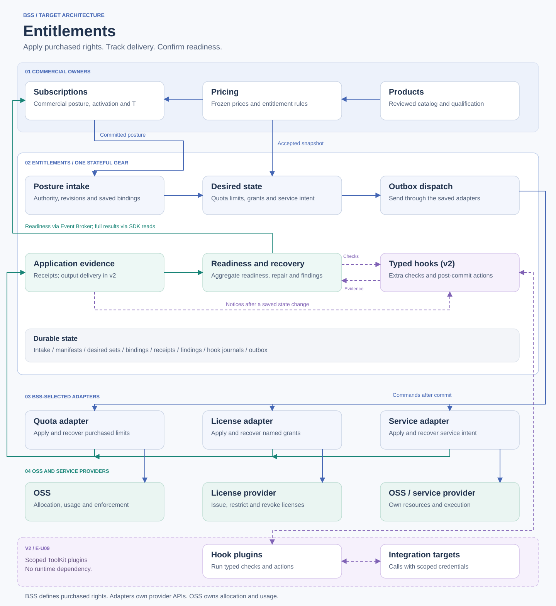
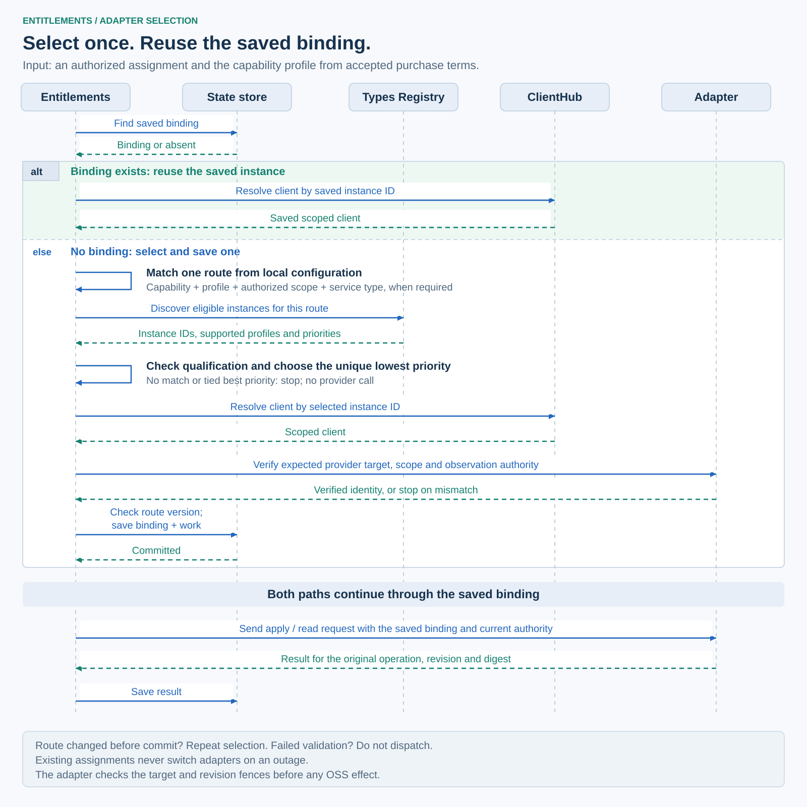
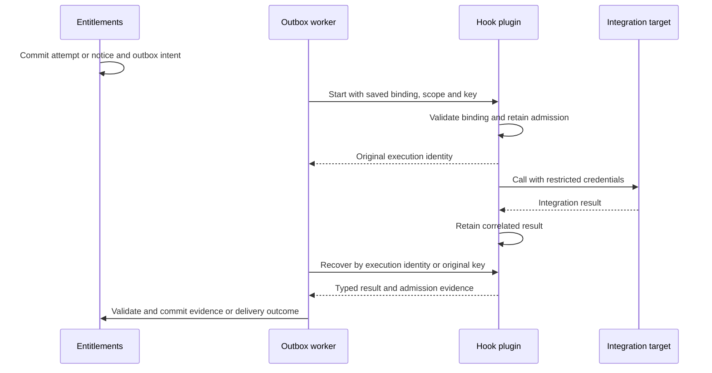

# Technical Design: Entitlements

<!-- toc -->

- [1. Architecture Overview](#1-architecture-overview)
  - [1.1 Architectural Vision](#11-architectural-vision)
  - [1.2 Architecture Drivers](#12-architecture-drivers)
  - [1.3 Architecture Layers](#13-architecture-layers)
- [2. Principles & Constraints](#2-principles--constraints)
  - [2.1 Design Principles](#21-design-principles)
  - [2.2 Constraints](#22-constraints)
- [3. Technical Architecture](#3-technical-architecture)
  - [3.1 Domain Model](#31-domain-model)
  - [3.2 Component Model](#32-component-model)
  - [3.3 API Contracts](#33-api-contracts)
  - [3.4 Internal Dependencies](#34-internal-dependencies)
  - [3.5 External Dependencies](#35-external-dependencies)
  - [3.6 Interactions & Sequences](#36-interactions--sequences)
  - [3.7 Database schemas & tables](#37-database-schemas--tables)
  - [3.8 Deployment Topology](#38-deployment-topology)
- [4. Additional context](#4-additional-context)
  - [4.1 Capability gates](#41-capability-gates)
  - [4.2 Compatibility](#42-compatibility)
  - [4.3 GTS identifiers, permissions and errors](#43-gts-identifiers-permissions-and-errors)
- [5. Traceability](#5-traceability)

<!-- /toc -->

- [ ] `p1` - **ID**: `cpt-cf-bss-entitlements-design-main`

**Status:** target architecture for desired-state derivation, initial readiness, adapter application and recovery. Concrete SDK/provider mappings, owner adoption and executed conformance are required before enabling a profile.

## 1. Architecture Overview

### 1.1 Architectural Vision

Entitlements turns committed subscription changes into desired quotas, grants and resource actions. It sends them through BSS-selected adapters and reports readiness and application results. It owns derivation, manifests, operation recovery and findings.

Subscriptions owns commercial decisions and current committed quantity. Pricing stores plan rules and freezes accepted terms. Products owns the reviewed commercial quota catalog. OSS owns resource allocation, usage counters, releases and enforcement. License and resource providers own their runtime state.

**Fulfillment boundary.** Entitlements uses versioned capability contracts. BSS selects the service/provider route and eligible adapter. Each adapter design defines its receiving OSS components, downstream APIs, permissions and recovery. Required capabilities may come from different systems.

| Abstract role | What Entitlements owns or requires | Outside this design |
| --- | --- | --- |
| Entitlement fulfillment | Versioned desired commercial rights/capacity and validity; durable request correlation; observed application or pending/failure; safe supersession and recovery | License objects, vendor states, native issuance APIs, callbacks, credentials and point-of-use implementation |
| Service fulfillment | Desired service lifecycle and confirmed application, readiness, retention/export and disposal outcomes | OSS inventory, physical resource identity, resource selection, provisioning workflow, topology and native execution |
| Enforcement | External application of the accepted access/quantity restrictions, with evidence only where the enabled profile requires it | Seat assignment, quota counters, request-time authorization and enforcement architecture |

Inventory and usage follow their owner contracts. Entitlements does not import usage, attribute charges or keep a quota usage read model.

Subscriptions supplies [commercial posture](#331-commercial-posture-contract) and consumes [readiness results](#332-readiness-observation-contract). Entitlements derives provider actions and builds the manifest. Each adapter must meet the [capability profile](#333-adapter-capability-profile) before use.

This document defines architecture and shared contracts. [Features](features) define detailed flows. [DECOMPOSITION](DECOMPOSITION.md) maps requirements to features. [DECISIONS](DECISIONS.md) records decisions and remaining delivery gates.

**Release scope.** This package keeps the full v1 and v2 design. V1 targets Q1. V2 adds fulfillment-output delivery, service dispositions with retention/export/holds/disposal, and typed extension hooks. The [PRD release table](PRD.md#51-in-scope) is the scope authority; features mark their v2 sections. A `V1` SDK type or `.v1~` GTS identifier is a schema version, not a delivery release.

V1 accepts only profiles that work without those v2 capabilities. It must reject an offer requiring them before purchase commitment/capture; it cannot omit required access, outputs or checks and call the service ready. Adapter application evidence and provider-confirmed usable access stay in v1. Basic service provisioning, restriction, stop and preparation withdrawal/recovery also stay in v1 where the profile needs them. Service-data holds in v2 are distinct from v1 readiness commitments and local evidence-retention holds.

The [Commercial Quotas design, merged in PR #5973](https://github.com/constructorfabric/gears-rust/pull/5973), defines the quota catalog, plan and adapter contracts. This package aligns with [the current Commercial Quotas design](../../docs/quotas/DESIGN.md). Check the accepted version before implementation qualification.

### 1.2 Architecture Drivers

The [application boundary ADR](ADR/0001-application-boundary.md), `cpt-cf-bss-entitlements-adr-application-boundary`, gives Entitlements responsibility for rule semantics and delivery through adapters. Subscriptions owns commercial decisions.

The [Hook plugins ADR](ADR/0002-hook-plugins.md), `cpt-cf-bss-entitlements-adr-hook-plugins`, defines optional extension execution and its authority boundary.

#### Functional Drivers

| Requirement | Design response |
| --- | --- |
| `cpt-cf-bss-entitlements-fr-posture-intake` | One intake path for `CommercialPostureV1`: producer and tenant authentication, revision/digest fences, durable intake journal, derivation work emitted to the outbox in the same transaction. |
| `cpt-cf-bss-entitlements-fr-initial-readiness` | Readiness manifest per activation operation, authenticated producers, observation envelope with high-water marks, aggregate `ready` only when every required assignment is ready for the exact desired revision and required hooks pass. |
| `cpt-cf-bss-entitlements-fr-rule-schema` | Versioned semantic schema of `PlanQuotaRule`, `QuotaBinding`, `AcceptedQuotaSnapshot` and grant definitions; Pricing stores and freezes it, Entitlements interprets it. |
| `cpt-cf-bss-entitlements-fr-quota-projection` | Exact conversion from committed quantity and frozen rules to amounts in the qualified unit; complete `DesiredQuotaSet` per source key with explicit tombstones. |
| `cpt-cf-bss-entitlements-fr-license-grants` | `DesiredGrantSet` derived from posture members with license capabilities; applied through the selected license adapter by scope, assignment and generation. |
| `cpt-cf-bss-entitlements-fr-resource-execution` | Service intents addressed by tenant and assignment, confirmed outcomes, protection from stale commands and safe recovery without OSS inventory. |
| `cpt-cf-bss-entitlements-fr-stale-action-fencing` | Adapter-guaranteed ordering by source, revision and digest. Higher acceptance fences older effects. Terminal closure and in-flight recovery do not depend on dispatch order. |
| `cpt-cf-bss-entitlements-fr-reconciliation` | Outbox replay by original identity, observation journal, desired-versus-applied comparison, durable findings and authorized repair; in-flight work stays on its original adapter. |
| `cpt-cf-bss-entitlements-fr-extension-hooks` | Typed hook plugin contracts, pinned implementations, separate readiness evidence and durable outbox delivery. |

#### NFR Allocation

| Requirement | Primary allocation and proposed target | Required verification |
| --- | --- | --- |
| `cpt-cf-bss-entitlements-nfr-handoff-latency` | Initial readiness and posture apply: first delivery to the selected adapter p95 < 5 s, p99 < 15 s after the posture is received; pending beyond 60 s creates an auditable exception. Usable-access time is measured separately and is not a Subscriptions commit guarantee. | Adapter outage and recovery, duplicate and refused acknowledgements, revision ordering under load; the reference workload is the Subscriptions S-Q07 profile ratified on 2026-10-08; the handoff targets are proposed by this gear and remain unmeasured. |

### 1.3 Architecture Layers



The SVG includes its draw.io source. Open the same file in diagrams.net to edit it.

- [ ] `p1` - **ID**: `cpt-cf-bss-entitlements-tech-runtime`

Entitlements is one stateful ToolKit gear. Intake, derivation, dispatch and recovery run inside it. Adapters are separate components selected through capability contracts. They need not be gears. Commit local work and its outbox entry together. Make remote calls only after commit.

## 2. Principles & Constraints

### 2.1 Design Principles

#### Derive, do not decide

- [ ] `p1` - **ID**: `cpt-cf-bss-entitlements-principle-derive-not-decide`

Derivation makes no commercial decision. Subscriptions supplies committed quantity, validity, posture and holder scope. Accepted snapshots supply the rules. A missing rule means no purchased declaration, not zero or unlimited. The product's admission policy decides whether another authority is sufficient. `Bounded(0)` means zero. `Unbounded` is outside v1.

Absence, error or unknown evidence is never translated into an unlimited value. Removal from an existing desired set requires an explicit tombstone.

#### Fenced application

- [ ] `p1` - **ID**: `cpt-cf-bss-entitlements-principle-fenced-application`

The adapter durably orders requests by source, revision and digest. It exposes the highest accepted head separately from the last fully applied head. Acceptance requires valid authority, supported content and no identity conflict. It does not prove that the requested change was applied.

Once a higher revision is accepted, older work cannot apply superseded state, even if the newer operation later fails. Replays recover the original result, including a refusal. Conflicting content is rejected. Terminal closure prevents later grants through the same source. Reads and recovery remain available.

These guarantees cover in-flight work, restart and lost responses. The adapter design chooses how to meet them across OSS. Dispatch ordering or filtering old callbacks alone is insufficient.

#### No subscription identifier at adapters

- [ ] `p1` - **ID**: `cpt-cf-bss-entitlements-principle-no-subscription-id-at-adapters`

Adapters receive authorized scope, assignment, desired revision and operation identity. They receive no subscription ID. Entitlements retains the posture-to-assignment mapping. Subscriptions retains the operation-to-manifest mapping. The source key is `(authenticated namespace, resource tenant, assignmentId)`. Only the [Subscriptions-facing contract](#331-commercial-posture-contract) carries the subscription ID.

#### Bounded extension authority

- [ ] `p1` - **ID**: `cpt-cf-bss-entitlements-principle-bounded-hooks`

Hooks add readiness evidence or run a separate post-commit action. They cannot change accepted terms, adapter commands, source fences, activation authority or cleanup rules. Entitlements owns hook scheduling and results; integration plugins own execution. Profiles without hooks need no hook plugin. See [ADR 0002](ADR/0002-hook-plugins.md).

### 2.2 Constraints

#### Rules are frozen in Pricing

- [ ] `p1` - **ID**: `cpt-cf-bss-entitlements-constraint-rules-frozen-in-pricing`

Entitlements owns the application rule schema and interpretation (ENT-D-03). Products owns approved metric, unit, accounting and scope definitions. Pricing owns plan rules, validation and acceptance. It freezes quota rules with prices and retains exact definition versions and evidence. Derivation and replay use this accepted snapshot, never the live plan.

A changed quota term needs new acceptance even if the price is unchanged. Quota amounts and charging are independent. A 20-vCPU allowance may be package-priced, usage-priced or mixed. Entitlements applies the purchased limit in each case; Rating and Billing follow the accepted charging terms.

#### No counters

- [ ] `p1` - **ID**: `cpt-cf-bss-entitlements-constraint-no-counters`

Entitlements stores purchased evidence, desired limits and adapter application results. It keeps no used, reserved or remaining quota counters, allocation ledger or per-resource quota release events. OSS owns these values and its admission decisions. The adapter design defines the OSS interfaces and tests.

Application evidence may identify a restriction that prevents fulfillment. It is not a mirror of live effective limits or usage. Normal resource consumption does not change commercial fulfillment status. A portal can combine BSS purchase/application reads with OSS usage reads.

License assignment and point-of-use checks stay with the selected enforcement owner. Entitlements does not create a second runtime capacity system.

## 3. Technical Architecture

### 3.1 Domain Model

- [ ] `p1` - **ID**: `cpt-cf-bss-entitlements-entity-desired-state-model`

The table defines logical state and invariants. Features define SDK fields, codecs, bounds and canonical digests. Implementations use those contracts; external owners still adopt their versions. Reject unsupported profiles or enum values before application; never interpret them as absent rights.

| Entity | Owned state and identity |
| --- | --- |
| CommercialPosture (intake copy) | The accepted `CommercialPostureV1` payload as received: identity triple, digest, operation id, tenant axes, members with posture, quantity, validity and holder scope, provenance references, execution context, activation resolution and service dispositions: every field group of §3.3.1. Immutable once accepted; superseded by a higher revision. |
| ReadinessManifest | Operation-owned set of required assignments, producer authorities and complete hook bindings for one desired revision, with pinned service profile and target references. Built before dispatch; withdrawn as a whole. It is not a license entity or a commercial status. |
| AdapterBinding | Immutable selection for an assignment/capability: plugin instance, contract version, profile version/digest, route ID/generation, route snapshot generation/digest, provider target/namespace, verified provider scope identity/generation and observation authority; see §3.3.3. |
| ReadinessCommitment | Immutable operation/posture/manifest binding and preparation-retention obligation; held until authoritative applied or terminal non-activation resolution, independent of changing readiness observations. |
| CleanupObligation | One per assignment of a generation closed without activation that can hold an effect: `open`, `requested`, then `settled` or `quarantined`; the settlement of the generation is read by Subscriptions before it admits a successor (ENT-D-08). |
| ReadinessProfile | Versioned record that states, for each capability, required, optional or not applicable, the readiness criterion, the target rule and the required outputs; named by the Subscriptions activation profile and pinned in the manifest (ENT-D-10). Immutable, with the schema of §3.3.9 (ENT-D-21). |
| Assignment | Stable identity of one concrete rights assignment or service instance within an authorized scope, its desired revision, pinned profile/target, routing to the selected adapter and current readiness. |
| Observation | One accepted readiness or application observation: event identity, producer, sequence, status, observed time, evidence reference and reason; durable high-water mark per producer stream. |
| PlanQuotaRule (definition) | Versioned application rule: rule ID/digest, Products SKU and approved definition evidence, exact metric/unit/accounting/scope references, `kind = Allocation`, subject kind, `Fixed` amount or `PerPlanUnit` coefficient, logical binding, `ExclusiveSource`, validity, access policy and required profile. Consumption windows and numerical decreases are outside v1. |
| QuotaBinding (selection) | Semantic selection of the accepted `PlanQuotaRuleV1`, not a second wire shape: rule and plan revision, one `item_id`, `dimension_value`, `logical_binding_key`, exact `scope_selection`, immutable Products definition evidence and `Fixed` or `PerPlanUnit` basis. Rules for different metrics may share a logical binding. Each selected `(logical_binding_key, metric)` has at most one applicable rule. Scope selection cannot duplicate one allowance across independent scopes. |
| AcceptedQuotaSnapshot (purchase evidence) | Acceptance ID, request/terms digests, order/version/line, plan/revision, original exact plan quantity, complete selected rule/binding snapshots or durable immutable resolvable references with digests, seller/payer/resource tenant axes, authorized subject-binding policy, terms/validity/continuation policy and required provider profile. Subsequent lot/delta acceptances remain separate immutable evidence. |
| ServiceTypeDescriptor / ServiceBinding / AcceptedServiceSnapshot | Adapter-owned execution service type; explicit qualified link from selected Pricing items and versioned Products SKUs to that type, profile, quantity rule, logical scope, parameters and policies. Pricing freezes the complete branch in its acceptance. Feature 05 defines the contract; no new Product/Service catalog entity or physical-resource model. |
| DesiredQuotaSet (commercial projection) | Source key `(namespace, resource tenant, assignmentId)`, monotonic revision, operation ID, desired digest, complete member count/digest and explicit removals, validity and `Granted \| Restricted \| Revoked` posture. Members retain logical binding, subject/scope generation, exact metric/amount/unit, policy evidence and accepted provenance. Preparation authority names its operation/generation, scope, profile and allowed actions. No allocation records or usage counters. |
| GrantDefinition / GrantBinding / AcceptedGrantSnapshot | Versioned provider-neutral grant definition and digest, immutable product/capability reference, quantity mode `Fixed` or `PerPlanUnit`, exact integer coefficient/quantity and supported bounds, allowed holder/subject kinds, validity and restrict/revoke policy, required profile/version; logical binding to plan items/dimensions and scope template. Pricing freezes selected definitions/bindings, original plan quantity, tenant axes and accepted validity in the same receipt as prices and quotas. No vendor grant object or seat assignment is stored here. |
| DesiredGrantSet / DesiredGrantState | Local complete collection per posture revision; each logical right has a separate assignment and `DesiredGrantState` with its own source key, revision, digest, target, adapter binding and operation. A right can represent several seats for one holder. Removal explicitly revokes that assignment. |
| ServiceWorkOrder | Operation identity, source revision/digest, kind (provision, withdraw, pause, restore, service-stop, export, delete), assignment generation, confirmed cutoff or boundary where applicable, requested effect and the adapter it was routed to. |
| AppliedReceipt (adapter observation) | Operation, source, desired revision/digest, saved binding, outcome, observation version/time, reason and recoverable effect evidence. Quota status is `pending`, `applied`, `refused` or `unknown`; reads expose accepted and fully applied heads separately. Service operations may also report `partial` with a safe summary and recoverable operation evidence (§3.3.6). Dispatch acceptance is not completion. |
| FulfillmentOutput | Versioned result of an assignment/member, such as a license document, license identifier or service endpoint; immutable origin operation/revision and adapter binding, current delivery eligibility, safe metadata and an opaque protected-content reference. See §3.3.7. It is not a new commercial right or a copy of provider secret storage. |
| Finding | Durable mismatch or unresolved work. Subject is an intake receipt, preparation generation, assignment or hook execution. Intake/preparation findings belong to the ordering tenant; assignment/hook findings belong to the resource tenant. Owner and subject are immutable; no assignment or manifest placeholder is required. Closed only on correlated evidence or an audited disposition. Hook findings do not enter the posture-outcome fold. |
| HookBinding | Immutable profile entry naming the point, plugin instance, exact implementation version/digest and restricted execution policy; saved in manifests and assignments before use. |
| HookAttempt / HookEvidence | Readiness check identity and its result, bound to the manifest and current prerequisite epoch/digest. Separate from adapter observation authority. |
| HookDelivery / HookExecution | Durable safe notice, subject sequence, saved invocation identity, request digest, bounded recovery policy and confirmed or unknown outcome. |
| AuditRecord | One audit record per applied or refused user/operator command. Immutable action/outcome core and separately protected actor identity data, with policy-based retention (ENT-D-20). |

`ExclusiveSource` assigns one commercial source to a canonical quota domain. Subscriptions protects that domain before purchase commitment or payment capture. The domain must remain the same across payer, seller, plan, SKU and adapter aliases. Entitlements validates the retained claim against its saved scope. The adapter checks ownership at application and cannot change another source's quotas.

Regional and pool scopes are optional qualified profiles. A tenant-wide profile must prove the advertised aggregate. A purchased limit cannot be copied into every independent scope. Missing scope authority or unsupported mapping blocks the profile. Pooling and arbitrary quota distribution remain outside v1.

### 3.2 Component Model

#### Posture intake

- [ ] `p1` - **ID**: `cpt-cf-bss-entitlements-component-posture-intake`

Accepts `CommercialPostureV1`, checks producer authority and tenant scope, and orders revisions by digest. It commits the posture and derivation work together and exposes the intake result per revision. Current delivery uses SDK calls; outbox/recovery transport is described in §3.3.1. See [posture intake](features/01-posture-intake.md).

#### Readiness

- [ ] `p1` - **ID**: `cpt-cf-bss-entitlements-component-readiness`

Builds the activation manifest before capability handlers dispatch preparation through saved adapters. It authenticates observations, tracks their sequence and reports aggregate readiness to Subscriptions. It also handles withdrawal and cleanup obligations. See [initial readiness](features/02-initial-readiness.md).

#### Quota projection

- [ ] `p1` - **ID**: `cpt-cf-bss-entitlements-component-quota-projection`

Reads the accepted rule and Products evidence, uses Subscriptions' committed quantity, and derives exact limits. `Fixed` applies once per distinct binding. `PerPlanUnit` multiplies the coefficient by current committed quantity once; lots are provenance, not a second multiplier. The handler sends the complete desired set through the saved adapter and recovers its result. See [quota projection](features/03-quota-projection.md).

#### License grants

- [ ] `p1` - **ID**: `cpt-cf-bss-entitlements-component-license-grants`

Derives `DesiredGrantSet` for members that require licenses. It applies grants through the selected adapter by scope, assignment and generation. The enforcement owner handles seat assignment, reservation and runtime limits. See [license grants](features/04-license-grants.md).

#### Resource execution

- [ ] `p1` - **ID**: `cpt-cf-bss-entitlements-component-resource-execution`

Maps `Granted`, `Restricted` and `Revoked` to work orders for a logical service assignment. It records readiness, stop, hold, export and deletion results, including partial or unknown effects. See [resource execution](features/05-resource-execution.md).

#### Reconciliation

- [ ] `p1` - **ID**: `cpt-cf-bss-entitlements-component-reconciliation`

Retries work by its original identity and reads correlated application evidence. It records discrepancies and repairs only source-owned state under current authority. In-flight work retains its original adapter and profile. See [reconciliation and recovery](features/06-reconciliation-recovery.md).

#### Extension hooks

- [ ] `p1` - **ID**: `cpt-cf-bss-entitlements-component-extension-hooks`

Schedules typed checks and post-commit actions, validates results and retains execution evidence. The host uses typed ToolKit hook plugins, scoped ClientHub clients and outbox delivery. Each plugin implements its own integration and recovery. No hook executes inside a local transaction. See [feature 07](features/07-extension-hooks.md).

### 3.3 API Contracts

These contracts define ownership and required behavior. The [decomposition contract index](DECOMPOSITION.md#contract-specification-ownership) locates the detailed SDK fields, validation and result shapes in features. External owners adopt those contracts under [UPSTREAM_REQS](UPSTREAM_REQS.md).

#### 3.3.1 Commercial posture contract

The contract implements `cpt-cf-bss-entitlements-contract-commercial-posture`. Subscriptions commits `CommercialPostureV1` with each lifecycle change. Entitlements accepts it as the desired commercial state. A higher revision replaces the target but retains earlier results. Current delivery uses the SDK calls described below.

| Field group | Content | Rule |
| --- | --- | --- |
| Identity | `(orderingTenantId, subscriptionId, revision)`, payload digest, operation id | The triple orders revisions; the digest identifies content; the operation id is retry identity. None substitutes for the others. The subscription identifier appears only in the Subscriptions-facing contract (`CommercialPostureV1` intake) and never in any adapter contract. |
| Tenant axes | Ordering, resource, payer and seller tenant | The axes fixed on the service subscription (Subscriptions SUB-D-113); a commercial leg changes none of them. The resource tenant becomes the tenant component of every provider source key. Payer and seller are purchase evidence, not resource authority or provider-key components; adapters do not receive them. The accepted reference separately names the catalog tenant for Pricing authorization (ENT-D-05, ENT-D-15). |
| Members | One per logical component: capability/product references, quantity as the sum of effective lots, validity interval, posture `Granted \| Restricted \| Revoked`, holder scope | Subscriptions supplies the effective interval, holder scope and current posture. Accepted Pricing evidence supplies the purchased rules and permitted scope/validity policies. Entitlements validates and maps these inputs; it makes no commercial decision. The member set is complete; a removed member produces an explicit tombstone in the derived desired set. |
| Provenance | Accepted snapshot references (acceptance id, rule/binding snapshot digests) and contributing lot ids | Lots are provenance only; Entitlements does not re-derive quantity from lots. Rules are read from the accepted snapshot the references name. |
| Execution context | `lifecycleAction = prepare_activation \| apply_lifecycle \| withdraw_preparation \| update_disposition`; applied transition kind and effective boundary; withdrawn preparation revision where applicable | Preparation and withdrawal name the saved activation operation; preparation also carries the snapshotted policy/version, the readiness profile reference and version (ENT-D-10), authorized start and deadline. Changed intent advances the aggregate revision even when the subscription status does not change; no T is assigned by preparation. |
| Activation resolution | `activationResolution`: authenticated ordering namespace, scope, operation, preparation revision/digest and durable decision version. `applied` requires exact manifest identity/version/digest, readiness commitment binding and T. `closed_without_activation` carries the reason and any already-known manifest/commitment bindings; closure does not require readiness to exist. Later snapshots retain the resolution reference. | Subscriptions commits the generation fence and posture/outbox atomically. Recovery is keyed by ordering namespace, operation and preparation revision, with scope authorization and digest verification. Closure fences late preparation and covers all effects of that generation; pending or absence never permits cleanup. |
| Quota exclusivity | Quota exclusivity claim evidence of the acquisition: claim identity and monotonic version, authority, canonical domain and domain generation, acquisition/attempt identity, resource tenant, scope-policy/selection digest and accepted terms reference | Subscriptions obtains the claim before the purchase commits. Entitlements retains the full commercial claim and checks it against the saved scope. The adapter receives only opaque authority/domain/claim-version proof bound to the resolved exclusive scope. Missing or changed proof blocks dispatch (ENT-D-11). |
| Service dispositions | Complete `serviceDispositions`: disposition ID/version, logical service component, confirmed charging-cutoff evidence, frozen retention/export terms and policy digest, disposal schedule version/deadline, hold policy version/state, required notice evidence and explicit `deleteAuthorized` | Subscriptions owns commercial authority. Entitlements resolves the component to its retained service assignment, never to an OSS resource. Ambiguous or retired associations cannot authorize new work. No inventory, native resource ID or physical generation is required. |

Subscriptions checks commercial and financial prerequisites before publishing preparation. Entitlements validates the authorized posture and prepares the requested capabilities. Billing commitments stay with Subscriptions and Billing; they are not part of the posture, readiness manifest or adapter request. Subscriptions combines service readiness with its own guards before activation.

**Wire shape.** Use the Subscriptions SDK `CommercialPostureV1` (ENT-D-12). Document-level `access` carries `grant`, `restrict` or `revoke`, plus `prepare` and `withdrawn` for preparation. Each `grants` entry carries a component, SKUs, quantity, acceptance reference and lot IDs. Preparation names its operation, generation, service profile/version, start and deadline. Member validity, holder scope and per-member access also require a Subscriptions-owned extension under E-U06. The document-wide `access` does not supply these member values. Service dispositions need an owner extension too. Keep capabilities that require them disabled until the owner SDK carries them. [Posture intake](features/01-posture-intake.md#sdk-contract-and-validation) defines the member inputs and validation.

Intake applies these fences to desired state:

- Lower revision: stale. Record it without deriving desired state; staleness alone opens no finding.
- Equal revision and equal digest: replay. Make no desired-state change.
- Equal revision and different digest: conflict. Refuse it and expose the conflict.
- Higher revision: accept it as the new target.
 The accepted posture and its derivation work are persisted in one local intake transaction. Capability handlers consume that durable work and commit desired sets or the readiness manifest with their delivery/publication intents in a separate local transaction, rechecking current source, preparation and disposition fences.

Valid activation resolutions and missing `resolutionRef` targets use the separate generation fence in §3.3.2, including on stale or replayed postures. Validate authority, schema and digest conflicts before using that evidence. Historical resolution cannot replace the desired head.

No adapter dispatch precedes the corresponding commit; replay between these stages retains the original work identity. Before any effect-capable preparation call, persist its irreversible dispatch-start marker under the generation fence. Closure blocks new markers and cancels unstarted work. A marker means effects may exist and requires adapter settlement evidence (ENT-D-08).

`update_disposition` uses the same revision rules. Holds, releases, schedule changes, cutoff confirmation and deletion authority each advance the revision and carry the complete collection. This applies even while access stays `Revoked`. A new hold clears `deleteAuthorized`. Final hold release creates a new schedule generation and future deadline. Notice evidence must match that schedule when accepted terms require it; current terms do not (SUB-D-69). Omission cannot authorize deletion. Explicit removal keeps the fence and history. Recovery returns the same payload and digest.

**Delivery in this version.** Subscriptions publishes no posture event (SUB-D-121). Its workers call service-only Entitlements SDK methods as the Subscriptions principal, scoped to the ordering tenant (ENT-D-04). The activation driver sends preparation and reads readiness by operation/revision (SUB-D-87). The withdrawal worker retries withdrawal until intake accepts it (SUB-D-88). The posture worker sends lifecycle revisions and reads their outcomes (SUB-D-106).

Intake is accepted only after its transaction commits. Subscriptions recovers a lost reply through `read_posture_receipt` and may replay the same saved payload and delivery identity while the result is absent or unknown. The same accepted revision/digest is a replay, even if the first call is still completing. A receipt confirms intake only, not provider application. [Feature 01](features/01-posture-intake.md#sdk-contract-and-validation) defines this recovery.

Entitlements does not pull missing posture revisions from Subscriptions in v1. A readiness notification only wakes the activation driver; the authoritative read supplies its decision evidence. Posture delivery uses SDK commands; readiness notifications use Event Broker. Missing activation resolutions are recovered through the Subscriptions operation read under §3.3.2, independently of posture delivery.

The lifecycle row kinds of Subscriptions map to member posture: `restrict` to `Restricted`, `reinstate` to `Granted` and `revoke` to `Revoked`, each with `lifecycleAction = apply_lifecycle`. After confirmed intake acceptance, Subscriptions tracks the application outcome; Entitlements retries its own failed application under ENT-D-13. A duplicate delivery remains safe but does not start another application attempt.

**Posture outcome per revision.** Entitlements returns one outcome for `(orderingTenantId, subscriptionId, revision)`. It combines the [delivery states](features/06-reconciliation-recovery.md#delivery-state) required by the accepted profile: all applied means `applied`; any failed means `failed`, even if others are pending; otherwise `pending` (ENT-D-06). Capability results and findings remain readable.

`submit_commercial_posture` returns `taken`, `replay`, `stale`, `conflict` or `refused`. `read_posture_receipt` recovers the delivery decision. `read_preparation_result` and `read_posture_application_result` separately report readiness and application (ENT-D-12). Owners agree their versions under E-U06.

Entitlements blocks new destructive dispatch on intake of a hold, then obtains execution-boundary confirmation; a desired hold is not yet proven protection. The resource adapter still arbitrates work already in flight. See [resource execution](features/05-resource-execution.md).

#### 3.3.2 Readiness observation contract

The contract implements `cpt-cf-bss-entitlements-contract-readiness-observation`. Entitlements serves the aggregate `ReadinessObservationV1` through `read_preparation_result` and emits a small event when the saved result changes. Adapters send separate assignment observations to Entitlements. Neither envelope carries a subscription ID. Subscriptions saves the activation operation, scope and preparation revision/digest first, so it can correlate the aggregate without an assignment-allocation handshake.

| Semantic fields | Required meaning |
| --- | --- |
| `schemaVersion`, `orderingTenantId`, `scopeId`, `operationId` | Supported contract version, authenticated ordering namespace, authorized resource scope and durable activation operation; operation identity is unique within that namespace. |
| `postureRevision`, `postureDigest` | Exact preparation input accepted from Subscriptions; both must match the consumer's saved operation. A result for a replaced or withdrawn input cannot activate. |
| `manifest`, `serviceProfileRef` | Nested manifest with `manifestId`, `manifestVersion`, `manifestDigest` and `requiredAssignments`; top-level pinned profile reference. Each roster entry carries scope, assignment ID, desired revision, logical target and profile reference. Capability, source digest and adapter authority stay in the digest-bound local manifest. An empty assignment roster with no readiness hooks requires authoritative no-preparation evidence; an empty assignment roster with hooks still waits for those checks. Physical target allocation is correlated internally to the pinned logical target, not silently substituted into this roster. |
| `eventId`, `producerId`, `statusSequence` | Entitlements is the authenticated producer. One durable sequence orders readiness and closure results for the exact operation/preparation revision, including before a manifest exists. |
| Result variant | Readiness carries `pending`, `ready`, `failed_retryable`, `failed_definitive` or `blocked` (ENT-D-09). Closure without activation carries the exact Subscriptions resolution and settlement `open`, `settled` or `quarantined`, with no readiness status (ENT-D-08). |
| `readinessCommitment` | Object with `commitmentId` and `bindingRef`, required on ready: durable obligation bound to operation, preparation revision/digest, manifest and accepted profile; distinct from observed health and retained until the authoritative activation resolution. |
| `observedAt`, `evidenceRef`, `reasonCode` | Diagnostic time, recoverable full manifest and producer-evidence reference, structured reason. Timestamp neither orders results nor supplies T. |

The canonical wire format is the [Subscriptions shared readiness result contract](../../subscriptions/docs/features/05-entitlements.md#shared-readiness-result-contract). [Feature 02](features/02-initial-readiness.md#readiness-sdk-results) defines Entitlements processing. E-U06 tracks SDK, GTS and endpoint implementation and joint conformance.

Manifest fields are required only after a manifest exists. An unbuildable result or closure received before preparation carries no invented manifest. Ready requires its durable commitment. Closure atomically replaces the current result with the closed variant and publication intent. Later evidence may update settlement but cannot restore readiness. Historical commitments remain evidence only; Subscriptions also rejects late readiness notifications through its terminal operation fence. A proven local no-dispatch history can settle an unstarted generation. Otherwise every possible external effect needs adapter resolution or isolation with safe-reuse confirmation; operator findings cannot supply it. The shared contract defines these result cases; [initial readiness](features/02-initial-readiness.md#readiness-sdk-results) defines settlement processing.

Before dispatch, Entitlements commits the manifest, initial result and publication intent. Each later observation commits with its updated aggregate and delivery intent. Sequence numbers and event IDs survive restart. An identical event is a replay. Conflicting content for an event or sequence is refused.

Subscriptions authenticates Entitlements and atomically binds the first matching manifest to its saved operation. The manifest digest covers its input, assignment roster and profiles, including immutable local hook bindings, not changing observation statuses. Hook details remain internal to Entitlements and add no fields to the Subscriptions result. The separate closed-result extension still requires E-U06 adoption.

A changed digest or roster under the same manifest version is a conflict. Replacement requires a higher preparation revision from Subscriptions. Older observations cannot replace newer results. Recover missing results by `(orderingTenantId, operationId, postureRevision)` through an authorized full-result read. It retains the same manifest binding and sequence. An explicitly empty manifest still needs a retained ready result; silence is not readiness.

Entitlements reports `ready` only when every required assignment meets its pinned criterion and output checks. Every required hook must pass for the current prerequisite epoch/digest (§3.3.10). `applied` uses complete application evidence with no open fulfillment discrepancy; `observed_ready` also requires a current authenticated ready observation. Pending, partial or unknown application contributes pending readiness.

A refusal contributes retryable or definitive failure according to the pinned capability profile; an unclassified refusal is retryable with a finding. [Feature 02](features/02-initial-readiness.md#readiness-state) defines the mapping and aggregate priority. It first commits the readiness obligation. Subscriptions saves that binding, checks current evidence and guards, then orders active/T against withdrawal on its local generation fence (SUB-D-57). Adapter events cannot bypass this check. Later failure changes readiness but does not release held preparation.

The protocol prevents ordinary control-plane revocation races, not physical outages or instantaneous knowledge of emergency security blocks; no cross-service atomic commit is claimed.

**Held obligation and terminal resolution.** Keep preparation and saved bindings until Subscriptions supplies the exact authenticated operation/generation resolution. Applied activation must match the manifest and commitment. Closure can precede either. Check supplied bindings and retain the generation fence for all known or later discovered effects. A closure received first prevents late dispatch and ready publication. Its diagnostic reason may be unfamiliar if it meets the owner contract. Retain that exact code and validate the outcome and bindings normally. [Posture intake](features/01-posture-intake.md#sdk-contract-and-validation) defines the SDK/GTS compatibility rule; it grants no additional cleanup authority.

Do not invent readiness metadata or apply an old closure to a successor. Applied activation continues the same assignments, subject to newer accepted desired state. Recovering an old activation settles its obligation without restoring an old grant over later restriction or cancellation. Only `closed_without_activation` authorizes withdrawal and cleanup. A replacement preparation first closes the earlier generation and retains its result.

Late delivery cannot revive a withdrawn manifest. Timeout, missing data, failed guards, failed observations or unreachable Subscriptions do not prove non-activation. Retain preparation, recover the original result and escalate. Profiles must retain required effects while the decision is unresolved, without extending purchased validity.

**Contract in this version.** Create `readinessCommitment` in the transaction that first records `ready`. Subscriptions delivers resolution inside applied or withdrawal posture documents. A newer lifecycle revision can supersede that delivery. Entitlements recovers the immutable result through the Subscriptions operation read, using `resolutionRef` or its saved preparation identity. It retains durable recovery work until a verified terminal result is stored.

Pending, missing or unreachable results never authorize cleanup. Resolution processing has its own generation fence, separate from the desired-head revision fence. A historical result settles only its generation and cannot undo a newer restriction or cancellation. [Feature 02](features/02-initial-readiness.md#readiness-manifest-and-observation-envelope) defines the read and recovery procedure. Before deadline escalation, read current Subscriptions operation progress.

Open `resolution_overdue` only when verified unpaused progress exceeds its current deadline plus the pinned resolution recovery horizon. Paused or unknown progress cannot prove overdue status. Retain the effects and continue recovery and held-age monitoring. Subscriptions owns both duration and deadline (ENT-D-24).

**Attempt deadline.** Subscriptions freezes preparation policy/version, start and deadline in its operation and posture. Entitlements reports correlated timeout or failure evidence through the aggregate readiness contract. Subscriptions decides closure and sends its resolution in a posture document. There is no separate closure command. Cleanup waits for that confirmed decision. Expired attempts cannot newly activate; retry or profile edits cannot extend them. Retain any earlier applied T. Closed attempts enter Orders remediation with purchase, payment and claim preserved. Unknown outcomes keep their obligations. A successor needs confirmation that earlier effects are resolved or safely isolated. See [initial readiness](features/02-initial-readiness.md) and ENT-Q12.

**Emergency and exposure.** The responsible adapter reports an assignment-scoped security block and its explicit clearance through typed observations. Required assignment blocks prevent ready for any criterion; only a newer authenticated clearance from the same authority lifts the named block. Ordinary readiness or finding disposition cannot clear it. [Feature 02](features/02-initial-readiness.md#readiness-sdk-results) defines the SDK/GTS payload and recovery. An authorized security block may stop access immediately. Record the actual incident time and correlated failure evidence. A known block prevents activation. If it races an applied commit, use later guarded lifecycle and financial correction; do not erase T.

Authorized pre-T preparation is platform-borne, including attempts that never activate. It cannot create ordinary service charges. Before enabling a profile, agree timing, capacity/usage/concurrency bounds, admission authority, escalation, settlement and usage-to-T attribution with Subscriptions and Rating/Billing.

Limits may refuse new preparation or report failure for Subscriptions to decide closure. They cannot release an unresolved commitment through a timer. Unknown usage boundaries remain unresolved, not customer-billable by default. Quota and financial admission gates still apply. [Initial readiness](features/02-initial-readiness.md) defines the flow; ENT-Q11 and ENT-Q13 retain integration and runtime gates.

**Adapter observation envelope.** The fields below define adapter-to-Entitlements evidence. They are separate from the aggregate sent to Subscriptions. SDK owners still need to adopt exact types and versions.

| Semantic field | Assignment / readiness meaning |
| --- | --- |
| `schemaVersion` | Explicit supported contract version; unsupported versions are quarantined/reported, not interpreted as ready. |
| `scopeId`, `assignmentId` | Authorized tenant scope and stable identity of the concrete rights assignment/service instance. A shared product or customer ID alone is not enough. Native identity must distinguish multiple environments under one broad right. |
| `desiredRevision` | Immutable desired-state generation bound to exact accepted preparation inputs; it is not a transport idempotency key. Retired identities/revisions cannot be silently reused. |
| `serviceProfileRef`, `targetRef` | Pinned versioned readiness requirements and concrete service target, retained in the descriptor/manifest and bound to results. Target allocation discovered during execution is durably associated before it can satisfy readiness. |
| `eventId` | Identity of an emitted observation for delivery deduplication; repeats keep the original identity/content, conflicting content is refused. A reconciled newer observation has its own identity. |
| `producerId`, `statusSequence` | Trusted responsible authority and durable monotonically ordered observation sequence within the agreed scoped assignment/authority stream. Producer replacement or sequence reset needs an explicit fenced generation mapping. |
| `status` | Semantic observation `pending`, `ready`, `failed` or `withdrawn`; these are preparation observations, not subscription states. Pending includes accepted work; ready means the service profile's complete initial readiness criterion. A `failed` observation carries the failure class `definitive` or `retryable`; a `withdrawn` that a producer originates is taken as a definitive failure with reason `producer_withdrawn` (ENT-D-09). |
| `observedAt`, `evidenceRef`, `reasonCode` | Observation time, recoverable authoritative evidence and structured reason. Timestamp is diagnostic evidence, not ordering, freshness authority or the commercial start. |

Authenticate each observation producer and check its scope, assignment and profile against the saved manifest. A claimed `producerId` is not proof. Identical delivery is a no-op. Refuse or quarantine conflicting, foreign or ambiguous evidence without leaking data. Older sequences cannot replace newer results. Dispatch receipts, broker acknowledgements and license existence alone do not prove readiness. Evidence from one assignment cannot satisfy another.

#### 3.3.3 Adapter capability profile

The adapter maps provider results to correlated Entitlements observations. Acknowledgement is not application; unknown results remain recoverable. Ordering and replay safety are integration guarantees. Vendors need not expose our revision field or state machine. The adapter may use a durable journal and reconciliation, but must prove its external effects. Dispatch serialization alone cannot stop an older request already in flight.

Select a versioned capability profile for the product and authorized route. Save adapter/profile identity with outstanding work. Its immutable recovery policy defines Entitlements call bounds, retries, polling, escalation and permitted replacement attempts. [Feature 06](features/06-reconciliation-recovery.md#recovery-matrix) defines the SDK/GTS fields, durable counters and core policy used before adapter selection. Policy edits cannot reset outstanding work; OSS internal retries remain the adapter design's responsibility. A capability declared unnecessary is `not_applicable`. A missing required adapter is unavailable, not successful. The accepted profile still requires its access, resource, attribution and financial evidence.

Adapter changes cannot redirect pending commands or reuse old completion evidence. Outstanding work keeps its saved binding until a separately supported migration resolves it.

Entitlements sends desired state to the selected adapter and tracks application results. Each adapter design defines the receiving system, its APIs and how it meets the contract, including status mappings and deployment details. This core design defines the boundary and can be reviewed before those integrations exist. A profile still needs proof of its adapter guarantees before use. Entitlements implements no local license engine, quota service or OSS provider.

**SDK and plugin ownership.** Entitlements hosts fulfillment adapters (ENT-D-01). Follow the [ToolKit SDK/plugin pattern](../../../../docs/toolkit_unified_system/03_clienthub_and_plugins.md). The SDK separates public BSS methods from versioned plugin contracts. The names below are proposed contract roles, not shipped types.

| Contract role | Consumer and responsibility |
| --- | --- |
| Public Entitlements client | Subscriptions and authorized BSS consumers use intake, correlated observations, recovery reads and fulfillment-output reads/retrieval under §3.3.7. The public contract exposes no vendor client or plugin selector. CommercialPostureV1 is the command payload and ReadinessObservationV1 is the full read result. A separate readiness event only schedules a read; output retrieval is another public query contract. |
| Quota application plugin | Entitlements sends a complete desired quota set and recovers the applied source state under §3.3.4. |
| License application plugin | Entitlements sends desired grants and recovers application/readiness evidence under §3.3.5. Runtime license checks are outside this application interface. |
| Preparation settlement interface | Preparation-enabled instances also expose `read_preparation_settlement(source_key, assignment_generation, closure_ref)` under their existing saved binding. Return typed unresolved, resolved or isolated evidence as defined in feature 02. No resource inventory or operator-set settlement. |
| Resource execution plugin | Entitlements sends service intents and recovers assignment-level outcomes under §3.3.6; OSS owns resource selection and execution. |

Plugins receive authorized scope, assignment, desired revision/digest and operation identity, never `subscriptionId`. One integration may register several capability interfaces. The domain uses narrow ports; infrastructure owns discovery, scoped clients and transport. Native adapters use their provider's public management SDK. External adapters own credentials and vendor translation. Neither may bypass provider storage boundaries.

A runtime license check cannot apply grants or prove that the requested grant state was applied. Entitlements requires correlated application evidence from the license adapter.

**Registration and selection.** Entitlements registers versioned GTS plugin schemas. Adapter gears register instances in Types Registry and typed clients under `ClientScope::gts_id(instance_id)`. The deployment binary includes selected adapters. The host depends on SDKs and Types Registry, not concrete adapter crates. Other gears call the public Entitlements client. An external proxy or remote binding must implement the contract explicitly; GTS registration alone creates no network connection.



*The SVG includes an editable draw.io model. [Feature 01](features/01-posture-intake.md#adapter-route-configuration) defines the detailed fields and checks behind this sequence. Each assignment/capability retains its own binding.*

For each new assignment/capability binding:

1. Resolve the deployment-authorized route for the product's accepted capability profile and resource scope. Route configuration selects eligible vendor/instance and target; customer posture cannot name arbitrary plugin instances or credentials.
2. Discover instances of the correct capability schema and contract major version. Validate advertised profile support against the separately accepted conformance evidence (E-U01, E-U02 or E-U05); registry metadata alone is not proof. Reuse the platform `GtsPluginSelector` / `choose_plugin_instance` selection facilities within the eligible route, with cache scope including that route and capability. Do not use one process-wide selection for unrelated routes or implement a competing generic registry. Missing, incompatible or ambiguous routing yields a typed unsupported/configuration/dependency result, never a weaker profile or success.
3. Resolve the scoped client and establish its stable provider target identity. A registered instance without a client is unavailable. Persist an `AdapterBinding` with the assignment/desired work and outbox before any provider call; concurrent workers converge on the same binding. Initial readiness includes these bindings in its pinned producer/target manifest.
4. Dispatch and recover through that saved binding. A transient outage does not select another plugin. All later revisions for the same assignment/capability reuse the binding until an explicitly supported transition settles the old source and its outstanding effects.

**Durable binding.** Save capability kind, plugin instance, contract major, profile version/digest, route ID/generation, route snapshot generation/digest, provider target/namespace, verified provider scope identity/generation and observation authority. Assignments, work and receipts reference this binding. A plugin ID alone is insufficient: changing its configured external account must not redirect saved work. Credential rotation or compatible upgrades may retain a binding only if target, authority and contract meaning stay unchanged.

An incompatible change blocks delivery and opens a finding. Recovery resolves the saved instance and operation. Every call uses the saved binding and authorized resource scope. License and service requests carry the explicit target/namespace context from feature 01. Quota calls retain the accepted `apply_quota_state` contract: the source key carries the authenticated namespace, and the complete target and authority carry the authorized subject/scope, generation and claim proof.

Resolve the pinned scoped client and verify the saved provider target at the adapter boundary; no extra quota wire parameters are added. The adapter verifies its outbound target and saved scope identity/generation and refuses mismatches. Scope aliases cannot silently remap during recovery. A host precheck alone cannot protect against concurrent reconfiguration. Authenticate callbacks against the saved producer and target.

Selection priority changes affect new bindings only; discovery and availability do not authorize migration or fallback after an unknown result.

##### GTS contracts and discovery

**Types and instances.** These are proposed v1 SDK identifiers. Keep the three capability contracts separate. Each derives from `gts.cf.toolkit.plugins.plugin.v1~`. Type IDs end in `~`; instance IDs do not.

| Capability | Proposed GTS type ID | Example instance ID |
| --- | --- | --- |
| Quota application | `gts.cf.toolkit.plugins.plugin.v1~cf.bss.entitlements.quota_plugin.v1~` | `gts.cf.toolkit.plugins.plugin.v1~cf.bss.entitlements.quota_plugin.v1~cf.native.oss_eu.quota.v1` |
| License application | `gts.cf.toolkit.plugins.plugin.v1~cf.bss.entitlements.license_plugin.v1~` | `gts.cf.toolkit.plugins.plugin.v1~cf.bss.entitlements.license_plugin.v1~cf.native.oss_eu.license.v1` |
| Resource execution | `gts.cf.toolkit.plugins.plugin.v1~cf.bss.entitlements.resource_plugin.v1~` | `gts.cf.toolkit.plugins.plugin.v1~cf.bss.entitlements.resource_plugin.v1~cf.native.oss_eu.resource.v1` |

An integration serving all three capabilities registers three instances and clients. Different provider targets use distinct instances. Product and subscription IDs are not plugin keys. Bindings retain the authorized scope and namespace. Each capability uses its own SDK representation of that context; quota retains its accepted contract unchanged.

**Contract types.** Entitlements owns `gts.cf.bss.entitlements.readiness_observation.v1~`. Subscriptions owns `gts.cf.bss.subscriptions.commercial_posture.v1~`. [§4.3](#43-gts-identifiers-permissions-and-errors) lists the remaining types, permissions and events.

**Instance metadata.** Use `PluginV1<P>`. Capability properties include a nonempty `supported_profiles` list with exact references, versions and digests. Compare advertisements against accepted qualification evidence. Registry metadata cannot close an E-U gate.

| Field | Meaning and validation |
| --- | --- |
| `id` | Full instance ID; must equal the registry entity ID and the scoped ClientHub registration key. |
| `vendor` | Selection label matched by the authorized route; not evidence of identity or permission. |
| `priority` | ToolKit signed integer priority; lower values win only among otherwise eligible candidates. |
| `properties.supported_profiles[]` | Proposed fields `profile_ref`, `version`, `digest`; match the accepted profile exactly. Unsupported versions or conflicting declarations cannot be treated as compatible. |
| Resource plugin `properties.supported_service_types[]` | Exact descriptor ID/version/digest from feature 05. Its descriptor lists supported profile pairs; generic profile support alone does not identify an execution service. |

The plugin type supplies the contract major, independently of profile version. An incompatible contract needs a new major and typed SDK; it cannot overwrite v1 or migrate saved bindings. Match exact supported versions/digests without downgrade. Metadata contains no credentials, customer scopes or authority proof. The authorized route supplies expected target and producer authority; the adapter verifies them.

**Registration lifecycle.** Types Registry registers the ToolKit base type. Entitlements registers derived schemas with `gts_schema_with_refs_as_string()`. Adapters register valid instances and matching scoped clients after those schemas exist. Check every registration result. Discover on demand after initialization. Failed registration or a missing client keeps the capability unavailable. Populate `PluginV1<P>` with actual profile properties. Do not add concrete adapter dependencies merely to force startup order.

**Route configuration.** Entitlements loads a versioned deployment-owned snapshot at startup. Each route names an exact accepted capability profile and authorized resource scope, eligible adapter instances and expected provider target/observation authority. Service-specific work also matches the accepted service type. Missing or overlapping matches block new bindings. Routes do not replace the purchase's pinned readiness profile or commercial terms.

[Feature 01](features/01-posture-intake.md#adapter-route-configuration) defines `AdapterRouteConfigurationV1`, its SDK/GTS fields, validation, atomic publication and recovery. Save route ID/generation and snapshot generation/digest in the durable binding. A configuration change affects new bindings only. The adapter design owns OSS connection details.

**Selection and cache rules.** `choose_plugin_instance` validates instance IDs, filters by vendor and selects the lowest priority. Entitlements first filters by authorized route, scope, profile and qualification. It then verifies the selected target before saving the binding. Equal best priorities are ambiguous and must be refused. A missing client returns dependency unavailability; it does not select a substitute.

`GtsPluginSelector` caches one ID per selector. Separate selection contexts by route snapshot generation/digest, route ID/generation, capability type/major, profile reference/version/digest, service type when present and authorized scope. Invalidate affected caches when routes, instance metadata/priorities or qualification change. Without reliable invalidation, rediscover for each new binding. Revalidate eligibility and serialize creation against the current route generation. Restart selection if that generation changed. A cache hit never replaces authority checks.

Invalidation affects new bindings only. Existing assignments and recovery resolve their saved instance and verify target, profile and producer, including after restart. Incompatible metadata opens a finding; it cannot authorize replacement discovery.

**Metric service association.** A service-specific metric instance may contain an explicit versioned service-descriptor reference. Shared metrics omit it and use qualified mappings. Products validates the association, Pricing freezes it and Entitlements checks it against the accepted mapping. GTS namespace text is descriptive, not a routing rule. The reference identifies a type; existing quota scope and exclusivity still select the target. [Feature 03](features/03-quota-projection.md#sdk-ownership-and-conformance) defines the proposed owner SDK/GTS extension.

**Quota catalog and plugin IDs are separate.** Plugin IDs identify an integration contract or instance. Products publishes named GTS metric and unit instances, accounting/scope policies and qualified mappings. Types Registry stores their schemas and identities; it is not the commercial catalog. The adapter translates an accepted mapping into OSS configuration. Discovery supplies capabilities, not prices, purchased limits, qualification or usage.

Entitlements uses exact accepted references, resolved content and digests. Major-only GTS IDs do not freeze historical content. Display names and unit symbols are not identities. Unit conversion must be exact, fit the accepted bounds and step, and preserve scope. No rounding, live-definition substitution or metric registration follows from selecting a plugin.

##### Readiness-check purpose

Use `purpose = readiness_check` in the scoped request context for a readiness check. Bind it to scope, assignment, desired revision and operation. The adapter preserves that correlation and may translate the marker to its provider format. It describes purpose, not execution behavior.

The adapter contract decides how to check readiness: inspect state, validate without execution or run a supported operation. The marker promises no dry run, zero consumption, extra authority or billing exemption. No universal check API or allowance is required. Readiness still needs the accepted profile's evidence. Real effects retain normal authorization, idempotency, provenance and cleanup obligations.

Platform-borne pre-T cost and existing lifecycle guards remain applicable. No subscription identifier crosses this request boundary.

#### 3.3.4 Quota apply and read

The contract implements `cpt-cf-bss-entitlements-contract-quota-apply`. It follows the [Commercial Quotas adapter contract](../../docs/quotas/DESIGN.md#334-quota-application-adapter-contract), merged in #5973 (ENT-D-11). These are proposed adapter methods, not downstream OSS APIs.

| Operation | Contract |
| --- | --- |
| `apply_quota_state(operation_id, source_key, source_revision, desired_digest, complete_target, effective_boundary, authority)` | Submit the complete desired quota set for one source. Include authorized subject/scope and generation, logical bindings, exact amounts/units, policy evidence, validity, posture and claim proof. |
| `read_quota_state(source_key)` | Read the highest accepted revision/digest, last fully applied revision/digest and matching application evidence under the saved binding. |
| `read_operation_result(source_key, operation_id)` | Recover the outcome of the original operation. Recovery cannot create another allowance or replay an old grant over newer authority. |

The source key is `(authenticated namespace, resource tenant, assignmentId)`. Revision orders desired changes, operation ID identifies a request, and digest identifies its content. Each member has a stable logical binding and subject. Its metric, unit, kind and scope meaning cannot change through retry or renewal.

**Accepted evidence source.** [Feature 01](features/01-posture-intake.md#sdk-contract-and-validation) names the existing Pricing receipt read and its catalog-owner scope. It returns one complete receipt; Entitlements does not reconstruct acceptance from current plan pages. Complete-set checks below still apply to each frozen branch and adapter payload.

**Complete input.** Accepted and desired sets carry `snapshot_id`, `item_count` and `content_digest`. Validate the complete set against its authorized snapshot, count and canonical whole-set digest. Where an owner contract explicitly pages a set, every page must retain that same snapshot binding. Missing pages, duplicate IDs or a digest mismatch leave intake unresolved. Truncated input cannot mean revoke or empty. Removal requires an explicit authorized complete target.

**Acceptance and ordering.** Authenticate source/scope, validate supported content and reject identity conflicts before advancing the accepted head. Acknowledge acceptance only when stale-write protection is durable. Keep the accepted head even if application later returns a definitive refusal. The applied head advances only on confirmed completion.

Recorded operations recover their saved or reconciled result. This includes refusals and superseded operations; they create no new effects. An unseen lower revision is stale. Conflicting content at the same revision is refused without replacing the original result. Once a higher revision is accepted, older in-flight work cannot apply superseded state. Recovery and compensation follow the latest accepted authority.

Terminal source closure blocks grants, increases and resumes through that source, including members not seen before closure. Authorized reads, recovery and updates that preserve closure remain available. New commercial rights need a distinct authorized source. Safe predecessor resolution is required before reusing its scope.

| Status | Meaning |
| --- | --- |
| `pending` | Accepted but incomplete. Known partial application stays pending, with its reason and recovery obligation. |
| `applied` | The complete requested change is confirmed for the exact operation, source, revision, digest and scope. |
| `refused` | Definitively rejected, with no unresolved effects or recovery obligation. Any earlier effects have been safely resolved. This does not cancel the purchase. |
| `unknown` | The current outcome or effects cannot be established. Recover through the same operation and binding. |

There is no quota `partial` status. If part of an operation is uncertain, report `unknown` and retain known effect evidence. Retry exhaustion cannot turn pending or unknown work into a refusal. Every response identifies the operation, source revision/digest, binding, observation version/time, reason and recovery evidence.

**Consistent application.** The contract does not require one OSS transaction. The adapter owns internal sequencing, coordination and compensation. It must confirm the complete set before reporting `applied`. During a partial increase, preserve the previously effective safe allowance. Suspension and revocation block newly prohibited actions. Resume cannot undo a newer restriction. No profile is enabled until these guarantees are verified, including restart and lost-response cases.

V1 supports initial installation and compatible increases. It rejects numerical decreases, changes in scope meaning, pooling, consumption windows and other unqualified operations. Suspension and revocation are access controls, not numerical decreases. A temporary adapter outage leaves the accepted obligation and saved recovery binding intact; it cannot trigger fallback grants or cancel the purchase.

**Preparation and readiness.** Quota readiness means that the complete purchased limit is applied and available for the authorized scope/revision. Buying limits alone does not require a VM or other resource. If the product includes deployment, the resource capability supplies that separate readiness result.

Existing Entitlements preparation rules still apply. Preparation authority names the activation operation/generation, scope, profile and allowed actions. Applied activation continues the same commercial assignment, subject to newer accepted changes. Closure requires authoritative non-activation evidence before cleanup. The responsible adapter/owner confirms that earlier effects are resolved or isolated before scope reuse. Entitlements does not inspect allocation records or settle usage counters. OSS owns all resource consumption and release accounting.

**Restrictions and reads.** Keep purchased limits when OSS reports an independent restriction. The adapter supplies an ordered discrepancy with affected scope, reason, observation time and recoverable evidence. A known unsupported offer cannot be sold. A later restriction leaves fulfillment unresolved; it does not rewrite accepted terms. A restriction preventing required access also blocks initial readiness.

BSS reads expose desired limits, correlated application results and discrepancies. OSS supplies current effective, used, reserved and remaining values. Matching stored configuration alone cannot prove fulfillment. The adapter design defines the receiving OSS components, runtime APIs, authorization mapping and enforcement tests.

#### 3.3.5 Grant apply

The contract implements `cpt-cf-bss-entitlements-contract-grant-apply`. [Feature 04](features/04-license-grants.md#grant-purchase-and-application-contracts) defines the closed v1 holder, validity, suspension and revocation policy values. Pricing freezes them; Subscriptions supplies the actual holder, interval and access posture. Entitlements validates and sends the complete application target, including frozen access policies. The adapter owns the native implementation and evidence. The selected license adapter must provide the following guarantees.

| Request | Adapter guarantee |
| --- | --- |
| Correlated application | Accept desired grant state with authorized scope, assignment identity, desired revision and generation. Identity at this boundary is scope, assignment and generation; the adapter neither receives nor reports a subscription identifier. Return applied, pending, refused or unknown evidence with authoritative effective time where known. |
| Stale-action suppression | A delayed issue or resume must not undo a newer revoke or suspend; enforce ordering at the effect boundary, not only when reading a callback. |
| Idempotent recovery | Read or replay the same application operation after a lost response; do not create another grant on retry. |

**Assignment identity.** One `assignmentId` identifies one logical right for one holder within its saved commercial source and preparation generation. It can cover many seats. Quantity changes, restriction and resume keep that identity. Distinct rights have separate fences and receipts. Terminal revocation closes only its assignment; a later new right needs a new identity.

**Operations.** The license plugin has the operations of the quota path: apply, read and recover (ENT-D-19). The names are proposals for `entitlements-sdk`.

| Operation | Contract |
| --- | --- |
| `apply_license_grant(operation_id, source_key, source_revision, desired_digest, complete_target, effective_boundary, authority)` | Takes the complete target of one logical right under its assignment source: definition, quantity, holder scope, validity, posture and preparation authority. A local `DesiredGrantSet` is dispatched as separate assignment requests. Answers `pending`, `applied`, `refused` or `unknown`, with the accepted and the applied revision, the applied digest, the effective time where the provider is its authority, the assignment's provider record reference and the output descriptors that the profile requires. Recover recorded operations first, including older refusals. An unseen lower revision is stale. Conflicting content is refused. Terminal revoke closes the source. Acceptance and application follow the separate-head rules of §3.3.4. |
| `read_license_grant(source_key)` | Returns the accepted head, the applied head with its digest, the complete state of that assignment and its current outputs. |
| `read_operation_result(source_key, operation_id)` | Returns the stored result of one operation by its original identity and creates no new attempt. When the adapter does not know the operation, Entitlements sends the same operation again under the same identity. |
| `retrieve_output(source_key, output_id, output_version, retrieval_policy)` | Returns the protected content of one output version, or a link where the profile allows one (§3.3.7). |

Preparation grants for initial activation are issued while the subscription is still `preparing` and are reported as readiness observations under [§3.3.2](#332-readiness-observation-contract); `active` is not the trigger (ENT-D-02). Delayed effects of an earlier committed change cannot undo a newer restriction. Seat assignment, counting and leases stay with the enforcement owner.

Where the accepted profile requires a license deliverable, application also returns or recoverably exposes the correlated output descriptors defined in [§3.3.7](#337-fulfillment-outputs). A grant record ID or `Applied` receipt alone does not prove that a required license file/key is retrievable. This extends the license adapter's result and recovery contract; it introduces no fourth plugin capability.

#### 3.3.6 Resource work orders

The contract implements `cpt-cf-bss-entitlements-contract-resource-work-order`. The `resource` capability fulfills a service assignment. Its target is the resource tenant and logical service or right, not a VM, volume or other OSS resource.

Entitlements creates and retains the assignment identity within the accepted commercial source. Its generation separates a new provision of the service from an older closed assignment. Replacing infrastructure inside OSS does not change this BSS identity. Subscriptions addresses its logical component; Entitlements resolves that component to the saved assignment. Neither side needs an OSS inventory or native resource IDs.

The adapter may call an OSS tenant-level or service-level operation directly. It need not enumerate resources. Any native identifiers, topology, job sequencing or compensation needed by a particular provider belong in the adapter design and OSS.

| Operation | Contract |
| --- | --- |
| `submit_service_operation(operation_id, source_key, assignment_generation, kind, boundary, evidence, authority)` | Submit one intent for a service assignment. Kinds are `provision`, `withdraw`, `pause`, `restore`, `service-stop`, `export` and `delete`. `delete` authorizes disposal of service data under the supplied terms; it is not a command to delete a named infrastructure resource. Return `pending`, `applied`, `partial`, `refused` or `unknown`, with actual effective time when known. |
| `read_service_operation(source_key, operation_id)` | Recover the original service-operation result. Do not create a new attempt or return a resource inventory. |
| `read_service_state(source_key, assignment_generation)` | Return the accepted and applied source heads, service fulfillment state, confirmed retention/export status, acknowledged hold version and unresolved operation references. No native resource roster or physical-state model. |
| `apply_service_hold(operation_id, source_key, assignment_generation, hold_policy_version, held)` | Request or release protection for the service's retained data. Return `acknowledged`, `pending`, `refused` or `unknown`. Acknowledgment must mean the provider enforces the requested protection; mere receipt is insufficient. |
| `retrieve_output(source_key, output_id, output_version, retrieval_policy)` | Retrieve one authorized service output, such as an endpoint, under §3.3.7. |

Each request binds the complete logical target, operation, assignment generation, `source_revision`, `desired_digest`, kind, boundary and authority. Retries retain the original identity and content. A changed request conflicts. Recorded operations recover before stale filtering. A newer accepted target prevents old work from restoring access or acting on a successor assignment.

`partial` means the service intent is known to be incomplete. The adapter retains and recovers internal effects; BSS stores the safe summary and operation evidence, not per-resource tasks. `applied` requires confirmation of the whole requested service effect. Unknown time or outcome stays unknown. A stop confirmed at 10:05 is not backdated to a 10:00 charging cutoff.

Subscriptions owns commercial retention, export, hold and disposal authority. Entitlements passes that authority and records the service result. OSS and the adapter own execution, including resource selection and the mechanism that orders a hold against disposal. A profile that cannot prove the promised protection cannot enable that operation. BSS does not implement provider locks, deletion workflows or infrastructure cleanup.

The saved binding selects the provider integration, not a physical resource. Observations arrive through `record_assignment_observation` (§3.3.8). [Feature 05](features/05-resource-execution.md#work-order-sdk-contract) defines request, result and recovery fields.

#### 3.3.7 Fulfillment outputs

**Release: v2 / p2.** The full contract is retained for implementation in v2.

**Purpose and ownership.** A capability may return a license identifier, file/key or service endpoint. Its adapter maps that result to versioned output descriptors. Entitlements correlates outputs, checks delivery eligibility and authorizes retrieval. The provider or protected store keeps content; Entitlements keeps safe metadata and opaque references. Subscriptions retains commercial decisions. SDK and adapter owners must adopt these contracts.

**Descriptor.** Each output has a logical slot `(authenticated namespace, resource tenant, assignmentId, memberId, outputKey)`. The accepted profile defines `outputKey`, such as `license_document`, along with its schema, required/optional status, visibility and retrieval/retention policy. It is not a vendor JSON path. One assignment may have several outputs. Unknown types or versions are quarantined with a finding.

| Field group | Required meaning |
| --- | --- |
| Identity | Opaque `outputId`, logical slot, immutable `outputVersion`, output kind and schema version. Kinds may describe a license identifier, protected license document/key or service endpoint; a profile defines the exact supported representation. |
| Origin | Authorized scope, member/assignment, desired revision/digest, operation, generation and saved `AdapterBinding`; assignment generation for service outputs and authenticated producer. A provider record reference is optional integration evidence, not a mandatory resource identity. No `subscriptionId` crosses the adapter boundary. |
| Observation | Event identity, per-slot monotonic sequence, observed time and authoritative evidence. An identical event is a replay; a conflicting duplicate is refused; older observations cannot replace the current output. |
| Delivery | `pending`, `available`, `unavailable`, `superseded`, `revoked` or `expired`, with structured reason and validity interval where applicable. This is output delivery state, distinct from grant application, aggregate readiness and physical revocation. |
| Content | Profile-allowlisted metadata suitable for the authorized viewer, such as display name, media type or non-secret license ID, plus an opaque protected-content reference when needed. License keys, bearer URLs and credentials are not metadata. |

Output identity, origin and content reference are immutable within a version. Replacement creates a new version. Availability observations can change independently of commercial revisions. Persist them and current-slot pointers with the matching receipt/observation. The provider verifies content identity; descriptors must not expose hashes of low-entropy secrets. BSS consumers find assignments and outputs by `fulfillmentRef`, an opaque purchased-component reference owned by Subscriptions. Entitlements retains its assignment/generation mapping and adds the reference to safe read DTOs. It stays stable across changes to the retained component and grants no access. Adapters and hooks do not receive it. [Feature 06](features/06-reconciliation-recovery.md#public-reads-and-operator-commands) defines its lifecycle, filters and authorization.

**Kinds and metadata.** An output is an instance of `gts.cf.bss.entitlements.fulfillment_output.v1~` in one of three kinds (ENT-D-23). The metadata of a kind is a closed list, and a property outside the list quarantines the output with a finding.

| Kind | Derived type segment | Metadata |
| --- | --- | --- |
| License identifier | `cf.bss.entitlements.license_identifier.v1~` | `displayName`, `licenseId`, `validFrom`, `validUntil` |
| License document or key | `cf.bss.entitlements.license_document.v1~` | `displayName`, `fileName`, `mediaType`, `sizeBytes` |
| Service endpoint | `cf.bss.entitlements.service_endpoint.v1~` | `displayName`, `url`, `protocol`, `region` |

A text property has at most 255 characters. `licenseId` is safe to show and is never a key. `url` holds no credential and no signed query. A vendor adds descriptive properties with a derived type; a derived type cannot add a secret.

**Content.** The provider holds protected content. Entitlements retains an opaque reference and retrieves through the saved binding using `retrieve_output`. If a provider issues content once, its adapter retains it in the resource tenant's protected store: [File Storage](../../../file-storage/docs/DESIGN.md) for documents or [credential storage](../../../credstore/docs/DESIGN.md) for keys. Entitlements never reads those stores directly.

**Retrieval mode.** The readiness profile states `stream` or `link` for each output (§3.3.9). With `stream`, Entitlements passes the content to the authorized caller, and each call is checked. With `link`, the answer holds a link for one output version with the lifetime that the profile states, from 1 to 900 seconds. An issued link cannot be withdrawn before it ends, so a profile whose terms need an immediate cutoff uses `stream`. No link is issued for an output that is not `available`. Entitlements passes the profile-selected mode and link expiry bounds to the adapter on each retrieval. [Feature 04](features/04-license-grants.md#shared-fulfillment-output-contract) defines `OutputRetrievalPolicyV1` and response validation.

**Delivery state.** An output version starts `pending`. It becomes `available` when its content is retrievable and `unavailable` when the adapter reports that it is not; ordered observations move it between these two. Three states are final: `superseded` when a newer version becomes current, `revoked` when the source is revoked or its generation closes without activation, and `expired` when the validity of the output ends.

Revocation follows the source of that output. Retention alone cannot restore a revoked service output. A separately accepted export member may deliver its own output while its export authority remains valid; it does not revive the old output or transfer its authority. A restricting posture changes no state: retrieval is refused while it is in force, unless the profile allows retrieval under restriction.

**Public read and retrieval.** The public client lists outputs by `fulfillmentRef`, assignment or `applicationOperationId` under resource-tenant authorization, reads an exact version and retrieves its content. A portal calls this client, not the adapter. Listing works through reads. A configured output hook receives a safe post-commit notice under §3.3.10; v2 adds no broker output event. Existing observations may prompt a read but carry no protected content. Historical descriptors need audit authority and do not authorize retrieval of old secrets.

Authorize every metadata read and retrieval with current `SecurityContext` and `PolicyEnforcer` scope/action checks. An output ID or purchase reference grants no access. Check version, desired/preparation fences and release policy, then use the saved binding. Reject caller-supplied provider URLs. The adapter must verify the same target/version and handle concurrent replacement or revocation under its delivery profile.

Return content through an authorized stream or a profile-approved link. A link is a credential: return it only in the retrieval response. Keep it out of metadata, receipts, events, logs and durable BSS read models. Link lifetime and revocation follow the profile. Use per-request authorization when immediate cutoff is required. A fresh link does not create a new output version. Missing content is `unavailable`; recover the original operation instead of issuing another license.

**Preparation and release.** Generating, retaining and delivering an output are separate actions. Generate required outputs and verify retrieval before readiness. A key needed for access before T requires explicit preparation delivery authority. An output needed only for later presentation may wait for the exact applied activation resolution. A post-T release policy cannot satisfy a pre-T access requirement. Unknown activation retains preparation but grants no new delivery authority. Missing required evidence blocks readiness; missing optional output stays visible.

Readiness includes retaining and recovering required content until activation resolves. Timers, expired download links and routine adapter changes cannot end that obligation. Each retrieval still needs current release authority. Lost content changes availability and opens a finding; it cannot cancel the obligation or justify replacement rights.

**Replacement, restriction and recovery.** Replay recovers the same output/version. Rotation needs an authorized operation and a new version linked to its predecessor. Existing content can continue across revisions only when the profile and current desired state allow it. Withdrawal, cancellation, supersession and expiry fence delivery. A late result remains history and cannot republish an old key. Suspension follows explicit retrieval policy. Retain correlation and tombstones for the required replay horizon.

Blocking retrieval does not erase a file or key already downloaded, nor does it prove provider-side revocation. License enforcement and revocation remain the provider's responsibility, including offline-license limits accepted by the profile. Never report a physically revoked license solely because its output is hidden.

**Example: return a license to BSS.**

```mermaid
sequenceDiagram
    participant B as BSS consumer / portal backend
    participant E as Entitlements
    participant A as Selected license adapter
    participant P as License provider / protected store
    E->>A: Apply desired grants (saved scope, assignment, revision, operation)
    A->>P: Issue or recover the same license operation
    P-->>A: Provider license ID + protected-content reference
    A-->>E: Applied receipt + correlated output descriptor
    E->>E: Persist output and evaluate required-output readiness
    Note over B,E: Subscriptions activates through the existing readiness protocol; release follows the accepted profile
    B->>E: List outputs for the authorized operation
    E-->>B: Output ID/version, safe metadata, delivery state
    B->>E: Retrieve this output version
    E->>E: Check current authority, lifecycle and release policy
    E->>A: Retrieve through the pinned binding
    A->>P: Authorized read of the same license content
    P-->>A: Content or approved scoped retrieval link
    A-->>E: Result for the exact output version
    E-->>B: Authorized content or approved scoped link
```

License outputs are delivered under E-U02; service outputs such as endpoints use the same descriptor/read rules under E-U05 when their profile requires them. The metadata schemas, the place of the content, the link bound and the delivery states are those of ENT-D-23. The executed recovery and authorization fixtures of each adapter remain enablement gates. A provider with no recoverable output retrieval cannot advertise a profile that requires customer delivery.

#### 3.3.8 SDK and REST surface

**Release rules.** Output delivery/retrieval and hook inspection methods are v2. `apply_service_hold`, export/delete commands and disposition fields are v2; core service application and recovery stay v1. V1 does not advertise or register deferred routes/plugins as available. Unsupported required capabilities fail qualification and purchase binding, and are refused at intake if they still arrive.

`EntitlementsClientV1` is exposed through ClientHub, and its domain DTOs live in `entitlements-sdk` (ENT-D-18). Public routes are under `/bss-entitlements/v1`. A service-only method is an SDK method only: it is not mounted in the public router, and the gear checks that the caller is the principal named for the action (ENT-D-04). A command carries an operation identity for replay. No route and no adapter payload carries a subscription identifier; the posture methods name it because Subscriptions is their only caller.

| Method | Caller | Route | Contract |
| --- | --- | --- | --- |
| `submit_commercial_posture(posture)` | Subscriptions service principal | SDK only | Takes one `CommercialPostureV1` of any `lifecycleAction`; answers `taken`, `replay`, `stale`, `conflict` or `refused` (ENT-D-12). |
| `read_posture_receipt(orderingTenantId, subscriptionId, revision, digest, operationId)` | Subscriptions service principal | SDK only | Exact durable intake decision and current accepted-head state, separate from application. Feature 01 defines receipt identity and recovery. |
| `list_posture_receipts`, `get_posture_receipt` | Operator with `posture_intake_inspect` in the ordering tenant | `GET /posture-intakes`, `GET /posture-intakes/{id}` | Scoped diagnostic projection by opaque receipt/stream ID. No subscription ID or raw posture. Feature 01 defines fields and pagination. |
| `read_preparation_result(orderingTenantId, operationId, postureRevision)` | Subscriptions service principal | SDK only | Returns the latest full `ReadinessObservationV1`: readiness, or a separate closed result with resolution and settlement but no readiness status (ENT-D-08, ENT-D-09). |
| `read_posture_application_result(orderingTenantId, subscriptionId, revision)` | Subscriptions service principal | SDK only | Returns `applied`, `failed` or `pending` with at most 16 findings (ENT-D-06). |
| `read_service_fulfillment(orderingTenantId, subscriptionId, postureRevision, cursor)` | Subscriptions service principal | SDK only | Snapshot-paged service results for the exact posture: component, `fulfillmentRef`, assignment/generation, disposition, operation, outcome, actual effective time and confirmed hold/retention/export evidence. No physical resource inventory. Feature 05 defines scope and completeness. |
| `record_assignment_observation(observation)` | Observation authority of the pinned adapter | SDK only | Takes the typed readiness/security-block/application/output/hold/settlement observation defined in feature 02; answers `accepted`, `duplicate`, `refused` or `quarantined`. |
| `list_assignments`, `get_assignment` | User with a read permission in the resource tenant | `GET /assignments`, `GET /assignments/{id}` | `fulfillmentRef`, capability, generation, desired revision and digest, delivery state, materialization, adapter and profile identity, cleanup obligation state. List filters include `fulfillmentRef` and `applicationOperationId`. No credential, no provider payload and no usage figure. |
| `reconcile_assignment` | Operator | `POST /assignments/{id}/reconcile` | Starts recovery of the saved operation or, after a refusal, a new attempt under a higher source revision (ENT-D-13). Needs an operation identity and a reason. |
| `list_findings`, `get_finding` | Operator or permitted reader in the finding owner tenant; Subscriptions in its authorized ordering scope | `GET /findings`, `GET /findings/{id}` | Finding with typed subject, immutable owner tenant, applicable desired/observed evidence, reason and state `open`, `acknowledged`, `resolved` or `dispositioned` (ENT-D-14). |
| `acknowledge_finding`, `close_finding` | Operator | `POST /findings/{id}/acknowledge`, `POST /findings/{id}/close` | A disposition needs a reason and an expected finding revision; it closes only the finding (ENT-D-14). |
| `list_output_descriptors`, `get_output_descriptor` | User with a read permission in the resource tenant | `GET /outputs`, `GET /outputs/{id}` | **v2.** Output descriptors of §3.3.7 by `fulfillmentRef`, assignment or `applicationOperationId`: identity, retained `fulfillmentRef`, version, kind, delivery state and metadata. No content and no link. |
| `retrieve_output` | User with the retrieval permission in the resource tenant | `POST /outputs/{id}/retrieve` | **v2.** Names the output version. Returns the content, or a link where the profile allows one. Each call is authorized and writes an audit record (ENT-D-20, ENT-D-23). |
| `list_hook_executions`, `get_hook_execution` | Operator with `hook_execution_read` in the resource tenant | `GET /hook-executions`, `GET /hook-executions/{id}` | **v2.** Safe execution state and correlation, including hook-only manifests. No payload, runtime log or execute/rebind action. Feature 07 defines the result and filters. |
| `list_audit_records` | Operator | `GET /audit` | Audit records of one tenant by cursor (ENT-D-20). |

Entitlements reads activation outcomes from Subscriptions and calls the capability plugins of §3.3.3. Readiness notifications go through Event Broker, with no SDK callback to Subscriptions. Profiles with hooks also use the hook plugin contract of §3.3.10. Public collection reads use ToolKit `ODataQuery` and `Page<T>` with `items` and `page_info`. REST uses `$filter`, `$orderby`, `$select`, `$top` and `$skiptoken`. Page size defaults to 50 and is capped at 200. [Feature 06](features/06-reconciliation-recovery.md#odata-collection-contract) defines allowed fields, cursor binding and validation. A read by a service caller names one target tenant. Service fulfillment pages one saved posture result under that scope; it is not cross-tenant discovery. Unknown and unauthorized identifiers answer in the same way.

**Delivery choices.** Use events to announce saved facts. Use SDK calls for addressed commands, admission decisions and authoritative reads.

| Boundary | Transport and reason |
| --- | --- |
| Subscriptions → Entitlements posture | Outbox-backed SDK command. The caller needs an intake receipt, revision fencing and replay recovery. |
| Entitlements → Subscriptions readiness change | Event Broker notification. It schedules a full-result read; it does not activate anything. |
| Entitlements ↔ capability adapters | SDK commands and reads. Apply, cancel and recover the exact saved operation and binding. |
| Adapter → Entitlements observation | SDK intake. Entitlements validates the pinned authority and returns accepted, duplicate, refused or quarantined. The provider feed behind the adapter is adapter-owned. |
| Entitlements → hook plugin | Outbox-backed SDK execution request, including notices. A selected handler runs under a pinned binding, budget and execution identity; its result is recoverable. |
| Finding opened or closed | Event Broker notification. Operators and consumers read the retained finding under their own authority. |
| Activation outcomes, outputs and recovery state | Scoped SDK reads. An optional wake-up never replaces the authoritative result. |

#### 3.3.9 Readiness profile

A readiness profile pins capability requirements, readiness criteria, targets and output release policy. Deployment supplies immutable versions; runtime cannot edit them. Subscriptions owns preparation duration and deadline. The field contract and validation are in [initial readiness](features/02-initial-readiness.md#readiness-profile-schema).

Products publishes the activation requirement and Pricing freezes it with accepted terms. Before purchase commitment or capture, Orders obtains a durable configuration binding from Subscriptions, which checks Settings and pins mode, policy and profile for that acquisition. This applies with or without hooks. Activation uses the saved binding; ordinary Settings changes cannot remove required preparation. [Feature 02](features/02-initial-readiness.md#pre-purchase-activation-configuration) defines the SDK contract and recovery. E-U03/E-U04/E-U06/E-U10 track adoption.

#### 3.3.10 Extension hooks

**Release: v2 / p2.** Hook schemas and contracts are specified here but are not enabled in v1.

V2 hooks require the `entitlements` activation profile. Assignments added after activation inherit the saved profile of their source's applied preparation generation (ENT-D-10). `no_preparation` services have no hooks. The pre-purchase binding in §3.3.9 also applies to services without hooks; hook configuration adds no separate purchase path.

ENT-D-25 defines three optional points: `readiness_check`, `after_assignment_outcome` and `after_output_state_changed`. The profile pins the plugin instance, exact implementation version/digest, schemas and execution policy. Its digest covers the bindings. Existing work never follows a new plugin version or a changed registry target.

`EntitlementsHookPluginV1` exposes binding validation, idempotent start, result recovery and cancellation. Its GTS plugin specification is `gts.cf.toolkit.plugins.plugin.v1~cf.bss.entitlements.hook_plugin.v1~`. This is an execution contract, not a fourth entitlement capability. Integration plugins implement the SDK and register scoped ClientHub clients. This reuses the ToolKit plugin and outbox pattern from Subscriptions, with Entitlements-specific inputs and authority. The host depends only on its SDK and shared platform infrastructure. A Serverless-backed implementation is future scope.

Checks run asynchronously after the required adapter criteria pass. Store their evidence separately and match it to the current manifest and prerequisite epoch/digest. All checks are required. They return `passed` or `not_ready` and cannot veto a purchase. Changed prerequisite evidence invalidates earlier passes. A profile with no required assignments can still require checks. An unknown profile or missing hook plugin never becomes an empty ready manifest.

Readiness budgets count admitted invocations, not start-delivery retries. Unknown starts retain a reserved slot and cannot trigger a replacement. Proven non-admission releases the slot; failures after admission consume it. Delivery has its own saved retry interval and admission deadline. Restart and prerequisite changes cannot reset the manifest total or discard unknown reservations.

Save a safe notice and delivery intent with each assignment outcome or output-state change. Dispatch the hook through the outbox after commit. Its failure cannot change the saved state or delay lifecycle processing. Notices can arrive more than once or out of order. Stable notice IDs and per-subject sequences support consumer deduplication. The host monitors completion and retains failures as findings.

Only deployment-approved integration plugins run in the v2 hook scope. The host and plugin authorize the source resource tenant. Downstream calls use the plugin's restricted identity, never caller credentials. Readiness handlers are read-only; notice handlers may perform approved external actions. They receive no authority to change commercial or provider rights. In-process plugins are trusted code, not a sandbox; qualification verifies the policy and credential restrictions.

The full binding fields, GTS payloads, SDK results, retry ownership, deadlines, recovery and read surface are in [feature 07](features/07-extension-hooks.md). Activation deadlines stay in Subscriptions. Hook cancellation cannot authorize cleanup. Enable profiles with hooks only after E-U09 is met. Profiles without hooks do not resolve a hook plugin. Configured hooks require no Serverless runtime.

### 3.4 Internal Dependencies

| Dependency | Purpose and status |
| --- | --- |
| Subscriptions | Publishes `CommercialPostureV1`, serves immutable activation results through its operation recovery read and consumes `ReadinessObservationV1`; owns the activation commit and T. Contract versions agreed bilaterally under E-U06. |
| Pricing | Stores and freezes plan rules. Entitlements reads the exact receipt through existing `PricingAcceptanceV1.acceptance` with explicit catalog tenant, under Pricing’s acceptance-read authorization. Feature 01 defines purchase/digest checks and the E-U03 extension returning complete frozen quota/grant/service evidence. |
| Products | Reviewed quota definitions, metric/unit/accounting/scope semantics, immutable mapping evidence and profile qualification. Owns sale availability for quota, license and resource profiles (ENT-D-22). E-U04. |
| Quota adapter | Complete-set application, source-state reads and operation recovery. Its design defines the OSS integration. OSS owns resource allocation, usage counters, release and enforcement (ENT-D-11). E-U01. |
| License adapter | Desired grant application by scope, assignment and generation, with correlated results and recovery. Its design defines the receiving system and APIs. Seat assignment and runtime checks stay in that system. E-U02. |
| Service adapter | Service intents, confirmed operation results and recovery. Its design defines the receiving system and APIs. OSS owns native resource selection and execution. E-U05. |
| Tenant Resolver | Public `TenantResolverClient` for required current identity/topology checks; resolver backend selection stays internal to that gear. |
| AuthZ / PolicyEnforcer | Current authority and delegation for intake producers, observation producers and adapter credentials; PDP-derived scope for writes, replay and recovery reads: a single-target scope for every call, checked by the returned-scope guard, and one service principal for the gear and its workers (ENT-D-04, E-U08). |
| [Accounts](../../accounts/docs/DESIGN.md) | No direct call (ENT-D-05). Billing accounts, account-use grants and billing assignments stay with Accounts and Subscriptions; their changes reach this gear only as a posture revision. How an offer names the quota behind `quota_controlled` funding is open (ENT-Q27); the payer and seller tenants of the posture are evidence only (ENT-D-15). |
| Hook plugin | Optional, for configured hooks only. Typed SDK through scoped ClientHub, pinned implementation, limited credentials and recoverable results. E-U09; no dependency on a function runtime or concrete plugin crate. |
| Types Registry / ClientHub | Versioned plugin metadata and typed scoped clients; discovery is infrastructure owned by Entitlements, with durable bindings under §3.3.3. |

Use versioned SDKs through ClientHub and preserve `SecurityContext`. No cross-gear table access or internal types. Use public Tenant Resolver and AuthZ interfaces, not their plugins. Service authorization follows the [commercial model §3.4](../../../../docs/arch/bss-commercial-model/DESIGN.md#34-internal-dependencies) and ENT-D-04.

**Startup and peer availability.** Subscriptions and Entitlements declare no `deps` on each other. Each registers its public SDK client during its own `init`, without resolving or calling the peer. Schema publication and startup do not wait for the peer. Required platform dependencies still apply. Resolve the peer client lazily when a worker or operation needs it, after initialization. Do not turn that lookup into a required startup binding. This follows the [ToolKit lifecycle contract](../../../../docs/toolkit_unified_system/08_lifecycle_stateful_tasks.md#runtime-startup).

| Peer unavailable | Required behavior |
| --- | --- |
| Entitlements is absent, starting or unreachable | Subscriptions retains posture delivery and recovery work under the original identities. Required preparation cannot pass. The qualified local `no_preparation` path remains available under its existing guards; an outage cannot select it as a fallback. |
| Subscriptions is absent, starting or unreachable | Entitlements retains readiness results, notification intents, preparation commitments and resolution recovery work. Continue work allowed by retained authority. An unknown activation outcome permits no cleanup or successor for that preparation generation; fresh owner evidence is still required. |

Client lookup and transport failure are unavailable dependency results, never `not_found`, successful delivery, refusal or a terminal commercial outcome. Retry with the existing bounded backoff and recovery policy. Unrelated local reads and work do not wait for peer availability. Neither `init` nor a worker holds a database transaction or lock while waiting for a peer.

Readiness changes reach Subscriptions through Event Broker and a transactional outbox. The consumer saves a wake-up before acknowledging delivery; the activation driver reads the full result through `read_preparation_result`. It also polls under its saved recovery policy. Event loss, delay, duplication or broker outage cannot change the readiness decision or prevent polling. Activation checks the returned binding and local terminal fence. Posture intake commits its receipt and work without calling back to Subscriptions. [Feature 02](features/02-initial-readiness.md#readiness-change-events) defines publication, consumption and recovery.

The ordering tenant owns intake, posture copies/outcomes, aggregate readiness and intake/preparation-generation findings. The resource tenant owns manifests, assignments, desired sets, bindings, receipts, observations, assignment/hook findings and outputs. Finding reads, commands, events and audit use the subject owner as defined in [feature 06](features/06-reconciliation-recovery.md#public-reads-and-operator-commands). A transaction touching both obtains both single-target scopes first and applies each only to its records. Tenant ancestry is not commercial authority or PDP permission. Registry metadata and producer IDs are not authentication. Local and remote calls enforce the same rules.

External fulfillment systems are reached through the selected adapters behind the capability profile; they need not be gears or implement ClientHub or our SDK.

### 3.5 External Dependencies

Entitlements accesses its database through ToolKit's secure transactional APIs and publishes through the platform event broker and outbox. Providers are reached only through their adapters. A missing configured adapter for a required capability returns an explicit unavailable dependency result; it is never success, permission or a zero quota.

### 3.6 Interactions & Sequences

#### Initial readiness

- [ ] `p1` - **ID**: `cpt-cf-bss-entitlements-seq-initial-readiness`

```mermaid
sequenceDiagram
    participant S as Subscriptions
    participant E as Entitlements
    participant B as Event Broker
    participant L as Selected license adapter
    participant O as Selected service adapter
    S->>S: Persist operation, posture revision/digest and outbox before dispatch
    S->>E: CommercialPostureV1 for the preparation revision (preparation members)
    E->>E: Accept posture, build and persist readiness manifest and producer authorities
    E->>L: Authorized preparation assignments, before active
    L-->>O: Assignment desired state via agreed feed or reconciliation
    O->>O: Reconcile account, purchased environment and required access
    O-->>E: Scoped assignment/revision readiness and evidence
    E->>E: Authenticate producer, accept observation, advance high-water mark
    E->>E: Commit result and event outbox together
    E-->>B: ReadinessChanged: operation, revision and result sequence
    B-->>S: Notification; save wake-up before acknowledgment
    S->>E: read_preparation_result (also polled without an event)
    E-->>S: Full ReadinessObservationV1 with manifest and commitment
    Note over S,E: Entitlements validates required adapter and hook evidence and reports manifest-level readiness; Subscriptions binds the aggregate result to its saved operation/posture and validates its own fences
    S->>S: Recheck fences, commit active state, fresh T, applied receipt and outbox atomically
    Note over S,E: Post-commit reconciliation cannot first supply required initial access
```

Withdrawal reverses the order: Subscriptions fences its local activation first, Entitlements marks the manifest withdrawn, revokes or supersedes preparation authority at the adapters, reconciles already running external actions and records cleanup obligations. A delayed `ready` for a withdrawn revision cannot activate; it still contributes historical evidence needed for cleanup.

#### Posture apply

- [ ] `p1` - **ID**: `cpt-cf-bss-entitlements-seq-posture-apply`

```mermaid
sequenceDiagram
    participant S as Subscriptions
    participant E as Entitlements
    participant D as Entitlements database
    participant A as Selected adapter
    participant P as Provider
    S->>E: CommercialPostureV1 (worker SDK delivery or replay)
    E->>D: Fence revision/digest against the intake journal
    alt Accepted (higher revision)
        E->>D: Commit posture and derivation work atomically
        E->>D: Consume work; recheck current fences; commit desired sets and delivery outbox atomically
        E->>A: apply(source key, revision, digest, complete target, boundary, authority)
        A->>P: Apply through the adapter-owned integration
        P-->>A: Applied, pending, refused or unknown
        A-->>E: Correlated result, accepted/applied heads and evidence
        E->>D: Persist receipt against the matching revision; open a finding on refused or unknown
    else Replay (equal revision, equal digest)
        E-->>S: Existing intake result, no new work
    else Stale (lower revision)
        E->>D: Record the stale delivery with its reason; desired head unchanged
    else Conflict (equal revision, different digest)
        E->>D: Record refusal and a visible finding; desired head unchanged
    end
```

A result is applied only to its matching source key and revision. A stale success cannot mark a newer desired head complete. Retry and backoff change neither identity nor quantity.

#### Hook execution

**Release: v2 / p2.**



This sequence requires a plugin qualified under E-U09, not a Serverless runtime. Readiness checks add evidence before activation. Notices observe committed state and never gate the source transaction.

### 3.7 Database schemas & tables

- [ ] `p1` - **ID**: `cpt-cf-bss-entitlements-db-entitlements`

Logical stores share the local transaction where their invariants require it. Actual backend schemas are implementation work, not evidence of deployed tables.

| Store | Required key/constraint and durability |
| --- | --- |
| Hook journals | Resource-tenant bindings, attempts, evidence and deliveries. Unique attempt per manifest/binding/check number and delivery per notice/binding. Retain invocation IDs, original keys, digests and unknown outcomes; source changes and notice intents commit atomically. See feature 07. |
| Posture intake journal | One accepted digest per posture identity triple. Separate scoped delivery receipts retain revision, digest, operation, immutable decision, opaque receipt/stream IDs and replay metadata, including stale/conflicting/refused deliveries. Operation reuse cannot replace saved content. Receipt, accepted head and derivation/outbox commit together; reads recover the exact decision across response loss. |
| Manifest + observations | One immutable manifest per activation operation and posture revision/digest records required assignments and producer authorities. Observations use event/content keys and a high-water mark per `(scopeId, assignmentId, producerId)` stream. Aggregate results use operation/manifest keys, their own event identity and sequence, an outbox and a recovery read. A journal records withdrawal and cleanup. |
| Desired sets per capability | `DesiredQuotaSet`, individual `DesiredGrantState` targets and work orders keyed by source key with monotonic revision and digest; local `DesiredGrantSet` collections retain complete membership and explicit assignment revocations; adapter/profile identity retained with each outstanding operation. |
| Preparation resolutions and readiness commitments | Durable terminal fence per authenticated operation/preparation revision and digest, retained even when closure precedes manifest creation. Independently recover each generation. Store the unresolved operation/reference, expected preparation binding, pinned core/capability policies, saved resolution recovery horizon and next retry time; recovery survives restart and posture supersession. Unique readiness commitment per preparation/manifest binding; known bindings and later discovered effects correlate to the immutable resolution. Retain dispatch-start markers and adapter settlement evidence with closure and safe-successor scope. Held obligations survive timeout, failed observations and restart; no timer-only release. |
| Recovery work | Exact policy reference/version/digest and resolved fields, start time, next call time, delivery counter and escalation state. Replacement operations retain root/parent identity and one atomic chain counter. Lease claims, counters and dispatch intent commit before calls escape. |
| Adapter bindings | One current binding per authorized assignment/capability, created atomically with its first desired work/outbox before dispatch; retained history for all work and receipts through retirement and recovery. Config changes cannot overwrite saved target identity. |
| Applied receipts | Receipt per source key, revision and operation; version-aware result application; older outcomes retained for audit. |
| Fulfillment outputs | Immutable versions per scoped assignment/member/output slot, origin and adapter binding, ordered availability observations, current-slot pointer and protected-content references. Persist correlated receipt/output changes atomically; store no raw keys or bearer download links. |
| Tombstones | Terminal revoke per source identity; a later grant for the same identity refused regardless of revision. |
| Findings | Durable mismatch, refusal, unknown and conflict records with immutable owner tenant and typed subject. Retain finding revision, evidence and disposition history; commit changes with same-owner audit/outbox. Close only on correlated evidence or audited disposition. Later assignment creation never moves the finding to another tenant. |
| Audit records | One record per applied or refused user/operator command, written with its outcome. Immutable action/outcome core and protected actor identity data; retention and erasure follow ENT-D-20. No output content, link or provider payload. |
| Outbox | Transactional outbox committed with the intake, derivation or receipt that created the work; replayable delivery by original identity. |

Retention separates operational details, replay/revision protection and audit. The platform operator sets versioned detail-retention periods; the audit policy owner sets audit retention and identity handling. Entitlements and each integration owner qualify any finite replay window. Without that proof, retain source heads and tombstones. [Feature 06](features/06-reconciliation-recovery.md#retention-and-safe-compaction) defines policy fields, clocks, holds and safe deletion.

Completed details may expire under ENT-D-20. Current state, unresolved operations and evidence still needed by a read, right, recovery or cleanup remain protected. Compact first, then delete only unreferenced details; never turn a known operation into a new one. An observation that changes neither status, reason nor evidence reference advances its stream high-water mark without adding a record.

### 3.8 Deployment Topology

- [ ] `p1` - **ID**: `cpt-cf-bss-entitlements-topology-runtime`

The gear exposes intake, observations and recovery reads over tenant-scoped storage. Finding work partitions by its immutable owner tenant; provider work remains resource-tenant scoped. Jobs retain their owner. A transaction touching multiple owners obtains each scope separately. Shard leases carry fences so expired owners cannot duplicate effects. Jobs resume from durable cursors. Outbox consumers deduplicate retries.

Workers use the gear service principal and an authorized tenant roster, with pages of at most 200. Obtain a single-target scope before each tenant read/write (ENT-D-04). Until E-U08 supplies this support, use its documented interim: cross-tenant discovery reads only owner tenant and row IDs; all subsequent access uses the target tenant scope.

## 4. Additional context

### 4.1 Capability gates

[UPSTREAM_REQS](UPSTREAM_REQS.md#25-provider-prerequisites-and-bilateral-acceptance) records the evidence for each gate. Quota qualification checks the adapter contract and the advertised scope and semantics. Products enables only qualified profiles. Pricing checks the complete quota set at publication and purchase/change acceptance. Separate metric checks do not prove a bundle works together.

Withdrawing qualification blocks new sales but preserves accepted terms and fulfillment obligations. Missing capability blocks enablement. A temporary outage uses the saved recovery path. Initial readiness also needs the authorized preparation guarantees of the accepted profile. Readiness-check purpose grants no special permission or accounting exemption. OSS runtime accounting contracts and tests belong to the adapter and OSS designs.

| Gate | Capability that cannot be enabled while open |
| --- | --- |
| E-U01 Quota application adapter contract | Quota projection: no fenced `apply_quota_state`/`read_quota_state`, no hard-limit profile, no cap application (ENT-D-11). |
| E-U02 Selected license adapter | License grants: no preparation grants, no grant application, no license-dependent initial readiness profile. |
| E-U03 Pricing rule block and acceptance freeze | Any sale carrying quota/grant rules or service bindings: without the complete frozen branch in the acceptance receipt no new target can be derived. |
| E-U04 Products metric semantics and GTS mapping | Quota members for the affected metrics: no cap can be expressed in a provider unit. License and resource profiles: no sale without an enabled qualification (ENT-D-22). |
| E-U05 Resource adapter | Resource execution: no provision, withdraw, pause, restore, service-stop, export or delete work orders; automatic deletion stays disabled without the proven hold/execution fence. |
| E-U06 Subscriptions contract versions | Posture intake and readiness reporting: until `CommercialPostureV1` and `ReadinessObservationV1` versions are agreed bilaterally, no activation profile that depends on initial readiness can be enabled. |
| E-U08 Platform authorization | Every worker and service call: until the platform provides the service principal, the scope answer fenced to the target and the tenant roster, they run on the interim of ENT-D-04, which is a known gap. |
| E-U09 Hook plugin execution | Configured hooks only. No exact deployment, limited execution identity or recoverable result means no hook-enabled profile. Profiles with no hooks remain available. |
| E-U10 Pre-purchase activation binding | Sales using the accepted activation requirement: Products, Pricing, Subscriptions and Orders must adopt the binding path and prove E-AC59 before these sales are enabled. |

### 4.2 Compatibility

Subscriptions requirements and their allocation are defined in its [PRD](../../subscriptions/docs/PRD.md) and [decomposition](../../subscriptions/docs/DECOMPOSITION.md).

### 4.3 GTS identifiers, permissions and errors

The identifiers below follow the [GTS guidelines](../../../../guidelines/GTS.md) and the [permission contract](../../../../docs/arch/authorization/PERMISSION_GTS_TYPE.md) (ENT-D-18). They are the target inventory of `entitlements-sdk`; none is registered yet. A new identifier starts at `v1`.

| Full type identifier | Shape |
| --- | --- |
| `gts.cf.bss.entitlements.posture_intake.v1~` | Final internal authorization resource of the ordering tenant: intake journal entry, posture copy, posture outcome and aggregate readiness result. The raw record is never public; authorized operators see only the receipt projection defined in feature 01. |
| `gts.cf.bss.entitlements.posture_intake_receipt.v1~` | Exact service-only intake receipt defined in feature 01. |
| `gts.cf.bss.entitlements.posture_intake_inspection.v1~` | Safe operator receipt projection; no subscription identifier or raw posture. |
| `gts.cf.bss.entitlements.assignment.v1~` | Concrete resource of the resource tenant: identity, capability, generation, desired revision and digest, delivery state, materialization, adapter binding reference and cleanup obligation state. |
| `gts.cf.bss.entitlements.finding.v1~` | Resource of its immutable subject owner: ordering tenant for intake/preparation, resource tenant for assignment/hook. Typed subject, safe correlated evidence, reason and disposition history; feature 06 defines the variants. |
| `gts.cf.bss.entitlements.readiness_observation.v1~` | Full SDK read result: the aggregate `ReadinessObservationV1` of §3.3.2. Also the subject type of readiness-change notifications. |
| `gts.cf.bss.entitlements.assignment_observation.v1~` | Final message: the adapter observation envelope of §3.3.2. |
| `gts.cf.bss.entitlements.plan_quota_rule.v1~` | Final rule schema that Pricing stores on a PlanRevision (ENT-D-03, ENT-D-11). |
| `gts.cf.bss.entitlements.grant_definition.v1~` | Final grant definition schema that Pricing stores on a PlanRevision (ENT-D-03). |
| `gts.cf.bss.entitlements.service_type.v1~` | Adapter-owned execution descriptor: immutable identity/content, supported profiles, parameter schema and commercial-unit meaning. Feature 05 defines its accepted binding. |
| `gts.cf.bss.entitlements.retention_policy.v1~` | Versioned deployment policy for local detail expiry, audit-policy binding and qualified replay bounds; feature 06 defines fields and guards. |
| `gts.cf.bss.entitlements.recovery_policy.v1~` | Typed BSS recovery scheduling and remediation limits; feature 06 defines units, bounds and persistence. |
| `gts.cf.bss.entitlements.adapter_routes.v1~` | Versioned deployment route snapshot. Feature 01 owns fields, validation, publication and binding fences. No public management API. |
| `gts.cf.bss.entitlements.readiness_profile.v1~` | Concrete extensible profile: for each capability required, optional or not applicable, the readiness criterion, the target rule and the required outputs (ENT-D-10). |
| `gts.cf.bss.entitlements.fulfillment_output.v1~` | Concrete resource of the resource tenant: the output descriptor of §3.3.7. Its kinds are the derived types `cf.bss.entitlements.license_identifier.v1~`, `cf.bss.entitlements.license_document.v1~` and `cf.bss.entitlements.service_endpoint.v1~` (ENT-D-23). |
| `gts.cf.bss.entitlements.hook_execution.v1~` | Resource-tenant execution record exposed as safe read-only status under §3.3.10. |
| `gts.cf.bss.entitlements.hook_binding.v1~` | Final immutable binding; feature 07 defines fields and bounds. |
| `gts.cf.bss.entitlements.hook_readiness_input.v1~`, `gts.cf.bss.entitlements.hook_readiness_result.v1~` | Final typed readiness-check payloads owned by Entitlements. |
| `gts.cf.bss.entitlements.hook_notice.v1~`, `gts.cf.bss.entitlements.hook_notice_result.v1~` | Final safe notice and completion acknowledgment, distinct from broker transport. |
| `gts.cf.toolkit.plugins.plugin.v1~cf.bss.entitlements.hook_plugin.v1~` | Optional hook plugin contract of §3.3.10. |
| `gts.cf.bss.entitlements.audit.v1~` | Final record of one applied or refused command of a user or an operator (ENT-D-20). |
| `gts.cf.bss.entitlements.reason.v1~` | Concrete discriminator schema for reason codes: instance, canonical error category, retryable flag and safe description. |
| `gts.cf.toolkit.plugins.plugin.v1~cf.bss.entitlements.quota_plugin.v1~`, `…license_plugin.v1~`, `…resource_plugin.v1~` | The three capability plugin specifications of §3.3.3. |

The reason instances that this design names are `manifest_unbuildable`, `producer_withdrawn`, `security_blocked`, `security_block_cleared`, `tenant_inactive`, `unknown_outcome`, `recovery_exhausted`, `source_closed`, `stale_revision`, `digest_conflict`, `resolution_overdue`, `hook_binding_unavailable`, `hook_binding_conflict`, `hook_not_ready`, `hook_result_invalid`, `hook_execution_failed` and `hook_unknown`, each as `gts.cf.bss.entitlements.reason.v1~cf.bss.entitlements.<name>.v1`. An adapter reason is mapped to a registered instance; a provider error body is never passed on.

**Permissions.** Each permission instance is the base `gts.cf.toolkit.authz.permission.v1~` plus the segment `cf.bss.entitlements.<name>.v1`. Its action is that name and its resource type is the listed type. No broad `entitlements.*` grant exists.

| Resource type | Permission names | Audience |
| --- | --- | --- |
| `gts.cf.bss.entitlements.posture_intake.v1~` | `posture_take`, `posture_intake_read`, `readiness_read`, `posture_outcome_read`, `service_fulfillment_read` | Subscriptions service principal only |
| `gts.cf.bss.entitlements.posture_intake.v1~` | `posture_intake_inspect` | Operator with explicit ordering-tenant scope; diagnostic projection only |
| `gts.cf.bss.entitlements.assignment.v1~` | `assignment_read`, `assignment_reconcile`, `observation_record`, `assignment_apply` | User and operator for the first two; the observation authority of the pinned adapter for the third; the gear's own principal for the last |
| `gts.cf.bss.entitlements.finding.v1~` | `finding_read`, `finding_acknowledge`, `finding_close` | Operator in the finding owner tenant; permitted readers including Subscriptions may hold `finding_read` in their authorized owner scope |
| `gts.cf.bss.entitlements.fulfillment_output.v1~` | `output_read`, `output_retrieve` | User in the resource tenant; `output_retrieve` is granted apart from `output_read` |
| `gts.cf.bss.entitlements.hook_execution.v1~` | `hook_execution_read` | Operator in the resource tenant; no permission to execute or mutate a hook |
| `gts.cf.bss.entitlements.audit.v1~` | `audit_read` | Operator |

Every permission is evaluated for one target tenant under the single-target scope of ENT-D-04. The roles of the gear's own principal cover `assignment_apply`, the reads and writes of its workers and tenant-scoped readiness and finding event publication.

**Events.** Entitlements publishes readiness-change and finding notifications through Event Broker and its transactional outbox. The abstract family is `gts.cf.core.events.event.v1~cf.bss.entitlements.event.v1~`. Final types, topics, payloads, partition keys and retention are defined in [feature 02](features/02-initial-readiness.md#readiness-change-events) and [feature 06](features/06-reconciliation-recovery.md#finding-events). Events contain safe correlation data. They grant no readiness, cleanup or linked-record access. The event and outbox belong to the record's owner tenant.

Hook notices are typed plugin inputs delivered through the local outbox. Hooks add no broker subscription or runtime event trigger. They contain safe metadata only.

**Errors.** SDK errors map through `toolkit-canonical-errors` to RFC 9457 `application/problem+json` with the canonical GTS error categories. The safe context is the reason instance, the correlation identity and, where it applies, the source revision. An intake answer, an observation answer and a persisted application outcome are results, not errors; a transport timeout is never a definitive refusal.

## 5. Traceability

- [PRD.md](PRD.md) owns requirements and acceptance outcomes.
- [DECOMPOSITION.md](DECOMPOSITION.md) allocates them to [features](features).
- [UPSTREAM_REQS.md](UPSTREAM_REQS.md) records inbound requirements from Subscriptions and the gates E-U01 to E-U06 and E-U08 to E-U10, applied per release and enabled profile.
- [DECISIONS.md](DECISIONS.md) records `ENT-D-01` to `ENT-D-25` and the open questions `ENT-Q01` to `ENT-Q15`, `ENT-Q27`, `ENT-Q29` and `ENT-Q30`.
- [ADR/0001-application-boundary.md](ADR/0001-application-boundary.md) records why the application layer is a gear.
