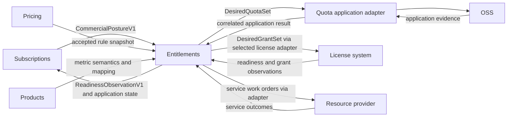

Created: 2026-10-23 by Virtuozzo International GmbH
Updated: 2026-11-16 by Virtuozzo International GmbH

# PRD: Entitlements: Application of Commercial Posture

<!-- toc -->

- [1. Overview](#1-overview)
  - [1.1 Purpose](#11-purpose)
  - [1.2 Background / Problem Statement](#12-background--problem-statement)
  - [1.3 Goals (Business Outcomes)](#13-goals-business-outcomes)
  - [1.4 Glossary](#14-glossary)
- [2. Architecture Alignment](#2-architecture-alignment)
  - [2.1 Terminology and Naming](#21-terminology-and-naming)
  - [2.2 Contract Status](#22-contract-status)
- [3. Actors](#3-actors)
  - [3.1 Human Actors](#31-human-actors)
  - [3.2 System Actors](#32-system-actors)
- [4. Operational Concept & Environment](#4-operational-concept--environment)
  - [4.1 Module-Specific Environment Constraints](#41-module-specific-environment-constraints)
- [5. Scope](#5-scope)
  - [5.1 In Scope](#51-in-scope)
  - [5.2 Out of Scope](#52-out-of-scope)
- [6. Functional Requirements](#6-functional-requirements)
  - [6.1 Posture Intake](#61-posture-intake)
  - [6.2 Initial Readiness](#62-initial-readiness)
  - [6.3 Rules and Quota Projection](#63-rules-and-quota-projection)
  - [6.4 License Grants](#64-license-grants)
  - [6.5 Service Fulfillment](#65-service-fulfillment)
  - [6.6 Fencing and Reconciliation](#66-fencing-and-reconciliation)
  - [6.7 Extension Hooks](#67-extension-hooks)
- [7. Non-Functional Requirements](#7-non-functional-requirements)
  - [7.1 NFR Inclusions](#71-nfr-inclusions)
  - [7.2 NFR Exclusions](#72-nfr-exclusions)
- [8. Five Quality Vectors Analysis](#8-five-quality-vectors-analysis)
- [9. Public Library Interfaces](#9-public-library-interfaces)
  - [9.1 Public API Surface](#91-public-api-surface)
  - [9.2 External Integration Contracts](#92-external-integration-contracts)
- [10. Use Cases](#10-use-cases)
  - [Initial activation readiness](#initial-activation-readiness)
  - [Posture change after activation](#posture-change-after-activation)
  - [Operator repair](#operator-repair)
- [11. User Interaction and Design](#11-user-interaction-and-design)
- [12. Acceptance Criteria](#12-acceptance-criteria)
- [13. Dependencies](#13-dependencies)
- [14. Assumptions](#14-assumptions)
- [15. Open Questions](#15-open-questions)
- [16. Risks](#16-risks)
- [17. Reference Materials](#17-reference-materials)
  - [17.1 Reconciliation Framework](#171-reconciliation-framework)
  - [17.2 Requirement Allocation](#172-requirement-allocation)
  - [17.3 Upstream Requirement Coverage](#173-upstream-requirement-coverage)

<!-- /toc -->

**Design status.** This document specifies proposed behavior. Each capability needs adopted contracts, SDK mappings and conformance evidence before enablement.

## 1. Overview

### 1.1 Purpose

Entitlements turns committed subscription changes into desired quotas, license grants and resource work. It sends that work through BSS-selected adapters and reports readiness and application status. Products owns the commercial quota catalog. Pricing stores plan rules and freezes them with accepted prices. Entitlements defines application rules and derives the desired state. OSS owns resource allocation, usage counters, releases and enforcement.

This PRD states what Entitlements guarantees and what it refuses. The architecture is in [DESIGN.md](DESIGN.md). The procedures per capability are in [features](features). Provider obligations and enablement gates are in [UPSTREAM_REQS.md](UPSTREAM_REQS.md). This package specifies the design. Its adapters, SDK and runtime are not implemented yet.

### 1.2 Background / Problem Statement

Commercial decisions and provider execution have separate owners, evidence and recovery rules. Orders, Rating and Billing consume commercial obligations; quota, license and resource providers consume scoped desired state. Entitlements derives desired state and tracks application through quota, license and service adapters. Each adapter design defines the receiving system, its APIs and how it meets the contract. Each adapter must preserve identity, reject stale work and recover lost results.

Subscriptions owns commercial posture and decides whether service readiness allows activation. Entitlements derives desired state, persists readiness manifests, integrates adapters and reconciles actual outcomes. Pricing stores immutable accepted rules. Entitlements applies those rules without changing their commercial meaning.

### 1.3 Goals (Business Outcomes)

- Every committed posture revision produces one complete desired state per enabled capability and a recoverable result.
- Required initial service is usable before Subscriptions commits active. Its first issuance cannot wait until after T.
- An older command can never undo a newer revocation at any provider.
- Pricing freezes the accepted rules. Replay never reads a live plan.

### 1.4 Glossary

| Term | Meaning |
| --- | --- |
| Commercial posture | The versioned fact Subscriptions publishes for a subscription revision: members with capability references, quantity as the sum of effective lots, validity, posture `Granted`, `Restricted` or `Revoked`, holder scope, tenant axes, revision and digest. |
| Desired state | The provider-facing projection Entitlements derives from one posture revision and the accepted snapshot: a `DesiredQuotaSet`, a `DesiredGrantSet` or a set of service work orders. |
| Assignment | The stable identity of one concrete rights assignment or service instance inside an authorized tenant scope. Adapters and providers address work by assignment, never by subscription. It is not the billing assignment that Subscriptions records for a commercial leg (ENT-D-05). |
| Readiness manifest | The persisted required assignments and hook bindings for initial activation, with desired revision, service profile, targets and producer authorities. |
| Hook binding | Immutable selection of a hook point, plugin instance, implementation version/digest and limited execution policy. |
| Observation | Evidence from an authorized producer. Adapter readiness uses `pending`, `ready`, `failed` or `withdrawn`. The aggregate sent to Subscriptions uses `pending`, `ready`, `failed_retryable`, `failed_definitive` or `blocked` (ENT-D-09). Quota application uses `pending`, `applied`, `refused` or `unknown`; known partial work stays `pending`. Resource outcomes may also be partial. None is a subscription status. |
| Adapter | The deployment-selected integration that translates desired state into provider operations and provider evidence into observations. Native, third-party and customer integrations are alternative adapters. |
| Capability profile | The versioned guarantees an adapter must prove before a product profile can use its capability. |
| Rule | A quota rule or grant definition stored on a PlanRevision. Quota rules select versioned Products definitions and set fixed or per-plan-unit amounts. Entitlements owns the application schema; Products owns catalog meaning and Pricing owns plan authoring and acceptance. |
| Binding | The selection of a rule for a plan item or dimension value inside a PlanRevision. It binds semantics, not a caller-chosen cap. An `AdapterBinding` is a different record: it pins an assignment to one adapter instance. |
| Grant | A license right that the selected license adapter issues from a grant definition. It is not the account-use grant of Accounts, which authorizes charging a billing account. |
| Accepted snapshot | The frozen rule and binding evidence inside Pricing's acceptance receipt for one purchase. Replay reads it; it never reads the live plan. |
| Source key | `(authenticated namespace, resource tenant, assignmentId)`: the key under which the adapter holds the accepted head and the applied head of one desired set (ENT-D-11). |
| Finding | A durable record of a mismatch between desired and observed state, closed only by correlated evidence or an audited disposition. |

## 2. Architecture Alignment

### 2.1 Terminology and Naming

BSS selects the service route and adapter. Each adapter design defines its OSS connections, receiving components and downstream APIs. "Provider" means the system that applies or enforces the requested state. Names such as `DesiredQuotaSet` describe proposed contracts, not shipped Rust types.

### 2.2 Contract Status

This PRD defines Entitlements requirements under `cpt-cf-bss-entitlements-*`. The [Subscriptions PRD](../../subscriptions/docs/PRD.md) defines the commercial requirements. The two gears agree the posture and readiness contracts under E-U06; [DECISIONS.md](DECISIONS.md) records the application boundary (ENT-D-01), the initial readiness rules (ENT-D-02), rule ownership (ENT-D-03), service authorization (ENT-D-04) and the boundary with Accounts and resale legs (ENT-D-05).

## 3. Actors

### 3.1 Human Actors

#### Platform Operator

**ID**: `cpt-cf-bss-entitlements-actor-platform-operator`

- **Role and needs**: Inspects desired and observed state per assignment, resolves findings, requests reconciliation and repair, and changes adapter or profile selection under audit.

### 3.2 System Actors

#### Subscriptions

**ID**: `cpt-cf-bss-entitlements-actor-subscriptions`

- **Role**: Publishes `CommercialPostureV1` from its atomic lifecycle commit and consumes `ReadinessObservationV1` and application state. Owns the commercial lifecycle, T and the consumer-side readiness gate.

#### Pricing

**ID**: `cpt-cf-bss-entitlements-actor-pricing`

- **Role**: Stores quota and grant rules on the immutable PlanRevision, validates them at publication and freezes them in the acceptance receipt together with the price bindings.

#### Products

**ID**: `cpt-cf-bss-entitlements-actor-products`

- **Role**: Owns the reviewed commercial quota catalog, GTS metric and unit identities, accounting and scope policies, historical versions, and qualification for sale.

#### Quota Adapter

**ID**: `cpt-cf-bss-entitlements-actor-quota-adapter`

- **Role**: Accepts complete desired quota sets and returns correlated application evidence. Its design defines the OSS integration. OSS owns resource allocation, usage counters, releases and enforcement.

#### License Adapter

**ID**: `cpt-cf-bss-entitlements-actor-license-adapter`

- **Role**: Accepts fenced desired grant state and returns application and readiness evidence. Its design defines the receiving system and APIs. Seat assignment and runtime checks stay in that system.

#### Service Adapter

**ID**: `cpt-cf-bss-entitlements-actor-service-adapter`

- **Role**: Accepts service intents and returns assignment-level outcomes and confirmed effective time. Its design defines the receiving system and APIs. OSS owns the affected resources and execution.

#### Hook Plugin

**ID**: `cpt-cf-bss-entitlements-actor-hook-plugin`

Runs approved integration handlers through a scoped ToolKit plugin. Returns execution results under a saved binding. It owns no commercial or activation decision.

## 4. Operational Concept & Environment

Subscriptions commits a lifecycle transition and the posture in one transaction and delivers the posture after that commit. Subscriptions workers call the public Entitlements client and read results by revision ([DESIGN §3.3.1](DESIGN.md#331-commercial-posture-contract)). Outbox delivery would use the same contract over another transport.

Entitlements accepts the posture, derives one desired set per enabled capability, and dispatches adapter work from its own outbox. Each adapter applies the requested state and returns evidence. Its contract must prevent stale work from undoing a newer accepted change. Entitlements journals the result and exposes it to Subscriptions reads. No call to a provider runs inside a local transaction, and no cross-gear transaction exists.

### 4.1 Module-Specific Environment Constraints

- Validity intervals are half-open and UTC. The adapter must preserve their meaning. Consumption windows and timed consumption quotas are outside v1.
- Every adapter call is bound to the resource tenant and proves subject membership through the resource authority. Seller and payer permissions never substitute for resource-tenant authority.
- Every call that names a tenant runs under a single-target scope of that tenant. The gear holds no scope over several tenants, and its workers find work through an authorized tenant roster (ENT-D-04).
- Event delivery is at least once and can be absent. Recovery reads of posture, source heads and observation streams must be sufficient without events.
- Desired state, outbox intent and journal must agree at each local commit. A process failure cannot expose an accepted posture without its derivation work.
- Adapter and profile identity is retained with every outstanding operation. A changed adapter never replays old commands into a new provider.

## 5. Scope

### 5.1 In Scope

| Capability | Release / priority | Launch condition |
| --- | --- | --- |
| Posture intake and fencing | v1 / p1 | E-U06 contract versions, E-U08 authorization and intake/replay fixtures. |
| Initial readiness and required service preparation | v1 / p1 | Held readiness, resolution, pre-purchase binding and the adapters required by the profile. |
| Quota projection and license grants | v1 / p1 | E-U01/E-U02 as applicable, frozen rules and qualified bindings under E-U03/E-U04. |
| Basic service execution | v1 / p1 | E-U05 for provision, withdraw, pause, restore and service-stop where required. |
| Reconciliation, repair and safe local retention | v1 / p1 | Recovery ships with each enabled capability. Local deletion additionally needs its policy and E-AC79 proof. |
| Fulfillment outputs: descriptors, listing, stream/link retrieval and delivery | v2 / p2 | Output contracts in feature 04, adopted by the selected license/service adapter. |
| Service dispositions: retention/export, holds, rescheduling and disposal | v2 / p2 | Subscriptions authority and feature 05 execution/fencing proof. |
| Typed extension hooks | v2 / p2 | E-U09 and the hook profile's shared prerequisites. |
| Consumption quota profile, pooling, rate limits | Future scope, not assigned to v2 | Separate contracts and qualification are required. |

V1 targets Q1. V2 requirements remain specified in this package. Their methods, permissions, required-output/hook profile fields and acceptance cases do not gate v1 profiles that do not use them. SDK/GTS version suffixes remain unchanged.

A v1 offer cannot require a v2 capability. Qualification and pre-purchase binding refuse such offers before commitment/capture; runtime intake also refuses unsupported work. Never silently drop required outputs, hooks or service dispositions. V1 still requires usable access before T. Deployment profiles that need Entitlements output delivery remain unavailable until v2. Basic application evidence, readiness commitments, preparation cleanup and local evidence-retention holds are v1.

**Quota readiness.** An authorized preparation attempt may apply purchased limits before T. Quota readiness confirms the complete desired set for the exact scope and revision. Buying limits alone does not require a VM or other resource to be created. If the purchase also includes deployment, the resource fulfillment contract owns that readiness.

An unknown activation or cleanup result keeps its recovery obligation. Only an authoritative non-activation decision permits preparation cleanup. OSS owns the effect of resource cleanup on usage and remaining capacity. Entitlements does not receive quota allocation or release events.

Unsupported profiles cannot be sold. A later outage keeps accepted terms and the delivery obligation. A capability with an open gate remains unavailable; a local test fixture cannot prove production support.

### 5.2 Out of Scope

Tenant-owned code, runtime editing of hook bindings, arbitrary policy scripts, mutation of purchased rights and workflow orchestration are outside v1. Typed hooks are v2 and use deployment-approved integration plugins. A Serverless-backed implementation remains future scope, not a v2 prerequisite.

OSS owns resource allocation, quota usage checks, used/reserved/remaining counters, releases and effective-limit reads. Entitlements stores purchased-limit provenance, desired state and adapter application results. It receives no per-resource quota accounting events and performs no runtime quota reconciliation.

License stores, seat assignment, provisioning engines and topology also belong to providers. Subscriptions owns the commercial lifecycle and purchase admission. Pricing owns plan authoring and acceptance; Products owns the reviewed commercial catalog. Entitlements does not decide whether a customer may buy.

V1 supports initial quota installation and compatible increases. Numerical decreases, base-plan and scope migrations, resource adoption, unbounded limits, multiple commercial sources, cross-provider pools, arbitrary partitions, consumption profiles and rate limits are future scope. Suspension and revocation remain access controls, separate from a numerical decrease.

Entitlements does not call [Accounts](../../accounts/docs/PRD.md) (ENT-D-05). It authorizes no account use and reads no account, offer or account-use grant. Changes to those records affect fulfillment only through a new Subscriptions posture. A resale leg or attachment order creates no separate desired state; one service subscription has one posture ([commercial model](../../../../docs/arch/bss-commercial-model/DESIGN.md#21-design-principles)). Offers requiring `quota_controlled` funding wait for the deferred consumption profile and cannot be qualified or sold in v1.

## 6. Functional Requirements

Requirements define observable guarantees. DESIGN holds mechanisms; features hold procedures and checks. Every active requirement needs acceptance evidence. Local fixtures do not close an external integration gate.

### 6.1 Posture Intake

#### Accept and fence a posture revision

- [ ] `p1` - **ID**: `cpt-cf-bss-entitlements-fr-posture-intake`

Entitlements MUST accept `CommercialPostureV1` through the Subscriptions delivery and recovery contracts. The posture carries:

- Identity `(orderingTenantId, subscriptionId, revision)`, payload digest and operation ID.
- Resource, payer and seller tenant axes. Payer and seller are evidence, not resource authority (ENT-D-15).
- Complete capability members, committed quantity, validity, access posture and holder scope.
- Acceptance references, rule/binding digests and contributing lot IDs.
- Execution context, preparation policy/version/start/deadline, activation resolution and complete service dispositions.

[DESIGN §3.3.1](DESIGN.md#331-commercial-posture-contract) defines these fields. Disposition updates retain cutoff, generation, hold, schedule and deletion authority. Withdrawal or disposition changes MUST advance the aggregate revision even if commercial status stays the same. Lots are provenance; Entitlements MUST NOT recalculate quantity from them.

Intake MUST authenticate the producer and authorize scope before acceptance. The journal applies these rules:

- Lower revision: record as stale without effects.
- Equal revision and digest: return the existing result.
- Equal revision with different content: refuse and expose the conflict.
- Higher revision: accept the new target and retain earlier outcomes.

A result MUST affect only its matching revision. The accepted posture, derivation work and outbox intent MUST commit together. Accepted provenance MUST identify the Pricing catalog tenant, acceptance ID, expected terms digest and exact purchase. Entitlements MUST obtain complete historical application evidence through the authorized Pricing receipt read and validate it before new derivation. Resource-tenant access MUST NOT imply catalog receipt access. Missing or failed reads MUST NOT fall back to current plans or empty rights.

Subscriptions MUST be able to recover the exact durable intake decision by revision, digest and operation. The read MUST distinguish the saved decision from whether an accepted revision is still current. It MUST NOT imply application or expose an uncommitted received state. Operators MUST have a separate, explicitly authorized ordering-tenant read of safe receipt metadata without subscription IDs or full posture content.

- **Rationale**: One fenced intake per revision keeps every later derivation reproducible and prevents a replay from producing a second application.
- **Actors**: `cpt-cf-bss-entitlements-actor-subscriptions`, `cpt-cf-bss-entitlements-actor-platform-operator`
- **Covers**: `cpt-cf-bss-entitlements-upreq-commercial-posture`

### 6.2 Initial Readiness

#### Readiness manifest, observations and the provider-side boundary

- [ ] `p1` - **ID**: `cpt-cf-bss-entitlements-fr-initial-readiness`

Entitlements MUST persist a complete readiness manifest before sending preparation work or observations. It lists every required scoped assignment, desired revision, profile, target and authorized producer. Optional and not-applicable capabilities are explicit. A manifest with no required assignments and no readiness hooks requires authoritative evidence that no preparation is needed; failed discovery cannot create one.

Preparation MUST run while the subscription is `preparing`. Required access cannot wait for `active`. The adapter prepares the accepted service: for example, an account, a purchased environment and usable access. It does not wait for first login or a later resource purchase. Entitlements records authority and waits for evidence; the adapter owns vendor steps. Buying quotas alone requires no resource deployment.

An existing assignment may be reused only when its scope, lifetime and revision semantics meet the contract. Its intent and activation association MUST be saved before dispatch, so a fast callback can be matched. A read/check interface is not evidence of an issuance API or change feed. The adapter contract may use events, polling or both, but recovery cannot depend on event delivery.

Entitlements MUST save and expose aggregate `ReadinessObservationV1` through its SDK read under [DESIGN §3.3.2](DESIGN.md#332-readiness-observation-contract). It binds the ordering tenant, scope, operation, posture revision/digest, immutable manifest identity/version/digest, complete roster and service profile. Each result includes schema/event/producer identity, sequence, observation time and evidence. Readiness results include status and reason. After verified non-activation closure, the current result MUST instead carry the exact Subscriptions resolution and cleanup settlement, with no readiness status.

This applies even before a manifest exists. Late readiness MUST NOT reopen the attempt; settlement updates MUST retain its closure. Every `ready` result includes a readiness commitment and its binding. No subscription identifier crosses this envelope. Each changed result MUST commit with an Event Broker notification intent. Subscriptions MUST read the full result before acting and recover through polling when notifications are missing. No readiness SDK callback is required.

Subscriptions saves its operation and preparation posture before dispatch, then binds the first exact matching manifest result. A changed roster or digest under the same version MUST be refused. Replacement needs a newer preparation posture. Entitlements MUST commit results and sequence changes with the outbox and make the full result recoverable by operation/posture. An authorized empty manifest still produces an explicit aggregate result.

Adapter observations are a separate input. Entitlements MUST authenticate the producer and check its authority against the saved manifest. Scope, assignment, desired revision, profile and target must match. It saves content identity, producer sequence and provenance. An identical replay is a no-op. Conflicts, wrong scope, unknown producers and ambiguous matches are refused or quarantined without leaking data. Older sequences cannot replace newer results. Gaps require recovery unless the agreed full-state snapshot proves coverage. Unsupported schemas cannot mean ready.

Aggregate readiness MUST require each required assignment to meet its pinned criterion and output checks for the exact revision. No required assignment may have an unresolved fulfillment discrepancy. Every configured readiness hook MUST pass against current prerequisite evidence. Pending, partial and unknown application MUST remain pending. A refusal MUST use the pinned capability profile's agreed retryable/definitive classification; an unclassified refusal is retryable with a finding, never an automatic definitive failure.

This classification does not authorize a new execution or cleanup. Subscriptions owns activation and closure decisions. One producer cannot satisfy another's obligation. A dispatch receipt, broker acknowledgment or existing license record is insufficient. Subscriptions owns activation and T. Post-commit work may reconcile prepared rights or deliver nonessential changes; it cannot be the first step that makes required access usable. Initial readiness is not an uptime promise.

Entitlements MUST retain external effects and durable recovery keys. A lost reply, absent read or quiet broker does not prove non-execution. Recovery keeps the same assignment and cannot create another environment. Preparation failure does not prove cleanup. Withdrawal first fences preparation authority, then recovers in-flight work and records cleanup obligations. Late results remain useful evidence but cannot reactivate a withdrawn attempt. Cleanup targets only resources owned by that attempt under accepted policy. It cannot delete an existing customer account merely because the account was linked.

Products qualification and accepted Pricing terms MUST state whether an offer requires Entitlements preparation, with or without hooks. Before purchase commitment or capture, Orders MUST obtain and retain a compatible configuration binding from Subscriptions for that exact acquisition and acceptance. Subscriptions MUST use the bound mode/policy/profile at activation; ordinary Settings changes cannot switch an accepted purchase to `no_preparation`. Missing or incompatible evidence MUST block purchase, not first be discovered as an activation-time configuration check. The binding starts no preparation or activation deadline.

**Held readiness (SUB-D-57).** A ready result MUST commit to retaining the prepared assignments until Subscriptions resolves the attempt. Subscriptions owns the serialized activation/non-activation decision. Entitlements MUST recover that immutable result through the authorized Subscriptions operation read after lost or superseded delivery. A later posture's `resolutionRef` or the saved preparation identity identifies the result.

Historical resolution settles only its generation and MUST NOT replace newer desired state or restore restricted or revoked access. Applied resolution must match the full manifest/commitment binding. Terminal non-activation must also be recoverable before any manifest or commitment exists. A verified `closed_without_activation` with an unfamiliar owner-valid reason MUST be accepted and retain its exact code.

The reason MUST NOT select additional actions or imply effect settlement. Unknown outcomes, invalid authority and mismatched attempt bindings remain invalid. It retains known bindings, blocks late preparation and covers partial or later discovered effects.

Timeout, a failed observation, an unmet guard or a missing resolution posture MUST NOT authorize cleanup on its own. Only authoritative non-activation permits authorized cleanup. Before admitting a successor, Subscriptions MUST receive settlement based on either complete local proof of no possible dispatch or adapter-confirmed resolution/isolation and safe reuse for every possible predecessor effect.

Operator acknowledgment or finding disposition cannot supply that proof. Applied resolution continues the same rights. If activation wins, its T remains historical truth and later lifecycle policy controls further work. Physical outages and authorized emergency security blocks remain explicit exceptions to continuous access. The responsible adapter MUST report a block for the exact assignment.

An active block on a required assignment MUST prevent ready, regardless of its readiness criterion. Only explicit newer clearance from the same responsible authority may lift that block. Ordinary readiness, hooks, timeouts and operator finding disposition MUST NOT clear it. Optional assignment blocks remain visible without blocking the whole manifest.

Subscriptions MUST snapshot the preparation policy/version, authorized start and deadline. Entitlements MUST report correlated failure and deadline evidence through aggregate readiness. Subscriptions alone decides closure and resends its resolution in posture. There is no separate closure command. Cleanup MUST wait for that confirmed decision. Retries, restarts and profile edits cannot extend the deadline. Closed or expired attempts cannot newly activate. Attempt closure keeps the purchase/payment for Orders remediation and does not cancel or refund it. A successor requires evidence that old effects and cleanup cannot harm it. Unknown outcomes retain their obligations.

Subscriptions MUST check commercial and financial prerequisites before publishing preparation and before activation. Entitlements MUST report service readiness without receiving or verifying Billing commitments.

Authorized preparation before T, including never-activated work, MUST remain platform-borne. It cannot become ordinary customer service charges. Enabled profiles need bounded exposure, preserved uncertain obligations and authoritative time/accounting evidence from the responsible owners. Entitlements does not calculate quota usage or remaining capacity. Quota application, purchased validity and financial admission gates remain in force.

Consumption quota readiness is outside v1. Its future contract must define evidence and side effects before qualification. A readiness marker alone grants no accounting exemption or authorization bypass.

**Fulfillment discrepancies.** A provider restriction that prevents the purchased limit MUST remain separate from accepted rights. Entitlements retains its ordered scope, reason, version and time as application evidence. It does not rewrite terms or collect runtime usage. Known incompatible offers are refused before acceptance/capture; a later restriction preserves the purchased obligation. Required initial readiness cannot pass while that mismatch remains. Ordinary usage is not a mismatch. Recovery must handle restriction changes without a commercial revision; delivery success alone cannot clear them. Held readiness, historical T and emergency rules still apply.

- **Rationale**: Usable service is confirmed before commercial activation; a readiness claim without evidence would let Subscriptions commit T on a service that does not work.
- **Actors**: `cpt-cf-bss-entitlements-actor-subscriptions`, `cpt-cf-bss-entitlements-actor-license-adapter`, `cpt-cf-bss-entitlements-actor-service-adapter`, `cpt-cf-bss-entitlements-actor-platform-operator`
- **Covers**: `cpt-cf-bss-entitlements-upreq-readiness-gate`

### 6.3 Rules and Quota Projection

#### Rule schema and semantics

- [ ] `p1` - **ID**: `cpt-cf-bss-entitlements-fr-rule-schema`

Entitlements MUST publish a versioned schema for applying quota and grant rules (ENT-D-03). Quota rules MUST retain the commercial meaning of the Products definition selected in Pricing. A rule, an accepted purchase and a desired application are separate records.

| Owner | Responsibility | Boundary |
| --- | --- | --- |
| Products | Review and publish commercial quota definitions, localized names/descriptions with English fallback, canonical units, accounting/scope policies, immutable versions and qualification evidence. | The GTS registry stores identities and schemas. It does not decide whether a definition can be sold. |
| Pricing | List applicable definitions, edit revision-owned rules, validate complete sets, and freeze price and quota terms together. | Does not apply quotas or read runtime usage. Package pricing and usage pricing are separate from the purchased limit. |
| Subscriptions | Own committed quantity, lifecycle posture and recoverable quota-domain exclusivity before purchase commitment or capture. | Does not calculate desired quotas or call adapters. |
| Entitlements | Derive complete desired sets from accepted rules and committed posture; track application and recovery. | Does not reinterpret catalog terms, inspect resource accounting or calculate remaining quota. |
| Orders | Preserve the accepted acquisition, quantity and receipt. | Cannot invent a cap or per-component quantity. |
| Selected adapter | Apply the requested state and confirm its scope, revision and result. | OSS components, internal APIs and accounting mechanisms belong to the adapter and OSS designs. |

Accepted quota evidence MUST retain exact rule and binding versions, GTS metric/unit identities, accounting/scope policies, selected scope values, qualified profile, exact amounts, quantity basis, validity and tenant axes. Complete sets MUST carry verifiable identity, count and digest. Missing pages or members cannot mean an empty set or removal. Billing meters, including derived meters, are not quota definitions unless an approved mapping proves the required meaning.

A service-specific metric MUST retain its explicit service-type reference and digest in accepted evidence. Consumers MUST validate that association through the qualified mapping; GTS naming alone grants no compatibility. Shared metrics use explicit mappings without a single service reference. This association MUST NOT multiply a shared limit or split its canonical ownership domain.

Products reviews capability discovery from adapters and authorized manual input before publication. GTS registration identifies schemas and semantics; it does not approve an offer. Products MUST qualify each supported profile and maintain its current availability. Pricing MUST check the complete set at publication and purchase/change acceptance. Entitlements MUST retain the accepted evidence rather than re-read current catalog terms. Withdrawn qualification blocks new sales; it does not erase accepted purchases or delivery obligations.

Grant rules MUST use separate `GrantDefinition`, `GrantBinding` and `AcceptedGrantSnapshot` types. They retain product/capability, supported subject/holder kinds, exact fixed or per-plan-unit quantities, selected items/dimensions, validity and access policies, required profile and tenant axes. They describe named rights, not quota counters or seat assignment. V1 grant policies MUST use the explicit holder, validity, suspension and revocation modes defined in feature 04. Pricing publication/acceptance and Entitlements validation MUST agree on those values; unknown or unsupported behavior MUST NOT fall back to a default. E-U03 requires separate authoring, validation, acceptance and historical-read support for quota and grant rules.

Unsupported values, versions or profiles MUST be refused before sale or application. They never mean "no limit". Replay MUST use the frozen receipt and its immutable references. Missing history is an explicit failure, never permission to use the live plan.

- **Rationale**: One owner of meaning and one owner of storage keep every accepted cap reproducible after the plan changes.
- **Actors**: `cpt-cf-bss-entitlements-actor-pricing`, `cpt-cf-bss-entitlements-actor-products`, `cpt-cf-bss-entitlements-actor-quota-adapter`
- **Covers**: `cpt-cf-bss-entitlements-upreq-commercial-posture`

#### Quota projection and exact conversion

- [ ] `p1` - **ID**: `cpt-cf-bss-entitlements-fr-quota-projection`

Entitlements MUST derive a complete `DesiredQuotaSet` from the accepted snapshot and Subscriptions' committed quantity and posture. It MUST preserve source identity, logical bindings, exact metric/unit and scope semantics, validity and accepted provenance. Lots provide provenance; Entitlements MUST NOT recalculate quantity from them.

A fixed rule applies once per logical binding. A per-plan-unit rule multiplies its coefficient by the committed plan quantity, once. Neither uses price, usage, selected-item count or a caller-supplied cap. Compatible quantity increases retain the original binding and source. Renewal and retry cannot create another allowance.

Conversion MUST be exact and use the accepted canonical unit. Negative amounts, incompatible units, unsupported precision, fractional integer results and overflow MUST be refused before effects. No rounding, truncation, saturation or float conversion is allowed. GB and GiB are distinct. DESIGN defines the numeric representation and bounds.

| Value | Meaning |
| --- | --- |
| Explicit zero | A purchased zero limit. It does not prove resource deletion or denial of every access path. |
| Absent rule | No purchased quota declaration. It means neither zero nor unlimited. Removal needs a complete authorized target. |
| Unbounded | Unsupported in v1. Errors or missing evidence cannot imply unlimited access. |

The selected scope MUST preserve the accepted policy. A tenant-wide offer is one shared limit. A regional or pool offer applies only to that selected region or pool and requires a qualified adapter profile. The full purchased limit MUST NOT be copied into each independent scope. Unresolved scope, missing exclusivity proof or changed mapping blocks dispatch. The resource authority proves scope ownership; Entitlements does not infer it from the calling user.

Only initial installation and compatible increases are supported in v1. A change of subject, metric, unit, kind, scope or period is a migration and MUST be refused. Lots with incompatible rules, coefficients, units, validity or expiry require a future contribution contract. Several subscriptions never imply pooling or an automatic sum/max policy.

| Transition | Required application behavior |
| --- | --- |
| Draft or future start | Purchase evidence alone grants nothing. Preparation requires explicit authority and accepted limits. |
| Activation | Required quota application is confirmed before T. Keep the same assignment and source. Resource readiness is a separate capability. |
| Active increase or addition | Send one complete compatible desired set. Keep the prior safe allowance while the increase is incomplete. |
| Suspended increase or addition | Subscriptions refuses it before publishing a posture. |
| Resume | Apply a newer authorized grant. Delayed work cannot undo a later restriction or closure. |
| Revocation | Close grants under the source. Preserve application history and unresolved recovery. Resource cleanup follows its own contract. |
| Renewal or continuation | Use accepted continuation terms and the same logical assignment. Do not issue another allowance. |
| Numerical decrease | Refuse as unsupported in v1. Do not credit counters or disguise it as a new source. |

The adapter MUST return `pending`, `applied`, `refused` or `unknown` with operation, source, revision and digest. `applied` confirms the complete requested set for the authorized scope. Known partial work stays `pending`; uncertain effects stay `unknown`. Neither becomes `refused` while effects or recovery remain unresolved. One OSS transaction is not required; the adapter owns internal sequencing and recovery.

Application status MUST remain separate from runtime usage. A purchased cap of 100 blocked by an independent ceiling of 60 is a fulfillment discrepancy. Using 40 of an available cap of 100 is not. Entitlements records the adapter's ordered discrepancy evidence without changing purchased terms or collecting runtime counters.

Example: three plan units at 100 GiB each produce a 300 GiB desired limit. A compatible increase to five units produces 500 GiB under the same binding. A separate fixed limit of ten projects stays ten. Package-priced and usage-priced offers can use the same limits; charging terms determine the bill.

- **Rationale**: Exact, reproducible projection keeps the purchased cap equal to what the accepted snapshot says after any replay or plan change.
- **Actors**: `cpt-cf-bss-entitlements-actor-pricing`, `cpt-cf-bss-entitlements-actor-products`, `cpt-cf-bss-entitlements-actor-quota-adapter`, `cpt-cf-bss-entitlements-actor-subscriptions`
- **Covers**: `cpt-cf-bss-entitlements-upreq-commercial-posture`

### 6.4 License Grants

#### Derive and apply desired grants

- [ ] `p1` - **ID**: `cpt-cf-bss-entitlements-fr-license-grants`

Entitlements MUST derive a `DesiredGrantSet` from the posture members that carry license capabilities. Each grant carries the grant definition reference, quantity, validity, holder scope, the assignment identity within the authorized scope and the generation. Purchased definitions, bindings and policy limits MUST come from the accepted Pricing snapshot. Subscriptions MUST supply each member's effective validity, holder scope and current access posture.

Entitlements MUST validate them against the accepted terms, not choose them from a live plan, caller identity or document-wide access. Missing member authority blocks new grants and increases; restriction or revocation of a known source follows ENT-D-13 using its retained binding. Each logical right MUST have a separate `assignmentId`, source fence and receipt.

A right can cover multiple seats for one holder. Quantity changes, restriction and resume preserve its identity; terminal revocation closes only that assignment. Entitlements dispatches each target through its selected license adapter. The adapter MUST:

- Accept desired grant state with authorized scope, assignment identity, desired revision and generation.
- Return applied, pending, refused or unknown evidence with authoritative effective time where known.

It neither receives nor reports `subscriptionId`.

A delayed issue or resume MUST NOT undo a newer revoke or suspend; ordering is enforced at the effect boundary, not only when reading a callback. The same application operation MUST support reads and replay after a lost response, without creating another grant.

When the accepted profile requires customer delivery, Entitlements MUST expose fulfillment outputs through authorized reads and retrieval. Examples include a license identifier, key or document. The adapter returns stable output identities, versions and safe metadata tied to the exact assignment/member and operation. Recovery must return the same output. A retry or download MUST NOT issue another license.

Protected content stays with the provider or an approved store. Raw keys and bearer links MUST NOT appear in ordinary receipts, events, logs or metadata reads. Each retrieval checks current resource-scope authority and delivery eligibility. Replacement, cancellation and expiry block unauthorized delivery of affected versions. Hiding an output does not prove revocation of an already downloaded offline license.

The accepted profile defines required outputs and release rules. Required initial outputs and their retrieval path MUST be ready before aggregate readiness. Essential pre-T delivery needs explicit preparation authority. Required initial access cannot wait for a post-T release. Missing optional outputs stay visible without blocking readiness. See [fulfillment outputs](DESIGN.md#337-fulfillment-outputs).

Preparation grants for an initial activation are issued while the subscription is still `preparing` and are reported as readiness observations; `active` is not the trigger. Increases and additions while suspended are refused by Subscriptions before any posture reaches Entitlements. Entitlements applies the accepted posture for each lifecycle decision. Delayed effects from an earlier change cannot undo a newer restriction.

The license provider owns seat assignment, reservation and access checks. Named grants do not create another copy of purchased capacity. Numerical quota enforcement belongs to OSS. Where the product requires no access gap, the selected license adapter MUST demonstrate that continuity; Entitlements cannot promise issue-before-revoke continuity by sending two asynchronous commands.

- **Rationale**: A complete local grant collection and independent provider fences per assignment keep each right equal to the accepted posture under retries and reordering.
- **Actors**: `cpt-cf-bss-entitlements-actor-license-adapter`, `cpt-cf-bss-entitlements-actor-subscriptions`
- **Covers**: `cpt-cf-bss-entitlements-upreq-commercial-posture`

### 6.5 Service Fulfillment

#### Work orders with confirmed service outcomes

- [ ] `p1` - **ID**: `cpt-cf-bss-entitlements-fr-resource-execution`

Pricing MUST freeze the complete service binding in the purchase acceptance: selected SKU versions, adapter-owned execution service type, exact profile, quantity rule, logical target rule, resolved parameters and policy evidence. Subscriptions MUST identify that binding in the component posture. Entitlements MUST use the saved content; a live catalog or deployment change cannot reinterpret an old purchase. The adapter MUST receive an explicit service-type reference and correlate native execution through the scoped assignment identity. Feature 05 defines the SDK/GTS fields.

Entitlements MUST express service intent for the resource tenant and its logical assignment: `provision`, `withdraw`, `pause`, `restore`, `service-stop`, `export` or `delete`. The last command authorizes disposal of service data. BSS MUST NOT require VM or volume IDs, an OSS resource inventory, physical generations or per-resource outcomes. The adapter may use a tenant-level or service-level OSS API without enumerating resources.

Subscriptions owns commercial intent, charging cutoff, retention/export terms and disposal eligibility. Entitlements retains assignment identity, desired revision, operation and correlated result. OSS owns resource selection and execution. Provider-specific IDs, sequencing, locks and compensation belong in the adapter design.

Results MUST distinguish `pending`, `applied`, `partial`, `refused` and `unknown` for the service intent. Partial effects stay recoverable through the original operation; their resource details stay in OSS. Actual effective time is included only when confirmed. A stop at 10:05 after a 10:00 charging cutoff stays 10:05. Subscriptions and Billing decide its commercial meaning.

Suspension MUST preserve service data. Retention, export and disposal MUST follow accepted terms. Hold acknowledgment MUST confirm provider-enforced protection, not receipt of a request. A profile that cannot provide these guarantees cannot enable the affected operation. Entitlements does not implement physical deletion or hold arbitration.

Service outputs use the fulfillment-output contract and remain bound to their assignment and generation. Retry cannot create a second service or apply an old command to a successor assignment. Replacing infrastructure within OSS does not create a new BSS assignment.

- **Rationale**: BSS needs service fulfillment evidence, not an infrastructure control plane.

- **Actors**: `cpt-cf-bss-entitlements-actor-service-adapter`, `cpt-cf-bss-entitlements-actor-subscriptions`, `cpt-cf-bss-entitlements-actor-platform-operator`
- **Covers**: `cpt-cf-bss-entitlements-upreq-commercial-posture`

### 6.6 Fencing and Reconciliation

#### Stale-action fencing at every provider

- [ ] `p1` - **ID**: `cpt-cf-bss-entitlements-fr-stale-action-fencing`

Every adapter MUST prevent stale work from undoing a newer accepted restriction, revocation or stop, including work already in flight. Checking a callback after the effect is too late. Ordering and recovery MUST survive timeout, restart and worker lease loss.

For quota application, the adapter MUST report its highest durably accepted revision/digest separately from the last fully applied revision/digest. Malformed, unauthorized or conflicting requests cannot advance the accepted head. A valid accepted request may later be refused, but that refusal does not lower the accepted head.

An unseen lower revision MUST be refused without effects. A recorded operation MUST return its saved or recovered result, including a refusal, without reapplying superseded state. Changed content under the same operation or revision MUST conflict without overwriting the original result. A corrected attempt needs a distinct identity. Acceptance proves ordering, not application.

Terminal closure prevents further grants under the same source, even at a higher revision. Authorized reads, original-operation recovery and updates that preserve closure remain available. A new purchase needs a distinct authorized identity. An operation ID, revision and content digest serve different purposes and cannot replace one another.

The adapter design defines the mechanism. Entitlements specifies the observable guarantees, not provider database fields, internal APIs or transactions. A profile that cannot prove these guarantees stays unavailable. Retained history and closure evidence must cover delayed requests and recovery; cleanup cannot reopen a source.

Entitlements MUST save a versioned adapter binding before dispatch for each assignment/capability. It retains the adapter instance, contract/profile, stable provider target and observation authority. Later revisions, retries and recovery MUST reuse it. Changed priority, a missing plugin or a reconfigured instance cannot redirect existing work.

Provider migration needs a separate supported transition that resolves outstanding effects and source ownership. An unknown result never permits automatic fallback. BSS selects the eligible service route and adapter through the Entitlements plugin contract (ENT-D-01). The adapter selects its receiving OSS components and downstream calls.

An unsupported profile or unavailable binding stays visible. Neither can produce success or readiness.

- **Rationale**: Without a fence that covers in-flight work, a delayed grant can restore access after cancellation.
- **Actors**: `cpt-cf-bss-entitlements-actor-quota-adapter`, `cpt-cf-bss-entitlements-actor-license-adapter`, `cpt-cf-bss-entitlements-actor-service-adapter`
- **Covers**: `cpt-cf-bss-entitlements-upreq-commercial-posture`

#### Reconciliation, findings and repair

- [ ] `p1` - **ID**: `cpt-cf-bss-entitlements-fr-reconciliation`

Entitlements MUST record adapter acceptance, confirmed application and findings separately from commercial status. A broker receipt or internal provider acknowledgment cannot prove complete application. Outbox replay MUST keep the request identity and saved adapter/profile. Recovery MUST use a pinned, versioned policy with bounded call timing, delivery retries, result polling, escalation and automatic replacement limits.

Restart or configuration change MUST NOT reset its clocks or counters. Exhaustion MUST retain uncertain operations and use slower recovery, not infer refusal or create replacement rights. A replacement after confirmed refusal requires remediation evidence, current authority and its own bounded attempt budget. Reconciliation obtains correlated application evidence through that adapter. The adapter design defines how it gathers and retains this evidence. A dispatch log alone is insufficient.

| Recovery situation | Required action |
| --- | --- |
| Remote apply succeeds; local response or write times out | Mark unknown, read the same source key and operation, verify revision and digest, recover the receipt; replay only the same idempotent apply. |
| Local commit succeeds; worker dies before dispatch | Recover the outbox and send the identical desired revision. |
| Delayed old request arrives after restriction or revoke | The adapter prevents old effects under its accepted head or closure record. Filtering callbacks alone is insufficient. |
| Adapter reports a higher accepted or applied revision | Check authorized history. Keep unexplained differences visible and never overwrite with an older local head. |
| Application missing or independent restriction reported | Recover through the adapter. Repair only this source under current authority. Keep other owners' restrictions and unresolved effects; do not create a parallel grant. |
| Accepted metric or profile can no longer be fulfilled | Record the adapter discrepancy and retain the commercial obligation. Do not substitute a metric or claim readiness. |
| Adapter or profile changes | Keep in-flight work bound to the original adapter and profile; a new adapter never replays old commands into a different provider. |

An authorized operator MUST be able to reconcile an assignment within one tenant scope. Missing or mismatched application creates a durable finding. Every finding MUST have a typed subject and immutable owner tenant. Intake and preparation-generation findings belong to the ordering tenant and MUST remain readable before assignments or manifests exist. Assignment and hook findings belong to the resource tenant. Reads, operator actions, audit and events MUST enforce that owner scope without exposing subscription IDs or raw posture. Repair retries the existing desired revision or submits an authorized successor. Commercial corrections belong in Subscriptions. Entitlements cannot directly edit a provider grant, quota or resource.

Public collection reads MUST use the shared ToolKit OData and page contract. SDK, REST and OpenAPI MUST agree on supported filters, sorting and pagination. Queries and cursors MUST remain inside the authorized tenant scope; unsupported parameters MUST fail explicitly. [Feature 06](features/06-reconciliation-recovery.md#odata-collection-contract) defines fields, limits and validation.

Local retention MUST use an explicit versioned policy. Completed diagnostic details may expire only after preserving replay results, revision fences and evidence still needed by rights, recovery or cleanup. Unresolved work MUST NOT expire by timeout. Audit retention and approved identity erasure MUST follow the platform audit policy. [Feature 06](features/06-reconciliation-recovery.md#retention-and-safe-compaction) defines policy ownership and deletion rules.

A finding closes only on correlated evidence or an audited operator decision. An outage or newer revision cannot erase unresolved history. Subscriptions reads MUST show desired state, application evidence, source revision, observation time and mismatch reason. Pending or failed work cannot imply access.

- **Rationale**: Operators must see whether the accepted posture was applied, and recover it without inventing success.
- **Actors**: `cpt-cf-bss-entitlements-actor-platform-operator`, `cpt-cf-bss-entitlements-actor-subscriptions`, `cpt-cf-bss-entitlements-actor-quota-adapter`, `cpt-cf-bss-entitlements-actor-license-adapter`, `cpt-cf-bss-entitlements-actor-service-adapter`
- **Covers**: `cpt-cf-bss-entitlements-upreq-commercial-posture`

### 6.7 Extension Hooks

**Release: v2 / p2.** The requirements below remain part of the target design.

#### Run bounded service extensions

- [ ] `p2` - **ID**: `cpt-cf-bss-entitlements-fr-extension-hooks`

In v2, Entitlements MUST support optional, typed hooks for an additional readiness check, an assignment outcome and an output-state change. Deployment configuration binds each point to an approved ToolKit hook plugin with an exact implementation version/digest and execution policy. A new binding requires a new qualified profile version. Configured hooks MUST work without Serverless. Services without bindings MUST work without loading a hook plugin. V2 hooks require the `entitlements` activation profile. Services using `no_preparation` have no hooks. Later assignments inherit the applied generation's saved profile.

A readiness hook MUST add evidence to the required adapter criteria. It cannot replace them, change purchased terms, provision essential access or cancel a purchase. Missing, stale, failed or invalid evidence MUST NOT permit ready. Subscriptions retains the activation decision and deadline. Checks run only during initial preparation. They MUST NOT delay restriction, revocation or cleanup.

Post-commit actions MUST use durable notices saved with the source change. Their execution outcome stays separate from application state. Delivery and execution failures MUST remain visible and recoverable without rolling back the source result. Repeated execution MUST keep the same notice identity so consumers can deduplicate it.

Hook-enabled offers MUST require Entitlements preparation. The pre-purchase configuration binding follows the initial-readiness requirement; hooks add no separate purchase protocol.

Entitlements MUST retain the binding, invocation correlation and result evidence across restart. An uncertain start MUST NOT trigger a replacement invocation and MUST retain its reserved check slot. Check budgets MUST count confirmed plugin admissions once, including failures or cancellation after admission. Proven `not_started` MUST release the reservation without consuming a check. Delivery retries MUST use separate saved bounds and cannot extend the activation attempt or reset check counts. Plugins receive only scoped, safe data and a separately restricted execution identity, never caller credentials or protected output content.

- **Rationale**: Different integrations can implement the same typed hooks while shared business rules remain stable.
- **Actors**: `cpt-cf-bss-entitlements-actor-hook-plugin`, `cpt-cf-bss-entitlements-actor-platform-operator`, `cpt-cf-bss-entitlements-actor-subscriptions`.

## 7. Non-Functional Requirements

Security, tenant isolation, audit and ToolKit integration inherit the [guidelines](../../../../guidelines/README.md), [security requirements](../../../../guidelines/SECURITY.md) and [architecture manifest](../../../../docs/ARCHITECTURE_MANIFEST.md). The threshold below is a launch target that this gear proposes, to be measured on the Subscriptions S-Q07 reference workload; it is not an observed result.

### 7.1 NFR Inclusions

#### Handoff latency

- [ ] `p1` - **ID**: `cpt-cf-bss-entitlements-nfr-handoff-latency`

Each accepted posture revision MUST reach every required adapter, or a visible retry state, within the target budget. Proposed target: first delivery p95 < 5 s and p99 < 15 s; pending beyond 60 s produces an auditable exception. Time to confirmed usable access is recorded separately and is never hidden inside a delivery figure.

- **Threshold**: proposed 5 s / 15 s first delivery; 60 s exception threshold.
- **Verification**: provider outage and recovery, duplicate acknowledgement and refusal scenarios with request identity preserved; measured on the reference workload of the Subscriptions PRD §7.1 with healthy providers at p99 response time at most 250 ms.
- **Architecture allocation**: DESIGN outbox dispatch and the readiness and reconciliation components.

- **Rationale**: Delayed application must be visible before anyone infers that access is ready.
- **Actors**: `cpt-cf-bss-entitlements-actor-subscriptions`, `cpt-cf-bss-entitlements-actor-platform-operator`
- **Covers**: `cpt-cf-bss-entitlements-upreq-readiness-gate`

### 7.2 NFR Exclusions

Point-of-use check latency, counter throughput and license issuance time are requirements of the platform owners. A provider outage leaves delivery pending or unknown. Entitlements does not promise provider availability.

## 8. Five Quality Vectors Analysis

| Vector | Product guarantee | Evidence |
| --- | --- | --- |
| Correctness | Exact projection, one desired set per revision, fenced application. | Numeric boundary, replay, conflict and in-flight race fixtures. |
| Security | Every adapter call is bound to the resource tenant; producers are authenticated against the manifest; every call runs under a single-target scope checked by the returned-scope guard (ENT-D-04). | Wrong-tenant observation, foreign subject and seller-as-resource-tenant refusals; refusal of a scope answer that is not fenced to the target; a user call of a service-only method. |
| Reliability | Accepted posture and its application remain discoverable without events or the original response. | Lost reply, worker death and restart scenarios. |
| Performance | Delivery budget per revision; no per-record dependence on provider latency inside a local transaction. | Reference workload with p95 and p99 per adapter. |
| Operability | Pending, failed and unknown application are visible with cause and owner action. | Fault injection with inspectable findings and repair. |

## 9. Public Library Interfaces

### 9.1 Public API Surface

Entitlements exposes tenant-scoped assignment reads with readiness, desired state, application evidence and findings. Operators can request reconciliation, acknowledge or disposition findings, and read audit records (ENT-D-20). Every action is authorized and audited.

Authorized BSS consumers can list fulfillment outputs, read an exact version and retrieve permitted protected content (ENT-D-23). Metadata and content need separate authorization. Historical visibility does not grant access to old keys. These reads expose no vendor client or plugin selector.

Posture intake, readiness reads and posture outcome reads are service-only SDK methods for Subscriptions. Subscriptions shows the application status of its own subscription. [DESIGN §3.3.8](DESIGN.md#338-sdk-and-rest-surface) defines methods, routes, GTS identities and permissions (ENT-D-18). Quota reads show desired limits and application status; used, reserved, remaining and current effective-limit reads belong to OSS.

### 9.2 External Integration Contracts

#### Commercial posture

- [ ] `p1` - **ID**: `cpt-cf-bss-entitlements-contract-commercial-posture`

- **Direction**: Required, from Subscriptions.
- **Protocol/format**: `CommercialPostureV1` through Subscriptions workers calling `submit_commercial_posture`. Lost replies use `read_posture_receipt` and replay of the saved delivery; schema in DESIGN.
- **Compatibility**: versions agreed bilaterally; an unsupported version is quarantined and visible, never applied.
- **Contract**: identity `(orderingTenantId, subscriptionId, revision)`, digest, operation id, tenant axes, members with capability references, quantity, validity, posture and holder scope, provenance, execution context with lifecycleAction and the preparation policy/deadline, `activationResolution`, and complete `serviceDispositions` with the logical component, disposition version, cutoff, hold, schedule and explicit deletion-authorization evidence. DESIGN §3.3.1 is the field authority. A newer revision supersedes the target; earlier outcomes are retained.

- **Rationale**: One versioned input keeps intake fences and derivation reproducible.
- **Actors**: `cpt-cf-bss-entitlements-actor-subscriptions`

#### Readiness observation

- [ ] `p1` - **ID**: `cpt-cf-bss-entitlements-contract-readiness-observation`

- **Direction**: Provided, to Subscriptions.
- **Protocol/format**: `ReadinessChanged` through Event Broker; `read_preparation_result` returns `ReadinessObservationV1`. Full-result fields are listed in `cpt-cf-bss-entitlements-fr-initial-readiness`.
- **Compatibility**: versions agreed bilaterally; Subscriptions ignores no field it does not understand and never treats an unsupported version as ready.
- **Contract**: one operation-correlated aggregate result per complete manifest, with Entitlements producer sequence and authoritative full-result recovery; `ready` only when every required producer/assignment is ready and every required hook passes; explicit empty-manifest evidence; no `subscriptionId` in the payload.

- **Rationale**: Subscriptions needs evidence it can match to its persisted operation and posture; Entitlements owns the manifest and adapter observations.
- **Actors**: `cpt-cf-bss-entitlements-actor-subscriptions`

#### Quota apply and read

- [ ] `p1` - **ID**: `cpt-cf-bss-entitlements-contract-quota-apply`

- **Direction**: Required, from the BSS-selected quota application adapter.
- **Protocol/format**: versioned `apply_quota_state(operation_id, source_key, source_revision, desired_digest, complete_target, effective_boundary, authority)`, `read_quota_state(source_key)` and `read_operation_result(source_key, operation_id)` (ENT-D-11); names are requirements, not shipped methods.
- **Compatibility**: versioned BSS-to-adapter contract. Each adapter design owns its downstream OSS mapping.
- **Contract**: separate accepted and fully applied heads; stable operation replay; stale-effect prevention; source closure; correlated complete-set application and recovery. Known partial work is `pending`; uncertain effects are `unknown`. No single OSS transaction is required.

- **Rationale**: A delayed request or lost response must not restore an old grant or create a second allowance.
- **Actors**: `cpt-cf-bss-entitlements-actor-quota-adapter`

#### Grant apply

- [ ] `p1` - **ID**: `cpt-cf-bss-entitlements-contract-grant-apply`

- **Direction**: Required, from the selected license adapter.
- **Protocol/format**: desired grant state keyed by scope, assignment and generation; applied, pending, refused or unknown evidence; readiness observations for preparation assignments.
- **Outputs**: profile-declared license deliverables with stable identity/version, safe metadata and authorized content retrieval; recovered by original operation without duplicate issuance under [DESIGN §3.3.7](DESIGN.md#337-fulfillment-outputs).
- **Compatibility**: the adapter normalizes vendor states; a vendor need not expose our revision field or state machine.
- **Contract**: stale-action suppression at the effect boundary, idempotent recovery, preparation grants while `preparing`, continuity demonstrated where the product needs no access gap.

- **Rationale**: Grants must follow the accepted posture under retries and reordering regardless of the vendor.
- **Actors**: `cpt-cf-bss-entitlements-actor-license-adapter`

#### Resource work order

- [ ] `p1` - **ID**: `cpt-cf-bss-entitlements-contract-resource-work-order`

- **Direction**: Required, from the selected service adapter.
- **Protocol/format**: service intents with tenant, assignment, generation, desired revision and operation identity; confirmed service outcomes and recoverable pending, unknown or partial results.
- **Compatibility**: adapter maps vendor jobs; outcomes are correlated by operation and generation.
- **Contract**: data-preserving suspension, accepted retention/export terms, confirmed hold protection and authorized disposal at service scope. Retry keeps the original identity. Old commands cannot affect a successor assignment. Native resource selection and execution stay in OSS.

- **Rationale**: Service results must be truthful and recoverable without exposing OSS inventory.
- **Actors**: `cpt-cf-bss-entitlements-actor-service-adapter`

#### Hook execution

**Release: v2 / p2.**

- **Consumer**: Entitlements through a saved plugin binding.
- **Provider**: the selected ToolKit hook plugin, using its scoped ClientHub client.
- **Contract**: validate an exact binding, start idempotently, recover a correlated typed result and request cancellation. Readiness evidence and post-commit notices use distinct GTS payloads. No runtime backend API crosses this boundary.
- **Status**: specified in [feature 07](features/07-extension-hooks.md); owner adoption and execution proof remain E-U09.

## 10. Use Cases

### Initial activation readiness

**Preconditions**: Subscriptions persisted an activation operation and the preparation posture of a `preparing` subscription; the accepted service profile requires preparation.

**Main flow**: Entitlements saves the readiness manifest and sends preparation assignments through selected adapters while the subscription is `preparing`. It validates observations against that manifest. Ready requires every required assignment to pass its pinned criterion and output checks. All required readiness hooks must pass for the current prerequisite epoch/digest. Subscriptions commits active with fresh T.

**Postconditions and alternatives**: A lost readiness notification is recovered by reading the same assignment. A withdrawal fences preparation and records cleanup. A ready for an old revision never activates.

### Posture change after activation

**Preconditions**: An active subscription with an applied desired set at revision N.

**Main flow**: Subscriptions publishes revision N+1 (increase, suspend, resume or cancel). Entitlements accepts it, derives the new desired sets, dispatches fenced applications and records receipts.

**Postconditions and alternatives**: A delayed revision N command is rejected at the provider. A lost reply is resolved by reading the source head. A refusal is a visible finding; the commercial record is unchanged.

### Operator repair

**Preconditions**: A finding reports a mismatch between desired and observed state.

**Main flow**: The operator reads desired and observed state in one tenant scope, retries the existing desired revision or submits an authorized successor, and closes the finding on correlated evidence or an audited disposition.

**Postconditions and alternatives**: A commercially wrong posture is corrected in Subscriptions; the operator never edits a provider record through Entitlements.

## 11. User Interaction and Design

The operator surface MUST show intake, desired state and application evidence per revision and assignment. It includes observation time/producer, the saved adapter/profile and open findings with their reason and required owner action. Pending, unknown and refused outcomes remain explicit. Dispatch alone cannot imply usable access. A repair names its desired revision and refuses if that revision was superseded.

## 12. Acceptance Criteria

These scenarios define required evidence for their release; they do not claim passing tests. E-AC22, E-AC46 to E-AC58 and E-AC73 belong to v2. Mixed cases apply their output, disposition and hook checks only in v2; v1 instead proves that profiles requiring those capabilities are refused. Core readiness, pre-purchase binding, security blocks, cleanup and recovery remain v1. Launch needs a closed gate and the real adapter. Unsupported-profile refusal can be tested earlier. FR suffixes refer to `cpt-cf-bss-entitlements-fr-…`.

| AC | Scenario and required observable result | FR coverage |
| --- | --- | --- |
| E-AC01 | A crash after posture acceptance and before dispatch recovers the same adapter command without losing the desired set or duplicating application. | posture-intake, reconciliation |
| E-AC02 | Issue request N delivered after revoke request N+1 with different command keys: the adapter and provider prevent access restoration and recover evidence that the newer posture is applied, without a vendor-native revision field. | stale-action-fencing |
| E-AC03 | A delayed old result cannot restore the old plan after a newer replacement or cancellation. | stale-action-fencing, reconciliation |
| E-AC04 | The read surface distinguishes delivery pending, application failed and observed success without asserting point-of-use access. | reconciliation |
| E-AC05 | A numerical quota decrease is refused before application in v1. Suspension and revocation use their access-control contract and do not require a reduced cap. | quota-projection |
| E-AC06 | An unavailable required adapter yields an explicit gated capability and a visible finding; a profile that does not need that capability reports not applicable without fabricated success. | reconciliation |
| E-AC07 | Initial readiness requires every pinned criterion, required output and hook, with no open fulfillment discrepancy. Required refusals map through the saved profile; unclassified refusal is retryable with a finding. Pending, partial and unknown work cannot hide a required failure. Duplicate, wrong-tenant or stale evidence cannot produce ready. | initial-readiness |
| E-AC08 | A lost readiness notification is recovered through the same assignment status; unknown or not-found does not allocate a second environment. | initial-readiness |
| E-AC09 | Cancellation racing ready is fenced at external execution; partial and late effects retain cleanup obligations. | initial-readiness, stale-action-fencing |
| E-AC10 | PaaS initial readiness covers the account, the purchased environment and required access, without waiting for first login or a later VM creation; Entitlements reports ready and assigns no T. | initial-readiness |
| E-AC11 | A new plan or metric revision published after purchase: replay retains the original rule, unit, quantity and digest; missing history is pending or refused, not unlimited. | rule-schema |
| E-AC12 | Fractional integer results, overflow, negative values and incompatible units are refused before effects. Exact valid amounts pass. Zero, absent and unsupported unbounded limits stay distinct. | quota-projection |
| E-AC13 | Committed quantity three applies a per-plan-unit coefficient once, even with several selected items. A fixed rule applies once. Lots provide provenance, not another quantity calculation. | quota-projection |
| E-AC14 | The same purchase delivered with another transport key recovers the same lot and snapshot; no extra quantity or quota; changed content conflicts. | posture-intake |
| E-AC15 | Apply succeeds but its reply is lost. After restart, recovery returns the same operation, accepted/applied revisions and digest without another grant. Until recovered, the outcome stays unknown. | reconciliation |
| E-AC16 | A newer accepted quota restriction blocks old work already in flight, even if the new request later fails. Terminal closure also rejects later grants under the same source and survives restart. | stale-action-fencing |
| E-AC17 | Another commercial source owns the same quota domain. Subscriptions refuses before commitment/capture; the adapter also checks ownership. Operator records and other sources are never overwritten or implicitly merged. | quota-projection |
| E-AC18 | Installation, compatible increase, renewal, replay and resume retain the logical assignment and source. Numerical decreases and consumption profiles are refused as outside v1. No retry creates another allowance. | quota-projection |
| E-AC19 | A multi-member change applies only partly. Known incomplete work is pending; uncertain effects are unknown. Applied requires the complete set. The prior safe allowance remains during an incomplete increase; no single OSS transaction is required. | stale-action-fencing, reconciliation |
| E-AC20 | A subject, metric, unit, kind, scope or period change is refused as an unsupported migration. It cannot create a new source to bypass the rule. | quota-projection |
| E-AC21 | Concurrent activations in one scope, a fast callback, a lost aggregate result and an empty manifest: correlate by saved operation/posture; reject changed same-version roster and stale results; recover the full aggregate by operation without allocating another environment. | initial-readiness |
| E-AC22 | **v2.** Hold placement/release, rescheduling and disposal authorization publish complete newer service dispositions even while access stays revoked. Tenant-level OSS calls apply them without a resource roster. Missing assignment authority or required notice denies disposal; stale commands cannot affect a successor service assignment. | posture-intake, resource-execution, stale-action-fencing |
| E-AC23 | A purchased 100 GiB limit is confirmed for the complete authorized scope and revision before required quota readiness. No disk creation is required for a quota-only purchase. Deployment readiness is checked separately when purchased. | initial-readiness, quota-projection |
| E-AC24 | Grant terms change after purchase: historical receipt replay retains the original definition, binding, quantity semantics and validity policy. Subscriptions supplies the effective interval, holder scope and state per member. Missing or incompatible values block new grants and increases. A quota-only receipt cannot satisfy a required grant. | rule-schema, license-grants, posture-intake |
| E-AC25 | Two eligible adapters, a concurrent first dispatch and a crash after binding: exactly one assignment/capability binding is persisted; restart and priority changes preserve it; no command reaches the other provider after an unknown result. | stale-action-fencing, reconciliation |
| E-AC26 | An adapter instance is removed or reconfigured to a different target under the same GTS ID, or its profile becomes incompatible: old work stays blocked/unknown with a finding; a matching ID or advertised capability cannot authorize rerouting or readiness. | stale-action-fencing, reconciliation |
| E-AC27 | A required plugin has metadata but no client, or lacks accepted capability evidence: application stays unavailable/unsupported; no successful no-op or weaker profile. Native adapters use public provider APIs, and a customer-supplied plugin/producer ID gives no authority. | posture-intake, stale-action-fencing |
| E-AC28 | Ready commitment issued; active commits but outcome publication is lost: retain assignments through timeout, recover the exact applied decision/T, and do not clean up or provision twice. A newer cancellation still wins the current desired head; historical recovery cannot regrant. Withdrawal winning instead leaves a permanent non-activation fence. | initial-readiness, reconciliation |
| E-AC29 | Failed observation, unmet accepted purchase start condition or missing resolution posture: no timer-only release. An authorized emergency block acts immediately; a racing applied T remains historical truth and triggers later guarded handling. | initial-readiness, stale-action-fencing |
| E-AC30 | Late pre-T and never-activated preparation usage: platform-borne, no ordinary customer tariff; unknown boundary remains unresolved and post-T use retains accepted terms. Missing exposure bounds or owner accounting mapping gates the profile. | initial-readiness |
| E-AC32 | Abort races activation and the resolution posture is delayed or lost. Retain commitments and assignments until the exact resolution is delivered or recovered through the authorized Subscriptions operation read. A suspend or cancel superseding the undelivered applied posture triggers recovery through `resolutionRef`. Restart or stale redelivery settles the original generation with the same T and commitment without replacing the newer desired head. Pending, missing, unauthorized or conflicting results cannot settle it. Non-activation permits only authorized cleanup. | initial-readiness, reconciliation |
| E-AC34 | Activation or abort races an in-flight preparation action and a reply is lost. Recover the original outcome; only authoritative non-activation permits cleanup. Resource outcomes stay with the resource contract, and quota usage/release accounting stays in OSS. | initial-readiness, quota-projection, resource-execution |
| E-AC35 | Saved preparation deadline expires while ready/activation and a delayed timeout worker race. Subscriptions recovers the applied winner or fences terminal non-activation with reason. Restart/profile edits do not extend the deadline; old observations cannot activate an expired/closed attempt. | initial-readiness, stale-action-fencing |
| E-AC36 | A successor waits while any predecessor effect, including optional work, is unresolved. Local settlement requires fenced closure and complete proof that no effect-capable call could leave. Otherwise adapter resolution or isolation must confirm safe reuse. Missing receipts, lease expiry and operator finding disposition cannot substitute. Old work and cleanup cannot affect the successor. | initial-readiness, reconciliation, resource-execution |
| E-AC37 | A region/pool offer is sold only with matching scope qualification. An adapter supporting only tenant-wide limits cannot fulfill it. Purchased capacity is never copied in full into several independent scopes. | initial-readiness, quota-projection |
| E-AC38 | Purchased cap 100 GiB is blocked by an independent ceiling of 60 GiB. Keep desired 100, record the adapter discrepancy and withhold required readiness. Ordinary use of 40 GiB is not a fulfillment discrepancy. | quota-projection, initial-readiness |
| E-AC39 | An adapter reports a restriction change without a commercial revision. Recover ordered application evidence and retain accepted terms. Delivery success alone cannot clear the discrepancy or override independent policy. | quota-projection, reconciliation |
| E-AC40 | A restriction arrives after held readiness. Ordinary changes follow activation/withdrawal arbitration; an applied T remains history. Authorized emergency blocks retain incident evidence. No automatic refund or resource eviction follows. | initial-readiness, stale-action-fencing |
| E-AC41 | Timeout/cancellation closes preparation before Entitlements creates a manifest or before Subscriptions receives any aggregate result. Recover terminal non-activation by authenticated operation/preparation revision and digest without requiring a commitment; retain the fence against late preparation and ready publication. An unfamiliar valid reason survives delivery, recovery and replay without blocking closure or implying settled cleanup; an unknown outcome or invalid binding grants no cleanup authority. | initial-readiness, posture-intake |
| E-AC42 | One required resource is prepared and another fails before aggregate ready. Close the generation without a readiness commitment; validate known bindings, reconcile partial and later discovered effects, and clean up only authorized resources. Lost closure remains recoverable and cannot affect a successor generation. | initial-readiness, reconciliation, resource-execution |
| E-AC43 | A resource action is unknown or partial when a newer desired revision arrives. Supersede dispatch separately, recover actual execution under the original identity and retain partial effects and cleanup obligations; never infer refusal or change the newer desired head from old outcomes. | resource-execution, reconciliation |
| E-AC44 | Editor and analytics have separate assignments. Increasing editor from 10 to 13 seats keeps its identity; revoking analytics leaves editor unchanged. Replay after a lost result recovers the same assignment operation without duplicate issuance; changed content at the same revision conflicts. | license-grants, stale-action-fencing, reconciliation |
| E-AC45 | A new desired revision arrives while an earlier license or resource action is unknown or partial. Superseding dispatch preserves recovery; a late exact result updates the original outcome and effects only, never the current desired head or its completion. | license-grants, resource-execution, reconciliation |
| E-AC46 | **v2.** License creation succeeds but its receipt/output response is lost. Recovery returns the same license and output version; repeated download renews only the retrieval authorization, never the license. | license-grants, reconciliation |
| E-AC47 | **v2.** Another tenant or an unauthorized BSS caller knows an output ID. Metadata/content access is refused without leaking license material; events, receipts and logs contain no keys or bearer download links. | license-grants, resource-execution |
| E-AC48 | **v2.** Replacement, cancellation or expiry races an old output callback/download. Current delivery fences and the accepted retrieval protocol prevent unauthorized release; old evidence stays historical and output hiding never claims physical revocation. | license-grants, stale-action-fencing, reconciliation |
| E-AC49 | **v2.** A grant is applied but its required license output cannot be retrieved. Aggregate ready is withheld; optional output failure stays visible. Essential pre-T delivery uses explicit preparation authority and does not wait for active. | license-grants, initial-readiness |
| E-AC50 | **v2.** No configured hooks and no hook plugin: ordinary services work. Configured qualified plugins also work without Serverless. A configured but unavailable required check cannot be skipped. | extension-hooks |
| E-AC51 | **v2.** Adapter readiness alone is insufficient when a hook is required. An empty assignment roster still waits for its checks. | extension-hooks, initial-readiness |
| E-AC52 | **v2.** A plugin implementation, policy or registry target changes during execution. Existing work keeps its exact binding or reports a conflict. | extension-hooks |
| E-AC53 | **v2.** A start reply is lost and workers restart past the deduplication window. Recover the original invocation or keep execution unknown; never create a replacement to hide uncertainty. | extension-hooks |
| E-AC54 | **v2.** Prerequisite evidence changes, the generation closes or activation commits. Late hook results remain historical and cannot restore readiness or undo T. | extension-hooks, initial-readiness |
| E-AC55 | **v2.** Three proven non-admissions consume zero checks. A later admission consumes one, even on failure. Lost admission replies retain reservations and original identities; restart, duplicate evidence and epoch changes cannot reset or double-charge budgets. Delivery retries have separate bounds. Only Subscriptions decides closure; no timer authorizes cleanup. | extension-hooks |
| E-AC56 | **v2.** A crash follows an output-state commit. Recover one notice per binding, preserve its sequence, and deduplicate repeated hook effects. | extension-hooks, reconciliation |
| E-AC57 | **v2.** A notice fails during restriction or revocation. The source state stays committed, cleanup proceeds and the hook failure remains visible. | extension-hooks |
| E-AC58 | **v2.** Tenant code, forged scope or excess plugin authority is refused. Protected content, caller credentials and commercial identifiers do not reach a hook. | extension-hooks |
| E-AC59 | An offer requiring preparation cannot bind or commit/capture under no-preparation Settings, whether or not it has hooks. A bound purchase retains its mode/profile across Settings changes. Lost replies recover the exact binding; a different tenant, order version or acceptance cannot reuse it. Binding starts no preparation clock and bypasses no sale or payment guard. | initial-readiness |
| E-AC60 | Closure before a manifest returns a closed result without readiness status or invented bindings. Closure after ready replaces the current result atomically. Lost delivery, restart and late readiness notifications cannot reopen the attempt. Settlement updates keep the resolution binding and advance the sequence. | initial-readiness, reconciliation |
| E-AC61 | A required assignment security block prevents ready even after applied/ready evidence. Only newer clearance from the same authority clears that incident; other blocks remain. Optional blocks alone do not block activation. Restart, gaps, stale or foreign clearance and ordinary observations cannot erase a block. Clearance cannot reopen a resolved attempt. | initial-readiness, reconciliation |
| E-AC62 | Lost intake replies recover the exact receipt. Supersession preserves the original decision. Accepted and conflicting deliveries of one revision remain distinct. Precommit reads return not found; retries do not duplicate work. Operator reads require ordering-tenant scope and expose only safe receipt metadata. | posture-intake |
| E-AC63 | Intake refusal/conflict and preparation failure/overdue resolution produce typed ordering-tenant findings without fabricated assignments or manifests. Assignment/hook findings remain in the resource tenant. Reads, commands, cursors, events and audit enforce the immutable owner; later assignment creation grants no new access. | posture-intake, initial-readiness, reconciliation |
| E-AC64 | Recovery retains policy, age, counters and operation identity across restart and profile edits. Exhaustion escalates without duplicate effects. Confirmed remediable refusals use a bounded replacement chain; unknown outcomes cannot. Core policy covers work before adapter selection and empty-manifest resolution. | posture-intake, initial-readiness, reconciliation |
| E-AC65 | Pricing and Entitlements agree on closed grant-policy values. Actual holder, interval and access come from Subscriptions. Invalid scope, missing finite end, unauthorized unbounded validity or unknown modes cannot grant access. Suspension preserves identity; revocation closes only that source. Adapter evidence, not output hiding, proves application. | rule-schema, license-grants, posture-intake |
| E-AC66 | An accepted service binding pins SKU evidence, adapter-owned service type/profile, quantity rule, parameters and policies. Catalog/default changes cannot alter old fulfillment. Missing or unsupported evidence blocks new work. Adapter retries recover the same scoped service assignment without exposing native OSS identities to BSS. | rule-schema, posture-intake, resource-execution |
| E-AC67 | Service-specific metrics retain and validate their typed service reference through catalog, acceptance and application. Generic metrics require explicit mappings. Unknown or mismatched references and namespace-only matches cannot enable a limit. Historical replay preserves the association; service aliases or multiple assignments cannot split or duplicate one canonical quota allowance. | rule-schema, quota-projection, resource-execution |
| E-AC68 | Exact catalog-scoped Pricing receipt reads verify purchase identity, digests and complete quota/grant/service evidence. Wrong-tenant or mismatched receipts cannot derive rights. Historical reads survive hold expiry and catalog changes; lost responses recover the same receipt. Superseded reads cannot overwrite current work. | posture-intake, rule-schema |
| E-AC69 | Each purchased component has a stable opaque reference for finding its assignments and outputs. Three subscriptions remain distinguishable; quantity changes, renewal and successor generations preserve correlation without mixing historical outputs into current reads. Rebinding and foreign-tenant reads expose no data. Subscription access alone cannot retrieve outputs. Adapters and hooks receive no purchase reference. | posture-intake, reconciliation, license-grants, resource-execution |
| E-AC70 | Versioned deployment routes select a qualified adapter for the exact accepted profile, service type and authorized scope. Invalid or ambiguous configuration cannot replace the active snapshot. Updates fence concurrent new bindings. Route removal, restart and rollback cannot redirect existing work or change purchased terms. | posture-intake |
| E-AC71 | Readiness result storage and reads use one agreed consumer schema, nested manifest, commitment object and exact integer encoding. Public rosters exclude local adapter details and remain complete within the agreed bound. Unsupported or mixed result variants cannot activate or confirm safe reuse. Both owners prove closure ordering and replay before enabling the contract. | initial-readiness, posture-intake |
| E-AC72 | A definitive derivation refusal makes a required capability and posture outcome failed, even before assignment creation. Temporary dependencies and unknown evidence remain pending. Repair cannot bypass current posture authority. | posture-intake, reconciliation |
| E-AC73 | **v2.** License and service output retrieval pass the pinned mode and expiry bounds to the adapter. Wrong modes, versions and excessive or expired links are rejected before release. Retries reauthorize and cannot extend release authority. | license-grants, resource-execution |
| E-AC74 | Concurrent repeats of a refused or conflicting intake payload share one finding across transport operation IDs. Its original subject and disposition remain stable. Changed revision, digest or reason creates a distinct incident; retries do not multiply notifications. | posture-intake, reconciliation |
| E-AC75 | Deadline diagnostics use current authorized activation progress. Pauses and unknown progress cannot prove overdue status; unpause uses the updated deadline. Recovery and held-age monitoring continue, and later evidence clears obsolete diagnostics without granting cleanup authority. | initial-readiness, reconciliation |
| E-AC76 | A higher provider head blocks dispatch until verified original history and current authority agree. Acceptance is not application. Missing history, invented revisions and finding disposition cannot bypass the block or redirect the source. | stale-action-fencing, reconciliation |
| E-AC77 | Either peer can start while the other is absent. Lazy client recovery resumes original work when the peer returns. Required preparation stays unavailable during outage; no fallback or timeout cleanup. Lost readiness notifications recover through polling, including broker outage and retention expiry. Consumer crashes around acknowledgment, duplicate events, sequence gaps and foreign tenant bindings cannot lose work or authorize activation. | posture-intake, initial-readiness, reconciliation |
| E-AC78 | All public collections share the ToolKit OData/Page contract across SDK, REST and OpenAPI. Declared filters and sorting work, page limits apply equally, and unsupported queries fail explicitly. Tenant-bound cursors and safe field selection prevent cross-scope or hidden-field access. | posture-intake, reconciliation, extension-hooks |
| E-AC79 | Policy-based detail expiry preserves replay results, current rights, unresolved work and required evidence. Holds and retirement proofs fence deletion. Audit expiry and identity erasure follow the platform policy without removing business safety records. | reconciliation, stale-action-fencing |

## 13. Dependencies

These dependencies are required contracts, not integration approvals. [UPSTREAM_REQS.md](UPSTREAM_REQS.md) records their owners and closure evidence.

| Dependency | Required input/output | Status and blocked capability |
| --- | --- | --- |
| Subscriptions | Workers deliver and retry committed `CommercialPostureV1` through the SDK and recover intake receipts; Subscriptions consumes readiness/application state and serves immutable activation resolutions. | Contract versions agreed bilaterally (E-U06); blocks intake and readiness. |
| Pricing | Typed rule block on PlanRevision, publication validation, freeze in the acceptance receipt, continuation evidence. | Required contract, delivery open (E-U03); blocks quota projection and grants. |
| Products | Reviewed commercial catalog, versioned GTS semantics, scope/accounting policies, qualified profiles and availability. | Required contract, delivery open (E-U04); blocks quota projection. |
| Quota adapter | `apply_quota_state`, `read_quota_state` and operation recovery with accepted and applied heads, fence and tombstones; runtime admission and accounting stay in OSS (ENT-D-11). | Required contract, delivery open (E-U01); blocks the quota profile. |
| License adapter | Fenced grant application, idempotent recovery, readiness observations. | Adapter selected per deployment (E-U02); blocks grants and readiness profiles. |
| Service adapter | Work orders with generation, truthful outcomes, hold fence. | Adapter selected per deployment (E-U05); blocks resource execution and automatic deletion. |
| AMS / Policy | Identity, authorized tenant scope, delegation, producer authentication. | Platform dependency; every command, read and observation intake exercises it. |
| Platform authorization | Service principal and roles, client-credentials exchange, a decision point that answers a root-only evaluation with a scope fenced to the target, and the tenant roster for worker discovery (ENT-D-04). | Required contract, delivery open (E-U08); until then every worker and service call runs on the interim of ENT-D-04. |
| Hook plugin | Pinned implementation, restricted execution identity, idempotent start and recoverable typed result through scoped ClientHub. | E-U09; blocks configured hooks only. No-hook services need no plugin; Serverless is not required. |
| Accounts | No direct input or output (ENT-D-05). `quota_controlled` funding needs a future consumption-quota contract (ENT-Q27). | Blocks no current capability; sponsored usage under `quota_controlled` waits on the consumption profile. |

## 14. Assumptions

- The Subscriptions posture is complete per revision; Entitlements never fills a missing member from a live catalog.
- Pricing and Products adopt the rule schema and the metric mapping through separate owner PRs; until then the quota profile is gated.
- An SDK signature or registry record does not prove support. Each profile needs evidence for its adapter contract and advertised semantics. OSS accounting tests belong to the OSS and adapter designs.
- One adapter binding per assignment and capability. A deployment may run several adapter instances for one capability on distinct authorized routes and provider targets. In the first profile, two adapters cannot serve the same assignment and capability at the same time.

## 15. Open Questions

[DECISIONS.md](DECISIONS.md#open-questions) records each question and its status. Quota catalog, supported changes and the BSS/OSS boundary follow the Commercial Quotas package. Adapter contracts and qualification evidence still gate delivery; no OSS implementation is prescribed here.

The full package specifies SDK requests/results and acceptance cases in features, allocated by the decomposition contract index. Readiness delivery gates require proof of feed recovery, identity mapping, held assignments, timeout/cleanup policy, bounded preparation cost. ENT-D-24 records the Subscriptions contract. Exact SDK adoption and runtime evidence remain open. Accounts-related consumption funding stays deferred; service authorization remains subject to ENT-D-04 and E-U08. These questions do not reopen deferred Subscriptions capabilities.

## 16. Risks

| Risk | Impact | Required mitigation |
| --- | --- | --- |
| A proposed contract is mistaken for a shipped integration | Subscriptions activates a service that no provider enforces. | Capability gates E-U01 to E-U09 and executed conformance cases. |
| An adapter cannot prevent stale effects | A delayed grant restores access after cancellation. | Prove the adapter ordering contract before enabling the profile. |
| Rules read from the live plan during replay | An accepted cap changes when the plan changes. | Frozen snapshot in the acceptance receipt; replay reads only the receipt. |
| `subscriptionId` leaks into an adapter payload | Adapters couple to the commercial aggregate and cannot serve other sources. | Source key by assignment; census grep over adapter contracts. |
| Readiness inferred from a receipt or a license row | Subscriptions commits T without usable service. | Observation acceptance rules; only `ready` for the exact revision counts. |
| An extension runs changed code or excessive authority | It leaks data or applies unintended external effects. | Pin immutable code/configuration/policy; prove restricted identity and replay behavior under E-U09. |
| Unmeasured latency target treated as a deadline | Retries amplify provider load. | Measured evidence on the reference workload before any release claim. |

## 17. Reference Materials

| Material | Version / role |
| --- | --- |
| [DESIGN.md](DESIGN.md), [DECOMPOSITION.md](DECOMPOSITION.md), [features](features) | Architecture, allocation and procedures of this gear. |
| [UPSTREAM_REQS.md](UPSTREAM_REQS.md), [DECISIONS.md](DECISIONS.md), [ADR](ADR/0001-application-boundary.md) | Inbound requirements, gates, decisions and the boundary record. |
| [Subscriptions PRD](../../subscriptions/docs/PRD.md), [Subscriptions DESIGN](../../subscriptions/docs/DESIGN.md) | Commercial posture and the consumer-side readiness gate. |
| [Commercial Quotas design](../../docs/quotas/DESIGN.md), merged in [PR #5973](https://github.com/constructorfabric/gears-rust/pull/5973) | Catalog, plan and purchase path, adapter contract and qualification. E-U01 records the required adoption. |

### 17.1 Reconciliation Framework

| Check | Source of expectation | Compared evidence | Required outcome |
| --- | --- | --- | --- |
| Intake completeness | Subscriptions posture revisions | Intake journal | Every published revision is accepted, stale, replayed or in conflict; none is missing. |
| Readiness | Persisted manifest | Observation journal per producer | Ready only when all required assignments meet their pinned criteria and output checks, and required hooks pass for the current prerequisite epoch/digest. Optional assignments do not block ready. |
| Quota application | `DesiredQuotaSet` per revision | Correlated adapter application state and discrepancies | Incomplete delivery and unmet purchased limits remain visible. Runtime usage is outside this read model. |
| Grant application | `DesiredGrantSet` per revision | Adapter evidence | Same. |
| Resource execution | Work orders per generation | Physical outcomes | No action on a replaced generation; partial outcomes visible. |

### 17.2 Requirement Allocation

[DECOMPOSITION.md](DECOMPOSITION.md) assigns the nine functional requirements and one non-functional requirement to one primary feature each. The feature documents define procedures and acceptance scenarios; [UPSTREAM_REQS.md](UPSTREAM_REQS.md) records required provider contracts and their closure evidence.

### 17.3 Upstream Requirement Coverage

The inbound ids are defined in [UPSTREAM_REQS.md](UPSTREAM_REQS.md).

| Upstream requirement | Implementing FRs / NFRs |
| --- | --- |
| `cpt-cf-bss-entitlements-upreq-commercial-posture` | posture-intake, rule-schema, quota-projection, license-grants, resource-execution, stale-action-fencing, reconciliation |
| `cpt-cf-bss-entitlements-upreq-readiness-gate` | initial-readiness; handoff-latency |
