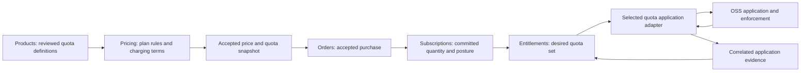

# Feature: Quota Projection

- [ ] `p1` - **ID**: `cpt-cf-bss-entitlements-featstatus-quota-projection-implemented`
- [ ] `p1` - `cpt-cf-bss-entitlements-feature-quota-projection`

<!-- toc -->

- [1. Feature Context](#1-feature-context)
  - [1.1 Overview](#11-overview)
  - [1.2 Purpose](#12-purpose)
  - [1.3 Actors](#13-actors)
  - [1.4 References](#14-references)
- [2. Actor Flows (CDSL)](#2-actor-flows-cdsl)
  - [Quota projection](#quota-projection)
  - [SDK ownership and conformance](#sdk-ownership-and-conformance)
- [3. Processes / Business Logic (CDSL)](#3-processes--business-logic-cdsl)
  - [Rule semantics](#rule-semantics)
  - [Exact conversion](#exact-conversion)
  - [Quota lifecycle](#quota-lifecycle)
- [4. States (CDSL)](#4-states-cdsl)
  - [Desired quota state](#desired-quota-state)
- [5. Definitions of Done](#5-definitions-of-done)
  - [5.1 Exact, fenced projection with a provider-confirmed receipt](#51-exact-fenced-projection-with-a-provider-confirmed-receipt)
- [6. Acceptance Criteria](#6-acceptance-criteria)

<!-- /toc -->

**Status:** proposed implementation. Adapter contracts and runtime checks remain delivery gates.

## 1. Feature Context

### 1.1 Overview

Entitlements derives a complete desired quota set from committed posture and frozen purchase terms. It sends the set through the BSS-selected adapter and tracks application and recovery. OSS owns resource allocation, usage counters, releases and enforcement.

### 1.2 Purpose

**Requirements:** `cpt-cf-bss-entitlements-fr-rule-schema`, `cpt-cf-bss-entitlements-fr-quota-projection`.

### 1.3 Actors

| Actor | Role |
| --- | --- |
| `cpt-cf-bss-entitlements-actor-pricing` | Stores plan rules and freezes quota and charging terms in one acceptance. |
| `cpt-cf-bss-entitlements-actor-products` | Publishes reviewed quota definitions and qualified adapter profiles. |
| `cpt-cf-bss-entitlements-actor-quota-adapter` | Applies desired limits and returns correlated application evidence. |
| `cpt-cf-bss-entitlements-actor-subscriptions` | Commits quantity, posture, validity and exclusive scope ownership. |

### 1.4 References

- **PRD:** [PRD.md](../PRD.md).
- **Design:** [quota apply and read](../DESIGN.md#334-quota-apply-and-read).
- **Build prerequisites:** [DECOMPOSITION.md](../DECOMPOSITION.md).
- **Decisions:** [DECISIONS.md](../DECISIONS.md), especially ENT-D-03, ENT-D-07 and ENT-D-11.
- **Integration gates:** E-U01, E-U03 and E-U04 in [UPSTREAM_REQS.md](../UPSTREAM_REQS.md).
- **Merged commercial contract:** [Commercial Quotas, PR #5973](https://github.com/constructorfabric/gears-rust/pull/5973), reviewed at [the current Commercial Quotas design](../../../docs/quotas/DESIGN.md). Check the accepted version before enabling an integration.

## 2. Actor Flows (CDSL)

### Quota projection

- [ ] `p1` - **ID**: `cpt-cf-bss-entitlements-flow-quota-projection`

**Actor:** Subscriptions supplies committed `CommercialPostureV1`; the selected adapter applies the derived limits.

**Success:** the adapter confirms the complete desired quota set for the exact operation, source revision and digest.

**Errors:** incomplete purchase evidence, unsupported profile or scope, inexact amount, ownership conflict, stale request, definitive refusal or uncertain application.

Products owns the commercial catalog. Its definitions describe metrics, units, supported scope and what counts toward a limit. Pricing owns plan rules and accepted charging terms. Entitlements owns rule interpretation and desired application state. These roles do not create a second runtime quota catalog.

| Owner | Responsibility |
| --- | --- |
| Products | Review discovered or manually entered definitions, retain immutable history and publish qualification and availability. GTS registration alone does not make a definition sellable. |
| Pricing | Attach rules to plan revisions, validate the complete set and freeze the selected rules with prices. Quota amounts do not select the charging model. |
| Orders | Preserve accepted order-line identity, quantity and receipt through the purchase flow. |
| Subscriptions | Commit quantity and lifecycle posture. Protect the canonical quota domain before purchase commitment or capture. Publish claim and accepted-term evidence. |
| Entitlements | Interpret frozen rules, derive the complete target, save the binding and operation, and track application and recovery. |
| Selected adapter | Verify authority and scope ownership. Apply the request through its OSS integration and return the required evidence. |
| OSS | Allocate resources, enforce the shared limit, maintain usage and release resources. Supply operational usage and remaining capacity through OSS reads. |

1. [ ] - `p1` - Accept posture through [posture intake](01-posture-intake.md). Resolve the frozen rule and binding evidence by its retained identity and digest. Do not read the live plan. - `inst-resolve-input`
2. [ ] - `p1` - Verify the complete snapshot, current quantity, authorized resource scope and exclusive claim. Missing or truncated input remains unresolved; it cannot mean an empty target or revocation. - `inst-verify-input`
3. [ ] - `p1` - Derive every member using [rule semantics](#rule-semantics) and [exact conversion](#exact-conversion). Refuse unsupported changes before dispatch and record their reason. - `inst-derive`
4. [ ] - `p1` - Recheck source and preparation-generation fences. Save the assignment, complete target, source revision, digest, operation, adapter binding and delivery intent in one local transaction. - `inst-persist`
5. [ ] - `p1` - Dispatch after commit through the saved adapter. Preparation calls first commit the dispatch-start marker under feature 02's generation fence. Retry keeps the same operation, content and binding. - `inst-dispatch`
6. [ ] - `p1` - Verify the result's operation, source, revision, digest and observation authority. Record the outcome separately from the desired head. - `inst-observe`
7. [ ] - `p1` - Contribute only a fully applied, correlated set to [initial readiness](02-initial-readiness.md). A stored cap, queued request or partial result is insufficient. - `inst-readiness`
8. [ ] - `p1` - Recover incomplete or uncertain work through the original operation and binding. Retain the purchased obligation after refusal or exhausted automatic retries. - `inst-recover`

**Adapter boundary.** The request is `apply_quota_state(operation_id, source_key, source_revision, desired_digest, complete_target, effective_boundary, authority)`. Authorized reads and operation recovery use the same source and saved binding. [DESIGN §3.3.4](../DESIGN.md#334-quota-apply-and-read) defines the contract.

The source key is `(authenticated namespace, resource tenant, assignmentId)`. Entitlements keeps subscription and purchase correlation internally. No subscription ID, payer payload or unfiltered receipt reaches the adapter. Exclusive ownership is proved by opaque authority/domain/claim-version evidence bound to the resolved scope.

A source revision orders requests. An operation ID identifies a request and its retries. A digest identifies its content. None substitutes for another. Entitlements owns the source revision sequence; it is separate from the commercial posture revision.

The adapter reports its highest durably accepted revision separately from its last fully applied revision. Acceptance must prevent delayed older effects before it is acknowledged. A later application refusal does not lower the accepted head. Invalid, unauthorized or conflicting requests cannot advance it.

| Request | Required result |
| --- | --- |
| Unseen request below the highest accepted revision | Refuse as stale without effects. |
| Recorded operation, including an older one | Return its saved result or recover unresolved effects. Do not reapply superseded state. |
| Same revision, digest and operation | Recover the same result, including a saved refusal. |
| Same revision with changed content or conflicting operation identity | Return a conflict without replacing the original result. |
| Higher valid revision on an open source | Advance the durable accepted head before effects. Report application separately. |
| Grant, increase or resume after terminal closure | Refuse even with a higher revision or new operation ID. |
| Read, recovery or an authorized restriction after closure | Keep history recoverable and preserve closure. |

For example, revision 7 is accepted and then refused while revision 5 remains fully applied. An unseen revision 6 is stale. Retrying revision 7 returns its refusal. A corrected attempt needs a new operation and revision above 7, with the same authorized commercial provenance. It creates no new purchase.

A multi-member request does not require one OSS transaction. The adapter owns internal sequencing and compensation. Known partial application remains `pending`; uncertain effects are `unknown`. BSS does not call individual OSS systems or combine their internal receipts. The complete set must be confirmed before the result becomes `applied`.

**Purchased limits and discrepancies.** Keep the purchased cap as desired state. An independent OSS restriction does not change the accepted terms. Record the adapter's ordered discrepancy with affected scope, reason, observation version and evidence time. A later restriction may arrive without a commercial revision.

For example, a ceiling of 60 GiB may prevent fulfillment of a purchased 100 GiB limit. The adapter reports that discrepancy. Normal resource use is different: consuming 40 GiB under a 100 GiB limit does not create a fulfillment failure. Entitlements neither calculates nor stores the remaining 60 GiB.

A required capability with an unresolved discrepancy cannot satisfy initial readiness, even if its applied receipt is stored. Its readiness stays pending unless an authoritative classified failure or emergency security block takes priority. The [receipt mapping](02-initial-readiness.md#readiness-state) also covers quota refusals: use the pinned reason classification, with retryable fallback for an unclassified refusal. Clearing the discrepancy requires a newer authoritative result. Matching configured caps or acknowledging a finding is insufficient. Ordinary restrictions affecting held preparation follow the activation/withdrawal contract. Emergency security blocks remain immediate. A prior applied T stays in history. Neither a discrepancy nor a local repair authorizes cancellation, refund or overwriting independent OSS policy.

**Preparation and activation.** An authorized preparation posture may apply the frozen quota for its exact scope and allowed actions before T. Draft creation alone grants nothing. Buying limits alone requires no resource creation. If deployment is included, [resource execution](05-resource-execution.md) provides separate readiness evidence.

Activation continues the same assignment and limits; it does not issue another allowance. After confirmed non-activation, close that generation's source and follow the existing authorized cleanup contract. A successor uses new assignment identities but retains the acquisition's exclusive claim. It waits for the responsible owners to confirm that the predecessor is closed and its scope is safe to reuse. Entitlements does not inspect allocations or settle counters to establish that result.

**Example.** A reviewed definition describes allocated storage in bytes for one qualified project scope. A plan sells `PerPlanUnit(107374182400 bytes)`, exactly 100 GiB per plan unit. Quantity three yields `322122547200 bytes`. Pricing freezes the definition, unit conversion, scope policy and rule with the price terms. Subscriptions commits the quantity and claim. Entitlements applies the complete target through the saved adapter.

A compatible increase to quantity five yields `536870912000 bytes` for the same binding. A `Fixed(10 projects)` rule still grants ten. Neither a second lot nor replay duplicates a fixed allowance. Charging may be package-priced, usage-priced or mixed; this does not alter the quota calculation.

### SDK ownership and conformance

Use the accepted [Commercial Quotas contract](../../../docs/quotas/DESIGN.md#334-quota-application-adapter-contract) for `apply_quota_state`, `read_quota_state` and operation recovery. Its exact definitions, accepted snapshots, decimal amounts, scope claims, complete-set digests and separate accepted/applied heads are normative. Do not create a second quota wire schema in Entitlements.

Map the saved assignment to the contract source key and the retained acquisition claim to its authority evidence. Keep purchase, payer and seller provenance local. Resolve every accepted definition and mapping version before deriving the set. The SDK adapter maps transport names without changing the canonical digest or numerical representation. Unsupported versions fail before a new source revision is accepted.

**Service-specific metric identity.** Extend the Products-owned `quota_metric` descriptor with the optional typed field `service_type_ref` (`serviceTypeRef` in the semantic model). This is a proposed shared catalog-contract change under E-U01/E-U03/E-U04, not a second quota application schema. The field belongs to the named metric instance, not to each purchased limit.

| Field or case | Contract |
| --- | --- |
| `service_type_ref` | When present, `{id, version, digest}` of one immutable adapter-owned service descriptor from [feature 05](05-resource-execution.md#work-order-sdk-contract). `id` is a GTS instance narrowed to `gts.cf.bss.entitlements.service_type.v1~`; validate and retain its content. A type schema ID or display name is invalid here. |
| Service-specific metric | The metric's defined meaning belongs to that service type. Its descriptor carries the reference, and its content digest covers it. The service descriptor must resolve before qualification or new sale. |
| Shared metric | Omit the field. Compatibility with each service remains explicit in the reviewed mapping and qualification. Absence is not permission to apply the metric to any service or provider. |
| GTS name | Vendor/package/namespace may make the service family readable. The name is not a foreign key. Never split or pattern-match it to infer service identity, select an adapter or grant authority. |

A service family can define separate metric instances, such as reserved capacity and storage. A plan stores amounts for those metrics. A different amount or tenant does not create another metric ID. Reusing an instance ID with changed meaning is forbidden. Adding, removing or changing its service association requires a reviewed versioned metric identity and immutable definition revision, new qualification and new acceptance for changed terms. Never overwrite an existing descriptor to make that change. Old receipts retain the exact previous descriptor, service reference and digests.

Products validates the metric-to-service association with the adapter's mapping/profile evidence. Pricing checks it during quota selection and acceptance of the complete plan. It freezes the resolved reference with the quota snapshot. Entitlements verifies that the accepted metric, service descriptor and qualified mapping agree before new application. The quota adapter uses that retained mapping to address the right OSS quota configuration; it does not infer a service from a SKU or GTS prefix. A mismatched or unresolved reference blocks qualification and new application. Restrictions and recovery for existing sources use their retained evidence.

The reference identifies a service type, not a tenant, assignment or OSS instance. Existing quota binding, canonical scope and exclusive claim still determine where the purchased limit applies. Buying a service-specific quota need not provision a new service. When service fulfillment is also purchased for that target, its accepted service binding must agree with the metric's pinned service type and qualified scope mapping. Multiple assignments of the same type cannot be matched by name or by picking the first one.

Do not add the service descriptor ID/version as an independent quota-domain partition. Two aliases or versions targeting the same enforcement domain must retain the same exclusivity checks. A tenant-wide limit remains one shared cap; it is not copied for each service assignment or created resource.

SDK/GTS adoption must preserve and validate this field through discovery, catalog reads, acceptance snapshots and application evidence. A consumer that cannot enforce the association cannot enable these metrics by ignoring the field. Generic metrics remain valid through their explicit mappings. E-AC67 covers shared-schema conformance, mismatch refusal and immutable replay.

The common rule-schema requirement is owned here; feature 04 supplies its grant-specific records and fixtures. Quota and grant snapshots are frozen together with price terms, but their quantities and application results remain separate. Passing quota conformance does not qualify grant support.

## 3. Processes / Business Logic (CDSL)

### Rule semantics

- [ ] `p1` - **ID**: `cpt-cf-bss-entitlements-algo-rule-semantics`

**Input:** frozen `PlanQuotaRuleV1`, binding and `AcceptedQuotaSnapshot` evidence, plus the current quantity from posture.

**Output:** complete semantic inputs for the desired set, or an explicit refusal.

1. [ ] - `p1` - Resolve the exact definition, metric, unit, accounting policy, scope policy and profile versions with their digests. If the metric declares `service_type_ref`, validate its exact service descriptor and qualified mapping; never infer that association from the GTS name. Preserve accepted history even when catalog availability later changes. - `inst-resolve-semantics`
2. [ ] - `p1` - Verify snapshot identity, count and whole-set digest. Refuse duplicate IDs, missing pages, inconsistent versions or mismatched content. - `inst-complete-snapshot`
3. [ ] - `p1` - Validate the complete set against its accepted qualified profile, including combined metrics and supported change direction. Registry metadata or separate qualification of each metric is insufficient. - `inst-profile`
4. [ ] - `p1` - Resolve the authorized subject and scope against the saved binding. The acting user is not a substitute for the resource owner. Verify the exclusive claim for the canonical domain. - `inst-scope`
5. [ ] - `p1` - Apply each distinct `Fixed` binding once. Scale each distinct `PerPlanUnit` binding by the posture quantity once. Lots retain provenance; Entitlements does not sum them again. - `inst-quantity`
6. [ ] - `p1` - Retain rule, acceptance and scope evidence with the result. Different item IDs, prices or purchase lots cannot create an extra allowance for the same binding. - `inst-provenance`
7. [ ] - `p1` - **RETURN** the complete semantic set or the precise unsupported-input reason. - `inst-result`

Products publishes a stable commercial catalog of versioned GTS definitions. Metrics may describe allocation capacity without being collector or derived usage meters. A usage meter or derived quantity is not automatically suitable for quota enforcement. The adapter's qualified mapping proves the advertised meaning and exact unit conversion.

Scope selection uses canonical owner IDs required by the accepted policy. A regional or pool quota is one shared limit in that exact scope. A tenant-wide profile must prove one aggregate limit. Neither profile permits a full copy of the allowance in each independent region or pool. Scope changes and cross-provider distribution need a separate future contract.

The initial profile uses allocation limits, `ExclusiveSource`, and qualified `initial_set` or compatible `increase`. Numerical decreases, consumption windows, rate limits, unbounded limits, pooling, partitions, source migration and resource adoption are outside v1. Unsupported profiles cannot be enabled or sold through the adapter.

| Value | Meaning |
| --- | --- |
| Explicit zero | A purchased zero limit within the qualified scope. It is not deletion or proof that every access path is blocked. |
| Absent rule | No purchased quota declaration. It is not zero, unlimited or permission. |
| Missing evidence | Unresolved input. It cannot become an empty set or an unlimited limit. |
| Explicit unbounded value | Unsupported in v1. |

An explicit complete target governs changes to source-owned members. Truncated input cannot authorize removal. Removing a quota rule while editing a draft creates no live quota operation; live numerical decreases and removals remain outside v1.

### Exact conversion

- [ ] `p1` - **ID**: `cpt-cf-bss-entitlements-algo-exact-conversion`

**Input:** exact current plan quantity `q`, nonnegative coefficient `c` or fixed amount `f`, and accepted conversion factor `s`.

**Output:** an exact amount in the qualified canonical unit, or a refusal before effects.

1. [ ] - `p1` - Calculate the fixed amount as `f × s`, or the per-plan amount as `q × c × s`, using exact decimal or rational arithmetic. - `inst-calculate`
2. [ ] - `p1` - Check every input and intermediate result against supported precision and bounds. Do not round, truncate, saturate or use floating point. - `inst-check-exactness`
3. [ ] - `p1` - Check the final amount against the metric's numeric bounds and step. Require an integer only when the qualified metric requires it. - `inst-check-range`
4. [ ] - `p1` - **RETURN** the exact amount or a reason identifying incompatible units, precision, step, negativity or overflow. - `inst-result`

Conversions come from frozen versioned evidence, never a metric label. GB and GiB are not interchangeable. For an integer-slot metric, quantity 2.5 with coefficient four gives ten slots; coefficient one gives 2.5 slots and is refused. The BSS contract does not assume a native OSS integer type or storage bound.

### Quota lifecycle

- [ ] `p1` - **ID**: `cpt-cf-bss-entitlements-algo-quota-lifecycle`

**Input:** committed posture, current quantity and accepted validity, plus desired and adapter application history.

**Output:** one complete desired revision or an explicit refusal before effects.

Only committed posture changes commercial quota state (ENT-D-16). A renewal with no new posture derives no command. Compatible additions use the quantity supplied by Subscriptions and retain each acceptance as provenance. Different coefficients or policies cannot silently select the newest rule, sum caps or take a maximum.

Matching item IDs across plan revisions do not prove quota equivalence. Use the frozen logical binding and semantic evidence. Subscriptions still applies its own commercial-binding and purchase-state guards.

| Transition | Required behavior |
| --- | --- |
| Draft or future start | Retain evidence. Grant nothing until an authorized preparation or service posture permits application. |
| Preparation | Apply the frozen limits under the authorized preparation scope and schedule. Track quota confirmation separately from resource readiness. |
| Activation | Continue the prepared assignment and limits without a second allowance. Subscriptions owns T. |
| Confirmed non-activation | Close the source for that generation. Keep application recovery and authorized resource cleanup open until their owners confirm the outcome. |
| Compatible active increase | Replace the complete desired set at a higher source revision. Preserve the prior safe allowance until the increase is complete. |
| Increase requested while suspended | Subscriptions refuses before commitment. A separate guarded resume must complete first. |
| Suspend | Apply an explicit restricted posture. Confirm the required denial, including fallback paths. Do not infer denial from a zero cap or deactivation alone. |
| Resume | Apply the permitted complete state on the same open source at a newer revision. An older resume cannot undo a later restriction. |
| Revocation | Close the source permanently for grants. Resource retention, export and cleanup follow their own contracts. |
| Numerical decrease or unsupported migration | Refuse in v1. Do not imitate the change by resetting accounting, creating another source or changing purchased terms. |

Validity is `[start, end)`. The qualified adapter must honor the accepted boundary and report actual application time separately. A late timer is not proof of exact expiry. Timing and OSS mapping belong to the adapter design.

A committed increase remains a purchased obligation if suspension follows it. Recover any older operation under the newer restriction; delayed delivery must not reopen access. Suspension, closure and application failure do not themselves delete resources or release capacity.

## 4. States (CDSL)

### Desired quota state

- [ ] `p1` - **ID**: `cpt-cf-bss-entitlements-state-desired-quota`

Local derivation uses `incomplete`, `derived`, `applied` or `refused`. Dispatch eligibility is separately `current` or `superseded`. The adapter's four result values describe an operation, not subscription status or a runtime counter.

| Adapter result | Meaning |
| --- | --- |
| `pending` | Accepted work is incomplete. Known partial application stays here with its reason. |
| `applied` | The complete requested change is confirmed for the exact source, operation, revision and digest. |
| `refused` | Definitive refusal. No effects or recovery obligations remain unresolved. |
| `unknown` | Current effects or outcome cannot be established. Recover the original operation. |

Each result includes the saved binding, observation version/time, reason where needed and recoverable effect evidence. Source reads expose both accepted and fully applied revision/digest. The local desired set retains complete member count/digest, accepted semantic references, exact amounts, scope, validity and access posture.

| From | Event / to | Guard |
| --- | --- | --- |
| none | posture accepted / incomplete | Persist intake. Missing or invalid derivation inputs cannot dispatch or become an empty target. |
| incomplete | complete derivation / derived | Persist target, source revision, digest and delivery intent together after checking current authority. |
| derived | matching `applied` / applied | Confirm the entire set for the original operation and saved binding. |
| derived | definitive `refused` / refused | Store its reason and preserve the purchased obligation. |
| derived | `pending` or `unknown` / derived | Keep recovery open. Retry exhaustion is not refusal. |
| any | newer desired revision / status unchanged | Mark old dispatch `superseded`. Retain unresolved operation effects and their history. |
| any | terminal source closure / status unchanged | Block new grants, increases and resumes. Keep reads and operation recovery available. |

A source-wide restriction or revocation must not wait for unrelated grant derivation to succeed (ENT-D-13). It still needs authenticated authority and a complete, unambiguous source target. Malformed input cannot become a grant or implicit removal.

A saved terminal result stays fixed. Later independent restrictions are separate discrepancies. An older pending observation cannot erase an applied result. Historical recovery never restores an older desired head.

## 5. Definitions of Done

### 5.1 Exact, fenced projection with a provider-confirmed receipt

- [ ] `p1` - **ID**: `cpt-cf-bss-entitlements-dod-quota-projection`

The implementation must:

- Resolve complete frozen purchase evidence and exact GTS semantics.
- Use current committed quantity without duplicating fixed rules or lot contributions.
- Verify the exclusive claim and persist the authorized scope and adapter binding.
- Save desired state and durable delivery work before dispatch.
- Enforce accepted-order protection, stable replay and terminal closure through the adapter contract.
- Report `applied` only for the complete correlated set; keep partial and unknown effects recoverable.
- Retain purchased obligations and discrepancies without reading or changing OSS usage counters.
- Verify each enabled profile against E-U01, E-U03 and E-U04. Documentation or registry metadata alone is insufficient.

The adapter design defines receiving OSS components, management calls, permissions and internal recovery. OSS and adapter tests cover resource accounting. Entitlements tests cover derivation, scope, application evidence and recovery at that contract boundary.

**Implements:** `cpt-cf-bss-entitlements-flow-quota-projection`, `cpt-cf-bss-entitlements-algo-rule-semantics`, `cpt-cf-bss-entitlements-algo-exact-conversion`, `cpt-cf-bss-entitlements-algo-quota-lifecycle`, `cpt-cf-bss-entitlements-state-desired-quota`.

When hooks are configured, save a safe assignment-outcome notice intent with each meaningful quota application outcome change under [feature 07](07-extension-hooks.md). This is application evidence, not a quota usage feed. Hook execution cannot change accepted limits or delay restriction or revocation. No-hook profiles create no deliveries.

## 6. Acceptance Criteria

- [ ] A service-specific metric retains its exact service descriptor through discovery, Pricing acceptance and quota application. A mismatched, unresolved or ignored association cannot enable a new limit (E-AC67).
- [ ] A generic metric has no service reference and requires an explicit qualified mapping. A matching namespace alone grants no compatibility or authority.
- [ ] Changing or removing the service association requires reviewed immutable evidence and new acceptance for changed terms. Historical replay uses the original reference and digest.
- [ ] A quota-only purchase needs no service provisioning. A tenant-wide cap is not multiplied across service assignments, and service descriptor aliases or versions cannot split one canonical quota domain.

- [ ] A later plan, metric or catalog edit cannot change replay. Original evidence stays readable; missing history remains unresolved.
- [ ] A complete-set count/digest mismatch or missing page cannot clear quota members or dispatch a partial target.
- [ ] Fixed and per-plan-unit rules apply once per distinct binding. A duplicate purchase, lot or delivery creates no extra allowance.
- [ ] Exact conversion rejects rounding, incompatible units, invalid steps and overflow. It uses qualified bounds without assuming an OSS storage type.
- [ ] A compatible increase replaces the complete desired set under the same source. A numerical decrease is refused before effects.
- [ ] A regional offer applies one shared limit in its selected region/pool. An unsupported scope cannot be enabled; retry cannot copy the full allowance to another scope.
- [ ] An acting user's identity cannot replace the authorized resource owner. Missing or conflicting exclusive-domain evidence blocks dispatch.
- [ ] Revision 7 is accepted and refused while revision 5 remains applied. Unseen revision 6 is rejected; replay of 7 returns its saved refusal. A corrected attempt uses a new operation and revision above 7 without another purchase.
- [ ] A newer accepted restriction prevents an older in-flight grant from taking effect, including after restart or response loss.
- [ ] One member applied and another pending leaves the whole operation `pending`. If any required effect is uncertain, the result is `unknown`. Neither reports success or definitive refusal prematurely.
- [ ] Lost responses recover the same operation through the saved binding. No fallback adapter or new source hides uncertainty.
- [ ] Terminal closure rejects later grants even before initial creation. Reads and old operation recovery remain available without reopening access.
- [ ] A purchased 100 GiB limit blocked by a 60 GiB ceiling retains desired 100 and an ordered discrepancy. Normal usage under the limit creates no discrepancy or BSS usage projection.
- [ ] Quota-only readiness needs no VM. Deployment purchases require separate resource evidence. Activation continues the prepared quota assignment without a second allowance.
- [ ] A successor preparation waits for authoritative closure and safe-reuse confirmation. BSS does not inspect allocation records or settle release counters.
- [ ] Qualification withdrawal blocks new sales but preserves accepted terms and recovery obligations. Application failure does not create an automatic cancellation or refund.

- [ ] The Entitlements SDK reproduces the accepted quota contract fixtures without digest or decimal conversion changes. Grant-specific fixtures remain required separately.
