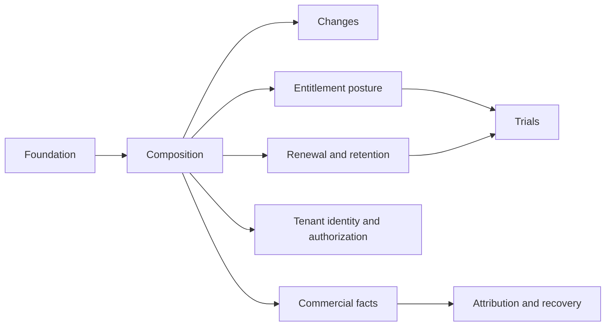

# Decomposition: Subscriptions

<!-- toc -->

- [1. Overview](#1-overview)
- [2. Entries](#2-entries)
  - [2.1 Lifecycle and recoverable operations](#21-lifecycle-and-recoverable-operations)
  - [2.2 Composition and accepted commercial terms](#22-composition-and-accepted-commercial-terms)
  - [2.3 Atomic composition and quantity changes](#23-atomic-composition-and-quantity-changes)
  - [2.4 Renewal, grace and resource retention](#24-renewal-grace-and-resource-retention)
  - [2.5 Commercial posture](#25-commercial-posture)
  - [2.6 Trial lifecycle and paid conversion](#26-trial-lifecycle-and-paid-conversion)
  - [2.7 Tenant ownership and authorization](#27-tenant-ownership-and-authorization)
  - [2.8 Commercial facts, groups and seals](#28-commercial-facts-groups-and-seals)
  - [2.9 Attribution, scope proofs and integration recovery](#29-attribution-scope-proofs-and-integration-recovery)
- [3. Dependency order and delivery gates](#3-dependency-order-and-delivery-gates)
  - [3.1 Cross-contract acceptance](#31-cross-contract-acceptance)
- [4. Identifier register](#4-identifier-register)
- [5. Coverage and verification](#5-coverage-and-verification)

<!-- /toc -->

**Overall implementation status:**
- [ ] `p1` - **ID**: `cpt-cf-bss-subscriptions-status-implementation`

## 1. Overview

This document allocates the [PRD](PRD.md) and [DESIGN](DESIGN.md) to implementation features. It does not claim that the Subscriptions runtime is implemented.
Each active FR/NFR has exactly one primary feature. Other features can cite it as context without sharing primary ownership. Deferred capabilities have no implementation allocation and must refuse unsupported commands before effects.

DESIGN defines architecture. The features define procedures, UPSTREAM_REQS defines cross-owner prerequisites, and DECISIONS records decisions. Unchecked entries remain unimplemented. A documented target or passing document check does not satisfy a production dependency.

## 2. Entries

### 2.1 [Lifecycle and recoverable operations](features/01-foundation.md)

- [ ] `p1` - **ID**: `cpt-cf-bss-subscriptions-feature-foundation`

- **Purpose**: Closed status machine, durable operation receipts, order/attempt identity, create settlement, scheduled-intent recovery and atomic admission.
- **Scope**: procedures, state rules, error/recovery paths and acceptance in the linked feature.
- **Out of scope**: Commercial pricing and invoice posting; enabling cross-attempt succession before S-U01/S-U07/S-U10 provider contracts close. The accepted same-acquisition successor semantics are defined in [acquisition recovery](features/01-foundation.md#acquisition-recovery); amended-version association and reopening cancelled acquisitions are not supplied by that recovery profile.
- **Depends On**: None.
- **Provider prerequisites / launch gates**: S-Q01/S-Q02 core, suspension and prepayment directions accepted; durable pre-capture place/terms and capture/cancel/release recovery contracts OPEN under S-U01/S-U07/S-U10, plus S-U04 for activation. Policy/claim-movement/exemption and runtime gates remain.
- **Design Components**: `cpt-cf-bss-subscriptions-component-lifecycle-foundation`.
- **Design Principles Covered**: `cpt-cf-bss-subscriptions-principle-idempotent-ordered`, `cpt-cf-bss-subscriptions-principle-when-not-math`.
- **Design Constraints Covered**: `cpt-cf-bss-subscriptions-constraint-tenant-isolation`, `cpt-cf-bss-subscriptions-constraint-utc-time`.
- **Domain Model Entities / Data**: applicable owned records and commit boundaries in DESIGN §3.1 and §3.7; no independent schema in this allocation.
- **API / Sequences**: canonical interfaces and interactions in DESIGN §3.3 and §3.6; feature procedures consume those contracts.
- **Cross-contract acceptance**: V01,V02,V03,V18; [vector definitions](DECOMPOSITION.md#31-cross-contract-acceptance).

**Requirements Covered (primary)**:

- [ ] `p1` - `cpt-cf-bss-subscriptions-fr-status-enum`
- [ ] `p1` - `cpt-cf-bss-subscriptions-fr-transitions-guards`
- [ ] `p1` - `cpt-cf-bss-subscriptions-fr-transition-request`
- [ ] `p1` - `cpt-cf-bss-subscriptions-fr-order-originated-create`
- [ ] `p1` - `cpt-cf-bss-subscriptions-fr-cancel-reasons`
- [ ] `p1` - `cpt-cf-bss-subscriptions-fr-intent-protocol`
- [ ] `p1` - `cpt-cf-bss-subscriptions-fr-operation-recovery`
- [ ] `p1` - `cpt-cf-bss-subscriptions-fr-scheduled-intents`
- [ ] `p2` - `cpt-cf-bss-subscriptions-fr-activation-instants`
- [ ] `p1` - `cpt-cf-bss-subscriptions-nfr-lifecycle-latency`
- [ ] `p2` - `cpt-cf-bss-subscriptions-nfr-operational-baselines`
- [ ] `p1` - `cpt-cf-bss-subscriptions-nfr-intent-seam-budget`

### 2.2 [Composition and accepted commercial terms](features/02-composition.md)

- [ ] `p1` - **ID**: `cpt-cf-bss-subscriptions-feature-composition`

- **Purpose**: Effective-dated components, revisions, PriceBook accepted bindings, price ends and immutable term evidence.
- **Scope**: procedures, state rules, error/recovery paths and acceptance in the linked feature.
- **Out of scope**: Unsupported commercial overlays, import and migration.
- **Depends On**: `cpt-cf-bss-subscriptions-feature-foundation`.
- **Provider prerequisites / launch gates**: CURRENT Pricing D-510 provider; Subscriptions adapter target; S-U01/S-U07 durable accepted-purchase coverage and recovery for future orders; S-U06/S-U08.
- **Design Components**: `cpt-cf-bss-subscriptions-component-composition-versioning`.
- **Design Principles Covered**: `cpt-cf-bss-subscriptions-principle-idempotent-ordered`, `cpt-cf-bss-subscriptions-principle-when-not-math`.
- **Design Constraints Covered**: `cpt-cf-bss-subscriptions-constraint-tenant-isolation`, `cpt-cf-bss-subscriptions-constraint-utc-time`.
- **Domain Model Entities / Data**: applicable owned records and commit boundaries in DESIGN §3.1 and §3.7; no independent schema in this allocation.
- **API / Sequences**: canonical interfaces and interactions in DESIGN §3.3 and §3.6; feature procedures consume those contracts.
- **Cross-contract acceptance**: V04,V05,V14; [vector definitions](DECOMPOSITION.md#31-cross-contract-acceptance).

**Requirements Covered (primary)**:

- [ ] `p1` - `cpt-cf-bss-subscriptions-fr-monotonic-version`
- [ ] `p1` - `cpt-cf-bss-subscriptions-fr-effective-dated-composition`
- [ ] `p1` - `cpt-cf-bss-subscriptions-fr-snapshot-discipline`
- [ ] `p1` - `cpt-cf-bss-subscriptions-fr-accepted-price-bindings`

### 2.3 [Atomic composition and quantity changes](features/03-changes.md)

- [ ] `p1` - **ID**: `cpt-cf-bss-subscriptions-feature-changes`

- **Purpose**: One-revision immediate increases/additions and overlap guards. Base-plan changes, future composition, linked replacement, ramps and historical correction/backdating are deferred.
- **Scope**: procedures, state rules, error/recovery paths and acceptance in the linked feature.
- **Out of scope**: Initial-profile quantity decreases, component removals and transfers between commercial purchase lots; multi-date batch transactions and distributed atomic multi-subscription commit. Linked replacement is deferred.
- **Depends On**: `cpt-cf-bss-subscriptions-feature-foundation`, `cpt-cf-bss-subscriptions-feature-composition`.
- **Provider prerequisites / launch gates**: S-Q02 core/suspended-place/prepayment and limit-decrease preservation directions accepted; versioned count/release contract, exact policy/key movement mappings and runtime evidence open; S-U10; supported current policy profile.
- **Design Components**: `cpt-cf-bss-subscriptions-component-plan-changes`.
- **Design Principles Covered**: `cpt-cf-bss-subscriptions-principle-idempotent-ordered`, `cpt-cf-bss-subscriptions-principle-when-not-math`.
- **Design Constraints Covered**: `cpt-cf-bss-subscriptions-constraint-tenant-isolation`, `cpt-cf-bss-subscriptions-constraint-utc-time`.
- **Domain Model Entities / Data**: applicable owned records and commit boundaries in DESIGN §3.1 and §3.7; no independent schema in this allocation.
- **API / Sequences**: canonical interfaces and interactions in DESIGN §3.3 and §3.6; feature procedures consume those contracts.
- **Cross-contract acceptance**: V03,V06; [vector definitions](DECOMPOSITION.md#31-cross-contract-acceptance).
- **Purchase-state scope**: Refuse suspended seat purchases/increases/additions at submission and commit; require separate guarded resume before normal active change. Preserve the separate S-U01 draft gate and recover committed-before-suspend purchases under the later provider fence. No queued purchase, implicit resume or new synchronous access-ready gate; renewal recovery and unrelated administration retain their own contracts.

**Requirements Covered (primary)**:

- [ ] `p1` - `cpt-cf-bss-subscriptions-fr-plan-change-boundary`
- [ ] `p1` - `cpt-cf-bss-subscriptions-fr-proration-triggers`
- [ ] `p1` - `cpt-cf-bss-subscriptions-fr-proration-ownership`
- [ ] `p1` - `cpt-cf-bss-subscriptions-fr-overlap-cardinality`
- [ ] `p1` - `cpt-cf-bss-subscriptions-fr-update-quantity`
- [ ] `p1` - `cpt-cf-bss-subscriptions-fr-composite-change`

### 2.4 [Renewal, grace and resource retention](features/04-renewal-retention.md)

- [ ] `p1` - **ID**: `cpt-cf-bss-subscriptions-feature-renewal-retention`

- **Purpose**: Accepted term/default sources, renewal identity, grace/nonpayment dwell, suspension and guarded retention/disposition. Co-term, collection pause and customer notifications are deferred.
- **Scope**: procedures, state rules, error/recovery paths and acceptance in the linked feature.
- **Out of scope**: PSP retry execution; legal advice; inferring deletion from elapsed time.
- **Depends On**: `cpt-cf-bss-subscriptions-feature-foundation`, `cpt-cf-bss-subscriptions-feature-composition`.
- **Provider prerequisites / launch gates**: S-Q05 post-stop and confirmed charging-cutoff directions accepted, internal stops split by cause and v1 defaults specified, confirmation protocol and owner/runtime evidence open; S-Q07 profile ratified, measurement open; S-U05/S-U06/S-U07/S-U11/S-U13.
- **Design Components**: `cpt-cf-bss-subscriptions-component-suspension-renewal-grace`.
- **Design Principles Covered**: `cpt-cf-bss-subscriptions-principle-idempotent-ordered`, `cpt-cf-bss-subscriptions-principle-when-not-math`.
- **Design Constraints Covered**: `cpt-cf-bss-subscriptions-constraint-tenant-isolation`, `cpt-cf-bss-subscriptions-constraint-utc-time`.
- **Domain Model Entities / Data**: applicable owned records and commit boundaries in DESIGN §3.1 and §3.7; no independent schema in this allocation.
- **API / Sequences**: canonical interfaces and interactions in DESIGN §3.3 and §3.6; feature procedures consume those contracts.
- **Cross-contract acceptance**: V05,V13,V14,V16; [vector definitions](DECOMPOSITION.md#31-cross-contract-acceptance).

**Requirements Covered (primary)**:

- [ ] `p1` - `cpt-cf-bss-subscriptions-fr-suspend-resume`
- [ ] `p2` - `cpt-cf-bss-subscriptions-fr-suspension-billing-posture`
- [ ] `p1` - `cpt-cf-bss-subscriptions-fr-renewal-evaluation`
- [ ] `p1` - `cpt-cf-bss-subscriptions-fr-renewal-auto-manual`
- [ ] `p1` - `cpt-cf-bss-subscriptions-fr-term-source`
- [ ] `p2` - `cpt-cf-bss-subscriptions-fr-failed-renewal-ladder`
- [ ] `p2` - `cpt-cf-bss-subscriptions-fr-grace-policy`
- [ ] `p1` - `cpt-cf-bss-subscriptions-fr-platform-defaults`
- [ ] `p1` - `cpt-cf-bss-subscriptions-fr-resource-disposition`
- [ ] `p1` - `cpt-cf-bss-subscriptions-fr-record-retention`

### 2.5 [Commercial posture](features/05-entitlements.md)

- [ ] `p1` - **ID**: `cpt-cf-bss-subscriptions-feature-entitlements`

- **Purpose**: Derive and publish commercial posture; consume readiness and materialization from Entitlements.
- **Scope**: procedures, state rules, error/recovery paths and acceptance in the linked feature.
- **Out of scope**: Derivation of provider state, adapters, counters, seats (Entitlements).
- **Depends On**: `cpt-cf-bss-subscriptions-feature-foundation`, `cpt-cf-bss-subscriptions-feature-composition`.
- **Provider prerequisites / launch gates**: S-U04 contract versions with Entitlements.
- **Design Components**: `cpt-cf-bss-subscriptions-component-entitlements`.
- **Design Principles Covered**: `cpt-cf-bss-subscriptions-principle-idempotent-ordered`, `cpt-cf-bss-subscriptions-principle-when-not-math`.
- **Design Constraints Covered**: `cpt-cf-bss-subscriptions-constraint-tenant-isolation`, `cpt-cf-bss-subscriptions-constraint-utc-time`.
- **Domain Model Entities / Data**: applicable owned records and commit boundaries in DESIGN §3.1 and §3.7; no independent schema in this allocation.
- **API / Sequences**: canonical interfaces and interactions in DESIGN §3.3 and §3.6; feature procedures consume those contracts.
- **Cross-contract acceptance**: V11; [vector definitions](DECOMPOSITION.md#31-cross-contract-acceptance).

**Requirements Covered (primary)**:

- [ ] `p1` - `cpt-cf-bss-subscriptions-fr-commercial-posture`

### 2.6 [Trial lifecycle and paid conversion](features/06-trials.md)

- [ ] `p1` - **ID**: `cpt-cf-bss-subscriptions-feature-trials`

- **Purpose**: Execute the optional free-period OR credit trial block of accepted Pricing PlanRevision as customer episodes, with explicit expiry/conversion and settlement/access prerequisites.
- **Scope**: procedures, state rules, error/recovery paths and acceptance in the linked feature.
- **Out of scope**: Products trial-policy fields, attribute-only trial offers; admission before the [Pricing trial terms](DESIGN.md#336-trial-terms-and-provider-evidence) is ratified/delivered.
- **Depends On**: `cpt-cf-bss-subscriptions-feature-foundation`, `cpt-cf-bss-subscriptions-feature-composition`, `cpt-cf-bss-subscriptions-feature-entitlements`, `cpt-cf-bss-subscriptions-feature-renewal-retention`.
- **Provider prerequisites / launch gates**: S-U12 Pricing trial terms and immutable receipts; S-U04 readiness and S-U07 financial coverage; S-U15 Billing grant, correction and Ledger integration for credit trials. Versioned owner mappings and runtime conformance evidence are required before launch. Extension, repeat, rollover, regrant and reactivation remain unavailable. S-U01 applies to supported later paid association.
- **Design Components**: `cpt-cf-bss-subscriptions-component-trials`.
- **Design Principles Covered**: `cpt-cf-bss-subscriptions-principle-idempotent-ordered`, `cpt-cf-bss-subscriptions-principle-when-not-math`.
- **Design Constraints Covered**: `cpt-cf-bss-subscriptions-constraint-tenant-isolation`, `cpt-cf-bss-subscriptions-constraint-utc-time`.
- **Domain Model Entities / Data**: applicable owned records and commit boundaries in DESIGN §3.1 and §3.7; no independent schema in this allocation.
- **API / Sequences**: canonical interfaces and interactions in DESIGN §3.3 and §3.6; feature procedures consume those contracts.
- **Cross-contract acceptance**: V12,V19; [vector definitions](DECOMPOSITION.md#31-cross-contract-acceptance).

**Requirements Covered (primary)**:

- [ ] `p1` - `cpt-cf-bss-subscriptions-fr-trials-not-a-status`
- [ ] `p2` - `cpt-cf-bss-subscriptions-fr-trial-commercial-pattern`
- [ ] `p1` - `cpt-cf-bss-subscriptions-fr-trial-provisioning`
- [ ] `p1` - `cpt-cf-bss-subscriptions-fr-trial-conversion`
- [ ] `p1` - `cpt-cf-bss-subscriptions-fr-trial-early-conversion`
- [ ] `p1` - `cpt-cf-bss-subscriptions-fr-trial-expiry`

### 2.7 [Tenant ownership and authorization](features/07-tenancy-import.md)

- [ ] `p1` - **ID**: `cpt-cf-bss-subscriptions-feature-tenancy-import`

- **Purpose**: Creation-time tenant axes, delegation, scope isolation and stable tenant provenance. Transfer and import are deferred; neither is allocated here.
- **Scope**: procedures, state rules, error/recovery paths and acceptance in the linked feature.
- **Out of scope**: Ownership/payer transfer, import/adoption and predecessor-system migration.
- **Depends On**: `cpt-cf-bss-subscriptions-feature-foundation`, `cpt-cf-bss-subscriptions-feature-composition`.
- **Provider prerequisites / launch gates**: Tenant Resolver identity/ancestry, AM commercial account evidence and PolicyEnforcer authorization/delegation contracts. Ownership transfer, import and administrative historical correction are deferred; their implementation does not gate this tenancy core.
- **Design Components**: `cpt-cf-bss-subscriptions-component-tenancy-transfer`.
- **Design Principles Covered**: `cpt-cf-bss-subscriptions-principle-idempotent-ordered`, `cpt-cf-bss-subscriptions-principle-when-not-math`.
- **Design Constraints Covered**: `cpt-cf-bss-subscriptions-constraint-tenant-isolation`, `cpt-cf-bss-subscriptions-constraint-utc-time`.
- **Domain Model Entities / Data**: applicable owned records and commit boundaries in DESIGN §3.1 and §3.7; no independent schema in this allocation.
- **API / Sequences**: canonical interfaces and interactions in DESIGN §3.3 and §3.6; feature procedures consume those contracts.
- **Cross-contract acceptance**: V09; [vector definitions](DECOMPOSITION.md#31-cross-contract-acceptance).

**Requirements Covered (primary)**:

- [ ] `p1` - `cpt-cf-bss-subscriptions-fr-tenant-axes`
- [ ] `p1` - `cpt-cf-bss-subscriptions-fr-delegation-proofs`
- [ ] `p1` - `cpt-cf-bss-subscriptions-fr-hierarchy-reference`

**Deferred traceability only:** `cpt-cf-bss-subscriptions-fr-import` is not allocated for current implementation or acceptance.

### 2.8 [Commercial facts, groups and seals](features/08-commercial-facts.md)

- [ ] `p1` - **ID**: `cpt-cf-bss-subscriptions-feature-commercial-facts`

- **Purpose**: Money-free immutable fact versions, usage parents, payer groups, complete commercial membership, outbox and period reconciliation.
- **Scope**: procedures, state rules, error/recovery paths and acceptance in the linked feature.
- **Out of scope**: Monetary math, hourly Rating work, invoice state, posting and a competing delta-delivery lane.
- **Depends On**: `cpt-cf-bss-subscriptions-feature-foundation`, `cpt-cf-bss-subscriptions-feature-composition`.
- **Provider prerequisites / launch gates**: S-Q03 Rating valuation direction accepted, owner/routing/accounting evidence open S-U08/S-U13; S-U15 for trial-credit evidence/allocation and invoice coordination; S-Q04 schema and S-Q05 confirmation/correction protocol owner contracts; period geometry from renewal-retention. Fee-bearing capture/activation cannot bypass occurrence, integration or pre-capture protection gates.
- **Design Components**: `cpt-cf-bss-subscriptions-component-events-billing`.
- **Design Principles Covered**: `cpt-cf-bss-subscriptions-principle-idempotent-ordered`, `cpt-cf-bss-subscriptions-principle-when-not-math`.
- **Design Constraints Covered**: `cpt-cf-bss-subscriptions-constraint-tenant-isolation`, `cpt-cf-bss-subscriptions-constraint-utc-time`.
- **Domain Model Entities / Data**: applicable owned records and commit boundaries in DESIGN §3.1 and §3.7; no independent schema in this allocation.
- **API / Sequences**: canonical interfaces and interactions in DESIGN §3.3 and §3.6; feature procedures consume those contracts.
- **Cross-contract acceptance**: V07,V08,V10; [vector definitions](DECOMPOSITION.md#31-cross-contract-acceptance).

**Requirements Covered (primary)**:

- [ ] `p1` - `cpt-cf-bss-subscriptions-fr-event-producers`
- [ ] `p1` - `cpt-cf-bss-subscriptions-fr-event-payload-completeness`
- [ ] `p1` - `cpt-cf-bss-subscriptions-fr-event-ordering`
- [ ] `p1` - `cpt-cf-bss-subscriptions-fr-recurring-idempotency`
- [ ] `p1` - `cpt-cf-bss-subscriptions-fr-versioned-billable-facts`
- [ ] `p1` - `cpt-cf-bss-subscriptions-fr-usage-parent-facts`
- [ ] `p1` - `cpt-cf-bss-subscriptions-fr-billing-groups-seals`
- [ ] `p2` - `cpt-cf-bss-subscriptions-fr-one-time-occurrence`
- [ ] `p1` - `cpt-cf-bss-subscriptions-fr-no-retro-edit`
- [ ] `p1` - `cpt-cf-bss-subscriptions-fr-billing-traceability`
- [ ] `p2` - `cpt-cf-bss-subscriptions-fr-dataset-separation`
- [ ] `p1` - `cpt-cf-bss-subscriptions-nfr-recurring-cut`
- [ ] `p1` - `cpt-cf-bss-subscriptions-nfr-proration-accuracy`

### 2.9 [Attribution, scope proofs and integration recovery](features/09-consumer-contracts.md)

- [ ] `p1` - **ID**: `cpt-cf-bss-subscriptions-feature-consumer-contracts`

- **Purpose**: Historical attribution streams, authorized ownership proofs, consistent discovery/replay and adapters for provider signals.
- **Scope**: procedures, state rules, error/recovery paths and acceptance in the linked feature.
- **Out of scope**: Usage emission/coverage attestation and local point-of-use enforcement.
- **Depends On**: `cpt-cf-bss-subscriptions-feature-foundation`, `cpt-cf-bss-subscriptions-feature-composition`, `cpt-cf-bss-subscriptions-feature-commercial-facts`.
- **Provider prerequisites / launch gates**: S-U01/S-U02/S-U03/S-U04/S-U06/S-U07/S-U10/S-U11; S-U15 for credit grant/outcome recovery; S-Q07 profile ratified, measurement open under S-U11; versioned prepayment reservation/capture recovery and all three occupancy counts.
- **Design Components**: `cpt-cf-bss-subscriptions-component-consumer-contracts`.
- **Design Principles Covered**: `cpt-cf-bss-subscriptions-principle-idempotent-ordered`, `cpt-cf-bss-subscriptions-principle-when-not-math`.
- **Design Constraints Covered**: `cpt-cf-bss-subscriptions-constraint-tenant-isolation`, `cpt-cf-bss-subscriptions-constraint-utc-time`.
- **Domain Model Entities / Data**: applicable owned records and commit boundaries in DESIGN §3.1 and §3.7; no independent schema in this allocation.
- **API / Sequences**: canonical interfaces and interactions in DESIGN §3.3 and §3.6; feature procedures consume those contracts.
- **Cross-contract acceptance**: V07,V09,V10,V16; [vector definitions](DECOMPOSITION.md#31-cross-contract-acceptance).

**Requirements Covered (primary)**:

- [ ] `p1` - `cpt-cf-bss-subscriptions-fr-usage-attribution`
- [ ] `p1` - `cpt-cf-bss-subscriptions-fr-attribution-segments`
- [ ] `p2` - `cpt-cf-bss-subscriptions-fr-event-consumers`
- [ ] `p1` - `cpt-cf-bss-subscriptions-fr-usage-scope-proofs`
- [ ] `p1` - `cpt-cf-bss-subscriptions-fr-billing-recovery`
- [ ] `p2` - `cpt-cf-bss-subscriptions-nfr-horizontal-partitioning`
- [ ] `p1` - `cpt-cf-bss-subscriptions-nfr-availability-recovery`

## 3. Dependency order and delivery gates

The dependency graph is acyclic: foundation first; composition second; changes,
renewal/retention, entitlement posture and tenant identity/authorization can then be developed
against those contracts. Commercial-fact storage depends on foundation and
composition; its period-producing renewal integration is a later conformance
step, not a circular feature dependency. Consumer recovery follows fact storage.
Trials depend on the agreed renewal and entitlement capabilities and remain gated.

Developing against a test double is possible before a provider lands. Enabling the
corresponding production capability requires the [S-U acceptance signal](UPSTREAM_REQS.md#25-provider-prerequisites-and-bilateral-acceptance)
and producer/consumer contract evidence. Multi-instance scheduler claims must be
proven under the chosen platform profile; a process-local mutex is not sufficient.

| Capability | Must be closed before it is called ready |
| --- | --- |
| Order activation | S-Q01/S-Q02 directions including prepayment accepted; durable reservation and future terms before capture, versioned count/release/payment and accepted-purchase execution contracts OPEN under S-U01/S-U07/S-U10; S-U04, actual Pricing adapter and multi-line compensation evidence also required |
| Recurring billing | Period/fact identity and renewal semantics; S-U06/S-U07/S-U13 as applicable; binding/replay vectors |
| Usage billing | Parent facts, attribution and scope recovery; S-U02/S-U03/S-U11/S-U13; Rating child completeness |
| One-time charges | S-Q03 valuation and S-Q04 charge-action identity directions accepted; exact occurrence schema and S-U08/S-U13 routing, frozen-term replay/correction, posting/prepayment evidence remain open before fee-bearing capture/activation |
| Trials | Both variants and early conversion remain. Both variants require S-U12 immutable PlanRevision/receipt. Credit additionally requires S-U15 conditional promotional-grant coverage effective at T and subsequent recording, shared allocation/correction and recovery; the free-period variant has no promotional-grant dependency. Financial admission and selected entitlement adapters remain S-U07/S-U04 dependencies. The [trial feature](features/06-trials.md) defines the acceptance cases. Trial exceptions and general plan replacement are deferred, not release gates. |
| Retention and purge | S-Q05 post-stop and confirmed charging-cutoff directions accepted; RO/RB semantics specified; S-U05/S-U13 provider ratification, adapter implementation and executed financial/stop/retention/correction evidence remain open. Known cutoff prevents customer tariff for platform delay without invented stop or early claim release/deletion; no implicit retention charge; use the accepted frozen default/term policy |
| Production service | Measured evidence against the ratified S-Q07 profile under S-U11, plus declared auth, load, outage and restoration evidence |

**Current allocation:** 55 active FRs and seven NFRs, each with one primary feature. Nine FRs are deferred: import, PlanTier, sale-brand, administrative backdating, ramps, collection pause, co-termination, notices and trial extension. Other excluded operations are explicitly removed from broader requirements; their stable IDs do not create implementation tasks.

**Implementation sequence for the retained scope.** Each stage produces executable conformance evidence; none implements the deferred capabilities.

| Stage | Concrete deliverable | Entry and exit evidence |
| --- | --- | --- |
| 1. Foundation and accepted composition | SDK commands/read outcomes, scoped operation/attempt fences, claim and trial-admission keys, immutable accepted terms, transactional receipt/outbox and cancellation schedules | Existing owner contracts can be modeled by explicit test doubles; exit with replay, settle-vs-create, parallel admission and local rollback fixtures. No provider readiness inferred. |
| 2. Commercial facts and recovery | Immutable parent/full-version facts, purchase lots, groups/seals, attribution journal and snapshot/catch-up reads | Exit with missed-event recovery, stale-version refusal, late-period correction discovery and explicit incomplete proof outcomes. |
| 3. Lifecycle integrations | Orders activation, abstract financial admission, renewal/grace, suspend/resume, confirmed-cutoff cancellation/retention and entitlement adapters | Enable each profile only after its S-U owner mapping and joint failure fixtures; preserve actual application versus external completion. |
| 4. Immediate increases/additions | Atomic resulting composition, immutable old/delta lots and full fact replacement | Requires supported Pricing/Rating quantity semantics; no Change Orders authoring, plan switch, decreases or future composition. Unsupported usage allocation remains refused. |
| 5. Trials | Pricing PlanRevision/receipt extension; free-period and credit trials, a shared Billing grant for credit trials, and early/normal paid conversion | Both variants require S-U12 terms/schema, S-U04 readiness, applicable S-U07 financial coverage and executed recovery evidence under S-Q06. Credit also requires S-U15 provider/Ledger integration and bounded coverage/enforcement. Prove initial-trial fencing for both variants; for credit, also prove usable readiness under the Billing commitment, grant effectiveness at T despite delayed recording, crash recovery, carryover and correction/liability cases. Free-period trials require no promotional-grant provider. These owner extensions can be developed alongside earlier stages. |
| 6. Release proof | Consumer/provider conformance plus selected storage/load/outage/restore profile | S-U11 measurements and applicable S-U gates pass before production enablement; no document validation substitutes for runtime proof. |

For each owner integration record the accepted version, producer and consumer, adapter mapping, refusal for unsupported capabilities and the executed fixture reference.

The [upstream requirements](UPSTREAM_REQS.md) define provider responsibilities and enablement gates. Consumer contracts specify the evidence and behavior Subscriptions requires.

### 3.1 Cross-contract acceptance

These scenarios require producer and consumer contract tests before the corresponding capability ships.

| Vector | Given / intervention | Required outcome |
| --- | --- | --- |
| V01 | Create reply lost or draft rebuilt after confirmation; unknown capture; new attempt/version after uncertain predecessor | One draft/tombstone per attempt; the distinct order claim and financial obligation survive absent/voided draft or payment uncertainty. No duplicate right or silent release; S-U01/S-U07 gate successor association, capture/cancel fencing and durable recovery |
| V02 | Two-line order; one activation succeeds, other fails or expires during hold/commit gap | Pending remains distinguishable from success; successful lines retain their applied obligations; independent line remediation is the default, and any explicit compensation has its own authority and durable outcome. Actual start follows S-Q01 |
| V03 | Confirmation, capture, reserved activation, suspension/resume and enabled key changes compete on the authoritative key | Place and future terms exist before capture; tolerate-failure cannot bypass them. Active, retained and order-reserved counts share the limit; active 0 plus either nonactive count 1 under limit 1 is full. Activation/resume converts its own right once. Paid/unknown-payment rights survive TTL/draft rebuild; suspended places survive unapplied cancel. Release is fenced; failed moves preserve the old claim. A lowered limit never evicts protected claims; own-reservation activation/unchanged-key resume keeps the same right, new admissions above the limit refuse, and applied cancel releases only its claim. Policy/key migration requires destination/version mapping and atomic movement; unsupported mapping refuses without release |
| V04 | Future purchase accepted beyond ordinary quote coverage; catalog changes or offer expires before start | Without supported durable acceptance, refuse/defer capture. After acceptance, execute original terms under current order/financial/security/readiness guards and explicit purchased start constraints. Paid obligation survives technical failure; no live re-admission or successor substitution. |
| V05 | Bound price ends inside a term; renewal retry and late replay | Non-overlapping complete slices use `ends_on`; replay reads pinned money and original period composition; exactly one term advancement |
| V06 | Immediate multi-item increase/addition targets suspended state, races suspension/stale revision or includes invalid bounds/future date | Suspended purchases refuse at submission/commit; separate guarded resume precedes normal active change. If suspension wins, unapplied purchase refuses and staged effects recover; if purchase committed first, preserve old/delta lots and obligations and fence late delivery under the later suspension. Draft changes retain S-U01 gating. Whole admitted request commits once or all refuse; no queued purchase, implicit resume or cancel+new |
| V07 | Usage-only subscription opens October; one hourly scope/evidence gap; a proven empty hour | One commercial parent; Rating owns 744 UTC hourly windows; missing evidence stays pending, proven empty scope is zero; no premature monthly completion |
| V08 | Qualifying setup action retries after catalog change with an existing illustrative EUR 50 advance | Stable occurrence and frozen terms produce one result; Billing applies the advance without a second collection. Correction retains lineage. Retry/resume/trial conversion/catalog change alone create no new fee. S-U08/S-U13 ratification and execution remain required |
| V09 | Late resource evidence, duplicated attribution segment, missing sequence and resource deletion | Recover exact historical payer/owner under immutable intervals; gaps/ambiguity block completeness. No new transfer or resource adoption capability is implied |
| V10 | Fact event never delivered, old fact corrected, consumer cursor past retention | Pull discovery restores complete state; newer replacement cannot be overwritten; expired cursor requires explicit reconciliation, never silent skip |
| V11 | License issuance times out after subscription operation acceptance | Durable pending issuance reconciles through Entitlements by assignment, operation and desired revision; an old issue request arriving after a newer revoke is refused by the provider; no false materialization or direct quota fallback |
| V12 | PlanRevision variants; shared Billing grant/retry; full Rating correction 30→25 on valid 100 grant; expired correction; correction after exhaustion ended the trial; early guarded conversion with unused credit; trial-delay overrun and positive correction beyond grant; delayed/boundary-crossing facts and unknown evidence | Ordinary trial gross remains distinct from coverage/payable/paid boundary. Billing retains prior allocation/result version and restores valid/applicable remaining 70→75 once at the same tariff until the same original expiry; duplicate no-op/conflict recovery. No new grant, cash refund, repricing, delta channel or inline posted rewrite. After expiry, corrected net consumption is 25 and conceptual remaining 75, but spendable credit is 0; original expiration is unchanged, with no trial extension or access revival. After exhaustion already ended a trial, correction 100→95 before original expiry restores 5 in accounting but grants no closed-episode service/spend permission, restart or reversal of applied paid conversion. Reactivation and repeat trials are deferred; later paid acquisition uses Orders without automatic resource adoption. Early guarded day-5 conversion of a 14-day/100 grant with 60 left preserves that same 60 for eligible paid expenses until original day 14; no new grant/term or assumed upfront-payment satisfaction. Paid-usage correction retains original grant restrictions and full-result lineage. Demonstrate Billing draft/posted correction and agreed Ledger integration; existing cash-funded wallet is not a bonus provider. Eligible delay-caused trial gross 5 with bonus 2 allocates 3 to platform; actual post-paid-boundary residual follows accepted paid terms. Late pre-boundary facts remain trial, crossing usage uses supported served-time evidence, and no backdating/negative bonus/top-up occurs; erroneous billed trial tail corrects once. Eligible pre-boundary gross 90→110 against grant 100 replaces the same allocation once as bonus 100/platform 10/customer 0, retaining gross/original tariff/version and no new grant or revival. S-U15 exact coverage/enforcement/evidence, liability cases outside eligible pre-boundary trial expenses, disposition and runtime gates remain |
| V13 | Confirmed cancellation cutoff 10:00; stop/recovery at 10:05 or unknown; mere request receipt; future scheduled cutoff; wrong posted/captured tail; hold release after original purge deadline | No customer tariff after confirmed cutoff; truthful runtime/state evidence, no invented early stop/claim release. Receipt alone is not confirmation; normal pre-cutoff service remains allowed, while authoritative earlier offboarding stop ends accrual. Unknown stop cannot extend billing past known cutoff. Late pre-cutoff usage keeps coordinates/terms; Billing corrects and settles overpayment once. Retention needs explicit terms. No purge under hold or premature archive; final hold release creates a fresh recorded generation/deadline and any required notice prerequisite; unavailable required notice blocks deletion and stale workers/callbacks cannot delete/reopen access |
| V14 | Contract expiry or changed defaults while accepted term is running | Frozen provenance remains replayable; explicit binding/renewal decides next terms; no retroactive contract/default replacement |
| V16 | Target workload plus outage and duplicated recovery delivery | Accepted NFR profile is met, operation/fact evidence survives declared recovery window; no measured result asserted until executed |
| V17 | Navigate the current design, requirements, dependencies and feature allocation | Local links and fragments resolve; each active FR/NFR has one primary feature allocation; scope and owner boundaries agree across the document set |
| V18 | Purchase waits through technical proof expiry or a credit-limit/risk change; cancellation races activation; postpay has no card | Retain original payment allocation or future postpay commitment without new eligibility assessment or debit. Recover missing evidence and fence explicit applicable dispositions against application. New uncovered obligations require their own financial basis. Later due/unpaid cannot undo a committed boundary. |
| V19 | Two initial trial Orders for one payer/plan; lost activation outcome and delayed Billing recording; cancellation/expiry races | One trial-admission association and one operation-bound Billing commitment. Entitlements prepares usable access before T; successful activation makes the same grant effective without waiting for recording. Only fenced non-activation releases; unknown retains protection. Pre-T use consumes no bonus; late applied recording preserves original T/expiry and cannot revive access. |
| V20 | Direct create, base-plan switch, linked replacement, future composition/resume, repeat/extension or earlier deferred command is requested | Refuse before domain effects even with operator privilege or permissive policy. Ordinary cancellation and new Orders purchase stay independent; no implied resource/data/claim transfer. Both trial variants and guarded early conversion remain enabled only through their own capability gates |

## 4. Identifier register

[PRD §17.2](PRD.md#172-requirement-allocation) defines requirement allocation. [DECISIONS](DECISIONS.md) records current design decisions.

## 5. Coverage and verification

The allocation above contains **62 active requirements**: 55 FRs and 7 NFRs, each exactly once.

Document checks verify these counts, incoming `Covers` links, requirement allocation, local links/fragments, TOCs and CFS artifact validation. Semantic review
checks actual operations and the ownership boundaries against the accepted contracts.
Runtime validation is not performed by this documentation change: feature DoDs
require deterministic unit/transaction tests, producer/consumer conformance,
negative authorization/concurrency tests and selected end-to-end acceptance.
Compile-fail tests are needed only if an implemented SDK introduces compile-time
guarantees; this documentation set introduces no such code.
