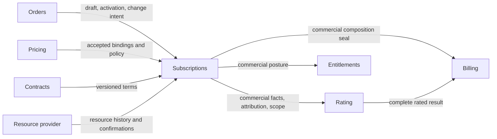

Created: 2026-08-24 by Virtuozzo International GmbH
Updated: 2026-10-23 by Virtuozzo International GmbH

# Subscriptions PRD: End-to-End Lifecycle (Multi-Tenant Revenue Object)

<!-- toc -->

- [1. Overview](#1-overview)
  - [1.1 Purpose](#11-purpose)
  - [1.2 Background / Problem Statement](#12-background--problem-statement)
  - [1.3 Goals (Business Outcomes)](#13-goals-business-outcomes)
  - [1.4 Glossary](#14-glossary)
- [2. Architecture Alignment](#2-architecture-alignment)
  - [2.1 Terminology and Naming](#21-terminology-and-naming)
  - [2.2 Contract Status](#22-contract-status)
- [3. Actors](#3-actors)
  - [3.1 Human Actors](#31-human-actors)
  - [3.2 System Actors](#32-system-actors)
- [4. Operational Concept & Environment](#4-operational-concept--environment)
  - [4.1 Module-Specific Environment Constraints](#41-module-specific-environment-constraints)
- [5. Scope](#5-scope)
  - [5.1 In Scope](#51-in-scope)
  - [5.2 Out of Scope](#52-out-of-scope)
- [6. Functional Requirements](#6-functional-requirements)
  - [6.1 Lifecycle State Machine](#61-lifecycle-state-machine)
  - [6.2 Versioning and Effective-Dated Composition](#62-versioning-and-effective-dated-composition)
  - [6.3 Plan Changes (Upgrade / Downgrade)](#63-plan-changes-upgrade--downgrade)
  - [6.4 Suspension and Reactivation](#64-suspension-and-reactivation)
  - [6.5 Renewal and Grace](#65-renewal-and-grace)
  - [6.6 Multi-Tenant Ownership](#66-multi-tenant-ownership)
  - [6.7 Event Model](#67-event-model)
  - [6.8 Billing Alignment](#68-billing-alignment)
  - [6.9 Commercial Posture](#69-commercial-posture)
  - [6.10 Trial Runtime and Conversion](#610-trial-runtime-and-conversion)
  - [6.11 Data Retention and Offboarding](#611-data-retention-and-offboarding)
- [7. Non-Functional Requirements](#7-non-functional-requirements)
  - [7.1 NFR Inclusions](#71-nfr-inclusions)
  - [7.2 NFR Exclusions](#72-nfr-exclusions)
- [8. Five Quality Vectors Analysis](#8-five-quality-vectors-analysis)
- [9. Public Library Interfaces](#9-public-library-interfaces)
  - [9.1 Public API Surface](#91-public-api-surface)
  - [9.2 External Integration Contracts](#92-external-integration-contracts)
- [10. Use Cases](#10-use-cases)
  - [Subscription administration](#subscription-administration)
  - [Plan change with preview](#plan-change-with-preview)
  - [Renewal monitoring and dunning export](#renewal-monitoring-and-dunning-export)
  - [Entitlement posture and licensing inspection](#entitlement-posture-and-licensing-inspection)
  - [Order fulfillment spawns subscriptions](#order-fulfillment-spawns-subscriptions)
  - [Change order increases a subscription](#change-order-increases-a-subscription)
- [11. User Interaction and Design](#11-user-interaction-and-design)
- [12. Acceptance Criteria](#12-acceptance-criteria)
  - [Lifecycle, composition and billing](#lifecycle-composition-and-billing)
  - [Entitlements and trials](#entitlements-and-trials)
  - [Scheduling, identity and lifecycle edges](#scheduling-identity-and-lifecycle-edges)
  - [Orders, terms and attribution](#orders-terms-and-attribution)
  - [Data, co-termination and import](#data-co-termination-and-import)
  - [Additional PriceBook, recovery and completeness scenarios](#additional-pricebook-recovery-and-completeness-scenarios)
- [13. Dependencies](#13-dependencies)
- [14. Assumptions](#14-assumptions)
- [15. Open Questions](#15-open-questions)
- [16. Risks](#16-risks)
- [17. Reference Materials](#17-reference-materials)
  - [17.1 Reconciliation Framework](#171-reconciliation-framework)
  - [17.2 Requirement Allocation](#172-requirement-allocation)
  - [17.3 Upstream Requirement Coverage](#173-upstream-requirement-coverage)

<!-- /toc -->

<!-- CONFLUENCE_TITLE: [BSS]: Subscriptions: End-to-End Lifecycle (Multi-Tenant Revenue Object) -->

**Design status.** This document specifies target behavior. The [provider requirements](UPSTREAM_REQS.md#25-provider-prerequisites-and-bilateral-acceptance) define the contracts and evidence required to enable each profile.

## 1. Overview

### 1.1 Purpose

Subscriptions owns the commercial record of **who receives service, who pays, what was accepted, and when an obligation exists**. It governs lifecycle, effective-dated composition, accepted commercial terms, renewal, commercial entitlement posture, durable operations, resource attribution and versioned commercial facts.

Pricing owns approved prices, immutable accepted bindings and usage rating policies. Rating owns monetary evaluation, proration, minimum fees and usage-window scheduling. Billing owns invoice state, posting, corrections and final monetary rounding. Entitlements applies the commercial entitlement posture. Platform licensing and quota services enforce it at point of use. Subscriptions does not duplicate those responsibilities.

**Provider independence:** BSS MUST support deployment-selected entitlement fulfillment, resource execution and inventory/evidence adapters rather than require our License Manager or OSS. A third-party system or customer integration may provide these capabilities. Entitlements owns entitlement fulfillment, resource execution and their adapter guarantees. Inventory and usage-evidence integrations remain Subscriptions consumer contracts. Subscriptions owns the commercial posture and consumes readiness and materialization observations.

**Delivery scope.** New paid and trial subscriptions originate through Orders. Supported operations include lifecycle transitions, immediate quantity increases and component additions, future order starts, scheduled cancellation, renewal and normal trial timers. Tenant axes remain fixed for the subscription.

Import/adoption and migration, payer/resource-owner transfer, administrative backdating, a dedicated audit subsystem, separate `confirmAcceptance`, multi-step ramps, co-termination, collection pause, notification delivery and per-sale brand/PlanTier metadata are outside this version. Trial extension/repeat, standalone acquisition, scheduled composition/resume, linked subscription replacement, base-plan changes, quantity decreases and component removals are also unavailable. Unsupported commands MUST refuse before effects, including through direct/operator wrappers. If required contractual behavior is unavailable, the affected profile stays blocked. The requirement cannot be silently waived.

Free-period and credit trials, normal expiry/conversion and early conversion to the already accepted paid target remain in scope. Their Pricing/Billing/financial gates still apply. Trial-to-paid conversion is not a general changePlan capability. Preserve trial history/eligibility evidence and refuse repeat requests for the same payer/plan, including via a new subscription. A transport retry is not a repeat trial. A Pricing policy alone cannot enable an extension or repeat. Independent cancellation and new purchase have separate resource/data lifecycles: there is no automatic resource adoption, data transfer, place handover or continuity promise. Cancellation follows the existing retention/disposition rules. It does not mean immediate deletion. Unsupported plan changes cannot silently become cancel+new.

Keep ordinary acquisition/lifecycle and current scope authorization. Preserve the fixed tenant axes, immutable accepted terms, current commercial facts/full replacement versions, reliable operations and domain events/outbox. Ordinary retries, late authoritative outcomes and downstream Rating/Billing corrections follow their existing protocols. They do not create an API for administrative edits to the past. A dedicated audit store/query/export/projection is not required. Domain events carry actor, reason and correlation provenance for a later audit consumer.

Operation receipts and financial/source history remain necessary for correctness. A deferred capability cannot be reported as fulfilled. If accepted terms require deferred acceptance, notice or other unavailable behavior, the affected profile remains unavailable. Removing notice implementation does not waive a contractual prerequisite or authorize destructive cleanup without it. Basic opt-out still uses ordinary end-of-term cancellation and does not depend on a notification feature.

**Financial admission and trial dependencies.** Subscriptions consumes an abstract authoritative financial admission outcome for activation, renewal and paid trial conversion: allowed, pending or refused. These are semantic outcomes, not a prescribed API enum. Under prepay, admission requires confirmation of the prescribed payment; under postpay, it requires authorization to serve under the accepted credit terms, without an immediate payment or card requirement. A pending or unknown outcome never grants permission.

External owners handle collection, invoices, credit limits and debt management. Subscriptions applies its lifecycle policy to later authoritative nonpayment outcomes. Admission does not replace capacity/term protection before capture, local execution guards or payment recovery. For initial purchases, financial coverage MUST be established during acquisition and retained for the agreed future launch: confirmed allocated payment under prepay, or an accepted commitment to serve under postpay terms.

A confirmed unpaid order remains pending its prescribed payment. Activation MUST consume that original coverage without a second credit assessment or payment. Technical token/session expiry, preparation delay allowed by the purchase, later credit-limit reduction or changed risk policy MUST NOT invalidate it. Only an explicit scoped cancellation, refund or restriction applicable under accepted terms may change coverage, with versioned disposition and activation fencing. Missing evidence MUST be recovered under the original identity. Complete retained evidence requires no new financial approval. Renewal or paid conversion requires financial admission only for its uncovered new obligation. This rule does not move future trial-target payment to trial entry.

Trials require a separate Pricing extension: an optional immutable PlanRevision trial block selecting free-period OR credit terms, with duration, applicability and paid-transition conditions. Credit trials additionally require Billing's promotional-grant contract; customer-funded Ledger credit is not that capability. Products gains no trial fields. S-U12/S-U15 define these accepted target dependencies. Current Pricing V1 does not deliver them. Exact owner contracts and runtime evidence still gate the affected profiles.

### 1.2 Background / Problem Statement

Commercial decisions, financial admission and provider execution have separate owners. Activation, partial order fulfillment, delayed provider outcomes and billing recovery require explicit contracts between those owners.

A subscription must remain explainable after prices change, events are lost, an order partially succeeds or resource ownership evidence arrives late. This PRD states the product guarantees and unsupported cases so implementation does not silently choose commercial policy. [DESIGN.md](DESIGN.md) defines the technical architecture. [Features](features) define capability flows and failure handling.

### 1.3 Goals (Business Outcomes)

- Every accepted operation has one durable identity and an observable outcome, including after a lost response.
- Every commercial obligation can be reproduced from immutable versions without reading today's mutable catalog or tenant profile.
- Every invoice group has a complete commercial fact set. Incomplete attribution or usage evidence stays pending; it never becomes an invented zero.
- Order compensation preserves financial evidence and reaches a durable outcome for every order line.
- Lifecycle actions protect customer data and expose retention, billing and licensing consequences to operators.
- Each launch capability has a defined owner contract, an acceptance scenario and evidence that its dependencies work together.

### 1.4 Glossary

| Term | Meaning |
| --- | --- |
| Subscription | Commercial aggregate with stable identity and a monotonic revision. |
| Component / line | Stable purchased occurrence within the subscription, including a base plan or add-on; quantity changes do not erase its identity. |
| PlanLink | Effective-dated relation to a Pricing plan and revision. |
| AcceptedBinding | Pricing's immutable accepted item, price, dimension selection, dated SKU descriptors, invoice inputs and policy evidence. It is not a Rating calculation snapshot. |
| BillingTerms | Subscriptions-owned accepted invoice cycle, anchor, timezone and provenance. Orders resolves this snapshot before Pricing checks commercial compatibility. |
| UsageRatingPolicy | Pricing-owned immutable window, scope and meter semantics; independent of the invoice cycle. |
| Commercial period | Subscription-defined period and served extent for an obligation. An hourly Rating window is not a new commercial period. |
| Commercial fact | Money-free, versioned obligation of kind `recurring`, `usage` or `one_time`; Rating performs tariff valuation. S-Q03 selects that one-time direction; owner routing/integration and S-Q04 occurrence gates remain open. |
| Billing group | One subscription, seller, payer, currency and billing window with a complete, versioned commercial composition. |
| Commercial seal | Evidence naming every fact and required version in a billing group. It does not prove usage collection or Rating completion. |
| Attribution segment | Effective-dated resource-to-component ownership, including historical payer and seller, published as full replacement versions. |
| Usage scope proof | Immutable proof of expected resources and ownership over a Rating window, reconciled against a historical inventory barrier. |
| Operation receipt | Durable record of accepted intent and its pending or terminal outcome. Acceptance does not mean activation succeeded. |
| Attempt | Orders Workflow fulfillment attempt; distinct from the order version, transport idempotency key and economic charge occurrence. |
| Entitlement posture | Subscription's commercial decision about grants, quantity, validity and holder; materialized by Entitlements. |
| Evaluated terms | Effective values stored with their source and version, rather than re-read from today's contract or defaults. |
| Fixed term / evergreen | A bounded contract term / ongoing service whose end-of-term action uses the current accepted billing-period end. |
| Grace | A recorded remediation interval after a payment failure, not a subscription status. |
| Data retention window | Time for protected storage and read-only export after service stops; it is not permission to keep consuming paid service. |
| Legal hold | Audited prohibition on specified record and resource deletion until released by an authorized actor. |

## 2. Architecture Alignment

The repository [architecture manifest](../../../../docs/ARCHITECTURE_MANIFEST.md), [guidelines](../../../../guidelines/README.md) and [ToolKit guide](../../../../docs/toolkit_unified_system/README.md) supply platform requirements.

### 2.1 Terminology and Naming

The current PriceBook model is adopted from [Pricing PRD](../../pricing/docs/PRD.md), [Pricing DESIGN](../../pricing/docs/DESIGN.md) and SUB-D-29. Active requirements use accepted bindings, price identifiers, explicit BillingTerms and immutable UsageRatingPolicy.

`serviceActivatedAt`, requested fulfillment time, contractual booking time and acceptance time have distinct meanings. S-Q01 defines Subscriptions-owned commercial activation time and caller scheduling lower bound. The required changes to Orders and the versioned accepted-purchase evidence contract remain open; the caller's historical start cannot override commercial T.

### 2.2 Contract Status

This PRD defines the subscription gear's commercial responsibilities. Entitlements owns provider application; license and quota providers own point-of-use enforcement. The local [commercial posture and readiness contract](features/05-entitlements.md) defines what Subscriptions publishes, consumes and recovers.

Requirements define target behavior unless marked as an existing dependency. An existing provider interface does not prove consumer integration. The [owner requirements](UPSTREAM_REQS.md) specify the contracts and delivery evidence required for each enabled profile.

## 3. Actors

### 3.1 Human Actors

#### Partner Admin

**ID**: `cpt-cf-bss-subscriptions-actor-partner-admin`

- **Role and needs**: Administers delegated customer subscriptions and needs clear operation, retention and billing consequences.

#### Customer (Self-Service)

**ID**: `cpt-cf-bss-subscriptions-actor-customer`

- **Role and needs**: Purchases, changes, cancels and exports data within authorized subscription scope.

#### Finance Analyst

**ID**: `cpt-cf-bss-subscriptions-actor-finance-analyst`

- **Role and needs**: Reconciles accepted terms, commercial facts, rated amounts and immutable financial documents.

#### Product Manager

**ID**: `cpt-cf-bss-subscriptions-actor-product-manager`

- **Role and needs**: Authors approved commercial defaults and capability scope; does not calculate runtime charges.

#### Platform Operator

**ID**: `cpt-cf-bss-subscriptions-actor-platform-operator`

- **Role and needs**: Recovers failed operations and administers audited holds and offboarding.

### 3.2 System Actors

#### Pricing

**ID**: `cpt-cf-bss-subscriptions-actor-pricing`

- **Role**: Provides PriceBook resolution, immutable prices and accepted commercial evidence.

#### Catalog Registry (Products)

**ID**: `cpt-cf-bss-subscriptions-actor-catalog-registry`

- **Role**: Owns SKU identity, published descriptors, product taxonomy and supported composition constraints.

#### Rating

**ID**: `cpt-cf-bss-subscriptions-actor-rating`

- **Role**: Consumes commercial facts, projected attribution and scope proofs; owns monetary evaluation and usage scheduling.

#### Billing & Invoicing

**ID**: `cpt-cf-bss-subscriptions-actor-billing`

- **Role**: Consumes rated results and commercial seals; owns invoicing, financial corrections and collection.

#### Contracts & Agreements

**ID**: `cpt-cf-bss-subscriptions-actor-contracts`

- **Role**: Owns explicitly bound negotiated terms and their versions.

#### Orders and Orders Workflow

**ID**: `cpt-cf-bss-subscriptions-actor-orders`

- **Role**: Own commercial acquisition and change orders; orchestrate per-line draft creation, activation and compensation.

#### Entitlements

**ID**: `cpt-cf-bss-subscriptions-actor-license-manager`

- **Role**: Applies commercial posture to providers and reports readiness and materialization.

#### Policy Engine

**ID**: `cpt-cf-bss-subscriptions-actor-policy-engine`

- **Role**: Authorizes commands, reads and delegated actions through `PolicyEnforcer`, with PDP-derived scope and auditable delegation evidence.

#### Resource provider Provisioning and Inventory

**ID**: `cpt-cf-bss-subscriptions-actor-oss-provisioning`

- **Role**: Execute resource actions and supply authoritative historical readiness, deletion and inventory evidence.

#### Payments

**ID**: `cpt-cf-bss-subscriptions-actor-payments`

- **Role**: Supply payment-method, authorization and retry-exhaustion evidence.

#### Account Management (AM)

**ID**: `cpt-cf-bss-subscriptions-actor-am`

- **Role**: Own account and tenant records; supply commercial account references and relationship evidence under the agreed contract. Subscriptions reads current tenant identity and ancestry through Tenant Resolver.

#### Tenant Resolver

**ID**: `cpt-cf-bss-subscriptions-actor-tenant-resolver`

- **Role**: Supply current tenant identity and ancestry through `TenantResolverClient`. Authorization remains with PolicyEnforcer.

#### Analytics / DWH

**ID**: `cpt-cf-bss-subscriptions-actor-analytics`

- **Role**: Consume tenant-scoped commercial lifecycle facts without deriving authoritative subscription state.

## 4. Operational Concept & Environment

Orders creates drafts for all lines before activating them. Partial activation is recovered through explicit per-line compensation, not represented as a cross-service atomic transaction. Subscriptions opens commercial periods, publishes facts and maintains their revisions. Rating derives its own evaluation windows beneath those periods. Billing requires both the commercial set and the complete rated result.

### 4.1 Module-Specific Environment Constraints

- Effective intervals are half-open and UTC; accepted calendar or anniversary anchors define period boundaries without drift.
- Resource-affecting actions fail closed without the required authorization, provider evidence and accepted terms. A draft alone grants no resource, entitlement or obligation.
- System and operator actions have the same tenant scoping, idempotency and audit obligations as customer actions.
- Event delivery is at least once and can be absent; recovery reads must be sufficient to rebuild consumer state.
- Durable state, operation outcome and the corresponding publication intent must agree at each commercial commit. A process failure cannot expose an applied operation without its evidence.

## 5. Scope

### 5.1 In Scope

| Capability | Priority | Launch condition |
| --- | --- | --- |
| Lifecycle, revision history and durable operations | p1 | Normal/retry/failure/recovery scenarios pass; authorization enforced. |
| Order acquisition and compensation | p1 | S-Q01 and S-Q02 core/suspended-place/prepayment directions accepted; activation/occupancy owner contracts and applicable residual claim rules must close, with provider evidence and attempt fencing integrated. |
| Accepted PriceBook terms and period bindings | p1 | Provider contract parity, complete selected items and supported D-504 profile verified. |
| Atomic order-driven quantity increases and component additions | p1 | One immediate applied boundary, expected revision, external-side-effect recovery and occupancy fixtures pass. |
| Versioned recurring/usage facts, groups and recovery | p1 | Rating/Billing C04 contracts and producer/consumer fixtures agreed. |
| Resource attribution and usage scope proofs | p1 | Historical inventory barrier available; usage finalization also needs independent coverage evidence. |
| Commercial entitlement posture and licensing status | p1 | Entitlements issuance and acknowledgement contract accepted and exercised. |
| Renewal, terms and uncontracted defaults | p1 | Versioned defaults and bound-contract precedence accepted; co-termination is deferred. |
| Suspension, retention and record preservation | p1 | S-Q05 post-stop and confirmed charging-cutoff directions accepted; internal stops are split by cause; confirmation protocol contracts and S-U05/S-U13 evidence remain open, alongside resource provider pause/export/delete confirmation. |
| Legacy import | Deferred | Outside the current version; no import/adoption implementation or readiness gate. |
| One-time facts | p2 | S-Q03 valuation and S-Q04 charge-action identity directions accepted; exact schema and S-U08/S-U13 routing/accounting evidence remain required before fee-bearing capture or activation. |
| Trial runtime | p2 | S-Q06 settlement-scheme and prepay-failure default directions accepted; PriceBook offer/eligibility, retry/later paid routing, detailed postpay due/dunning, Entitlements and runtime contracts still required. |
| Collection pause, ramps, transfer and historical correction | Deferred | Outside the current version. |
| Parent/child subscription lifecycle, bulk administration and analytics extensions | p3 | Separate decomposition after the core contract is ratified. |

The launch profile follows Pricing D-504: month/year invoice cycles in UTC; supported recurring Flat/PerUnit; supported usage PerUnit/Volume/Graduated with explicit policy; no implicit FX, quarter, package, allowance or trial model. CalendarHour usage rejects every minimum fee, including a zero-valued floor. A pure price read accepting historical data does not authorize a new sale using an unsupported profile. The accepted PlanRevision trial/credit target is a separate S-U12/S-U15 extension; it does not broaden this V1 launch profile.

**Blocked is observable:** the caller receives a stable unsupported-capability or dependency-unavailable outcome before any new service or commercial obligation is created. A UI option, a fixture provider or acceptance of a draft is not evidence that the runtime capability is available. Existing committed obligations remain recoverable when admission of new obligations is blocked.

### 5.2 Out of Scope

Price authoring, discount/FX/tax evaluation, invoice posting and rounding, payment execution, resource provider topology mutation, entitlement grant stores, point-of-use checks and counters are external responsibilities. Subscriptions does not emit hourly billing ticks, infer usage completeness from silence, or silently convert proposed owner contracts into production guarantees.

## 6. Functional Requirements

FRs define observable guarantees. Architecture and transactional mechanisms are specified in DESIGN; detailed flows and test fixtures are in features. All active FRs require automated acceptance evidence appropriate to their capability; unratified gates remain closed even when a local fixture passes.

### 6.1 Lifecycle State Machine

#### Status enum and terminality

- [ ] `p1` - **ID**: `cpt-cf-bss-subscriptions-fr-status-enum`

The system MUST use exactly `draft`, `active`, `suspended`, `cancelled` and `archived`. Allowed status changes are draft→active, draft→cancelled (void), active→suspended, suspended→active, active/suspended→cancelled and cancelled→archived. Import is deferred and provides no direct creation edge into active/suspended in the current version. A cancelled or archived subscription MUST NOT resume commercial service; a new sale requires a new subscription. Historical fact corrections, retention actions and audited personal-reference erasure remain possible without commercial rebirth.

For a plain unconfirmed/unpaid draft with no outstanding external effects, void requires no resource provider deletion and creates no activation-driven service fact. Confirmed, paid or unknown-payment orders retain their separate claim and financial obligation until the agreed cancellation/release protocol resolves them; a local draft void is not refund or settlement evidence. Unconfirmed unpaid draft cleanup is housekeeping with a configurable TTL and no financial effect; it cannot release protected order rights. A confirmed but unpaid prepay order keeps its reserved place until the versioned payment deadline from the accepted order terms; after that deadline only the order's cancel route releases the claim, never a silent release.

- **Rationale**: Closed states and explicit terminal behavior make retries and historical audit unambiguous.
- **Actors**: `cpt-cf-bss-subscriptions-actor-platform-operator`

#### Normative transitions and guards

- [ ] `p1` - **ID**: `cpt-cf-bss-subscriptions-fr-transitions-guards`

Each resource-affecting transition MUST require an authorized Policy decision and the confirmations appropriate to the action. Activate requires complete valid accepted terms, fulfillment admission evidence, occupancy and confirmed resource readiness where provisioning is required. Suspend requires authorized non-destructive restriction intent and a supported pause capability; actual provider pause completion is observed after the commercial commit, not a precondition for publishing that intent. Resume requires restored eligibility, occupancy and resolution of a blocking payment failure. Cancel requires confirmed service-stop handling and a retained-data disposition; physical deletion follows retention, not the cancel commit. Archive requires completed retention disposition and the configured record-governance rule.

A denied or stale precondition MUST leave commercial state unchanged. Pending external work MUST remain visible on the operation. An external effect that succeeds before a rejected local commit MUST be recovered or compensated and audited; the system MUST NOT report a clean failure while abandoning live resources.

- **Rationale**: Admission, service state and external side effects must have one explainable outcome.
- **Actors**: `cpt-cf-bss-subscriptions-actor-policy-engine`, `cpt-cf-bss-subscriptions-actor-oss-provisioning`
- **Covers**: `cpt-cf-bss-subscriptions-upreq-order-intents`

#### Trials are not a status

- [ ] `p1` - **ID**: `cpt-cf-bss-subscriptions-fr-trials-not-a-status`

The system MUST represent any approved trial through versioned commercial terms and effective-dated composition while using the closed lifecycle states. Trial is never a new status or an untyped flag that bypasses accepted terms. This invariant applies even while trial admission is disabled.

- **Rationale**: Trials must not fork the lifecycle or bypass commercial evidence.
- **Actors**: `cpt-cf-bss-subscriptions-actor-pricing`, `cpt-cf-bss-subscriptions-actor-contracts`

#### Trial commercial pattern

- [ ] `p2` - **ID**: `cpt-cf-bss-subscriptions-fr-trial-commercial-pattern`

**Delivery condition**: S-Q06 Pricing trial-offer ownership and contract-expansion direction accepted; trial admission remains disabled pending the proposed Pricing extension, eligibility and provider/runtime contracts.

Trial extensions and repeat trials MUST be refused in this version even when Pricing policy permits them. Preserve payer/plan trial history to detect repeats across subscription IDs; retries recover the same episode. Additional bonus, stacking and payer/resource transfer remain unavailable. Early conversion to paid service MUST preserve eligible unused trial credit under the accepted terms. Conversion requires authorization, financial guards and accepted eligibility.

Pricing MUST place optional trial terms on existing PlanRevision, selected by stable plan/revision identity; no separate TrialOffer identifier/catalog is required. The storefront combines Products descriptions/SKU identity with that Pricing version. A trial selects either an explicit zero-priced free period or monetary trial credit with explicit amount, currency, eligible products/items/charge kinds and duration semantics; combining variants is not approved. Credit trials MUST retain ordinary price bindings. Paid-target resolution/acceptance and policy references remain explicit. Subscriptions retains the accepted revision/receipt and owns actual episode dates, expiry/conversion and Entitlements intents. Products stores no trial-policy fields; Contracts supplies only explicitly bound terms. Exact [trial terms](DESIGN.md#336-trial-terms-and-provider-evidence) schema/provider-consumer ratification and runtime remain open; current D-504/D-510 V1 does not provide it.

The [TP delivery contract](DESIGN.md#336-trial-terms-and-provider-evidence) requires complete zero-charge evidence for the free scope, including applicable minimum-fee behavior. Initial free/bonus-funded access MUST NOT acquire a card/capture prerequisite merely because a paid target exists; any separately prescribed upfront payment retains its financial guards. Actual T and the accepted duration determine the original exclusive expiry; delayed grant recording MUST NOT reset that expiry or gate initial access already prepared under the Billing commitment.

Trial credit MUST use shared accounting with a distinct durable customer grant tied to accepted acquisition/episode and immutable policy/applicability. Billing MUST own promotional trial-credit issuance/history/remaining balance and allocation/correction; S-U15 must establish its exact provider and Ledger integration, authoritative versioned outcomes and invoice coordination. Billing MUST consume canonical full Rating replacements, preserve prior accepted allocation/version lineage and adjust the same grant once under original scope/currency/terms. Repeated accepted versions MUST be no-ops; conflicting version/content MUST refuse or recover.

No independent delta-delivery contract or inline rewrite of posted financial history is introduced. Multiple eligible items share one grant; no cloned full bonus, implicit all-product/FX scope or new setup-charge trigger is allowed. Pricing stores terms, not balances; Subscriptions facts remain amount-less with relevant policy/grant evidence references, not bonus amounts or balance math. Trial bonus is neither customer prepayment nor authorization for postpay service. Current Ledger cash-funded grant semantics MUST NOT be repurposed as an existing free-bonus capability or supplied with fabricated settled cash; necessary financial postings require the agreed Billing/Ledger path.

A downward correction at the same accepted tariff MUST restore the released eligible amount on the same grant exactly once while that grant remains valid and applicable to an active trial or eligible paid usage after early guarded conversion, only until the same original expiry: illustratively, grant 100 minus usage value 30 leaves 70, and corrected value 25 leaves 75. After grant expiry, Billing MUST still correct history/accounting and preserve the original expiration: historical net consumption is 25 and conceptual remaining is 75, but spendable credit is 0.

Correction MUST NOT extend the trial or create a new grant/top-up, cash refund, repricing or access revival. The numbers are illustrative semantic outcomes, not defaults or prescribed balance fields. A later correction MUST NOT automatically reopen a trial already ended by exhaustion, even before original expiry. Illustratively, full consumption 100 corrected to 95 restores 5 in accounting but grants no service/spend permission for the closed episode and MUST NOT reverse an applied paid conversion.

A correction MUST NOT end a still-active trial or prevent restoration of credit to the same grant while it remains valid and applicable, until the original expiry. V1 has no reactivation of a closed trial episode, rollover past original expiry or regrant on the same subscription. A later acquisition after a trial is a fresh paid purchase; repeat trials are deferred; its guarded routing and owner contracts remain required. Positive corrections of eligible pre-boundary trial expenses follow the platform-liability rule below; correction/liability cases outside that scope remain gated.

On an early valid guarded trial-to-paid transition, Billing MUST retain unused monetary trial credit on the same grant for eligible paid-plan expenses until the same original expiration, under unchanged currency/product/item/charge-kind and other accepted restrictions. Closing the trial episode through that conversion MUST NOT itself make the retained grant unspendable. Illustratively, a 100-credit/14-day grant with 60 left on day 5 keeps that 60 eligible only until original day 14; conversion issues no new grant, top-up or duration.

Expired grants are not revived. Full Rating replacement/correction lineage MUST continue for eligible paid usage using its frozen agreed tariffs and original grant applicability. A paid-plan SKU outside that applicability MUST NOT spend the balance or cause it to be erased; no product-scope or FX expansion follows. Credit alone grants no access or paid-transition permission, and MUST NOT be assumed to satisfy prescribed upfront payment unless the agreed coverage/settlement contract allows it. Stacking and new-period rollover/regrant are refused in v1; payer transfer is deferred and cannot move this grant. Exact S-U15 provider/integration/coverage contracts remain external delivery gates.

Credit trials MUST retain legitimate served/usage facts valued at ordinary tariffs before paid-target conversion. Rated gross value, bonus coverage, platform-borne amount, customer obligation, access-stop evidence and the successor paid boundary are distinct. Expiry-no-debt/no-paid-start rules do not suppress trial evidence needed for drawdown. Overage or excluded charges require an agreed paid basis and guards. For eligible accepted-trial expenses served before the authoritative applied paid boundary, the platform MUST bear full rated value beyond bounded bonus coverage, including positive corrections, errors and accounting/stopping-delay or in-flight overrun.

Billing MUST NOT create customer trial-overage debt for this excess. Illustratively, remaining bonus 2 and eligible trial usage value 5 means bonus coverage 2 and platform-borne 3. For usage actually served after valid guarded paid conversion, the residual 3 instead follows accepted paid-plan/settlement terms. Classification MUST use actual served time and the authoritative applied paid boundary, never rating/event/correction arrival; late pre-conversion facts remain trial liability, crossing usage MUST be split/attributed using supported evidence, and paid conversion MUST NOT be backdated to charge trial overrun.

Rating MUST preserve actual gross usage/value and Billing MUST distinguish bounded bonus coverage, platform-borne amount and customer obligation; no negative bonus, unlimited top-up or fabricated coverage of 5 is allowed. A canonical full replacement correcting illustrative eligible pre-boundary gross value from 90 to 110 against a grant of 100 MUST allocate bonus 100, platform 10 and customer 0, retaining original source/version and tariff lineage. Replay MUST NOT repeat the adjustment, issue a grant or reopen an exhausted episode.

Erroneous billed trial tail MUST use existing idempotent Billing correction/remedy paths, not an additional goodwill payment. This selects neither a refund mechanism nor a Ledger journal/tax schema, and waives no prior legitimate debt, explicit retention obligation, excluded charge kind or unrelated recovery/remedy obligation. Before credit launch, S-U15 MUST demonstrate this coverage boundary and ratify exact evidence/provider/Ledger, detection/enforcement/recovery and remaining liability contracts. No instantaneous stop or unlimited free operation is promised; unknown balance is neither zero/exhaustion nor spend permission.

- **Rationale**: A trial must be auditable and compatible with the current price model.
- **Actors**: `cpt-cf-bss-subscriptions-actor-pricing`, `cpt-cf-bss-subscriptions-actor-contracts`

#### TransitionRequest

- [ ] `p1` - **ID**: `cpt-cf-bss-subscriptions-fr-transition-request`

Every mutation MUST have a durable operation record with intent, expected revision where relevant, asserting principal, idempotency identity, correlation and outcome. Current operation kinds include activate, suspend, resume, cancel, archive, addAddOn, updateQuantity, changeComposition, renew and unschedule; convertTrial retains its own provider gates; extendTrial and changePlan are deferred. Quantity decreases/removals, transfer, collection-pause commands and confirmAcceptance are deferred and unavailable.

The operation statuses are `pending`, `approved`, `applied`, `failed`; acceptance or approval MUST NOT be reported as application. Failures carry a machine-readable reason and retryability. A withdrawn operation reaches status `failed` with reason `withdrawn` only after its external effects are safely resolved. The decision that prevents activation is recorded before cleanup; it does not by itself mean that withdrawal is complete.

- **Rationale**: Callers need a durable state machine for work that outlives one request.
- **Actors**: `cpt-cf-bss-subscriptions-actor-orders`, `cpt-cf-bss-subscriptions-actor-platform-operator`
- **Covers**: `cpt-cf-bss-subscriptions-upreq-order-intents`

#### Order-originated acquisition

- [ ] `p1` - **ID**: `cpt-cf-bss-subscriptions-fr-order-originated-create`

**Current acquisition profile:** all new paid and trial subscriptions MUST originate through Orders. Standalone direct/operator create MUST refuse before effects. Existing-subscription lifecycle operations, conversion, renewal and technical acquisition recovery retain their own guards.

**Delivery condition**: S-Q01/S-Q02 directions, including prepayment reservation, are accepted; provider/consumer contracts, payment/release fences and integration evidence remain OPEN under S-U01/S-U07/S-U10. Direction approval does not enable capture or order runtime admission.

Before actual Billing/Payments capture or settlement, order confirmation MUST secure a distinct durable place claim for the order/version/line and a Pricing/Products commitment to the original commercial terms for the accepted future date and fulfillment window. Both prerequisites must be durably evidenced before money is taken; inability to secure either MUST refuse or defer capture. A seller's tolerate-failure setting cannot waive this guarantee. Existing payment authorization before begin-fulfillment is not proof of actual capture, settlement or this new prepayment capability. Billing/Payments owns the actual money and outcome evidence.

**Capture/cancellation direction:** for Orders-origin acquisitions, Orders Lifecycle MUST durably arbitrate cancellation versus capture start using one local acquisition/version guard, after both protections are established. Workflow delivers/reconciles and Payments executes under the original capture identity. Cancellation winning first MUST prevent delayed debit; capture start winning first MUST preserve the applicable cancellation route while financial recovery/remedy may remain pending. Unknown outcome MUST retain protection and MUST NOT cause a second collection. Release requires authoritative capture resolution and acknowledged capture/activation fences plus the required recorded remedy, not a cancellation notification alone; a posted refund is not universally required. The [protocol and failure cases](features/01-foundation.md#acquisition-recovery) are accepted semantics; exact cross-owner contracts and implementation remain release gates. This introduces no acquisition-time payment/card requirement for authorized postpay.

**Fulfillment retry direction:** technical retry MUST retain the original attempt/operation identities. A successor attempt for the same accepted acquisition MUST require durable predecessor non-application and delayed-create/activation fencing, resolved financial outcomes, authorized predecessor/successor lineage and an atomic exclusive association change preserving the existing claim and payment references. Unknown predecessor outcome MUST be recovered first; an already applied subscription MUST be recovered rather than recreated. Succession MUST NOT duplicate payment, occupancy or charge occurrence, extend an explicit accepted start restriction, amend accepted terms or reopen a cancelled acquisition. Existing financial remedy obligations remain binding. The [successor-attempt protocol](features/01-foundation.md#acquisition-recovery) defines the accepted semantics; provider mapping, amended-version association and runtime evidence remain gated.

**Commercial amendment direction:** a changed order version with different composition, price bindings or payer MUST undergo Orders' commercial amendment checks and required new-version approvals/acceptance. It MUST NOT use the technical-retry path or automatically inherit the previous version's reservation, commercial commitment or payment. Explicit owner-approved mapping and financial applicability are required before capture/activation for the new version; superseded commands MUST be fenced, and unknown old financial outcomes MUST be recovered. Failed preparation preserves the protected source; a committed amendment with incomplete handover MUST retain old obligations with a pending disposition rather than silently release them or resume the superseded version. Existing Orders state/field restrictions remain in force, including no amendment during `in_fulfillment`. See the [amendment protocol](features/01-foundation.md#acquisition-recovery); exact cross-owner mappings and financial allocation remain delivery gates.

The reservation may precede Subscriptions draft creation in Workflow wave 1 and MUST survive waiting for the future date, ephemeral draft rebuild and an unknown payment outcome. Draft creation and prepayment MUST NOT be represented as provided service or activation-driven commercial facts. After this confirmation stage, Orders Workflow MUST create one draft per order line, carrying its complete base/add-on composition and quantity, then call activate separately. Create MUST accept and retain order id/version/line, fulfillment attempt, wave, caller binding reference and external order reference when supplied. That provenance travels on operation outcomes, lifecycle events and commercial facts.

Draft creation alone MUST NOT provision, issue commercial access or publish an activation-driven service fact. A separately authorized initial activation operation MAY prepare assigned rights and resources while status remains draft under IA-2026-10-18; this is not applied service and creates no activation-driven fact; any separate prepayment settlement remains Billing/Payments evidence. The activation path MUST verify the original accepted purchase, terms, market and exclusive attempt association together with current order, financial, security and readiness guards.

A changed payer market yields an explicit conflict. The supported purchase receipt/commitment MUST prove durable future coverage; a quote-lifetime V1 receipt alone does not establish that guarantee. A copied receipt MUST NOT create a second acquisition, and catalog changes after acceptance MUST NOT reprice or invalidate the original purchase. An order-backed activation MUST consume its own reserved place atomically without competing for another place; commercial T still follows S-Q01. New attempt/version or replacement-draft association requires the S-U01 owner protocol and cannot silently recreate or drop the order right.

Before activation, compensation can void the draft only while preserving the separate order claim and payment obligation until the agreed cancellation/release protocol resolves them. A paid unfulfilled order requires remediation or explicit cancellation with a recorded financial remedy, not quiet claim release. Release must be fenced against late capture and activation; unknown outcomes remain recoverable. No refund amount or timing is implied. After activation compensation uses cancel with `order_compensation`. Standalone system/operator creation is deferred; new acquisitions require Orders.

- **Rationale**: Two operations and retained order identity make partial fulfillment recoverable.
- **Actors**: `cpt-cf-bss-subscriptions-actor-orders`, `cpt-cf-bss-subscriptions-actor-pricing`
- **Covers**: `cpt-cf-bss-subscriptions-upreq-order-intents`, `cpt-cf-bss-subscriptions-upreq-accepted-bindings`

#### Cancellation reasons

- [ ] `p1` - **ID**: `cpt-cf-bss-subscriptions-fr-cancel-reasons`

Cancel MUST record one versioned reason: `customer`, `operator`, `term_expired`, `nonpayment_exhausted`, `saga_superseded` or `order_compensation`. Trial expiry maps to `term_expired` with trial-expiry context. Customer/operator cancellation alone is in the early-termination-fee or unused-portion-credit eligibility class; actual financial treatment requires frozen contract terms and the Billing contract.

Order compensation MUST NOT derive either class by accident. It preserves emitted facts and requests explicit replacement/zero-obligation versions and Billing correction where required. Actual consumed usage remains recorded. S-Q05 excludes the platform technical tail after a customer-confirmed charging cutoff from the ordinary customer tariff; remaining cancellation cases require agreed financial disposition. Cancellation is not proof of a zero balance, and erroneous tail charges require correction.

- **Rationale**: Financial consequences depend on the business reason, not a generic terminal status.
- **Actors**: `cpt-cf-bss-subscriptions-actor-orders`, `cpt-cf-bss-subscriptions-actor-billing`

#### Caller intent protocol

- [ ] `p1` - **ID**: `cpt-cf-bss-subscriptions-fr-intent-protocol`

Same-key/same-payload resubmission MUST return the original operation and current outcome. Same-key/different-payload reuse MUST conflict. A second transport key for the same business intent MUST not create a second subscription or effect. Distinct order versions or attempts MUST remain distinguishable while being fenced against an already committed or unsettled predecessor.

Callers MUST be able to read operations by operation id and business identity after transport dedup retention expires, and to withdraw unapplied work. Withdrawal before external dispatch has no service effect. After dispatch, it completes only when outstanding effects are cancelled or compensated. An applied operation requires a new compensating transition. Every outcome MUST echo the caller's order/attempt/line/wave, correlation, opaque binding reference and asserting principal. Correlation MUST propagate to Policy and resource provider.

- **Rationale**: A lost response must not force the caller to guess whether a transition happened.
- **Actors**: `cpt-cf-bss-subscriptions-actor-orders`, `cpt-cf-bss-subscriptions-actor-platform-operator`
- **Covers**: `cpt-cf-bss-subscriptions-upreq-order-intents`

#### Operation recovery and uncertain creation

- [ ] `p1` - **ID**: `cpt-cf-bss-subscriptions-fr-operation-recovery`

The system MUST provide durable create settlement for an order attempt and line. Settlement MUST serialize with create for that business identity: it returns an existing draft/operation or records a terminal not-created fence preventing a delayed create from appearing. A not-found status read alone never proves non-creation. Repeated settlement MUST return the same durable result.

An order can report a line resolved only with durable applied, voided, compensated or settled-not-created evidence. Tombstones and operation/business-identity records MUST survive for the full order retry, recovery and audit horizon. Expiry of an HTTP idempotency entry MUST NOT remove the business fence. A settled-not-created or voided draft outcome MUST NOT by itself release a distinct order reservation, settle an unknown capture or erase a paid obligation. Reservation, capture, cancellation and activation outcomes require the correlated owner-agreed S-U01/S-U07/S-U10 recovery protocol.

- **Rationale**: Timeout recovery must prevent late creation after Workflow declared failure.
- **Actors**: `cpt-cf-bss-subscriptions-actor-orders`, `cpt-cf-bss-subscriptions-actor-platform-operator`
- **Covers**: `cpt-cf-bss-subscriptions-upreq-order-intents`, `cpt-cf-bss-subscriptions-upreq-recovery`

#### Import of live subscriptions

- [ ] `p2` - **ID**: `cpt-cf-bss-subscriptions-fr-import`

**DEFERRED.** Import/adoption of existing subscriptions is outside the current version. Import requests MUST refuse before effects. There is no import API or implementation allocation.

#### Scheduled lifecycle intents

- [ ] `p1` - **ID**: `cpt-cf-bss-subscriptions-fr-scheduled-intents`

Cancel-at-term-end and cancel-at-date MUST be durable intents with one effective boundary, originating request, policy version and outcome. Re-submission MUST not schedule a second effect. An end-of-term cancel MUST win over renewal at the same boundary. Retries MUST preserve renewal and trial-conversion suppression. A terminal cancellation-intent failure MUST retain that suppression until explicit operator resolution. Unschedule MUST withdraw only unapplied work and preserve its history. For customer-confirmed cancellation, withdrawal/rescheduling also requires an explicit versioned confirmed action before the applicable charging cutoff. An unapplied cancellation alone does not permit withdrawal/rescheduling after cutoff. No action restores charges retroactively. New service after the cutoff needs a separate valid guarded route.

Execution MUST recheck current authorization and state. A transient failure is retryable, an invalid commercial condition is terminal, and a state-precondition wait is explicitly parked. Deadlines and back-pressure MUST be visible. A parked intent must not disappear or silently become a different immediate change.

- **Rationale**: Durable scheduling prevents missed lifecycle actions and renewal races.
- **Actors**: `cpt-cf-bss-subscriptions-actor-orders`, `cpt-cf-bss-subscriptions-actor-platform-operator`

#### Commercial activation instants

- [ ] `p2` - **ID**: `cpt-cf-bss-subscriptions-fr-activation-instants`

**Delivery condition**: the accepted-purchase profile requires Orders alignment and versioned durable acceptance, original-term recovery and future-coverage evidence. Owner adoption and executed integration remain OPEN.

The system MUST distinguish requested fulfillment time, booking time, actual service activation and any acceptance confirmation. The accepted S-Q01 direction sets commercial service start to the server-assigned effective instant recorded atomically with successful activation. A caller date schedules eligibility and never backdates live service. The deferred import feature supplies no current historical-start exception. First-period served coverage MUST begin at that commercial start, even with an earlier calendar invoice anchor.

The 2026-10-18 amendment requires all initial usable service readiness to be confirmed before the guarded activation commit (SUB-D-55). The subscription MUST remain draft with a durable pending/approved activation operation until then. Subscriptions MUST persist the operation and preparation posture revision/digest before dispatch and bind Entitlements' aggregate readiness result by ordering tenant, scope, operation and immutable manifest identity/version/digest; Entitlements retains the manifest and validates all assignment/producer evidence (SUB-D-56).

The adapter is not required to know subscription identity. Apply the [initial readiness contract](features/05-entitlements.md#initial-activation-readiness-contract), including current-evidence/revocation guards; timestamp alone is insufficient. SUB-D-57 additionally requires a durable readiness commitment bound to that operation/preparation/manifest. Activation and ordinary withdrawal MUST serialize on one local fence. The applied or irrevocably non-activated outcome MUST be recoverable and published through posture. Unknown outcomes and timeouts MUST NOT release preparation. Authorized preparation use before T, including never-activated preparation, MUST be platform-borne under an explicitly bounded profile. It creates no ordinary customer service charge.

Emergency security denial remains immediate with correlated recovery and no fictitious rollback of an applied T. Exact provider and Rating/Billing mapping remain delivery gates. Initial service period/accrual starts at fresh local T, never backdated to provider observation or prepayment. Required post-activation issuance MUST NOT be used as an initial readiness prerequisite. This applies only to initial acquisition. Resume, renewal, trial conversion and active modifications retain their own rules.

Separate post-start confirmAcceptance is deferred. A contract requiring this unsupported workflow cannot be enabled by silently treating the workflow as complete. This does not remove purchase acceptance evidence supplied by Orders/Pricing.

- **Rationale**: Booking, service and acceptance have different financial and operational meanings.
- **Actors**: `cpt-cf-bss-subscriptions-actor-orders`, `cpt-cf-bss-subscriptions-actor-contracts`

### 6.2 Versioning and Effective-Dated Composition

#### Monotonic revision

- [ ] `p1` - **ID**: `cpt-cf-bss-subscriptions-fr-monotonic-version`

Each successful commercial change MUST advance a monotonic subscription revision exactly once and preserve the predecessor. Replaying a request MUST not create another revision. Expected-revision conflicts leave the subscription unchanged. Reads and events MUST identify the revision they describe.

- **Rationale**: Concurrency and replay need a stable version precondition.
- **Actors**: `cpt-cf-bss-subscriptions-actor-orders`, `cpt-cf-bss-subscriptions-actor-rating`

#### Effective-dated composition

- [ ] `p1` - **ID**: `cpt-cf-bss-subscriptions-fr-effective-dated-composition`

Plan links, component occurrences, quantities, holder/payer/seller allocations and evaluated terms MUST preserve non-overlapping effective intervals and explicit replacement history. At any supported historical instant the system MUST resolve the composition that applied then. A current snapshot alone is insufficient. Uncommitted future intent MUST be distinguishable from the applied composition.

- **Rationale**: Late usage and historical invoices must retain their original commercial context.
- **Actors**: `cpt-cf-bss-subscriptions-actor-rating`, `cpt-cf-bss-subscriptions-actor-billing`

#### Snapshot discipline

- [ ] `p1` - **ID**: `cpt-cf-bss-subscriptions-fr-snapshot-discipline`

Every commercial obligation MUST retain enough immutable accepted price, SKU/descriptors, policy and term evidence for replay. New catalog publication, tenant-profile edits, default-policy changes or contract updates MUST NOT rewrite existing pins. A Rating calculation snapshot MUST be referenced separately from the accepted Pricing binding. Missing historical evidence MUST produce an explicit pending/error condition. A live lookup cannot substitute for it.

- **Rationale**: Commercial replay must reproduce what was accepted.
- **Actors**: `cpt-cf-bss-subscriptions-actor-pricing`, `cpt-cf-bss-subscriptions-actor-rating`
- **Covers**: `cpt-cf-bss-subscriptions-upreq-accepted-bindings`

#### Accepted PriceBook bindings and BillingTerms

- [ ] `p1` - **ID**: `cpt-cf-bss-subscriptions-fr-accepted-price-bindings`

New admission MUST validate complete selected PriceBook bindings, explicit BillingTerms and compatible per-item UsageRatingPolicy using the applicable versioned provider contract. The current V1 path retains its own deadlines and exact-time semantics. BillingTerms MUST identify month/year cycle, UTC anchor and source/version. A usage-only item with `period = null` MUST NOT imply either a monthly invoice or an hourly rating window. Mixed items MUST satisfy Pricing's supported compatibility profile.

Periods MUST retain pins and dated invoice descriptors. Renewal resolves with existing pins: it follows eligible `all` successors and stops before a `new` successor. Publication alone changes no binding. A bound price's `ends_on`, not `effective_to`, triggers in-period re-resolution. Automatic adoption requires explicitly accepted continuation policy and satisfied notice/assent prerequisites (SUB-D-41). For an established obligation with a known unresolved continuation, publish a full successor fact with an explicit `Unresolved` interval and exact successor seal; full valuation stays pending until a resolving successor arrives. Uncovered chains MUST still block new admission; never invent a price or currency conversion. Changing immutable rating-window policy requires the explicit supported boundary in §6.3.

The provider methods are PricingReadV1 resolve/price/current_revision, PricingAcceptanceV1 acceptance/hold and SellabilityV1 check/check_fulfilment (D-510). Their presence does not prove consumer integration or durable future-purchase support. New-offer acceptance follows its declared validity; the accepted-purchase execution profile requires the durable evidence and recovery contract below.

For a paid future order, Pricing/Products MUST durably accept the original terms and agreed future coverage before capture. The commitment may be part of the acceptance receipt or correlated evidence. Preview, date checks and a quote-lifetime V1 hold alone are insufficient. If the requested future date is unsupported, acceptance/capture MUST refuse or defer. Ordinary offer expiry, price changes and retirement for new sales after acceptance MUST NOT invalidate or reprice the purchase. Exact versioned owner contracts remain OPEN under S-U01/S-U07.

At readiness, Subscriptions MUST activate against the accepted purchase and original immutable terms, using retained acquisition financial coverage and current order/cancellation, authorization, occupancy and held-readiness guards. T MUST satisfy the agreed start lower bound and any explicit accepted execution restriction. An assessment/quote deadline or current price end MUST NOT become a new execution deadline after purchase. Missing historical evidence requires recovery. An unmet contractual condition requires agreed remediation or cancellation without erasing the paid obligation. A complete saved accepted snapshot needs no live Pricing re-admission.

- **Rationale**: Accepted price bindings and explicit continuation rules preserve the agreed terms throughout fulfillment and renewal.
- **Actors**: `cpt-cf-bss-subscriptions-actor-pricing`, `cpt-cf-bss-subscriptions-actor-orders`, `cpt-cf-bss-subscriptions-actor-rating`
- **Covers**: `cpt-cf-bss-subscriptions-upreq-accepted-bindings`

#### PlanTier derivability

- [ ] `p1` - **ID**: `cpt-cf-bss-subscriptions-fr-plantier-derivability`

**DEFERRED.** This capability is outside the current version. Requests MUST refuse before effects and receive no implementation allocation. Ordinary cancellation/opt-out, source-authorized current lifecycle changes and immutable fact replay remain governed by their active requirements.

#### Per-sale brand attribution

- [ ] `p2` - **ID**: `cpt-cf-bss-subscriptions-fr-sale-brand-attribution`

**DEFERRED.** This capability is outside the current version. Requests MUST refuse before effects and receive no implementation allocation. Ordinary cancellation/opt-out, source-authorized current lifecycle changes and immutable fact replay remain governed by their active requirements.

#### Usage attribution binding

- [ ] `p1` - **ID**: `cpt-cf-bss-subscriptions-fr-usage-attribution`

Subscriptions MUST own effective-dated resource/subject-to-subscription-component attribution, including payer, seller, usage type version and stable component identity. It MUST use provider-confirmed historical readiness and stop/deletion evidence rather than event-arrival time. Late readiness after cancellation still requires historical attribution and an explicit current resource disposition.

The supported read horizon MUST cover collector replay, permitted corrections and retained financial evidence. Historical queries MUST return an exact match, explicit no-match or explicit ambiguous result; ambiguous ownership MUST never be guessed. Historical attribution MUST preserve old intervals after resource deletion or externally reported reuse; this read contract does not enable transfer or adoption. Physical resource retention alone MUST not extend a paid service interval (S-Q05).

- **Rationale**: Usage collectors carry resource facts without commercial identity.
- **Actors**: `cpt-cf-bss-subscriptions-actor-rating`, `cpt-cf-bss-subscriptions-actor-oss-provisioning`
- **Covers**: `cpt-cf-bss-subscriptions-upreq-attribution`

#### Attribution replacement stream

- [ ] `p1` - **ID**: `cpt-cf-bss-subscriptions-fr-attribution-segments`

Every attribution change MUST publish a full-state segment version with stable segment id, version and an ordered sequence within its resource tenant. The lifecycle/stream checkpoint used for completeness MUST be gap-free in its declared resource-tenant stream, separate from subscription aggregate ordering. Retries reuse identity. Newer replacement versions preserve history.

Consumers MUST be able to rebuild the same projection from reads as from events. Close-before-open, duplicate delivery and a missing sequence MUST be recoverable. An incomplete projection stays pending. Rating MUST attribute usage from its local projection, without a synchronous Subscriptions lookup per usage record.

- **Rationale**: A projected historical ownership stream supports Rating throughput and deterministic replay.
- **Actors**: `cpt-cf-bss-subscriptions-actor-rating`, `cpt-cf-bss-subscriptions-actor-oss-provisioning`
- **Covers**: `cpt-cf-bss-subscriptions-upreq-attribution`, `cpt-cf-bss-subscriptions-upreq-recovery`

### 6.3 Plan Changes (Upgrade / Downgrade)

#### Change boundary and mode

- [ ] `p1` - **ID**: `cpt-cf-bss-subscriptions-fr-plan-change-boundary`

Subscriptions MUST own the actual applied instant of supported immediate component additions and quantity increases. Base-plan changes, scheduled composition changes and quantity decreases are deferred. Refuse a requested future boundary or accepted policy requiring one. Do not silently apply it immediately. Changes MUST validate the resulting complete composition and accepted terms. Ordinary renewal and trial conversion to its accepted paid target retain their separate timer/term semantics.

Current changes cannot alter payer, base plan, meter or rating-window policy. Supported immediate additions/increases require compatible accepted Rating semantics, including purchase-lot allocation. An incompatible profile refuses. Existing price-pin resolution and renewal retain their separate rules and cannot reset accumulated usage or reprice prior lots.

- **Rationale**: Every consumer must use the same commercial boundary without resetting usage economics.
- **Actors**: `cpt-cf-bss-subscriptions-actor-customer`, `cpt-cf-bss-subscriptions-actor-rating`

#### Proration triggers

- [ ] `p1` - **ID**: `cpt-cf-bss-subscriptions-fr-proration-triggers`

A committed mid-period composition, suspension, cancellation or applicable price-binding change MUST publish the changed served extent and replacement commercial fact version. It MUST identify cause and effective instant. It MUST NOT invent an additional one-time charge as a substitute for rerating the same obligation. Rating receives the complete frozen slices for the new version, while Billing decides draft replacement or posted correction.

- **Rationale**: Corrections must update one economic obligation instead of double-charging deltas.
- **Actors**: `cpt-cf-bss-subscriptions-actor-rating`, `cpt-cf-bss-subscriptions-actor-billing`

#### Proration ownership split

- [ ] `p1` - **ID**: `cpt-cf-bss-subscriptions-fr-proration-ownership`

Subscriptions MUST define commercial periods, served intervals, suspension posture and change boundaries. Rating MUST own all monetary evaluation, proration and minimum-fee calculation from immutable accepted terms. Billing owns final rounding and financial artifact changes. Subscriptions MUST preserve sufficient time and policy evidence without calculating amounts, rounding intermediate results or reproducing a second tier interpreter.

Recurring flat MUST be charged once per component obligation and covered time under identical applicable flat terms, not per lot or seat (SUB-D-46). Distinct purchase lots retain their provenance. Different simultaneous flat tariffs on one component remain unsupported. Authorized sequential transitions use separate slices. Recurring proration and proportional period-minimum calculations MUST use exact covered UTC seconds over declared billing-period UTC seconds. For the pooled profile, a minimum MUST apply once per price/subscription/period/currency/scale after summing eligible base charges; coverage MUST be the union of chargeable intervals.

Different price IDs retain separate floors. Cross-fact aggregation remains an open contract. This rule authorizes neither independent per-fact floors nor a new admission ban. The current Pricing hourly/resource-scope prohibition is a provider gap for the separately required per-resource minimum profile; its tariff selects hourly or billing-period windows, with a full minimum for partial eligible hours; calendar-hour alignment and configurable full/proportional partial-period treatment are accepted, while timezone/SDK mapping and eligible-duration evidence remain open. One-time action scope is unchanged. External-owner adoption and integration evidence are still required.

- **Rationale**: One mathematical authority prevents divergent invoice amounts.
- **Actors**: `cpt-cf-bss-subscriptions-actor-rating`, `cpt-cf-bss-subscriptions-actor-billing`

#### Backdated changes vs posted invoices

- [ ] `p2` - **ID**: `cpt-cf-bss-subscriptions-fr-backdated-changes`

**DEFERRED.** This capability is outside the current version. Requests MUST refuse before effects and receive no implementation allocation. Ordinary cancellation/opt-out, source-authorized current lifecycle changes and immutable fact replay remain governed by their active requirements.

#### Overlap occupancy and cardinality

- [ ] `p1` - **ID**: `cpt-cf-bss-subscriptions-fr-overlap-cardinality`

**Delivery condition**: S-U01/S-U07/S-U10 require versioned reservation, count, payment and release contracts, supported policy/key mappings and runtime evidence before enablement. Technical attempt recovery preserves the original acquisition. Linked subscription replacement is unavailable.

The accepted occupancy key is `(payerTenantId, resourceTenantId, overlapScopeKey)`, with the business scope key and explicit `maxConcurrentActive` supplied by versioned policy. Active subscriptions, retained suspended places and explicit order reservations MUST be counted separately. All three consume the policy's admission capacity, including a reservation held while capture is pending. Each business right counts once as it changes form. `activeCount` MUST continue to mean active subscriptions only, never paid drafts or reservations. These counts govern commercial subscription admission. They do not reserve provider resources or prove service readiness.

The target batched read MUST provide all three counts, the effective limit and coherent key/policy/count provenance sufficient to apply this rule. This requires a versioned alignment of Orders' active-count-only read and its proposed release-on-leaving-active behavior; it is not a shipped API or a silent change to `activeCount`. A limit of one applies only when that policy explicitly sets it; missing or invalid key/limit evidence MUST refuse admission, never default to one. Consumers MUST use the same authoritative key without local reclassification.

Suspend MUST retain the subscription's place on its existing key. Resume MUST convert that same retained place to active occupancy without taking a second place. An applied cancel MUST release the place in the same guarded commercial transition. A pending, failed or scheduled cancel, or expiry of a dwell deadline or TTL alone, MUST NOT release a place while the subscription remains suspended. An approved configured cancellation process can eventually release it through successful application; this decision adopts no new dwell duration or TTL.

Activate, other admission, and supported active composition changes that alter the occupancy key MUST enforce the limit in the same commercial transaction as the state/key change. Admission counts every other active holder, retained suspended holder and explicit order reservation and the target at most once. Order confirmation claims capacity before capture; activation atomically converts its own reservation to active occupancy without a second place or a new competition for capacity.

A retained place protects against competing acquisitions on the unchanged key. It does not bypass payment, Policy, term or resource guards. Entitlements reinstatement/materialization remains asynchronous and separately observed. Retaining a place does not prove usable access or add an access-ready prerequisite to local resume. Suspended seat purchases, quantity increases and component additions MUST refuse. Their retained claim cannot be moved through a purchase. Any separately supported non-purchase policy/key movement still requires atomic destination admission and preserves the old claim on failure. Tenant transfer remains deferred.

A preflight read alone is insufficient. Changes to policy keys or limits require an owner-agreed rule before enablement. Neither silent claim deletion nor unconditional resume is permitted. Self-exclusion does not exempt a different predecessor subscription in cancel+new. Any such exception remains separately gated.

For example, with active count 0, retained suspended count 1 and explicit policy limit 1, there is no free place for another acquisition. A successful resume changes the counts to active 1 and retained suspended 0. It does not consume capacity twice. Likewise, active 0, retained suspended 0 and explicit order reservations 1 under limit 1 leaves no free place, even while capture is pending. Activation consumes that order reservation and changes its representation to active 1 without double-counting. These counts illustrate the rule, not a default policy limit.

The confirmed/prepaid order profile requires the order reservation described here. Standalone acquisition is deferred. All new paid and trial subscriptions require Orders. Existing-subscription lifecycle operations retain their own authorized guards.

A plain unconfirmed draft MUST remain distinguishable from active occupancy, retained suspended places and explicit order reservations; draft creation alone gives no automatic place claim. Order confirmation, however, MUST create the distinct durable reservation before actual capture, potentially before a draft exists. A paid reservation protects the future place from competing acquisitions and MUST NOT be released by an ordinary reservation/hold TTL, waiting for the future date, unpaid-draft hygiene or ephemeral draft rebuild. An unknown payment timeout is not proof of nonpayment and MUST NOT authorize release.

A paid unfulfilled reservation remains a visible obligation for remediation or explicit agreed cancellation with recorded financial remedy. Cancellation/release must be fenced against late capture and activation and recovered idempotently; the technical lifecycle contract is OPEN under S-U01/S-U07/S-U10. Unconfirmed unpaid draft cleanup is housekeeping with a configurable TTL and no financial effect. A confirmed unpaid prepay order keeps its place until the versioned payment deadline from the accepted order terms; afterwards only the order's cancel route releases it.

Linked predecessor/successor subscription replacement is deferred. A link grants no occupancy exemption or resource handover. A future-dated booking counts against capacity from confirmation. V1 has no date-sliced capacity pool. Exact policy/key movement mappings remain gated. A versioned limit decrease MUST preserve every existing protected active, retained-suspended and explicit order-reserved claim, even above the new limit, and MUST NOT evict or release one solely for the policy change.

New admissions that would exceed the current limit MUST refuse until room exists. Applied cancellation releases its own claim. Unchanged-key resume and activation consuming an existing reservation retain their protected right and other guards without a second slot. A claim/key/policy movement MUST establish the destination/version mapping and atomic move; an unsupported or failed move MUST preserve the old claim and refuse, never synthesize a release.

- **Rationale**: Concurrent acquisitions cannot exceed a commercial limit merely because both preflight reads passed.
- **Actors**: `cpt-cf-bss-subscriptions-actor-orders`, `cpt-cf-bss-subscriptions-actor-catalog-registry`
- **Covers**: `cpt-cf-bss-subscriptions-upreq-occupancy`

#### Seat / quantity change

- [ ] `p1` - **ID**: `cpt-cf-bss-subscriptions-fr-update-quantity`

**Quantity-change scope:** support quantity increases and component additions under the existing Orders contract. Customer-requested quantity decreases and component removals are deferred, including through direct/operator wrappers; such requests refuse before effects. Transfers of purchased quantity or resources between commercial purchase lots are outside this profile. Ordinary whole-subscription cancellation, current-operation full fact replacements and external entitlement user assignment remain; administrative past edits and tenant/payer transfer are deferred.

**Suspended purchase refusal.** Seat purchases, quantity increases and component additions to a suspended subscription MUST refuse before commercial effects (SUB-D-39). First perform a separate authorized resume through its existing guards; only then submit the normal change against the active subscription and its current revision. Purchase never resumes the subscription and is not queued for later application. Check this state rule at submission and again in the completing transaction: if suspension wins the race, the unapplied change refuses and any already staged external work is recovered/compensated.

If the change committed first, preserve its accepted lots, facts and financial obligations; reconcile its delivery under the later suspension revision, whose provider fence prevents a stale grant from restoring access. This narrow rule covers Orders and direct/operator purchase wrappers, not renewal recovery or unrelated administration. The separately gated S-U01 draft-change contract remains; non-terminality alone is not purchase admission. Entitlement materialization remains asynchronous under the existing selected-provider contract; this decision adds no synchronous access-ready gate.

Quantity MUST change only through an auditable, effective-dated operation with an expected revision. An increase MUST specify a strictly positive added quantity, not a replacement total. Untyped metadata edits MUST NOT alter billable quantity. Zero quantity MUST NOT act as a cancellation command; whole-subscription cancellation uses its explicit guarded lifecycle operation. Policy applies to quota-bearing changes; Rating receives the applied boundary and quantity history.

- **Rationale**: Quantity drives both access and money and needs typed provenance.
- **Actors**: `cpt-cf-bss-subscriptions-actor-customer`, `cpt-cf-bss-subscriptions-actor-rating`

#### Transactional order change

- [ ] `p1` - **ID**: `cpt-cf-bss-subscriptions-fr-composite-change`

One order-driven changeComposition MUST apply all supported increases and add-on additions to one existing subscription, or none. It MUST check expected revision, the admitted source-state profile, complete resulting min/max/step/required/eligible constraints and occupancy at submission and within the commercial commit. New purchases on existing subscriptions require active state; suspended targets refuse and must be separately resumed first. The S-U01 draft-change capability remains separately gated; non-terminality alone does not admit a purchase. Each applied item retains its order line and accepted delta-binding provenance. A successful change keeps the subscription identity.

All items MUST share one immediate applied boundary. Requests for past or future boundaries, or different boundaries across items, MUST be refused before effects. Durable acceptance and application MUST be separately observable. Revision and eligibility MUST be revalidated in the commercial commit. External effects already staged before a failed commercial commit require recovery/compensation, even though composition itself remains unchanged.

The initial quantity/component-change scope is increases and additions only. Decreases and component removals remain deferred even through separately authorized wrappers; authorization alone cannot enable them. Plan replacement retains its separate capability gates. A composition read MUST return the effective line set and the revision used by the precondition.

- **Rationale**: A change order must not leave a customer with an unapproved partial bundle.
- **Actors**: `cpt-cf-bss-subscriptions-actor-orders`, `cpt-cf-bss-subscriptions-actor-customer`
- **Covers**: `cpt-cf-bss-subscriptions-upreq-composite-change`

#### Committed multi-step schedules

- [ ] `p2` - **ID**: `cpt-cf-bss-subscriptions-fr-ramp-execution`

**DEFERRED.** This capability is outside the current version. Requests MUST refuse before effects and receive no implementation allocation. Ordinary cancellation/opt-out, source-authorized current lifecycle changes and immutable fact replay remain governed by their active requirements.

### 6.4 Suspension and Reactivation

#### Suspend / resume semantics

- [ ] `p1` - **ID**: `cpt-cf-bss-subscriptions-fr-suspend-resume`

Suspend MUST record the service-pause intent and request the frozen/revoked commercial posture appropriate to accepted policy. Actual provider pause completion MUST be observed separately after the commercial commit. Data-bearing resources MUST remain intact and the subscription MUST retain its occupancy place. Resume MUST restore the same retained resources, recheck Policy, accepted terms and eligibility, payment resolution and resource readiness, and request Entitlements reinstatement. That request is materialized asynchronously and observed separately from local resume; this rule adds no synchronous access-ready gate.

Resume converts its own retained place to active occupancy without a second place. Place retention protects against competing acquisitions on the unchanged key; it does not bypass these guards or promise immediately usable access. An applied cancel releases the place; a pending, failed or scheduled cancel or mere dwell/TTL expiry does not. A grace-driven suspension MUST not resume solely because a caller asks; payment resolution or an audited authorized override is required. The accepted `bill`/`waive` suspension posture remains separate from place retention.

- **Rationale**: Suspension is reversible service control, not deletion.
- **Actors**: `cpt-cf-bss-subscriptions-actor-policy-engine`, `cpt-cf-bss-subscriptions-actor-oss-provisioning`

#### Suspension billing posture

- [ ] `p2` - **ID**: `cpt-cf-bss-subscriptions-fr-suspension-billing-posture`

The system MUST retain accepted `bill` or `waive` suspension posture and exact suspended intervals clipped to each served period, and carry them in replacement facts. Reserved-capacity billing, usage stop and collection behavior MUST remain distinct. Neither Rating nor Billing may infer a waiver from status alone.

- **Rationale**: Suspension has a commercial consequence that must be explicit and replayable.
- **Actors**: `cpt-cf-bss-subscriptions-actor-contracts`, `cpt-cf-bss-subscriptions-actor-rating`

#### Collection pause

- [ ] `p2` - **ID**: `cpt-cf-bss-subscriptions-fr-collection-pause`

**DEFERRED.** This capability is outside the current version. Requests MUST refuse before effects and receive no implementation allocation. Ordinary cancellation/opt-out, source-authorized current lifecycle changes and immutable fact replay remain governed by their active requirements.

### 6.5 Renewal and Grace

#### Renewal evaluation

- [ ] `p1` - **ID**: `cpt-cf-bss-subscriptions-fr-renewal-evaluation`

Renewal MUST evaluate frozen contract/default terms for the next boundary, observe pending end actions, refresh accepted PriceBook bindings using their pins and create one durable attempt for the term. Success extends the term and opens obligations once. Failure preserves the attempt, reason and applicable grace policy. A newly published revision alone MUST NOT replace the subscription plan or accepted pins.

- **Rationale**: Renewal applies an existing agreement and must survive retries.
- **Actors**: `cpt-cf-bss-subscriptions-actor-contracts`, `cpt-cf-bss-subscriptions-actor-pricing`

#### Auto vs manual renewal

- [ ] `p1` - **ID**: `cpt-cf-bss-subscriptions-fr-renewal-auto-manual`

Automatic and manually requested renewal MUST share one term-occurrence identity and the same eligibility, payment and idempotency rules. Manual retry MUST not extend an already renewed term again. When autoRenew is false and no successful manual renewal exists, the subscription MUST cancel at term end with reason term_expired, instead of remaining active without an explicit commercial posture.

- **Rationale**: One renewal occurrence prevents duplicate extensions.
- **Actors**: `cpt-cf-bss-subscriptions-actor-payments`, `cpt-cf-bss-subscriptions-actor-platform-operator`

#### Term source and evergreen semantics

- [ ] `p1` - **ID**: `cpt-cf-bss-subscriptions-fr-term-source`

The system MUST resolve term and auto-renewal from an explicitly bound Contract, otherwise accepted order terms, otherwise a versioned seller/platform default. An existing contract for the payer alone has no effect. Proposed default is evergreen with auto-renewal enabled. An evergreen end-of-term action uses the end of the current BillingTerms period.

Invoice cycle and contract term MUST remain separate. A yearly fixed term can have a monthly invoice cycle when the accepted provider profile allows it. A term-length change defaults to the next renewal and requires a new accepted terms version. A usage-only sale MUST carry explicit invoice terms even when no recurring item provides a frequency.

- **Rationale**: Terms cannot be inferred from a usage price or an unrelated customer contract.
- **Actors**: `cpt-cf-bss-subscriptions-actor-orders`, `cpt-cf-bss-subscriptions-actor-contracts`
- **Covers**: `cpt-cf-bss-subscriptions-upreq-accepted-bindings`

#### Co-termination

- [ ] `p1` - **ID**: `cpt-cf-bss-subscriptions-fr-co-termination`

**DEFERRED.** This capability is outside the current version. Requests MUST refuse before effects and receive no implementation allocation. Ordinary cancellation/opt-out, source-authorized current lifecycle changes and immutable fact replay remain governed by their active requirements.

#### Renewal notices and opt-out

- [ ] `p2` - **ID**: `cpt-cf-bss-subscriptions-fr-renewal-notices`

**DEFERRED.** This capability is outside the current version. Requests MUST refuse before effects and receive no implementation allocation. Ordinary cancellation/opt-out, source-authorized current lifecycle changes and immutable fact replay remain governed by their active requirements.

#### Failed renewal ladder

- [ ] `p2` - **ID**: `cpt-cf-bss-subscriptions-fr-failed-renewal-ladder`

A failed payment pre-check or aligned post-renewal collection failure MUST be attached to one renewal occurrence. The system MUST distinguish a term that never started from one already renewed but unpaid. Billing/Payments owns retries and dunning. Subscriptions owns the resulting grace, suspension and terminal lifecycle decisions. Duplicate failure or retry-exhaustion signals MUST not restart grace or extend a term.

- **Rationale**: Payment failure must not create ambiguous service or term state.
- **Actors**: `cpt-cf-bss-subscriptions-actor-payments`, `cpt-cf-bss-subscriptions-actor-billing`

#### Grace policy

- [ ] `p2` - **ID**: `cpt-cf-bss-subscriptions-fr-grace-policy`

Grace MUST use evaluated duration, billing posture and exit rules from accepted terms. Seven calendar days is the accepted v1 platform default, overridable only within platform bounds. Exit occurs on successful resolution, deadline or authoritative retry exhaustion. A never-started renewal term MUST NOT acquire recurring debt merely because its retry ran. Its withheld obligation is emitted only on success with the original economic key. Actual service usage and any already-started term MUST remain represented with their explicit agreed posture.

Late success within the allowed continuity window MUST preserve the original renewal boundary and historical terms, not today's composition. Resumption after suspension requires resolution of the failure. Nonpayment suspended dwell is evaluated and frozen at suspension. The accepted v1 platform default is 90 days. Expiry submits cancel/nonpayment_exhausted through the normal guarded transition. Only successful application releases the retained place. Pending or failed cancellation leaves it held. Resolution or another committed exit clears the deadline. Holds and pauses require auditable deadline treatment. No current configuration edit silently rewrites an in-flight grace/dwell.

- **Rationale**: A bounded, recorded ladder protects customers while preventing an indefinite unpriced active state.
- **Actors**: `cpt-cf-bss-subscriptions-actor-contracts`, `cpt-cf-bss-subscriptions-actor-payments`

#### Platform defaults and contract binding

- [ ] `p1` - **ID**: `cpt-cf-bss-subscriptions-fr-platform-defaults`

Uncontracted subscriptions MUST use a complete versioned default set for fixed/evergreen term, auto-renewal, BillingTerms, grace/nonpayment dwell, occupancy, retention and archive. Freeze source/version and evaluated deadlines. Explicitly bound terms take precedence, and accepted order values override defaults only within approved bounds. Current defaults are grace 7 calendar days, nonpayment dwell 90 days, retention 30 days with read-only export and archive dwell 90 days. Deferred acceptance, notice and collection-pause behavior is not implemented. An accepted term requiring an unavailable prerequisite keeps the affected action blocked. A configuration change cannot rewrite a running deadline.

A new Contract binding or default change MUST be explicit and effective-dated. Changed commercial terms apply at the next renewal unless a separately accepted immediate change contract exists. When a bound Contract ends while an accepted term is running, the running term completes unchanged; the next renewal binds to an explicitly bound successor Contract, otherwise to the versioned platform defaults with a renewal price-change notice. Contract termination/expiry MUST be observable. There is no automatic termination or reversion. Immediate rebinding needs an explicit effective-dated action. The v1 default values are platform policy parameters, not statements of legal minima. Authoritative regional/governance constraints must be supplied by the owning service.

- **Rationale**: Defaults are real commercial terms and must not drift under live subscriptions.
- **Actors**: `cpt-cf-bss-subscriptions-actor-contracts`, `cpt-cf-bss-subscriptions-actor-platform-operator`

### 6.6 Multi-Tenant Ownership

#### Tenant axes

- [ ] `p1` - **ID**: `cpt-cf-bss-subscriptions-fr-tenant-axes`

Every subscription MUST identify resource, payer and seller tenant axes independently. Order-originated axes come from accepted order evidence. The initiating principal is operation/event provenance, not another commercial tenant axis. An immutable ordering tenant is pinned for subscription events for the life of the subscription.

Payer/resource-owner transfer is deferred. Tenant axes are fixed for the subscription under the current profile. Attempts to rebind them through transfer or generic metadata edits refuse. Historical facts remain assigned to their recorded tenant axes. Creating a new authorized subscription is a separate acquisition, not an implicit transfer.

- **Rationale**: Resource ownership, payment and sales channel have different histories.
- **Actors**: `cpt-cf-bss-subscriptions-actor-orders`, `cpt-cf-bss-subscriptions-actor-tenant-resolver`, `cpt-cf-bss-subscriptions-actor-am`, `cpt-cf-bss-subscriptions-actor-rating`
- **Covers**: `cpt-cf-bss-subscriptions-upreq-attribution`

#### Delegation proofs

- [ ] `p1` - **ID**: `cpt-cf-bss-subscriptions-fr-delegation-proofs`

Every cross-tenant command, recovery read and scope query MUST enforce authorized tenant scope. Delegated actions MUST retain the verified delegation reference and asserting principal. A caller-supplied tenant id or opaque binding reference is not authority. Unauthorized requests MUST reveal no cross-tenant operation, pricing or resource history.

- **Rationale**: Historical and recovery surfaces must not become a tenant-isolation bypass.
- **Actors**: `cpt-cf-bss-subscriptions-actor-policy-engine`, `cpt-cf-bss-subscriptions-actor-partner-admin`

#### Hierarchy by reference

- [ ] `p1` - **ID**: `cpt-cf-bss-subscriptions-fr-hierarchy-reference`

Subscriptions MUST use the platform Tenant Resolver for tenant identity and topology, and retain commercial account references from their authoritative owner, rather than inventing a second topology. AuthZ through PolicyEnforcer supplies current permissions; ancestry alone MUST NOT authorize selling for, paying for, or consuming on behalf of another tenant. Commercial delegation and seller/payer/resource relationships require their own verified evidence. Cached or historical hierarchy context MUST be identifiable by its source/version and cannot override current authorization; a versioned historical proof is not implied by the Tenant Resolver's current-read API. Commercial payer history remains retained even after an account hierarchy changes.

- **Rationale**: One identity authority avoids contradictory reseller hierarchies.
- **Actors**: `cpt-cf-bss-subscriptions-actor-am`, `cpt-cf-bss-subscriptions-actor-tenant-resolver`, `cpt-cf-bss-subscriptions-actor-policy-engine`

### 6.7 Event Model

#### Producer inventory

- [ ] `p1` - **ID**: `cpt-cf-bss-subscriptions-fr-event-producers`

The system MUST publish versioned lifecycle and operation outcomes, EntitlementPostureChanged (carrying the `CommercialPostureV1` payload under SUB-D-56), BillableFactPublished, BillableSetSealed, AttributionSegmentChanged and UsageScopeSealed, plus renewal and retention/disposition state outcomes. Customer notice delivery events are deferred. License issuance events are Entitlements-owned.

- **Rationale**: A documented event inventory gives each change one authoritative producer.
- **Actors**: `cpt-cf-bss-subscriptions-actor-rating`, `cpt-cf-bss-subscriptions-actor-billing`, `cpt-cf-bss-subscriptions-actor-license-manager`

#### Payload completeness

- [ ] `p1` - **ID**: `cpt-cf-bss-subscriptions-fr-event-payload-completeness`

Events MUST carry producer/schema identity, tenant authorization context, stable business identity, aggregate/stream version, effective time, correlation/causation and relevant order/attempt provenance. Commercial payloads MUST name immutable source evidence and prior version/cause where applicable. Event-arrival time MUST not replace effective time. Unsupported schema or conflicting same-version content MUST be quarantined visibly.

- **Rationale**: Consumers must validate lineage and compatibility without guessing missing business context.
- **Actors**: `cpt-cf-bss-subscriptions-actor-rating`, `cpt-cf-bss-subscriptions-actor-billing`

#### Consumers

- [ ] `p2` - **ID**: `cpt-cf-bss-subscriptions-fr-event-consumers`

Subscriptions MUST consume authoritative Policy, resource provider, Contracts, Payments and Entitlements outcomes only for an existing authorized business operation or binding. Fulfillment, readiness and resource-action outcomes MUST arrive through Entitlements. Direct inventory and usage-evidence integrations support attribution and completeness; they do not bypass Entitlements for fulfillment. Consumers MUST deduplicate, validate identity/revision and surface stale or unknown outcomes. A license finding or contract event alone MUST not create a subscription or silently force a lifecycle transition outside its accepted policy.

- **Rationale**: Inbound observations are evidence, not implicit permission for arbitrary commercial changes.
- **Actors**: `cpt-cf-bss-subscriptions-actor-contracts`, `cpt-cf-bss-subscriptions-actor-payments`, `cpt-cf-bss-subscriptions-actor-oss-provisioning`

#### Ordering

- [ ] `p1` - **ID**: `cpt-cf-bss-subscriptions-fr-event-ordering`

Subscription events MUST retain stable ordering within the pinned subscription stream. Attribution has a separate resource-tenant sequence suitable for projection completeness. Producers MUST provide replayable checkpoints and explicit version identities; consumers MUST recover a sequence gap before treating the affected projection as complete. Tenant axes remain fixed; no history may be moved to another event partition.

- **Rationale**: Stable ordering enables replay despite delayed delivery.
- **Actors**: `cpt-cf-bss-subscriptions-actor-rating`, `cpt-cf-bss-subscriptions-actor-analytics`

### 6.8 Billing Alignment

#### Recurring idempotency

- [ ] `p1` - **ID**: `cpt-cf-bss-subscriptions-fr-recurring-idempotency`

Recurring obligation identity MUST be stable across retries and monetary repricing and include the subscription/component occurrence, item, payer allocation and commercial billing period. A retry returns the same fact/version; a commercial correction produces a newer version of that same obligation. Two separate purchased occurrences must not collapse into one line. Legacy lineKey aliases MUST map explicitly to the new identity.

- **Rationale**: Idempotency must track economic identity rather than a changing price version.
- **Actors**: `cpt-cf-bss-subscriptions-actor-billing`, `cpt-cf-bss-subscriptions-actor-rating`
- **Covers**: `cpt-cf-bss-subscriptions-upreq-versioned-facts`

#### Versioned commercial facts

- [ ] `p1` - **ID**: `cpt-cf-bss-subscriptions-fr-versioned-billable-facts`

Subscriptions MUST assign stable fact_id and monotonic fact_version for each recurring, usage or supported one-time obligation. Each immutable version MUST carry payload digest, billing group/composition reference, tenant axes, commercial period or occurrence, served extent, timing, quantity where applicable, frozen bindings/policies and the applicable suspension billing posture.

The complete temporal description MUST cover the declared extent exactly once without implicit gaps or overlap. Chargeable slices carry frozen accepted terms; explicit nonchargeable intervals carry evidence. A known unresolved continuation of an established obligation MUST carry an explicit `Unresolved` interval, reason, boundary evidence and preserved known lot/quantity/purchase provenance in a successor fact and exact seal (SUB-D-42). Such publication advances the fact head but does not establish full Rating completeness, permit old-result substitution under the new seal or automatically reverse posted money.

Resolution requires another full version/seal; new-admission prerequisites are unchanged. A price or composition change creates a replacement version; removing an obligation produces an explicit zero-obligation version, retained in the commercial set. Fact identity MUST NOT depend on price version, delivery attempt or Rating child window. Rating consumes versions without synthesizing its own authoritative commercial periods.

**Rating result distinction.** A complete empty replacement MUST remove only that fact's prior monetary contributions under the exact seal and normal Billing guards, retaining history and other facts (SUB-D-45). An active obligation evaluated at zero MUST retain zero-valued lines with classification, accepted terms and calculation provenance. Zero usage still requires completeness evidence and full tariff evaluation, including applicable minimum fees. Missing terms/data MUST remain structured pending without a complete monetary delivery. A zero total MUST NOT erase classified lines. Billing owns invoice display and financial correction; empty/zero does not prove a completed refund.

**Per-resource minimum requirement:** the target contract MUST support the per-resource minimum case with a separate minimum for each resource. The accepted pooled price/subscription/period rule is not universal. For that profile, the scope selects eligible consumption (for example storage or traffic) and an individual container or a node group pooling container storage. Individual/group scope are alternative tariff settings. The same eligible usage does not receive both minima.

Cross-price eligibility and historical membership contracts remain open. The minimum is monetary: apply it after rating eligible usage in the selected scope. The tariff MUST support selecting hourly or billing-period minima. A partial eligible hour retains the full hourly monetary minimum once per selected target/window, without time proration or multiplication by group members. Hourly windows use calendar hours: 10:50–11:10 covers two hourly minima, each compared with its own eligible base; excess in one hour does not offset the other.

Partial billing-period minimum treatment is an explicit tariff setting, full minimum or proportional to eligible time, preserved in accepted terms. The full minimum for partial calendar hours is unchanged. Exact resource/group identities, timezone/SDK mapping and eligible-duration evidence remain to be specified; existing Pricing's resource/hourly prohibition does not satisfy this requirement. Preserve resource-level evidence through Rating calculation and historical correction independently of Billing invoice grouping. Exact provider contracts and runtime proof remain gates under S-U08/S-U13 and the Pricing minimum-fee contract (SUB-D-47, SUB-D-48, SUB-D-49, SUB-D-50, SUB-D-51, SUB-D-52, SUB-D-53, SUB-D-54).

- **Rationale**: Unversioned facts cannot represent correction without looking like duplicate or conflicting debt.
- **Actors**: `cpt-cf-bss-subscriptions-actor-rating`, `cpt-cf-bss-subscriptions-actor-billing`
- **Covers**: `cpt-cf-bss-subscriptions-upreq-versioned-facts`

#### Usage parent facts at period opening

- [ ] `p1` - **ID**: `cpt-cf-bss-subscriptions-fr-usage-parent-facts`

The system MUST publish a usage parent fact when its commercial billing period opens, including at activation for a first partial period. It MUST name frozen billing/rating terms, group, line and served extent; later changes use replacement versions. Rating owns hourly/BillingCycle scheduling beneath the fact. Subscriptions MUST emit no hourly trigger and MUST not wait until invoice due time to disclose an open usage period. Recovery must discover an entirely missed opening.

- **Rationale**: Rating cannot schedule hourly evaluation from an obligation first disclosed at month end.
- **Actors**: `cpt-cf-bss-subscriptions-actor-rating`
- **Covers**: `cpt-cf-bss-subscriptions-upreq-usage-period`, `cpt-cf-bss-subscriptions-upreq-recovery`

#### Billing groups and commercial seals

- [ ] `p1` - **ID**: `cpt-cf-bss-subscriptions-fr-billing-groups-seals`

The system MUST group facts by subscription, seller, payer, currency and billing window. It MUST publish an immutable composition seal with a version, digest and the complete set of exact fact ID/version/digest references (SUB-D-40). New composition or fact revisions MUST produce an updated seal; missing facts cannot be omitted to make a group appear complete. Billing MUST NOT substitute a newer fact version for the version named by a seal. A Rating result revision based on the same exact fact reference does not require a new commercial seal; Rating completeness and Billing financial guards still apply. One-time occurrences join the appropriate payer-specific group.

The commercial seal proves the obligation inventory only. Rating must independently prove all expected child windows/scopes are evaluated; Billing needs both forms of completeness. A commercially empty set or zero-obligation version is explicit evidence, not absence of delivery.

- **Rationale**: Invoice completeness requires proof that every commercial obligation is accounted for.
- **Actors**: `cpt-cf-bss-subscriptions-actor-billing`, `cpt-cf-bss-subscriptions-actor-rating`
- **Covers**: `cpt-cf-bss-subscriptions-upreq-versioned-facts`

#### One-time economic occurrence

- [ ] `p2` - **ID**: `cpt-cf-bss-subscriptions-fr-one-time-occurrence`

**Delivery condition**: S-Q03 assigns tariff valuation to Rating and S-Q04 defines stable charge-action identity. Exact occurrence schema, S-U08/S-U13 owner contracts and runtime evidence remain required before fee-bearing capture/activation. Capacity and commercial commitment must be protected before capture.

A supported one-time fee MUST identify the separately agreed chargeable business action with a durable occurrence identity independent of `price_id`, price version. Recovery of the same action after failure, including another transport key or a supported attempt/draft rebind, MUST preserve that identity; none is a new purchase. New-attempt/rebind execution still requires the agreed S-U01 protocol. Resume and catalog changes MUST NOT create another setup fee. A new connection purchase after cancellation MAY create a distinct fee only if explicitly included in its agreed purchase terms. Cancellation/re-add, plan change, trial conversion or technical reprovision alone MUST NOT imply a charge. Separately agreed purchases remain distinct even at the same price.

The committed qualifying commercial action and accepted terms drive the amount-less fact. Allocating an identity, reservation or prepayment does not itself prove service or earn a fee. A correction retains the same occurrence with explicit versions. Component lifetime identity is separate from charge-occurrence identity.

The accepted S-Q03 direction routes the qualifying fact through Rating using frozen agreed Pricing terms. Billing accounts/posts the result, applies existing prepayment and owns final invoice rounding/corrections; taxes and actual payments remain with their respective owners. Subscriptions never computes the amount.

Replay MUST retain the same qualifying fact and rated result without duplicate posting or collection. An existing setup advance MUST be applied by Billing rather than collected again at activation. Corrections MUST preserve original agreed terms and version lineage, not substitute current catalog prices. These are required integration outcomes, not evidence that the provider contracts or runtime exist.

**Calculation basis:** a supported one-time fact MUST carry `Once` for a flat action fee or `Units { quantity, unit }` for a per-unit fee (SUB-D-43). Units MUST freeze the positive exact quantity and agreed unit of the qualifying action, with applied evidence and accepted terms. Rating MUST reject missing quantity or incompatible basis/model/unit, never infer one or current component quantity. Later subscription quantity changes MUST NOT change the original one-time occurrence or basis. An authorized correction of that original action uses the same occurrence with a successor fact and exact seal; separate additional charges require separately agreed qualifying actions. Once MUST NOT be multiplied by seat quantity. Exact wire encoding and owner integration remain S-U08/S-U13 gates.

- **Rationale**: A stable chargeable-action identity prevents retries from creating duplicate one-time charges.
- **Actors**: `cpt-cf-bss-subscriptions-actor-pricing`, `cpt-cf-bss-subscriptions-actor-rating`, `cpt-cf-bss-subscriptions-actor-billing`

#### Usage scope proofs

- [ ] `p1` - **ID**: `cpt-cf-bss-subscriptions-fr-usage-scope-proofs`

Subscriptions MUST provide batched ownership proofs per fact/version and requested Rating windows against an identified historical inventory snapshot. Each answer MUST be pending with the needed checkpoint, or an immutable sealed scope naming every overlapping resource/type/interval and the inventory/attribution checkpoints used. Deleted resources inside the window MUST be included.

A sealed empty scope is affirmative evidence that no resource was expected. A missing inventory service, lagging attribution, ambiguous ownership or absent barrier MUST remain pending. Subscriptions MUST NOT substitute current resources, invent a usage coverage declaration or infer completeness from silence. Scope reads establish evidence and do not schedule Rating.

- **Rationale**: A trustworthy zero needs complete historical ownership, not an empty current list.
- **Actors**: `cpt-cf-bss-subscriptions-actor-rating`, `cpt-cf-bss-subscriptions-actor-oss-provisioning`
- **Covers**: `cpt-cf-bss-subscriptions-upreq-scope-proof`

#### Billing and attribution recovery reads

- [ ] `p1` - **ID**: `cpt-cf-bss-subscriptions-fr-billing-recovery`

The system MUST expose tenant-authorized, paginated, snapshot-consistent recovery of bindings, fact versions, facts by group, periods overlapping an interval, attribution changes since a checkpoint, stored scope proofs and groups due. Business-key discovery MUST find obligations whose event was never received. Re-reading MUST preserve original ids, versions and content and enter the same consumer processing path as event delivery. Source retention MUST permit recovery beyond broker retention for the supported replay/correction horizon.

- **Rationale**: A getter by known id cannot recover an event the consumer never saw.
- **Actors**: `cpt-cf-bss-subscriptions-actor-rating`, `cpt-cf-bss-subscriptions-actor-billing`, `cpt-cf-bss-subscriptions-actor-platform-operator`
- **Covers**: `cpt-cf-bss-subscriptions-upreq-recovery`

#### No retro-edit

- [ ] `p1` - **ID**: `cpt-cf-bss-subscriptions-fr-no-retro-edit`

The system MUST preserve prior fact, attribution, operation and accepted-terms versions. Billing decides whether a new rated parent replaces a draft or creates an adjustment against posted artifacts. Subscriptions MUST neither rewrite a posted invoice nor suppress a required correction merely because the original group was closed.

- **Rationale**: Posted financial evidence remains immutable while corrections stay possible.
- **Actors**: `cpt-cf-bss-subscriptions-actor-billing`

#### Billing traceability

- [ ] `p1` - **ID**: `cpt-cf-bss-subscriptions-fr-billing-traceability`

Every fact and seal MUST retain subscription/component/item identity, accepted binding and terms versions, effective period or occurrence, tenant axes, source operation and available order/contract provenance. Consumers MUST distinguish Pricing accepted evidence from Rating calculation lineage and Billing posting references. A complete path from agreement to correction must remain inspectable after archival.

- **Rationale**: Finance must explain every amount and later correction.
- **Actors**: `cpt-cf-bss-subscriptions-actor-finance-analyst`, `cpt-cf-bss-subscriptions-actor-rating`, `cpt-cf-bss-subscriptions-actor-billing`

#### Dataset separation

- [ ] `p2` - **ID**: `cpt-cf-bss-subscriptions-fr-dataset-separation`

Commercial obligations, resource attribution, license materialization, rated results and financial postings MUST remain distinguishable datasets with their authoritative owners. Analytical MRR/ARR or estimated usage totals MUST not become authoritative billable facts; previews MUST be marked as estimates and cannot authorize service.

- **Rationale**: Operational and reporting data must not silently acquire financial authority.
- **Actors**: `cpt-cf-bss-subscriptions-actor-analytics`, `cpt-cf-bss-subscriptions-actor-finance-analyst`

### 6.9 Commercial Posture

#### Commercial posture publication

- [ ] `p1` - **ID**: `cpt-cf-bss-subscriptions-fr-commercial-posture`

A committed transition that changes commercial access MUST record the resulting commercial posture (capabilities, quantity as the sum of effective lots, validity, restriction interval, holder and tenant axes, operation id and provenance: acceptance id, rule/binding snapshot digests, contributing lot ids) with the subscription revision and publish it through the outbox and recovery reads (SUB-D-56). Initial activation MUST first satisfy IA-2026-10-18: Subscriptions waits for an operation-correlated aggregate manifest result from Entitlements that proves every required assignment ready for the exact preparation posture revision, then commits active with fresh local T (SUB-D-55). The ready result MUST include a durable commitment to retain the prepared assignments until the activation decision is durably resolved. That commitment MUST bind the exact operation, preparation revision and immutable manifest. Activation and non-activation MUST serialize on the same local operation fence (SUB-D-57).

Subscriptions MUST expose the latest readiness and materialization state reported by Entitlements per component with its observation time and findings, and MUST NOT claim usable access from an unacknowledged posture or roll back committed commercial history on a provider refusal. Derivation of provider state, adapters and reconciliation belong to Entitlements; point-of-use enforcement belongs to the providers behind it.

At authorized preparation start, Subscriptions MUST snapshot the service-profile duration policy/version, start and evaluated deadline with the attempt. Retries, restart and later configuration edits MUST NOT move that deadline. The activation decision MUST refuse an expired attempt even before the timeout worker runs. Timeout or definitive preparation failure MUST serialize terminal non-activation against activation on the same operation fence; a prior applied result retains its T. Only the durable non-activation resolution permits authorized cleanup, with resource release separately confirmed. Orders MUST retain the purchase, payment and protected claim for remediation; attempt timeout alone MUST NOT cancel the purchase, issue a refund or start service-period accrual. A new attempt requires the existing predecessor settlement, financial association and external-effect/cleanup fencing protocol; unknown outcome cannot authorize it.

Provider restrictions MUST NOT silently amend purchased rights. Entitlements MUST report the actual restriction and reason/evidence; a known incompatibility prevents sale/capture of that unsupported offer, while a post-purchase discrepancy preserves the obligation for remediation. Initial readiness MUST NOT succeed while a restriction blocks a required purchased capability. Applied activation retains its T/history; ordinary restrictions affecting held preparation follow the activation/withdrawal fence and independently authorized emergency security restrictions remain immediate.

Subscriptions MUST persist the activation operation and preparation posture before dispatch and bind the returned manifest under [feature 05](features/05-entitlements.md#initial-activation-readiness-contract). Preparation, its withdrawal and disposition/hold/schedule changes MUST advance the aggregate revision and publish complete state atomically with the local fence or policy change, even if status is unchanged. For an enabled allocation-quota profile, the authorized preparation posture MUST permit Entitlements to prepare the purchased environment within frozen accepted capacity.

Required allocation quota and actual resource readiness MUST precede T. Occupied resources MUST remain counted across activation under the same source/member and allocation identities, without a second grant or counter reset. Pre-T preparation cost is platform-borne. It does not make occupied capacity free. Unknown activation MUST retain protection; after fenced non-activation, block new allocation and release occupied capacity only on authoritative resource-release evidence under authorized cleanup.

For a supported consumption profile, preparation MUST configure the accepted limit, scope, window and enforcement/accounting path and obtain authoritative provider readiness evidence. Entitlements MUST label readiness-check requests in the scoped adapter context so the provider can recognize their purpose. The provider contract defines execution and quota/accounting treatment. The marker MUST NOT itself imply dry-run, zero consumption, an authorization bypass or billing exemption. A consuming probe or separate service allowance MUST NOT be a universal prerequisite.

Activation/recovery MUST retain the same rule/counter/window, with no reset or duplicate allowance. Actual effects and consumption MUST follow the provider's declared handling and existing pre-T cost rules; unsupported or deferred runtime profiles remain unavailable. Missing provider support blocks the affected profile before sale/capture. A temporary outage preserves the accepted obligation.

- **Rationale**: One commercial decision and one application owner prevent divergent grants.
- **Actors**: `cpt-cf-bss-subscriptions-actor-license-manager`, `cpt-cf-bss-subscriptions-actor-partner-admin`
- **Covers**: `cpt-cf-bss-subscriptions-upreq-entitlement-posture`

### 6.10 Trial Runtime and Conversion

S-Q06 conversion follows the accepted settlement-scheme direction: prepay requires payment prescribed by agreed terms before paid transition; postpay requires accepted terms and authorization to serve on credit, not immediate payment or a linked card. Without an applicable authorized settlement route, normal expiry/revocation retains data under existing policy and creates no debt or setup charge by expiry alone. Authorized postpay conversion starts ordinary paid obligations. Failed prescribed prepay at trial end defaults to recorded failure/retry and normal expiry without paid start; only explicit bounded trial terms allow free continuation. Later paid routing and detailed postpay due/dunning contracts remain open, alongside trial authoring/eligibility/duration, Pricing/settlement/Entitlements and runtime gates. No current trial provider capability, trial-start card requirement or numeric default is assumed.

#### Trial provisioning

- [ ] `p1` - **ID**: `cpt-cf-bss-subscriptions-fr-trial-provisioning`

**Delivery condition**: S-Q06 trial authoring, eligibility and provider/runtime contracts OPEN; settlement-scheme direction approval does not enable trial launch.

Initial trials MUST satisfy IA-2026-10-18. For credit trials, Billing MUST commit one reserved grant to the accepted acquisition and exact activation operation before Entitlements prepares usable access. Its fixed amount, currency, scope and duration MUST become effective upon successful Subscriptions activation at T, with original expiry derived from T. Subscriptions MUST retain the commitment reference/digest in preparation posture and its atomic applied outcome. Later Billing recording MUST require no new issuance decision, delay no initial access and shift neither T nor expiry.

Pre-T preparation MUST be platform-borne and consume no bonus. Unknown outcomes MUST retain the commitment. Release requires proven fenced non-activation. Late applied recovery MUST preserve newer cancellation/expiry without regrant or revival. Provider mappings, bounded exposure/enforcement and conformance remain S-U15 deployment gates. An approved trial MUST instantiate the selected variant from its accepted immutable PlanRevision, derive actual episode dates under the agreed duration semantics and issue its limited entitlement posture, preserving repeat-trial eligibility evidence.

The credit variant also requires the supported S-U15 grant/coverage contract. Policy acceptance alone is neither a balance nor permission to spend. Unsupported or missing trial terms MUST refuse admission before access is issued. Trial price and access evidence must be replayable like a paid subscription.

- **Rationale**: A trial must have a bounded commercial and access basis.
- **Actors**: `cpt-cf-bss-subscriptions-actor-pricing`, `cpt-cf-bss-subscriptions-actor-license-manager`

#### End-of-trial conversion

- [ ] `p1` - **ID**: `cpt-cf-bss-subscriptions-fr-trial-conversion`

**Delivery condition**: S-Q06 settlement-scheme and prepay-failure default directions ACCEPTED; implementation of the accepted retry/later paid routing, detailed postpay due/dunning, repeat-trial and provider/runtime contracts remain OPEN.

At approved trial expiry, conversion MUST be one idempotent commercial transition with a frozen paid target and exact boundary. Eligibility MUST use the agreed permissible settlement arrangement, not a universal card or payment-method requirement. Under prepay terms, the prescribed payment MUST be satisfied before paid transition; mere method presence is not success, and no universal capture mechanism is specified. Under postpay terms, accepted postpay conditions and authoritative authorization to serve the customer on credit MUST be established. Payment success at conversion and a linked card MUST NOT be required solely because they are prerequisites in a prepay profile.

Authorized postpay conversion starts paid service, paid-period facts and ordinary valid accrual at its boundary. Billing invoices and payment becomes due later under agreed terms; absence of immediate payment is not delinquency. Postpay delinquency begins only once payment is due and unpaid, invoking the agreed recorded failure/retry/restriction policy. Detailed postpay due/dunning contracts remain OPEN; this direction sets no numeric credit limit, due date interval or grace duration.

Authoritative absence of an applicable authorized settlement route MUST prevent automatic paid conversion; normal trial expiry applies without creating debt or a setup charge by expiry alone. Relevant owner unknown/outage MUST NOT be interpreted as absence, payment success or credit authorization; unresolved required evidence cannot authorize conversion or extend the trial by itself. Evidence follows the selected arrangement: invoice/postpay MUST NOT acquire an unrelated card-provider dependency. Successful conversion uses the accepted asynchronous Entitlements posture protocol without reprovisioning an installed product. The direction does not auto-migrate an existing customer/prepaid order to credit, forgive prior debt, waive pre-capture protection or invent a setup charge trigger.

On definitive failure of prescribed prepayment at trial end, the default MUST be no paid-period start. Record the outcome and support payment retry through the agreed recovery contract; end trial access through normal expiry/revocation and retain data under existing policy. Trial extension is deferred; no automatic grace/free extension or paid-renewal grace is inherited. After successful prescribed payment, paid service/accrual MUST begin only at the valid applied paid transition, using normal guards and the S-Q01 boundary. Waiting time MUST NOT become retroactive paid coverage or debt.

Payment success alone MUST NOT reopen expired/cancelled trial episodes or terminal cancelled subscriptions, bypass guards or prove instant Entitlements completion. Later paid acquisition needs supported guarded routing and agreed Orders/Subscriptions association/recovery; resource/data reuse follows existing retention policy. Those contracts remain open under S-U01/S-U07/S-U12 as applicable. Unknown payment MUST remain unresolved rather than definitive failure/absence/success: recover the original outcome before retrying collection. Retries MUST NOT duplicate collection, and uncertainty MUST NOT release protected prepaid rights. It authorizes neither conversion nor automatic free extension. This direction creates no new trial or setup charge and changes no existing prepaid-order financial-remedy obligation.

The system MUST validate the already accepted paid target and financial coverage for that exact target separately. Unchanged accepted terms require no new customer assent merely for normal conversion or technical retry; changed or unaccepted terms require explicit assent through a supported route. An expired initial trial hold is not authority for paid conversion.

- **Rationale**: Conversion requires the applicable settlement authorization before paid service begins.
- **Actors**: `cpt-cf-bss-subscriptions-actor-payments`, `cpt-cf-bss-subscriptions-actor-license-manager`

#### Early conversion

- [ ] `p1` - **ID**: `cpt-cf-bss-subscriptions-fr-trial-early-conversion`

**Delivery condition**: S-Q06 remaining conversion and provider/runtime contracts OPEN; same agreed settlement-scheme guards as scheduled conversion, without inferring prepay success or credit authorization from a stored method.

convertTrial MUST be an explicit authorized operation that brings forward the approved conversion boundary, validates paid terms and settlement eligibility, replaces the posture and produces new fact/composition versions once. It MUST preserve subscription/resource identity and MUST NOT be expressed as a metadata flag edit.

- **Rationale**: An early revenue boundary needs normal guards and provenance.
- **Actors**: `cpt-cf-bss-subscriptions-actor-customer`, `cpt-cf-bss-subscriptions-actor-partner-admin`

#### Trial expiry without conversion

- [ ] `p1` - **ID**: `cpt-cf-bss-subscriptions-fr-trial-expiry`

**Delivery condition**: S-Q06 expiry without an applicable authorized settlement route ACCEPTED; explicit offer expiry, settlement evidence, Entitlements and runtime contracts remain OPEN.

An unconverted trial MUST follow its accepted normal lifecycle end action at duration expiry or authoritative credit exhaustion under the accepted policy, issue trial-posture revocation and retain data under existing policy. Expiry/exhaustion cannot itself authorize paid service. Grant outcomes must be version ordered and replayable. Later financial corrections cannot automatically reopen a closed episode, grant service/spend permission for it, retrigger paid conversion or reverse an applied paid conversion, including after exhaustion before original expiry.

Early valid guarded conversion retains eligible unused credit until original expiry under original restrictions. Stacking and transfer are refused. V1 has no new-period rollover, regrant on the same subscription or reactivation route. A new acquisition is a fresh paid purchase. Repeat trials are deferred. Revocation intent and asynchronous Entitlements completion MUST remain separately observable. Expiry does not prove instant access removal or release occupancy before the applicable applied lifecycle transition.

Optional win-back notification does not extend entitlement or billing coverage. Expiry without an applicable authorized settlement route MUST NOT itself create a paid period, debt or setup charge/occurrence; this does not waive ordinary obligations from a successful authorized postpay conversion. Legitimate prior obligations, explicitly agreed paid retention and separately confirmed/prepaid-order financial remedies remain intact. S-Q04 still requires an explicitly agreed qualifying chargeable action. No bespoke trial terminal status is introduced.

- **Rationale**: Expiry must stop trial access while preserving customer data safely.
- **Actors**: `cpt-cf-bss-subscriptions-actor-license-manager`, `cpt-cf-bss-subscriptions-actor-oss-provisioning`

#### Trial extension

- [ ] `p2` - **ID**: `cpt-cf-bss-subscriptions-fr-trial-extension`

**DEFERRED.** No trial-extension operation or approval workflow is implemented in this version. Repeat trials are also deferred. Retain history and refuse extension/repeat requests; these operations are unavailable.

### 6.11 Data Retention and Offboarding

#### Resource and data disposition

- [ ] `p1` - **ID**: `cpt-cf-bss-subscriptions-fr-resource-disposition`

**Delivery condition**: S-Q05 defines charging cutoffs, stop-cause treatment and resource disposition. Exact owner protocols and runtime evidence remain required.

Suspend MUST pause and preserve data-bearing resources for the entire suspension. Release of a non-data resource requires explicit policy and audit. Cancel MUST stop normal access and record retention start/end, protected data, export rights and resource disposition. Retention comes from evaluated versioned policy/explicitly bound terms, with a 30-day default. Customer notice scheduling/delivery is deferred. Any accepted notice prerequisite remains explicit and unmet until a supported integration supplies evidence; it cannot be silently waived. Read-only export during retention grants no normal paid-service entitlement.

Legal hold MUST block deletion until released; resumed deletion requires a fresh recorded schedule and satisfaction of applicable bound-term prerequisites. At expiry, only when those prerequisites and current guards are satisfied, the resource provider executes deletion and supplies confirmation; a request sent is not proof of deletion. Historical attribution remains resolvable after resource deletion.

Ordinary service tariff accrual MUST end at the authoritative confirmed effective cancellation/offboarding stop. This is not a new waiver for transient outages or suspension; evaluated suspension bill/waive policy remains unchanged. Keeping data for recovery/export, resource presence, legal hold or delayed deletion MUST NOT alone continue that tariff or create a new storage fee. Explicitly agreed retention terms MAY support a separate retained-storage obligation, including under existing agreed terms; this rule does not require a new purchase in every case. A stopped server's retained disk does not extend the former server tariff.

An explicit customer cancellation confirmation MUST follow authorization and commercial eligibility and durably fix the business charging cutoff before it is reported as confirmed; it MUST NOT wait for resource provider completion merely to establish that financial commitment. Ordinary customer tariff MUST NOT accrue after that cutoff because platform execution is delayed. For a confirmed 10:00 cutoff with actual stop at 10:05, preserve runtime through 10:05 but do not charge the customer for 10:00–10:05; the platform bears that technical cost.

These minutes are illustrative, not an SLO. A scheduled cancellation uses its agreed future cutoff. Early confirmation alone does not waive normal service before it. A request receipt or acceptance for processing MUST NOT be treated as cutoff confirmation. An authoritative earlier cancellation/offboarding stop also ends ordinary accrual. A later scheduled cutoff cannot extend it.

Confirmed charging cutoff, applied commercial cancellation, actual effective resource provider stop, callback arrival and physical deletion MUST remain distinct. Stop evidence MUST be authoritative and correlated to the resource/operation. A trustworthy earlier effective stop is not moved to callback arrival. Unknown stop MUST remain operational uncertainty, but MUST NOT erase a known confirmed cutoff or continue customer billing beyond it. A delayed worker recovering a confirmed scheduled cutoff preserves that cutoff without inventing an earlier physical stop or backdating commercial state. Neither financial cutoff nor a request proves deletion or authorizes early archive or claim release. S-Q02 still releases normal occupancy at applied cancellation only.

Actual runtime and usage history MUST remain truthful with authoritative resource provider/usage owners. Subscriptions commercial facts MUST retain relevant evidence/lineage and the nonchargeable technical extent with frozen policy and confirmation evidence under an agreed versioned contract; this does not add raw-usage ingestion or sample storage to Subscriptions. Correction MUST NOT erase usage, change catalog prices to zero or use collection pause as a waiver. Rating owns tariff valuation. Billing corrects any erroneous tail charge/posting and settles resulting overpayment through an idempotent financial-remedy path.

This corrects an incorrect customer charge. It does not add a goodwill payout or approve a cash-refund method/timing or credit formula. Late pre-cutoff usage and corrections retain original coordinates, attribution, frozen terms and version lineage. Legitimate prior charges, debts, commitments and explicit retention obligations survive. An erroneous technical-tail charge is not legitimate prior debt.

Withdrawal/rescheduling of a confirmed customer cancellation MUST be an explicit versioned confirmed action before its applicable cutoff. It MUST NOT retroactively restore charging. New service after the cutoff requires a separate valid guarded route.

Internal stops follow their cause:

- A platform-fault or maintenance stop beyond the accepted SLA ends ordinary accrual at the authoritative stop. Billing corrects any charged tail as erroneous. SLA credits/remedies remain outside Subscriptions.
- An operator, abuse or policy stop follows the existing suspension bill/waive policy. It creates no charging cutoff by itself. Cancellation still needs the normal confirmed route.

Exact protocol remains open. S-U05/S-U13 must establish versioned financial confirmation separately from eventual guarded commercial/resource completion, including authoritative evidence and capture/compensation/state/correction fences. This is target capability, not an existing API guarantee or general backdating permission. Unknown evidence can keep affected operational/final closeout pending without overriding a known cutoff. Paid unactivated-order remedy contracts, retention/hold/notice safeguards and suspension policy remain unchanged.

- **Rationale**: Lifecycle actions must not destroy data or guess whether retained resources are billable.
- **Actors**: `cpt-cf-bss-subscriptions-actor-oss-provisioning`, `cpt-cf-bss-subscriptions-actor-customer`, `cpt-cf-bss-subscriptions-actor-platform-operator`
- **Covers**: `cpt-cf-bss-subscriptions-upreq-retention`

#### Record retention, holds and personal data

- [ ] `p1` - **ID**: `cpt-cf-bss-subscriptions-fr-record-retention`

A cancelled subscription MUST be archived only after its configured archive dwell and completion of data retention/disposition; 90 days after cancellation is the accepted v1 platform default. Outstanding deletion, export or hold state MUST remain visible and prevent premature record disposal.

Aggregate/revision history, operations, evaluated terms, accepted bindings, facts, attribution and audit MUST survive for the configured financial-evidence and correction retention period. A legal hold on the subscription or applicable payer scope MUST block record purge and resource deletion. Authorized placement/release and eventual purge MUST be audited. Retention duration comes from approved governance configuration; this PRD asserts no universal statutory duration.

Personal data MUST be minimized through stable party references. Authorized erasure MUST remove/tombstone eligible personal references without rewriting financial history or destroying required replay evidence.

- **Rationale**: Archival preserves the evidence chain while supporting governed data erasure.
- **Actors**: `cpt-cf-bss-subscriptions-actor-platform-operator`, `cpt-cf-bss-subscriptions-actor-finance-analyst`
- **Covers**: `cpt-cf-bss-subscriptions-upreq-retention`

## 7. Non-Functional Requirements

Project security, tenant isolation, audit and ToolKit integration inherit the [guidelines](../../../../guidelines/README.md), [security requirements](../../../../guidelines/SECURITY.md) and [architecture manifest](../../../../docs/ARCHITECTURE_MANIFEST.md). The thresholds below are the **Ratified v1 launch targets, not observed results**. The S-Q07 product decision is closed; SRE and consuming owners confirm measurability under S-U11, and implementation must supply measured evidence before a release claims them.

### 7.1 NFR Inclusions

**Ratified reference workload:** 100,000 active subscriptions in one large tenant, one million across ten tenants, a one-hour steady run at 100 mutation submissions/s and 1,000 authorized reads/s, followed by a twice-rate five-minute burst. The dataset includes multi-item subscriptions, one full 31-day UTC hourly usage period (744 slots per line), late corrections and a rebuilt attribution projection. Provider calls, resource count, component-count distribution, hardware and storage configuration must be recorded with results; unbounded component/resource cardinality is not implied. Control-plane latency measurements use healthy external providers with measured p99 response time at most 250 ms; separate outage tests verify pending/back-pressure behavior without granting access.

#### Lifecycle control-plane latency

- [ ] `p1` - **ID**: `cpt-cf-bss-subscriptions-nfr-lifecycle-latency`

The system MUST meet the ratified intent-acceptance budget at the declared workload. Ratified target: p95 < 1 s and p99 < 2 s from authorized submission to durable receipt, including required synchronous validation. Application without an external service leg has the same ratified local budget, measured separately; provisioning and license materialization have separate elapsed-time metrics and cannot be hidden inside a successful activation response.

- **Threshold**: ratified p95 < 1 s; p99 < 2 s for each measured local class.
- **Verification**: benchmark with same-key retries, contention and mixed operations; publish accepted/failed/pending counts and the latency distributions.
- **Architecture allocation**: DESIGN operation coordinator and persistence boundaries.

- **Rationale**: Orders needs a bounded receipt latency distinct from service readiness.
- **Actors**: `cpt-cf-bss-subscriptions-actor-orders`
- **Covers**: `cpt-cf-bss-subscriptions-upreq-order-intents`

#### Commercial fact publication and reconciliation

- [ ] `p1` - **ID**: `cpt-cf-bss-subscriptions-nfr-recurring-cut`

Commercial facts MUST follow their owned period-opening/change boundary rather than a universal daily midnight batch. Ratified publication lag is p95 < 5 s, p99 < 30 s after that boundary under the reference workload. A due-fact/seal reconciler MUST detect and repair a deliberately missed publication within a ratified 15-minute recovery budget. Rating's hourly scheduler is outside this responsibility.

- **Threshold**: ratified 5 s / 30 s publication; 15 min missed-fact recovery.
- **Verification**: omit an event and an initial publication, then recover original business identities from overlapping-period and due-group discovery.
- **Architecture allocation**: DESIGN commercial period coordinator, outbox and recovery reads.

- **Rationale**: The former daily-cut target cannot support usage parents needed at period opening.
- **Actors**: `cpt-cf-bss-subscriptions-actor-rating`, `cpt-cf-bss-subscriptions-actor-billing`
- **Covers**: `cpt-cf-bss-subscriptions-upreq-usage-period`, `cpt-cf-bss-subscriptions-upreq-recovery`

#### Commercial-to-monetary accuracy

- [ ] `p1` - **ID**: `cpt-cf-bss-subscriptions-nfr-proration-accuracy`

The system MUST preserve 100% of required source facts, exact interval boundaries and immutable terms in the jointly approved golden scenarios, with zero duplicate economic occurrences. Expected exact Rating results and final Billing rounding MUST be independently specified in those fixtures; Subscriptions must not implement the monetary calculation.

- **Threshold**: every golden scenario passes; no lost, duplicated or silently reinterpreted obligation.
- **Verification**: producer/consumer contract fixtures for partial periods, price ends, corrections, suspension and zero replacement.
- **Architecture allocation**: DESIGN fact identity, frozen bindings and commercial set construction.

- **Rationale**: A deterministic fact chain is the Subscription contribution to amount correctness.
- **Actors**: `cpt-cf-bss-subscriptions-actor-rating`, `cpt-cf-bss-subscriptions-actor-billing`
- **Covers**: `cpt-cf-bss-subscriptions-upreq-versioned-facts`

#### Scale and bounded recovery

- [ ] `p2` - **ID**: `cpt-cf-bss-subscriptions-nfr-horizontal-partitioning`

The system MUST support tenant-isolated access and recovery at the ratified workload without a per-usage-record dependency from Rating. Ratified acceptance includes batching scope proofs for all 744 hourly slots of a 31-day parent period in one logical per-fact request, using bounded paginated reads when transport limits require them. Resource cardinality and proof size must be included in the benchmark report.

- **Threshold**: ratified 100,000 active subscriptions per large tenant; reference sustained/burst rates above; no N+1 scope request per hour or usage record.
- **Verification**: large-tenant workload, skewed keys, full-month batched proof and cold projection rebuild.
- **Architecture allocation**: DESIGN indexed tenant/business-key reads, sequence history and scope batching.

- **Rationale**: Scale must be bounded by deliberate business-key and batching contracts.
- **Actors**: `cpt-cf-bss-subscriptions-actor-rating`, `cpt-cf-bss-subscriptions-actor-platform-operator`
- **Covers**: `cpt-cf-bss-subscriptions-upreq-scope-proof`, `cpt-cf-bss-subscriptions-upreq-attribution`, `cpt-cf-bss-subscriptions-upreq-recovery`

#### Operational latency and observability

- [ ] `p2` - **ID**: `cpt-cf-bss-subscriptions-nfr-operational-baselines`

The system MUST expose request latency, oldest pending operation, external leg age, outbox age, attribution gaps, overdue commercial groups, unsealed scope and retention/deletion backlog. Ratified read latency is p95 < 200 ms and p99 < 500 ms for bounded authorized pages; event availability at the consumer boundary is p95 < 30 s and p99 < 60 s with a healthy broker. Reads and events must report source version/checkpoint rather than conceal staleness.

- **Threshold**: ratified read 200/500 ms and event 30/60 s; every injected stuck-work class has a visible metric and auditable reason.
- **Verification**: mixed load and dependency fault injection; verify alerts and source-linked operator inspection.
- **Architecture allocation**: DESIGN observability and reconciliation components.

- **Rationale**: Operators need to distinguish slow work from lost or falsely completed work.
- **Actors**: `cpt-cf-bss-subscriptions-actor-platform-operator`

#### Intent seam budget and back-pressure

- [ ] `p1` - **ID**: `cpt-cf-bss-subscriptions-nfr-intent-seam-budget`

The published capability profile MUST include p95/p99 acceptance and local confirmation budgets, sustained/burst rates, outstanding-operation bounds and the overload response. The ratified rates are the reference workload above. Overload MUST return a retryable explicit outcome or an existing accepted receipt, never an ambiguous success. A caller timeout MUST leave status/settlement recovery available.

- **Threshold**: no silently dropped accepted operations; ratified 100 submissions/s sustained and 200/s burst, with the separately measured local budgets.
- **Verification**: saturate the declared limit; replay timed-out requests and settle an unknown create without another effect.
- **Architecture allocation**: DESIGN operation admission and durable receipts.

- **Rationale**: Workflow deadlines and retries require a concrete published contract.
- **Actors**: `cpt-cf-bss-subscriptions-actor-orders`
- **Covers**: `cpt-cf-bss-subscriptions-upreq-order-intents`

#### Availability and recovery objectives

- [ ] `p1` - **ID**: `cpt-cf-bss-subscriptions-nfr-availability-recovery`

The system MUST publish and demonstrate the ratified availability and recovery objectives. Ratified targets are 99.9% monthly availability for configured control/recovery surfaces, zero lost acknowledged commercial commits after process restart/failover with durable storage intact, and disaster recovery RPO ≤ 15 minutes / RTO ≤ 60 minutes from the declared backup/restore model. These are distinct failure scopes; disaster RPO does not authorize forgetting a surviving operation receipt.

- **Threshold**: ratified 99.9%, process-failure RPO 0, disaster RPO 15 min and RTO 60 min.
- **Verification**: restart during commit/publication, storage failover and restore drill followed by source-to-fact reconciliation; record actual loss/recovery times.
- **Architecture allocation**: DESIGN persistence, recovery inventory and operational restore procedures.

- **Rationale**: Durable intent and financial lineage require a stated failure model.
- **Actors**: `cpt-cf-bss-subscriptions-actor-platform-operator`
- **Covers**: `cpt-cf-bss-subscriptions-upreq-recovery`

### 7.2 NFR Exclusions

- Point-of-use entitlement latency and counter freshness belong to platform licensing/quota services.
- Handoff latency to providers is a requirement of Entitlements.
- PSP retry schedules, provisioning duration, tax/invoice throughput and Rating evaluation throughput belong to their owners; this gear measures its handoff and observes their pending outcomes.

## 8. Five Quality Vectors Analysis

| Vector | Product guarantee | Evidence |
| --- | --- | --- |
| Correctness | Immutable terms, effective history, one economic identity and complete fact sets. | Price end, correction, duplicate and competing-commit fixtures. |
| Security | Every mutation, recovery page and historical scope is tenant-authorized. | Delegation and cross-tenant denial scenarios. |
| Reliability | Accepted work remains discoverable without events or the original response. | Timeout settlement, lost-event and restore scenarios. |
| Performance | Control-plane budgets and batched attribution avoid per-record dependence. | Declared reference workload with p95/p99 and resource cardinality. |
| Operability | Pending licensing, billing, retention and external compensation are visible. | Fault injection with inspectable cause, deadline and owner action. |

## 9. Public Library Interfaces

### 9.1 Public API Surface

#### Control-plane operations contract

- [ ] `p2` - **ID**: `cpt-cf-bss-subscriptions-interface-control-plane`

- **Type**: versioned public SDK; REST projection only where explicitly designed.
- **Stability**: experimental target; no shipped subscription ABI is asserted here.
- **Description**: create/read/list/metadata, transitions and scheduled intents, operation status/withdrawal/create settlement, proposed order reservation/capture recovery, current and historical composition, batched occupancy and governed retention/holds. Metadata edits cannot alter commercial state. Reads expose revision and tenant scope; writes expose durable receipt, replay/conflict and pending/terminal distinctions.
- **Breaking change policy**: explicit SDK/schema version and migration for closed operation/reason sets; preserve historical operation reads and stable business identifiers. Accepted request replay never substitutes current terms.

- **Rationale**: A complete product surface includes recovery and inspection as well as happy-path mutation.
- **Actors**: `cpt-cf-bss-subscriptions-actor-orders`, `cpt-cf-bss-subscriptions-actor-platform-operator`

### 9.2 External Integration Contracts

#### Billing handoff

- [ ] `p1` - **ID**: `cpt-cf-bss-subscriptions-contract-billing-handoff`

- **Direction**: Provided.
- **Protocol/format**: versioned SDK and explicit event/read schemas in DESIGN.
- **Compatibility**: preserve historical versions and ids; unsupported schema fails visibly.
- **Contract**: Versioned money-free facts and complete commercial set seals; Pricing bindings are not Rating snapshots. S-Q03 selects Rating one-time tariff valuation from frozen terms; Rating supplies exact result lineage. Billing applies prepayments and chooses draft replacement or financial correction, with final invoice rounding. S-U08/S-U13 routing/accounting evidence and S-Q04 remain gates.

- **Rationale**: Each dependency must have an owner and observable closure evidence.
- **Actors**: `cpt-cf-bss-subscriptions-actor-billing`, `cpt-cf-bss-subscriptions-actor-rating`

#### Rating read model

- [ ] `p1` - **ID**: `cpt-cf-bss-subscriptions-contract-rating-read-model`

- **Direction**: Provided.
- **Protocol/format**: versioned SDK and explicit event/read schemas in DESIGN.
- **Compatibility**: preserve historical versions and ids; unsupported schema fails visibly.
- **Contract**: Frozen period bindings, versioned facts and served slices, billing groups, historical attribution and scope proofs. Rating projects attribution and schedules its own child windows. Pull recovery is sufficient without broker delivery.

- **Rationale**: Each dependency must have an owner and observable closure evidence.
- **Actors**: `cpt-cf-bss-subscriptions-actor-rating`

#### Contracts input

- [ ] `p1` - **ID**: `cpt-cf-bss-subscriptions-contract-contracts-input`

- **Direction**: Required.
- **Protocol/format**: versioned SDK and explicit event/read schemas in DESIGN.
- **Compatibility**: preserve historical versions and ids; unsupported schema fails visibly.
- **Contract**: Explicit contract id/version binding, evaluated renewal/grace/retention/commercial terms and authoritatively governed constraints. Unsupported termination/reversion or ramp semantics stay gated rather than inferred.

- **Rationale**: Each dependency must have an owner and observable closure evidence.
- **Actors**: `cpt-cf-bss-subscriptions-actor-contracts`

#### Orders intent

- [ ] `p1` - **ID**: `cpt-cf-bss-subscriptions-contract-orders-intents`

- **Direction**: Provided/required.
- **Protocol/format**: versioned SDK and explicit event/read schemas in DESIGN.
- **Compatibility**: preserve historical versions and ids; unsupported schema fails visibly.
- **Contract**: Order/version/attempt/line identities, two-phase acquisition, atomic composition changes, occupancy reads, withdrawal, durable outcome and uncertain-create settlement. S-Q01 and S-Q02 core/suspended-place/prepayment directions are accepted; their owner contracts, applicable residual claim rules and fixtures remain required before enablement.

- **Rationale**: Each dependency must have an owner and observable closure evidence.
- **Actors**: `cpt-cf-bss-subscriptions-actor-orders`

#### Usage attribution

- [ ] `p1` - **ID**: `cpt-cf-bss-subscriptions-contract-usage-attribution`

- **Direction**: Provided/required.
- **Protocol/format**: versioned SDK and explicit event/read schemas in DESIGN.
- **Compatibility**: preserve historical versions and ids; unsupported schema fails visibly.
- **Contract**: Provider-confirmed history and inventory barrier feed full-state attribution segments and immutable batched scope proofs. Subscription proof is ownership completeness, not usage-coverage completeness.

- **Rationale**: Each dependency must have an owner and observable closure evidence.
- **Actors**: `cpt-cf-bss-subscriptions-actor-rating`, `cpt-cf-bss-subscriptions-actor-oss-provisioning`

#### Policy Engine gate

- [ ] `p1` - **ID**: `cpt-cf-bss-subscriptions-contract-policy-gate`

- **Direction**: Required.
- **Protocol/format**: versioned SDK and explicit event/read schemas in DESIGN.
- **Compatibility**: preserve historical versions and ids; unsupported schema fails visibly.
- **Contract**: Authorized, scoped decisions tied to intended resource/commercial action and correlation; missing/denied/stale evidence blocks the effect.

- **Rationale**: Each dependency must have an owner and observable closure evidence.
- **Actors**: `cpt-cf-bss-subscriptions-actor-policy-engine`

#### Entitlements posture and readiness

- [ ] `p1` - **ID**: `cpt-cf-bss-subscriptions-contract-license-manager`

- **Direction**: Provided/required.
- **Protocol/format**: versioned SDK and outbox/recovery-read schemas agreed with Entitlements.
- **Compatibility**: preserve historical versions and ids; unsupported schema fails visibly.
- **Contract**: `CommercialPostureV1` published by Subscriptions with identity `(orderingTenantId, subscriptionId, revision)`, digest, operation id, tenant axes, members (capability/product reference, quantity as the sum of effective lots, validity, posture, holder scope) and provenance (acceptance id, rule/binding snapshot digests, contributing lot ids); `ReadinessObservationV1` consumed from Entitlements as an aggregate manifest result (schemaVersion, orderingTenantId, scopeId, operationId, postureRevision, postureDigest, manifestId, manifestVersion, manifestDigest, requiredAssignments, serviceProfileRef, eventId, producerId, statusSequence, status, observedAt, evidenceRef, reasonCode). A `ready` result MUST also carry `readinessCommitmentId` and an immutable binding/evidence reference for the authenticated ordering namespace, scope, activation operation, preparation posture revision/digest, manifest identity/version/digest and service profile. The commitment MUST retain the prepared assignments until the exact activation outcome is durably resolved, as specified in [initial readiness](features/05-entitlements.md#initial-activation-readiness-contract). Missing or mismatched commitment evidence MUST NOT satisfy activation readiness. The posture also carries lifecycleAction and the complete resourceDispositions collection defined in feature 05, including cutoff, generation, hold, schedule and deletion-authorization evidence; updates publish even without a commercial status change. Preparation context also carries the snapshotted policy/version, authorized start and deadline; terminal activation resolution retains the timeout/failure reason where applicable. For credit trials, `trialCoverage` carries the authenticated Billing commitment reference/digest, reserved grant identity, accepted scope/terms and exact activation operation/preparation generation; it is bound by the posture digest and retained with activation resolution. Adapter commands, manifests and reconciliation are Entitlements' (SUB-D-56).

- **Rationale**: Each dependency must have an owner and observable closure evidence.
- **Actors**: `cpt-cf-bss-subscriptions-actor-license-manager`

#### Resource outcomes through Entitlements

- [ ] `p1` - **ID**: `cpt-cf-bss-subscriptions-contract-oss-provisioning`

- **Direction**: Provided/required.
- **Protocol/format**: versioned SDK and outbox/recovery-read schemas agreed with Entitlements.
- **Compatibility**: preserve historical versions and ids; unsupported schema fails visibly.
- **Contract**: Subscriptions supplies disposition terms, schedule generations and eligibility; Entitlements issues provision/pause/restore/service-stop/export/delete work orders and returns correlated outcomes with confirmed effective times and retention state. Cancel is distinct from physical deletion. No adopt operation exists (import is deferred).

- **Rationale**: Each dependency must have an owner and observable closure evidence.
- **Actors**: `cpt-cf-bss-subscriptions-actor-oss-provisioning`

#### Payments outcome signals

- [ ] `p2` - **ID**: `cpt-cf-bss-subscriptions-contract-payments-signals`

- **Direction**: Required.
- **Protocol/format**: versioned SDK and explicit event/read schemas in DESIGN.
- **Compatibility**: preserve historical versions and ids; unsupported schema fails visibly.
- **Contract**: Payment-method validity, admitted payment/credit evidence where required, failure and retry-exhaustion bound to the exact commercial attempt. A caller UUID or zero quoted usage total is not payment admission.

- **Rationale**: Each dependency must have an owner and observable closure evidence.
- **Actors**: `cpt-cf-bss-subscriptions-actor-payments`

#### Pricing accepted commercial evidence

- [ ] `p1` - **ID**: `cpt-cf-bss-subscriptions-contract-pricing-accepted-terms`

- **Direction**: Required.
- **Protocol/format**: versioned SDK and explicit event/read schemas in DESIGN.
- **Compatibility**: preserve historical versions and ids; unsupported schema fails visibly.
- **Contract**: Pricing SDK bindings preserve immutable accepted evidence and existing V1 offer/hold semantics. The future-purchase profile requires versioned durable acceptance/coverage and authorized historical recovery; current quote-lifetime evidence is insufficient. Subscriptions owns execution of the accepted acquisition and actual T. S-Q06 additionally requires the [PlanRevision trial block and receipt contract](features/06-trials.md), with accepted paid-target and historical evidence; these capabilities require owner adoption.

- **Rationale**: Each dependency must have an owner and observable closure evidence.
- **Actors**: `cpt-cf-bss-subscriptions-actor-pricing`

## 10. Use Cases

### Subscription administration

- [ ] `p2` - **ID**: `cpt-cf-bss-subscriptions-usecase-admin-console`

**Preconditions**: An authorized active/suspended subscription and current revision are visible.

**Main flow**: The administrator inspects billing, resource and retention consequences, submits an operation, and follows its durable receipt.

**Postconditions and alternatives**: The system exposes applied service/retention state and pending external materialization separately. A denial or unresolved external leg is visible and recoverable.

- **Rationale**: This scenario exposes the capability in business terms.
- **Actors**: `cpt-cf-bss-subscriptions-actor-partner-admin`

### Plan change with preview

- [ ] `p2` - **ID**: `cpt-cf-bss-subscriptions-usecase-plan-change`

**DEFERRED.** Base-plan changes and linked replacement are outside this release. Immediate eligible quantity increases/component additions use their existing contract. Ordinary trial-to-accepted-paid-target conversion remains separate and in scope.

### Renewal monitoring and dunning export

- [ ] `p2` - **ID**: `cpt-cf-bss-subscriptions-usecase-renewal-monitoring`

**Preconditions**: Renewal attempts and evaluated grace terms are retained.

**Main flow**: Finance reads due, failed, graced and resumed attempts with Billing/Payments references.

**Postconditions and alternatives**: Every term has one attempt history and an explicit charge/service posture; exporting a report creates no charge.

- **Rationale**: This scenario exposes the capability in business terms.
- **Actors**: `cpt-cf-bss-subscriptions-actor-finance-analyst`

### Entitlement posture and licensing inspection

- [ ] `p2` - **ID**: `cpt-cf-bss-subscriptions-usecase-entitlement-dashboard`

**Preconditions**: Accepted composition is available and Entitlements is available.

**Main flow**: The administrator inspects commercial posture alongside actual issuance state and findings.

**Postconditions and alternatives**: Pending/refused materialization is visible; the subscription UI does not fabricate a point-of-use allow decision.

- **Rationale**: This scenario exposes the capability in business terms.
- **Actors**: `cpt-cf-bss-subscriptions-actor-partner-admin`

### Order fulfillment spawns subscriptions

- [ ] `p1` - **ID**: `cpt-cf-bss-subscriptions-usecase-order-fulfillment`

**Preconditions**: Approved order/attempt, accepted terms and all required launch gates are satisfied. For the confirmed/prepaid profile, the distinct order place and future-term commitment were secured before actual capture, with recoverable payment evidence.

**Main flow**: Workflow creates one draft per line, then activates each. If a later line fails, it settles unknown creates and remediates each affected line independently by default. Successful lines retain their commercial and financial obligations. Compensation requires an explicit authorized decision under the [activation protocol](features/01-foundation.md#acquisition-recovery).

**Postconditions and alternatives**: Every line has durable resolution evidence; the order cannot report completion from pending acceptance receipts.

- **Rationale**: This scenario exposes the capability in business terms.
- **Actors**: `cpt-cf-bss-subscriptions-actor-orders`

### Change order increases a subscription

- [ ] `p1` - **ID**: `cpt-cf-bss-subscriptions-usecase-change-order`

**Preconditions**: The existing subscription is active after any separately required guarded resume; one current revision, complete resulting composition and a single supported effective boundary are accepted. Draft changes require the separate S-U01 capability.

**Main flow**: Workflow submits one changeComposition with all item provenance.

**Postconditions and alternatives**: All items commit together or none; a suspended target, stale revision or one invalid add-on rejects the batch. The completing transaction rechecks state, so suspension winning the race refuses the unapplied change. External precommit effects, if any, are recovered visibly. An already committed purchase remains historical evidence while later suspension fences its delayed materialization; the purchase does not implicitly resume service or wait in a new queue.

- **Rationale**: This scenario exposes the capability in business terms.
- **Actors**: `cpt-cf-bss-subscriptions-actor-orders`

## 11. User Interaction and Design

The administration surface MUST show subscription status, commercial revision, active term, accepted pricing/terms references, order/contract provenance, pending intent and actual licensing/resource readiness separately. It MUST disclose effective dates and financial/data consequences before an operator submits a supported action. Unsupported gated capabilities cannot appear as successfully executable actions.

Cancellation and retention views show service-stop evidence, export deadline, blocked deletion prerequisites, legal hold and confirmed purge status. Billing views distinguish accepted facts, Rating results and posted documents. Error/pending outcomes identify the affected capability and recoverable operation without exposing private cross-tenant information. Preview is an estimate; final financial amounts remain Billing-owned.

## 12. Acceptance Criteria

The following scenarios are required evidence, not assertions of passing tests. Existing AC 1–52 numbering is preserved from the source PRDs, with explicitly changed expectations where ownership or the PriceBook contract changed. A scenario behind S-Qxx passes for launch only after the relevant decision is ratified and a real provider contract is exercised; unsupported-profile refusal can be tested beforehand. FR suffixes below refer to `cpt-cf-bss-subscriptions-fr-…`.

### Lifecycle, composition and billing

| AC | Scenario and required observable result | FR coverage |
| --- | --- | --- |
| 1 | Denied resource-affecting action leaves commercial state unchanged and exposes no unauthorized resource effect. | transitions-guards, delegation-proofs |
| 2 | Same-key/same-payload replay returns the original operation/revision; changed payload conflicts, including after a lost response. | transition-request, intent-protocol, monotonic-version |
| 3 | Duplicated/out-of-order lifecycle events preserve one ordered subscription history; an attribution gap stays pending. | event-ordering, event-payload-completeness |
| 4 | Mid-period change closes/opens composition at one boundary and publishes a replacement fact; no independent duplicate delta obligation appears. | effective-dated-composition, plan-change-boundary, proration-triggers |
| 5 | Retrying a due recurring period emits one economic fact; correction increments its version without changing its id. | recurring-idempotency, versioned-billable-facts |
| 6 | Administrative backdating/historical correction is deferred and refuses before effects; current-system history remains immutable. | backdated-changes, no-retro-edit |
| 7 | Repeated renewal failure signals start one grace interval and no duplicate term; successful resolution uses the original attempt/boundary. | failed-renewal-ladder, grace-policy |
| 8 | Competing acquisitions on the authoritative key cannot exceed the explicit policy limit. Active 0 with retained suspended 1, or with explicit order reservations 1, under limit 1 leaves no free place while `activeCount` remains 0. Reserved activation consumes its own right once; missing policy refuses. A plain unconfirmed draft alone creates no reservation. | overlap-cardinality |
| 9 | Replaying a historical bill after price/profile/default changes reads the same immutable bindings and descriptors. | snapshot-discipline, accepted-price-bindings |
| 10 | Missing or invalid delegation blocks mutation and historical/recovery reads across tenant scope. | delegation-proofs, hierarchy-reference |
| 11 | Every composition/fact event retains immutable source, tenant axes, revision, cause and order-line provenance; incompatible schema is visible. | event-producers, event-payload-completeness, billing-traceability |

### Entitlements and trials

| AC | Scenario and required observable result | FR coverage |
| --- | --- | --- |
| 12 | One committed posture change publishes one `CommercialPostureV1` revision and one posture event. | commercial-posture |
| 13 | Repeated publication reuses the same revision/digest; Entitlements reports replay as no-op. | commercial-posture |
| 14 | Pending/refused materialization reported by Entitlements is visible per component. | commercial-posture |
| 15 | A plan/add-on change uses accepted versioned grant definitions; an absent definition blocks access admission. | commercial-posture |
| 16 | Failed prescribed prepay at trial end defaults to recorded failure/retry and normal expiry without paid start; no extension of the trial is available in the current profile. Later successful payment starts accrual at a valid applied paid transition, not for the waiting gap; closed episodes/subscriptions stay closed. Authorized postpay remains valid without immediate payment/card. Routing/provider contracts gate delivery and Entitlements stays asynchronous. | trial-conversion |
| 17 | After S-Q06, early conversion is an authorized idempotent operation, not a metadata update. | trial-early-conversion |
| 18 | With applicable provider contracts, expiry without conversion issues trial revocation and retains data under existing policy; asynchronous completion remains observable, with no early claim release or new trial status. | trial-expiry, trials-not-a-status |
| 19 | DEFERRED; no current implementation/acceptance task. | renewal-notices |
| 20 | DEFERRED; no current implementation/acceptance task. | sale-brand-attribution, plantier-derivability |

### Scheduling, identity and lifecycle edges

| AC | Scenario and required observable result | FR coverage |
| --- | --- | --- |
| 21 | End-of-term cancellation and renewal racing at the same boundary resolve to cancellation once. | scheduled-intents, renewal-evaluation |
| 22 | Unschedule before application retains history; confirmed cancellation additionally needs a versioned confirmed action before its cutoff. After cutoff no retroactive charging is restored; after application withdrawal refuses and requires a valid new route. | scheduled-intents, intent-protocol |
| 23 | Quantity increase has typed provenance and one effective boundary; initial-profile decreases/removals and transfers between purchase lots refuse before effects, including through direct wrappers; zero uses the explicit cancellation route. | update-quantity |
| 24 | DEFERRED; no current implementation/acceptance task. | collection-pause |
| 25 | Booking, requested start and actual commercial activation remain distinct historical instants; separate post-start acceptance is deferred. | activation-instants |
| 26 | DEFERRED; no current implementation/acceptance task. | tenant-axes, event-ordering |
| 27 | A corrected recurring fact is rerated as a new version; Billing uses complete parent replacement/correction. | versioned-billable-facts, billing-groups-seals, proration-ownership |
| 28 | Plain unconfirmed/unpaid draft void creates no resource provider deletion, entitlement or activation-driven service fact and leaves recoverable history. Voiding/rebuilding a confirmed, paid or unknown-payment draft does not erase its separate order claim, existing capture or financial remedy obligation. | status-enum, cancel-reasons |
| 29 | DEFERRED; no current implementation/acceptance task. | collection-pause, renewal-auto-manual |
| 30 | After S-Q04 schema and S-U08/S-U13 gates close, one approved qualifying occurrence emits once and replays to the same rated result without duplicate posting/payment. For an illustrative EUR 50 prepaid setup, Billing applies the existing advance instead of collecting it again at activation; corrections retain original terms/version lineage. A new charge needs a separately agreed action under S-Q04; retry/resume/price change alone creates none. | one-time-occurrence |
| 31 | Auto-renewal disabled with no successful manual renewal ends the subscription at term end once. | renewal-auto-manual |
| 32 | Nonpayment dwell retains its evaluated deadline; resolution clears it and expiry submits one guarded cancellation. A pending, failed or scheduled cancel and mere dwell/TTL expiry leave the suspended place held; successful cancellation releases it once. Suspension does not delete customer data. | grace-policy, suspend-resume |
| 33 | Renewal pricing follows accepted pinned successors without silent repricing; if accepted terms require unavailable notice, the affected price change remains blocked. | accepted-price-bindings |
| 34 | Only customer/operator reason can qualify for contractual early-termination/unused-portion treatment; other reasons retain separate correction provenance. | cancel-reasons, billing-traceability |

### Orders, terms and attribution

| AC | Scenario and required observable result | FR coverage |
| --- | --- | --- |
| 35 | Order confirmation durably secures each order/version/line place and original future commercial terms before actual capture, even if the two drafts are created later. Missing either guarantee prevents capture, including with tolerate-failure enabled. Authorization alone is not capture; same-business create retries do not duplicate drafts or claims, and drafts/prepayment emit no provided-service facts. | order-originated-create, intent-protocol |
| 36 | Under the accepted S-Q01 direction, delayed activation records commercial T atomically with application and retains the earlier requested date separately. Orders/Pricing contract alignment remains required before launch. | activation-instants, order-originated-create |
| 37 | Before acceptance, offer validity and current catalog eligibility constrain a new purchase. After durable acceptance, ordinary quote expiry or catalog changes do not invalidate or reprice execution of the original future terms. Actual contractual start conditions and current order/financial/security/readiness guards remain required; unknown capture or draft cleanup cannot release the protected place. | accepted-price-bindings, order-originated-create |
| 38 | Failure after one order line activates resolves each real outcome durably. An unfulfilled paid line retains its obligation until remediation or explicit agreed cancellation with recorded financial remedy; release is fenced against late capture/activation. Compensation avoids accidental termination-fee derivation and preserves financial evidence without promising a refund amount or timing. | cancel-reasons, operation-recovery |
| 39 | One invalid item, stale revision or any requested future composition boundary rejects the entire changeComposition without applying any item. | composite-change |
| 40 | Eligible immediate composition changes count their own active place once; suspended purchases refuse without altering their retained claim. A supported key change requires atomic destination admission; failure preserves the old claim/composition. Tenant transfer remains unavailable. | overlap-cardinality, composite-change |
| 41 | A request waiting on resource provider returns its current receipt on replay; withdrawal finishes only after outstanding effects are resolved. | intent-protocol, transitions-guards |
| 42 | Confirmation/failure and dependent Policy/resource provider calls retain caller order, attempt, line, wave, opaque reference, principal and correlation. | intent-protocol, event-payload-completeness |
| 43 | A new unrelated contract for the payer does not alter an unbound subscription; frozen versioned defaults govern. | platform-defaults |
| 44 | Late usage for a resource reused by another subscription resolves to the historical owner from Rating's local projection; unknown/ambiguous ownership is explicit. | usage-attribution, attribution-segments |
| 45 | Without an applicable authorized settlement route, expiry creates no automatic successor paid-target period/facts, debt or setup charge; existing trial facts remain valid for rating/bonus allocation. Authorized invoice/postpay without a card converts and accrues ordinary paid obligations. Relevant unknown is not absence or authorization; remaining S-Q06 contracts still gate admission. | trial-commercial-pattern, trial-provisioning, trial-conversion |

### Data, co-termination and import

| AC | Scenario and required observable result | FR coverage |
| --- | --- | --- |
| 46 | Suspension preserves the resource and place. On an unchanged key, competing acquisitions cannot take that place; successful resume converts retained count 1 to active count 1 without a second place. Payment, Policy, term and resource guards still apply. Entitlements reinstatement/materialization remains asynchronous and separately observed, so the local resume does not assert usable access; `bill`/`waive` remains a separate posture. | suspend-resume, resource-disposition |
| 47 | Under the v1 platform defaults, cancel opens 30-day exportable retention with notification implementation deferred; any required notice prerequisite remains unsatisfied until supported. Legal hold blocks deletion and purge waits for resource provider confirmation. S-Q05 excludes customer tariff after a confirmed cancellation charging cutoff despite technical delay; remaining confirmation/closeout contracts are gated. | resource-disposition |
| 48 | Archive occurs no earlier than accepted dwell/data-disposition completion; financial history survives erasure and cannot be purged under a hold. | record-retention |
| 49 | DEFERRED; no current implementation/acceptance task. | co-termination |
| 50 | DEFERRED; no current implementation/acceptance task. | co-termination, term-source |
| 51 | Accepted fixed order term survives creation; an evergreen end-of-term cancel uses the accepted billing-period boundary. | term-source |
| 52 | DEFERRED: import/adoption is outside current delivery. | import |

### Additional PriceBook, recovery and completeness scenarios

| AC | Scenario and required observable result | FR coverage |
| --- | --- | --- |
| 53 | Activation opens a usage-only commercial parent immediately; Rating recovers three missing hours after its outage and accounts for all 744 October slots without Subscriptions hourly ticks. | usage-parent-facts, billing-recovery |
| 54 | A binding ends mid-period at ends_on: authorized continuation forms adjacent accepted slices. Missing continuation produces a successor fact with explicit Unresolved interval and exact seal; Rating stays pending until a resolving successor. Informational effective_to alone does not prematurely end a protected pin. | accepted-price-bindings, versioned-billable-facts |
| 55 | A lost fact event and an unknown group are found through period_facts/groups_due; replay yields original ids and no duplicate obligations. | billing-recovery, recurring-idempotency |
| 56 | A removed obligation publishes a zero version and new seal; Rating/Billing can reverse the previous result without deleting history. | versioned-billable-facts, billing-groups-seals, no-retro-edit |
| 57 | Attribution close arrives before open or after a sequence gap: consumer waits/rebuilds from segments_since and reaches the same historical payer assignment. | attribution-segments, billing-recovery |
| 58 | Sealed historical empty inventory produces an empty ownership scope; missing barrier or missing usage coverage stays pending and is never invented zero evidence. | usage-scope-proofs |
| 59 | Create times out while settlement races: exactly one existing draft or durable not-created tombstone wins; a delayed create cannot appear after settled failure. | operation-recovery |
| 60 | Unsupported changes to payer, base plan, meter or rating-window policy refuse before effects. Immediate eligible increases/additions preserve prior lots and accumulated usage under the accepted Rating contract. | plan-change-boundary, tenant-axes |
| 61 | Trial extension and repeat requests refuse before effects, including through a new subscription or a policy permitting an exception; ordinary replay retains the same episode. | trial-commercial-pattern |
| 62 | Deferred ramp/plan/transfer operations refuse even when requested by a Contract event. Ordinary bound Contract expiry is evaluated at the next renewal without rewriting the running term. | event-consumers, platform-defaults |
| 63 | Updated analytics/preview data never changes billable facts or financial state without an authorized commercial operation. | dataset-separation |
| 64 | Process restart between commercial commit and delivery preserves receipt, history and eventual publication; restore drill reconciles missed work within accepted objectives. | operation-recovery, billing-recovery, event-producers |

## 13. Dependencies

The status column describes evidence or a required contract, not blanket integration approval. [UPSTREAM_REQS.md](UPSTREAM_REQS.md) tracks inbound requirements and outgoing owner requests with closure evidence.

| Dependency | Required input/output | Status and blocked capability |
| --- | --- | --- |
| Pricing | Current D-510 read/acceptance/hold/sellability ports, immutable terms and supported profile; authoring, validation and acceptance freeze for Entitlements-defined quota and grant rules. | Existing ports require consumer verification; typed rule extensions and historical recovery remain owner adoption gates for the affected profiles. |
| Products | SKU history, composition and product/capability descriptors, and a stable occupancy business key. | Accepted-binding descriptors exist; remaining commercial constraints and occupancy-key contract need explicit closure. |
| Orders / Workflow / Changes | Attempt/order identity, two-stage acquisition, composite intent and terminal recovery evidence. | S-Q01/S-Q02 core/suspended-place/prepayment directions accepted; implementation/owner contracts, applicable residual claim rules and fixtures remain launch gates. |
| Rating | Versioned fact intake, usage parents, attribution projection, batched scope consumption and exact results. | The [financial consumer boundary](DESIGN.md#financial-consumer-boundary) specifies the target; owner mappings and executed consumer fixtures remain required. |
| Billing | Group completeness, collection policy, correction/compensation and final posting/rounding. | No complete billing orchestration provider is established by this reconciliation. |
| Historical inventory provider | Snapshot and sequence barrier for attribution evidence; readiness, stop, deletion and export outcomes come through Entitlements. | Inventory barrier needed for scope proofs; Entitlements must demonstrate the selected retention-execution contract. |
| Usage coverage producer | Complete final source declarations for Rating. | Owner/delivery unresolved in Rating evidence; Subscriptions does not fabricate this input. |
| Entitlements | `CommercialPostureV1` out, `ReadinessObservationV1` in; applies posture to QE/LE/resource adapters. | New BSS gear design set; contract versions under S-U04. |
| Contracts | Bound term versions, governed overrides, grace and Contract-end renewal behavior; ramps are deferred. | Local PRD exists; unsupported or unresolved behavior cannot be inferred. |
| Payments / credit admission | Trusted authorization/method/retry evidence tied to terms and attempt. | Real provider required for financial admission; fixture is insufficient for production. |
| Tenant Resolver | Current tenant identity and ancestry through `TenantResolverClient`. | Use the platform SDK; topology alone grants no permission. |
| Account Management (AM) | Commercial account references and required relationship evidence. | Exact evidence follows the agreed commercial contract. |
| AuthZ / PolicyEnforcer | Current authorization, PDP-derived tenant scope and verified delegation. | All command, read and recovery surfaces must enforce it. |
| Notifications | Deferred from this release. | No delivery implementation gate; accepted terms requiring notice block the affected action until supported. |
| Event platform / storage | Durable publication and replay with the configured source-retention horizon. | Consumer recovery must also work without events. |

## 14. Assumptions

- English repository documents are the canonical implementation inputs.
- Accepted provider inputs are versioned and retained for the promised replay/correction horizon; missing evidence is a blocker, not permission to use current state.
- Product defaults stated here are proposed policy values. Regional/governance constraints are supplied by their owners and are never inferred as legal advice.
- A capability can be delivered independently only when its own dependencies and refusal behavior are explicit. In particular recurring/usage core work does not make one-time, trial, transfer or retention-tail behavior implicitly ready.
- A provider's implementation and a consumer's target specification are different evidence levels. Bilateral fixtures and production-capable dependencies are required before an integration is called ready.

## 15. Open Questions

S-Q01-S-Q07 remain stable decision identifiers. Product decisions for the retained scope are accepted; [provider requirements](UPSTREAM_REQS.md#25-provider-prerequisites-and-bilateral-acceptance) define the contracts and evidence needed to enable each capability. The table below lists applicable delivery dependencies, not a request to reopen deferred capabilities or previously accepted policies. Unsupported profiles remain unavailable until their contracts and evidence exist.

| Gate / question | Direction and decision status | Owners | Acceptance required / blocked capability |
| --- | --- | --- | --- |
| S-Q01 implementation contracts | Pricing freezes the accepted purchase and future coverage; Subscriptions records actual T under current execution guards. | Orders, Workflow, Pricing, Products, Subscriptions, Billing/Payments, platform | Agree durable acceptance evidence, initial catalog ordering, capture/release and local application fences, historical recovery and runtime fixtures. |
| S-Q02 occupancy and drafts | Protected capacity counts active, retained suspended and confirmed order-reserved rights separately; future bookings count from confirmation. | Orders, Products, Subscriptions, Pricing, Billing/Payments | Semantic design specified. S-U01/S-U07/S-U10 ratification/runtime prove pre-capture protection, own-claim conversion, payment-deadline cancellation, limit-decrease preservation and fenced release. |
| S-Q03 one-time valuation | Direction accepted: Rating values the amount-less qualifying fact from frozen Pricing terms; Billing posts/accounts, applies advances and owns final invoice rounding/corrections. | Pricing, Rating, Billing, Subscriptions | Mirrored owner contracts, bindings/calculation-snapshot mapping and replay/correction/prepayment fixtures under S-U08/S-U13; S-Q04 detailed schema evidence still gates fee-bearing capture/activation. |
| S-Q04 one-time occurrence | Direction accepted: durable identity per separately agreed chargeable action; retries/resume/price changes create no fee. A new connection purchase after cancel is chargeable only under explicit new terms. | Pricing, Rating, Billing, Subscriptions | Exact schema, identity conflict handling and replay/correction fixtures remain S-U08/S-U13 work; fee-bearing capture/activation stays gated. No automatic lifecycle trigger or new-attempt purchase inference. |
| S-Q05 service stop, retained data and payable tail | Post-stop and confirmed charging-cutoff directions accepted: no ordinary customer tariff after explicit cutoff despite platform delay, or after authoritative cancellation/offboarding stop. Runtime stays truthful; retention alone creates no charge, explicit agreed retention terms can support their own obligation. Billing corrects erroneous tail charges and settles overpayment. | resource provider, Billing, Rating, Product, Subscriptions | Internal stops are split by cause: platform-fault/maintenance stops beyond the accepted SLA end accrual at the authoritative stop with Billing correction, operator/abuse/policy stops follow suspension bill/waive policy and create no cutoff. Versioned financial/stop/correction/capture/state contracts remain open under S-U05/S-U13. Prove delayed-worker cutoff preservation, truthful runtime and idempotent correction. No goodwill payout, refund method/timing or credit formula adopted; retention uses the v1 platform defaults. |
| S-Q06 trial model and access risk | Both PlanRevision variants, early conversion and platform liability for eligible pre-paid-boundary trial overrun are accepted. Extension/repeat and other deferred exceptions refuse. | Billing, Pricing, Subscriptions, Rating and Ledger | Semantic contract in the trial feature; S-U12/S-U15 ratification, financial posting mapping and runtime conformance remain external delivery work. No automatic debt, regrant, revival or plan replacement. |
| S-Q07 measurable NFRs | The §7 workload, p95/p99, capacity, availability and recovery budgets are ratified as product target v1 on 2026-10-08; none is measured. | Product, Operations, all consuming owners | Benchmark/fault/restore evidence against the ratified profile before release claims; SRE confirms measurability under S-U11. |
| Contract bind/end behavior | A running accepted term completes unchanged; the next renewal binds to an explicitly bound successor Contract, otherwise to the versioned platform defaults subject to accepted price-change prerequisites; an unavailable required notice blocks the affected change. No automatic termination or reversion. | Contracts, Product | Bound-contract lifecycle scenarios and source versions under S-U06; no implicit immediate rebinding or base-plan change. |
| Grant-definition and issuance boundary | Entitlements owns grant semantics and application; Pricing authors, validates and freezes accepted definitions/bindings; Products supplies product/capability descriptors. Initial access requires aggregate held readiness. | Pricing, Products, Entitlements, Subscriptions, selected license/resource adapters | Typed grant acceptance/history, adapter contracts and readiness/refusal ordering fixtures; the affected grant profile remains gated. |
| Collection pause and nonpayment defaults | Collection pause is DEFERRED; ordinary grace/nonpayment dwell remain. | Billing, Contracts | No collection-pause implementation gate in the current profile. |
| Historical inventory and usage coverage | Authoritative barrier for ownership; separate emitter declaration for usage completeness. | resource provider/IRM, usage producer, Rating | Real provider proof and empty/missing/deleted-resource fixtures; usage finalization blocked. |
| Commercial forecast for renewal notice | Notification capability is DEFERRED. | Pricing / future notification integration | No notice/forecast implementation task in the current profile; required undisclosed price changes remain guarded. |
| Ramps, multiple effective dates and unsupported transfer | DEFERRED. | Contracts / future integrations | Not a current design-completion or launch gate. |

## 16. Risks

| Risk | Impact | Required mitigation |
| --- | --- | --- |
| Target contract mistaken for shipped integration | Orders enables service that downstream cannot bill or materialize. | Capability gates, bilateral fixtures and explicit provider evidence. |
| Activation/occupancy contracts and residual claim rules unresolved | Backdated service, duplicate active subscriptions or unexplained fulfillment failure. | Implement accepted S-Q01/S-Q02 core/suspended-place/prepayment directions through agreed contracts; resolve each applicable residual claim rule and prove admission fixtures. |
| Incomplete commercial set confused with usage zero | Lost revenue or premature final invoices. | Independent commercial seal, ownership proof and Rating completeness. |
| Cancel conflates service stop with resource deletion | Data loss or incorrect retention charges. | S-Q05 and confirmed resource provider pause/export/delete semantics. |
| Mutable pricing/defaults used during replay | Old invoice cannot be reproduced. | Immutable accepted binding/terms versions and explicit correction history. |
| One-time or trial contracts are implemented inconsistently | Duplicate fees or unsupported free paid access. | S-Q03/S-Q04/S-Q06 contracts and cross-owner conformance scenarios. |
| Event loss or stale operator state hides accepted work | Late create after failure, missing charges or abandoned resources. | Business-key settlement/recovery and visible pending external legs. |
| Unmeasured NFR promise becomes a deadline contract | Workflow timeouts amplify retries and overload. | S-Q07 measured workload and explicit back-pressure. |

## 17. Reference Materials

| Material | Version / role |
| --- | --- |
| [DESIGN.md](DESIGN.md), [DECOMPOSITION.md](DECOMPOSITION.md), [features](features) | Canonical architecture, implementation allocation and capability acceptance. |
| [UPSTREAM_REQS.md](UPSTREAM_REQS.md), [DECISIONS.md](DECISIONS.md) | Owner requirements, open requests and decisions. |
| [Pricing PRD](../../pricing/docs/PRD.md), [Pricing DESIGN](../../pricing/docs/DESIGN.md) | PriceBook, immutable accepted bindings and provider contracts. |
| [Products PRD](../../products/docs/PRD.md), [Contracts PRD](../../contracts/docs/PRD.md) | Published product and negotiated commercial inputs. |
| [Orders Lifecycle](../../orders-lifecycle/docs/PRD.md), [Workflow](../../orders-workflow/docs/PRD.md), [Changes](../../orders-changes/docs/PRD.md) | Caller contracts and unresolved activation/occupancy differences. |
| [Rating PRD on repository baseline](../../rating/docs/PRD.md), [Ledger PRD](../../ledger/docs/PRD.md) | Owner context; required consumer behavior is specified in the local [financial consumer boundary](DESIGN.md#financial-consumer-boundary). |

### 17.1 Reconciliation Framework

| Check | Source of expectation | Compared evidence | Required outcome |
| --- | --- | --- | --- |
| Commercial period coverage | Effective composition and accepted BillingTerms | Facts, versions and seals | Missing opening/change is recovered with original ids. |
| Group completeness | Commercial seal | Rating parent result manifests and Billing disposition | Every required fact version accounted for, including zero. |
| Attribution coverage | Historical resource inventory barrier | Segment checkpoint and scope proof | Missing/ambiguous ownership stays pending and has a recovery path. |
| Entitlement materialization | Committed posture/token | Entitlements acknowledgement/state | Drift and overdue issuance remain visible. |
| Order completion | Accepted order line set and attempt | Applied/voided/compensated/settled outcomes | No unresolved or late-created line after terminal failure. |
| Resource retention | Evaluated disposition/hold | Export, notice and resource provider deletion confirmation | No premature deletion or false purge completion. |
| Financial replay | Accepted bindings, term and fact history | Rating lineage and Billing posting/correction | Explainable unchanged historical evidence. |

### 17.2 Requirement Allocation

[DECOMPOSITION.md](DECOMPOSITION.md) assigns each of the 55 active functional requirements and seven non-functional requirements to one primary feature. Deferred requirements define refusal boundaries and receive no implementation allocation. The [feature documents](features) specify procedures and acceptance scenarios; provider obligations and their delivery gates are defined in [UPSTREAM_REQS.md](UPSTREAM_REQS.md).

### 17.3 Upstream Requirement Coverage

The local inbound IDs are defined in UPSTREAM_REQS; outgoing owner asks do not become accepted upstream guarantees merely because they are listed here.

| Upstream requirement | Implementing FRs / NFRs |
| --- | --- |
| `cpt-cf-bss-subscriptions-upreq-order-intents` | order-originated-create, transition-request, intent-protocol, operation-recovery; lifecycle-latency, intent-seam-budget |
| `cpt-cf-bss-subscriptions-upreq-occupancy` | overlap-cardinality |
| `cpt-cf-bss-subscriptions-upreq-composite-change` | composite-change |
| `cpt-cf-bss-subscriptions-upreq-accepted-bindings` | snapshot-discipline, accepted-price-bindings, term-source |
| `cpt-cf-bss-subscriptions-upreq-versioned-facts` | recurring-idempotency, versioned-billable-facts, billing-groups-seals; proration-accuracy |
| `cpt-cf-bss-subscriptions-upreq-usage-period` | usage-parent-facts; recurring-cut |
| `cpt-cf-bss-subscriptions-upreq-attribution` | usage-attribution, attribution-segments, tenant-axes; horizontal-partitioning |
| `cpt-cf-bss-subscriptions-upreq-scope-proof` | usage-scope-proofs; horizontal-partitioning |
| `cpt-cf-bss-subscriptions-upreq-recovery` | operation-recovery, attribution-segments, usage-parent-facts, billing-recovery; recurring-cut, availability-recovery |
| `cpt-cf-bss-subscriptions-upreq-entitlement-posture` | commercial-posture |
| `cpt-cf-bss-subscriptions-upreq-retention` | resource-disposition, record-retention |
