# Technical Design — LLM Gateway

<!-- toc -->

- [1. Architecture Overview](#1-architecture-overview)
  - [1.1 Architectural Vision](#11-architectural-vision)
  - [1.2 Architecture Drivers](#12-architecture-drivers)
  - [1.3 Architecture Layers](#13-architecture-layers)
- [2. Principles & Constraints](#2-principles--constraints)
  - [2.1 Design Principles](#21-design-principles)
  - [2.2 Constraints](#22-constraints)
- [3. Technical Architecture](#3-technical-architecture)
  - [3.1 Domain Model](#31-domain-model)
  - [3.2 Component Model](#32-component-model)
  - [3.3 API Contracts](#33-api-contracts)
  - [3.4 Internal Dependencies](#34-internal-dependencies)
  - [3.5 External Dependencies](#35-external-dependencies)
  - [3.6 Interactions & Sequences](#36-interactions--sequences)
  - [3.7 Database schemas & tables](#37-database-schemas--tables)
  - [3.8 Deployment Topology](#38-deployment-topology)
- [4. Additional context](#4-additional-context)
  - [4.1 Error Handling and Wire Errors](#41-error-handling-and-wire-errors)
  - [4.2 Security Considerations](#42-security-considerations)
  - [4.3 Data Protection](#43-data-protection)
  - [4.4 Fault Tolerance and Dependency Failure Policy](#44-fault-tolerance-and-dependency-failure-policy)
  - [4.5 Performance and Capacity](#45-performance-and-capacity)
  - [4.6 Observability](#46-observability)
  - [4.7 Testing Strategy](#47-testing-strategy)
  - [4.8 Compliance Posture](#48-compliance-posture)
  - [4.9 Platform Baseline Deviations](#49-platform-baseline-deviations)
  - [4.10 Open Questions and Assumptions](#410-open-questions-and-assumptions)
  - [4.11 Out of Scope and Not Applicable](#411-out-of-scope-and-not-applicable)
- [5. Traceability](#5-traceability)

<!-- /toc -->

- [ ] `p1` - **ID**: `cpt-cf-llm-gateway-design-llm-gateway-v1`

## 1. Architecture Overview

### 1.1 Architectural Vision

LLM Gateway is a stateless request pipeline in front of a set of provider plugins. The core gear owns everything that is the same for every provider: the public API (REST and the `LlmGatewayClientV1` SDK client), per-operation authorization through the platform `PolicyEnforcer`, model resolution through Model Registry, capability and parameter checks, tool schema resolution, quota admission and settle through Quota Enforcement, credential retrieval, stream supervision, structured output validation, usage reporting, and structured logging and tracing. Each provider plugin owns everything that differs per provider: translation between the Open Responses contract and the provider HTTP API, provider settings schema, cost calculation in AI credits, error and stop-reason normalization, and the provider call itself through OAGW. The core and plugins meet at one in-process trait (`LlmGatewayProviderPluginClientV1`) resolved through scoped ClientHub entries keyed by GTS plugin instances.

The public contract is the Open Responses request/response/streaming model defined in `llm-gateway-sdk`. The Gateway normalizes what is common (input items, tool calls, reasoning, usage, status, errors, citations) and forwards provider-specific items and tools verbatim as namespaced extensions. It never interprets content and never executes tools. Requests carry full context: the request model has no fields for provider-side state (`previous_response_id`, `store`), the Gateway keeps no conversation state, and plugins always request stateless provider behavior. The gear has no database and persists no request or response data, so any instance can serve any request.

Security is enforced at the core, not in plugins. Provider API keys are fetched from CredStore per request by the secret reference in the model info and are sent only through OAGW, over HTTPS, to the model's OAGW upstream alias. Keys live in memory for the duration of one call and are never logged, persisted, or serialized. Governance is fail-closed for authorization, model resolution, quota admission, and credential retrieval (Quota Enforcement unavailable means the request is rejected) and fail-open for telemetry (Usage Collector outages never block a consumer request; usage is retried with an idempotency key equal to the response `id`). Quota settle after the response is non-blocking: it is retried in the background, and a lease that cannot be settled expires in Quota Enforcement.

### 1.2 Architecture Drivers

Requirements that significantly influence architecture decisions.

#### Functional Drivers

| Requirement | Design Response |
|-------------|------------------|
| `cpt-cf-llm-gateway-fr-chat-completion-v1` | Request Pipeline (`cpt-cf-llm-gateway-component-request-pipeline-v1`) runs resolve → check → credentials → dispatch for `POST /responses`; Open Responses SDK models are the only wire format; the request model carries no provider-state fields, and `item_reference` input items are rejected with `capability_not_supported`. |
| `cpt-cf-llm-gateway-fr-streaming-v1` | Stream Supervisor (`cpt-cf-llm-gateway-component-stream-supervisor-v1`) relays normalized SSE events, propagates consumer disconnect as cancellation down to the OAGW connection, and marks usage incomplete. |
| `cpt-cf-llm-gateway-fr-embeddings-v1` | Separate `POST /embeddings` pipeline variant; Capability Checker enforces the `dimensions` never-drop rule; plugins map `input_type` and convert `encoding_format` when the provider cannot. |
| `cpt-cf-llm-gateway-fr-provider-plugins-v1` | Provider Plugin component (`cpt-cf-llm-gateway-component-provider-plugin-v1`) behind `LlmGatewayProviderPluginClientV1`; Plugin Directory (`cpt-cf-llm-gateway-component-plugin-directory-v1`) selects the plugin by `ModelInfoV1.gts_type`. |
| `cpt-cf-llm-gateway-fr-custom-endpoints-v1` | The model's OAGW upstream alias (`provider_settings.oagw_alias`) comes from model info; the plugin sends provider requests through OAGW to that alias, so self-hosted and OpenAI-compatible endpoints are reached as OAGW upstreams. |
| `cpt-cf-llm-gateway-fr-provider-credentials-v1` | Credential Broker (`cpt-cf-llm-gateway-component-credential-broker-v1`) fetches the key from CredStore by the secret reference in the model info and passes it as a non-serializable secret value in the provider call context; the plugin sends it only through OAGW, over HTTPS, to the model's upstream alias; an alias that does not resolve to an upstream enabled for the tenant returns `unapproved_destination`. |
| `cpt-cf-llm-gateway-fr-vision-v1` | Input content parts (`input_image`, `input_file`) pass through as URLs or base64; Media Resolver (`cpt-cf-llm-gateway-component-media-resolver-v1`) prefetches bytes through the egress layer only when the plugin requires bytes. |
| `cpt-cf-llm-gateway-fr-document-understanding-v1` | Same path as image input (`input_file` parts); capability check against the model's `file_input` capability. |
| `cpt-cf-llm-gateway-fr-reasoning-v1` | Normalized `reasoning` config mapped by plugins; reasoning output items carry opaque continuation artifacts that consumers send back; the core never inspects them. |
| `cpt-cf-llm-gateway-fr-tool-calling-v1` | Tool Resolver (`cpt-cf-llm-gateway-component-tool-resolver-v1`) resolves GTS references and inline GTS schemas through Type Registry; Capability Checker then validates `tool_choice` and `parallel_tool_calls` against the resolved tools; tool calls are returned, never executed. |
| `cpt-cf-llm-gateway-fr-web-search-v1` | `cf_gears:web_search` is a Gateway-owned tool type; the plugin maps it to the provider's native tool; capability check uses model `web_search` capability; citations normalized to `url_citation` annotations. |
| `cpt-cf-llm-gateway-fr-provider-tools-v1` | Tools typed `<provider>:<tool>` are checked against the plugin's declared tool namespace and forwarded verbatim; provider-executed tool output items are preserved as extensions. |
| `cpt-cf-llm-gateway-fr-structured-output-v1` | Capability Checker rejects schemas not expressible in the provider subset with `unsupported_schema` before quota admission and credential retrieval, using the provider rules kept in the core; the plugin adapts the schema at call time; Output Validator (`cpt-cf-llm-gateway-component-output-validator-v1`) validates the result against the original schema. |
| `cpt-cf-llm-gateway-fr-generation-parameters-v1` | Capability Checker applies the parameter policy: per-model parameter support from the provider rules kept in the core, model defaults from `default_parameters` overridable by request values only when the model's `allow_parameter_override` is true, `drop_unsupported_params`, cache-control hints always droppable, provider-specific parameters gated by Model Registry `allow_extra_params`; every drop listed in `ignored_parameters`. |
| `cpt-cf-llm-gateway-fr-usage-tracking-v1` | Plugins compute AI credits from the model's provider pricing; responses carry cost, generic usage, and raw provider usage; Usage Reporter (`cpt-cf-llm-gateway-component-usage-reporter-v1`) delivers records with the response `id` as idempotency key. |
| `cpt-cf-llm-gateway-fr-budget-enforcement-v1` | Quota Guard (`cpt-cf-llm-gateway-component-quota-guard-v1`) acquires a Quota Enforcement lease for the request's upper-bound AI credits before dispatch (fail closed: denial returns `quota_exceeded`, an unavailable check returns `quota_check_unavailable`) and settles it at the terminal state by committing the actual AI credits or releasing the hold; the Usage Reporter then reports the actual AI credits to Usage Collector. |
| `cpt-cf-llm-gateway-fr-model-capability-check-v1` | Capability Checker (`cpt-cf-llm-gateway-component-capability-checker-v1`) derives required capabilities from the request and checks model capabilities plus plugin integration capabilities before dispatch. |
| `cpt-cf-llm-gateway-fr-provider-error-normalization-v1` | Plugins map provider errors to the fixed category set with provider code, message, and `provider_request_id`; the core maps categories to canonical errors and RFC 9457 Problems (§ 4.1) and to `response.failed` mid-stream. |
| `cpt-cf-llm-gateway-fr-completion-status-v1` | Plugins map stop reasons to `status` and `incomplete_details.reason` and always include the original stop reason; Stream Supervisor guarantees exactly one terminal event. |
| `cpt-cf-llm-gateway-fr-request-traceability-v1` | Request Pipeline allocates the response `id` before any dependency call and carries it in the provider call context, usage records, error Problems, logs, and trace spans; plugins capture `provider_request_id`. |
| Not covered by this design | `cpt-cf-llm-gateway-fr-filestorage-media-v1`, `cpt-cf-llm-gateway-fr-image-generation-v1`, `cpt-cf-llm-gateway-fr-text-to-speech-v1`, `cpt-cf-llm-gateway-fr-video-understanding-v1`, `cpt-cf-llm-gateway-fr-async-jobs-v1`, `cpt-cf-llm-gateway-fr-timeout-v1`, `cpt-cf-llm-gateway-fr-rate-limiting-v1`, `cpt-cf-llm-gateway-fr-speech-to-text-v1`, `cpt-cf-llm-gateway-fr-video-generation-v1`, `cpt-cf-llm-gateway-fr-realtime-audio-v1`, `cpt-cf-llm-gateway-fr-batch-processing-v1`, `cpt-cf-llm-gateway-fr-audit-events-v1` |

#### NFR Allocation

This table maps non-functional requirements from PRD to specific design/architecture responses, demonstrating how quality attributes are realized.

| NFR ID | NFR Summary | Allocated To | Design Response | Verification Approach |
|--------|-------------|--------------|-----------------|----------------------|
| `cpt-cf-llm-gateway-nfr-scalability-v1` | Horizontal scaling, no instance-local state, any instance serves any request | Request Pipeline, deployment topology | No request affinity; caches hold only configuration (plugin directory); the gear persists no state, so any instance serves any request. | Load test with requests round-robined across instances; kill-instance test under load |
| `cpt-cf-llm-gateway-nfr-data-retention-v1` | No persistence of request or response data; nothing to retain or clean up | Request Pipeline, deployment topology | The gear persists no request or response data and has no database, so there are no records to retain or clean up | Design and code review: the gear declares no database, table, or other persistent store |
| PRD § 1.3 success criteria (no NFR ID) | Gateway overhead < 50 ms P99 at 1 000 concurrent requests; 500 rps steady, 2 000 rps peak | Request Pipeline, Quota Guard, Credential Broker | Independent pre-dispatch steps run concurrently after model resolution (quota admission, credential resolution, and media resolution run as one concurrent step); quota settle runs after the response and adds no latency; streaming relays events without buffering whole responses; no per-request disk I/O | Pre-release load test with a fixed-latency mock provider behind a mock egress; overhead = end-to-end minus provider latency. Not measured in production (monitoring exception, § 4.6) |
| PRD § 1.3 success criteria (no NFR ID) | Availability ≥ 99.9 % monthly; rolling restarts with zero downtime | Deployment topology, lifecycle | Stateless instances behind api-gateway; graceful shutdown drains in-flight requests and the usage delivery buffer within the stop timeout; streams still open at the drain deadline end with `response.failed` (§ 4.5) | Pre-release rolling-restart test under load: zero failed requests among requests that finish within the drain deadline, and every stream cut at the deadline ends with exactly one `response.failed`. Availability is not measured in production (monitoring exception, § 4.6) |
| `cpt-cf-llm-gateway-nfr-compatibility-v1` | Backward compatibility within a major API version; breaking changes need a new version prefix | Not allocated (p2) | Not covered by this design: the requirement is p2. The P1 contract already uses versioned paths (`/llm-gateway/v1`, § 3.3), and its evolution rules are in ADR 0001 | Not verified in this design |
| `cpt-cf-llm-gateway-nfr-recovery-v1` | Async and batch job state survives instance restarts | Not allocated (p2) | Not covered by this design: the requirement is p2 and applies only to async and batch jobs, which are outside P1; P1 keeps no job state to recover | Not verified in this design |
| `cpt-cf-llm-gateway-nfr-observability-v1` | Operational metrics for the request lifecycle (counters, stream aborts, TTFT, validation failures) | Not allocated (p2) | Not covered by this design: the requirement is p2. P1 ships structured logs and trace spans only, under the monitoring exception (§ 4.6) | Not verified in this design |

#### Key ADRs

The architecture decision below is recorded as an ADR.

| ADR ID | Decision Summary |
|--------|-----------------|
| `cpt-cf-llm-gateway-adr-open-responses-protocol` | Open Responses as the single public protocol for REST and SDK, with Gateway-owned types under the `cf_gears:` prefix. |

### 1.3 Architecture Layers

- [ ] `p1` - **ID**: `cpt-cf-llm-gateway-tech-gear-stack-v1`

| Layer | Responsibility | Technology |
|-------|---------------|------------|
| Presentation | REST routes for responses and embeddings; SSE framing; DTO validation; Problem mapping; ClientHub registration of the local client | Rust, ToolKit `OperationBuilder` registered on api-gateway (Axum), SSE, utoipa OpenAPI |
| Application | Pipeline orchestration, stream supervision, usage delivery | Rust async (Tokio), `CancellationToken`, ToolKit `WithLifecycle` background tasks |
| Domain | Capability and parameter policy, tool schema handling, structured output validation, normalized error and status model | Rust domain types (`#[domain_model]`), SDK Open Responses models, JSON Schema validator |
| Infrastructure | Adapters to Model Registry, Type Registry, CredStore, Quota Enforcement (Quota Guard), Usage Collector, OAGW, and the platform `PolicyEnforcer` (AuthZ Resolver) | SDK clients resolved from ClientHub, scoped ClientHub for plugins, platform tracing and structured logging |

## 2. Principles & Constraints

### 2.1 Design Principles

#### Stateless Processing

- [ ] `p1` - **ID**: `cpt-cf-llm-gateway-principle-stateless-processing-v1`

Every request carries its full context. The Gateway keeps no conversation history, stores no responses, and never sends `previous_response_id` or `store=true` to providers. Instance memory holds only in-flight request state and configuration caches (plugin directory). The gear persists nothing: it has no database and stores no request or response data. This keeps any instance able to serve any request and makes horizontal scaling a deployment concern.

#### Content Non-Interpretation

- [ ] `p1` - **ID**: `cpt-cf-llm-gateway-principle-content-non-interpretation-v1`

The Gateway does not read meaning into prompts, completions, tool arguments, or reasoning artifacts. It validates structure (schema, types, capability needs) and, for structured output, validates the result against the consumer's schema. It never executes tools, never runs web searches, and never edits or filters content. Provider-specific items it does not own are forwarded as opaque `Extension` values.

#### Normalize the Common, Preserve the Specific

- [ ] `p1` - **ID**: `cpt-cf-llm-gateway-principle-normalize-and-preserve-v1`

Semantics shared across providers (messages, function tools, tool choice, reasoning config and output, usage, stop status, errors, citations, embeddings parameters) have one normalized shape. Everything else stays provider-specific and namespaced: provider tools (`openai:shell`), provider output items, provider raw usage, original stop reasons, provider error codes, and allowed provider-specific parameters. Normalized fields never lose the provider original when the PRD requires it (stop reason, error code and message, `provider_request_id`, raw usage).

#### Provider Isolation

- [ ] `p1` - **ID**: `cpt-cf-llm-gateway-principle-provider-isolation-v1`

Provider-specific code lives only in provider plugins. The core branches on provider identity only to select the plugin and to apply the provider rules it keeps for pre-dispatch checks and estimates (per-model parameter support, JSON Schema subset, token counting and pricing; § 4.10). Plugins never perform cross-cutting work (model resolution, quota, credentials, usage delivery). Adding a provider means adding a plugin gear and the provider's rules in the core; consumers do not change.

#### Fail Closed on Governance, Fail Open on Telemetry

- [ ] `p1` - **ID**: `cpt-cf-llm-gateway-principle-fail-closed-governance-v1`

Steps that protect tenants, money, or secrets block the request when they cannot complete: authorization, model resolution, quota admission, credential retrieval. Quota admission is never bypassed: a denial or an unavailable Quota Enforcement stops the request before dispatch. Steps that only observe or close out an admitted request never block it: quota settle and usage delivery are retried in the background without delaying the response.

#### No Silent Outcomes

- [ ] `p1` - **ID**: `cpt-cf-llm-gateway-principle-no-silent-outcomes-v1`

Any deviation from what the consumer asked for is visible in the response: dropped parameters appear in `ignored_parameters`, truncation and content filtering appear in `status` and `incomplete_details.reason`, interrupted streams produce usage marked incomplete, and every stream ends with exactly one terminal event. Estimates are always labeled as estimates.

#### SDK-First Contracts

- [ ] `p1` - **ID**: `cpt-cf-llm-gateway-principle-sdk-first-v1`

`llm-gateway-sdk` is the single source of the public contract: consumer trait, plugin trait, plugin GTS spec, Open Responses models, and transport-agnostic errors. The REST layer is a projection of the SDK models. Other gears and plugins depend only on the SDK, never on the gear crate. Domain, API, and infrastructure stay separated per the platform gear layout.

**ADRs**: [`cpt-cf-llm-gateway-adr-open-responses-protocol`](./ADR/0001-cpt-cf-llm-gateway-adr-open-responses-protocol.md)

### 2.2 Constraints

#### OAGW-Only Egress

- [ ] `p1` - **ID**: `cpt-cf-llm-gateway-constraint-oagw-only-egress-v1`

All outbound HTTP traffic to providers and to external media URLs goes through the OAGW SDK interface (`ServiceGatewayClientV1`). No component in the core or in plugins opens its own HTTP client. A deployment may replace the OAGW implementation with a plain HTTP client that implements the same interface; the deployment then loses OAGW circuit breaking and egress policy (see § 4.9).

#### No Third-Party Provider SDKs

- [ ] `p1` - **ID**: `cpt-cf-llm-gateway-constraint-no-provider-sdks-v1`

Plugins implement provider HTTP contracts directly on top of the egress interface. Provider SDK libraries are not used because they bring their own HTTP clients (bypassing OAGW), their own retries, and their own credential handling.

#### No Credential Persistence or Logging

- [ ] `p1` - **ID**: `cpt-cf-llm-gateway-constraint-no-credential-persistence-v1`

Provider API keys exist only in memory for the duration of one provider call. They are held in a secret type with redacted debug output, excluded from serialization, and dropped (and zeroed) when the call completes. Keys never appear in logs, traces, metrics, errors, or usage records.

#### Key-Destination Binding

- [ ] `p1` - **ID**: `cpt-cf-llm-gateway-constraint-key-destination-binding-v1`

A provider API key is fetched from CredStore only by the secret reference in the model info, and the plugin sends it only in requests to the model's OAGW upstream alias (`provider_settings.oagw_alias`), through OAGW, over HTTPS. The key is never sent to any other destination. When the alias does not resolve to an upstream enabled for the tenant, OAGW forwards nothing and the request fails with `unapproved_destination`.

#### No Provider-Side State and No Tool Execution

- [ ] `p1` - **ID**: `cpt-cf-llm-gateway-constraint-no-provider-state-v1`

The request model has no `previous_response_id`, `store`, or `background` fields, so provider-side state cannot be requested; unknown top-level fields are not part of the contract and are ignored on deserialization. `item_reference` input items (references to stored items) are rejected with `capability_not_supported`. Plugins always request stateless provider behavior (for example, store disabled and encrypted reasoning returned). The Gateway returns tool calls to the consumer and never runs tools; `cf_gears:web_search` and provider tools run only at the provider.

#### Content Logging Restrictions

- [ ] `p1` - **ID**: `cpt-cf-llm-gateway-constraint-content-logging-v1`

Prompts, completions, tool arguments, media, and reasoning content are not written to logs, traces, or metrics. Diagnostics carry identifiers (response `id`, `provider_request_id`, model, provider type, tenant) and sizes only. Provider error messages are returned to the consumer but logged only after truncation.

#### Platform REST and Gear Conventions

- [ ] `p1` - **ID**: `cpt-cf-llm-gateway-constraint-platform-conventions-v1`

The gear follows the platform gear layout (`llm-gateway-sdk` plus `llm-gateway` crate with `api/rest`, `domain`, `infra`), registers routes only through `OperationBuilder` on api-gateway, returns RFC 9457 Problems for all 4xx/5xx through the canonical error model, propagates `SecurityContext` on every in-process call, has no persistence, and uses `CancellationToken` and `WithLifecycle` for background work. Deviations are listed in § 4.9.

**ADRs**: Not applicable (platform baseline).

## 3. Technical Architecture

### 3.1 Domain Model

**Technology**: GTS (plugin spec, provider settings schemas, tool schemas, usage type), Rust structs in `llm-gateway-sdk` (serde + schemars, Open Responses aligned), `#[domain_model]` types in the gear crate.

**Location**: [llm-gateway-sdk/src/models](../llm-gateway-sdk/src/models)

**Core Entities**:

- [ ] `p1` - **ID**: `cpt-cf-llm-gateway-entity-create-response-request-v1`
- [ ] `p1` - **ID**: `cpt-cf-llm-gateway-entity-response-v1`
- [ ] `p1` - **ID**: `cpt-cf-llm-gateway-entity-streaming-event-v1`
- [ ] `p1` - **ID**: `cpt-cf-llm-gateway-entity-embedding-v1`
- [ ] `p1` - **ID**: `cpt-cf-llm-gateway-entity-tool-v1`
- [ ] `p1` - **ID**: `cpt-cf-llm-gateway-entity-usage-v1`
- [ ] `p1` - **ID**: `cpt-cf-llm-gateway-entity-provider-call-context-v1`
- [ ] `p1` - **ID**: `cpt-cf-llm-gateway-entity-provider-plugin-spec-v1`
- [ ] `p1` - **ID**: `cpt-cf-llm-gateway-entity-normalized-error-v1`
- [ ] `p1` - **ID**: `cpt-cf-llm-gateway-entity-usage-record-v1`

| Entity | Description | Schema |
|--------|-------------|--------|
| CreateResponseRequest (`cpt-cf-llm-gateway-entity-create-response-request-v1`) | Open Responses request: `model`, `input` (text or items), `instructions`, `tools`, `tool_choice`, `parallel_tool_calls`, `text.format`, `reasoning` (effort, summary, token budget), generic generation parameters, cache-control hints, `include`, `metadata`, provider-specific parameters (`extra_fields`), `drop_unsupported_params`. It has no `previous_response_id`, `store`, or `background` fields; unknown top-level fields are ignored on deserialization. It has no `stream` field either: SDK callers pick the mode by the trait method, and the REST request DTO adds the `stream` flag that selects the method (§ 3.3) | [core.rs](../llm-gateway-sdk/src/models/core.rs) (`CreateResponseBody`) |
| Response (`cpt-cf-llm-gateway-entity-response-v1`) | Normalized result: Gateway response `id`, `status`, `incomplete_details`, `output` items (message, function_call, reasoning, provider extensions), `usage`, `ignored_parameters`, provider details (original stop reason, `provider_request_id`), `error` | [core.rs](../llm-gateway-sdk/src/models/core.rs) (`ResponseResource`), [items.rs](../llm-gateway-sdk/src/models/items.rs) |
| StreamingEvent (`cpt-cf-llm-gateway-entity-streaming-event-v1`) | Typed SSE event with `sequence_number`; lifecycle events (`response.created`, `response.in_progress`), delta events, and exactly one terminal event (`response.completed`, `response.incomplete`, `response.failed`); the Gateway never emits a standalone `error` event | [streaming.rs](../llm-gateway-sdk/src/models/streaming.rs) |
| Embedding (`cpt-cf-llm-gateway-entity-embedding-v1`) | Gateway-defined embedding request (`input`, `dimensions`, `input_type`, `encoding_format`, provider-specific parameters) and response (vectors as floats or base64, `usage`), outside the Open Responses specification | [core.rs](../llm-gateway-sdk/src/models/core.rs) (`EmbeddingRequest`, `EmbeddingResponse`) |
| Tool (`cpt-cf-llm-gateway-entity-tool-v1`) | Tool definition family: `function` (inline JSON schema), `reference` (GTS schema id), `inline_gts`, the Gateway tool `cf_gears:web_search`, and provider tools `<provider>:<tool>` kept as `Extension` | [tools.rs](../llm-gateway-sdk/src/models/tools.rs), [extension.rs](../llm-gateway-sdk/src/models/extension.rs) |
| Usage (`cpt-cf-llm-gateway-entity-usage-v1`) | Generic token usage (input, output, cached, reasoning), cost in AI credits, provider raw usage (opaque), completeness flag, estimate label | [core.rs](../llm-gateway-sdk/src/models/core.rs) (`Usage`) |
| ProviderCallContext (`cpt-cf-llm-gateway-entity-provider-call-context-v1`) | Per-call input to a plugin: resolved `ModelInfoV1` as received from Model Registry (including the OAGW upstream alias), response `id`, optional provider API key (secret, not serialized), effective parameter decisions, cancellation token | [plugin.rs](../llm-gateway-sdk/src/models/plugin.rs) (`ProviderCallCtx`) |
| ProviderPluginSpec (`cpt-cf-llm-gateway-entity-provider-plugin-spec-v1`) | GTS plugin instance (`gts.cf.toolkit.plugins.plugin.v1~cf.llmgw.provider.plugin.v1~…`): `provider_type` (model-info `gts_type` served), provider tool namespace, priority | [gts.rs](../llm-gateway-sdk/src/gts.rs) (`LlmGatewayProviderPluginSpecV1`) |
| NormalizedError (`cpt-cf-llm-gateway-entity-normalized-error-v1`) | Gateway error code (pre-dispatch codes and provider categories), message, `param`, provider code and message, `provider_request_id`, `retry_after`, response `id` | [errors.rs](../llm-gateway-sdk/src/errors.rs) (`LlmGatewayError`) |
| UsageRecord (`cpt-cf-llm-gateway-entity-usage-record-v1`) | Outbound record to Usage Collector: tenant and user as explicit attribution, model, AI credit quantity, time window, idempotency key = response `id`, metadata (completeness, estimate flag, `provider_request_id`, provider type) | Usage Collector SDK `CreateUsageRecord` |

**Relationships**:
- CreateResponseRequest → Tool: a request carries zero or more tools; reference and inline GTS tools resolve to JSON schemas through Type Registry.
- CreateResponseRequest → Response: one request produces one Response with a Gateway-allocated `id`; streaming produces the same Response as the payload of the terminal event.
- Response → Usage: every Response and every terminal streaming event carries one Usage.
- Response → UsageRecord: one completed or interrupted request produces one UsageRecord keyed by the Response `id`.
- ProviderCallContext → ModelInfoV1: the context embeds the model info returned by Model Registry unchanged; the plugin narrows `provider_settings` to its typed view and reads the OAGW upstream alias from it.
- ProviderPluginSpec → ModelInfoV1: a plugin serves models whose `gts_type` equals its `provider_type`.

### 3.2 Component Model

The gear has one main crate (`gears/llm-gateway/llm-gateway`) containing all core components, and one plugin gear per provider or provider API family under `gears/llm-gateway/plugins/providers/`. Only provider plugins are an extension point; quota enforcement and usage reporting call Quota Enforcement and Usage Collector directly.

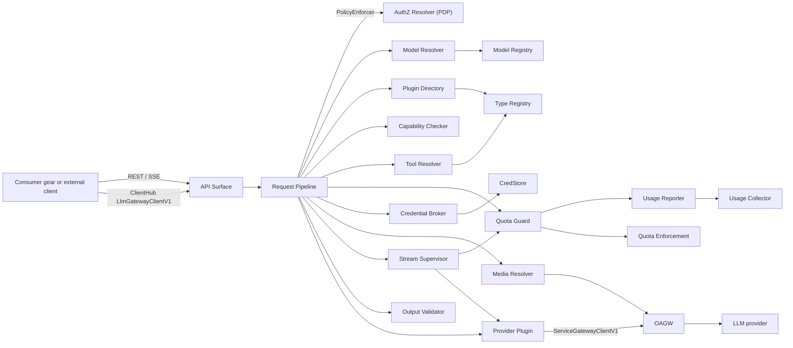

#### API Surface

- [ ] `p1` - **ID**: `cpt-cf-llm-gateway-component-api-surface-v1`

##### Why this component exists

Consumers reach the Gateway two ways: in-process gears through ClientHub and external clients through REST. Both must see the same contract and the same errors.

##### Responsibility scope

Registers REST operations through `OperationBuilder` (§ 3.3) with authentication, OpenAPI schemas, and declared Problem responses. Converts REST DTOs to SDK models and back. Chooses JSON or SSE framing from the `stream` flag; frames SSE events with `event` and `data` lines and closes with the `[DONE]` sentinel. Registers the local client implementing `LlmGatewayClientV1` in ClientHub at `init`. Maps domain errors to canonical errors and RFC 9457 Problems. Creates the per-request cancellation token and cancels it when the HTTP connection or the SDK stream is dropped.

##### Responsibility boundaries

Does not implement business rules, does not call dependencies, does not host an HTTP server (api-gateway owns it), and adds no transport middleware (CORS, compression, body limits). Request IDs and tracing at the HTTP edge come from api-gateway.

##### Related components (by ID)

- `cpt-cf-llm-gateway-component-request-pipeline-v1` — calls (create response, embeddings)

#### Request Pipeline

- [ ] `p1` - **ID**: `cpt-cf-llm-gateway-component-request-pipeline-v1`

##### Why this component exists

Every operation shares the same ordered governance steps. One orchestrator keeps the order, the fail-closed rules, and traceability consistent across chat, streaming, embeddings, and media input.

##### Responsibility scope

Allocates the response `id` first. Runs the per-operation authorization check through the platform `PolicyEnforcer` (§ 3.3) and acquires an in-flight slot (§ 4.5). Rejects `item_reference` input items and requests for unsupported capabilities (§ 3.3). Resolves the model, selects the plugin, resolves tool schemas, then runs the capability, parameter, and structured output schema checks; only then runs quota admission, credential resolution, and media resolution as one concurrent step; dispatches to the plugin only after all succeed. If admission fails, the fetched key is dropped unused; if credential or media resolution fails after a lease was acquired, the lease is released. For sync calls runs output validation, attaches `ignored_parameters`, and hands the terminal outcome to the Quota Guard for settle (the Quota Guard then passes usage to the Usage Reporter). For streaming calls hands the plugin stream to the Stream Supervisor. Converts every failure to a NormalizedError with the response `id`. Opens one trace span per stage.

##### Responsibility boundaries

Does not translate to provider formats, does not compute cost, does not talk to providers, and does not retry provider calls. Does not persist anything.

##### Related components (by ID)

- `cpt-cf-llm-gateway-component-model-resolver-v1` — depends on (model info)
- `cpt-cf-llm-gateway-component-plugin-directory-v1` — depends on (plugin selection)
- `cpt-cf-llm-gateway-component-capability-checker-v1` — calls (capability and parameter policy)
- `cpt-cf-llm-gateway-component-tool-resolver-v1` — calls (tool schemas)
- `cpt-cf-llm-gateway-component-quota-guard-v1` — calls (admission and settle)
- `cpt-cf-llm-gateway-component-credential-broker-v1` — calls (provider key)
- `cpt-cf-llm-gateway-component-media-resolver-v1` — calls (media inputs)
- `cpt-cf-llm-gateway-component-provider-plugin-v1` — calls (dispatch)
- `cpt-cf-llm-gateway-component-stream-supervisor-v1` — delegates streams to
- `cpt-cf-llm-gateway-component-output-validator-v1` — calls (structured output)

#### Model Resolver

- [ ] `p1` - **ID**: `cpt-cf-llm-gateway-component-model-resolver-v1`

##### Why this component exists

Model identity, tenant availability, OAGW upstream alias, secret reference, capabilities, defaults, and pricing are owned by Model Registry. The Gateway needs one adapter that turns a model identifier into model info for the caller's tenant.

##### Responsibility scope

Calls `ModelRegistryClientV1::get_tenant_model` with the caller's `SecurityContext` on every request. Maps "unknown" and "not available for tenant" to `model_not_found` without telling them apart, and Model Registry unavailability to `model_resolution_unavailable`. Returns `ModelInfoV1` unchanged for the plugin.

##### Responsibility boundaries

Holds no cache of its own (Model Registry is cache-first). Does not interpret provider settings. Does not validate settings against schemas (Model Registry does that at registration).

##### Related components (by ID)

- `cpt-cf-llm-gateway-component-request-pipeline-v1` — called by

#### Plugin Directory

- [ ] `p1` - **ID**: `cpt-cf-llm-gateway-component-plugin-directory-v1`

##### Why this component exists

The core must find the plugin for a model's provider type without compile-time knowledge of plugins.

##### Responsibility scope

Registers the `LlmGatewayProviderPluginSpecV1` GTS schema in Type Registry at `init`. Lists registered plugin instances, matches `provider_type` to `ModelInfoV1.gts_type`, breaks ties by `priority`, and resolves the scoped `LlmGatewayProviderPluginClientV1` from ClientHub by the instance GTS id. Caches the instance list and integration capabilities after startup (configuration, not request state). Returns `provider_not_supported` when no plugin matches.

##### Responsibility boundaries

Does not load code dynamically; plugins are compiled into the deployment and register at startup. Does not decide model availability.

##### Related components (by ID)

- `cpt-cf-llm-gateway-component-provider-plugin-v1` — resolves
- `cpt-cf-llm-gateway-component-request-pipeline-v1` — called by

#### Capability Checker

- [ ] `p1` - **ID**: `cpt-cf-llm-gateway-component-capability-checker-v1`

##### Why this component exists

The PRD requires capability and parameter problems to be caught before the provider is called and reported with stable error codes.

##### Responsibility scope

Derives required capabilities from the request (streaming, image and file input, function calling, `cf_gears:web_search`, reasoning options, structured output, embeddings) and checks them against `ModelInfoV1.capabilities`, `disabled_capabilities`, `supported_api`, and the plugin's integration capabilities; failure returns `capability_not_supported`, as does any request for a capability that the resolved model or this gear does not support (§ 3.3). Applies the parameter policy: applies the model's `default_parameters`; when the model's `allow_parameter_override` is true, request values override those defaults, and when it is false, a request value for a parameter that has a model default is not applied, the default is used, and the parameter is listed in `ignored_parameters`; determines which generic parameters the resolved model supports from the provider rules kept in the core (per provider type and model); rejects unsupported ones with `unsupported_parameter` unless `drop_unsupported_params` is set; always drops unsupported cache-control hints; never drops `dimensions`; gates provider-specific parameters by the model's `allow_extra_params`. Runs after tool resolution, so `tool_choice` is validated against the resolved function set; validates provider tool prefixes against the plugin namespace (`validation_error`). Checks, from the same provider rules, that the structured output schema can be expressed in the provider's JSON Schema subset, and returns `unsupported_schema` naming the construct otherwise. Produces the effective request and the `ignored_parameters` list. All of these checks complete before quota admission and credential retrieval, so no lease is acquired and no key is fetched for a request that is certain to fail.

##### Responsibility boundaries

Does not adapt JSON schemas to provider subsets (plugin) and does not resolve GTS tool schemas (Tool Resolver).

##### Related components (by ID)

- `cpt-cf-llm-gateway-component-provider-plugin-v1` — depends on (integration capabilities)
- `cpt-cf-llm-gateway-component-request-pipeline-v1` — called by

#### Tool Resolver

- [ ] `p1` - **ID**: `cpt-cf-llm-gateway-component-tool-resolver-v1`

##### Why this component exists

Function tools can be given as a GTS reference or an inline GTS schema. Plugins need plain JSON schemas.

##### Responsibility scope

Resolves `reference` tools through Type Registry and inline GTS schemas (including their GTS `$ref`s) into the unified function tool form. Returns `schema_not_found` for unresolvable references. Keeps Gateway tools and provider tools untouched.

##### Responsibility boundaries

Does not validate tool call arguments returned by the model and does not execute tools.

##### Related components (by ID)

- `cpt-cf-llm-gateway-component-request-pipeline-v1` — called by

#### Credential Broker

- [ ] `p1` - **ID**: `cpt-cf-llm-gateway-component-credential-broker-v1`

##### Why this component exists

Provider keys are the most sensitive data the Gateway handles. Key retrieval must happen in one place, outside plugins.

##### Responsibility scope

Reads the secret reference from the model info and fetches the provider API key from CredStore by that reference under the caller's `SecurityContext`. Returns `credentials_unavailable` when CredStore fails or the referenced secret is missing. Returns the key in a secret wrapper for the provider call context. For models without a secret reference it returns no key and performs no CredStore call.

##### Responsibility boundaries

Does not cache keys across requests, does not inject keys into HTTP requests (the plugin does), does not choose the provider destination (the model's OAGW upstream alias does), and does not configure OAGW upstreams.

##### Related components (by ID)

- `cpt-cf-llm-gateway-component-request-pipeline-v1` — called by
- `cpt-cf-llm-gateway-component-provider-plugin-v1` — supplies the provider key to

#### Quota Guard

- [ ] `p1` - **ID**: `cpt-cf-llm-gateway-component-quota-guard-v1`

##### Why this component exists

The PRD requires the AI credit quota to be checked before execution through Quota Enforcement, never bypassed. A read-only check cannot hold under concurrent load, because many requests pass it before any of them is counted. A lease reserves the request's upper-bound cost at admission, so concurrent requests compete for the same remaining quota, and the actual cost replaces the reservation at the terminal state.

##### Responsibility scope

Integrates with Quota Enforcement through `QuotaEnforcementClientV1` on the AI credit metric (a metric registered as quota-gated, § 4.10). Holds at most one lease per request, keyed by the response `id`.

`admit` runs before dispatch, in the concurrent step with credential and media resolution, after the capability, parameter, and schema checks (§ 3.2 Request Pipeline):

- Amount: the request's upper-bound cost. The Quota Guard computes it locally, without I/O, from the provider rules kept in the core: estimated input tokens plus the maximum output the request allows, priced from the pricing in the model's provider settings. The maximum output is `max_output_tokens` when the request sets it, otherwise the model's output limit from model info, otherwise the fallback output allowance from gear configuration (§ 4.5). For embeddings the amount is the estimated input only. The Quota Guard converts the AI credits to the metric's integer unit, rounding up.
- Call: `acquire_lease` under the caller's `SecurityContext`, with attribution tenant and subject (user) of the request and the request metadata required by the metric's request contract (for example model and provider type; the contract is settled with the metric registration, § 4.10), the amount, a TTL, and an idempotency key derived from the response `id`.
- TTL: the request's maximum duration (sync provider call timeout for sync calls and embeddings, maximum stream duration for streams) plus a settle margin from gear configuration. The configured values must fall inside the operator's lease TTL window in Quota Enforcement (`min_lease_ttl`, `max_lease_ttl`).
- Outcomes:
  - `Acquired`: the request is admitted and the Quota Guard keeps the lease token and its expiry for settle.
  - `Denied` with reason `NO_APPLICABLE_QUOTA`: no quota applies to the tenant, and the request is admitted without a lease. This is a design choice (§ 4.10).
  - `Denied` with any other reason: `quota_exceeded`. The violated quota ids are logged with the response `id`, not returned to the consumer.
  - Quota Enforcement unreachable, timed out, or failing; in-flight lease limit reached for the tenant and metric (`LEASE_INFLIGHT_LIMIT_EXCEEDED`); lease contention timeout (`LEASE_CONTENTION_TIMEOUT`): `quota_check_unavailable` (retryable). The check fails closed and the provider is not called.
  - Quota Enforcement refuses the attribution (PDP denial): `permission_denied`.
  - Other rejections (TTL out of bounds, metric not quota-gated or not registered, metadata rejected by the metric contract, idempotency payload mismatch): `internal`, logged as a configuration or contract fault. The request is not dispatched.

`settle` runs at the terminal state of an admitted request that holds a lease: completed, incomplete, failed after dispatch, cancelled by consumer disconnect or timeout, or cut at shutdown.

- Commit: `commit_lease` with `actual_amount` equal to the AI credit quantity the Usage Reporter records for the same request (§ 3.2 Usage Reporter), converted to the metric's integer unit and rounded up, capped at the reserved amount.
- Overrun: when the actual quantity exceeds the reserved amount, the Quota Guard commits the reserved amount and logs the overrun with the response `id`, the reserved amount, and the actual amount. The Usage Reporter still records the full actual quantity.
- Release: when the actual quantity is 0, the Quota Guard calls `release_lease`. It also calls `release_lease` when the request fails before dispatch after a lease was acquired (credential or media resolution failure, shutdown before dispatch).
- Execution: settle never blocks the consumer. It runs in the background under the gear's own service (S2S) identity, the same identity as usage delivery (§ 3.2 Usage Reporter), and passes the tenant explicitly (`tenant_id` and the lease token). The settle call has its own idempotency key derived from the response `id` and is retried with backoff on transient failures until it succeeds or the lease expires. When the lease is no longer active (`LEASE_NOT_ACTIVE`) or expires before settle completes, Quota Enforcement auto-releases the hold, and the Quota Guard logs the settle failure with the response `id`.
- Order with usage: after settle completes, or is abandoned as above, the Quota Guard hands the usage of a dispatched request to the Usage Reporter. The Usage Collector record of a request therefore never precedes the settle of its lease. A request admitted without a lease goes to the Usage Reporter at once.

##### Responsibility boundaries

Does not own quotas, quota policies, or quota counters (Quota Enforcement does). Computes the reservation estimate itself; the actual cost of a dispatched call comes from the plugin. Does not block the response on settle. Does not report usage to Usage Collector (the Usage Reporter does), and Usage Collector records are not an input to Quota Enforcement.

##### Related components (by ID)

- `cpt-cf-llm-gateway-component-request-pipeline-v1` — called by (admission and settle)
- `cpt-cf-llm-gateway-component-stream-supervisor-v1` — called by (settle at stream terminal state)
- `cpt-cf-llm-gateway-component-provider-plugin-v1` — depends on (actual AI credits)
- `cpt-cf-llm-gateway-component-usage-reporter-v1` — hands usage to after settle

#### Media Resolver

- [ ] `p1` - **ID**: `cpt-cf-llm-gateway-component-media-resolver-v1`

##### Why this component exists

Providers differ in how they accept media. Some take URLs, some need bytes.

##### Responsibility scope

Handles image and file input parts. Leaves base64 and external URLs as they are when the plugin's media input mode is URL forwarding; when the plugin requires bytes, fetches external URLs through the egress interface and returns `media_not_found` on fetch or decode failure. Media fetch policy (design assumption; the PRD does not define one):

- Fetches use a dedicated media egress route configured in the egress layer (an OAGW route for public media, or the equivalent policy in the plain HTTP substitute); provider upstreams are never used for media. The route enforces the address, redirect, and limit rules below; the Media Resolver applies the scheme rule before calling it. When no media egress route is configured, the Capability Checker rejects URL input for a plugin that requires bytes with `capability_not_supported`.
- Only `https` URLs without user info are accepted; other schemes are rejected before any network call.
- Only public addresses are reachable: loopback, RFC 1918 private, carrier-grade NAT, link-local (including cloud metadata addresses such as `169.254.169.254`), IPv6 unique-local and link-local, multicast, and unspecified addresses are blocked. The check applies to the address actually connected to, after DNS resolution, so DNS rebinding cannot bypass it.
- Redirects are not followed; a redirect response is a fetch failure.
- Response size, content type (image and document types allowed by the capability being used), and fetch timeout are bounded by gear configuration (§ 4.5).
- A blocked or failed fetch returns `media_not_found` without saying which rule failed, so the error cannot be used to probe internal networks.

##### Responsibility boundaries

Does not transcode media, does not inspect media content beyond type and size, and does not store media. Never fetches URLs with a private HTTP client.

##### Related components (by ID)

- `cpt-cf-llm-gateway-component-request-pipeline-v1` — called by
- `cpt-cf-llm-gateway-component-provider-plugin-v1` — depends on (media input mode)

#### Provider Plugin

- [ ] `p1` - **ID**: `cpt-cf-llm-gateway-component-provider-plugin-v1`

##### Why this component exists

Provider APIs differ in request shape, streaming format, schema support, errors, stop reasons, pricing, and usage reporting. Plugins isolate these differences behind one trait.

##### Responsibility scope

At startup registers its GTS plugin instance and scoped client, and publishes its provider settings schema (including pricing) in Type Registry so Model Registry can validate model settings. Per call: narrows `ModelInfoV1` to its typed settings; applies defaults and allowed provider-specific settings; maps reasoning config, tool choice, `cf_gears:web_search`, provider tools, and cache-control hints; at call time adapts the structured output schema to the provider subset (schemas the subset cannot express are already rejected by the Capability Checker); sets the provider key on the request; sends the request through OAGW to the model's upstream alias (`provider_settings.oagw_alias`) and maps an alias that does not resolve to an upstream enabled for the tenant to `unapproved_destination`; parses responses and SSE into SDK models; maps stop reasons and errors to normalized values with provider originals; converts embedding encoding when needed; captures `provider_request_id`; computes cost in AI credits from model pricing; reacts to the cancellation token.

##### Responsibility boundaries

Does not resolve models, check or settle quotas, fetch credentials, report usage, persist anything, retry provider calls, or call anything other than OAGW and Type Registry (registration only). Does not use third-party provider SDKs.

##### Related components (by ID)

- `cpt-cf-llm-gateway-component-plugin-directory-v1` — registered in
- `cpt-cf-llm-gateway-component-request-pipeline-v1` — called by
- `cpt-cf-llm-gateway-component-stream-supervisor-v1` — produces streams for

#### Stream Supervisor

- [ ] `p1` - **ID**: `cpt-cf-llm-gateway-component-stream-supervisor-v1`

##### Why this component exists

Streams fail in more ways than sync calls: provider omits a stop event, the connection breaks, the consumer leaves. The PRD requires one terminal event, incomplete usage, and upstream cancellation in all these cases.

##### Responsibility scope

Wraps the plugin stream. Emits `response.created` and `response.in_progress`, renumbers `sequence_number`, relays deltas through a bounded channel (backpressure; capacity from gear configuration, § 4.5), and tracks whether a terminal event was seen, the last provider usage seen, and the output relayed so far (for the incomplete-usage estimate). Enforces the stream idle timeout and maximum stream duration (§ 4.5): on expiry it cancels the request token and ends the stream with `response.failed` (`provider_unavailable`) and incomplete usage. Synthesizes `response.completed` when the provider ends normally without one, and `response.failed` with the normalized category and incomplete usage when the stream breaks. Converts a provider `error` event into the terminal `response.failed` and never emits a standalone `error` event. Drops anything after the terminal event. On consumer disconnect, cancels the request token so the plugin stream and OAGW connection close, and reports usage marked incomplete, with the quantity set by the incomplete-usage policy of the Usage Reporter. At every terminal state hands the AI credit quantity to the Quota Guard, which settles the lease and then passes the usage to the Usage Reporter. For `json_schema` output, accumulates the final text and validates it before emitting the terminal event (failure turns into `response.failed` with `output_validation_error`). Logs stream aborts with the reason and the response `id`.

##### Responsibility boundaries

Does not translate provider events (plugin) and does not buffer the whole stream except the text needed for structured output validation.

##### Related components (by ID)

- `cpt-cf-llm-gateway-component-provider-plugin-v1` — consumes streams from
- `cpt-cf-llm-gateway-component-output-validator-v1` — calls
- `cpt-cf-llm-gateway-component-quota-guard-v1` — hands terminal usage to (settle, then usage reporting)
- `cpt-cf-llm-gateway-component-request-pipeline-v1` — called by

#### Output Validator

- [ ] `p1` - **ID**: `cpt-cf-llm-gateway-component-output-validator-v1`

##### Why this component exists

Plugins may relax a schema to fit the provider subset. The consumer's original constraints must still hold.

##### Responsibility scope

Validates the model's structured output against the original request schema with a standard JSON Schema validator. Returns `output_validation_error` with validation details (paths and failed keywords, no content values).

##### Responsibility boundaries

Does not repair or retry output and does not validate free text responses.

##### Related components (by ID)

- `cpt-cf-llm-gateway-component-request-pipeline-v1` — called by
- `cpt-cf-llm-gateway-component-stream-supervisor-v1` — called by

#### Usage Reporter

- [ ] `p1` - **ID**: `cpt-cf-llm-gateway-component-usage-reporter-v1`

##### Why this component exists

Usage must reach Usage Collector at least once per request without blocking the consumer, and without the Gateway persisting usage records.

##### Responsibility scope

Builds one UsageRecord per terminal request state (completed, incomplete, failed after dispatch, disconnected) with tenant and user (subject) as explicit attribution, model, AI credit quantity, completeness flag, optional labeled estimate, `provider_request_id`, and idempotency key equal to the response `id`. Receives the usage of a request from the Quota Guard after the settle of its lease completes or is abandoned (at once for a request admitted without a lease), so the record is emitted only after the Quota Enforcement settle for the same request. Delivers asynchronously in batches through `UsageCollectorClientV1::create_usage_records`, retrying transient failures with backoff from a bounded in-memory buffer; treats idempotent replays as success. Drains the buffer during graceful shutdown within the gear stop timeout. Logs delivery failures with the response `id`.

AI credit quantity per terminal state (interim policy, design assumption pending the PRD open question on budget edge cases, § 4.10). Quantities from provider usage are computed by the plugin with the call's cost; estimates for requests without final provider usage are computed by the core from the provider rules and the pricing in the model's provider settings. The Usage Reporter only records them. The same values appear in the `usage` of the Response or terminal event when one is sent, and the Quota Guard commits the same quantity, capped at the reserved amount (§ 3.2 Quota Guard).

| Terminal state | Quantity | `complete` | `estimate` |
|----------------|----------|------------|------------|
| Provider reported final usage (completed, or incomplete by stop reason such as output token limit) | Plugin cost from provider usage | true | false |
| Failed after dispatch with a provider error response | Plugin cost from provider usage if the error carries it, otherwise 0 | true | false |
| No final provider usage: stream broke, consumer disconnected, stream or sync call timed out, instance shutdown cut the request | Core estimate: estimated input tokens plus output relayed so far (or the last partial provider usage seen, whichever is higher), priced from the model's provider settings | false | true |
| Same as above, but no estimate can be made (no token counting or pricing rule for the provider) | 0 | false | false |

Delivery identity: the Usage Reporter calls Usage Collector under the gear's own service (S2S) identity, obtained through the platform client-credentials exchange (`exchange_client_credentials`), and passes the tenant and subject (user) of each request explicitly as attribution on its record. It keeps no caller `SecurityContext` after the request ends. Usage Collector authorizes, through its PDP, the tenants and subjects the gear may report for.

##### Responsibility boundaries

Does not compute cost, does not report raw token counts to Usage Collector, and does not persist records. A hard instance crash loses records still in the buffer; this residual gap is tracked in § 4.10.

##### Related components (by ID)

- `cpt-cf-llm-gateway-component-quota-guard-v1` — receives usage from (after settle)

### 3.3 API Contracts

The gear exposes three contracts: the REST API for external consumers, the in-process consumer SDK client, and the provider plugin SDK interface. All three use the same Open Responses aligned models from `llm-gateway-sdk`.

- [ ] `p1` - **ID**: `cpt-cf-llm-gateway-interface-rest-api-v1`

- **Contracts**: no PRD contract ID; the contract is the Open Responses request, response, and streaming model in `llm-gateway-sdk`, plus the Gateway extensions listed below
- **Technology**: REST/OpenAPI over api-gateway, SSE (`text/event-stream`) for streaming
- **Location**: OpenAPI generated by api-gateway from `OperationBuilder` registrations; models in [llm-gateway-sdk/src/models](../llm-gateway-sdk/src/models)

**Endpoints Overview**:

Paths are relative to the api-gateway prefix (deployment `prefix_path`, empty by default).

| Method | Path | Description | Stability |
|--------|------|-------------|-----------|
| `POST` | `/llm-gateway/v1/responses` | Create a response. `stream=false`: `200` JSON Response. `stream=true`: `200` SSE stream of StreamingEvents. | stable (P1) |
| `POST` | `/llm-gateway/v1/embeddings` | Generate embeddings | stable (P1) |

**Operation registration**:

- Every operation is registered through `OperationBuilder` with `.authenticated()`, an `operation_id` following `<crate>.<resource>.<action>` (`llm_gateway.responses.create`, `llm_gateway.embeddings.create`), typed JSON request schemas, typed success responses, and `.standard_errors(...)` plus the Gateway-specific Problem responses from § 4.1 (`501`, `503`).
- `llm_gateway.responses.create` declares two success media types on one operation: `application/json` (Response) and `text/event-stream` (StreamingEvent). The handler selects by the `stream` flag.
- The service is attached once with `Extension<Arc<Service>>` after all routes. Handlers take `Extension<SecurityContext>` and pass it to the pipeline unchanged.
- Authorization: the platform authenticates every route. The Request Pipeline then runs one PEP check per operation through the platform `PolicyEnforcer` (`authz-resolver-sdk`), before any other dependency call, for both REST and SDK entry points. Resource type: one LLM Gateway resource type scoped by `OWNER_TENANT_ID` (the caller's tenant; GTS identifier settled with the GTS identifiers question, § 4.10). Actions: `create_response` (sync and streaming) and `create_embedding`. A PDP denial returns `permission_denied` (403, § 4.1); PDP evaluation failure fails closed per the platform PEP error mapping. The PRD delegates authorization to platform middleware and names no resource types or actions, so this resource type and these actions are a design assumption. Model availability per tenant stays with Model Registry.

**Wire behavior**:

- Requests that ask for capabilities the resolved model or this gear does not support are rejected before dispatch with `capability_not_supported` (§ 4.1).
- Errors before the first byte of a response (all pre-dispatch failures, sync provider failures) are RFC 9457 Problems (`application/problem+json`) built from the canonical error model. The Problem carries the Open Responses `code`, `param` when known, provider details for provider categories, `retry_after` when available, and the response `id` (§ 4.1).
- Errors after an SSE stream has started are delivered in-band as exactly one terminal `response.failed` event with the same `code`; the HTTP status is already `200`. After `200` the Gateway never emits a standalone `error` event: a provider `error` event is converted into `response.failed`.
- Problems never contain provider keys, request content, or internal error chains. `Internal` errors expose only a generic message and the response `id`.
- Gateway extensions (additive to Open Responses): `drop_unsupported_params` (request), `ignored_parameters` (response), provider details with original stop reason and `provider_request_id` (response), usage extensions (AI credit cost, provider raw usage, completeness and estimate flags), `input_type` (embeddings), and Gateway-owned tool types, item types, and stream events.
- Gateway namespace: Gateway-owned tool types, item types, and stream events use the `cf_gears:` prefix (for example the `cf_gears:web_search` tool and the `cf_gears:response.data.done` event), so they cannot collide with Open Responses or provider names; Gateway extension fields on Open Responses objects (the fields listed above) are additive optional fields defined in the SDK models. Provider-specific tools and items keep their provider prefix (`<provider>:<tool>`).
- Request model: the request carries no `previous_response_id`, `store`, or `background` fields, so stateful and background features cannot be requested; unknown top-level fields are not part of the contract and are ignored on deserialization; provider-specific parameters travel in `extra_fields`, gated by the model's `allow_extra_params`.
- Sync calls can run longer than the platform's default handler duration guideline; this is a recorded deviation (§ 4.9). Long generations should use streaming.

- [ ] `p1` - **ID**: `cpt-cf-llm-gateway-interface-client-sdk-v1`

- **Contracts**: no PRD contract ID; `LlmGatewayClientV1` in `llm-gateway-sdk` (PRD § 7)
- **Technology**: Rust trait resolved from ClientHub (in-process; same trait for an out-of-process client)
- **Location**: [llm-gateway-sdk/src/api.rs](../llm-gateway-sdk/src/api.rs)

**Endpoints Overview**:

| Method | Path | Description | Stability |
|--------|------|-------------|-----------|
| `create_response` | `LlmGatewayClientV1` | Sync create response; returns Response or `LlmGatewayError` | stable (P1) |
| `create_response_stream` | `LlmGatewayClientV1` | Streaming create response; pre-stream failures as `Err`, later failures in-band as `response.failed`; dropping the stream cancels the request | stable (P1) |
| `create_embedding` | `LlmGatewayClientV1` | Embeddings | stable (P1) |

- [ ] `p1` - **ID**: `cpt-cf-llm-gateway-interface-provider-plugin-v1`

- **Contracts**: no PRD contract ID; `LlmGatewayProviderPluginClientV1` and `LlmGatewayProviderPluginSpecV1` in `llm-gateway-sdk` (PRD § 7)
- **Technology**: Rust trait registered as a scoped ClientHub client keyed by the plugin's GTS instance id; GTS plugin instance and provider settings schema in Type Registry
- **Location**: [llm-gateway-sdk/src/plugin_api.rs](../llm-gateway-sdk/src/plugin_api.rs), [llm-gateway-sdk/src/gts.rs](../llm-gateway-sdk/src/gts.rs)

**Endpoints Overview**:

| Method | Path | Description | Stability |
|--------|------|-------------|-----------|
| `capabilities` | `LlmGatewayProviderPluginClientV1` | Local call: integration capabilities: streaming transport, media input mode, mapping of `cf_gears:web_search` to a native provider tool | stable (P1) |
| `create_response` | `LlmGatewayProviderPluginClientV1` | Sync call with the provider call context (model info, response `id`, optional provider API key, cancellation token); adapts the structured output schema to the provider subset; returns the normalized Response with usage and AI credits | stable (P1) |
| `create_response_stream` | `LlmGatewayProviderPluginClientV1` | Streaming call; failures in-band as `response.failed`; stops on cancellation token or when the stream is dropped | stable (P1) |
| `create_embedding` | `LlmGatewayProviderPluginClientV1` | Embeddings; converts vectors to the requested `encoding_format` when the provider cannot | stable (P1) |

The plugin trait carries no pre-dispatch or estimation calls. Per-model parameter support, the check that a structured output schema is expressible in the provider subset (`unsupported_schema`), the quota lease amount, and the usage estimate for requests that ended without final provider usage are computed by the Gateway service before quota admission and credential retrieval, or at the terminal state, not through `LlmGatewayProviderPluginClientV1`.

### 3.4 Internal Dependencies

All calls go through SDK clients resolved from ClientHub. Request-path calls carry the caller's `SecurityContext`, including tool GTS schema resolution through `TypesRegistryApi` and quota admission (`acquire_lease`). Quota settle (`commit_lease`, `release_lease`) and usage delivery run in the background after the request ends, under the gear's own service identity with the tenant passed explicitly: in the settle call (§ 3.2 Quota Guard), and with tenant and subject as attribution on each usage record (§ 3.2 Usage Reporter). Registration of the plugin spec schema, plugin instances, and provider settings schemas, and the plugin instance listing behind the Plugin Directory cache, use `PlatformTypesRegistryApi` with `PlatformSecurityContext`. These are the only calls not made with a request's context.

| Dependency Gear | Interface Used | Purpose |
|-------------------|----------------|----------|
| Model Registry | `ModelRegistryClientV1::get_tenant_model` | Resolve model info per tenant on every request. Model info carries the provider `gts_type`, provider model id, the OAGW upstream alias (`provider_settings.oagw_alias`), the secret reference of the provider API key, capabilities, `default_parameters`, `allow_parameter_override`, `allow_extra_params`, and provider settings with pricing; provider settings are validated against the schemas that plugins publish in Type Registry |
| Type Registry | `PlatformTypesRegistryApi` with `PlatformSecurityContext`; `TypesRegistryApi` | `PlatformTypesRegistryApi`: register the plugin spec schema (core) and plugin instances and settings schemas (plugins), and list plugin instances. `TypesRegistryApi`: resolve tool GTS schemas at request time under the caller's context |
| OAGW | `ServiceGatewayClientV1` (`proxy_request`) | Only egress path for provider calls (to the model's upstream alias) and external media fetches; circuit breaking |
| CredStore | `CredStoreClientV1::get` | Fetch the provider API key by the secret reference in the model info |
| Quota Enforcement | `QuotaEnforcementClientV1` (`acquire_lease`, `commit_lease`, `release_lease`) | Pre-dispatch AI credit lease for the request's upper-bound cost under the caller's context; settle at the terminal state (commit of the actual AI credits capped at the reservation, or release) under the gear's service identity with explicit tenant |
| Usage Collector | `UsageCollectorClientV1::create_usage_records` | At-least-once delivery of AI credit usage records under the gear's service identity, with explicit tenant and subject attribution per record |
| AuthZ Resolver | `PolicyEnforcer` (`authz-resolver-sdk`) | Per-operation PEP check (`create_response`, `create_embedding`) before any other dependency call |
| api-gateway | Route registration through `OperationBuilder` | REST hosting, authentication, OpenAPI |

**Dependency Rules** (per project conventions):
- No circular dependencies
- Always use sdk modules for inter-gear communication
- No cross-category sideways deps except through contracts
- Only integration/adapter gears talk to external systems
- `SecurityContext` must be propagated across all in-process calls (quota settle, usage delivery, and Type Registry registration and listing use the contexts stated above)

### 3.5 External Dependencies

External systems, databases, and third-party services this gear interacts with. Define protocols, data formats, and integration points.

#### LLM Providers

- **Contract**: no PRD contract ID; each provider's public HTTP API, owned and versioned inside the matching provider plugin

| Dependency Gear | Interface Used | Purpose |
|-------------------|---------------|---------|
| Provider plugins (OpenAI and OpenAI-compatible, Anthropic, Google, self-hosted Ollama and vLLM, others) | Provider HTTPS APIs via OAGW `proxy_request`, SSE for streaming | Completions, embeddings, reasoning, tools, web search |

**Dependency Rules** (per project conventions):
- No circular dependencies
- Always use SDK modules for inter-gear communication
- No cross-category sideways deps except through contracts
- Only integration/adapter gears talk to external systems
- `SecurityContext` must be propagated across all in-process calls

### 3.6 Interactions & Sequences

#### Create Response (Sync)

**ID**: `cpt-cf-llm-gateway-seq-create-response-sync-v1`

**Use cases**: `cpt-cf-llm-gateway-usecase-chat-completion-v1`, `cpt-cf-llm-gateway-usecase-vision-v1`, `cpt-cf-llm-gateway-usecase-document-understanding-v1`

**Actors**: `cpt-cf-llm-gateway-actor-consumer`, `cpt-cf-llm-gateway-actor-model-registry`, `cpt-cf-llm-gateway-actor-quota-enforcement`, `cpt-cf-llm-gateway-actor-credstore`, `cpt-cf-llm-gateway-actor-provider-plugin`, `cpt-cf-llm-gateway-actor-oagw`, `cpt-cf-llm-gateway-actor-provider`, `cpt-cf-llm-gateway-actor-usage-collector`

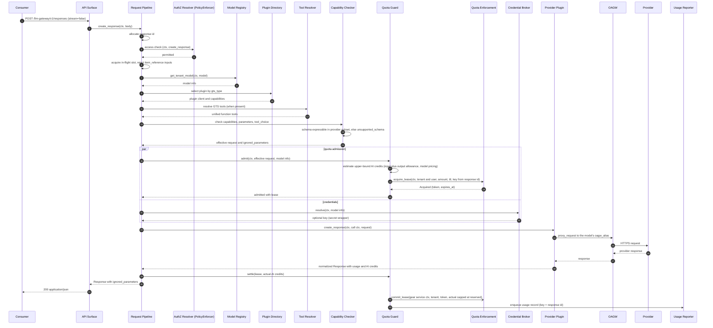

**Description**: The pipeline allocates the response `id`, runs the PEP check (`permission_denied` on denial), acquires an in-flight slot (§ 4.5), resolves the model, selects the plugin, resolves tool schemas, and runs the capability, parameter, and structured output schema checks. Only then do quota admission and credential resolution run concurrently (media resolution joins the same concurrent step when media parts are present); admission denial returns `quota_exceeded` and an unavailable check returns `quota_check_unavailable` (§ 3.6 Admission: Quota), the fetched key is then dropped unused, and a lease already acquired is released when credential or media resolution fails. The plugin translates, calls the provider through OAGW, normalizes the result, and computes cost. Image and document inputs travel as URLs or base64 (Media Resolver prefetches only when the plugin requires bytes; fetch or decode failures return `media_not_found`). Any failure before dispatch returns a Problem without calling the provider. Provider failures return the normalized category with provider details; usage is reported for every dispatched call. After the response is returned, the Quota Guard settles the lease in the background and only then hands the usage record to the Usage Reporter.

#### Credential Resolution

**ID**: `cpt-cf-llm-gateway-seq-credential-resolution-v1`

**Use cases**: `cpt-cf-llm-gateway-usecase-chat-completion-v1`

**Actors**: `cpt-cf-llm-gateway-actor-oagw`, `cpt-cf-llm-gateway-actor-credstore`, `cpt-cf-llm-gateway-actor-provider-plugin`

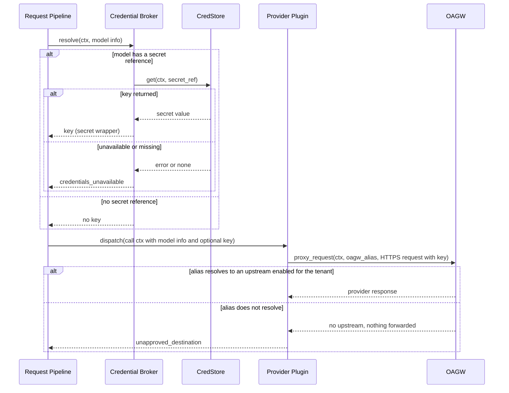

**Description**: The Credential Broker reads the secret reference from the model info and fetches the key from CredStore by that reference; it never chooses a destination. The plugin sends the key only in requests to the model's OAGW upstream alias, over HTTPS, through OAGW; OAGW resolves the alias under the caller's tenant (upstream hierarchy and sharing rules apply) and forwards nothing when no enabled upstream matches, which the plugin reports as `unapproved_destination`. CredStore failure or a missing secret returns `credentials_unavailable` and the provider is not called.

#### Streaming Response

**ID**: `cpt-cf-llm-gateway-seq-streaming-v1`

**Use cases**: `cpt-cf-llm-gateway-usecase-streaming-v1`

**Actors**: `cpt-cf-llm-gateway-actor-consumer`, `cpt-cf-llm-gateway-actor-quota-enforcement`, `cpt-cf-llm-gateway-actor-provider-plugin`, `cpt-cf-llm-gateway-actor-oagw`, `cpt-cf-llm-gateway-actor-provider`, `cpt-cf-llm-gateway-actor-usage-collector`

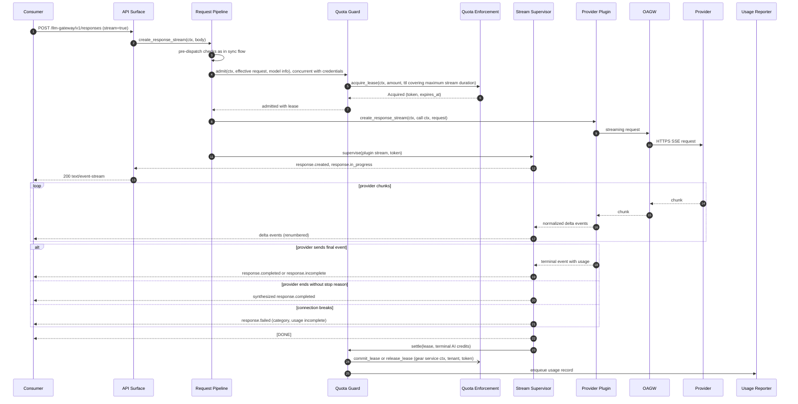

**Description**: Pre-stream failures return a Problem with an HTTP error status. After `200` the supervisor guarantees exactly one terminal event and drops events after it. For `json_schema` output it validates the accumulated text before the terminal event. The lease TTL covers the maximum stream duration (§ 3.2 Quota Guard). Usage from the terminal event (or incomplete usage per the policy in § 3.2 Usage Reporter) settles the lease, committed capped at the reservation or released when 0, and is then reported once.

#### Stream Cancellation on Consumer Disconnect

**ID**: `cpt-cf-llm-gateway-seq-stream-cancellation-v1`

**Use cases**: `cpt-cf-llm-gateway-usecase-streaming-v1`

**Actors**: `cpt-cf-llm-gateway-actor-consumer`, `cpt-cf-llm-gateway-actor-provider-plugin`, `cpt-cf-llm-gateway-actor-oagw`, `cpt-cf-llm-gateway-actor-quota-enforcement`

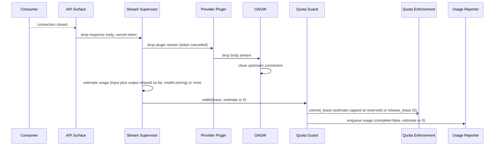

**Description**: Cancellation travels two ways at once: dropping the stream chain (API body → supervisor → plugin stream → OAGW body) and a per-request cancellation token checked by the plugin between reads. Either closes the provider connection. No terminal event is sent because nobody receives it. The lease is settled with the same quantity (committed capped at the reservation, or released when it is 0), and usage is then reported as incomplete with the core's labeled estimate, or 0 credits when no estimate can be made (§ 3.2 Usage Reporter); the Stream Supervisor logs the abort with reason `client_disconnect`.

#### Embeddings

**ID**: `cpt-cf-llm-gateway-seq-embeddings-v1`

**Use cases**: `cpt-cf-llm-gateway-usecase-embeddings-v1`

**Actors**: `cpt-cf-llm-gateway-actor-consumer`, `cpt-cf-llm-gateway-actor-provider-plugin`, `cpt-cf-llm-gateway-actor-provider`

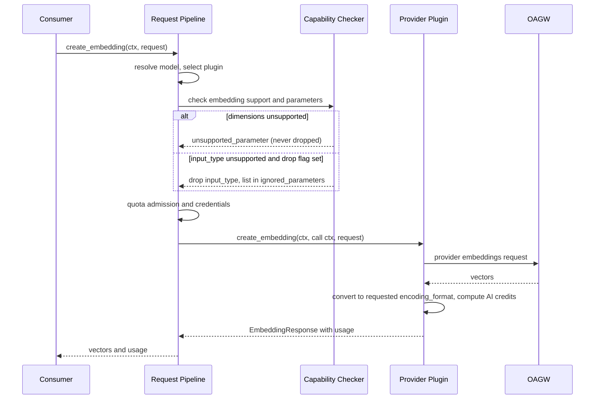

**Description**: The embeddings path reuses the pipeline, including quota admission (lease amount from the estimated input only) and settle. Empty input or input beyond provider limits returns `validation_error`. `encoding_format` is always honored (the plugin converts when the provider cannot), and `dimensions` is either honored exactly or the request is rejected.

#### Tool Calling Round Trip

**ID**: `cpt-cf-llm-gateway-seq-tool-calling-v1`

**Use cases**: `cpt-cf-llm-gateway-usecase-tool-calling-v1`

**Actors**: `cpt-cf-llm-gateway-actor-consumer`, `cpt-cf-llm-gateway-actor-type-registry`, `cpt-cf-llm-gateway-actor-provider`

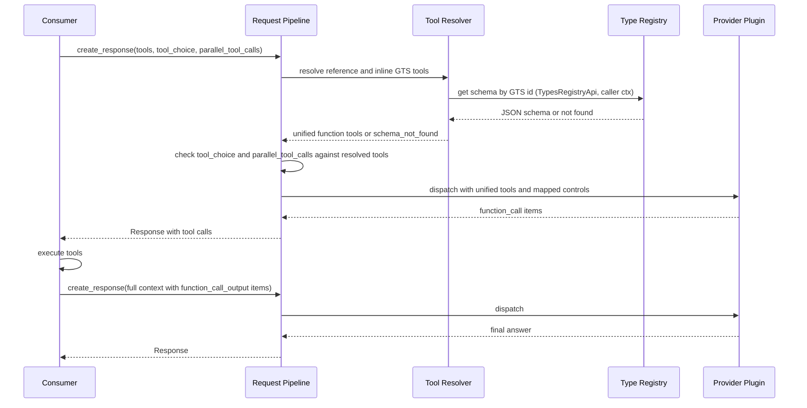

**Description**: The Gateway resolves schemas but never executes tools. Tool resolution precedes the `tool_choice` check, so `tool_choice` may name a function defined by a GTS reference; `tool_choice` naming a function absent from the resolved set returns `validation_error`; an unsupported `tool_choice` value or `parallel_tool_calls` setting follows the parameter policy. Partial tool results are forwarded as given. Each round is an independent stateless request with its own response `id` and usage.

#### Structured Output

**ID**: `cpt-cf-llm-gateway-seq-structured-output-v1`

**Use cases**: `cpt-cf-llm-gateway-usecase-structured-output-v1`

**Actors**: `cpt-cf-llm-gateway-actor-consumer`, `cpt-cf-llm-gateway-actor-provider`

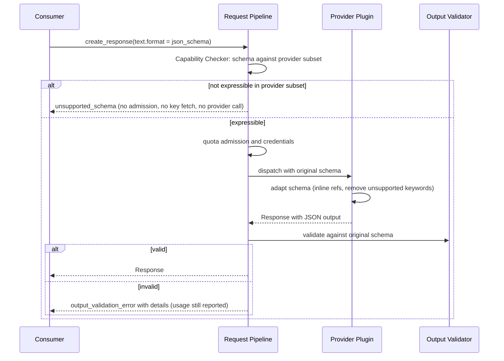

**Description**: Expressibility is decided in the pre-dispatch validation step, before quota admission and credential retrieval. Adaptation never loosens the final result because validation always uses the original schema.

#### Reasoning Continuation

**ID**: `cpt-cf-llm-gateway-seq-reasoning-v1`

**Use cases**: `cpt-cf-llm-gateway-usecase-reasoning-v1`

**Actors**: `cpt-cf-llm-gateway-actor-consumer`, `cpt-cf-llm-gateway-actor-provider-plugin`

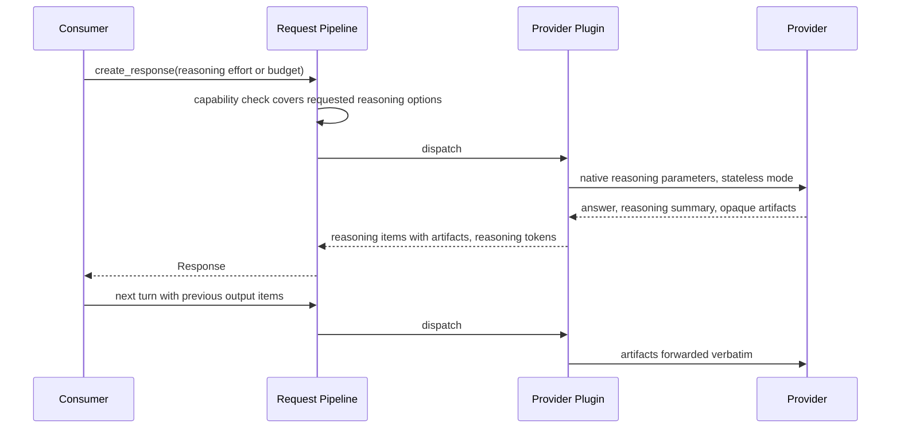

**Description**: Plugins always ask providers for the artifacts needed for stateless continuation (signatures, encrypted reasoning). Artifacts are opaque and provider-bound; a plugin forwards only artifacts its provider issued. An option the model does not support (for example a token budget on an effort-only provider) returns `capability_not_supported`.

#### Web Search and Provider Tools

**ID**: `cpt-cf-llm-gateway-seq-web-search-v1`

**Use cases**: `cpt-cf-llm-gateway-usecase-web-search-v1`

**Actors**: `cpt-cf-llm-gateway-actor-consumer`, `cpt-cf-llm-gateway-actor-provider-plugin`, `cpt-cf-llm-gateway-actor-provider`

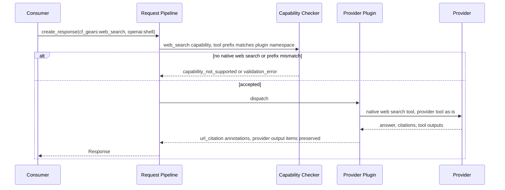

**Description**: The provider runs searches and provider tools. The Gateway normalizes citations and web search results and preserves provider tool outputs as namespaced items.

#### Media Input Resolution

**ID**: `cpt-cf-llm-gateway-seq-media-input-v1`

**Use cases**: `cpt-cf-llm-gateway-usecase-vision-v1`, `cpt-cf-llm-gateway-usecase-document-understanding-v1`

**Actors**: `cpt-cf-llm-gateway-actor-consumer`, `cpt-cf-llm-gateway-actor-oagw`, `cpt-cf-llm-gateway-actor-provider-plugin`

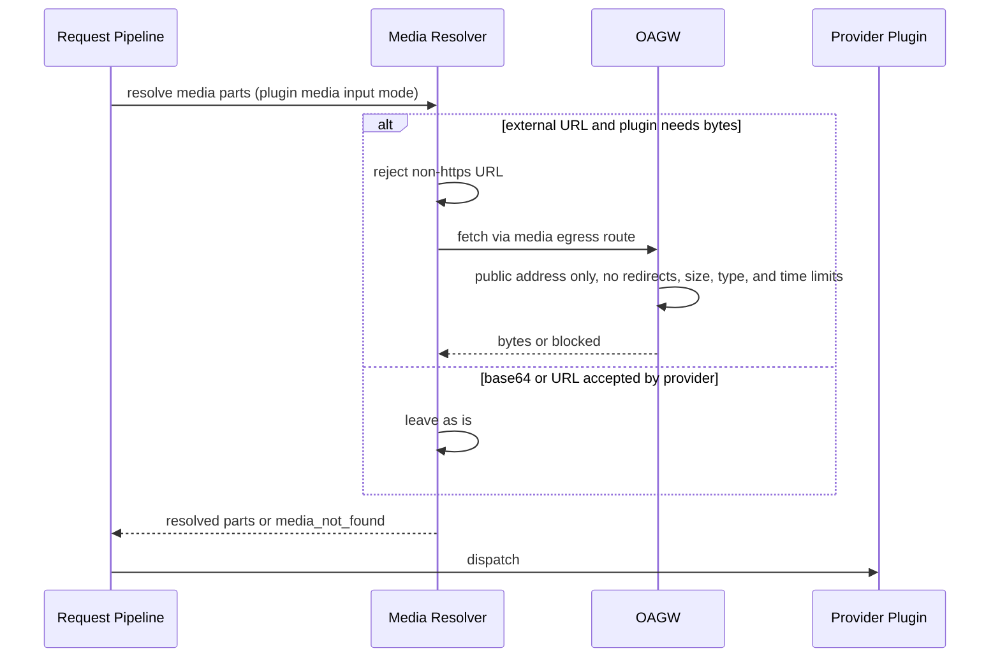

**Description**: The step covers image and document input parts, checked against the `vision` and `file_input` capabilities. Fetches follow the media fetch policy of the Media Resolver (§ 3.2); a blocked or failed fetch returns `media_not_found`.

#### Admission: Quota

**ID**: `cpt-cf-llm-gateway-seq-admission-v1`

**Use cases**: `cpt-cf-llm-gateway-usecase-chat-completion-v1`, `cpt-cf-llm-gateway-usecase-streaming-v1`, `cpt-cf-llm-gateway-usecase-embeddings-v1`

**Actors**: `cpt-cf-llm-gateway-actor-consumer`, `cpt-cf-llm-gateway-actor-quota-enforcement`

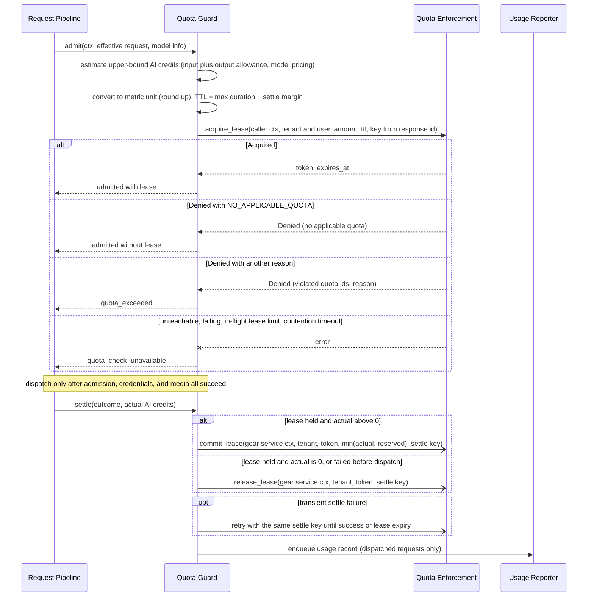

**Description**: Admission is never bypassed: the provider is called only after `acquire_lease` returns `Acquired`, or `Denied` with `NO_APPLICABLE_QUOTA` (no quota applies to the tenant, so there is nothing to hold; design choice, § 4.10). Every other denial returns `quota_exceeded`; an unreachable or failing Quota Enforcement, the in-flight lease limit, and lease contention return `quota_check_unavailable` (fail closed). The lease reserves the request's upper-bound cost, so concurrent requests of a tenant cannot all pass on the same remaining quota. A tenant can still exceed its quota by an overrun, when the actual cost is above the estimate; the commit is capped at the reserved amount, and the overrun is logged and reported in full to Usage Collector, which matches the PRD's statement that consumption can exceed the quota. Settle runs after the response, under the gear's service identity with explicit tenant, and is retried with its idempotency key; a lease that cannot be settled auto-releases at its expiry and the failure is logged (§ 4.4). The usage record of a request is enqueued only after its settle completes or is abandoned.

#### Usage Delivery

**ID**: `cpt-cf-llm-gateway-seq-usage-delivery-v1`

**Use cases**: `cpt-cf-llm-gateway-usecase-chat-completion-v1`, `cpt-cf-llm-gateway-usecase-streaming-v1`

**Actors**: `cpt-cf-llm-gateway-actor-usage-collector`

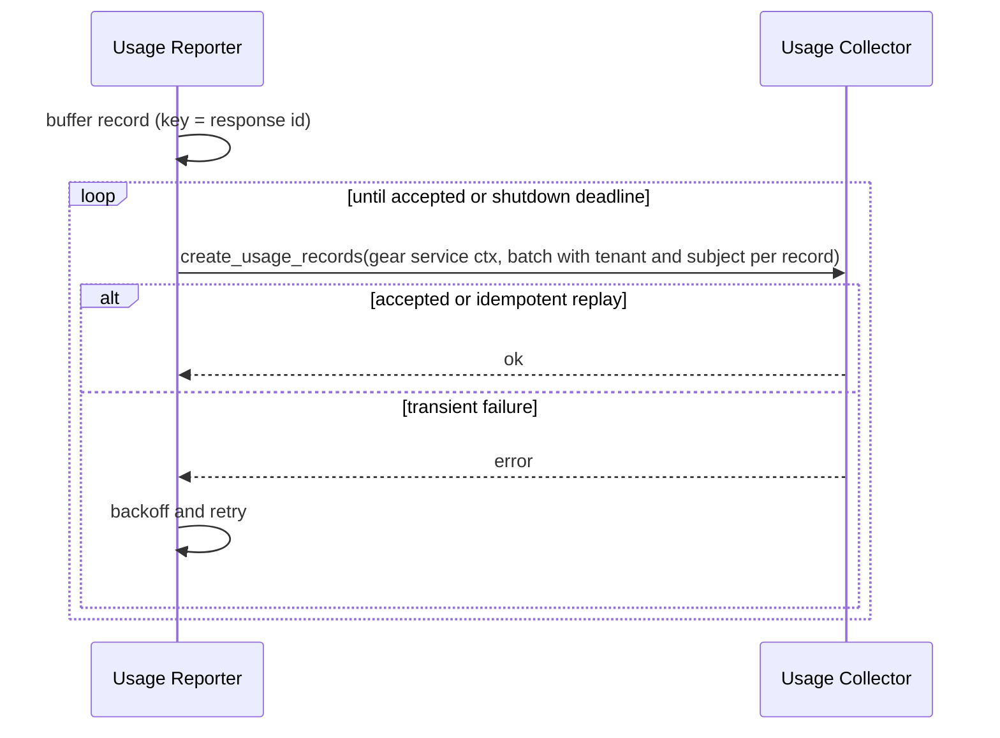

**Description**: Delivery never blocks the consumer. Records arrive from the Quota Guard after the settle of the request's lease (§ 3.2 Quota Guard). Each batch is sent under the gear's service identity obtained through the platform client-credentials exchange, and each record names its tenant and subject explicitly (§ 3.2 Usage Reporter). Duplicates have no extra credit effect because Usage Collector deduplicates by idempotency key. Graceful shutdown drains the buffer within the stop timeout; records left after the deadline are logged with their response `id`.

#### Provider Plugin Registration

**ID**: `cpt-cf-llm-gateway-seq-plugin-registration-v1`

**Use cases**: `cpt-cf-llm-gateway-usecase-provider-plugin-registration-v1`

**Actors**: `cpt-cf-llm-gateway-actor-provider-plugin`, `cpt-cf-llm-gateway-actor-type-registry`, `cpt-cf-llm-gateway-actor-model-registry`

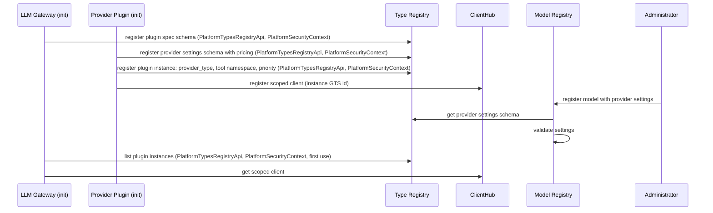

**Description**: Registration and plugin instance listing have no caller, so they use `PlatformTypesRegistryApi` with `PlatformSecurityContext` (§ 3.4); the registered schemas and instances are tenant-neutral. Models with settings that do not match the plugin's schema are rejected by Model Registry. Requests for a registered model route to the plugin whose `provider_type` matches the model's `gts_type`.

### 3.7 Database schemas & tables

Not applicable because the gear persists no data.

### 3.8 Deployment Topology

- [ ] `p1` - **ID**: `cpt-cf-llm-gateway-topology-stateless-instances-v1`

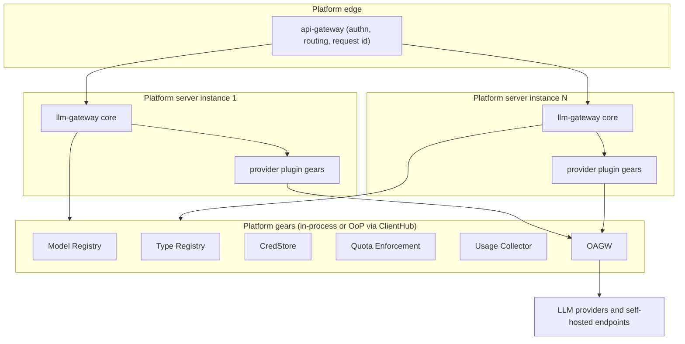

The core and its provider plugins run in the same process (plugins are scoped ClientHub clients). Instances are identical and stateless; api-gateway can route any request to any instance. Dependency gears are resolved through ClientHub, in-process or out-of-process, without design changes. OAGW is the only component with network egress to providers. Zero-downtime rolling restarts rely on graceful shutdown: stop accepting, finish in-flight requests, settle their quota leases, drain the usage buffer, all within the gear stop timeout; streams still open at the drain deadline are ended with `response.failed` (§ 4.5).

## 4. Additional context

### 4.1 Error Handling and Wire Errors

Every error is a NormalizedError in the domain, an `LlmGatewayError` in the SDK, and a canonical error rendered as an RFC 9457 Problem at REST. The Problem `type` is the GTS error type of the canonical category; the Open Responses `code` is an extension member and is the value consumers branch on.

| Code | Raised by | Canonical category | HTTP | Retry |
|------|-----------|--------------------|------|-------|
| `validation_error` (request) | API Surface, Capability Checker, request limits (§ 4.5) | InvalidArgument | 400 | No |
| `permission_denied` | Request Pipeline (PEP check through `PolicyEnforcer`), Quota Guard (Quota Enforcement refuses the quota attribution) | PermissionDenied | 403 | No |
| `unsupported_parameter` | Capability Checker | InvalidArgument | 400 | No |
| `unsupported_schema` | Capability Checker (before quota admission and credential retrieval) | InvalidArgument | 400 | No |
| `capability_not_supported` | Capability Checker, pipeline (`item_reference` input items, unsupported capabilities per § 3.3) | FailedPrecondition | 400 | No |
| `model_not_found` | Model Resolver | NotFound | 404 | No |
| `schema_not_found` | Tool Resolver | NotFound | 404 | No |
| `media_not_found` | Media Resolver | InvalidArgument | 400 | No |
| `provider_not_supported` | Plugin Directory | Unimplemented | 501 | No |
| `unapproved_destination` | Provider Plugin (the model's OAGW alias does not resolve to an upstream enabled for the tenant) | FailedPrecondition | 400 | No |
| `credentials_unavailable` | Credential Broker | ServiceUnavailable | 503 | Yes |
| `model_resolution_unavailable` | Model Resolver | ServiceUnavailable | 503 | Yes |
| `quota_exceeded` | Quota Guard (Quota Enforcement denied the lease) | ResourceExhausted | 429 | After quota reset |
| `quota_check_unavailable` | Quota Guard (Quota Enforcement unreachable, timed out, or failing; in-flight lease limit reached; lease contention timeout) | ServiceUnavailable | 503 | Yes |
| `gateway_unavailable` | Request Pipeline (in-flight limit reached), Stream Supervisor (stream cut at shutdown drain deadline) | ServiceUnavailable | 503 | Yes |
| `output_validation_error` | Output Validator | Aborted | 409 | Yes, at caller's discretion |
| `context_length_exceeded` | Provider Plugin | InvalidArgument | 400 | After trimming input |
| `rate_limited` | Provider Plugin | ResourceExhausted | 429 | After `retry_after` |
| `content_filtered` | Provider Plugin | InvalidArgument | 400 | No |
| `invalid_request` | Provider Plugin | InvalidArgument | 400 | No |
| `authentication_failed` | Provider Plugin | FailedPrecondition | 400 | No (operator action) |
| `provider_unavailable` | Provider Plugin, OAGW circuit open, OAGW unreachable, provider call or stream timeouts (§ 4.5) | ServiceUnavailable | 503 | Yes |
| `provider_error` | Provider Plugin (unmatched) | Unknown | 500 | Depends |
| `internal` | Any | Internal | 500 | Depends |

Rules:

- Provider categories carry `provider_code`, `provider_message` (truncated), and `provider_request_id` when available.
- Provider `authentication_failed` never maps to `401`, because the consumer's own authentication is not at fault.
- Every Problem and `response.failed` event carries the response `id` once it is allocated.
- The PRD defines no codes for authorization denial or Gateway capacity and shutdown; `permission_denied` and `gateway_unavailable` are design additions (assumption). `quota_exceeded` and `quota_check_unavailable` are the PRD's quota-exceeded and quota-check-unavailable errors (UC-001).
- The SSE terminal event uses the same codes. A request blocked before any output is a provider error (`content_filtered`); output stopped by policy is a Response with `status=incomplete` and `incomplete_details.reason=content_filter`.

### 4.2 Security Considerations

- **Authentication and authorization**: all routes are authenticated by api-gateway; the Request Pipeline runs a PEP check per operation through `PolicyEnforcer` before any other dependency call (resource type and actions in § 3.3; denial returns `permission_denied`); model access per tenant is enforced by Model Registry.
- **Tenant isolation**: the caller's `SecurityContext` is propagated to every request-path dependency call, including quota admission; quota settle and usage delivery run under the gear's service identity with the tenant passed explicitly (§ 3.2 Quota Guard, § 3.2 Usage Reporter); no cache is shared across tenants except the tenant-neutral plugin directory; the gear stores no tenant data.
- **Provider keys**: see `cpt-cf-llm-gateway-constraint-no-credential-persistence-v1` and `cpt-cf-llm-gateway-constraint-key-destination-binding-v1`. Keys are fetched per request by the secret reference in the model info, held in a secret wrapper, sent only through OAGW over HTTPS to the model's upstream alias, and dropped after the call. Plugin request logging redacts authorization headers.
- **Provider destination**: the provider destination is the model's OAGW upstream alias; OAGW resolves it under the caller's tenant and forwards only to an upstream enabled for that tenant, so a key cannot reach a destination that is not configured in OAGW (`unapproved_destination` otherwise). Only authorized administrators can register models with their upstream alias and secret reference (PRD assumption).
- **Outbound request forgery**: the Gateway never fetches URLs with its own HTTP client. External media fetches (only when a plugin requires bytes) go through a dedicated media egress route: `https` only, public addresses only (loopback, private, link-local, metadata, and other non-public ranges blocked on the connected address, which defeats DNS rebinding), no redirects, and size, content-type, and time limits; blocked fetches return `media_not_found`. Without a configured media route, URL input for byte-only plugins is rejected with `capability_not_supported` (§ 3.2 Media Resolver).
- **Input limits**: request body size limits are applied by api-gateway; the gear adds limits on item count, tool count, schema size, and media size from gear configuration (§ 4.5).
- **Content handling**: content is never logged (`cpt-cf-llm-gateway-constraint-content-logging-v1`) and never interpreted (`cpt-cf-llm-gateway-principle-content-non-interpretation-v1`).
- **Plugin trust**: plugins are compiled into the deployment and reviewed like core code; they run in-process and are trusted with keys for their own provider only.

### 4.3 Data Protection

| Data | Handling |
|------|----------|
| Prompts, completions, embeddings, media in transit | Memory only for the request lifetime; not logged; streamed without full buffering except structured output text |
| Provider API keys | Memory only for one call; secret wrapper; never serialized, logged, persisted |
| Usage telemetry | Sent to Usage Collector with tenant, user, model; pseudonymous personal data; not stored by the Gateway |
| Quota attribution | Sent to Quota Enforcement with tenant, user, and request metadata (model, provider type) and AI credit amounts; no content; lease tokens held in memory until settle |

### 4.4 Fault Tolerance and Dependency Failure Policy

| Dependency failure | Behavior |
|--------------------|----------|
| AuthZ Resolver unavailable | Request rejected (fail closed, platform PEP error mapping) |
| Model Registry unavailable | `model_resolution_unavailable` (fail closed) |
| Quota Enforcement unavailable at admission | `quota_check_unavailable` (fail closed, never bypassed); the provider is not called and a fetched key is dropped unused |
| Quota Enforcement unavailable at settle | Request unaffected; settle retried in the background with its idempotency key until the lease expires; an unsettled lease auto-releases at its expiry, so its consumption is not counted in Quota Enforcement; logged with the response `id`; the usage record is still delivered |
| CredStore unavailable or referenced secret missing (key required) | `credentials_unavailable`; keyless models unaffected |
| Type Registry unavailable | Startup registration retried until ready; at request time unresolved tool schemas return `schema_not_found` |
| OAGW unavailable or circuit open | `provider_unavailable`; the Gateway does not retry or fail over to another model or provider |
| Provider failure mid-stream | `response.failed` with category, usage incomplete |
| Usage Collector unavailable | Request succeeds; records retried from the buffer |
| Instance crash | In-flight sync and streaming requests fail at the connection; pending lease settles are lost and those leases auto-release at their expiry; buffered usage records not yet delivered are lost (§ 4.10) |

Each dependency call has a bounded timeout from gear configuration (§ 4.5). Provider calls are never retried by the Gateway, because LLM calls are not idempotent and a retry can double the charge; consumers decide on retries using the error category.

### 4.5 Performance and Capacity

- The overhead budget (< 50 ms P99) covers the PEP check, model resolution, tool resolution, capability checks, quota admission, credential resolution, media resolution, and dispatch. Quota admission, credential resolution, and media resolution run concurrently after the checks, so the budget is roughly the PEP check plus Model Registry latency, plus Type Registry latency when GTS tools are present, plus the slowest of the concurrent steps. Quota settle runs after the response and is not on the critical path.
- Quota admission is on the critical path of every request. Quota Enforcement documents a p95 target of 100 ms for single-quota operations, including lease acquisition (`cpt-cf-quota-enforcement-nfr-evaluation-latency`). That target alone exceeds the Gateway's total overhead budget, so the overhead criterion can be met only when admission is well below the Quota Enforcement target. The two targets must be aligned with the Quota Enforcement owners (§ 4.10). Until then, the pre-release overhead benchmark reports admission latency separately.
- Streaming relays events through a bounded channel; memory per stream is constant except for structured output accumulation.

#### Limits and Configuration

The gear sets protective operational bounds. Every value is set in gear configuration; defaults are tunable and chosen from pre-release load tests, and this design fixes no numbers. Key names are indicative.

| Limit | Owner | Configuration key | On breach |
|-------|-------|-------------------|-----------|
| Dependency call timeout (AuthZ Resolver, Model Registry, Type Registry, Quota Enforcement, CredStore, Usage Collector) | Gateway, per dependency | `timeouts.dependency.<name>` | That dependency's fail-closed code (§ 4.4); retry for usage delivery |
| Sync provider call timeout | Gateway (cancels the request token). The OAGW route timeout is the outer bound set by the deployment and must not be shorter; the api-gateway sync route timeout must exceed both (§ 4.9) | `timeouts.provider_sync` | `provider_unavailable`; usage per the incomplete-usage policy (§ 3.2) |
| Stream idle timeout (no provider event) and maximum stream duration | Stream Supervisor | `timeouts.stream_idle`, `timeouts.stream_max_duration` | `response.failed` (`provider_unavailable`), incomplete usage |
| Media fetch timeout and size | Media egress route, Media Resolver | `media.fetch_timeout`, `media.max_bytes` | `media_not_found` |
| In-flight sync and embeddings requests per instance | Request Pipeline | `limits.max_inflight_sync` | `gateway_unavailable` before model resolution |
| In-flight streams per instance | Request Pipeline | `limits.max_inflight_streams` | `gateway_unavailable` before model resolution |
| Per-stream channel capacity (events) | Stream Supervisor | `stream.channel_capacity` | Backpressure on the plugin stream, no error |
| Quota lease TTL: request maximum duration (`timeouts.provider_sync` or `timeouts.stream_max_duration`) plus settle margin; must lie within the Quota Enforcement lease TTL window (`min_lease_ttl`, `max_lease_ttl`) | Quota Guard; the TTL window is owned by the Quota Enforcement operator | `quota.lease_ttl_margin` | A TTL outside the window is rejected by Quota Enforcement (`TTL_OUT_OF_BOUNDS`) and returns `internal`, logged as a configuration fault |
| Fallback output allowance for the lease amount when neither the request nor the model sets an output limit | Quota Guard | `quota.fallback_max_output_tokens` | No error; an actual cost above the reservation is an overrun (§ 3.2 Quota Guard) |
| Settle retry backoff | Quota Guard | `quota.settle_retry_backoff` | Retries stop at lease expiry; the failure is logged |
| Request limits: input items, tools, schema size, inline media size, embedding inputs | Capability Checker | `limits.max_input_items`, `limits.max_tools`, `limits.max_schema_bytes`, `limits.max_inline_media_bytes`, `limits.max_embedding_inputs` | `validation_error` before quota admission and credential retrieval |

- **Bulkheads**: streams and sync calls use separate in-flight pools, so long streams cannot starve sync and embeddings calls. A slot is taken right after the PEP check and released at the terminal state.
- **Graceful shutdown**: on stop the instance stops accepting requests; in-flight sync calls and streams continue until the drain deadline, which is the gear stop timeout minus a reserve for draining the usage buffer (`shutdown.usage_drain_reserve`). At the deadline, open streams are cancelled and end with `response.failed` (`gateway_unavailable`), and sync calls still running return a `gateway_unavailable` Problem; their leases are settled and their usage is enqueued per the incomplete-usage policy before the buffer drains; the drain reserve covers pending settles and usage delivery. Rolling restarts therefore cause no failed requests among those that finish within the drain deadline; longer requests end with a retryable error (verification in § 1.2).

### 4.6 Observability

The gear relies on platform tracing and structured logging. Traces: one span per pipeline stage, tagged with the response `id`, model, and provider; platform trace context is propagated to dependency calls. Logs: structured, with the response `id` and `provider_request_id`, never content or keys; stream aborts, quota denials (with the violated quota ids), quota overruns (reserved and actual amounts), quota settle failures and leases left to expire, usage delivery failures, and usage records left undelivered at shutdown are logged with the response `id`.

**Monitoring exception**: the gear ships with logs and trace spans only. The PRD § 1.3 GA success criteria (overhead < 50 ms P99, availability ≥ 99.9 % monthly, steady and peak throughput) and usage delivery failures and dropped usage records are not monitored in production. They are verified only by pre-release load and rolling-restart tests (§ 4.7); usage delivery problems are visible only as log entries. Owner: LLM Gateway team, with Platform Architecture for the platform monitoring approach (PRD § 13, request monitoring and observability, due before P1 implementation). Until a monitoring approach is adopted, the success criteria have no production evidence.

### 4.7 Testing Strategy

- **Unit**: capability and parameter policy tables, tool resolution, error and status mapping, terminal-event logic of the Stream Supervisor (including property tests over arbitrary event sequences, and conversion of provider `error` events into `response.failed`), credential broker behavior.
- **Plugin conformance suite**: one shared suite run against every plugin with a mock egress and recorded provider fixtures: translation, streaming, stop-reason table, error categories, schema adaptation, encoding conversion, cost calculation, cancellation, key only sent to the model's OAGW upstream alias.
- **Integration**: the core with a mock plugin and mock dependency clients through ClientHub; fail-closed paths; usage idempotency; Problem shapes; SSE framing; rejection of unsupported capabilities with `capability_not_supported`.
- **Quota**: with a mock `QuotaEnforcementClientV1`: a denied lease returns `quota_exceeded` and an unreachable or failing Quota Enforcement, the in-flight lease limit, and lease contention return `quota_check_unavailable`, in each case without a provider call; `NO_APPLICABLE_QUOTA` admits the request without a lease and without settle; the lease amount is the Quota Guard's upper-bound estimate rounded up to the metric unit and the TTL covers the request's maximum duration; a credential or media failure after admission releases the lease; settle commits the Usage Reporter quantity for completed, incomplete, failed-after-dispatch, disconnected, timed-out, and shutdown-cut requests and releases on 0; an actual above the reservation commits the reserved amount and logs the overrun; settle runs under the gear's service identity with explicit tenant, is retried with the same idempotency key, and stops at lease expiry with a logged failure; the usage record is enqueued only after settle completes or is abandoned; the response is never delayed by settle.
- **Security**: no key in logs, traces, errors, or serialized contexts; a model whose OAGW alias does not resolve to an upstream enabled for the tenant returns `unapproved_destination` and nothing is forwarded; CredStore failure or a missing secret returns `credentials_unavailable` and the provider is not called; PEP denial returns `permission_denied` before any other dependency call. Media fetch: non-`https` schemes and URLs with user info rejected; loopback, private, link-local, metadata (`169.254.169.254`), and IPv6 unique-local targets blocked, including hostnames that resolve to them and DNS rebinding between check and connect; redirects not followed; oversize, wrong content type, and slow responses fail with `media_not_found`; byte-only plugins reject URL input with `capability_not_supported` when no media route is configured.
- **Performance**: pre-release overhead benchmark with a fixed-latency provider stub at 1 000 concurrent requests; streaming soak tests; rolling-restart test under load. These are the only evidence for the PRD success criteria (§ 4.6).
- **Live provider tests**: opt-in, outside CI, per plugin.

### 4.8 Compliance Posture

The Gateway is a data processor: consumers own request and response data. Request and response data is transient: the gear persists none of it. Usage records contain pseudonymous user identifiers and are owned by Usage Collector after delivery. Compliance for data processed by providers lies with consumers and providers. Safety, usability, and accessibility do not apply (API-only gear without physical effects).

### 4.9 Platform Baseline Deviations

| Deviation | Rationale | Review owner |
|-----------|-----------|--------------|
| Provider API keys are fetched by the Gateway and passed in-process to plugins, instead of OAGW injecting credentials (Architecture Manifest: OAGW centralizes credential injection). OAGW injection remains available for models without a secret reference | PRD requires per-model secret references and plugin-set keys; the key is sent only through OAGW, over HTTPS, to the model's upstream alias | Platform Architecture and Security |
| Deployments may replace OAGW with a plain HTTP client behind the same interface | PRD § 3.1 minimal deployments; plugins still use one egress interface; OAGW circuit breaking and egress policy are lost | Platform Architecture |
| Sync `POST /responses` can exceed the ~30 s handler duration guideline | LLM generations routinely run longer; streaming is the recommended path, and the sync route needs a longer route timeout at api-gateway | Platform Architecture (api-gateway owners) |
| Instance-local in-memory usage buffer | Required for non-blocking at-least-once delivery without persisting usage records; it holds no request-affinity state, so any-instance routing still holds | LLM Gateway team |
| Open Responses error object appears only inside SSE terminal events; HTTP errors use RFC 9457 Problems with the Open Responses `code` as an extension | Keeps the platform error envelope for HTTP while staying Open Responses compatible in streams | Platform Architecture |

### 4.10 Open Questions and Assumptions

Carried from PRD § 13 (unchanged ownership):

- Quota enforcement ownership: this design takes the enforcement position. The Quota Guard reserves the request's upper-bound cost with a Quota Enforcement lease before dispatch and settles it at the terminal state (commit capped at the reservation, or release), and Usage Collector records are reported after settle and do not feed quotas (§ 3.2 Quota Guard). The PRD decision must confirm this position before implementing `cpt-cf-llm-gateway-fr-budget-enforcement-v1`.
- Budget enforcement edge cases decide what is committed for incomplete streams and failed-after-dispatch calls. Interim policy until decided: the Quota Guard commits the quantity the Usage Reporter records, capped at the reservation: the core's labeled estimate (input plus output relayed so far), or 0 credits (the lease is released) when no estimate can be made, always with `complete=false`; provider error responses without usage record 0 (§ 3.2 Usage Reporter). Background job budgeting does not arise in this design, because async jobs are not covered (§ 1.2).
- Request monitoring and observability: the platform monitoring approach is undecided, so the gear runs under the monitoring exception in § 4.6.
- Cross-gear request traceability may add a platform request id beside the response `id`.
- OAGW upstream provisioning decides who creates the OAGW upstreams that model aliases refer to. Default in this design: configured outside the Gateway.
- Stream cancellation mechanism: this design uses drop propagation plus a cancellation token (§ 3.6).
- GTS identifiers for plugin instances, settings schemas, route declarations, and the AI credit usage type.
- Migration from llm-connectors, including a Chat Completions compatibility layer, provider parity, and user-supplied keys. A compatibility layer is not part of this design.

Raised by this design:

- Provider rules in the core: per-model parameter support, JSON Schema subsets, token counting, and pricing formats for estimates are kept in the core per provider type, not reported by plugins, so adding a provider also changes the core. Owner: LLM Gateway team.
- At-least-once usage delivery: an in-memory buffer loses undelivered records on a hard crash. Closing the gap needs durable storage, which PRD § 3.1 excludes for usage records; a decision is needed from Platform Architecture and the LLM Gateway team.
- Model Registry model info carries the secret reference of the provider API key (§ 3.4). Owner: Model Registry and LLM Gateway teams.
- AI credit metric in Quota Enforcement: registration of the AI credit metric as quota-gated, its integer unit (the Quota Guard rounds AI credits up to it), and its request metadata contract (the metadata the Quota Guard sends on `acquire_lease`); also confirmation that Quota Enforcement authorizes the gear's service identity to commit and release leases for the tenant named in the call. Owner: LLM Gateway and Quota Enforcement teams.
- `NO_APPLICABLE_QUOTA` handling: this design admits a request without a lease when no quota applies to the tenant, so its consumption is reported to Usage Collector without passing Quota Enforcement. The Quota Enforcement PRD treats a quota-gated metric without an applicable quota as absence of permission and expects operators to provision quotas before consumption. The two positions must be aligned; if they align on denial, the Quota Guard returns `quota_exceeded` for this reason too. Owner: LLM Gateway and Quota Enforcement teams.
- Quota Enforcement admission latency (p95 100 ms for lease acquisition) versus the Gateway overhead budget (< 50 ms P99), § 4.5. Owner: LLM Gateway and Quota Enforcement teams.
- Media egress route: the egress layer (OAGW and the plain HTTP substitute) must offer a public-media route that enforces the media fetch policy of § 3.2 (connected-address checks, no redirects, size, type, and time limits). Owner: OAGW and LLM Gateway teams. Until it exists, plugins that require bytes reject URL input.

Assumptions: provider plugins are compiled into the deployment and registered at startup; api-gateway enforces request body limits; the LLM Gateway authorization resource type and actions (§ 3.3) are confirmed with the AuthZ owners.

### 4.11 Out of Scope and Not Applicable

- Conversation state, stored responses, provider-side state, tool execution, Gateway-run web search, and Gateway-side response caching or deduplication (PRD § 4.2).
- Provider fallback, pre-call and post-response hooks: listed in the gear README but not in the PRD.
- Human-facing UI: none; administrators configure models in Model Registry.

## 5. Traceability

- **PRD**: [PRD.md](./PRD.md)
- **ADRs**: [ADR/](./ADR/)
- **Features**: not yet created (decomposition pending)
- **SDK**: [llm-gateway-sdk](../llm-gateway-sdk/src/lib.rs)
