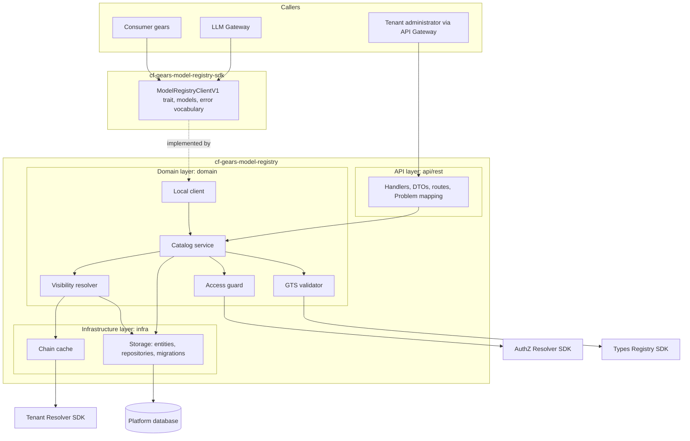
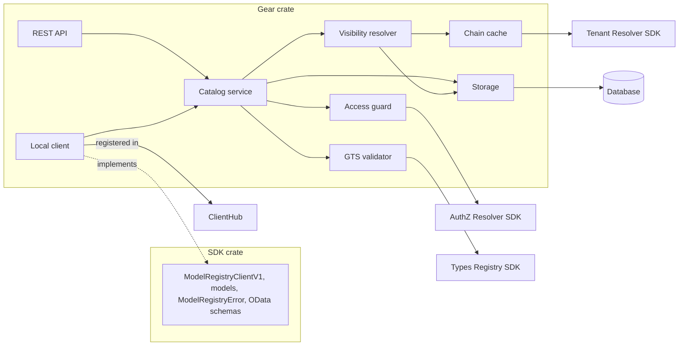
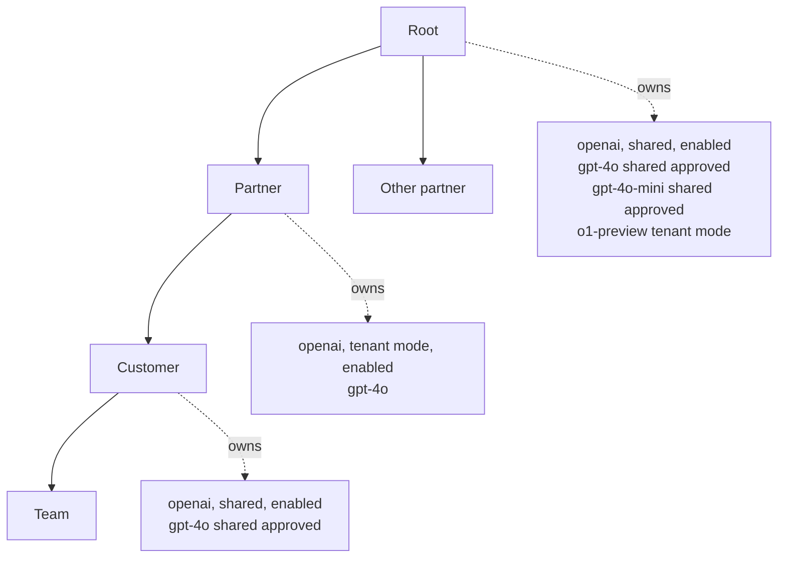
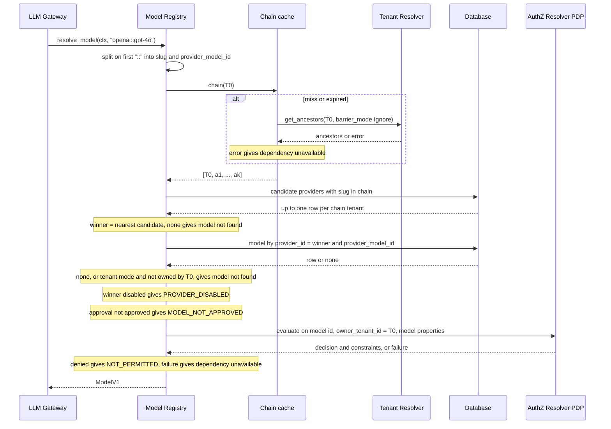
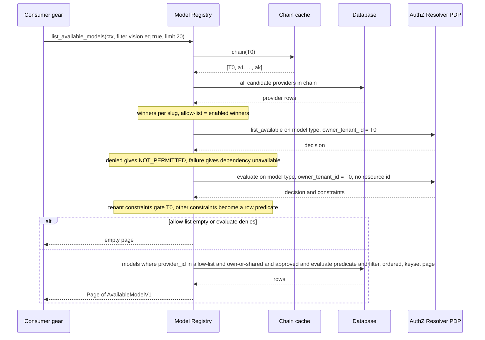
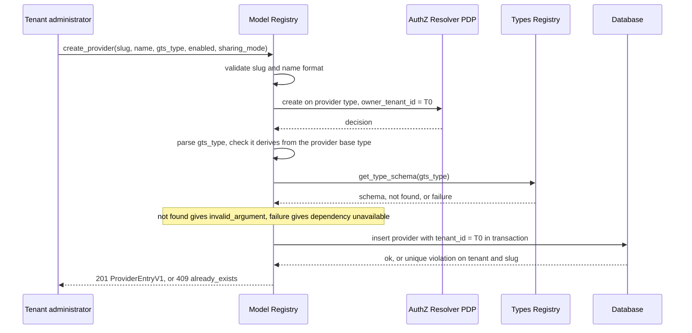
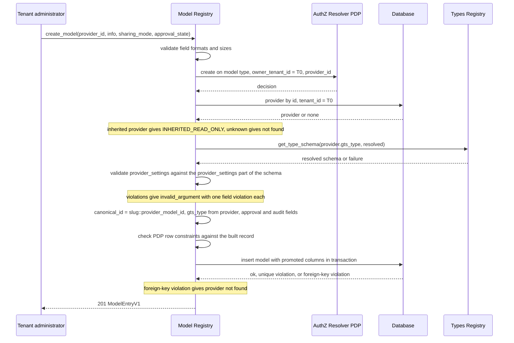
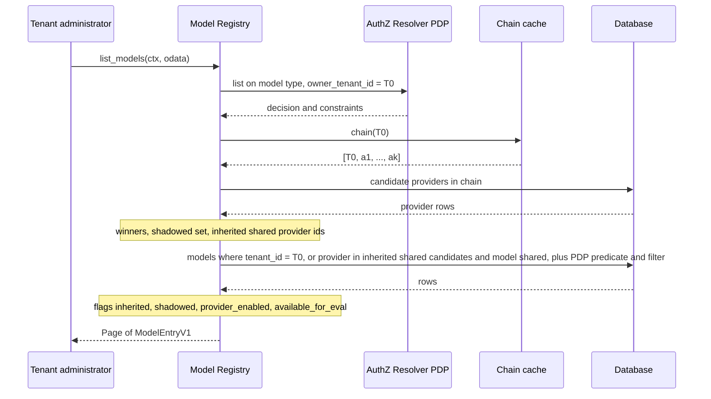
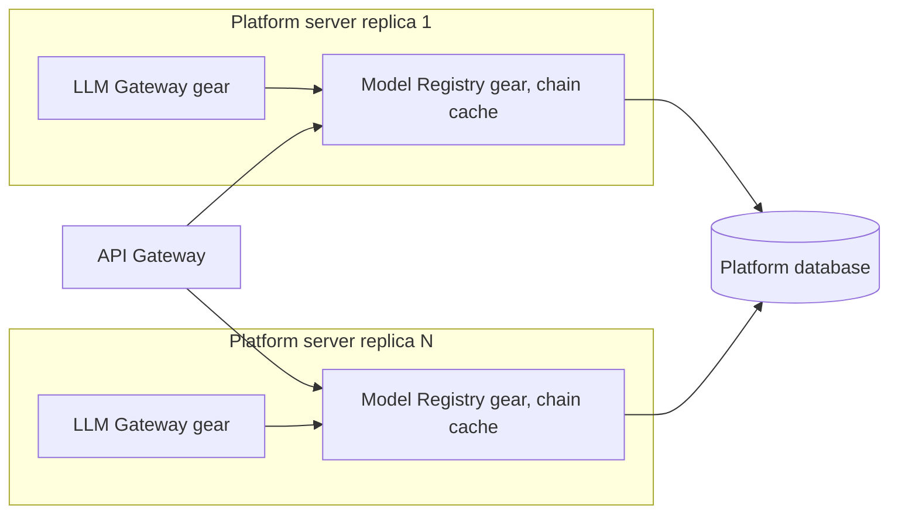

Created: 2026-10-23 by Constructor Tech

# Technical Design — Model Registry

<!-- toc -->

- [1. Architecture Overview](#1-architecture-overview)
  - [1.1 Architectural Vision](#11-architectural-vision)
  - [1.2 Architecture Drivers](#12-architecture-drivers)
  - [1.3 Architecture Layers](#13-architecture-layers)
- [2. Principles & Constraints](#2-principles--constraints)
  - [2.1 Design Principles](#21-design-principles)
  - [2.2 Constraints](#22-constraints)
- [3. Technical Architecture](#3-technical-architecture)
  - [3.1 Domain Model](#31-domain-model)
  - [3.2 Component Model](#32-component-model)
  - [3.3 API Contracts](#33-api-contracts)
  - [3.4 Internal Dependencies](#34-internal-dependencies)
  - [3.5 External Dependencies](#35-external-dependencies)
  - [3.6 Interactions & Sequences](#36-interactions--sequences)
  - [3.7 Database schemas & tables](#37-database-schemas--tables)
  - [3.8 Deployment Topology](#38-deployment-topology)
- [4. Additional context](#4-additional-context)
  - [Authorization](#authorization)
  - [GTS Checks](#gts-checks)
  - [Error Handling](#error-handling)
  - [Tenant Isolation and Data Protection](#tenant-isolation-and-data-protection)
  - [Security Assumptions](#security-assumptions)
  - [Observability](#observability)
  - [Fault Tolerance and Consistency](#fault-tolerance-and-consistency)
  - [Configuration](#configuration)
  - [Testability](#testability)
  - [Documentation](#documentation)
  - [Compliance](#compliance)
  - [Not Applicable](#not-applicable)
  - [Change Audit Follow-up](#change-audit-follow-up)
  - [Deviations](#deviations)
  - [Limitations](#limitations)
  - [Open Questions](#open-questions)
- [5. Traceability](#5-traceability)

<!-- /toc -->

- [ ] `p1` - **ID**: `cpt-cf-model-registry-design-model-registry`

## 1. Architecture Overview

### 1.1 Architectural Vision

Model Registry is an in-process gear that owns two tables: providers and models. Each row belongs to exactly one tenant. Tenant administrators manage the rows of their own tenant through a management API. LLM Gateway and other consumer gears use two resolution operations: resolve one model by its canonical id, and list the models available for evaluation. Both resolution operations compute the caller's effective catalog on every request. The effective catalog is the set of providers and models a tenant sees after inheritance and shadowing.

The effective catalog is built from three inputs: the caller's ancestor chain, the provider rows owned by the tenants in that chain, and the model rows of the winning providers. The ancestor chain comes from Tenant Resolver and is kept in a small in-process cache. Provider and model rows are always read from the database. Visibility is decided in one place: for each provider slug, the nearest visible provider wins. A model is visible only when its provider is the winner for its slug. Provider enabled state, model approval, and the policy decision point (PDP) then decide whether a visible model can be evaluated.

The gear follows the platform SDK pattern. The SDK crate `cf-gears-model-registry-sdk` holds one versioned trait, `ModelRegistryClientV1`, together with its models and error vocabulary. The gear crate `cf-gears-model-registry` implements the trait, registers it in ClientHub, and exposes a REST API that maps one-to-one to the trait methods. Provider-specific settings are opaque JSON documents. The gear validates them on write against the GTS schema that the LLM Gateway provider plugin registered in Types Registry. Nothing on the resolution path calls Types Registry.

Terms used below:

- **PDP**: the policy decision point. The PRD's Authorization PDP is the platform AuthZ Resolver (`authz-resolver`), called through the toolkit `PolicyEnforcer`.
- **Fail closed**: when a check cannot complete, the request is refused, never granted.
- **Dependency unavailable**: the `service_unavailable` error (HTTP 503) returned when Tenant Resolver, the PDP, Types Registry, or the database cannot answer within its deadline (§4 Error Handling).
- **Row predicate**: the SQL condition built from PDP row constraints and added to a list query.
- **Promoted column**: a real column that holds a copy of a value stored inside a JSON column, used for filtering and ordering.
- **Keyset page**: a page addressed by an opaque cursor that encodes the order key of the last row, not an offset.
- **`SecureConn`**, **`Scopable`**: the toolkit-db connection that applies an `AccessScope` to every query, and the entity derive that declares the tenant and resource columns the scope uses ([secure ORM](../../../docs/toolkit_unified_system/06_authn_authz_secure_orm.md)).

### 1.2 Architecture Drivers

#### Functional Drivers

| Requirement | Design Response |
|-------------|------------------|
| `cpt-cf-model-registry-fr-provider-management` | Provider CRUD in `cpt-cf-model-registry-component-catalog-service`, stored in `cpt-cf-model-registry-dbtable-providers` with a unique `(tenant_id, slug)` key. Slug and `gts_type` are immutable (`cpt-cf-model-registry-constraint-immutable-identity`). Delete removes the provider and its models in one transaction. Visibility is recomputed per request, so a provider it shadowed becomes visible again (§3.6 `cpt-cf-model-registry-seq-provider-write`). |
| `cpt-cf-model-registry-fr-provider-disable` | The `enabled` flag does not change who wins a slug. A disabled winner is left out of the allow-list, so none of its models resolve or appear in the available list, for the owner and every inheriting tenant. Rows are kept; re-enabling restores them. Resolution reports `PROVIDER_DISABLED` only after the model is found (§3.6 `cpt-cf-model-registry-seq-resolve-model`). |
| `cpt-cf-model-registry-fr-provider-sharing` | `sharing_mode` column with values `tenant` and `shared`. Only `shared` ancestor providers become candidates for descendants. The mode is read per request, so a change applies to the next resolution (§3.6 `cpt-cf-model-registry-seq-effective-catalog`). |
| `cpt-cf-model-registry-fr-provider-shadowing` | Winner per slug over the candidate set ordered by chain distance; a tenant's own provider is always a candidate for itself, and an ancestor's provider is a candidate only when `shared`. Implemented once in `cpt-cf-model-registry-component-visibility-resolver`. |
| `cpt-cf-model-registry-fr-model-identity` | `canonical_id = provider_slug::provider_model_id`, built by the gear on create, stored with unique keys `(tenant_id, canonical_id)` and `(provider_id, provider_model_id)`. Parsing splits on the first `::`. `provider_id` and `provider_model_id` are immutable. |
| `cpt-cf-model-registry-fr-model-management` | Model CRUD in `cpt-cf-model-registry-component-catalog-service`. The record holds general settings (optional `base_url`, optional `secret_ref`), default parameters with override policy, capabilities, user-facing information, sharing mode, approval, and opaque `provider_settings` (§3.1 `cpt-cf-model-registry-entity-model-info`). `gts_type` is copied from the provider on create and never set by the caller. |
| `cpt-cf-model-registry-fr-model-settings-validation` | `cpt-cf-model-registry-component-gts-validator` fetches the resolved schema of the provider type from Types Registry on create and on any update that carries `provider_settings`, validates the document locally, and rejects it with field violations. Types Registry failure rejects the write as dependency unavailable (§3.6 `cpt-cf-model-registry-seq-model-write`). |
| `cpt-cf-model-registry-fr-model-approval` | Approval state, decider, and decision time live on the model row (`cpt-cf-model-registry-entity-approval`). Create and update set them under the model `update`/`create` permissions; a create without a state starts as Approved. Only Approved models resolve or appear in the available list. Approval travels with the model; descendants cannot write it. |
| `cpt-cf-model-registry-fr-model-sharing` | `sharing_mode` on models. A descendant sees a model only when the model is `shared` and its provider is a `shared` winner. There is no model-level shadowing: visibility is keyed on `provider_id` only. |
| `cpt-cf-model-registry-fr-effective-catalog` | `cpt-cf-model-registry-component-visibility-resolver` computes winners per slug and the allow-list of provider ids, and filters models by `provider_id` membership, never by `canonical_id` dedupe. Inherited entries are read-only and returned with their full record. |
| `cpt-cf-model-registry-fr-resolve-model` | `resolve_model` runs the PRD order: find in the effective catalog, provider enabled, approved, PDP `evaluate`. Each failure has a distinct canonical error and reason code (§4 Error Handling). PDP or Tenant Resolver failures fail closed. |
| `cpt-cf-model-registry-fr-list-available-models` | `list_available_models` requires the PDP action `list_available` and applies the gates of `resolve_model` in one model query, so every listed model resolves (decision rules in §4 Authorization). It returns `AvailableModelV1`, which omits `provider_settings`, `base_url`, and `secret_ref`. OData options run on promoted columns (§3.6 `cpt-cf-model-registry-seq-list-available-models`). |
| `cpt-cf-model-registry-fr-tenant-isolation` | Every write is clamped to `tenant_id = caller tenant` through `SecureConn`. Reads return own rows and rows that ancestors share. There are no reads of sibling or descendant rows and no writes to ancestor rows (`cpt-cf-model-registry-principle-owner-only-writes`). |
| `cpt-cf-model-registry-fr-authorization` | `cpt-cf-model-registry-component-access-guard` calls the PDP through `PolicyEnforcer` on every operation. Two GTS-identified resource types; distinct action groups for provider management (provider `get`, `list`, `create`, `update`, `delete`), model management (model `get`, `list`, `create`, `update`, `delete`), and model evaluation (model `evaluate` and `list_available`) (§4 Authorization). |
| `cpt-cf-model-registry-fr-management-api-conventions` | Versioned paths under `/model-registry/v1/`, `OperationBuilder` with `.authenticated()` and `.standard_errors()`, OData on every list, canonical Problem errors. Management reads return own and inherited entries with `inherited`, `shadowed`, and eval-availability flags; writes on inherited entries fail with `INHERITED_READ_ONLY` (§3.3). |
| `cpt-cf-model-registry-fr-change-audit` | `p2`, partly covered. Per-row audit columns `created_by`, `created_at`, `updated_by`, `updated_at` on both tables, plus `approval_decided_by` and `approval_decided_at` on models. The append-only change log for deletes and full history is not part of this design (§4 Change Audit Follow-up). |

#### NFR Allocation

| NFR ID | NFR Summary | Allocated To | Design Response | Verification Approach |
|--------|-------------|--------------|-----------------|----------------------|
| `cpt-cf-model-registry-nfr-resolution-latency` | p99 ≤ 10 ms in-gear, excluding PDP and Tenant Resolver wait; 1,000 rps sustained, 5,000 rps peak; 10,000 models; hierarchy depth up to 10 | `cpt-cf-model-registry-component-chain-cache`, `cpt-cf-model-registry-component-visibility-resolver`, `cpt-cf-model-registry-component-storage` | On a cache hit, resolution makes no Tenant Resolver call. It runs two indexed point queries: providers by `(tenant_id IN chain, slug)` on the unique key (at most 11 rows), and the model by the unique `(provider_id, provider_model_id)` key. No Types Registry call on the read path. The available list runs one chain-wide provider query and one model query with the allow-list predicate on indexed columns. p99 sub-budget: chain cache lookup 0.1 ms, provider query 3 ms, model query 3 ms, mapping and constraint check 1 ms; the rest is headroom. Each resolution takes one PDP decision, so the PDP receives up to 5,000 decisions per second at peak. Outside the in-gear budget, a resolution waits for that decision (Policy Engine target 25 ms p95, `cpt-cf-policy-engine-nfr-decision-latency`; bounded by `pdp_deadline_ms`) and, on a chain cache miss, for Tenant Resolver (bounded by `tenant_resolver_deadline_ms`). | Automated benchmark with 10,000 models, hierarchy depth 10, 1,000 rps sustained and 5,000 rps bursts; the gear reports in-gear duration with dependency wait subtracted (§4 Observability). |
| `cpt-cf-model-registry-nfr-availability` | 99.9% monthly availability of resolution; recovery within 15 minutes after a gear failure | `cpt-cf-model-registry-topology-in-process-gear`, `cpt-cf-model-registry-component-chain-cache` | Stateless replicas; all state is in the platform database. A chain cache miss calls Tenant Resolver. A failed replica is replaced by platform restart without data recovery (§4 Fault Tolerance and Consistency). Every PDP, Tenant Resolver, Types Registry, and database call has a deadline (§4 Configuration). The resolution path makes no retries. An expired deadline fails closed as dependency unavailable. | Availability SLI of §4 Observability. Recovery time is measured from the outcomes-by-reason metric after injected gear failures. |
| `cpt-cf-model-registry-nfr-durability` | Zero loss of acknowledged writes | `cpt-cf-model-registry-component-storage`, `cpt-cf-model-registry-db-catalog-storage` | Every write commits in a database transaction before the response is sent. Provider delete and its model deletes share one transaction. No catalog state lives only in memory. The tables are part of the platform database and its standard backups. | Restart tests and backup-restore tests confirming that acknowledged writes survive. |

#### Key ADRs

No accepted ADRs exist for this gear yet. The decisions are specified in this document.

### 1.3 Architecture Layers

- [ ] `p1` - **ID**: `cpt-cf-model-registry-tech-toolkit-gear`
- [ ] `p1` - **ID**: `cpt-cf-model-registry-tech-relational-storage`
- [ ] `p1` - **ID**: `cpt-cf-model-registry-tech-json-schema-validation`

| Layer | Responsibility | Technology |
|-------|---------------|------------|
| Presentation | REST handlers and DTOs, OData query extraction, `$select` projection, mapping of domain errors to canonical Problem responses | Axum handlers registered with toolkit `OperationBuilder`; `utoipa` DTOs in `api/rest/` only |
| Domain | Local client; catalog service (operation flow, authorization calls, validation order, transactions, audit columns); effective-catalog algorithm, approval and sharing rules, PDP scope gate, GTS type and settings checks | Rust in `domain/` (local client in `domain/local_client.rs`), `#[domain_model]` types, toolkit `PolicyEnforcer` (`cpt-cf-model-registry-tech-toolkit-gear`); settings validated with the workspace JSON Schema validator (`jsonschema`) against schemas from Types Registry (`cpt-cf-model-registry-tech-json-schema-validation`) |
| Infrastructure | SeaORM entities with `Scopable`, repositories over `DBRunner`, migrations, OData field-to-column mapping, chain cache | SeaORM through `toolkit-db` `SecureConn`; PostgreSQL in production, SQLite in dev/test (`cpt-cf-model-registry-tech-relational-storage`) |

Domain components call dependency SDK traits (`TenantResolverClient`, `AuthZResolverClient` through `PolicyEnforcer`, `TypesRegistryClient`) obtained from ClientHub, and storage through repository traits. These traits are the seams where tests inject mocks.

Layer rules follow the [platform gear layout](../../../docs/toolkit_unified_system/02_gear_layout_and_sdk_pattern.md): serde and `ToSchema` derives appear only in `api/rest/` DTOs and in SDK models; domain types carry `#[domain_model]`; all endpoints are versioned. `unsafe` is forbidden and `unwrap`/`expect` are denied in non-test code.

Technology risks:

- PostgreSQL and SQLite differ in locking and type handling. Integration tests run on both (§4 Testability).
- JSON Schema validation cost grows with schema and document size. Documents are bounded by `max_json_document_bytes`.
- The per-replica chain cache can serve a stale chain. Staleness is bounded by the TTL (`cpt-cf-model-registry-component-chain-cache`).

## 2. Principles & Constraints

### 2.1 Design Principles

When principles conflict, Fail Closed and Owner-Only Writes take precedence over the others.

#### SDK-First Contract

- [ ] `p1` - **ID**: `cpt-cf-model-registry-principle-sdk-first-contract`

`ModelRegistryClientV1` is the public contract. Every REST endpoint maps to exactly one trait method with the same semantics and error categories. The REST layer adds only transport concerns: path and query parsing, flattened entry DTOs, `$select` projection, rejection of immutable fields in update bodies (`IMMUTABLE_FIELD`), status codes, and Problem rendering. Both surfaces call the same domain service and the same error mapping. Drivers: `cpt-cf-model-registry-fr-management-api-conventions`, `cpt-cf-model-registry-fr-resolve-model`.

#### One Visibility Rule

- [ ] `p1` - **ID**: `cpt-cf-model-registry-principle-slug-shadowing-allow-list`

Visibility is computed by one algorithm (§3.6 `cpt-cf-model-registry-seq-effective-catalog`). The provider slug decides which provider wins; the winner's `provider_id` decides which models are visible. Resolution, the available list, and the management reads all use this algorithm. No path filters models by deduplicating `canonical_id`. Drivers: `cpt-cf-model-registry-fr-effective-catalog`, `cpt-cf-model-registry-fr-provider-shadowing`.

#### Fail Closed

- [ ] `p1` - **ID**: `cpt-cf-model-registry-principle-fail-closed`

When the gear cannot decide, it refuses. A PDP denial or an unknown constraint denies. An unreachable PDP, Tenant Resolver, or Types Registry fails the request as dependency unavailable. A failed provider query fails the whole read; a partial provider set is never used. Drivers: `cpt-cf-model-registry-fr-authorization`, `cpt-cf-model-registry-fr-tenant-isolation`.

#### Catalog Rows Are Not Cached

- [ ] `p1` - **ID**: `cpt-cf-model-registry-principle-uncached-catalog-rows`

Provider and model rows are read from the database on every request. Only the tenant ancestor chain is cached. A provider disable, a sharing change, a revocation, or a delete takes effect on the next request on every replica. Drivers: `cpt-cf-model-registry-fr-provider-disable`, `cpt-cf-model-registry-fr-model-approval`.

#### Validate on Write

- [ ] `p1` - **ID**: `cpt-cf-model-registry-principle-write-time-validation`

All GTS checks run on writes: provider type checks on provider create and settings validation on model create or settings update. Records that reach the database are valid against the schema that was current at write time. The resolution path performs no schema fetch and no schema validation. Drivers: `cpt-cf-model-registry-fr-model-settings-validation`, `cpt-cf-model-registry-nfr-resolution-latency`.

#### Owner-Only Writes

- [ ] `p1` - **ID**: `cpt-cf-model-registry-principle-owner-only-writes`

A tenant writes only rows it owns. It reads its own rows and the rows its ancestors share with it. Inherited rows are read-only, including their approval state. The root administrator manages the platform-wide shared catalog as the root tenant's own rows; there is no cross-tenant administration path in this gear. Drivers: `cpt-cf-model-registry-fr-tenant-isolation`, `cpt-cf-model-registry-fr-model-approval`.

### 2.2 Constraints

#### No Secret Storage

- [ ] `p1` - **ID**: `cpt-cf-model-registry-constraint-no-secret-storage`

The gear stores only a CredStore secret reference (`secret_ref`), never secret material. The reference uses the CredStore `SecretRef` format ([credstore-sdk](../../credstore/credstore-sdk/src/models.rs)): 1 to 255 characters from `[a-zA-Z0-9_-]`. The gear does not call CredStore and does not check that the reference exists. LLM Gateway resolves the reference through CredStore at evaluation time. The gear does not bind a secret reference to a destination; that control belongs to LLM Gateway, OAGW, and CredStore (§4 Security Assumptions).

#### Opaque Provider Settings

- [ ] `p1` - **ID**: `cpt-cf-model-registry-constraint-opaque-provider-settings`

The gear does not define or interpret provider-specific fields, including cost. `provider_settings` is a JSON document whose shape belongs to the LLM Gateway provider plugin that registered the provider type schema. The gear validates the document against that schema and stores it unchanged.

#### OData Filters on Real Columns

- [ ] `p1` - **ID**: `cpt-cf-model-registry-constraint-real-column-filters`

The toolkit OData layer maps each filter field to exactly one real SeaORM column; it has no JSON-path filtering and no joins. Every filterable field is a real column with a B-tree index, low-cardinality columns included. Fields stored inside JSON sub-objects are promoted to real columns and rewritten on every create and update. No GIN indexes; SQLite and PostgreSQL use the same schema. The filterable fields and their columns are listed once, in §3.3 OData.

#### No Model Lifecycle Status

- [ ] `p1` - **ID**: `cpt-cf-model-registry-constraint-no-model-lifecycle`

Models have no lifecycle status. Model delete is a hard delete. Setting approval to Revoked is the non-destructive way to stop a model. Aliases, tags, model discovery, approval-service integration, and provider health are not part of this gear.

#### Immutable Identity

- [ ] `p1` - **ID**: `cpt-cf-model-registry-constraint-immutable-identity`

Provider `slug`, provider `gts_type`, model `provider_id`, model `provider_model_id`, and the owning `tenant_id` of both entities never change after create. These fields are absent from the update requests. As a result, `canonical_id` and the model's `gts_type` never change and need no resynchronization. This is the canonical list of immutable fields; other sections refer to it.

#### Local Chain Cache Only

- [ ] `p1` - **ID**: `cpt-cf-model-registry-constraint-local-chain-cache`

The ancestor-chain cache is an in-process map per replica. The gear uses no platform cache primitive and no `cluster` gear. The cache holds tenant ids only. Hierarchy changes take effect within the TTL bound of `cpt-cf-model-registry-component-chain-cache`, as the PRD contract `cpt-cf-model-registry-contract-tenant-hierarchy` allows.

## 3. Technical Architecture

### 3.1 Domain Model

**Technology**: Rust structs in the SDK crate; provider types are GTS types derived from the provider base type `gts.cf.genai.model.provider.v1~`.

**Location**: [model-registry-sdk/src/models/](../model-registry-sdk/src/models/).

**Core Entities**:

| Entity | Description | Schema |
|--------|-------------|--------|
| Provider | Where models come from: a tenant-owned record with slug, name, provider GTS type, enabled flag, and sharing mode | [models/](../model-registry-sdk/src/models/) (`ProviderV1`) |
| Model | A tenant-owned catalog entry for one model of one provider: identity, sharing, approval, audit, and the model info | [models/](../model-registry-sdk/src/models/) (`ModelV1`) |
| Available Model | The model as listed for evaluation: every `ModelV1` field except `info.provider_settings`, `info.base_url`, and `info.secret_ref` | [models/](../model-registry-sdk/src/models/) (`AvailableModelV1`) |
| Model Info | The record LLM Gateway uses to evaluate the model; the shape of its `provider_settings` is fixed by the provider type | [models/](../model-registry-sdk/src/models/) (`ModelInfoV1`) |
| Provider Type | GTS type derived from `gts.cf.genai.model.provider.v1~` and published by an LLM Gateway provider plugin; its schema constrains `provider_settings` | Types Registry |
| Approval | The owning tenant's latest decision on a model | [models/](../model-registry-sdk/src/models/) (`ApprovalV1`) |
| Effective Catalog | The computed view of providers and models one tenant sees | Computed per request; not stored |

Type notation in the field tables: `?` marks an optional field; `uuid`, `string`, `bool`, `u32`, `u64`, `i32`, `f64`, `timestamp` (UTC, ISO-8601), `enum`, `json` (any JSON value), `object` (a nested structure described below the table). Enum values are lowercase on the wire; the PRD's `Tenant`/`Shared` and Pending/Approved/Rejected/Revoked are the same values. Strings without a stated limit are bounded by their column length in §3.7, and JSON values by `max_json_document_bytes`; a value over a bound is rejected with `TOO_LARGE`.

#### Provider

- [ ] `p1` - **ID**: `cpt-cf-model-registry-entity-provider`

| Field | Type | Meaning |
|-------|------|---------|
| `id` | uuid | Provider id, generated by the gear (UUIDv7). Management operations address the provider by this id. |
| `tenant_id` | uuid | Owning tenant. Immutable. |
| `slug` | string | 1–64 characters: lowercase letters, digits, hyphen. Unique among the providers of the owning tenant. Immutable. Shadowing key and left part of every canonical id. |
| `name` | string | Display name, 1–255 characters, free text. |
| `gts_type` | string | Provider GTS type: a type derived from `gts.cf.genai.model.provider.v1~`, for example `gts.cf.genai.model.provider.v1~cf.genai._.openai.v1~`. Names the LLM Gateway plugin family that evaluates the provider's models. Immutable. |
| `enabled` | bool | When false, no model of this provider can be evaluated by the owner or any inheriting tenant. Default true. |
| `sharing_mode` | enum | `tenant` (owner only) or `shared` (owner and all descendants). Default `tenant`. |
| `managed` | bool | Whether the platform manages the provider runtime, for example a local runtime. Informational; the gear does not act on it. Default false. |
| `metadata` | json? | Optional provider metadata. Opaque; stored and returned unchanged. |
| `created_at`, `created_by` | timestamp, uuid | When and by which subject the provider was created. |
| `updated_at`, `updated_by` | timestamp, uuid | When and by which subject the provider was last changed. |

#### Model

- [ ] `p1` - **ID**: `cpt-cf-model-registry-entity-model`

| Field | Type | Meaning |
|-------|------|---------|
| `id` | uuid | Model id, generated by the gear (UUIDv7). Management operations address the model by this id. |
| `tenant_id` | uuid | Owning tenant. Always equal to the provider's `tenant_id`. Immutable. |
| `provider_id` | uuid | The provider that serves the model. Must be owned by the same tenant. Immutable. |
| `canonical_id` | string | `provider_slug::provider_model_id`, for example `openai::gpt-4o`. Built by the gear. Unique among the models of the owning tenant. Never changes. |
| `sharing_mode` | enum | `tenant` or `shared`. Descendants see the model only when it is `shared` and its provider is `shared`. Default `tenant`. |
| `approval` | object | Approval decision, see Approval. |
| `info` | object | Model info, see Model Info. |
| `created_at`, `created_by` | timestamp, uuid | Creation time and subject. |
| `updated_at`, `updated_by` | timestamp, uuid | Last change time and subject. |

#### Model Info

- [ ] `p1` - **ID**: `cpt-cf-model-registry-entity-model-info`

`ModelInfoV1` is the SDK record that LLM Gateway uses to evaluate a model; it is not a GTS type. Its `gts_type` names the provider type: a GTS type derived from the provider base type `gts.cf.genai.model.provider.v1~` (§3.3 `cpt-cf-model-registry-interface-model-info-schema`). The provider type's schema fixes the shape of `provider_settings`. The registry returns `ModelInfoV1` unchanged to LLM Gateway, which narrows `provider_settings` to the plugin's typed view.

| Field | Type | Meaning |
|-------|------|---------|
| `gts_type` | string | The provider GTS type, copied from the model's provider on create. Read-only for callers; never part of a create or update request. LLM Gateway selects the plugin whose provider type equals this value. |
| `provider_model_id` | string | The provider's own model identifier, sent to the provider. 1–255 characters without whitespace or control characters. Immutable. |
| `base_url` | string? | General setting: the absolute `http` or `https` URL the plugin calls for this model, up to 2,048 characters, with no user information (`user:password@`). SSRF protection is handled by OAGW at call time (§4 Security Assumptions). When absent, the LLM Gateway provider plugin uses its provider's default URL. The registry stores no default and returns the field as absent. |
| `secret_ref` | string? | General setting: optional CredStore secret reference for the provider credential. |
| `display_name` | string | Name shown to users, 1–255 characters. |
| `description` | string? | Free-text description, up to 4,096 characters. |
| `family` | string? | Model family label, for example `gpt-4` or `llama`. |
| `vendor` | string? | Organization that produced the model weights. Independent of the provider that serves it. |
| `managed` | bool | Whether the platform can load and unload this model on a managed runtime. Informational. Default false. |
| `architecture` | string? | Architecture class, for example `llama` or `mistral`. |
| `size_bytes` | u64? | On-disk size of locally hosted weights, at most 2^63 − 1 (stored as signed 64-bit). |
| `format` | string? | Weight or serving format, for example `gguf` or `safetensors`. |
| `region` | string? | Deployment region, for example `eu-west-1`. |
| `hosted_by` | string? | Infrastructure host, for example `Azure` or `self-hosted`. |
| `last_release_at` | timestamp? | When the vendor last released this model version. |
| `reasoning_level` | string? | Display-only reasoning level label. |
| `version` | string? | Model version string. |
| `sort_order` | i32 | Position in model pickers; lower first. Default 0. |
| `icon` | string? | Absolute `http` or `https` URL of the model icon, up to 2,048 characters. Other schemes are rejected with `INVALID_FORMAT`. |
| `multiplier_display` | string? | Display label for the relative cost, for example `3x`. |
| `performance` | object | Expected performance: `response_latency_ms` (u32?) and `tokens_per_second` (u32?). |
| `additional_info` | json | Map from string keys to JSON values for deployment-specific metadata. Default empty. |
| `supported_api` | set of enum | API kinds the model serves: `completion`, `embedding`, `batch`. A closed set owned by the registry; adding a value is a non-breaking change within `v1`. |
| `capabilities` | object | What the model can do, see Capabilities. |
| `disabled_capabilities` | object | Capabilities an administrator turned off for this model, see Disabled Capabilities. |
| `context_window` | object | `max_input_tokens` (u32), `max_output_tokens` (u32?, absent for embedding models), `output_vector_size` (u32?, embedding dimension). |
| `default_parameters` | object | Provider-independent inference defaults, see Default Parameters. |
| `allow_parameter_override` | bool | Whether callers may override `default_parameters` per request. Default false. |
| `allow_extra_params` | list of string | Names of extra request parameters callers may pass to the provider, up to 64 names of up to 128 characters. Default empty. |
| `provider_settings` | json | Provider-specific settings, including cost. Shape defined by the provider type schema. Opaque to the registry beyond validation. |

**Capabilities** (`capabilities`). A media capability has two fields: `enabled` (bool) and `supported_mime_types` (list of up to 64 strings). MIME types follow RFC 6838 in lowercase. `disabled_mime_types` has the same bound.

| Field | Type | Meaning |
|-------|------|---------|
| `vision` | media capability | Image input. |
| `reasoning` | object | `effort`, `toggle`, `resume`, `budget` (all bool): support for reasoning effort, switching reasoning on or off, resuming a reasoning chain, and a reasoning token budget. |
| `function_calling` | bool | Tool or function calling. |
| `response_schema` | bool | Structured output against a JSON schema. |
| `streaming` | bool | Streaming responses. |
| `file_input` | media capability | Document or file input. |
| `image_generation` | media capability | Image output. |
| `audio_input` | media capability | Audio input. |
| `audio_output` | media capability | Audio output. |
| `code_interpreter` | bool | Sandboxed code execution. |
| `web_search` | object | `enabled`, `allowed_domains`, `excluded_domains` (all bool): web search, and support for allow-lists and deny-lists of domains. |

**Disabled Capabilities** (`disabled_capabilities`) mirror the capability structure; every flag reads as "disabled". Media entries have `disabled` (bool) and `disabled_mime_types` (list of string). `reasoning` has `effort`, `toggle`, `resume`, `budget`. `web_search` has `disabled`, `allowed_domains`, `excluded_domains`. The remaining entries are single booleans. The effective capability is the declared capability minus the disabled one.

**Default Parameters** (`default_parameters`). All fields are optional. The registry stores them and applies no range limits.

| Field | Type | Meaning |
|-------|------|---------|
| `temperature` | f64? | Sampling temperature. |
| `top_p` | f64? | Nucleus sampling mass. |
| `max_output_tokens` | u32? | Maximum output tokens. |
| `max_tool_calls` | u32? | Maximum tool calls per response. |
| `presence_penalty` | f64? | Presence penalty. |
| `frequency_penalty` | f64? | Frequency penalty. |
| `top_logprobs` | u8? | Number of top log-probabilities per token. |
| `truncation` | enum? | `auto` or `disabled`: context truncation strategy. |
| `service_tier` | enum? | `auto` or `default`. |
| `parallel_tool_calls` | bool? | Whether the model may issue tool calls in parallel. |
| `text` | object? | `format`: `text`, `json_object`, or `json_schema` with `name`, `description?`, `schema?`, `strict`; `verbosity?`: `low`, `medium`, `high`. |
| `reasoning` | object? | `effort?`: `none`, `low`, `medium`, `high`, `xhigh`; `summary?`: `concise`, `detailed`, `auto`. |
| `tool_choice` | enum? | `auto`, `required`, `none`, or a named function. |
| `store` | bool? | Whether the provider should store the response. |

#### Approval

- [ ] `p1` - **ID**: `cpt-cf-model-registry-entity-approval`

| Field | Type | Meaning |
|-------|------|---------|
| `state` | enum | `pending`, `approved`, `rejected`, or `revoked`. Only `approved` models can be evaluated. |
| `decided_by` | uuid | Subject that made the latest decision. |
| `decided_at` | timestamp | Time of the latest decision. |

Any create or update request that carries an approval state records a decision, even when the state does not change. A create without an approval state stores `approved`, decided by the creating subject at creation time. Any state may follow any other state.

#### Effective Catalog

- [ ] `p1` - **ID**: `cpt-cf-model-registry-entity-effective-catalog`

The effective catalog of tenant T0 is computed per request from T0's ancestor chain and the provider and model rows of the tenants in it (§3.6 `cpt-cf-model-registry-seq-effective-catalog`). It is never stored. Its parts are: the candidate providers, the winning provider per slug, the allow-list (winning providers that are enabled), and the visible models (models of winning providers that T0 owns or that are `shared`).

**Relationships**:
- Provider → Tenant: many-to-one; a provider belongs to exactly one tenant.
- Model → Provider: many-to-one through `provider_id`; the model and its provider have the same tenant. Deleting a provider deletes its models.
- Model → Approval: one-to-one, embedded in the model row.
- Model → Model Info: one-to-one, embedded in the model row.
- Model Info → Provider type schema: `gts_type` names the schema in Types Registry that constrains `provider_settings`.

**Invariants**:
- `(tenant_id, slug)` is unique for providers; `(tenant_id, canonical_id)` and `(provider_id, provider_model_id)` are unique for models.
- A model's `tenant_id` and `gts_type` equal its provider's.
- Identity fields listed in `cpt-cf-model-registry-constraint-immutable-identity` never change.
- Every model row's `provider_settings` passed schema validation when it was last written.

### 3.2 Component Model

#### SDK

- [ ] `p1` - **ID**: `cpt-cf-model-registry-component-sdk`

##### Why this component exists

Consumers need a stable, transport-free contract that does not depend on gear internals.

##### Responsibility scope

Crate `cf-gears-model-registry-sdk`. Holds the `ModelRegistryClientV1` trait, the request and response models (`ProviderV1`, `ModelV1`, `ModelInfoV1`, `ApprovalV1`, `ProviderEntryV1`, `ModelEntryV1`, create and update requests), the OData query schemas and field references for providers, models, and available models, the public reason-code and field-code constants, and the opt-in typed error projection `ModelRegistryError`. Declares the provider base type `gts.cf.genai.model.provider.v1~` (§3.3 `cpt-cf-model-registry-interface-model-info-schema`).

##### Responsibility boundaries

No storage, no HTTP types, no provider-specific settings types. Trait methods return the platform `CanonicalError`; `ModelRegistryError` is a projection over it, not part of the trait signature.

##### Related components (by ID)

- `cpt-cf-model-registry-component-local-client` — implemented by
- `cpt-cf-model-registry-component-rest-api` — shares models with (DTOs convert from SDK models)

#### REST API

- [ ] `p1` - **ID**: `cpt-cf-model-registry-component-rest-api`

##### Why this component exists

Administrators and out-of-process callers reach the gear over HTTP through API Gateway.

##### Responsibility scope

Registers the endpoints of §3.3 with `OperationBuilder` (`.authenticated()`, the platform license check, OData helpers, `.standard_errors()`), parses paths, bodies, and OData options, applies `$select` projection to responses, and renders errors as canonical Problem documents through the same domain-to-canonical mapping the SDK uses.

##### Responsibility boundaries

No business rules. No database or dependency calls. Every handler calls exactly one catalog-service operation.

##### Related components (by ID)

- `cpt-cf-model-registry-component-catalog-service` — calls

#### Local Client

- [ ] `p1` - **ID**: `cpt-cf-model-registry-component-local-client`

##### Why this component exists

In-process gears, LLM Gateway first, call the registry through ClientHub without HTTP.

##### Responsibility scope

Implements `ModelRegistryClientV1` over the catalog service and is registered in ClientHub as `dyn ModelRegistryClientV1` during gear `init`. Converts domain errors to `CanonicalError` once per method.

##### Responsibility boundaries

No logic beyond delegation and error conversion.

##### Related components (by ID)

- `cpt-cf-model-registry-component-sdk` — implements
- `cpt-cf-model-registry-component-catalog-service` — calls

#### Catalog Service

- [ ] `p1` - **ID**: `cpt-cf-model-registry-component-catalog-service`

##### Why this component exists

One place defines the order of checks and side effects for every operation.

##### Responsibility scope

Implements the twelve operations of §3.3:

- validates request fields;
- calls the access guard, the visibility resolver, and the GTS validator in the order defined in §3.6;
- builds `canonical_id`, copies `gts_type` from the provider, and sets approval and audit fields from the `SecurityContext` subject;
- runs each write in one database transaction;
- computes the `inherited`, `shadowed`, `provider_enabled`, and `available_for_eval` flags on management reads.

##### Responsibility boundaries

Does not compute visibility itself and does not talk to the PDP, Tenant Resolver, or Types Registry directly. Does not interpret `provider_settings`.

##### Related components (by ID)

- `cpt-cf-model-registry-component-visibility-resolver` — calls
- `cpt-cf-model-registry-component-access-guard` — calls
- `cpt-cf-model-registry-component-gts-validator` — calls
- `cpt-cf-model-registry-component-storage` — calls

#### Visibility Resolver

- [ ] `p1` - **ID**: `cpt-cf-model-registry-component-visibility-resolver`

##### Why this component exists

Inheritance and shadowing must give the same answer on every path.

##### Responsibility scope

Gets the caller's chain from the chain cache, loads candidate providers through storage, and computes winners per slug, the allow-list, and the shadowed set (§3.6 `cpt-cf-model-registry-seq-effective-catalog`). Provides three views: the winner for one slug (resolution), the allow-list and own-or-shared model predicate (available list), and the candidate sets with flags (management reads).

##### Responsibility boundaries

Does not apply approval or PDP gates. Holds no state between requests.

##### Related components (by ID)

- `cpt-cf-model-registry-component-chain-cache` — calls
- `cpt-cf-model-registry-component-storage` — calls

#### Access Guard

- [ ] `p1` - **ID**: `cpt-cf-model-registry-component-access-guard`

##### Why this component exists

Every operation needs a PDP decision, and the tenant dimension of inherited data needs a single, consistent treatment.

##### Responsibility scope

Applies the decision rules of §4 Authorization:

- declares the PDP resource types and actions;
- holds a `PolicyEnforcer` whose deadline is `pdp_deadline_ms` instead of the enforcer's 30 s default;
- asks the PDP with the acting tenant as `owner_tenant_id`, the resource id for point operations, and the model properties for evaluation;
- evaluates tenant constraints as a gate on the acting tenant, and turns row constraints into a row predicate for lists or an in-memory check for single rows;
- maps enforcer errors: denial or compile failure to `NOT_PERMITTED`, evaluation failure to dependency unavailable.

##### Responsibility boundaries

Does not decide catalog visibility; that is the visibility resolver's job.

##### Related components (by ID)

- `cpt-cf-model-registry-component-catalog-service` — called by

#### GTS Validator

- [ ] `p1` - **ID**: `cpt-cf-model-registry-component-gts-validator`

##### Why this component exists

Provider types and provider settings come from plugins the gear does not know at build time; they must be checked against Types Registry on write.

##### Responsibility scope

Checks provider GTS types on provider create (§4 GTS Checks). Fetches the resolved schema of a provider type from Types Registry and validates `provider_settings` against it on model create and settings update. Publishes nothing itself.

##### Responsibility boundaries

Not called on the resolution path. Keeps no schema cache. Does not check that an LLM Gateway plugin instance exists for a type.

##### Related components (by ID)

- `cpt-cf-model-registry-component-catalog-service` — called by

#### Chain Cache

- [ ] `p1` - **ID**: `cpt-cf-model-registry-component-chain-cache`

##### Why this component exists

Without it, every resolution calls Tenant Resolver. That wait is outside the in-gear latency NFR but inside LLM Gateway's 50 ms overhead budget (PRD rationale of `cpt-cf-model-registry-nfr-resolution-latency`).

##### Responsibility scope

An in-process map from tenant id to that tenant's ordered ancestor chain (parent first, root last) plus the time the entry was stored. On a miss or an expired entry it calls `TenantResolverClient::get_ancestors` with `GetAncestorsOptions { barrier_mode: BarrierMode::Ignore }`, bounded by `tenant_resolver_deadline_ms`, and stores the result. Rules:

1. TTL is `chain_cache_ttl_seconds`, default 30, maximum 300 (checked at gear start). Value 0 disables caching; every request calls Tenant Resolver. Each stored entry gets a TTL reduced by a random jitter of up to 10%, so entries stored together do not expire together.
2. An empty chain (root tenant) is a cached value, not a miss.
3. Failures are not cached. A failed call fails the request with dependency unavailable.
4. The map is a bounded concurrent LRU cache of `chain_cache_max_entries` (default 100,000) entries. Inserting into a full map evicts the least recently used entry in constant time.
5. There is no invalidation API. A stale entry is used for at most one TTL plus the duration of the request that read it. A stale chain can narrow or widen visibility. A tenant moved under a new parent keeps its former ancestors' shared catalog and does not yet see the new ancestors' shared providers, including ones that would shadow an inherited slug. A detached tenant keeps its former ancestors' shared catalog. Deployments that need hierarchy changes to apply on the next request set the TTL to 0.
6. Concurrent misses for the same tenant share one Tenant Resolver call (single flight per tenant).
7. Expiry is checked against an injectable clock, the same clock that sets audit and approval timestamps.

##### Responsibility boundaries

Holds tenant ids only, never provider or model data. The cache affects visibility only within the staleness bound of rule 5. With the cache empty or disabled, every request depends on Tenant Resolver. The key is the tenant id alone; the barrier mode is fixed and the chain does not depend on the caller.

##### Related components (by ID)

- `cpt-cf-model-registry-component-visibility-resolver` — called by

#### Storage

- [ ] `p1` - **ID**: `cpt-cf-model-registry-component-storage`

##### Why this component exists

Durable, tenant-scoped persistence of providers and models.

##### Responsibility scope

SeaORM entities for `providers` and `models` deriving `Scopable`, with `tenant_id` as the tenant column, `id` as the resource column, and PEP properties `provider_id`, `canonical_id`, and `gts_type`. Repositories over `DBRunner` that run every query through `SecureConn` with an `AccessScope`. Whole-row projection between the SDK model and the columns, including promoted filter columns. Resolution and the available list read providers through a narrow projection (`id`, `tenant_id`, `slug`, `enabled`, `sharing_mode`); `metadata` and other provider fields are read only by management operations. OData field-to-column mappings (§3.3). Migrations exposed through the gear's database capability.

##### Responsibility boundaries

No raw SQL outside migrations. No visibility or approval logic.

##### Related components (by ID)

- `cpt-cf-model-registry-component-catalog-service` — called by
- `cpt-cf-model-registry-component-visibility-resolver` — called by

### 3.3 API Contracts

The gear realizes the PRD interfaces `cpt-cf-model-registry-interface-sdk-client` and `cpt-cf-model-registry-interface-rest-api`, and the integration contracts `cpt-cf-model-registry-contract-provider-settings-schema` and `cpt-cf-model-registry-contract-tenant-hierarchy`.

#### SDK Client Trait

- [ ] `p1` - **ID**: `cpt-cf-model-registry-interface-client-v1`

- **Contracts**: `cpt-cf-model-registry-contract-provider-settings-schema`, `cpt-cf-model-registry-contract-tenant-hierarchy`
- **Technology**: Rust trait `ModelRegistryClientV1` in `cf-gears-model-registry-sdk`, obtained through ClientHub; realizes `cpt-cf-model-registry-interface-sdk-client`
- **Location**: [model-registry-sdk/src/](../model-registry-sdk/src/). Consumer obligations are in §3.3 Consumer Contract.

Every method takes `&SecurityContext` and returns `Result<_, CanonicalError>`. The acting tenant is the context's subject tenant.

| Method | Input | Output | Behavior |
|--------|-------|--------|----------|
| `resolve_model` | canonical id | `ModelV1` | Resolution for evaluation (§3.6 `cpt-cf-model-registry-seq-resolve-model`). |
| `list_available_models` | `ODataQuery` | `Page<AvailableModelV1>` | Exactly the models `resolve_model` would return for the caller, without `provider_settings`, `base_url`, and `secret_ref`. Permissions per §4 Authorization (§3.6 `cpt-cf-model-registry-seq-list-available-models`). |
| `create_provider` | `CreateProviderRequestV1` | `ProviderEntryV1` | Creates a provider in the acting tenant. |
| `get_provider` | provider id | `ProviderEntryV1` | Own or inherited provider. |
| `list_providers` | `ODataQuery` | `Page<ProviderEntryV1>` | Own providers plus inherited candidates. |
| `update_provider` | provider id, `UpdateProviderRequestV1` | `ProviderEntryV1` | Own providers only. |
| `delete_provider` | provider id | nothing | Own providers only; deletes its models. |
| `create_model` | `CreateModelRequestV1` | `ModelEntryV1` | Creates a model under an own provider. |
| `get_model` | model id | `ModelEntryV1` | Own or inherited model. |
| `list_models` | `ODataQuery` | `Page<ModelEntryV1>` | Admin list under the model `list` action: own models plus inherited candidates in every state, including models of disabled providers and models that are not approved, with flags. |
| `update_model` | model id, `UpdateModelRequestV1` | `ModelEntryV1` | Own models only; may change approval. |
| `delete_model` | model id | nothing | Own models only; hard delete. |

Request contents:

| Request | Fields |
|---------|--------|
| `CreateProviderRequestV1` | `slug`, `name`, `gts_type`, `enabled?` (default true), `sharing_mode?` (default `tenant`), `managed?` (default false), `metadata?` |
| `UpdateProviderRequestV1` | Any of `name`, `enabled`, `sharing_mode`, `managed`, `metadata` (null clears) |
| `CreateModelRequestV1` | `provider_id`, `sharing_mode?` (default `tenant`), `approval_state?` (default `approved`), and every Model Info field except `gts_type` |
| `UpdateModelRequestV1` | Any of `sharing_mode`, `approval_state`, and every mutable Model Info field (`cpt-cf-model-registry-constraint-immutable-identity`); optional fields accept null to clear |

Update semantics: a field present in the request replaces the stored value as a whole, including nested objects such as `capabilities`, `default_parameters`, and `provider_settings`. Absent fields stay unchanged.

Management responses:

| Type | Fields |
|------|--------|
| `ProviderEntryV1` | `provider` (`ProviderV1`); `inherited` (owned by an ancestor); `shadowed` (inherited and not the winner of its slug for the caller); `available_for_eval` (winner of its slug and enabled) |
| `ModelEntryV1` | `model` (`ModelV1`); `inherited`; `shadowed` (its provider is not the winner of its slug for the caller); `provider_enabled`; `available_for_eval` (not shadowed, provider enabled, and approved) |

`available_for_eval` reflects catalog state only. It does not include the PDP `evaluate` decision, which depends on the subject; `list_available_models` is the authority for a given subject.

OData on lists: `$filter`, `$orderby`, `$select`, `limit` (alias `$top`), and `cursor` (alias `$skiptoken`).

- Page size defaults to `default_page_size` (20) and is capped at `max_page_size` (100). Lists read whole rows; the page cap and the document size limits bound a page.
- Default order is `canonical_id asc` for models and `slug asc` for providers, with `id` as the final tie-breaker. Pages are keyset pages.
- `$orderby` accepts only non-nullable fields. Nullable fields are filter-only, and a `$orderby` on one is rejected as `invalid_argument` with a field violation. Filter-only model fields: `family`, `vendor`, `hosted_by`, `region`, `version`, `architecture`, `format`, `last_release_at`, `max_output_tokens`. The other fields in the table below are orderable, and every provider field is orderable.
- `$select` is applied to the serialized response on REST. The SDK always returns whole records.

Filter and order fields, with their columns (this is the canonical list):

| List | Group | Fields | Column |
|------|-------|--------|--------|
| Available models and models | Identity | `id`, `tenant_id`, `provider_id`, `canonical_id`, `provider_model_id`, `gts_type`, `sharing_mode` | Same name |
| Available models and models | Approval | `approval_state`, `approval_decided_at` | Same name |
| Available models and models | Capabilities (effective values) | `vision`, `reasoning_effort`, `function_calling`, `response_schema`, `streaming`, `file_input`, `image_generation`, `audio_input`, `audio_output`, `code_interpreter`, `web_search` | `cap_<field>` |
| Available models and models | Supported API | `api_completion`, `api_embedding`, `api_batch` | Same name |
| Available models and models | User-facing | `display_name`, `family`, `vendor`, `hosted_by`, `region`, `version`, `managed`, `architecture`, `format`, `sort_order`, `last_release_at` | Same name |
| Available models and models | Context window | `max_input_tokens`, `max_output_tokens` | `ctx_<field>`: the `context_window` limits, not `default_parameters.max_output_tokens` |
| Available models and models | Audit | `created_at`, `updated_at` | Same name |
| Providers | All | `id`, `tenant_id`, `slug`, `name`, `gts_type`, `enabled`, `sharing_mode`, `managed`, `created_at`, `updated_at` | Same name |

The flags `inherited`, `shadowed`, `provider_enabled`, and `available_for_eval` are response fields only and are not filterable. A filter can only narrow a result set: it is ANDed onto the mandatory visibility predicates and cannot switch them off.

#### REST Endpoints

- [ ] `p1` - **ID**: `cpt-cf-model-registry-interface-rest-v1`

- **Contracts**: `cpt-cf-model-registry-contract-provider-settings-schema`, `cpt-cf-model-registry-contract-tenant-hierarchy`
- **Technology**: REST over JSON, generated OpenAPI from `OperationBuilder` registrations; realizes `cpt-cf-model-registry-interface-rest-api`
- **Location**: `api/rest/routes.rs` in the gear crate; published in the platform OpenAPI document

**Endpoints Overview**:

| Method | Path | Description | Stability |
|--------|------|-------------|-----------|
| `GET` | `/model-registry/v1/available-models/{canonical_id}` | `resolve_model`. The canonical id is one percent-encoded path segment: clients encode `/`, `%`, `?`, and `#`. API Gateway routes on the encoded path and the handler decodes the segment once, so `%2F` stays inside the segment. 200 with the model as `AvailableModelV1`; the full `ModelV1` is returned only through the SDK. | stable |
| `GET` | `/model-registry/v1/available-models` | `list_available_models`. 200 with a page of `AvailableModelV1`. | stable |
| `POST` | `/model-registry/v1/providers` | `create_provider`. 201 with `Location` and the entry. | stable |
| `GET` | `/model-registry/v1/providers/{id}` | `get_provider`. 200. | stable |
| `GET` | `/model-registry/v1/providers` | `list_providers`. 200 with a page. | stable |
| `PATCH` | `/model-registry/v1/providers/{id}` | `update_provider`. 200 with the entry. | stable |
| `DELETE` | `/model-registry/v1/providers/{id}` | `delete_provider`. 204. | stable |
| `POST` | `/model-registry/v1/models` | `create_model`. 201 with `Location` and the entry. | stable |
| `GET` | `/model-registry/v1/models/{id}` | `get_model`. 200. | stable |
| `GET` | `/model-registry/v1/models` | `list_models`. 200 with a page. | stable |
| `PATCH` | `/model-registry/v1/models/{id}` | `update_model`. 200 with the entry. | stable |
| `DELETE` | `/model-registry/v1/models/{id}` | `delete_model`. 204. | stable |

REST conventions:

- Every route is registered with `OperationBuilder`, `.authenticated()`, the platform license check with no gear-specific feature, `.standard_errors()` plus the 503 response, and operation id `model_registry.<sdk_method>`. List routes add `.with_odata_filter`, `.with_odata_orderby`, and `.with_odata_select` for their field enums.
- JSON field names are snake_case. REST DTOs flatten the entry types: provider or model fields plus the flags at the top level.
- REST update DTOs reject the immutable fields of `cpt-cf-model-registry-constraint-immutable-identity`, `canonical_id`, and audit fields with `invalid_argument` and field reason `IMMUTABLE_FIELD`.
- Errors are canonical Problem documents (RFC 9457) produced by `toolkit-canonical-errors`. The wire carries category, title, detail, resource type and name, and the category context (reason, field violations). Internal diagnostics, SQL text, stored JSON documents, and the ids of rows the caller cannot see are never put on the wire. The error table is in §4 Error Handling.
- Versioning follows the [platform versioning guideline](../../../guidelines/DNA/REST/VERSIONING.md). Breaking REST changes require `/v2/`. A breaking SDK change adds `ModelRegistryClientV2` next to `ModelRegistryClientV1`, and V1 is deprecated per that guideline. Additions of optional fields, endpoints, filter fields, and `supported_api` values are non-breaking.

#### Provider Base Type

- [ ] `p1` - **ID**: `cpt-cf-model-registry-interface-model-info-schema`

- **Contracts**: `cpt-cf-model-registry-contract-provider-settings-schema`
- **Technology**: GTS type schema in Types Registry, declared in the SDK crate
- **Location**: [model-registry-sdk/src/models/](../model-registry-sdk/src/models/)

The gear owns the provider base type `gts.cf.genai.model.provider.v1~` (the AI model provider type of the [platform GTS guideline](../../../guidelines/GTS.md)). Its schema declares one open object property, `provider_settings`. Each LLM Gateway provider plugin publishes a derived provider type, for example `gts.cf.genai.model.provider.v1~cf.genai._.openai.v1~`, whose schema narrows `provider_settings` to the plugin's settings, including cost. Plugins follow the compatibility rule of `cpt-cf-model-registry-contract-provider-settings-schema`: schema changes stay backward compatible with stored settings, or ship as a new type version. The base type changes only additively within `v1`. A provider moves to a new provider type version by replacement: the administrator creates a provider of the new type and recreates its models, deleting the old provider first to keep the slug and canonical ids. There is no in-place type migration.

The gear publishes the provider base type `gts.cf.genai.model.provider.v1~` and the permission instances of §4 Authorization to Types Registry through the platform's GTS publication. Provider plugins publish their derived types after the base type exists; until then, provider and model writes that need a provider type fail with `GTS_TYPE_NOT_REGISTERED`.

#### Consumer Contract

What LLM Gateway and its provider plugins rely on:

1. **SDK surface.** `ModelInfoV1` is not generic; `provider_settings` is JSON that the plugin narrows. The SDK defines no provider settings types; they live in the LLM Gateway provider plugins that own the derived provider types. Models have no lifecycle status (`cpt-cf-model-registry-constraint-no-model-lifecycle`), and provider availability is the `enabled` flag. The resolution methods are `resolve_model`, which returns the full `ModelV1`, and `list_available_models`, which returns `AvailableModelV1`; the management list is `list_models`, which returns `ModelEntryV1`. `llm-gateway-sdk` depends on the SDK crate; the `provider_type` of its plugin specification carries provider type ids derived from `gts.cf.genai.model.provider.v1~`.
2. **Errors.** `resolve_model` reports distinct outcomes: model not found, `PROVIDER_DISABLED`, `MODEL_NOT_APPROVED`, `NOT_PERMITTED`, and dependency unavailable (§4 Error Handling). LLM Gateway decides its own external mapping of each.
3. **Destination.** The model is called at `base_url` when set, otherwise at the plugin's default URL for the provider. The plugin sends every call through OAGW, whose egress policy admits only upstreams enabled for the caller's tenant and otherwise fails with `unapproved_destination` (§4 Security Assumptions). A plugin that addresses OAGW by an upstream alias keeps that alias in its own `provider_settings` schema.
4. **Permissions.** The caller's `SecurityContext` must be granted model `evaluate` for `resolve_model`, and both `list_available` and `evaluate` for `list_available_models`.
5. **Plugin obligations.** Each plugin publishes a provider type derived from `gts.cf.genai.model.provider.v1~` whose schema constrains `provider_settings`, after the base type exists. It keeps the schema backward compatible with stored settings or publishes a new type version.

### 3.4 Internal Dependencies

| Dependency Gear | Interface Used | Purpose |
|-------------------|----------------|----------|
| `tenant-resolver` | `TenantResolverClient::get_ancestors` via ClientHub, `GetAncestorsOptions { barrier_mode: BarrierMode::Ignore }` | Ancestor chain of the acting tenant for inheritance and shadowing |
| `authz-resolver` | `AuthZResolverClient` wrapped in `PolicyEnforcer` (`authz-resolver-sdk`) | PDP decisions for every operation |
| `types-registry` | `TypesRegistryClient::get_type_schema` (the effective schema, parent chain inlined) under the caller's context; platform GTS publication (provider base type and permission instances) | Provider type checks and settings validation on writes |
| `llm-gateway` (consumer) | Calls `ModelRegistryClientV1` | Resolves models on every inference request; its provider plugins publish provider types derived from `gts.cf.genai.model.provider.v1~` (§3.3 Consumer Contract) |

The gear declares `deps = [tenant_resolver, authz_resolver, types_registry]` and `capabilities = [db, rest]`. The CredStore reference format is a data contract only; the gear does not call CredStore.

**Dependency Rules** (per [platform dependency rules](../../../docs/GEARS.md#dependency-rules)):
- No circular dependencies
- Always use SDK modules for inter-gear communication
- No cross-category sideways deps except through contracts
- Only integration/adapter gears talk to external systems
- `SecurityContext` must be propagated across all in-process calls

### 3.5 External Dependencies

#### Tenant Resolver Ancestor Chain

- **Contract**: `cpt-cf-model-registry-contract-tenant-hierarchy`

| Dependency Gear | Interface Used | Purpose |
|-------------------|---------------|---------|
| `tenant-resolver` | `get_ancestors(ctx, tenant, GetAncestorsOptions { barrier_mode: BarrierMode::Ignore })` returning the tenant and its ancestors from parent to root | Builds the chain `[T0, parent, …, root]` used by `cpt-cf-model-registry-seq-effective-catalog` |

The gear uses the parent-first, root-last order that Tenant Resolver returns, as the PRD contract states. With `BarrierMode::Ignore`, a self-managed tenant inherits its ancestors' shared providers and models, and changes an ancestor makes to its shared entries (disable, revoke, sharing, shadowing) apply to the self-managed subtree (§4 Deviations). Ancestors never read the self-managed subtree's rows; the gear never reads descendant rows. Tenant Resolver errors map as listed in §4 Error Handling. Hierarchy changes take effect within the chain cache TTL (`cpt-cf-model-registry-component-chain-cache` rule 5).

#### Provider Settings Schemas

- **Contract**: `cpt-cf-model-registry-contract-provider-settings-schema`

| Dependency Gear | Interface Used | Purpose |
|-------------------|---------------|---------|
| `types-registry` (schemas registered by LLM Gateway provider plugins) | `TypesRegistryClient::get_type_schema`, taking the effective schema (the type's schema with its parent chain inlined) | Source of the JSON Schema for `provider_settings` of each provider type |

Schema reads go through the Types Registry client registered in ClientHub and take the effective schema, the type's schema with its parent chain inlined. The read runs under the caller's context, which needs the Types Registry read grant.

#### Platform Database

- **Contract**: none; the gear owns its schema (§3.7 `cpt-cf-model-registry-db-catalog-storage`)

| Dependency Gear | Interface Used | Purpose |
|-------------------|---------------|---------|
| Platform database (PostgreSQL in production, SQLite in dev/test) | SeaORM through `toolkit-db` `SecureConn` / `DBRunner`; migrations through the gear's database capability | Durable storage of providers and models |

The dependency rules of §3.4 apply.

### 3.6 Interactions & Sequences

#### Effective Catalog Resolution

**ID**: `cpt-cf-model-registry-seq-effective-catalog`

**Use cases**: `cpt-cf-model-registry-usecase-share-and-shadow-provider`, `cpt-cf-model-registry-usecase-resolve-model`, `cpt-cf-model-registry-usecase-list-available-models`

**Actors**: `cpt-cf-model-registry-actor-tenant-admin`, `cpt-cf-model-registry-actor-llm-gateway`, `cpt-cf-model-registry-actor-tenant-resolver`

**Description**: Builds the effective catalog of the acting tenant T0. All read paths use these steps.

1. Get the chain `C = [T0, a1, …, ak]`, nearest first, from the chain cache. Distance of `ai` is `i`; distance of T0 is 0.
2. Load candidate providers in one query: providers with `tenant_id = T0` in any sharing mode, plus providers with `tenant_id IN (a1 … ak)` and `sharing_mode = shared`. A failed query fails the request.
3. For each slug, the winner is the candidate with the smallest distance. The `(tenant_id, slug)` key guarantees one candidate per tenant, so there are no ties. The `enabled` flag is not used here.
4. The allow-list is the set of winner ids whose provider is enabled.
5. A model is visible to T0 when `provider_id` is a winner id and either `tenant_id = T0` or `sharing_mode = shared`.
6. A visible model is available for evaluation when its provider is in the allow-list, its approval state is `approved`, and the PDP `evaluate` decision admits it.
7. A candidate provider that is not the winner of its slug is shadowed for T0, together with all its models.

Rules that follow from these steps:

- A tenant's own provider always wins its slug for that tenant, in any sharing mode.
- A `shared` shadowing provider also wins for every descendant that does not own a provider with the same slug.
- A `tenant`-mode shadowing provider is not a candidate for descendants, so they keep inheriting the ancestor's shared provider.
- A `shared`, disabled shadowing provider still wins its slug but is not in the allow-list, so no model with that slug resolves anywhere in its subtree.
- Deleting a shadowing provider removes it from the candidates; the ancestor's provider wins again on the next request.
- Filtering is by `provider_id` membership, never by `canonical_id` dedupe. In the example below, Root's `openai::gpt-4o-mini` stays invisible to Customer although Customer owns no model with that name.

Result of the example hierarchy in the diagram:

| Acting tenant | Winner for `openai` | Visible `openai` models | Reason |
|---------------|---------------------|-------------------------|--------|
| Root | Root's provider | `gpt-4o`, `gpt-4o-mini`, `o1-preview` | Own provider; own models in any mode |
| Partner | Partner's provider | Partner's `gpt-4o` | Own provider wins even in `tenant` mode; Root's models are shadowed |
| Other partner | Root's provider | Root's `gpt-4o`, `gpt-4o-mini` | `o1-preview` is in `tenant` mode |
| Customer | Customer's provider | Customer's `gpt-4o` | Partner's `tenant`-mode provider is not a candidate; Customer's own provider is nearer than Root's |
| Team | Customer's provider | Customer's `gpt-4o` | Customer's `shared` provider is nearer than Root's |
| Customer or Team, with Customer's provider disabled | Customer's provider | none | `openai::gpt-4o` fails with `PROVIDER_DISABLED`; `openai::gpt-4o-mini` fails with model not found |

#### Resolve Model

**ID**: `cpt-cf-model-registry-seq-resolve-model`

**Use cases**: `cpt-cf-model-registry-usecase-resolve-model`

**Actors**: `cpt-cf-model-registry-actor-llm-gateway`, `cpt-cf-model-registry-actor-tenant-resolver`, `cpt-cf-model-registry-actor-authz-pdp`

**Description**: Resolves a canonical id for the acting tenant T0 in the PRD order.

1. Parse the canonical id on the first `::`. A missing separator or an empty part yields model not found.
2. Get the chain (cache first). A Tenant Resolver failure yields dependency unavailable.
3. Load candidate providers with the parsed slug (step 2 of the effective-catalog algorithm, restricted to one slug). No candidate yields model not found.
4. Load the model by `(provider_id = winner.id, provider_model_id)`. If no row exists, or the row belongs to an ancestor and is in `tenant` mode, the result is model not found.
5. If the winner is disabled, return `PROVIDER_DISABLED`. Provider state is reported only for a canonical id that names a visible model.
6. If the approval state is not `approved`, return `MODEL_NOT_APPROVED`.
7. Ask the PDP for `evaluate` on the model resource with the model id, `owner_tenant_id = T0`, and the properties `provider_id`, `canonical_id`, `gts_type`. Apply any returned row constraints to the found row in memory. Denial yields `NOT_PERMITTED`; a PDP failure yields dependency unavailable.
8. Return the full `ModelV1`, including `provider_settings`, `base_url` and `secret_ref` when set, defaults, and capabilities. An absent `base_url` stays absent; the gear does not fill in a default.

The record is read from the database on every call; a revocation, disable, sharing change, or delete applies to the next resolution.

#### List Available Models

**ID**: `cpt-cf-model-registry-seq-list-available-models`

**Use cases**: `cpt-cf-model-registry-usecase-list-available-models`

**Actors**: `cpt-cf-model-registry-actor-consumer-gear`, `cpt-cf-model-registry-actor-llm-gateway`, `cpt-cf-model-registry-actor-authz-pdp`

**Description**: Returns exactly the models that `resolve_model` would return for the same caller.

1. Build the chain, candidates, winners, and allow-list as in `cpt-cf-model-registry-seq-effective-catalog`.
2. Take the PDP `list_available` decision on the model resource type, with `owner_tenant_id = T0` and no resource id. This decision is the gate for the operation: only its tenant gate applies, and it contributes no row predicate. A denial fails the request with `NOT_PERMITTED`.
3. Take the PDP `evaluate` decision on the model resource type, with `owner_tenant_id = T0` and no resource id. Its row constraints become the row predicate. A denial yields an empty page: the caller may list, but no model would resolve for it.
4. A PDP failure on either decision fails the request with dependency unavailable; nothing is listed by default.
5. Run one model query with these mandatory predicates: `provider_id IN allow-list`, `(tenant_id = T0 OR sharing_mode = shared)`, `approval_state = approved`, and the row predicate from the `evaluate` constraints on `id`, `provider_id`, `canonical_id`, and `gts_type`. The caller's `$filter`, `$orderby`, cursor, and limit are applied on top. The allow-list holds at most one id per slug among the chain's candidates; PDP value lists are capped by `max_pdp_constraint_values` (§4 Authorization rule 3).
6. If the allow-list is empty, return an empty page without querying models.

Only `evaluate` decides which rows appear, and the resolve path applies the same PDP property set and constraint rules to a single row, so a consistent PDP gives the same membership on both paths. The cursor's filter hash covers the caller's `$filter` only; a provider disable or approval change between pages changes later pages.

#### Provider Write Path

**ID**: `cpt-cf-model-registry-seq-provider-write`

**Use cases**: `cpt-cf-model-registry-usecase-share-and-shadow-provider`

**Actors**: `cpt-cf-model-registry-actor-tenant-admin`, `cpt-cf-model-registry-actor-authz-pdp`, `cpt-cf-model-registry-actor-types-registry`

**Description**: Provider create, update, and delete.

- **Create**: format checks, PDP `create`, the GTS checks of §4 GTS Checks, a check of any PDP row constraints in memory against the built record, then insert with `tenant_id = T0`, `created_by` and `updated_by` set to the subject. A duplicate slug in the tenant yields `already_exists`. A new provider with an inherited slug immediately shadows the inherited provider as described in `cpt-cf-model-registry-seq-effective-catalog`.
- **Update**: PDP `update` with the provider id, then one transaction: load the row by id under `tenant_id = T0` with an exclusive row lock (a PostgreSQL row lock for update; SQLite serializes writers), apply the fields present in the request, and write the row. Zero rows loaded means the id is either an inherited provider visible to T0 (`INHERITED_READ_ONLY`) or not visible (not found). Changing `enabled` or `sharing_mode` applies to the next request.
- **Delete**: PDP `delete` with the provider id, then one transaction deletes the provider's models and the provider, both scoped to `tenant_id = T0`. The foreign key from models to providers is `ON DELETE CASCADE` as a backstop. If the provider shadowed an inherited one, the inherited provider wins its slug again on the next request.

#### Model Write Path

**ID**: `cpt-cf-model-registry-seq-model-write`

**Use cases**: `cpt-cf-model-registry-usecase-approve-model`, `cpt-cf-model-registry-usecase-share-and-shadow-provider`

**Actors**: `cpt-cf-model-registry-actor-tenant-admin`, `cpt-cf-model-registry-actor-authz-pdp`, `cpt-cf-model-registry-actor-types-registry`

**Description**: Model create and update, including approval changes.

- **Create**:
  1. Validate formats and sizes (`base_url` only when present).
  2. PDP `create` on the model type with `owner_tenant_id = T0` and `provider_id`. A denial fails here.
  3. Load the provider under `tenant_id = T0`.
  4. Validate `provider_settings` (§4 GTS Checks). No database connection is held during the Types Registry call.
  5. Build `canonical_id`, copy `gts_type`, and set approval (default `approved`, decided by the subject now).
  6. Check any row constraints of the step 2 decision in memory against the built record.
  7. Insert all columns in one transaction. A duplicate `canonical_id` yields `already_exists`. If the provider was deleted after step 3, the insert fails on the foreign key and the gear reports provider not found.
- **Update**:
  1. PDP `update` with the model id.
  2. Load the row under `tenant_id = T0` to read its `gts_type`. Zero rows: `INHERITED_READ_ONLY` or not found, as for providers.
  3. Validate `base_url` when the request sets it (null clears it), and `provider_settings` when the request carries it.
  4. In one transaction, load the row again with an exclusive row lock and apply the fields present in the request to the locked row. When the request carries `approval_state`, set `approval_decided_by` to the subject and `approval_decided_at` to now. Rewrite every promoted column from the merged record and write the row under `tenant_id = T0`.
  5. A concurrent update of other fields cannot revert a revoke or any other approval change. Two updates of the same field apply in commit order; the last one wins.
- **Approve**: an update with `approval_state = approved` (PRD use case approve-model). Later resolutions of the model succeed when its provider is enabled and the PDP permits evaluation. Revoke is the same update with `revoked`; later resolutions report `MODEL_NOT_APPROVED`.
- **Delete**: PDP `delete` with the model id; scoped hard delete under `tenant_id = T0`.

There is no bulk create or update in this design. Each model write fetches and compiles its provider type schema once.

#### Management Reads

**ID**: `cpt-cf-model-registry-seq-management-read`

**Use cases**: `cpt-cf-model-registry-usecase-share-and-shadow-provider`

**Actors**: `cpt-cf-model-registry-actor-tenant-admin`, `cpt-cf-model-registry-actor-tenant-resolver`, `cpt-cf-model-registry-actor-authz-pdp`

**Description**: `list_models` is the admin list, authorized by the model `list` action and separate from the available list (`list_available_models`). It returns every model the tenant manages or inherits, including models of disabled providers and models that are not approved. `list_providers`, `get_provider`, `list_models`, and `get_model` return own entries in any state and inherited entries that are candidates for T0, including shadowed ones. An inherited provider is a candidate when it is `shared`. An inherited model is a candidate when it is `shared` and its provider is a `shared` candidate for T0. Each entry carries `inherited` and `shadowed` flags and its eval availability. Point reads take the PDP `get` decision first, then load the row by id and check that it is own or an inherited candidate; anything else is not found. Inherited entries contain the full record. Management reads never return rows of descendant or sibling tenants.

### 3.7 Database schemas & tables

- [ ] `p1` - **ID**: `cpt-cf-model-registry-db-catalog-storage`

Two tables in the platform database, created by the gear's migrations and recorded in the gear's own migration history table. Logical types map per backend: `UUID` (PostgreSQL `UUID`, SQLite `TEXT`), `TIMESTAMP` (PostgreSQL `TIMESTAMPTZ`, SQLite `TEXT` in ISO-8601 UTC), `JSON` (PostgreSQL `JSONB`, SQLite `TEXT`), `BOOLEAN`, `INTEGER` (32-bit), `BIGINT` (64-bit; used for unsigned 32-bit values so they fit on PostgreSQL), `VARCHAR(n)`, `TEXT`. All indexes are B-tree. JSON columns have no indexes and are never filtered.

#### Table: providers

**ID**: `cpt-cf-model-registry-dbtable-providers`

**Schema**:

| Column | Type | Description |
|--------|------|-------------|
| id | UUID | Provider id |
| tenant_id | UUID | Owning tenant; `Scopable` tenant column |
| slug | VARCHAR(64) | Lowercase letters, digits, hyphen |
| name | VARCHAR(255) | Display name |
| gts_type | VARCHAR(512) | Provider GTS type id |
| enabled | BOOLEAN | Provider enabled flag |
| sharing_mode | VARCHAR(16) | `tenant` or `shared` |
| managed | BOOLEAN | Platform-managed provider flag |
| metadata | JSON | Opaque metadata, nullable |
| created_at | TIMESTAMP | Creation time |
| created_by | UUID | Creating subject |
| updated_at | TIMESTAMP | Last change time |
| updated_by | UUID | Last changing subject |

**PK**: `id`

**Constraints**: all columns NOT NULL except `metadata`; UNIQUE `(tenant_id, slug)`; UNIQUE `(id, tenant_id)`, the target of the models foreign key; CHECK on `sharing_mode` values.

**Additional info**: Indexes: the unique `(tenant_id, slug)` key serves the chain-wide candidate query and the slug lookup of resolution; `(slug, id)` serves the default keyset order; one index for every other filterable provider field of §3.3. Referenced by `models (provider_id, tenant_id)`.

**Example**:

| id | tenant_id | slug | name | gts_type | enabled | sharing_mode | managed |
|----|-----------|------|------|----------|---------|--------------|---------|
| `0192…a1` | `root…` | `openai` | OpenAI | `gts.cf.genai.model.provider.v1~cf.genai._.openai.v1~` | true | shared | false |
| `0192…b7` | `customer…` | `openai` | OpenAI (Customer contract) | `gts.cf.genai.model.provider.v1~cf.genai._.openai.v1~` | true | shared | false |

#### Table: models

**ID**: `cpt-cf-model-registry-dbtable-models`

**Schema**:

| Column | Type | Description |
|--------|------|-------------|
| id | UUID | Model id |
| tenant_id | UUID | Owning tenant; equals the provider's |
| provider_id | UUID | Provider; FK with `tenant_id` to `providers(id, tenant_id)` |
| provider_model_id | VARCHAR(255) | Provider's model id |
| canonical_id | VARCHAR(321) | `slug::provider_model_id` |
| gts_type | VARCHAR(512) | Copied from the provider on create |
| sharing_mode | VARCHAR(16) | `tenant` or `shared` |
| approval_state | VARCHAR(16) | `pending`, `approved`, `rejected`, `revoked` |
| approval_decided_by | UUID | Subject of the latest decision |
| approval_decided_at | TIMESTAMP | Time of the latest decision |
| base_url | VARCHAR(2048) | General setting, nullable; NULL means the plugin's default URL |
| secret_ref | VARCHAR(255) | CredStore reference, nullable |
| display_name | VARCHAR(255) | Display name |
| description | TEXT | Nullable |
| family | VARCHAR(128) | Nullable |
| vendor | VARCHAR(128) | Nullable |
| managed | BOOLEAN | Platform-managed model flag |
| architecture | VARCHAR(64) | Nullable |
| size_bytes | BIGINT | Nullable; 0 to 2^63 − 1 |
| format | VARCHAR(64) | Nullable |
| region | VARCHAR(64) | Nullable |
| hosted_by | VARCHAR(128) | Nullable |
| last_release_at | TIMESTAMP | Nullable |
| reasoning_level | VARCHAR(64) | Nullable |
| version | VARCHAR(64) | Nullable |
| sort_order | INTEGER | Default 0 |
| icon | VARCHAR(2048) | Nullable |
| multiplier_display | VARCHAR(32) | Nullable |
| performance | JSON | `performance` object |
| additional_info | JSON | `additional_info` map |
| supported_api | JSON | `supported_api` set (source of truth) |
| api_completion, api_embedding, api_batch | BOOLEAN | Promoted from `supported_api` |
| capabilities | JSON | `capabilities` object (source of truth) |
| disabled_capabilities | JSON | `disabled_capabilities` object (source of truth) |
| cap_vision, cap_reasoning_effort, cap_function_calling, cap_response_schema, cap_streaming, cap_file_input, cap_image_generation, cap_audio_input, cap_audio_output, cap_code_interpreter, cap_web_search | BOOLEAN | Promoted effective capability: declared and not disabled (`reasoning.effort` for `cap_reasoning_effort`; `enabled` for media and web search) |
| ctx_max_input_tokens | BIGINT | `context_window.max_input_tokens` |
| ctx_max_output_tokens | BIGINT | Nullable |
| ctx_output_vector_size | BIGINT | Nullable |
| default_parameters | JSON | `default_parameters` object |
| allow_parameter_override | BOOLEAN | Override policy |
| allow_extra_params | JSON | List of parameter names |
| provider_settings | JSON | Opaque provider-specific settings including cost |
| created_at | TIMESTAMP | Creation time |
| created_by | UUID | Creating subject |
| updated_at | TIMESTAMP | Last change time |
| updated_by | UUID | Last changing subject |

**PK**: `id`

**Constraints**: NOT NULL on every column not marked nullable; UNIQUE `(tenant_id, canonical_id)`; UNIQUE `(provider_id, provider_model_id)`; FK `(provider_id, tenant_id) → providers(id, tenant_id)` ON DELETE CASCADE, which enforces the same-tenant rule; CHECK on `sharing_mode` and `approval_state` values. SQLite connections run with foreign-key enforcement on, so the FK holds on both backends.

**Additional info**: Indexes: the unique `(provider_id, provider_model_id)` key serves resolution and the `provider_id IN allow-list` predicate; the unique `(tenant_id, canonical_id)` key serves own-tenant scans; `(canonical_id, id)` serves the default keyset order; one single-column index for every other filterable model field of §3.3, on its mapped column, low-cardinality `cap_*`, `api_*`, `sharing_mode`, and `approval_state` included (`cpt-cf-model-registry-constraint-real-column-filters`). A migration test fails when a filter field has no index. Every create and update rewrites all columns from the full record, so promoted columns never drift from their JSON sources. Eval visibility, `shadowed`, and provider enabled state are not stored on models; they are computed per request from `providers`.

**Example**:

| id | tenant_id | provider_id | canonical_id | gts_type | sharing_mode | approval_state | cap_vision | base_url | secret_ref |
|----|-----------|-------------|--------------|----------|--------------|----------------|------------|----------|------------|
| `0192…c3` | `root…` | `0192…a1` | `openai::gpt-4o` | `gts.cf.genai.model.provider.v1~cf.genai._.openai.v1~` | shared | approved | true | `https://api.openai.com/v1` | `platform-openai-key` |
| `0192…d9` | `customer…` | `0192…b7` | `openai::gpt-4o` | `gts.cf.genai.model.provider.v1~cf.genai._.openai.v1~` | shared | pending | true | NULL (plugin default URL) | `customer-openai-key` |

### 3.8 Deployment Topology

- [ ] `p1` - **ID**: `cpt-cf-model-registry-topology-in-process-gear`

The gear runs in-process inside the platform server binary, enabled by a cargo feature and registered with the other gears. It runs no background tasks of its own and has no listener of its own; REST traffic arrives through API Gateway and SDK calls arrive through ClientHub. GTS publication is run by the platform. Each replica keeps its own chain cache. All replicas share the platform database. Replicas are stateless and can be added, removed, or restarted at any time. Packaging, orchestration, environment promotion, configuration injection, and database credentials are owned by the platform server deployment.

Database load: at most two point queries per resolution, so up to 10,000 queries per second at the 5,000 rps peak, on the primary (no read replica). Connections come from the platform pool and are never held across a PDP, Tenant Resolver, or Types Registry call.

Migrations are expand-contract: a release adds columns with defaults that rows written by the previous release keep valid, and backfills promoted columns from their JSON sources in the same migration. A later release drops columns that no running replica uses and backfills new promoted columns again, covering rows that previous-release replicas wrote during the rolling upgrade.

## 4. Additional context

### Authorization

PDP resource types (GTS-identified) and actions:

| Resource type | Supported properties | Actions |
|---------------|---------------------|---------|
| `gts.cf.genai.model_registry.provider.v1~` | `owner_tenant_id`, `id`, `gts_type` | `get`, `list`, `create`, `update`, `delete` (provider management) |
| `gts.cf.genai.model_registry.model.v1~` | `owner_tenant_id`, `id`, `provider_id`, `canonical_id`, `gts_type` | `get`, `list`, `create`, `update`, `delete` (model management, including approval; `list` is the admin list); `evaluate` and `list_available` (model evaluation: resolve one model, list the evaluable models) |

The resource types do not opt into native group predicates.

| Operation | Resource type | Action | Resource id | Properties sent |
|-----------|---------------|--------|-------------|-----------------|
| `resolve_model` | model | `evaluate` | model id | `owner_tenant_id = T0`, `provider_id`, `canonical_id`, `gts_type` |
| `list_available_models` | model | `list_available` (gate), then `evaluate` (row predicate) | none | `owner_tenant_id = T0` |
| `create_provider` | provider | `create` | none | `owner_tenant_id = T0` |
| `get_provider`, `update_provider`, `delete_provider` | provider | `get`, `update`, `delete` | provider id | `owner_tenant_id = T0` |
| `list_providers` | provider | `list` | none | `owner_tenant_id = T0` |
| `create_model` | model | `create` | none | `owner_tenant_id = T0`, `provider_id` |
| `get_model`, `update_model`, `delete_model` | model | `get`, `update`, `delete` | model id | `owner_tenant_id = T0` |
| `list_models` | model | `list` | none | `owner_tenant_id = T0` |

Decision rules:

1. Every call uses `PolicyEnforcer::access_scope_with` with `require_constraints(false)`, since the gear builds the row scope itself (rule 7). A permit with no constraints admits the operation for T0 with no row constraint. T0 is the subject tenant of the `SecurityContext`.
2. `owner_tenant_id` is always the acting tenant T0, also for inherited rows owned by an ancestor. The decision answers "may this subject perform the action for tenant T0"; the effective-catalog algorithm decides which ancestor rows T0 sees.
3. Tenant constraints returned by the PDP are a gate: each constraint alternative is kept only if its `owner_tenant_id` filter admits T0. An `InTenantSubtree` filter on `owner_tenant_id` admits T0 when its subtree root is T0 or in T0's ancestor chain. If no alternative remains, the result is `NOT_PERMITTED`. Constraint kinds that cannot be evaluated in memory deny, and so does a filter with more than `max_pdp_constraint_values` values.
4. The remaining filters on `id`, `provider_id`, `canonical_id`, and `gts_type` are row constraints. Lists apply them in SQL through `SecureConn`; point operations check them in memory against the row. On `list_available_models` only the `evaluate` decision supplies row constraints; the `list_available` decision is a gate only.
5. `EnforcerError::Denied` and `CompileFailed` map to `NOT_PERMITTED`; `EvaluationFailed` maps to dependency unavailable. Access is never granted by default.
6. Writes are additionally clamped to `tenant_id = T0` in SQL, independent of the PDP answer: own-row writes run through `SecureConn` under `AccessScope::for_tenant(T0)`.
7. Reads run through `SecureConn` under a scope the gear builds from the validated ancestor chain: `AccessScope::for_tenants` over T0 and its ancestors (`tenant_id IN chain`). The mandatory sharing and winner predicates of `cpt-cf-model-registry-seq-effective-catalog` are ANDed onto it; on lists, so are the PDP row constraints of rule 4. The PDP tenant constraints gate T0 only (rule 3) and are never used as the row scope. A caller `$filter` is ANDed on top and never widens the scope.

This section is the canonical statement of the `list_available` and `evaluate` rules. Management operations call the PDP before any row lookup. `list_available_models` takes both of its decisions before the model query: a `list_available` denial is `NOT_PERMITTED`, an `evaluate` denial is an empty page, and a failure of either is dependency unavailable. The `list_available` decision adds no row predicate; the list is exactly the set of models that resolve. `resolve_model` calls the PDP last, per the PRD order: catalog reasons (not found, provider disabled, not approved) about the caller's own effective catalog are reported before the PDP is asked.

Permission catalog. The two resource types are declared as abstract GTS type schemas, and each action is declared as one instance of `gts.cf.toolkit.authz.permission.v1~`. All are published to Types Registry (§3.3 `cpt-cf-model-registry-interface-model-info-schema`), so administrators can discover and grant them.

| Permission instance | `resource_type` | `action` |
|---------------------|-----------------|----------|
| `gts.cf.toolkit.authz.permission.v1~cf.model_registry._.provider_get.v1` | `gts.cf.genai.model_registry.provider.v1~` | `get` |
| `gts.cf.toolkit.authz.permission.v1~cf.model_registry._.provider_list.v1` | `gts.cf.genai.model_registry.provider.v1~` | `list` |
| `gts.cf.toolkit.authz.permission.v1~cf.model_registry._.provider_create.v1` | `gts.cf.genai.model_registry.provider.v1~` | `create` |
| `gts.cf.toolkit.authz.permission.v1~cf.model_registry._.provider_update.v1` | `gts.cf.genai.model_registry.provider.v1~` | `update` |
| `gts.cf.toolkit.authz.permission.v1~cf.model_registry._.provider_delete.v1` | `gts.cf.genai.model_registry.provider.v1~` | `delete` |
| `gts.cf.toolkit.authz.permission.v1~cf.model_registry._.model_get.v1` | `gts.cf.genai.model_registry.model.v1~` | `get` |
| `gts.cf.toolkit.authz.permission.v1~cf.model_registry._.model_list.v1` | `gts.cf.genai.model_registry.model.v1~` | `list` |
| `gts.cf.toolkit.authz.permission.v1~cf.model_registry._.model_create.v1` | `gts.cf.genai.model_registry.model.v1~` | `create` |
| `gts.cf.toolkit.authz.permission.v1~cf.model_registry._.model_update.v1` | `gts.cf.genai.model_registry.model.v1~` | `update` |
| `gts.cf.toolkit.authz.permission.v1~cf.model_registry._.model_delete.v1` | `gts.cf.genai.model_registry.model.v1~` | `delete` |
| `gts.cf.toolkit.authz.permission.v1~cf.model_registry._.model_evaluate.v1` | `gts.cf.genai.model_registry.model.v1~` | `evaluate` |
| `gts.cf.toolkit.authz.permission.v1~cf.model_registry._.model_list_available.v1` | `gts.cf.genai.model_registry.model.v1~` | `list_available` |

### GTS Checks

On provider create:

1. `gts_type` parses as a GTS type id (schema id ending with `~`). Failure: `invalid_argument`, field `gts_type`, reason `INVALID_GTS_TYPE`.
2. The chain starts with the base type `gts.cf.genai.model.provider.v1~` and has at least one derived segment. Failure: reason `NOT_A_PROVIDER_TYPE`.
3. Types Registry returns an active type schema for the id (`TypesRegistryClient::get_type_schema` under the caller's context). Not found: reason `GTS_TYPE_NOT_REGISTERED`. Read denied: `NOT_PERMITTED`. Types Registry failure: dependency unavailable.

On model create, and on model update when the request carries `provider_settings`:

1. Read the resolved schema of the provider's `gts_type` from Types Registry (read options in §3.5). Not found: `invalid_argument`, field `provider_settings`, reason `GTS_TYPE_NOT_REGISTERED`. Read denied: `NOT_PERMITTED`. Failure: dependency unavailable.
2. Take the subschema at `properties.provider_settings` of the resolved schema and validate the document with the workspace JSON Schema validator as JSON Schema Draft-07, the GTS dialect ([GTS guideline](../../../guidelines/GTS.md)). Schema-only `x-gts-*` keywords do not affect validation. A provider type that does not constrain `provider_settings` accepts any JSON object.
3. Report every violation as one field violation: field `provider_settings` plus the JSON pointer of the offending value, reason `SCHEMA_MISMATCH`, and the validator message as description.

Schemas are fetched on these writes only. They are not cached and not fetched on resolution or listing. Stored settings are not re-validated when a plugin publishes a new schema; plugins keep schemas backward compatible or publish a new type version.

### Error Handling

All errors are `CanonicalError` values at the SDK boundary and canonical Problem documents on REST, from one mapping in the gear. Reason codes and field reason codes are public constants in the SDK. The opt-in projection `ModelRegistryError` has the variants `ModelNotFound`, `ProviderNotFound`, `ProviderDisabled`, `ModelNotApproved`, `NotPermitted`, `InheritedReadOnly`, `AlreadyExists`, `Invalid`, `DependencyUnavailable`, `Internal`, and `Other`, which wraps any other `CanonicalError`.

| Condition | Category | HTTP | Reason / context | Raised by |
|-----------|----------|------|------------------|-----------|
| Model not found (not in the effective catalog, malformed canonical id, unknown or invisible id) | `not_found` | 404 | resource type `gts.cf.genai.model_registry.model.v1~`, resource name = canonical id or id | resolution, model reads and writes |
| Provider not found | `not_found` | 404 | resource type `gts.cf.genai.model_registry.provider.v1~`, resource name = id | provider operations, `create_model` |
| Provider disabled | `permission_denied` | 403 | reason `PROVIDER_DISABLED` | `resolve_model` |
| Model not approved (pending, rejected, revoked) | `permission_denied` | 403 | reason `MODEL_NOT_APPROVED` | `resolve_model` |
| PDP denies, or Types Registry denies the caller's schema read | `permission_denied` | 403 | reason `NOT_PERMITTED` | all operations |
| Write against an inherited entry | `permission_denied` | 403 | reason `INHERITED_READ_ONLY` | updates, deletes, `create_model` under an inherited provider |
| Duplicate slug or canonical id in the tenant | `already_exists` | 409 | resource type and name | creates |
| Invalid request field, GTS type, or settings | `invalid_argument` | 400 | field violations with reasons `INVALID_FORMAT`, `TOO_LARGE`, `IMMUTABLE_FIELD`, `INVALID_GTS_TYPE`, `NOT_A_PROVIDER_TYPE`, `GTS_TYPE_NOT_REGISTERED`, `SCHEMA_MISMATCH` | writes |
| Invalid OData option or cursor | `invalid_argument` | 400 | toolkit OData field violations | lists |
| Tenant Resolver, PDP, or Types Registry cannot answer (unavailable, deadline expired, internal failure) | `service_unavailable` | 503 | no context; the category is the reason "dependency unavailable" | all operations that call the dependency |
| Database connectivity loss, pool acquire timeout, statement timeout, serialization failure, or deadlock | `service_unavailable` | 503 | no context; diagnostic kept in logs | all operations |
| Logic or invariant failure, unexpected database error | `internal` | 500 | diagnostic kept in logs, stripped from the wire | all operations |

Dependency errors map as follows:

| Dependency error | Result |
|------------------|--------|
| Tenant Resolver `TenantNotFound` for the caller's own tenant | `NOT_PERMITTED` |
| Tenant Resolver `Unauthorized` | `NOT_PERMITTED` |
| Tenant Resolver `NoPluginAvailable`, `ServiceUnavailable`, `Internal`, or `tenant_resolver_deadline_ms` expired | dependency unavailable |
| PDP `EnforcerError::EvaluationFailed`, including an expired `pdp_deadline_ms`, which the enforcer reports as `service_unavailable` | dependency unavailable |
| Types Registry `NotFound` | `invalid_argument` with `GTS_TYPE_NOT_REGISTERED` (§4 GTS Checks) |
| Types Registry `permission_denied` (the caller lacks the Types Registry read grant; projected as `TypesRegistryError::Other`) | `NOT_PERMITTED`, with an operator-visible log diagnostic naming the missing grant |
| Types Registry `Unavailable`, `DeadlineExceeded`, `Internal`, or `types_registry_deadline_ms` expired | dependency unavailable |

Database errors are classified with the toolkit-db contention check for serialization failures and deadlocks, and by error kind for connectivity and timeouts. The gear does not retry. Callers retry only `service_unavailable`, with backoff; every other category is final for the same request.

Authentication failures (401) are produced by the platform before the gear runs.

### Tenant Isolation and Data Protection

- Rows of a tenant reach other tenants only through the effective-catalog algorithm: downward, read-only, and only when `shared`. Reads never return sibling or descendant rows. Not-found answers do not distinguish "does not exist" from "not visible".
- Inheriting tenants see the full inherited record, including `provider_settings` with cost, `base_url` when set, and `secret_ref`, as the PRD requires (`cpt-cf-model-registry-fr-effective-catalog`). `secret_ref` is a name, not a secret; secret values are never stored or returned.
- `list_available_models` and both `/available-models` REST routes return `AvailableModelV1`, without `provider_settings`, `base_url`, and `secret_ref`, because holders of `list_available` and `evaluate` include end users. The full record for evaluation is returned only by the SDK `resolve_model`.
- The gear stores configuration and subject ids of administrators (audit and approval columns), and no end-user content. Platform baselines for encryption at rest and in transit apply.
- Administrator subject ids stay for the life of their row and are removed with it by hard delete; copies in backups age out with the platform backup retention. Rows of a deleted tenant are removed by an operator with the runbook procedure (§4 Limitations).
- Logs and traces carry tenant id, ids, canonical id, slug, outcome, and reason code. They never carry `provider_settings`, `metadata`, `additional_info`, or request bodies.

### Security Assumptions

Controls this gear relies on but does not enforce:

| Threat | Assumed control | Owner |
|--------|-----------------|-------|
| Credential exfiltration: a descendant administrator creates its own model that reuses an ancestor's `shared` `secret_ref` with a `base_url` it controls | The registry stores references only and cannot bind a secret reference to a destination. LLM Gateway sends provider credentials only through OAGW, whose egress policy admits only upstreams enabled for the caller's tenant and otherwise fails with `unapproved_destination`. CredStore `shared` semantics let descendants use a shared secret by design. | LLM Gateway team, with the CredStore and OAGW teams |
| Server-side request forgery (SSRF) through `base_url`: a model points the plugin at an internal host | The registry checks `base_url` on write only: optional, absolute `http` or `https`, no user information, at most 2,048 characters. SSRF protection is handled by OAGW at call time. | LLM Gateway team, with the OAGW team |
| Secret material in free-form fields (`base_url` query, `provider_settings`, `metadata`, `additional_info`), which inheriting tenants can read | Plugin schemas reference credentials through `secret_ref` and define no secret-valued fields; administrators put no secrets in free-form fields. The registry cannot detect secrets in opaque values. | LLM Gateway team (plugin schemas); tenant administrators |
| Catalog disclosure before the PDP: `resolve_model` reports not found, `PROVIDER_DISABLED`, or `MODEL_NOT_APPROVED` to a caller without `evaluate` | Accepted per the PRD resolution order. The disclosure is limited to the caller's own effective catalog. | Model Registry team |
| A malicious provider type schema registered in Types Registry | Type registration is trusted platform input from LLM Gateway provider plugins; Types Registry governs who may register types. | Types Registry team, with the LLM Gateway team |
| Validator resource exhaustion through a large document or schema | Documents are bounded by `max_json_document_bytes`; the validator applies its own recursion and size limits; the Types Registry read is bounded by `types_registry_deadline_ms`. | Model Registry team |
| Long-lived stale hierarchy | `chain_cache_ttl_seconds` is at most 300, checked at gear start. | Model Registry team |

### Observability

- Metrics: resolution duration histogram measured in-gear with PDP and Tenant Resolver wait subtracted; outcomes by reason code for `resolve_model` and `list_available_models`; chain cache hits, misses, and evictions; dependency errors by dependency; settings validation failures.
- Availability SLI for `cpt-cf-model-registry-nfr-availability`: measured at the gear's interfaces (SDK and REST) for `resolve_model` and `list_available_models`, from the outcomes-by-reason metric. A bad event is an `internal` (500) or `service_unavailable` (503) response, including `service_unavailable` caused by a dependency. Every other response is good, including domain refusals such as model not found, `PROVIDER_DISABLED`, `MODEL_NOT_APPROVED`, and `NOT_PERMITTED`. The window is a calendar month and the target is 99.9% good events, an error budget of about 43 minutes per month. Recovery time runs from the first failed resolution to the first successful one after a gear failure, read from the same metric.
- Tracing: one span per operation and one child span per dependency call (Tenant Resolver, PDP, Types Registry, database).
- Logs: structured records carrying the trace id. `info` per write (operation, tenant id, entity id, subject id, outcome); `warn` per dependency failure or deadline expiry; `error` per `internal`. Successful resolutions log nothing above `debug`. Aggregation follows the platform logging baseline.
- Security events: each `NOT_PERMITTED` and `INHERITED_READ_ONLY` is logged with subject, tenant, operation, and resource id. A write that changes `sharing_mode`, `enabled`, or approval state is logged with the old and new values. Retention and tamper protection follow the platform log baseline.
- Alerts: availability SLI burn rate against the monthly error budget; in-gear p99 resolution latency above 10 ms for 10 minutes; dependency errors or deadline expiries above their baseline rate. Dashboards follow the platform monitoring baseline.
- Readiness: a replica reports ready through the platform gear lifecycle after its migrations run and its client is registered in ClientHub (start conditions in §4 Fault Tolerance and Consistency). Dependency health shows in the dependency-error metrics, not in readiness.

### Fault Tolerance and Consistency

| Failure | Behavior |
|---------|----------|
| Tenant Resolver unavailable or slow | Requests with a valid cache entry proceed; others wait at most `tenant_resolver_deadline_ms`, then fail with `service_unavailable` |
| PDP unavailable or slow | Each decision waits at most `pdp_deadline_ms`, then the request fails with `service_unavailable`; never grant |
| Types Registry unavailable or slow | Provider and model writes that need it wait at most `types_registry_deadline_ms`, then fail with `service_unavailable`; reads are unaffected |
| Types Registry fails at replica start | Types Registry runs in the same server process and registers the gear's published types in its own `init`, which runs before the gear's `init` (`deps`). A failed registration fails the server start, so the replica never becomes ready; running replicas are unaffected |
| Database unavailable or slow | Waits are bounded by the pool `acquire_timeout` and the PostgreSQL `statement_timeout` (§4 Configuration); then the request fails with `service_unavailable`. No catalog data is served from memory |
| Database serialization failure or deadlock | The transaction is rolled back and the request fails with `service_unavailable` |
| Replica crash | No state lost; the platform restarts or replaces the replica |

No dependency or database call is retried inside the gear, on the resolution path or elsewhere; callers retry `service_unavailable` (§4 Error Handling).

Creates are not idempotent: a retried create after a lost response fails with `already_exists` on the slug or canonical id, and the caller reads the existing entry. A retried delete of a removed row reports not found.

Catalog reads are strongly consistent with committed writes on every replica. The queries of one read do not share a snapshot: a read reflects every write committed before its first query, and a write committed during the request applies at the latest to the next request. Hierarchy changes become visible within `chain_cache_ttl_seconds` plus the duration of one request, and until then a stale chain can narrow or widen visibility (`cpt-cf-model-registry-component-chain-cache`). Concurrent updates of the same row are serialized by an exclusive row lock (`cpt-cf-model-registry-seq-provider-write`, `cpt-cf-model-registry-seq-model-write`): only fields present in a request change, the last write to the same field wins, and a concurrent edit of other fields cannot revert an approval change or `enabled`. Creates are protected against duplicates by the unique keys, and a model create whose provider was deleted concurrently fails with provider not found.

### Configuration

| Key | Default | Meaning |
|-----|---------|---------|
| `chain_cache_ttl_seconds` | 30 | Chain cache TTL; 0 disables the cache; at most 300 |
| `chain_cache_max_entries` | 100000 | Chain cache capacity |
| `default_page_size` | 20 | Page size when the request has no limit |
| `max_page_size` | 100 | Largest accepted page size |
| `max_json_document_bytes` | 65536 | Size limit for each of `provider_settings`, `metadata`, `additional_info`, `default_parameters` (`TOO_LARGE` when exceeded) |
| `pdp_deadline_ms` | 1000 | Deadline for one PDP decision, passed to `PolicyEnforcer::with_deadline` |
| `tenant_resolver_deadline_ms` | 1000 | Deadline for one `get_ancestors` call |
| `types_registry_deadline_ms` | 3000 | Deadline for one Types Registry schema read on writes |
| `max_pdp_constraint_values` | 1000 | Largest value list in one PDP row-constraint filter; a larger list denies |

The keys live in the gear's `config` section of the platform YAML configuration, with the platform's environment-variable overrides; absent keys take the defaults above. The gear checks the values at start and refuses to start when a check fails: `chain_cache_ttl_seconds` is between 0 and 300; `chain_cache_max_entries`, the page sizes, the document size, the deadlines, and `max_pdp_constraint_values` are greater than 0; `default_page_size` is at most `max_page_size`.

Database waits are bounded by the gear's `database` section of the platform configuration: the pool `acquire_timeout` (toolkit-db default 30 s) and, on PostgreSQL, the `statement_timeout` runtime parameter, which has no platform default. Deployments of the gear set both to 2 s.

### Testability

- Unit tests for the effective-catalog algorithm cover the hierarchy table of `cpt-cf-model-registry-seq-effective-catalog`, including the `canonical_id` dedupe leak case and the disabled shared shadow.
- Integration tests run on SQLite and on PostgreSQL, the production backend, with migrations applied and mock Tenant Resolver, PDP, and Types Registry clients, through the real service. Each test builds its own database (in-memory SQLite or a fresh PostgreSQL schema) and seeds its hierarchy through the service. Mocks return configured chains, PDP decisions with constraints, schemas, errors, and delays past deadlines.
- The service takes an injectable clock. Tests advance it to expire chain cache entries and pin audit and approval timestamps; TTL 0 tests the uncached path. No test sleeps.
- A promoted-column test writes models through create and update and asserts that every `cap_*`, `api_*`, and `ctx_*` column equals the value derived from its JSON source.
- Contract tests: each REST endpoint and its SDK method give the same result and error category for the same input, except that `GET /available-models/{canonical_id}` returns the `resolve_model` record as `AvailableModelV1`; the provider base type and permission instances the gear declares are valid GTS; stored settings fixtures validate against a sample derived provider type.
- End-to-end REST tests run against the example server and make at least one call per API method ([E2E guide](../../../docs/toolkit_unified_system/13_e2e_testing.md)). Coverage follows the workspace CI gates.
- A property test checks that `list_available_models` returns exactly the canonical ids for which `resolve_model` succeeds.
- REST round-trip tests pin every reason code and field reason to its Problem JSON location.
- The latency benchmark for `cpt-cf-model-registry-nfr-resolution-latency` runs on PostgreSQL at the NFR load, catalog size, and hierarchy depth. It also measures `list_available_models` in the default order at the same catalog size.
- Restart and backup-restore durability tests for `cpt-cf-model-registry-nfr-durability` run against a persistent PostgreSQL database.

PRD §9 acceptance criteria map to test layers:

| PRD §9 criterion | Test layer |
|------------------|------------|
| A model of a disabled provider never resolves and is absent from the available list | Unit (algorithm); integration on SQLite and PostgreSQL |
| A descendant sees shared ancestor providers and models and none of their `tenant`-mode entries | Unit; integration on SQLite and PostgreSQL |
| A `shared` shadowing provider replaces the inherited models of its slug for the tenant and its subtree | Unit; integration on SQLite and PostgreSQL |
| A `tenant`-mode shadowing provider replaces them for the owner only | Unit; integration on SQLite and PostgreSQL |
| A `shared`, disabled shadowing provider blocks the slug in the whole subtree | Unit; integration on SQLite and PostgreSQL |
| Deleting a shadowing provider restores the inherited provider and models | Integration on SQLite and PostgreSQL |
| Only approved models resolve, and a revoke stops resolution on the next call | Integration on SQLite and PostgreSQL; REST |
| Settings that violate the provider type schema are rejected with a validation error | Integration on SQLite (mock Types Registry); REST |
| Management calls never return another tenant's owned entries beyond inherited candidates | Integration on SQLite and PostgreSQL (isolation matrix below); REST |
| Resolution meets the latency NFR | Benchmark on PostgreSQL |
| Resolution meets the availability NFR | Production monitoring of the availability SLI (§4 Observability) |

Security tests:

- Multi-tenant isolation matrix over a hierarchy with siblings: no sideways reads, no reads of descendant rows, no writes to ancestor rows, and inherited rows read-only (`INHERITED_READ_ONLY`).
- A PDP stub returns each constraint kind (tenant gate, row constraints on `id`, `provider_id`, `canonical_id`, `gts_type`, a kind that cannot be evaluated in memory) and each error (denied, compile failure, evaluation failure, deadline expiry); tests assert the result and reason of §4 Authorization and §4 Error Handling.
- Fail closed per dependency: PDP, Tenant Resolver, Types Registry, and database failures and deadline expiries each yield `service_unavailable` and never a grant.
- A caller `$filter` cannot widen visibility on any list.
- A self-managed (barrier) tenant inherits its ancestors' shared entries, and ancestors' changes to those entries apply to it.
- A concurrent update of another field cannot revert a revoke or a provider disable (PostgreSQL).

### Documentation

Rustdoc covers every public item of the SDK crate. The gear README lists the configuration keys of §4 Configuration. An operator runbook covers dependency outages, chain cache TTL changes, recovery of an accidental delete from the platform backup, and removal of a deleted tenant's rows.

### Compliance

Platform baselines apply ([ARCHITECTURE_MANIFEST.md](../../../docs/ARCHITECTURE_MANIFEST.md), [SECURITY.md](../../../docs/security/SECURITY.md)). The gear holds no end-user personal data and no secrets. It stores administrator subject ids in audit and approval columns; consent, privacy impact assessment, and cross-border transfer of these ids follow the platform baseline for administrator identity data. Retention is in §4 Tenant Isolation and Data Protection.

### Not Applicable

- User-facing architecture, accessibility, internationalization, offline use, safety: the gear has no user interface; consumer gears own presentation (PRD §6.2).
- CDN and edge caching: SDK calls are in-process; REST traffic is administrative.
- Events, dead-letter queues, poison messages, sagas, distributed transactions: the gear uses no messaging; every write is a single-database transaction.
- Queues, sessions, load balancing: replicas are stateless; request distribution is owned by the platform.
- CORS, DMZ, firewall, network segmentation: REST enters through API Gateway; the gear runs in-process and has no listener.
- Rate limiting and overload protection: owned by API Gateway ([platform gears overview](../../../docs/GEARS.md#api-ingress)) and the platform server.
- IaC, containers, autoscaling, resource tagging: owned by the platform server deployment.
- Partitioning, sharding, tiering, archival: the catalog is small, deletes are hard, and no history is kept.
- Replication, backup, point-in-time recovery, disaster recovery: the platform database baseline applies. An accidental hard delete is recovered by an operator from the platform backup; the gear has no undelete.
- Cost budgets and time-to-market: no new infrastructure; the gear adds two tables to the platform database and runs in-process.
- Data residency, licensing, legacy integration, team and budget constraints: platform baselines and the workspace license policy apply; the gear is new and replaces no legacy system.

### Change Audit Follow-up

`cpt-cf-model-registry-fr-change-audit` is p2. This design provides per-row audit columns and approval decision columns. The append-only change log that records deletes and full change history, readable by the owning tenant's administrator, is not part of this design; it is designed with the p2 scope (owner: Model Registry team).

### Deviations

| Deviation | Baseline | Rationale | Review owner |
|-----------|----------|-----------|--------------|
| The ancestor chain is read with `BarrierMode::Ignore`: a self-managed tenant inherits its ancestors' shared providers and models, and ancestors' changes to those entries apply to it. Ancestors never read the self-managed subtree's rows. Validated by a hierarchy test with a self-managed tenant. | Tenant Resolver default `BarrierMode::Respect` | Same rule as CredStore shared secrets: data crosses the barrier, authority does not | Model Registry team |
| Update replaces present top-level fields as a whole, including nested objects; it does not merge nested objects. | [REST guideline](../../../guidelines/DNA/REST/API.md): PATCH with JSON Merge Patch | Gives SDK and REST identical update semantics and makes "settings changed" a simple presence check for re-validation | Model Registry team |
| No `ETag` / `If-Match` optimistic locking. Each update locks the row it changes, so concurrent updates are serialized: only fields present in a request change, and the last write to the same field wins. | [REST guideline](../../../guidelines/DNA/REST/API.md): representations carry `ETag` | Catalog writes are rare and made by the owning tenant's administrators | Model Registry team |
| `gts_type` is stored as text on both tables, not as the GTS UUID. | [GTS guideline](../../../guidelines/GTS.md) §5.1: GTS types stored as UUIDs | The value is an OData filter field and a PDP property in its string form and is passed to Types Registry by id; no join or foreign key uses it | Model Registry team |
| `cpt-cf-model-registry-fr-change-audit` (p2) is covered by per-row audit columns only; deletes and change history are not recorded. | `cpt-cf-model-registry-fr-change-audit` | p2 scope; the change log is designed with the p2 scope (§4 Change Audit Follow-up) | Model Registry team |

### Limitations

- The gear has no tenant event surface. A hierarchy change is picked up only through the chain cache TTL.
- Rows of a deleted tenant stay until an operator removes them with the runbook procedure (§4 Documentation). Owner: Model Registry team provides the procedure; platform operations run it.
- The gear does not check that an LLM Gateway plugin instance exists for a provider type; LLM Gateway reports a missing plugin at evaluation time.

### Open Questions

PRD §13 questions, with their disposition in this design:

- External approval service and model auto-discovery: carried open to P2 planning; out of scope of this design (`cpt-cf-model-registry-constraint-no-model-lifecycle`) (owners: Platform Architecture; Model Registry team).

## 5. Traceability

- **PRD**: [PRD.md](./PRD.md)
- **ADRs**: none yet
- **Features**: none yet
- **SDK crate**: [model-registry-sdk](../model-registry-sdk/) (`cf-gears-model-registry-sdk`)
- **Gear crate**: `gears/model-registry/model-registry/` (`cf-gears-model-registry`). Layout: `src/gear.rs`, `src/config.rs`, `src/api/rest/` (DTOs, handlers, routes), `src/domain/` (local client, catalog service, visibility resolver, access guard, GTS validator), and `src/infra/` (storage entities, repositories, mapper, migrations; chain cache).
- **Platform sources**: [ARCHITECTURE_MANIFEST.md](../../../docs/ARCHITECTURE_MANIFEST.md), [guidelines](../../../guidelines/README.md), [REST API guideline](../../../guidelines/DNA/REST/API.md), toolkit [OperationBuilder](../../../docs/toolkit_unified_system/04_rest_operation_builder.md), [errors](../../../docs/toolkit_unified_system/05_errors_rfc9457.md), [secure ORM](../../../docs/toolkit_unified_system/06_authn_authz_secure_orm.md), [OData](../../../docs/toolkit_unified_system/07_odata_pagination_select_filter.md).
- **Precedence**: the PRD for requirements; platform sources for conventions, except where §4 Deviations records a departure; this DESIGN for gear specifics.
