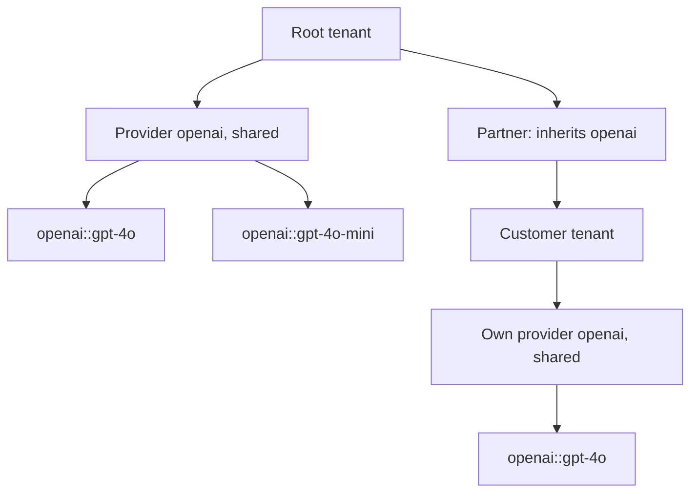

Created: 2026-10-22 by Constructor Tech

# PRD — Model Registry

<!-- toc -->

- [1. Overview](#1-overview)
  - [1.1 Purpose](#11-purpose)
  - [1.2 Background / Problem Statement](#12-background--problem-statement)
  - [1.3 Goals (Business Outcomes)](#13-goals-business-outcomes)
  - [1.4 Glossary](#14-glossary)
- [2. Actors](#2-actors)
  - [2.1 Human Actors](#21-human-actors)
  - [2.2 System Actors](#22-system-actors)
- [3. Operational Concept & Environment](#3-operational-concept--environment)
  - [3.1 Gear-Specific Environment Constraints](#31-gear-specific-environment-constraints)
- [4. Scope](#4-scope)
  - [4.1 In Scope](#41-in-scope)
  - [4.2 Out of Scope](#42-out-of-scope)
- [5. Functional Requirements](#5-functional-requirements)
  - [5.1 Providers](#51-providers)
  - [5.2 Models](#52-models)
  - [5.3 Resolution for Evaluation](#53-resolution-for-evaluation)
  - [5.4 Tenancy and Access Control](#54-tenancy-and-access-control)
- [6. Non-Functional Requirements](#6-non-functional-requirements)
  - [6.1 Gear-Specific NFRs](#61-gear-specific-nfrs)
  - [6.2 NFR Exclusions](#62-nfr-exclusions)
- [7. Public Library Interfaces](#7-public-library-interfaces)
  - [7.1 Public API Surface](#71-public-api-surface)
  - [7.2 External Integration Contracts](#72-external-integration-contracts)
- [8. Use Cases](#8-use-cases)
  - [Resolve Model for a Tenant](#resolve-model-for-a-tenant)
  - [Share and Shadow Provider](#share-and-shadow-provider)
  - [Approve Model](#approve-model)
  - [List Models with a Filter](#list-models-with-a-filter)
- [9. Acceptance Criteria](#9-acceptance-criteria)
- [10. Dependencies](#10-dependencies)
- [11. Assumptions](#11-assumptions)
- [12. Risks](#12-risks)
- [13. Open Questions](#13-open-questions)
- [14. Traceability](#14-traceability)

<!-- /toc -->

## 1. Overview

### 1.1 Purpose

Model Registry is the platform's catalog of AI models. For each model it holds the identity (`provider_slug::provider_model_id`), the provider that serves it, and the LLM Gateway plugin type that evaluates it (evaluation means running an inference request). It also holds provider-specific settings including cost, general connection settings, default parameters, capabilities, user-facing information, sharing mode, and approval state.

The registry records which provider offers which model and which tenants may use it. LLM Gateway calls it on every request. It resolves a model identifier into everything needed to evaluate the request and checks that the calling tenant may use that model.

### 1.2 Background / Problem Statement

Platform gears (chat, agents, batch jobs) send inference requests to LLM Gateway naming a model. The gateway must find, from one place, which plugin evaluates the model, which endpoint and credential to use, and which settings and prices apply. It must also know whether the tenant is allowed to use the model.

Tenants form a hierarchy. A parent, for example a partner, wants to configure providers and models once and let descendants use them. A descendant may add its own providers or block an inherited one. Without a registry, each consumer would keep its own model list and access rules would be scattered.

The Customer tenant defines its own `Shared` provider with the slug `openai`, which shadows the inherited one. Because it is `Shared`, Customer and its descendants see only Customer's `openai::gpt-4o`, while Partner still sees both Root models.

### 1.3 Goals (Business Outcomes)

- One catalog: every model LLM Gateway can evaluate is described once, under one canonical identifier.
- Tenant administrators configure providers and models for their own tenant and share them down the hierarchy without per-tenant duplication.
- Only models from enabled providers, approved by their owning tenant, and permitted by the policy decision point (PDP) resolve for evaluation.
- Resolution sits on the request path of every LLM call: latency and availability targets set in `cpt-cf-model-registry-nfr-resolution-latency` and `cpt-cf-model-registry-nfr-availability`.

### 1.4 Glossary

| Term | Definition |
|------|------------|
| Model | A catalog entry describing one AI model offered by exactly one provider. |
| Provider | An entity describing where models come from. It belongs to exactly one tenant and has a name, slug, and Global Type System (GTS) type. |
| Canonical ID | The model identifier `provider_slug::provider_model_id`, for example `openai::gpt-4o`. |
| GTS | Global Type System: the platform's registry of globally unique type identifiers and their schemas. |
| Provider GTS type | A globally unique type identifier naming the LLM Gateway plugin family that evaluates the provider's models. |
| Provider-specific settings | Settings whose shape is defined by the provider type, including cost. |
| General settings | The `base_url` and an optional reference to a secret in the credential store. |
| Default parameters | Provider-independent inference defaults, such as temperature or maximum output tokens. The model record also states whether callers may override them and which extra parameters callers may pass. |
| Capabilities | What a model can do: streaming, tool calling, vision, structured output, reasoning controls, embeddings. |
| User-facing information | Presentation fields: display name, description, icon, hosted by, context window size, and similar. |
| Approval | The owning tenant's decision on a model. The state is Pending, Approved, Rejected, or Revoked. Only Approved models may be evaluated. |
| Sharing mode | `Tenant` (visible only to the owner) or `Shared` (visible to descendant tenants). |
| Inheritance | Descendant tenants see the shared providers and models of their ancestors. |
| Shadowing | A tenant's own provider with the same slug replaces an inherited provider and all its models for that tenant. The replacement reaches the tenant's descendants only when the shadowing provider is `Shared`. |
| Effective catalog | The providers and models a tenant sees after inheritance and shadowing. |
| Evaluation (eval) | Running an inference request through LLM Gateway. |
| Tenant hierarchy | The tree of tenants, from the root tenant down to leaf tenants. |
| Tenant Resolver | The platform service that provides a tenant's ancestor chain. |
| PDP | Policy decision point of the platform authorization service. |
| OData | Query conventions for filtering, selecting, ordering, and paging list results. |
| CredStore | The platform credential store, which holds secrets. |

## 2. Actors

### 2.1 Human Actors

#### Tenant Administrator

**ID**: `cpt-cf-model-registry-actor-tenant-admin`

- **Role**: Manages the providers and models of their own tenant. Sets sharing modes, enables or disables providers, and approves or revokes models. The administrator of the root tenant plays the same role for the platform-wide shared catalog.
- **Needs**: Create, read, update, and delete providers and models in their tenant. See which inherited providers and models their tenant receives. Control what descendants receive.

### 2.2 System Actors

#### LLM Gateway

**ID**: `cpt-cf-model-registry-actor-llm-gateway`

- **Role**: Resolves a canonical id for the calling tenant on every inference request. Uses the returned model record to select the plugin, endpoint, credential, settings, cost, and capabilities.

#### Consumer Gear

**ID**: `cpt-cf-model-registry-actor-consumer-gear`

- **Role**: Platform gears and user interfaces that list the models available for evaluation so that users can pick one.

#### Tenant Resolver

**ID**: `cpt-cf-model-registry-actor-tenant-resolver`

- **Role**: Provides the tenant hierarchy (ancestor chain) used for inheritance and shadowing.

#### Authorization PDP

**ID**: `cpt-cf-model-registry-actor-authz-pdp`

- **Role**: The policy decision point (PDP). Decides whether a caller may manage providers and models or evaluate a given model.

#### Types Registry

**ID**: `cpt-cf-model-registry-actor-types-registry`

- **Role**: Holds the GTS schemas of provider types, registered by LLM Gateway provider plugins. Provider-specific settings are validated against them.

## 3. Operational Concept & Environment

> **Note**: Platform-wide runtime, lifecycle, security, and integration conventions are defined in [ARCHITECTURE_MANIFEST.md](../../../docs/ARCHITECTURE_MANIFEST.md) and the [guidelines](../../../guidelines/README.md). There is no parent PRD for this gear. Only gear-specific constraints are listed below.

### 3.1 Gear-Specific Environment Constraints

- The gear sits on the request path of LLM Gateway. Its availability target is set in section 6.1.
- Catalog data persists durably through the platform's standard persistence (see `cpt-cf-model-registry-nfr-durability`).
- The gear depends at runtime on Tenant Resolver, Authorization PDP, and Types Registry being reachable.

## 4. Scope

### 4.1 In Scope

- Tenant-scoped provider catalog: create, read, update, delete, enable or disable, and sharing mode.
- Tenant-scoped model catalog with the model record contents described in section 5.2.
- Model approval state managed by the owning tenant.
- Inheritance down the tenant hierarchy, with provider shadowing.
- Management API following platform conventions (OData, authorization, canonical errors).
- Resolution API for evaluation: get a model by canonical id and list available models.
- Durable storage of the catalog.

### 4.2 Out of Scope

- Running inference. LLM Gateway and its plugins do this.
- Storing secrets. CredStore holds them; the registry stores only a reference.
- Automatic discovery or synchronization of models from provider APIs.
- Provider health or latency monitoring.
- Usage metering and billing. The registry only stores cost settings.
- Multi-step approval workflows with external approvers. The registry records the owning tenant's approval decision.
- Per-user or per-group model entitlements beyond the policy decisions of the PDP.

## 5. Functional Requirements

> **Testing strategy**: All requirements verified via automated tests (unit, integration, e2e) targeting 90%+ code coverage unless otherwise specified. Document verification method only for non-test approaches (analysis, inspection, demonstration).

### 5.1 Providers

#### Provider Management

- [ ] `p1` - **ID**: `cpt-cf-model-registry-fr-provider-management`

The system **MUST** let a Tenant Administrator create, read, update, and delete providers in their own tenant. A provider has a name, a slug unique among the providers the tenant owns, a provider GTS type, an enabled flag, and a sharing mode. A provider belongs to exactly one tenant and is managed only by that tenant. The slug and the provider GTS type are immutable after creation. Deleting a provider deletes its models, and the change takes effect for later resolutions. When the deleted provider shadowed an inherited one, the inherited provider and its models become visible again.

- **Rationale**: Tenants need to describe where their models come from and keep control of that description.
- **Actors**: `cpt-cf-model-registry-actor-tenant-admin`

#### Provider Disable

- [ ] `p1` - **ID**: `cpt-cf-model-registry-fr-provider-disable`

The system **MUST** make every model of a disabled provider unavailable for evaluation, for the owning tenant and every tenant that inherits the provider, without deleting the models. Re-enabling the provider **MUST** restore availability. Resolution of such a model **MUST** report the distinct reason "provider disabled".

- **Rationale**: Administrators need a fast, reversible way to stop a provider, for example during an outage or a contract change.
- **Actors**: `cpt-cf-model-registry-actor-tenant-admin`, `cpt-cf-model-registry-actor-llm-gateway`

#### Provider Sharing

- [ ] `p1` - **ID**: `cpt-cf-model-registry-fr-provider-sharing`

The system **MUST** support two provider sharing modes. With `Tenant`, the provider and its models are visible only to the owning tenant. With `Shared`, the provider is visible to all descendant tenants. A change of mode **MUST** take effect for later resolutions.

- **Rationale**: Parents configure a provider once and choose whether descendants receive it.
- **Actors**: `cpt-cf-model-registry-actor-tenant-admin`

#### Provider Shadowing

- [ ] `p1` - **ID**: `cpt-cf-model-registry-fr-provider-shadowing`

The system **MUST** let a tenant shadow an inherited provider by owning a provider with the same slug. The tenant's own provider and models always replace the inherited provider and all of its models for that tenant. The replacement extends to the tenant's descendants only when the shadowing provider is `Shared`. A `Tenant`-mode shadowing provider affects its owner only, and descendants keep inheriting the ancestor's shared provider. A `Shared`, disabled shadowing provider therefore blocks the inherited models for the whole subtree.

- **Rationale**: Descendants need to override or block what they inherit without any change to the ancestor's catalog.
- **Actors**: `cpt-cf-model-registry-actor-tenant-admin`

### 5.2 Models

#### Model Identity

- [ ] `p1` - **ID**: `cpt-cf-model-registry-fr-model-identity`

The system **MUST** identify every model by the canonical id `provider_slug::provider_model_id`, for example `openai::gpt-4o`. A model belongs to exactly one provider of the same tenant, is unique among the models that tenant owns, and has a `provider_model_id` that is immutable after creation. With the immutable provider slug, its canonical id never changes.

- **Rationale**: A stable, human-readable identifier lets consumers refer to models without knowing tenant or storage details.
- **Actors**: `cpt-cf-model-registry-actor-llm-gateway`, `cpt-cf-model-registry-actor-tenant-admin`

#### Model Management

- [ ] `p1` - **ID**: `cpt-cf-model-registry-fr-model-management`

The system **MUST** let a Tenant Administrator create, read, update, and delete models in their own tenant. A model record holds the following.

- The provider GTS type that evaluates it, taken from its provider.
- Provider-specific settings, including cost.
- General settings: `base_url` and an optional credential-store secret reference.
- Default parameters, and which parameters callers may override or add per request.
- Capabilities.
- User-facing information: display name, description, icon, hosted by, context window size, and similar.
- Sharing mode.
- Approval information.

The gear does not interpret provider-specific settings beyond validation.

- **Rationale**: LLM Gateway needs one complete record per model to evaluate a request.
- **Actors**: `cpt-cf-model-registry-actor-tenant-admin`

#### Model Settings Validation

- [ ] `p1` - **ID**: `cpt-cf-model-registry-fr-model-settings-validation`

The system **MUST** validate provider-specific settings against the GTS schema registered for the provider's type. A model with settings that do not match the schema **MUST** be rejected with a validation error naming the offending fields. When Types Registry cannot answer, the write **MUST** be rejected with the reason "dependency unavailable".

- **Rationale**: Invalid settings found at write time cannot break requests at evaluation time.
- **Actors**: `cpt-cf-model-registry-actor-tenant-admin`, `cpt-cf-model-registry-actor-types-registry`

#### Model Approval

- [ ] `p1` - **ID**: `cpt-cf-model-registry-fr-model-approval`

The system **MUST** keep an approval state on each model, set by the owning tenant's administrator. Each model carries one of four approval states: Pending, Approved, Rejected, or Revoked, together with who made the last decision and when. Create and update **MAY** set the approval state under the model management permission. A model created without an approval state starts as Approved. Only Approved models **MUST** be available for evaluation. Approval is inherited with the model. A descendant tenant cannot change the approval of an inherited model and can only exclude it by shadowing its provider.

- **Rationale**: The owning tenant controls which models are cleared for use, and the latest decision and who made it stay visible.
- **Actors**: `cpt-cf-model-registry-actor-tenant-admin`

#### Model Sharing

- [ ] `p1` - **ID**: `cpt-cf-model-registry-fr-model-sharing`

The system **MUST** give models the same sharing modes as providers. A model **MUST** be visible to descendant tenants only when both the model and its provider are `Shared`. There is no model-level shadowing.

- **Rationale**: Administrators can share a provider yet keep some of its models private by setting them to `Tenant` mode. Shadowing a model would require shadowing its provider first, which already replaces all its inherited models.
- **Actors**: `cpt-cf-model-registry-actor-tenant-admin`

#### Effective Catalog

- [ ] `p1` - **ID**: `cpt-cf-model-registry-fr-effective-catalog`

The system **MUST** build a tenant's effective catalog from the providers and models it owns plus the shared providers and models of its ancestors. Shadowing is applied per provider slug, and the nearest tenant whose provider is visible to the caller wins. Inherited entries **MUST** be read-only for the inheriting tenant. An inheriting tenant sees the full record of an inherited provider and model, including provider-specific settings and cost, general settings with `base_url` and the secret reference, default parameters, capabilities, and user-facing information.

- **Rationale**: A single, predictable rule decides what each tenant sees, so all consumers get the same answer.
- **Actors**: `cpt-cf-model-registry-actor-llm-gateway`, `cpt-cf-model-registry-actor-tenant-admin`, `cpt-cf-model-registry-actor-tenant-resolver`

### 5.3 Resolution for Evaluation

#### Resolve Model

- [ ] `p1` - **ID**: `cpt-cf-model-registry-fr-resolve-model`

The system **MUST**, given a canonical id and the calling tenant, return the full model record from the tenant's effective catalog when the provider is enabled, the model is approved, and the PDP permits the caller to evaluate the model. Otherwise it **MUST** return a distinct, machine-readable reason for each failure: model not found, provider disabled, model not approved (the state is Pending, Rejected, or Revoked), or not permitted. When the PDP or Tenant Resolver cannot answer, resolution **MUST** fail closed with the distinct reason "dependency unavailable"; it never grants access by default.

- **Rationale**: LLM Gateway needs one call that both finds the model and enforces tenant access, and it must tell callers why a request failed.
- **Actors**: `cpt-cf-model-registry-actor-llm-gateway`, `cpt-cf-model-registry-actor-authz-pdp`

#### List Available Models

- [ ] `p1` - **ID**: `cpt-cf-model-registry-fr-list-available-models`

The system **MUST** list, for the calling tenant, exactly the models that would resolve successfully under `cpt-cf-model-registry-fr-resolve-model`. The list **MUST** support OData filtering, ordering, selection, and paging on the model's general fields: identity, approval, capabilities, and user-facing fields.

- **Rationale**: Users and consumer gears need to pick from models they can actually use.
- **Actors**: `cpt-cf-model-registry-actor-consumer-gear`, `cpt-cf-model-registry-actor-llm-gateway`

### 5.4 Tenancy and Access Control

#### Tenant Isolation

- [ ] `p1` - **ID**: `cpt-cf-model-registry-fr-tenant-isolation`

The system **MUST** scope all management operations to the caller's tenant, and resolution and listing **MUST** return only models in the caller's effective catalog. A tenant **MUST NOT** read or modify another tenant's providers or models except through read-only inheritance.

- **Rationale**: A tenant's providers and models hold commercial settings and credential references. They reach other tenants only when the owner shares them down the hierarchy, never sideways or upward.
- **Actors**: `cpt-cf-model-registry-actor-tenant-admin`

#### Authorization

- [ ] `p1` - **ID**: `cpt-cf-model-registry-fr-authorization`

The system **MUST** authorize every management and resolution operation through the platform PDP. Distinct permissions **MUST** exist for managing providers, managing models, and evaluating models.

- **Rationale**: Separate permissions let organizations split catalog administration and use.
- **Actors**: `cpt-cf-model-registry-actor-authz-pdp`, `cpt-cf-model-registry-actor-tenant-admin`, `cpt-cf-model-registry-actor-llm-gateway`

#### Management API Conventions

- [ ] `p1` - **ID**: `cpt-cf-model-registry-fr-management-api-conventions`

The system **MUST** expose the management API following the platform REST conventions: OData query options on list operations, canonical problem-details errors, and a versioned API surface. It **MUST** expose inherited entries read-only and mark them as inherited.

- **Rationale**: Consistent conventions reduce integration effort, and explicit marking prevents confusion about what a tenant can edit.
- **Actors**: `cpt-cf-model-registry-actor-tenant-admin`, `cpt-cf-model-registry-actor-consumer-gear`

#### Change Audit

- [ ] `p2` - **ID**: `cpt-cf-model-registry-fr-change-audit`

The system **MUST** record who made each change to a provider or model and when, for create, update, delete, enable or disable, sharing mode, and approval changes, and make that record readable to the owning tenant's administrator.

- **Rationale**: Changes to sharing, shadowing, and enablement alter what other tenants can use.
- **Actors**: `cpt-cf-model-registry-actor-tenant-admin`

## 6. Non-Functional Requirements

> **Global baselines**: Project-wide NFRs (performance, security, reliability, scalability) are defined once in [ARCHITECTURE_MANIFEST.md](../../../docs/ARCHITECTURE_MANIFEST.md) and the [guidelines](../../../guidelines/README.md). There is no parent PRD. Only gear-specific NFRs are listed here.
>
> **Testing strategy**: NFRs verified via automated benchmarks, security scans, and monitoring unless otherwise specified.

### 6.1 Gear-Specific NFRs

#### Resolution Latency

- [ ] `p1` - **ID**: `cpt-cf-model-registry-nfr-resolution-latency`

The system **MUST** resolve a canonical id for a tenant within 10 ms at the 99th percentile inside the gear, excluding network time.

- **Threshold**: p99 at or below 10 ms per resolution, measured inside the gear and excluding time spent waiting on the PDP and Tenant Resolver; sustained load of 1,000 resolutions per second with peaks of 5,000 per second platform-wide; catalog of 10,000 models platform-wide across all tenants; tenant hierarchies up to 10 levels deep.
- **Rationale**: Resolution runs on every LLM request, and LLM Gateway budgets 50 ms of total overhead.
- **Verification Method**: Automated benchmark at the stated load, catalog size, and hierarchy depth.
- **Architecture Allocation**: Pending DESIGN (not yet created)

#### Availability

- [ ] `p1` - **ID**: `cpt-cf-model-registry-nfr-availability`

The system **MUST** keep the resolution operations available 99.9% of the time per calendar month, measured at the gear's interfaces. It **MUST** restore service within 15 minutes after a failure of the gear itself.

- **Threshold**: 99.9% monthly availability of resolution; recovery within 15 minutes after a gear failure.
- **Rationale**: LLM Gateway targets 99.9% availability and depends on resolution on every request.
- **Verification Method**: Monitoring of monthly resolution availability and of recovery time after gear failures.
- **Architecture Allocation**: Pending DESIGN (not yet created)

#### Durability

- [ ] `p1` - **ID**: `cpt-cf-model-registry-nfr-durability`

An acknowledged change to a provider or model **MUST** survive restarts of the gear and of the platform, and **MUST** be covered by the platform's standard backups.

- **Threshold**: Zero loss of acknowledged writes.
- **Rationale**: The catalog is the source of truth for model access, and losing it would stop all LLM calls that depend on it.
- **Verification Method**: Restart and backup-restore tests confirming that acknowledged writes survive.
- **Architecture Allocation**: Pending DESIGN (not yet created)

### 6.2 NFR Exclusions

- **Safety**: Not applicable. The gear is an information system with no physical interaction.
- **Usability, accessibility, internationalization, offline use**: Not applicable. The gear has no user interface; consumer gears own presentation.
- **Authentication**: Provided by the platform. The gear only consumes the authenticated security context.
- **Regulatory compliance and privacy**: The gear stores configuration and the identity of administrators who made approval decisions or changes, and no end-user personal data. Platform baselines apply.
- **Operations and monitoring**: Platform baselines apply. No gear-specific requirement.
- **Documentation and support**: Platform baselines apply.

## 7. Public Library Interfaces

### 7.1 Public API Surface

#### REST API

- [ ] `p1` - **ID**: `cpt-cf-model-registry-interface-rest-api`

- **Type**: REST API
- **Stability**: stable
- **Description**: Tenant-scoped management of providers and models, plus the two resolution operations: get by canonical id and list available for evaluation.
- **Breaking Change Policy**: A breaking change requires a new API version.

#### SDK Client

- [ ] `p1` - **ID**: `cpt-cf-model-registry-interface-sdk-client`

- **Type**: Rust gear SDK trait, obtained through the platform client hub
- **Stability**: stable
- **Description**: The same resolution and management operations for in-process gears. LLM Gateway uses it on the request path.
- **Breaking Change Policy**: A breaking change requires a new versioned trait.

### 7.2 External Integration Contracts

#### Provider Settings Schema

- [ ] `p1` - **ID**: `cpt-cf-model-registry-contract-provider-settings-schema`

- **Direction**: required from client (LLM Gateway provider plugins)
- **Protocol/Format**: GTS schema registered in Types Registry for each provider type
- **Compatibility**: Schema changes must stay backward compatible with stored settings, or ship as a new provider type version.

#### Tenant Hierarchy

- [ ] `p1` - **ID**: `cpt-cf-model-registry-contract-tenant-hierarchy`

- **Direction**: required from client (Tenant Resolver)
- **Protocol/Format**: Ancestor chain of a tenant, root first
- **Compatibility**: Hierarchy changes take effect on the next resolution.

## 8. Use Cases

### Resolve Model for a Tenant

- [ ] `p1` - **ID**: `cpt-cf-model-registry-usecase-resolve-model`

**Actor**: `cpt-cf-model-registry-actor-llm-gateway`

**Preconditions**:
- The calling tenant has `openai::gpt-4o` in its effective catalog.

**Main Flow**:
1. LLM Gateway receives an inference request from a tenant naming `openai::gpt-4o`.
2. LLM Gateway asks the registry to resolve `openai::gpt-4o` for that tenant.
3. The registry finds the model in the tenant's effective catalog.
4. The registry checks that the provider is enabled and the model is approved.
5. The registry asks the PDP whether the caller may evaluate the model.
6. The registry returns the full model record.
7. LLM Gateway selects the plugin, endpoint, credential, and settings from the record.

**Postconditions**:
- LLM Gateway holds everything needed to evaluate the request.

**Alternative Flows**:
- **Model not found**: The registry returns the reason "model not found".
- **Provider disabled**: The registry returns the reason "provider disabled".
- **Model not approved**: The model is Pending, Rejected, or Revoked. The registry returns the reason "model not approved".
- **Not permitted**: The PDP denies access, and the registry returns the reason "not permitted".
- **Dependency unavailable**: The PDP or Tenant Resolver cannot answer. The registry fails closed and returns the reason "dependency unavailable".

### Share and Shadow Provider

- [ ] `p1` - **ID**: `cpt-cf-model-registry-usecase-share-and-shadow-provider`

**Actor**: `cpt-cf-model-registry-actor-tenant-admin`

**Preconditions**:
- Root, Partner, and Customer tenants form a three-level hierarchy.

**Main Flow**:
1. The Root administrator creates the shared provider `openai` and its shared, approved models.
2. The Partner tenant now sees `openai::gpt-4o` and `openai::gpt-4o-mini` as inherited, read-only entries.
3. The Customer administrator creates its own shared provider with the slug `openai`.
4. The Customer administrator creates a shared, approved `openai::gpt-4o` under that provider.
5. Customer and its descendants now see only the Customer models of the `openai` provider.
6. Partner and its other descendants still see the Root models.

**Postconditions**:
- The inherited `openai` provider and its models are replaced for the Customer subtree.

**Alternative Flows**:
- **Block inherited models**: The Customer administrator creates the shadowing `openai` provider as `Shared` and disabled. No `openai` model resolves anywhere in the Customer subtree.

### Approve Model

- [ ] `p1` - **ID**: `cpt-cf-model-registry-usecase-approve-model`

**Actor**: `cpt-cf-model-registry-actor-tenant-admin`

**Preconditions**:
- A model exists in the administrator's tenant with approval state Pending.
- The administrator holds the model management permission.

**Main Flow**:
1. The administrator opens the model in their tenant.
2. The administrator sets the approval state to Approved.
3. The registry records the decision, who made it, and when.
4. The model now resolves for tenants that may see it.

**Postconditions**:
- The model is available for evaluation, provided its provider is enabled.

**Alternative Flows**:
- **Revoke**: The administrator sets the state to Revoked. Later resolutions report "model not approved".

### List Models with a Filter

- [ ] `p1` - **ID**: `cpt-cf-model-registry-usecase-list-available-models`

**Actor**: `cpt-cf-model-registry-actor-consumer-gear`

**Preconditions**:
- The caller is acting for a tenant and may evaluate models.

**Main Flow**:
1. A consumer gear asks for the available models of the tenant.
2. The consumer gear adds a capability filter, for example models that support vision.
3. The registry builds the tenant's effective catalog.
4. The registry keeps only models that would resolve successfully and match the filter.
5. The registry returns a page of results.

**Postconditions**:
- The consumer gear can show the user models that are certain to resolve.

**Alternative Flows**:
- **No match**: The registry returns an empty list.

## 9. Acceptance Criteria

- [ ] A model from a disabled provider never resolves and is absent from the available list.
- [ ] A descendant tenant sees the shared providers and models of its ancestors and none of their `Tenant`-mode entries.
- [ ] Defining a `Shared` provider with an inherited slug replaces all inherited models of that slug for the tenant and its descendants.
- [ ] Defining a `Tenant`-mode provider with an inherited slug replaces the inherited models for the owning tenant only; its descendants keep the inherited models.
- [ ] A `Shared`, disabled shadowing provider removes the inherited models from the whole subtree.
- [ ] Deleting a shadowing provider restores the inherited provider and its models for the affected tenants.
- [ ] Only approved models resolve, and a revoked model stops resolving on the next call.
- [ ] Provider-specific settings that violate the provider type schema are rejected with a validation error.
- [ ] Management calls never return another tenant's owned entries.
- [ ] Resolution meets `cpt-cf-model-registry-nfr-resolution-latency` at its stated load, catalog size, and hierarchy depth.
- [ ] Resolution meets `cpt-cf-model-registry-nfr-availability`.

## 10. Dependencies

| Dependency | Description | Criticality |
|------------|-------------|-------------|
| Tenant Resolver | Provides the tenant ancestor chain for inheritance and shadowing. | p1 |
| Authorization PDP | Decides management and evaluation permissions. | p1 |
| Types Registry | Holds provider type schemas used to validate settings. | p1 |
| Platform database | Stores the catalog durably. | p1 |
| LLM Gateway provider plugins | Register provider types and schemas, and consume model records. | p1 |
| CredStore | Stores and resolves the secrets that models reference, outside the registry. | p2 |

## 11. Assumptions

- Secrets live in CredStore, and the registry stores only a reference.
- LLM Gateway is the only evaluator and enforces capabilities and parameter overrides at request time.
- The tenant hierarchy is a tree with one root.
- The root tenant's administrator seeds the platform-wide shared catalog.
- Provider types and their settings schemas are registered before models of that type are created.

## 12. Risks

| Risk | Impact | Mitigation |
|------|--------|------------|
| Inheritance resolution cost grows with hierarchy depth and catalog size. | Resolution slows down every LLM request. | Verify the latency NFR by benchmark. |
| Shadowing semantics surprise administrators. | A tenant loses or blocks models unintentionally. | The management API marks inherited and shadowed entries explicitly. |
| Provider settings schema drifts between plugin versions and stored models. | Stored models stop matching their schema. | Follow the compatibility contract and validate on write. |
| The registry on the hot path is a single point of failure for LLM Gateway. | A registry outage stops all LLM calls. | Meet the availability NFR. |

## 13. Open Questions

- Confirm the resolution latency budget and load conditions (`cpt-cf-model-registry-nfr-resolution-latency`) and the availability and recovery targets (`cpt-cf-model-registry-nfr-availability`). (Owner: LLM Gateway team and Model Registry team, Resolve by: before P1 implementation begins)
- Will descendant tenants need per-tenant approval overrides of inherited models? This is currently excluded by design. (Owner: Model Registry team, Resolve by: before DESIGN is approved)
- Will multi-step approval through an external approval service be required later? (Owner: Platform Architecture, Resolve by: before P2 planning)
- How will auto-discovery of provider models work? Discovered models would start as Pending and wait for an administrator's approval. (Owner: Model Registry team, Resolve by: before P2 planning)
- Must cost settings be exposed in a provider-independent form for consumers other than LLM Gateway? (Owner: Model Registry team, Resolve by: before DESIGN is approved)

## 14. Traceability

- **Design**: not yet created.
- **ADRs**: not yet created.
- **Features**: not yet created.
- **SDK crate**: `cf-gears-model-registry-sdk` (`gears/model-registry/model-registry-sdk`) exists and predates this PRD.
