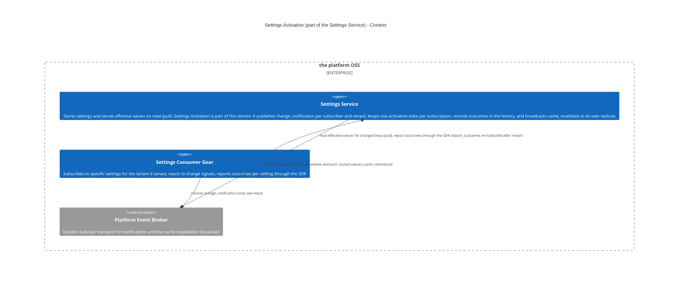
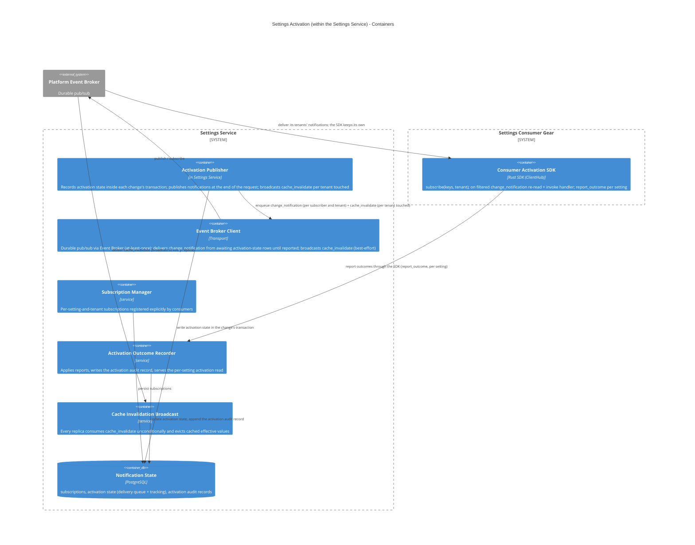
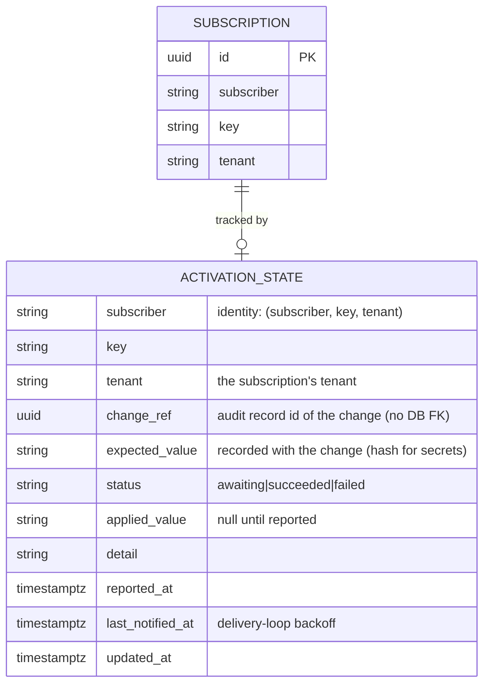
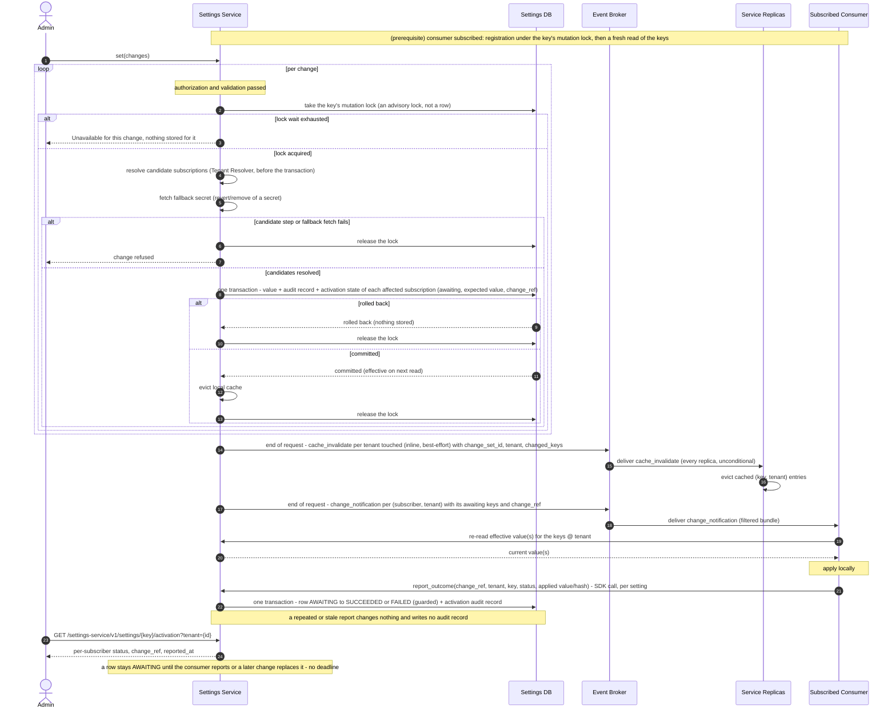
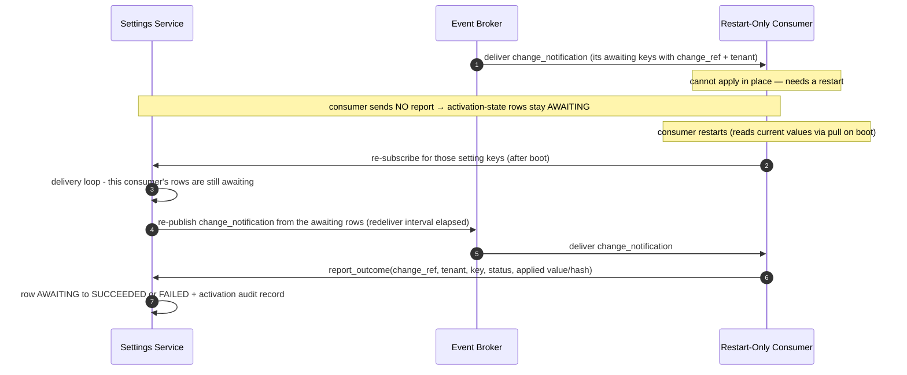

Created:  2026-07-28 by Virtuozzo International GmbH
Updated:  2026-10-27 by Virtuozzo International GmbH

# Technical Design — Settings Activation

<!-- toc -->

- [1. Architecture Overview](#1-architecture-overview)
  - [1.1 Architectural Vision](#11-architectural-vision)
  - [1.2 Architecture Drivers](#12-architecture-drivers)
  - [1.3 Architecture Layers](#13-architecture-layers)
- [2. Goals / Non-Goals](#2-goals--non-goals)
  - [2.1 Goals](#21-goals)
  - [2.2 Non-Goals](#22-non-goals)
- [3. Principles & Constraints](#3-principles--constraints)
  - [3.1 Design Principles](#31-design-principles)
  - [3.2 Constraints](#32-constraints)
- [4. Technical Architecture](#4-technical-architecture)
  - [4.1 Domain Model](#41-domain-model)
  - [4.2 Component Model](#42-component-model)
  - [4.3 API Contracts](#43-api-contracts)
  - [4.4 External Interfaces & Protocols](#44-external-interfaces--protocols)
  - [4.5 Service-to-Service Pattern](#45-service-to-service-pattern)
  - [4.6 Interactions & Sequences](#46-interactions--sequences)
  - [4.7 Database schemas & tables](#47-database-schemas--tables)
  - [4.8 Security & Authorization](#48-security--authorization)
  - [4.9 Technology Stack](#49-technology-stack)
- [5. Risks / Trade-offs](#5-risks--trade-offs)
  - [5.1 Architectural Trade-offs](#51-architectural-trade-offs)
  - [5.2 Security and Performance Risks](#52-security-and-performance-risks)
- [6. Open Questions](#6-open-questions)
  - [6.1 From PRD (Cross-Reference)](#61-from-prd-cross-reference)
  - [6.2 Design-Specific Questions](#62-design-specific-questions)
- [7. Additional context](#7-additional-context)
  - [Feature Metrics](#feature-metrics)
  - [NFR Mapping](#nfr-mapping)
  - [Testing Architecture](#testing-architecture)
- [8. Traceability](#8-traceability)

<!-- /toc -->

<!--
=============================================================================
TECHNICAL DESIGN DOCUMENT
=============================================================================
PURPOSE: Define HOW the system is built — architecture, components, APIs,
data models, and technical decisions that realize the requirements.

DESIGN IS PRIMARY: DESIGN defines the "what" (architecture and behavior).
ADRs record the "why" (rationale and trade-offs) for selected design
decisions; ADRs are not a parallel spec, it's a traceability artifact.

SCOPE:
  ✓ Architecture overview and vision
  ✓ Design principles and constraints
  ✓ Component model and interactions
  ✓ API contracts and interfaces
  ✓ Data models and database schemas
  ✓ Technology stack choices

NOT IN THIS DOCUMENT (see other templates):
  ✗ Requirements → PRD.md
  ✗ Storage, resolution and the value commit → DESIGN.md
  ✗ Detailed rationale for decisions → ADR/

STANDARDS ALIGNMENT:
  - IEEE 1016-2009 (Software Design Description)
  - IEEE 42010 (Architecture Description — viewpoints, views, concerns)
  - ISO/IEC 15288 / 12207 (Architecture & Design Definition processes)

DESIGN LANGUAGE:
  - Be specific and clear; no fluff, bloat, or emoji
  - Reference PRD requirements using `cpt-cf-settings-service-fr-{slug}`,
    `cpt-cf-settings-service-nfr-{slug}` IDs
  - Cross-document references name the target file, e.g. "DESIGN.md §4.2"
=============================================================================
-->

- [ ] `p1` - **ID**: `cpt-cf-settings-service-design-settings-activation`

## 1. Architecture Overview

### 1.1 Architectural Vision

Design **Settings Activation** — the part of the **Settings Service** that provides **guaranteed, acknowledged delivery** of settings-change notifications. It tells a settings consumer **which settings changed**, so the consumer can re-read the new values and apply them its own way, and it **keeps each consumer's activation state per subscription (one row per subscriber, key and tenant)** until the consumer confirms the current value. It builds on the [Settings Service](./DESIGN.md) value store, which serves values **on read** (pull): that path assumes a consumer reads a value **when it needs it**. This design adds the **push** signal with **back-response tracking**, so a consumer that has already materialized values at startup (connection pools, listener sockets, rendered config files) learns exactly which changed and can confirm successful activation back to the service. Settings Activation is **not a separate component** — the Settings Service owns it.

The service also keeps its own **cache coherence** from the same request: replicas evict cached effective values. This is a **separate, internal broadcast** (§4.2 *Cache Invalidation Broadcast*) — not the consumer signal — so the two concerns (consumer activation vs. replica invalidation) do not leak into each other.

#### Two distinct distributions

A committed change drives **two independent kinds of distribution**, with deliberately different delivery and trust models:

| | **Consumer activation** (§4.2 *Activation Publisher*, §4.2 *Consumer Activation SDK*) | **Replica cache invalidation** (§4.2 *Cache Invalidation Broadcast*) |
|---|---|---|
| **Who receives** | Services that **subscribed** to the specific settings — only they know which settings need active re-application beyond a plain pull | **Every** Settings Service replica (the service's own instances) |
| **Subscription** | Per setting and tenant, opt-in (§4.2 *Subscription Manager*) | **None** — always sent, always processed |
| **Payload** | Filtered to **only the subscriber's own subscribed keys** | The full changed-key set (trusted, internal) |
| **Acknowledged** | Yes — per activation-state row (subscriber, key, tenant); no deadline (§4.2 *Activation Outcome Recorder*) | No — fire-and-forget eviction |
| **Event** | `change_notification` (`gts.cf.core.events.event.v1~cf.core.settings.change_notification.v1~`, activation topic; per subscriber and tenant) | `cache_invalidate` (`gts.cf.core.events.event.v1~cf.core.settings.cache_invalidate.v1~`, cache topic; broadcast) |

Splitting them is **least-privilege / blast-radius reduction** (§4.8): a consumer's handler is given only the keys it subscribed to (the SDK drops what the broker delivers for other subscribers of its tenants, §4.8), not the full "everything that changed, in every tenant" set — which stays inside the trusted replica set. Under the **trusted-caller** model (DESIGN.md §6) the subscriber identity is taken on trust, so this is a best-effort default, **not** an identity-enforced access control; revisit if consumers are ever untrusted.

#### Why a distinct design

Reading a value and being told a value changed are different concerns with different owners, so they are documented separately — even though both live inside the Settings Service:

- The **Settings Service** owns the value and answers reads (pull) — [DESIGN-settings-service](./DESIGN.md).
- The **owning consumer** owns *how* to react to a change — re-read a variable, rebuild a pool, drain and rebind, restart itself. That knowledge lives in the consumer, not in a central orchestrator, and a static per-setting effect enum cannot express it.

This design owns the **signal** and the **reaction contract**. It does not own value storage, resolution, or validation.

### 1.2 Architecture Drivers

#### Functional Drivers

| Requirement | Design Response |
|-------------|-----------------|
| `cpt-cf-settings-service-fr-consumer-activation` | **The requirement this document exists to serve.** A consumer registers interest per `key` and tenant (§4.1 `Subscription`); the Activation Publisher emits a **per-subscriber-and-tenant filtered** `change_notification` carrying only the keys that subscriber watches, and only ones it is entitled to read; the payload carries **identifiers only, never a value**, so the signal stream cannot disclose `secret`- or PII-classified content — the consumer re-reads through its ordinary authorization. Confirmation is the back-response; the account per change is kept in `activation_state` (§4.1 `ActivationState`) and in the setting's history, where each report is recorded under the change it answers (§4.2 *Activation Outcome Recorder*), and the state of the current value is read through the per-setting activation read (§4.3). Activation state is written in the change's transaction and delivered until reported from the durable `activation_state` rows, idempotent per `(subscriber, key, tenant, change_ref)`, with no deadline. |
| `cpt-cf-settings-service-fr-replica-coherence` | The `cache_invalidate` broadcast (§4.2 *Cache Invalidation Broadcast*) converges the **other** replicas — the writing replica evicts inside the write itself. Published inline and best-effort; a missed broadcast is bounded by the reader's `cache_ttl_seconds` backstop, which is what makes the staleness window bounded rather than open-ended. For a `cascading` setting the eviction covers the descendant scopes the change altered. |
| `cpt-cf-settings-service-fr-live-read-activation` | Two-signal split: a per-subscriber-and-tenant filtered `change_notification` for consumer activation and an unfiltered `cache_invalidate` broadcast for replica cache coherence; consumers re-read and self-react |
| `cpt-cf-settings-service-nfr-efficiency-live-read` | Activation never reloads or restarts a consumer; a heavier reaction is the consumer's own, performed in its handler on the signal |
| `cpt-cf-settings-service-nfr-reliability-validated-set` | An invalid or stale write stores nothing, so no activation state is written for it |
| `cpt-cf-settings-service-nfr-performance-read-cache` | `cache_invalidate` is published inline and best-effort; a missed broadcast self-heals inside `cache_ttl_seconds`, so coherence never depends on durable delivery |
| `cpt-cf-settings-service-nfr-ops-set-monitoring` | Per-administrator failure surfaces through the back-response and `event_value_change_failed`; the aggregate operator signal stays with DESIGN.md |

#### NFR Allocation

| NFR ID | NFR Summary | Allocated To | Design Response | Verification Approach |
|--------|-------------|--------------|-----------------|----------------------|
| `cpt-cf-settings-service-fr-consumer-activation` | No consumer activation is lost | Activation Publisher + activation state | The key's mutation lock + activation state written in the change's transaction + deliver-until-reported; idempotent per `(subscriber, key, tenant, change_ref)` | Integration redelivery and restart tests |
| `cpt-cf-settings-service-nfr-performance-read-cache` | Replica staleness is bounded | Cache Invalidation Broadcast | Inline best-effort broadcast plus the `cache_ttl_seconds` backstop owned by the cache components in DESIGN.md | Timed multi-replica convergence test |
| `cpt-cf-settings-service-nfr-security-baseline` | No secret leaves in the signal stream | Event payloads | Notification events carry identifiers only; back-responses carry a hash for secret-valued settings | Subscribed-observer test asserting no plaintext |

### 1.3 Architecture Layers

```
┌─────────────────────────────────────────────────────────────┐
│   Consumers (gears subscribing to the settings they read)   │
├─────────────────────────────────────────────────────────────┤
│  Consumer Activation SDK │ subscribe · handler · ack        │
├─────────────────────────────────────────────────────────────┤
│  Settings Activation (inside the settings-service gear)     │
│  ┌──────────────────────────────────────────────────────┐   │
│  │ Activation Publisher · Subscription Manager ·        │   │
│  │ Activation Outcome Recorder ·                        │   │
│  │ Cache Invalidation Broadcast                         │   │
│  └──────────────────────────────────────────────────────┘   │
├─────────────────────────────────────────────────────────────┤
│  Transport │ Event Broker (at-least-once, repeat-safe)      │
├─────────────────────────────────────────────────────────────┤
│  Storage   │ PostgreSQL (activation state, subscriptions)   │
└─────────────────────────────────────────────────────────────┘
```

| Layer | Responsibility | Technology |
|-------|---------------|------------|
| Consumer SDK | Subscribe to exact setting keys for a tenant, receive the change signal, report the applied outcome | Rust trait in `settings-service-sdk` |
| Activation | Publish the two signals, keep one activation state per subscription, record outcomes in the history | In-process Rust modules in the `settings-service` gear |
| Transport | At-least-once event delivery; a repeated notification is re-applied and re-acknowledged | Event Broker |
| Storage | Durable activation state and the subscription registry | PostgreSQL via `toolkit-db` |

#### Context View



#### Container View



## 2. Goals / Non-Goals

### 2.1 Goals

- **Consumer notification (filtered)** — `change_notification { tenant, subscriber, changes: [{key, change_ref}] }`, delivered **per subscriber and tenant**, carrying **only the subscribed keys at that tenant whose activation is awaiting**, each with the `change_ref` of the change that set what the subscriber is expected to apply (never the full request). Normally one message per request per subscriber and tenant (more only over the broker's event size limit), so a consumer batch-reacts without re-subscribing or polling. `tenant` is always present — the root tenant's id at platform scope (DESIGN.md §4.7). Keys are the settings' GTS **type** ids — referenceable by construction, each registered when its declaration was created (DESIGN.md §4.7). No `change_kind` — consumers re-read anyway.
- **Replica cache invalidation (broadcast)** — `cache_invalidate { change_set_id, tenant, changed_keys: [key] }`, published once per request and tenant it touched to **all** Settings Service replicas (no subscription, no ack), carrying that tenant's full changed-key set so every replica evicts its cached `(key, tenant)` entries (§4.2 *Cache Invalidation Broadcast*).
- **One expectation per subscription** — the latest change to a key at a tenant sets what each subscriber is expected to apply; a newer change replaces it.
- **Per-setting subscription** — a consumer subscribes, in its own name, to the **specific setting keys** it must actively activate (not merely pull). Subscription implies **acknowledged delivery** for those keys (§4.2 *Subscription Manager*).
- **Back-response contract** — consumers report `success` (or `failed` with a `detail`) through the SDK call `report_outcome(change_ref, …)` **per changed setting** after reacting, echoing the `tenant` and **the value they applied (a hash for secret-valued settings)**, so the Settings Service tracks activation **per activation-state row** and verifies the applied value against the expected value **recorded when the change committed** (§4.2 *Activation Publisher*). A `success` carrying a value that does **not** match is a **failure** when it answers the current change (§4.2 *Activation Outcome Recorder*).
- **Activation account per change** — the history of a setting at a tenant shows each subscriber's report for each change (§4.2 *Activation Outcome Recorder*), and the activation read shows the state of the current value (§4.3).
- **Consumer re-read-and-react** obligation: on a `change_notification` the consumer re-reads the affected keys and applies them. A restart-only consumer is handled by the **delivery loop**, which re-publishes its `awaiting` rows once it is back (§4.2 *Event Broker Client*) — no missed activation is stranded.
- **Event Broker transport only** — durable pub/sub via the platform event broker. At-least-once delivery; the consumer's reaction is idempotent, so a repeated notification is re-applied and re-acknowledged.

### 2.2 Non-Goals

- **Setting storage, effective-value resolution, validation, and the value commit** — owned by the [Settings Service](./DESIGN.md) write path. Settings Activation is triggered *by* each committed change, and does not duplicate it.
- **Carrying the value in a notification** — neither **notification** event (`change_notification` / `cache_invalidate`) contains the value or a secret (§4.1); consumers re-read. (Back-responses **do** echo the applied value — a hash for secrets — §4.1/§4.4.)
- **Exactly-once delivery** — the model tolerates at-least-once (Event Broker durability): on every notification the consumer re-reads the effective value and converges to it, so a repeat is **re-applied and re-acknowledged**, never suppressed (§4.2 *Consumer Activation SDK*). No global ordering guarantee across requests.
- **Central execution of heavier reactions — not in the model.** Activation never centrally reloads/restarts a consumer, nor classifies a per-setting "effect." Heavier reactions (rebuild a pool, re-render a config file, restart) are the consumer's **own**, done in its handler on the signal — a consumer that cannot apply in place restarts itself (exit → supervisor restarts it → reads the current value on boot, §4.6). See §4.2 *Heavier consumer reactions*. (Coordinated **rolling** restart across replicas is a deployment/rollout concern — RMS — not activation.)
- **A response deadline / time-boxed wait** — the Settings Service does **not** impose a deadline on an activation; an `awaiting` row stays until the consumer reports or a later change replaces it (how long to keep waiting is an administrator decision, §6). A restart-only consumer leaves its rows **unanswered**; the delivery loop **re-publishes** the notification and the consumer reports after boot (§4.2 *Event Broker Client*).
- **Signalling hierarchy changes** — a re-parent or a tenant inserted mid-chain changes a `cascading` effective value with no value change, and is not signalled to subscribers; the pull path and the cache TTL cover it (§5.2).
- **Namespace/prefix subscriptions** — not supported. Subscription (and the consumer-facing `subscribe`, §4.5 *In-Process SDK — Consumer Activation*) is per **exact** setting key (§4.2 *Subscription Manager*), never a namespace prefix or category.

## 3. Principles & Constraints

### 3.1 Design Principles

#### Notify and React, Never Centrally Execute

- [ ] `p1` - **ID**: `cpt-cf-settings-service-principle-notify-not-execute`

Activation signals *which* keys changed; it never performs a consumer's reaction. A consumer that must rebuild a pool, re-render a config file, or restart does so itself in its own handler. There is no central per-setting effect and no orchestrator.

#### Two Signals, Two Audiences

- [ ] `p1` - **ID**: `cpt-cf-settings-service-principle-two-signal-split`

Consumer activation and replica cache coherence are separate concerns with different delivery requirements, so they are separate events: `change_notification` is per subscriber and tenant, filtered, and acknowledged; `cache_invalidate` is an unfiltered broadcast to the service's own trusted replicas with no subscription and no ack.

#### Identifiers in Notifications, Values Only in Back-Responses

- [ ] `p1` - **ID**: `cpt-cf-settings-service-principle-identifiers-only`

Neither notification event carries a settings value or a secret — consumers re-read under their own identity ([ADR-003](./ADR/ADR-003-thin-event-pull-report-activation.md)). The back-responses are the deliberate exception: they echo the value the consumer applied, hashed when the setting is secret-valued, so the service can verify what was activated.

#### Verify Against the Snapshot, Not a Recomputation

- [ ] `p1` - **ID**: `cpt-cf-settings-service-principle-snapshot-verification`

A report is compared with the expected value recorded in the activation-state row when the change committed, never with a value recomputed at receive. A later change replaces the expectation, and a report counts as success only when the value it applied is the expectation in force.

#### The Wait Is Unbounded and Admin-Driven

- [ ] `p1` - **ID**: `cpt-cf-settings-service-principle-unbounded-wait`

An activation-state row stays `awaiting` until the consumer reports or a later change replaces it. There is no deadline: the service cannot distinguish a slow consumer from a gone one, so it does not guess. The administrator sees an outstanding row in the activation read (§4.3) and in the setting's history; a clean retire deletes the subscription's rows; anything else is an operator decision.

### 3.2 Constraints

#### Delivered as part of the Settings Service Gear

- [ ] `p1` - **ID**: `cpt-cf-settings-service-constraint-activation-in-settings-gear`

Settings Activation is a mechanism **inside** the Settings Service; the publisher and state tables ship in the Settings Service Constructor Fabric Gear (ToolKit runtime); consumers reach the subscription contract through the settings SDK registered in `ClientHub`. The settings database is reached through session pooling or a direct connection: a transaction-pooling proxy voids the key mutation lock and the scan lock (§4.2 *Event Broker Client*, *Why only one replica scans at a time*).

#### Event Broker transport only

- [ ] `p1` - **ID**: `cpt-cf-settings-service-constraint-activation-broker-only`

The signals travel over the platform Event Broker, which is a soft dependency: without it writes commit, activation-state rows stay `awaiting` and the delivery loop idles until the broker resolves, while `cache_ttl_seconds` bounds replica staleness (DESIGN.md §4.9 *The Event Broker as a soft dependency*). Outcomes do not travel over the broker (§4.5).

#### Two signals per request

- [ ] `p1` - **ID**: `cpt-cf-settings-service-constraint-activation-two-events-per-change-set`

Each `set` request emits, at its end, (1) one `cache_invalidate` broadcast to all replicas for each tenant it touched (published inline, best-effort, cache-TTL backstop) and (2) one filtered `change_notification` per subscriber and tenant with `awaiting` keys (§4.2 *Activation Publisher*), re-delivered from the durable activation-state rows until reported. Both follow the commits they describe (§4.2 *Activation Publisher*).

#### Consumer notification is filtered

- [ ] `p1` - **ID**: `cpt-cf-settings-service-constraint-activation-filtered-notification`

A `change_notification` is built for one subscriber and carries **only its subscribed keys whose value changed** — never the full request. A subscription names the tenant it is for, and the subscriber is notified only when the effective value at that tenant changed (§4.2 *Activation Publisher*). This is **best-effort least-privilege, not isolation** (§4.8): every process with an interest in a tenant also receives the notifications built for that tenant's other subscribers, and the SDK drops them.

#### Tenant in payload

- [ ] `p1` - **ID**: `cpt-cf-settings-service-constraint-activation-tenant-in-payload`

Both events include a `tenant`: for `change_notification` the subscription's tenant, whose effective value changed and which the consumer re-reads; for `cache_invalidate` the tenant the change applies to, so replicas evict the right scope. It is **always present**: platform scope is the **root tenant's id**, an ordinary tenant id, not an absent one (DESIGN.md §4.7).

#### No settings value in a notification payload

- [ ] `p1` - **ID**: `cpt-cf-settings-service-constraint-activation-identifiers-only-payload`

The two **notification** events (`change_notification`, `cache_invalidate`) carry **identifiers only** (keys, `change_ref`, `tenant`) — no settings value, no secret; the tenant-scoped effective value resolves correctly on re-read. The **back-responses** (the SDK `report_outcome` call) are the deliberate exception: they carry the **applied value** — plaintext for a non-secret setting, a **hash** for a secret value (the secret plaintext never enters the stream); see §4.8, §4.1/§4.4 (ADR-003, `cpt-cf-settings-service-adr-thin-event-pull-report-activation`).

#### Consumers read effective values on demand, respond with outcomes

- [ ] `p1` - **ID**: `cpt-cf-settings-service-constraint-activation-pull-plus-back-response`

The pull path (`SettingsReaderClient`, DESIGN.md §4.5) is the source of truth; this system signals *which* of a subscriber's keys changed and tracks *what* happened via back-responses (the SDK `report_outcome` call, per setting, carrying the applied value or a secret hash).

#### Unbounded wait, no deadline

- [ ] `p1` - **ID**: `cpt-cf-settings-service-constraint-activation-wait-for-all-unbounded`

An activation-state row stays **awaiting** until the consumer reports or a later change replaces it; there is **no TTL** and **no deadline**. A restart-only consumer does not report before rebooting; its rows stay **awaiting**, the delivery loop keeps **re-publishing** them, and the consumer reports once it is back (§4.2 *Event Broker Client*, §6). The administrator sees an outstanding row in the activation read (§4.3) and in the setting's history (§4.2 *Activation Outcome Recorder*).

## 4. Technical Architecture

### 4.1 Domain Model

#### Entity: `ChangeNotification` (per-subscriber consumer event body)

| Field | Type | Required | Description |
|-------|------|----------|-------------|
| `tenant` | string | Yes | The subscription's tenant, whose effective value changed, as its tenant id — a bare lowercase UUID string; the **root tenant's id** for the platform-wide value (DESIGN.md §4.7). The envelope `tenant_id` names the same tenant. The consumer re-reads for this tenant. |
| `subscriber` | string | Yes | The subscriber the notification is for. The broker delivers by topic, type and tenant only, so the SDK drops a notification whose `subscriber` is not its own (§4.2 *Event Broker Client*, *Broker topology*). |
| `changes` | `[{key, change_ref}]` | Yes | **Only the subscribed keys at `tenant` whose activation-state row for this subscriber is `awaiting`** (GTS type ids; no operation type) — never the full request. Each key carries the `change_ref` of the change that set the current expectation: the id of that change's audit record (DESIGN.md §4.7 `audit_records.id`), which correlates the signal with its cause and with the report that answers it. One notification per subscriber and tenant at the end of a request, so keys changed together arrive together. Consumer already re-reads; operation type is not needed. |

**Invariant:** the payload never contains values or secrets, and never keys the subscriber did not subscribe to. A consumer that needs values re-reads them via `SettingsReaderClient` (DESIGN.md §4.5), which resolves effective values for the given `tenant`.

#### Entity: `CacheInvalidation` (internal broadcast event body)

| Field | Type | Required | Description |
|-------|------|----------|-------------|
| `change_set_id` | UUID | Yes | The correlation id of the `set` request that changed the values — the same id its audit records carry (DESIGN.md §4.7); activation does not group by it. |
| `tenant` | string | Yes | The tenant this broadcast covers, as a bare lowercase UUID string — one broadcast per tenant the request touched; the **root tenant's id** for a platform-wide change (DESIGN.md §4.7). Replicas evict this scope and, for `cascading` keys, affected descendant tenants. |
| `changed_keys` | `[key]` | Yes | The **full** set of the request's changed keys at that tenant. Sent only to the trusted Settings Service replica set (§4.2 *Cache Invalidation Broadcast*) — never to external consumers. |

**Invariant:** carries identifiers only (no values/secrets). Consumed unconditionally by every replica; there is no subscription and no acknowledgement.

#### Entity: `BackResponse` (consumer-emitted responses)

| Field | Type | Required | Description |
|-------|------|----------|-------------|
| `change_ref` | UUID | Yes | The change this response answers — the `change_ref` the notification carried for `key`. |
| `subscriber` | string | Yes | Consumer identity (gear/module namespace) that reacted, taken from the caller's context. |
| `key` | string | Yes | The changed setting (GTS type id) this response answers. Together with `subscriber` and `tenant` it identifies the **activation-state row**; a consumer emits one response per changed setting it is subscribed to. |
| `tenant` | string | Yes | The tenant the consumer applied the change for, echoed from the notification — a bare lowercase UUID string. Lets the system verify against the tenant-scoped effective value. |
| `status` | `ResponseStatus` | Yes | `success` / `failed`. |
| `applied_value` | string | Conditional | **Required when `status = success`**; absent when `status = failed`. The value the consumer applied for `key` at `tenant` — the **plaintext value** for non-secret settings, or a **hash** for secret-valued settings (plaintext never leaves the consumer). The Settings Service verifies it against the row's `expected_value`, **recorded when the change committed** (§4.2 *Activation Publisher*; comparing hashes for secrets); a value that does **not** match makes the row **failed** even when `status = success` if the response names the row's `change_ref`, and is ignored as stale if it names an earlier one; a `success` that omits it cannot be verified at all and is treated as a value that does not match (§4.2 *Activation Outcome Recorder*). |
| `detail` | string | No | Failure detail when `status = failed` (e.g., which specific reason the setting failed to apply); at most 1 KiB, longer input truncated; the SDK documents it as free of values and secrets. |

**Verification is tenant-scoped:** the system verifies a report against the `expected_value` of the activation-state row `(subscriber, key, tenant)`, **recorded when the change committed** (§4.2 *Activation Publisher*) — the tenant-scoped effective value captured for the reported `tenant`, not a single global value, and **not** a value recomputed at receive. For secret-valued settings the consumer returns a **hash** of the applied value rather than the plaintext, and the system compares hashes. How a match, a mismatch and a `failed` status resolve the row is §4.2 *Activation Outcome Recorder*; the time the report was received is the row's `reported_at`.

**Canonical value encoding (normative).** A settings value is typed JSON — scalar or structured (DESIGN.md §4.1: `value` is `JSONB`, validated against JSON Schema 2020-12) — so comparing two independently produced serializations as raw text is **not** sound: member order, whitespace, number formatting and Unicode escaping all differ without the value differing, and the two sides are serialized by different code (the service writes `expected_value` when the change commits, the SDK builds `applied_value` at the consumer). `expected_value` and `applied_value` therefore carry the value canonicalized per **RFC 8785 (JSON Canonicalization Scheme)**, and are compared byte-for-byte in that form. For secret-valued settings the value is hashed rather than carried, over that same canonical form (**Secret-value hash** below). A payload that is not valid canonical JSON is treated as a value that does not match (§4.2 *Activation Outcome Recorder*). Because both sides must produce identical bytes for the same value, agreement between the service-side and SDK-side canonicalizers is a **conformance requirement**, not an implementation detail (§7 *Testing Architecture*).

**The encoding has a narrower number domain than the value store, and the store must respect it.** RFC 8785 serializes a number by parsing it into an IEEE-754 binary64 and printing the shortest decimal that reads back as the same double, whereas `JSONB` keeps numbers as exact arbitrary-precision `numeric` and JSON Schema 2020-12 bounds neither magnitude nor precision. Numbers the double cannot distinguish — an integer beyond ±2^53, or a decimal carrying more precision than binary64 resolves — therefore lose information **at the parse, before any byte is written**, with two consequences: two implementations that handle the excess differently produce different bytes and fail every acknowledgement for that setting, and two distinct stored values that collapse to one double compare equal, so the verification stops verifying. Values are consequently **constrained to the domain the encoding carries losslessly**, enforced on write by the Type Validator (DESIGN.md §4.2) — a number MUST survive a round trip through binary64 unchanged in value. Canonicalization here **never silently normalizes** an out-of-domain number; such a value is rejected before it is ever stored. A setting that genuinely needs more range or precision — a 128-bit identifier, a nanosecond timestamp — models it as a **string** in its GTS type, which the encoding carries verbatim.

**Secret-value hash (normative).** For a `secret`-trait setting the consumer returns a hash in place of the plaintext, and the service records the same hash as `expected_value`. The hash is **SHA-256** over the canonical encoding above of the array `["cf.settings.activation.secret.v1", key, tenant, value]`, rendered as **lowercase hex**. `tenant` is the activation-state row's tenant — the subscription's tenant, the root tenant's id when the subscription is for the platform-wide value (DESIGN.md §4.7) — written as a bare lowercase UUID string, the form `data.tenant` and the report's `tenant` carry. The service hashes plaintext it holds: for a `set`, the plaintext the write carries; for a `revert` or `remove_value` whose result at the subscription's tenant is an inherited secret, the fallback plaintext the Secret Manager fetches once per change, under the key's mutation lock, before the transaction opens (§4.2 *The expected value of a secret*). Framing the input as a canonical JSON array rather than a concatenation avoids inventing separator and escaping rules for `key`. The salt is `(key, tenant)` and **nothing else**: both are fixed for an activation-state row, so a value hashes equal across the changes that replace one another on that row and a report about an earlier change still matches the current expectation (§4.2 *Activation Outcome Recorder*) — a salt that varied per change would break that. What this hash does and does not protect against is §6.2 *Keyed secret hash*.

**File-reference values (normative).** A `file-reference`-trait value (DESIGN.md §3 *Files*) is an ordinary structured value here: it carries the reference, never the file, so it canonicalizes and compares exactly like any other object — no hash, no new field, no protocol change. It needs none, because the reference is **always pinned to a version** and `file-storage` guarantees a version's content is immutable: two identical references therefore stand for identical bytes, and the `expected_value` recorded for a change stays true for as long as it is the row's expectation. There is no unpinned form to weaken this — a reference naming only the file would resolve through a pointer that an ordinary `bind` swaps, and acknowledgements on it would compare equal while subscribers held different bytes. Because the shape is uniform, activation needs no file-specific registration rule: any file-valued setting is trackable exactly like a scalar one.

The per-version content hash `file-storage` publishes is deliberately **not** carried in the value. It would require every subscriber to download and digest the content merely to answer — stronger than this protocol asks of any other value, where an acknowledgement attests to the value received, not to what the consumer did with it. It is also a weaker identity than the version id it would replace: `hash_mode` is `whole-sha256` **or** `multipart-composite-sha256`, so the published hash is not always a digest of the object's bytes.

If the referenced file is deleted while an activation is outstanding, the subscriber cannot self-react and its activation-state row follows the ordinary unreported path — it stays `awaiting` and the `change_notification` is re-delivered on the usual interval, because no row reaches a terminal state on a timer (§4.2 *Activation Outcome Recorder*). This is the same behaviour as for any consumer that cannot apply. Nothing else happens: the reference is stored unvalidated and no deletion signal is consumed (DESIGN.md §3 *Files*), so the value stays valid, stays applicable, and the only party that learns the file is gone is the subscriber that tried to fetch it.

#### Entity: `ActivationState` (per-subscription activation state — the load-bearing state)

One row per **(subscriber, key, tenant)** — one per subscription a change has affected. Its `tenant` is the **subscription's** tenant, the scope the expected value is resolved at. Written in the change's own transaction (§4.2 *Activation Publisher*), the row holds the **expected value** recorded when the change committed — the value a report is verified against, read back verbatim and never recomputed — and the outcome of the report that answered it. A later change that affects the same subscription overwrites the row and resets it to `awaiting`: that overwrite is supersession, and nothing else tracks it. The same key at a different tenant is an independent row. Persisted as `activation_state` (§4.7). Activation does not track subject-scoped values in v1: the row identity has no subject component, and a notification bundle carries at most the request's subject pair (§4.4).

| Field | Type | Required | Description |
|-------|------|----------|-------------|
| `subscriber` | string | Yes | Consumer identity that owes a report. `(subscriber, key, tenant)` is the row's **unique identity**. |
| `key` | string | Yes | The setting (GTS type id). |
| `tenant` | string | Yes | The subscription's tenant — the scope `expected_value` was resolved at (§4.2 *Activation Publisher*) — as a bare lowercase UUID string. |
| `change_ref` | UUID | Yes | The change that set the current expectation: the id of its audit record (DESIGN.md §4.7 `audit_records.id`). Replaced by every later change that affects the subscription. |
| `expected_value` | string | Yes | The effective value at `tenant` after that change, **recorded when it committed** (§4.2 *Activation Publisher*), in the canonical encoding (§4.1 *Canonical value encoding*), or a **hash** over those canonical bytes for secret-valued settings, salted by this row's `tenant` (§4.1 *Secret-value hash*). The report's applied value is compared against it, never against a recomputed value. |
| `status` | `ActivationStatus` | Yes | `awaiting` → `succeeded` / `failed` (§4.2 *Activation Outcome Recorder*). A report never moves a terminal row; the next change that affects the subscription resets it to `awaiting`. |
| `applied_value` | string | No | The value of the report that settled the row, in the same encoding as `expected_value`; absent while `awaiting`. |
| `detail` | string | No | The consumer's failure detail; absent otherwise. |
| `reported_at` | `timestamptz` | No | When the report that settled the row was received; absent while `awaiting`. |
| `last_notified_at` | `timestamptz` | No | When the row was last published in a `change_notification` (§4.2 *Event Broker Client*); cleared by the change that overwrites the row. |
| `updated_at` | `timestamptz` | Yes | The last write by a change or a report. |

#### Entity: `Subscription`

| Field | Type | Required | Description |
|-------|------|----------|-------------|
| `id` | UUID | Yes | Subscription id (UUIDv7). |
| `subscriber` | string | Yes | The consumer identity that registered this subscription — **any trusted in-platform consumer**, not necessarily the setting's owner/contributor. |
| `key` | string | Yes | The **exact setting key** (GTS type id) the subscriber watches — one row per setting the consumer must actively activate. Not a namespace/prefix pattern. Registered by the consumer (trusted-caller, §4.2 *Subscription Manager*) for any key it can read — **not** tied to contribution, and stored by this system, **not** on the settings declaration (which stays activation-agnostic). |
| `tenant` | string | Yes | The tenant the subscription is for — the one the subscriber serves — as a bare lowercase UUID string; the root tenant's id for the platform-wide value. Default mode: notified only when the effective value at this tenant changes (§4.2 *Activation Publisher*). |
| `created_at` | `timestamptz` | Yes | UTC timestamp. |

> A subscription **implies acknowledged delivery** for its key — there is no non-acking subscription. Replica cache invalidation is *not* modelled as a subscription (§4.2 *Cache Invalidation Broadcast*): it is an unconditional broadcast with no registry row.

#### Enums

| Enum | Values |
|------|--------|
| `ResponseStatus` | `success`, `failed` |
| `ActivationStatus` | `awaiting`, `succeeded`, `failed` |

> **`ActivationStatus`** is the state of one activation-state row: `awaiting` until the consumer reports on the current expectation, then `succeeded` (the value applied is the expected one) or `failed` (the consumer reported a failure, or applied a different value, for the current change). The next change that affects the subscription resets the row to `awaiting`. There is **no deadline** (§4.2 *Activation Outcome Recorder*, §6). The Settings Service exposes the state through the per-setting activation read (§4.3) and records each transition in the setting's history.

#### Entity Relationships



### 4.2 Component Model

#### Component: Activation Publisher

- [ ] `p1` - **ID**: `cpt-cf-settings-service-component-change-set-publisher`

Runs inside the Settings Service; invoked by the Value Writer (DESIGN.md §4.2 *Value Writer*) for each committed change, inside that change's transaction, and once at the end of the request.

**Dependencies:** Event Broker Client, Notification State (PostgreSQL), Settings Service write path, Subscription Manager, Tenant Resolver, Secret Manager. It takes no lock of its own: it runs under the key's mutation lock the Value Writer holds (*Registration and writes*, below).

**Operations:**

| Operation | Input | Output | Key Behavior |
|-----------|-------|--------|--------------|
| `record_change` | `change` (`key`, `tenant`, pre-image, the id of its audit record), the qualifying subscriptions with — for a `cascading` key only — each qualifying tenant's ancestor chain, and, for an inherited secret, the fallback plaintext fetched under the lock before the transaction | — | Called by the Value Writer **inside the change's own transaction**, under the key's mutation lock (*Registration and writes*, below), so the activation state commits with the value and its audit record (DESIGN.md §4.2 *Value Writer*). Which subscriptions qualify for the changed key and scope was decided under the same lock before the transaction was opened (`resolve_subscribers`, §4.2 *Subscription Manager*), because the Tenant Resolver is an out-of-transaction call; for a `cascading` key that step also fetched the ancestor chain of each qualifying tenant, which is handed in here — `global` and `local` need none. Of the qualifying subscriptions it keeps the affected ones (the rule in *Which subscriptions a change affects*, below), resolving each expected value **through the transaction, bypassing the effective-value cache**, from the ancestor chain it was handed — no Tenant Resolver call inside the transaction. Because the lock is held from before the candidate step until the transaction ends, no registration or retire lands in between, so every subscription the change affects has that change's row (*Registration and writes*, below). The fallback plaintext of an inherited secret is fetched once per change (*The expected value of a secret*, below). For each affected subscription it upserts the activation-state row, chosen from the one read of the key's subscriptions made under the lock; the upsert is **one insert-select from `subscriptions` restricted to the ids of the read set**, so a subscription of the read set that no longer exists gets no row: `status = awaiting`; `expected_value` = the effective value at the subscription's tenant after the change, canonically encoded (§4.1 *Canonical value encoding*; a hash for a `secret`-trait setting, §4.1 *Secret-value hash*) — recorded once, read back verbatim at receive and **never recomputed** (§4.2 *Activation Outcome Recorder*); `change_ref` = this change's audit record id; `applied_value`, `detail`, `reported_at` and `last_notified_at` cleared. An existing row is overwritten whatever its status: a later change to the same `(key, tenant)` replaces the expectation, and that overwrite is the whole of supersession — nothing else tracks it. Within one request the changes are evaluated in order, so the last one to a `(key, tenant)` wins. Remembers, for the request, which tenants and which `(subscriber, tenant)` pairs it touched. |
| `publish_request` | `change_set_id`, the tenants and `(subscriber, tenant)` pairs the request touched | — | Called **once at the end of the request**, after its last change. Publishes one `cache_invalidate` **broadcast** per tenant the request touched, with that tenant's full committed changed-key set (§4.2 *Cache Invalidation Broadcast*), **inline, best-effort** — replicas evict; a missed broadcast self-heals within `cache_ttl_seconds` (§7 *NFR Mapping*). Then publishes the prompt **filtered** `change_notification` per `(subscriber, tenant)` the request affected, carrying every `awaiting` row of that pair (§4.2 *Event Broker Client* `publish_notification`), and stamps `last_notified_at`. A notification lost here — a crash before the end of the request, a refused publish — is re-published by the delivery loop from the `awaiting` rows (§4.2 *Event Broker Client*); there is **no separate outbox**. |

**Which subscriptions a change affects.** A change that changed `key` at scope `X` affects the subscription `(S, key, T)` if and only if the effective value of `key` at `T` differs after the change from before it; a write of an identical value affects nothing. For a `secret`-trait setting every write counts as a change, since the pre-image holds only a reference (DESIGN.md §4.2 *Secret Manager*). The value before the change comes from the change's pre-image — or, for a new override, from the value `X` inherited — both read inside the change's transaction, under the lock, over the same ancestor chain handed in, never from a read made before it.

*Under the key's mutation lock, before the transaction opens,* the publisher reads the key's subscriptions once and qualifies their tenants by the setting's Scope Class (DESIGN.md §4.1): for `global`, whose value lives only at the root and is the effective value at every tenant, every subscription qualifies; for `local`, only those with `T = X`; for `cascading`, it asks the Tenant Resolver, per subscription tenant `T`, for `T`'s ancestor chain, which answers whether `X` is `T` or an ancestor of `T` and is handed to `record_change`, with barriers ignored as the runtime resolution ignores them. No subtree is enumerated: the work is bounded by the key's subscriptions, not by the size of `X`'s subtree, and the change touched `X`'s row only, so the hierarchy is read as it stands. A Tenant Resolver failure fails the write closed — the write already needs the resolver for its own subtree check (DESIGN.md §4.2 *Value Writer*).

*Inside the change's transaction*, still under the lock (*Registration and writes*, below), `record_change` takes the qualifying subscriptions handed in; for `cascading` and `T` other than `X`, it excludes a candidate with an override of `key` at `T` or at a tenant between `T` and `X`, the tenants taken from `T`'s ancestor chain and the overrides read from the store within the transaction. For each remaining candidate it resolves the effective value at `T` **through the transaction, bypassing the effective-value cache**, over `T`'s ancestor chain and with no Tenant Resolver call (DESIGN.md §4.2 *Value Resolver*), so the expectation is the value the transaction commits, and compares it with the value before the change. The `expected_value` of an affected subscription is the effective value at `T` after the change. Each row is upserted from the one read of the key's subscriptions made under the lock (the insert-select of `record_change`, above), so a subscription retired before the lock gets no row and a subscription retire that arrives later waits for the commit.

*Registration and writes.* Every value, restriction and subscription mutation of a key — a value write (`set`, `revert`, `remove_value`, `clone`, at any scope), a restriction change (`set_restriction` / `clear_restriction`), a subscription registration and a subscription retire — takes the **key's mutation lock** (DESIGN.md §4.8 *Access binds the writer, not the target*): a named advisory lock through `toolkit-db`'s `LockManager`, keyed on the setting key — the facility the delivery loop's scan lock uses (`pg_try_advisory_lock` on PostgreSQL, `GET_LOCK` on MySQL, a file marker on SQLite; *Why only one replica scans at a time*), so the same PgBouncer caveat applies to it. Declaration lifecycle changes (retire, reactivate, evolve, update) are outside the lock — they change no stored value. It is an advisory lock, not a lock on a row, which the data path does not offer (*Why only one replica scans at a time*). The lock is taken only after authorization and validation have passed, so a refused mutation never contends for it. Acquisition waits — `try_lock`, repeated attempts with backoff — bounded by `mutation_lock_wait_seconds` (§4.2 *Event Broker Client*); waiters poll with backoff and are not served in order; a wait that exhausts it fails the mutation closed as `Unavailable`, which a retry may clear, with nothing stored for that change. The lock is held from before the candidate step until the transaction has rolled back, or has committed and the local cache is evicted, and released then — commit (or rollback), evict the local cache, release the lock; the guard's release is awaited before the mutation returns. The mutations of one key are therefore serialized and mutations of different keys do not block each other: a registration or a subscription retire waits for a write in flight, and a write waits for them. `register_subscription` and `retire_subscription` hold it around the transaction that inserts or deletes the subscription (and, for a retire, its activation-state rows). A mutation holds the lock of one key at a time, so the locks cannot deadlock. That argument assumes one key per mutation, which holds for every v1 mutation; a multi-key atomic set (a Dependency Group, `p3`) would have to take its keys' locks in one total order. Because a change's candidate step and its transaction both run under the lock, the subscriptions it sees are exactly those that exist when it commits: every subscription the change affects has that change's row, and no activation is lost. Two writes to one key at different scopes commit one after the other, so a write's in-transaction resolve sees every committed override and the expectation it records is the value in force when it commits. The change, registration and subscription retire transactions run at read committed, the default; the guarantee rests on the lock, not on the isolation level. The guarantee holds while the process's lock session lives: a reconnect of that session drops every lock it held without telling the holder, a key whose unlock failed stays held server-side, for every replica, until the holding session reconnects, and on the SQLite file backend a marker left by a crash is removed only by `remove_lock_marker_at_startup` at the next start. This gear calls it at init only in the single-process SQLite profile (DESIGN.md §3.2 *PostgreSQL primary storage*, the reduced configuration), where no other holder can be running, for the scan lock and the mutation lock of every declared key. A lock-session reconnect and a failed unlock are logged at `warn` and counted under `settings_mutation_lock_total{result="error"}` (§7 *Feature Metrics*). The consumer materializes from the fresh read `subscribe` makes after its registration committed (§4.2 *Consumer Activation SDK*): a change committed before the registration is in that read, and a change committed after it writes the subscription's row.

*The expected value of a secret* is a hash (§4.1 *Secret-value hash*) over plaintext the service holds. For a `set` the hash comes from the plaintext in hand. For a `revert` or `remove_value` whose result is an inherited secret, when candidate subscriptions qualified — for a secret every write counts, so a qualified candidate is affected unless a nearer override excludes it — the Secret Manager fetches the fallback plaintext **once per change, after the key's mutation lock is taken and before the transaction opens** — every affected subscription inherits the same fallback — and the publisher hashes it per candidate tenant, the salt being the row's tenant. The fallback's `secret_ref` is read before the transaction, under the lock, through the Value Resolver's **uncached read outside a transaction — the freshness form** (DESIGN.md §4.5, §4.2 *Value Resolver*), never from the effective-value cache. Under the lock no mutation of the key can change the fallback, so the plaintext hashed is the value in force when the change commits. The fetch is written as a `secret_use` audit record attributed to the service's own identity (DESIGN.md §4.2 *Secret Manager*): one fetch and one `secret_use` record per change. The `secret_use` record belongs to the fetch and stays when the change later rolls back. When the fallback is not a stored secret (the declaration's default), the expected value is the hash of that value's canonical encoding like any other. The plaintext is held only from the fetch to the hash, in the same redacting, zeroizing wrapper the Secret Manager uses for its hand-over (DESIGN.md §4.2 *Secret Manager*), and is never logged.

*Cost.* Per change the work is candidates × (one effective-value resolution + one upsert), bounded by the key's active subscriptions (§7 *Fan-out bounds*), not by tenants. The assumption: a candidate costs one store resolve over the handed-in chain plus one upsert, a few milliseconds on the local database; a change at the per-key bound (§7 *Fan-out bounds*) therefore exceeds the write's REST latency target (DESIGN.md §7) and holds the key's lock for that long, queueing the key's other mutations, while the typical change (a few candidates) stays within it. The lock is also held over the steps before the transaction: one Tenant Resolver chain fetch per qualifying `cascading` tenant and, for an inherited secret, one Credential Store fetch through `resolve_plaintext` (DESIGN.md §4.2 *Secret Manager*), whose per-setting authorization decision and `secret_use` audit write are under the lock too — bounded by the per-key subscription bound (§7 *Fan-out bounds*); the hold time is their sum plus the transaction. A request makes at most one inline publish per tenant touched plus one per affected `(subscriber, tenant)`, bounded by §7 *Fan-out bounds*; the inline publishes at the end of the request are bounded by `publish_timeout_seconds` (§4.2 *Event Broker Client*) and stop at the first refusal, so a request pays at most one timeout. A registration takes its read decision (§4.8) before it takes the lock.

**Committed with the value.** The activation state is part of the change's transaction, so no committed change can lack its expectation; delivery is at-least-once from the `awaiting` rows.

#### Component: Event Broker Client

- [ ] `p1` - **ID**: `cpt-cf-settings-service-component-event-broker-client`

Transport abstraction for sending and receiving notifications.

**Configuration:**

| Parameter | Type | Default | Description |
|-----------|------|---------|-------------|
| `redeliver_interval_seconds` | integer | `30` | The delivery loop's scan runs every `redeliver_interval_seconds`, and it re-publishes a `change_notification` for a still-`awaiting` row only once this interval has passed since `last_notified_at` (a row whose `last_notified_at` an overwriting change cleared is due at once), so a slow-to-report consumer is not re-notified on every scan. **Not** a deadline — the wait is unbounded (§4.2 *Activation Outcome Recorder*). |
| `publish_timeout_seconds` | integer | `2` | Bound on each inline publish at the end of a request (`cache_invalidate`, `change_notification`); a publish the broker has not accepted within it is dropped, and after the first refused or timed-out publish the request's remaining publishes are skipped — the delivery loop covers the `change_notification`s (§4.2 *Event Broker Client*) and `cache_ttl_seconds` the broadcasts. |
| `mutation_lock_wait_seconds` | integer | `10` | The budget for acquiring a key's mutation lock (`try_lock` with backoff), applied **per change** and the same for a value write, a restriction change, a registration and a retire (§4.2 *Activation Publisher*, *Registration and writes*); kept below the platform's request deadline (DESIGN.md §6) so that exhaustion is observed as `Unavailable` and nothing is stored for that change. In a batch each change's wait is further capped by the remainder of the request deadline; a change refused by either is the per-item `Unavailable`, and the later changes are still attempted while time remains. It bounds the retry schedule, not a query already in flight (`toolkit-db` *advisory locks*). |

> **`cache_ttl_seconds` is not configured here.** The cache TTL backstop is **owned by the cache components** — the replica effective-value cache (DESIGN.md §4.2 *Cache & Invalidation*) and the reader-SDK consumer cache (DESIGN.md §4.5). Activation only **references** it: it is the sole correctness backstop for the best-effort `cache_invalidate` broadcast (§4.2 *Cache Invalidation Broadcast*), so a missed broadcast self-heals within that TTL (§7 *NFR Mapping*).

**Operations:**

| Operation | Input | Output | Key Behavior |
|-----------|-------|--------|--------------|
| `publish_notification` | `subscriber`, `tenant`, `ChangeNotification` | — | Publish one **filtered** notification per subscriber and tenant on the activation topic: every `awaiting` activation-state row of that pair, each key with its `change_ref`, envelope `tenant_id` = that tenant, `subscriber` set (§4.4). A bundle over the broker's event size limit — 64 KiB per event (`cpt-cf-evbk-nfr-event-size`) — is split into several notifications, each under the limit; the rows stay per key. At-least-once; invoked at the end of the request by `publish_request` (§4.2 *Activation Publisher*) and by the delivery loop (below). |
| `publish_cache_invalidation` | `CacheInvalidation` | — | **Broadcast** one tenant's full changed-key set to every Settings Service replica (§4.2 *Cache Invalidation Broadcast*). At-least-once; no acknowledgement. |
| `subscribe_notifications` | `keys`, `tenant`, handler | subscription handle | Register the `(subscriber, key, tenant)` interests (§4.2 *Subscription Manager*) and ensure the process's own anonymous consumer group on the activation topic with one interest per subscription tenant (*Broker topology*, below). |
| `deliver_awaiting` | — | — | The **delivery loop**: re-publishes a filtered `change_notification` per subscriber and tenant from its `awaiting` `activation_state` rows on a periodic reconcile scan (retry, broker-outage recovery, and post-restart re-delivery); the prompt publish at the end of the request is `publish_request`'s (§4.2 *Activation Publisher*). Honours `redeliver_interval_seconds` via `last_notified_at`. The scan's stamp is guarded by the row's `change_ref` — the scan stamps only the expectation it read — so an overwrite during a scan leaves `last_notified_at` `NULL`; the worst cases are one extra notification and one delayed by `redeliver_interval_seconds`. The scan **sweeps orphans in one conditional delete** — every row whose subscription no longer exists, whatever its status, in a single statement — instead of publishing them, so a row that a registration and a write recreated meanwhile is not touched (its subscription exists). Stops for a row once it is terminal (§4.2 *Activation Outcome Recorder*). **Every replica runs this loop, and the periodic scan is serialised across them by an advisory lock** — see *Why only one replica scans at a time*. |

**Broker topology.** At `subscribe` the SDK, in the subscriber's process, creates an anonymous consumer group of its own (which needs the broker's `define` grant, DESIGN.md §4.8 *Publishing identity*) — one per subscribing gear in a process, shared by that gear's subscription handles — and joins the activation topic with one interest per subscription tenant: event type `change_notification`, `tenant_id` set to that tenant. The SDK always sets the tenant: the broker matches an interest to an event by exact tenant, so an interest without one would match nothing. The group keeps its offsets in memory only and starts from the latest position; no offset has to survive a restart, since catch-up is the delivery loop's job. The broker does not evaluate its filter expressions today, so the SDK drops every event whose `data.subscriber` is not its own. A subscriber that was away is caught up by the delivery loop, which re-publishes from the activation-state rows, not by broker retention. When the gear's last handle is dropped, or on stop, the SDK leaves the group and deletes it; a group left behind by a crash stays in the broker, which does not reap consumer groups — a v1 limitation. The service's replicas consume `cache_invalidate` through an anonymous group per replica on the cache topic, with one interest on the root tenant, under which every `cache_invalidate` is published (DESIGN.md §4.4). In v1 a gear holds at most 64 tenant interests per process, the broker's interest limit, and the SDK refuses a subscription past it. The broker itself is optional at runtime: without it writes commit, activation-state rows stay `awaiting` and the delivery loop idles until the broker resolves (DESIGN.md §4.9 *The Event Broker as a soft dependency*).

#### Component: Subscription Manager

- [ ] `p1` - **ID**: `cpt-cf-settings-service-component-subscription-manager`

**Dependencies:** Notification State (PostgreSQL), `toolkit-db` `LockManager`, Tenant Resolver. Subscription is **self-contained**: a consumer registers explicitly (`register_subscription` / SDK `subscribe`). There is **no dependency on the Settings Service Contribution path** and **no auto-subscribe** — contribution and subscription are fully independent.

**Operations:**

| Operation | Input | Output | Key Behavior |
|-----------|-------|--------|--------------|
| `register_subscription` | `subscriber`, `key`, `tenant`, `Context` | `Subscription` | **Any trusted in-platform consumer** registers a per-`key` subscription, for the tenant the consumer serves, for **any key it can read** — trusted-caller, the same posture as the reader SDK (DESIGN.md §6); subscription is **decoupled from owning/contributing** the setting, so shared and admin-authored keys are subscribable. Subscription is **always explicit** — there is **no auto-subscribe from contribution**; a subscription's report obligation (§4.2 *Activation Outcome Recorder*) is only ever created by a deliberate subscribe, never as a side effect of declaring a setting. Idempotent per `(subscriber, key, tenant)`; the tenant is normalised to a bare lowercase UUID string. It takes the key's mutation lock around the transaction that inserts the subscription, so it commits before a value write takes the lock or waits until that write commits (§4.2 *Activation Publisher*, *Registration and writes*). A key with no declaration is refused `NotFound`; a retired key, whose declaration still exists, is registered — its fresh read returns `Retired`, and on reactivation the next change writes the subscription's row. **On re-subscribe** (e.g. after a consumer restart) the subscriber's still-`awaiting` rows are re-delivered automatically by the delivery loop (§4.2 *Event Broker Client*) — no explicit re-publish call — so the consumer receives the change again and can report (§4.2 *Activation Outcome Recorder*). |
| `resolve_subscribers` | `key`, `scope` | the qualifying subscriptions of the key and, for a `cascading` key only, each qualifying tenant's ancestor chain | Read the subscriptions of the changed `key` and qualify their tenants by its Scope Class — every subscription for `global`; for `cascading`, those whose tenant is the changed scope or a descendant of it, asked of the Tenant Resolver per subscription tenant, whose ancestor chain answers it, with no subtree enumeration; the changed scope for `local`. Called under the key's mutation lock, before the change's transaction opens; inside it the publisher keeps the affected ones, using the ancestor chains handed to it and calling no Tenant Resolver (§4.2 *Activation Publisher*). |
| `retire_subscription` | `subscriber`, `key`, `tenant`, `Context` | — | Remove the subscription (Settings Service register/retire lifecycle) and, **in the same transaction, delete its activation-state rows**; nothing is reported for them. It takes the key's mutation lock before its transaction, so a retire racing a value write waits until the write commits and then deletes the row it wrote (§4.2 *Activation Publisher*, *Registration and writes*). Retire is a deterministic lifecycle event, so the service knows the consumer will never answer; the delivery loop has nothing left to re-deliver, and a late report for a deleted row is ignored (§4.2 *Activation Outcome Recorder*). |

**Why only one replica scans at a time.** This service runs as **N replicas** — that is the premise of `cache_invalidate` — and every one of them runs the delivery loop. A plain periodic scan would therefore have every replica read the same `awaiting` records and publish the same notification, and `last_notified_at` would not prevent it: read-then-write is a race, so two replicas both see an interval that has elapsed, both publish, and both write the timestamp. The consumer receives duplicates and the back-response arrives more than once.

The scan therefore runs **under an advisory lock**. Before each pass a replica makes one non-blocking attempt on a named lock through `toolkit-db`'s `LockManager` — `pg_try_advisory_lock` on PostgreSQL, `GET_LOCK` on MySQL, a file marker on SQLite — and a replica that does not get it skips this tick rather than waiting. The key's mutation lock (§4.2 *Activation Publisher*, *Registration and writes*) is the same `LockManager` facility, waited for with a bounded wait — repeated attempts with backoff through `try_lock` — where the scan's is a single non-blocking attempt. Exactly one replica scans per tick, so the scan is a single writer of `last_notified_at` under the lock and publishes a row at most once per interval. The end-of-request publish (§4.2 *Activation Publisher*) is a second writer outside the lock; where the two overlap, the worst case is one extra notification, which the consumer's repeat-safe reaction absorbs (§4.7). On PostgreSQL and MySQL the lock is session-level on a pinned connection, so a replica that dies releases it when its session ends; nothing has to detect the failure. Being session-level, the lock does not survive a transaction-pooling proxy such as PgBouncer in transaction mode — the scan would then run twice or not at all, and the mutation lock would no longer serialize the mutations of a key — so the settings database must be reached through session pooling or a direct connection.

Row-level claiming with `FOR UPDATE SKIP LOCKED` would parallelise this across replicas, and is deliberately not used: it is not reachable from a gear. `SecureConn`'s query surface exposes filtering and projection but no lock behaviour, and raw SQL outside migrations is rejected by the architecture lints (DESIGN.md §4.8 *The Data Path*) — `SKIP LOCKED` appears in this platform only inside infrastructure that owns its own SQL, the outbox's dialect layer and the `cluster` plugin. Serialising the scan is the honest cost, and a small one: the prompt publish at the end of the request is unaffected, and the scan exists only for rows nobody has answered yet, which is by construction the quiet path. Leader election in the `cluster` gear would serve equally well and is not taken, because an advisory lock in `toolkit-db` costs no gear dependency at all.

> **Why ToolKit's transactional outbox is not used here.** The platform ships a four-stage outbox in `toolkit-db` with per-partition ordering, dead-letter handling and both transactional and leased delivery, and this design deliberately does not adopt it — not for the delivery loop, though it *is* used for shipping audit records (DESIGN.md §4.2 *Audit Emitter*), where the difference below does not arise.
>
> An outbox acknowledges a message when it has been **sent**. This loop must keep re-publishing until the consumer has **replied** — the activation-state row's whole reason to exist — which is a strictly stronger condition and one an outbox does not model. Delivery to the broker is therefore already covered: if a publish fails, the row simply stays `awaiting` and the next claim republishes it, so an outbox would add a second retry mechanism in front of one that already subsumes it.
>
> Forcing the fit would also misbehave. An outbox's retry budget and dead-letter policy are calibrated to *sending*: a consumer that is merely slow to answer would exhaust retries and be dead-lettered while nothing is actually broken. The split that matters is whether a reply is awaited — audit shipping is fire-and-forget and belongs in the outbox; consumer activation is request-and-response and belongs here.

#### Component: Consumer Activation SDK

- [ ] `p1` - **ID**: `cpt-cf-settings-service-component-consumer-activation-sdk`

The consumer-facing contract. Subscribes to specific setting keys, receives filtered `change_notification` bundles, re-reads the changed settings, and reports outcomes through the SDK.

**Operations:**

| Operation | Input | Output | Key Behavior |
|-----------|-------|--------|--------------|
| `subscribe` | `keys`, `tenant`, handler | subscription handle, with a state per key and the fresh effective value of each `registered` key at `tenant` | Subscribe, for the tenant the consumer serves, to the **specific setting keys** the consumer must actively activate — **any keys it can read**, not tied to ownership (§4.2 *Subscription Manager*). `subscribe` returns an error **only for invalid input** (empty `keys`, a malformed tenant), and then registers nothing; otherwise it returns the handle at once, and **every other outcome is a per-key state on the handle**: `registered`, with the fresh value; `pending` — retried by the SDK with backoff while the handle lives, a warning logged each minute it stays pending — for a key refused `NotFound` (undeclared, hidden or a foreign tenant), a lock wait exhausted, the authorization service unavailable, a registration that failed before commit, a fresh read that failed after the registration committed (the registration is kept), and a broker grant missing (the subscription is registered, and the join is retried until an operator grants); or `refused`, terminal, for a key not readable (a `403` decision) and for the interest limit, which the SDK checks before registering, so nothing is registered (§4.5 *Results and errors*). A `subscribe` repeated by the caller returns a new handle; dropping a handle stops its pending retries and retires nothing. The handle offers `retire()` — explicit, never on drop — which calls `retire_subscription` for the handle's keys with the subscriber's identity from the SDK `Context` (§4.2 *Subscription Manager*). For a registered key the SDK, after the registration committed, reads it at `tenant` with the freshness option — as `get_effective` returns it, a `SecretHandle` for a secret-valued key (DESIGN.md §4.5); the consumer materializes from that read, not from an earlier one (§4.2 *Activation Publisher*, *Registration and writes*). When a pending registration commits, the SDK performs the fresh read and invokes the handler with the values as a bundle — the same bundle type, with `change_ref` absent per key — which owes no report, so the consumer materializes then; a fresh read that fails then leaves the key `pending`. The per-key result type carries those states, not only the reader's `Unavailable \| Retired \| NotFound`. On each affected change the SDK **receives a bundle of only those keys whose effective value changed at that tenant** (+ the `tenant`) and **re-reads** each of them for it (`SettingsReaderClient.get_effective` with the freshness option, *Fresh re-read* below). Invokes the handler with the bundle + fresh values. Handler decides *how* to apply. |
| `report_outcome` | `change_ref`, `tenant`, `key`, `status`, `applied_value`, `detail?` | `applied` \| `ignored`, or an error (§4.5) | After reacting to a change, report `BackResponse` (success/failed) through the SDK call (not a broker event) **for the given `key`** (and `tenant`), naming the `change_ref` the notification carried and the **value applied** (a **hash** for secret-valued settings), so the Settings Service updates the activation-state row and verifies against the expected value **recorded when the change committed** (§4.2 *Activation Outcome Recorder*). Idempotent per `(subscriber, key, tenant, change_ref)`. |

**Consumer obligation (normative):** a consumer that materializes settings at startup (connection pool, listener socket, rendered file) and needs *active* re-application MUST `subscribe` to those setting keys, re-read on signal, and report a per-setting outcome — **on every delivery that carries a `change_ref`, including a repeat of one already handled**. The bundle the handler receives when a pending registration commits carries no `change_ref` and owes no report. Re-reading is what makes the reaction idempotent: a consumer already at the current value reports `success` with that value and does no further work. A repeat MUST NOT be suppressed — suppressing it withholds its report and leaves the activation-state row `awaiting` (§4.2 *Activation Outcome Recorder*). A consumer that reads settings fresh on every use needs no subscription — the pull path already gives it the current value. On boot a consumer reads current values via the pull path, and any activation left pending across a restart is re-published by the delivery loop once it is back (§4.2 *Event Broker Client*). A consumer materializes a subscribed key from the fresh values `subscribe` returns, not from a read made before it: a change committed before the registration is in those values, and a change committed after it writes the subscription's row (§4.2 *Activation Publisher*, *Registration and writes*).

**Fresh re-read.** The re-read the SDK makes for a notification bypasses the effective-value cache: `SettingsReaderClient.get_effective` takes a freshness option (DESIGN.md §4.5), which the SDK sets on every re-read it makes for a notification — it re-reads each notified key with `get_effective`, since `get_effective_bulk` has no freshness option — and the read resolves from the store on the replica that serves it. A replica that has not yet evicted on `cache_invalidate` therefore cannot hand the consumer the previous value, which the consumer would apply and report, failing a row it could have settled. The cost is one store read per notified key.

#### Component: Activation Outcome Recorder

- [ ] `p1` - **ID**: `cpt-cf-settings-service-component-change-set-outcome-tracker`

Applies consumer reports to the activation state, records each outcome in the setting's history, and serves the per-setting activation read. Runs in the Settings Service.

**Dependencies:** Notification State (PostgreSQL); the Audit Emitter (DESIGN.md §4.2 *Audit Emitter*) for the activation audit record; outcomes arrive through the SDK `report_outcome` call (§4.5). *(No dependency on the Settings Service write path for the expected value: it is read from the activation-state row recorded with the change (§4.2 *Activation Publisher*), not recomputed here.)*

**Operations:**

| Operation | Input | Output | Key Behavior |
|-----------|-------|--------|--------------|
| `receive_response` | `BackResponse` | — | Record an outcome reported through the SDK (`report_outcome`, §4.5) against the activation-state row `A` = `(subscriber, key, tenant)`. **No row** → ignored: the subscription was retired (§4.2 *Subscription Manager*). **`A` already `succeeded` / `failed`** → ignored: a report never moves a terminal row — a repeat of the report that settled it changes nothing, and only the next change resets it (§4.2 *Activation Publisher*). Otherwise `A` is `awaiting`: **`status = success`** and `applied_value` equals `A.expected_value` (hash compare for secrets) → **`succeeded`**, whatever `change_ref` the report names — the consumer runs the value currently expected. **`status = success`** with a value that differs → **`failed`** if the report names `A.change_ref` (the consumer applied the wrong value), else **ignored as stale** — a newer change is on its way to the consumer. A `success` without `applied_value`, or with one that is not valid canonical JSON, is treated as a value that differs. **`status = failed`** naming `A.change_ref` → **`failed`**; naming an earlier change → ignored. A transition writes only `status`, `applied_value`, `detail`, `reported_at` and `updated_at`, and appends the activation audit record in the same transaction (*Reports in the history*, below). Idempotent per `(subscriber, key, tenant, change_ref)`. Late reports are **always** accepted while `A` is `awaiting` — the wait is unbounded, no deadline. |
| `activation_status` | `key`, `tenant`, `Context` | the rows of `(key, tenant)` | Serve the per-setting activation read (§4.3): one item per subscriber — `subscriber`, `status`, `change_ref`, `reported_at`, and `detail` on failure — over the `activation_state` rows of `(key, tenant)`, after the read decision of §4.8. No values. |

**Reports in the history.** On every transition to `succeeded` or `failed` the Recorder appends one audit record (DESIGN.md §4.2 *Audit Emitter*, §4.7 `audit_records`) in the same transaction as the row update: `operation = activation`; `resource` = `cf.settings:{key}@{tenant_id}` from the canonical formatter (DESIGN.md §4.2 *Audit Emitter*); `declaration_key` = the key; `tenant_id` = the row's tenant as a UUID; `actor` = the subscriber's identity, with `actor_classification = public`, since the subscriber is a gear identity; `outcome` = `success` / `failure`; `detail` = the consumer's `detail` on failure — at most 1 KiB, longer input truncated, and documented by the SDK as free of values and secrets; `request_id` = a freshly minted UUID, as on every non-HTTP path; `change_ref` = the row's `change_ref`; and no `pre_value` / `post_value`. A repeat or ignored report writes nothing, since there is no transition.

The history read of DESIGN.md §4.3 (`GET /settings-service/v1/settings/{key}/history?scope=…`) returns, beside each change record of `(key, scope)`, the `activation` records whose `change_ref` equals that record's `id`, whatever their `tenant_id` (found through `idx_audit_change_ref`, DESIGN.md §4.7), and keeps a report only when its tenant is inside the caller's subtree and the key is visible to the caller there. An attached item carries `change_ref`, the subscriber (`actor`), `outcome`, `detail` and `tenant_id`. An `activation` record whose change record belongs to the same `(key, scope)` history is returned only attached to that change record, on whichever page the change record falls; it is listed as an ordinary record only in a history other than its change's, where the subscription tenant differs from the written scope.

**"Not confirmed" is the state of the current value.** The activation read (the `awaiting` rows, §4.3) says which subscribers have not confirmed the current value; a report is recorded in the history under the change it answers; an expectation replaced by a later change before it was confirmed leaves no record.

There is **no deadline-driven transition**: no row reaches a terminal state on a timer. How long to keep waiting for an `awaiting` row is an administrator decision, taken on what the activation read and the history show (§6).

**Supersession is the overwrite.** A later change that affects the subscription overwrites the row and resets it to `awaiting` (§4.2 *Activation Publisher*); nothing else tracks it. A report about the earlier change then counts only if the value it applied is the new expectation; a `failed` report about it, or a `success` with its old value, is stale and ignored. A newer change that fails to activate is therefore never masked by an older success, and an older failure never marks a row the consumer has since brought up to date.

**Concurrency of reports — guards.** Each report is processed in one transaction at the default isolation, and the row update carries a **row guard**: `… WHERE change_ref = ? AND status = 'awaiting'`, with the `change_ref` the decision was taken on. Zero rows affected means a concurrent report settled the row first, or a concurrent change replaced its expectation; the report is skipped and writes no audit record, and in the second case the consumer receives the newer notification and reports again. A decision taken on a stale read can therefore only **fail to apply**, never overwrite a newer expectation or a settled row — the same guard style the value write uses for its `If-Match` commit (DESIGN.md §7 *Concurrency Testing*). The overwrite in `record_change` is an upsert on `uq_activation_state` (§4.7) inside the change's transaction, so two changes to one row commit one after the other and the later one wins.

**Back-response lateness (restart scenario):** a restart-only consumer leaves its rows **awaiting** (no report before reboot). The delivery loop (§4.2 *Event Broker Client*) keeps re-publishing them; after the consumer re-subscribes on boot it receives them and reports. Rows stay `awaiting` until then — there is no TTL (§4.1, §6).

#### Heavier consumer reactions (self-react)

Activation is **self-react**: the signal (§4.2 *Activation Publisher*/§4.2 *Consumer Activation SDK*) tells a consumer *what* changed; the consumer decides *how*. A consumer that must do more than re-read a variable — rebuild a connection pool, drain and rebind, **re-render a config file**, or **restart** — performs that reaction **itself in its handler**. A consumer that cannot apply in place simply **restarts**: it exits, its supervisor (k8s / systemd) brings it back at the same replica count, and it reads the current value on boot via pull — this is exactly the restart path in §4.6.

Consequently the Settings Service needs **no central orchestrator and no per-setting "effect" enum** to drive reloads/restarts — consistent with §1 (reaction knowledge lives in the consumer, not a central orchestrator). The only thing self-react does **not** cover is **coordinated rolling restart** across a service's replicas (so they don't all drop at once); that is a **deployment/rollout concern** (RMS / the orchestrator), out of scope for activation. A consumer that cares can also stagger its own restart.

#### Component: Cache Invalidation Broadcast

- [ ] `p1` - **ID**: `cpt-cf-settings-service-component-cache-invalidation-broadcast`

**Dependencies:** Event Broker Client, Settings Service effective-value cache (DESIGN.md §4.2 *Cache & Invalidation* of that design).

Replica cache coherence is **not** a subscription. Every Settings Service replica **unconditionally** consumes the `cache_invalidate` broadcast for every request and evicts — there is no registry row, no filtering, and no acknowledgement. Because the recipients are the service's own trusted replicas, the broadcast may carry the full changed-key set (unlike the consumer `change_notification`, which is filtered, §4.8). It is published **inline at the end of the request, best-effort**, bounded by `publish_timeout_seconds` (§4.2 *Event Broker Client*), once per tenant it touched, carrying the request's `change_set_id` (§4.2 *Activation Publisher*) — **not** persisted in a queue; a missed broadcast self-heals within `cache_ttl_seconds` (§7 *NFR Mapping*), so replica coherence never depends on durable delivery.

**Operations:**

| Operation | Input | Output | Key Behavior |
|-----------|-------|--------|--------------|
| `on_cache_invalidate` | `CacheInvalidation` | — | Each replica evicts its cached `(key, tenant)` entries — and, for `cascading` keys, affected descendant tenants — so peers re-resolve on next read. Always sent, always processed; idempotent eviction. |

**Write-driven invalidation is not the only trigger.** This broadcast covers a **value** change. A cached `cascading` effective value also depends on the tenant's **ancestor chain**, so a hierarchy change — a re-parent, or a tenant inserted mid-chain — invalidates it with **no value change and therefore no broadcast**. That trigger is owned by the settings-service cache (DESIGN.md §4.2 *Cache & Invalidation* of that design), which evicts on a Tenant Resolver hierarchy-change signal; the Tenant Resolver does not publish one today, so `cache_ttl_seconds` bounds the window. Stated here so the broadcast is not mistaken for the complete invalidation story.

**Ordering — the broadcast follows the commit, never precedes it.** The publish is inline at the end of the request, strictly **after** its values are durably committed (DESIGN.md §4.2 *Value Writer*: commit and evict the local cache per change, broadcast at the end of the request), so no replica or consumer can receive an invalidation, or an `change_notification`, for a value that is not yet stored. Best-effort delivery relaxes *whether* the signal arrives, never *when* it may be sent.

### 4.3 API Contracts

Most of this system is an in-process SDK contract. The **only** REST surface is the **read-only per-setting activation read** (below). Subscription and outcome report are SDK calls and the notification is an Event Broker event (§4.5); replica cache invalidation is the `cache_invalidate` broadcast (§4.2 *Cache Invalidation Broadcast*) — neither is REST. `{key}` is the setting's GTS type id (URL-encoded).

#### REST — Per-setting activation read (read-only)

| Method | Endpoint | Description | Idempotency |
|--------|----------|-------------|-------------|
| `GET` | `/settings-service/v1/settings/{key}/activation?tenant={id}` | The activation state of the current value of `key` at `tenant` (default: the caller's own tenant; the tenant is normalised to a bare lowercase UUID string): `{ tenant, items: [{ subscriber, status, change_ref, reported_at, detail? }] }`, one item per `activation_state` row of `(key, tenant)` — one per subscriber (§4.2 *Activation Outcome Recorder* `activation_status`). **No values.** | Yes |

It is an `OperationBuilder` declaration like every other route in the gear — method, versioned `/settings-service/v1/…` path, `operation_id`, `.authenticated()`, licence posture, response schema and registered errors, collected by `OpenApiRegistry` (DESIGN.md §4.3). It is not anonymous.

**Authorization is the read's own.** The read is decided exactly as a read of `key` at `tenant` (DESIGN.md §4.8): a caller denied the action is refused `403`, and a tenant outside the caller's subtree or a key hidden from the caller there is answered `404`, indistinguishable from an unknown key (`cpt-cf-settings-service-nfr-scope-isolation`, §4.8). A key nobody subscribed to at that tenant answers `200` with no items.

**What each caller sees.** The activation read answers for one key at one tenant and shows the state of its current value, so it is visible exactly where a read of that key is. The history (DESIGN.md §4.3, §4.2 *Activation Outcome Recorder*) attaches the activation records to each change record by `change_ref`, whatever tenant they sit at, and keeps each report only where the caller could read the key at the report's tenant: under a change made at `X`, a caller sees the report of each subscribed tenant its subtree contains and where it may see the key. In its change's own history a report is returned only attached to that change, on whichever page the change falls; it is listed as an ordinary record only in a history other than its change's, where its subscription tenant differs from the written scope (§4.2 *Activation Outcome Recorder*). The administrator of `X` sees the reports of the subscribed tenants in `X`'s subtree where it may see the key; the administrator of a descendant sees those of its own subtree, and no report from a tenant outside it. Nothing is hidden from the party able to act on it: an ancestor that wrote the change sees the reports of the tenants it governs, and a descendant is not shown an outcome it can neither explain nor clear.

**Why activation is read on its own.** "Did the value commit" is answered by the `set` response itself, synchronously, per change (DESIGN.md §4.2 *Value Writer*). "Did the consumers activate" cannot be: the wait is unbounded (§3.1), so it is read later — as the state of the current value (this read) and as the account of each change (the setting's history). One gear serves both sides (Settings Activation is part of the Settings Service, §1).

**Size.** The read returns one item per subscriber of the key at that tenant — at most the subscribers per setting key (§7 *Fan-out bounds*) — so it is a single resource, not a paginated list.

**This read is the entire REST surface.** Everything else is deliberately not REST:
- **Subscribe / report** — SDK `subscribe` / `report_outcome` (§4.5); the outcome is an SDK call that updates the activation-state row directly, not a broker event. There is **no REST back-response ingest**.
- **Replica cache invalidation** — the `cache_invalidate` broadcast event (§4.2 *Cache Invalidation Broadcast*); no endpoint.
- **Publishing** — the Activation Publisher publishes `cache_invalidate` and the prompt `change_notification` at the end of the request, and the delivery loop re-publishes `change_notification` from the activation-state rows, both in-process to the broker (§4.2 *Activation Publisher*/§4.2 *Event Broker Client*); no endpoint, hence **no platform service-token surface**.

### 4.4 External Interfaces & Protocols

Canonical attribute definitions of the two signals; their identifiers, topics, envelope and durability are governed by [DESIGN.md](./DESIGN.md) §4.4 *Activation signals on the broker*. Both are derived event schemas of the broker's event base, on the broker-native envelope (`id`, `type_id`, `tenant_id`, `source`, `subject`, `subject_type`, `occurred_at`, `trace_parent`, `data`); the attributes below are `data`. For both signals `subject` is the tenant the signal concerns — the `tenant` in `data` — and `subject_type` is `gts.cf.core.settings.activation.v1~`, a type this gear registers for the two signals' subject; DESIGN.md §4.4 *Activation signals on the broker* carries the same. Both are unrelated to the optional `subject_type?` / `subject_id?` in `data`, which name the value's scope subject (below).

**Payload schemas resolve through GTS, like everything else here.** The `data` schema is the registered derived event type — the same type system that types setting values and subjects, not a second, event-local convention — and evolution follows the rule in DESIGN.md §4.4: GTS compatibility, which for events is **coarser than for control-plane types**: an event type identifier carries a **major only** ([DESIGN.md](./DESIGN.md) §4.4, `…v<MAJOR>~`), where a control-plane type may carry `[.<MINOR>]`. So there is no minor to bump: an additive, optional attribute leaves the type id untouched and a consumer that does not know the attribute ignores it, while any change that removes an attribute or alters what one means is a **new major type id** — a different event. Which versions are published during a transition is not settled here: subscriptions are registered per setting **key**, not per event type version, so this service cannot tell when the last consumer of an older type is gone — the same reason [DESIGN.md](./DESIGN.md) §6 gives for refusing a deprecation window on keys.

| Event | Attributes | Notes |
|-------|-----------|-------|
| `change_notification` (`gts.cf.core.events.event.v1~cf.core.settings.change_notification.v1~`, activation topic) | `tenant`, `subscriber`, `changes: [{key, change_ref}]`, `subject_type?`, `subject_id?` | Published **once per subscriber and tenant** at the end of each request that affected the pair, carrying every `awaiting` key of that subscriber at that tenant with its `change_ref` — never the full request; envelope `tenant_id` = `tenant`; `subscriber` names the recipient. `tenant` is always present (the root tenant's id at platform scope). **No values, no secrets.** (Re-)delivered from a subscriber's `awaiting` activation-state rows until reported by the delivery loop (§4.2 *Event Broker Client*), which subsumes restart re-publish. Drives consumer re-read + per-setting report. |
| `cache_invalidate` (`gts.cf.core.events.event.v1~cf.core.settings.cache_invalidate.v1~`, cache topic) | `change_set_id`, `tenant`, `subject_type?`, `subject_id?`, `changed_keys: [key]` | Published **inline at the end of the request, best-effort**, as a broadcast to every Settings Service replica — one per tenant the request touched, carrying that tenant's **full** changed-key set (split over the broker's event size limit of 64 KiB per event, `cpt-cf-evbk-nfr-event-size`). Its envelope `tenant_id` is the root tenant's, which every replica's interest names; `tenant` carries the tenant of the change. **No values, no secrets.** No subscription, no acknowledgement, **no durable queue** — every replica evicts; a miss self-heals within `cache_ttl_seconds` (§4.2 *Cache Invalidation Broadcast*, §7 *NFR Mapping*). Internal/trusted recipients only. |

Consumer outcomes are not events: the consumer reports them through the SDK (`report_outcome`, §4.5), which updates the activation-state row directly.

**The subject rides with `tenant`, and is absent until something writes it.** A setting value may be scoped to a subject inside a tenant ([DESIGN.md](./DESIGN.md) §4.7), so every signal that names a tenant carries the optional subject beside it: a consumer re-reading a changed value needs the same scope the change was applied at, a replica evicts a cache key that includes it, and a back-response has to say which subject's value it applied.

**A pair, not one attribute**, because a subject is identified by `(subject_type, subject_id)` and by neither half alone. `subject_id` is the subject's **runtime** identity — minted when the subject is created, unique only within its type — so two types may legitimately mint the same id. This is the one place the subject differs in shape from the keys beside it: a setting key is an **authored** GTS type id in chain form and carries its own type, which is why no value-type attribute travels next to it. A subject has no authored id to carry a type inside, so the type travels as its own attribute. Both attributes are **optional and absent in v1**, which writes no subject-scoped values; they are in the shape now because `cpt-cf-settings-service-fr-subject-scoped-values` forbids shipping anything that would need a migration — and for a signal the migration is worse than a column, since it is a **published contract** other gears have already compiled against. Adding them now is free under the rule above — optional attributes leave the type id alone; adding them after consumers exist would still be free for the *publisher* and useless for the *consumer*, which is compiled against a payload that had no place to put a subject. Activation does not track subject-scoped values in v1: the activation-state row identity has no subject component, and a bundle carries at most the request's subject pair (§4.1).

**Two events, two trust domains:** consumer activation (`change_notification`) is per-subscriber and filtered; cache coherence (`cache_invalidate`) is a full-set broadcast confined to the service's own replicas. The full changed-key set never reaches an external consumer — the cache topic is not granted to consumer gears (DESIGN.md §4.8).

### 4.5 Service-to-Service Pattern

#### In-Process SDK — Consumer Activation

| Operation | Signature | Description |
|-----------|-----------|-------------|
| `subscribe` | `subscribe(keys, tenant, handler)` | Subscribe to specific setting keys and return the subscription handle at once — an error only for invalid input (*Results and errors*, below); per key the handle exposes a state — `registered` with the fresh effective value at `tenant`, read with the freshness option after the registration committed, as `get_effective` returns it, a `SecretHandle` for a secret-valued key (DESIGN.md §4.5); `pending`, retried by the SDK; or `refused`, terminal (*Results and errors*, below). The fresh values are the ones the consumer materializes from (§4.2 *Activation Publisher*, *Registration and writes*); when a pending registration commits, the SDK performs the fresh read and invokes the handler with the values as a bundle without `change_ref`, which owes no report, so the consumer materializes then. The handle's `retire()` retires its keys explicitly (§4.2 *Consumer Activation SDK*). The per-key result type carries those states, not only the reader's `Unavailable \| Retired \| NotFound`; on each change, receive a filtered bundle of the changed subscribed keys, re-read, and invoke the handler. Every re-read made for a notification reads each notified key with `SettingsReaderClient.get_effective` (`get_effective_bulk` has no freshness option) and sets its freshness option (DESIGN.md §4.5), which bypasses the effective-value cache and resolves from the store on the replica that serves it — one store read per notified key (§4.2 *Consumer Activation SDK*). |
| `report_outcome` | `report_outcome(change_ref, tenant, key, status, applied_value, detail?)` | Report a per-setting outcome (`BackResponse`) after reacting (for the given `key`/tenant), naming the `change_ref` the notification carried and the applied value (hash for secrets). The call updates the activation-state row in the settings database (§4.2 *Activation Outcome Recorder*); in-process it is a direct call, under a remote binding it reaches the service through the SDK's remote binding (DESIGN.md §4.5). |

**Results and errors.** `subscribe` returns an error **only for invalid input** (empty `keys`, a malformed tenant), and then registers nothing; otherwise it returns the handle at once, and every other outcome is a per-key state on the handle — `registered`, `pending` (retried by the SDK with backoff while the handle lives) or `refused` (terminal). A `subscribe` repeated by the caller returns a new handle; dropping a handle stops its pending retries and retires nothing.

| Call | Result | Meaning | Retried |
|------|--------|---------|---------|
| `subscribe` | Error — invalid input | Empty `keys` or a malformed tenant; nothing is registered and no handle is returned | No — the caller corrects the input |
| `subscribe` | `registered` | The registration committed and the fresh read returned the value at `tenant` | No — nothing to retry |
| `subscribe` | `registered` — key retired | The subscription is registered; the fresh read returns `Retired` and the value is absent from the returned set; reactivation re-arms the next change | No — no one |
| `subscribe` | `registered` — broker unreachable | The subscription is registered; delivery waits until the broker resolves, and the delivery loop then catches up from the `awaiting` rows | Yes — by the SDK, which retries joining the activation topic; the caller does nothing |
| `subscribe` | `pending` — key refused `NotFound` | `register_subscription` refuses a key with no declaration; nothing is registered; a hidden key or a foreign tenant answers the same `NotFound` (§4.8), so it stays pending — accepted under the trusted-caller model, surfaced by the warning | Yes — by the SDK, with backoff while the handle lives, the boot-ordering rule (DESIGN.md §4.5); the caller does nothing |
| `subscribe` | `pending` — lock wait exhausted | The key's mutation lock was not acquired within `mutation_lock_wait_seconds` (§4.2 *Activation Publisher*, *Registration and writes*); nothing is registered | Yes — by the SDK, with backoff while the handle lives; the caller does nothing |
| `subscribe` | `pending` — authorization service unavailable | The registration read decision fails closed; nothing is registered | Yes — by the SDK, with backoff while the handle lives; the caller does nothing |
| `subscribe` | `pending` — registration failed before commit | A database error; nothing is registered | Yes — by the SDK, with backoff while the handle lives; the caller does nothing |
| `subscribe` | `pending` — fresh read failed | The registration committed and is kept; the fresh read after it failed (`Unavailable`) | Yes — by the SDK, with backoff while the handle lives; the caller does nothing |
| `subscribe` | `pending` — broker grant missing (`consume` / `define`) | The subscription is registered; delivery waits | Yes — by the SDK, which retries the join until an operator grants; the caller does nothing |
| `subscribe` | `refused` — key not readable | The subscriber may not read the key at that tenant (a `403` registration read decision, §4.8); nothing is registered | No — no one; the answer does not change on retry |
| `subscribe` | `refused` — interest limit | A 65th tenant interest in the process (§4.2 *Event Broker Client*, *Broker topology*); the SDK checks it before registering, so nothing is registered | No — no one |
| `subscribe` | Multi-key `subscribe` | Each key is registered under its own lock, in its own transaction; the handle reports each key's state, and the call is not atomic across keys | Per key, as the row of its state says |
| `retire` (handle) | Per key: retired, or `404` | `retire_subscription` for each of the handle's keys, with the subscriber's identity from the SDK `Context`; its rows are deleted; a row that is not the caller's answers `404` | No — no one |
| `report_outcome` | `applied` | The row moved to `succeeded` or `failed` and the activation audit record was written | No — nothing to retry |
| `report_outcome` | `ignored` | No row, a stale `change_ref`, or a repeat — not an error, returned as the outcome (§4.2 *Activation Outcome Recorder*) | No — neither the SDK nor the consumer |
| `report_outcome` | Failed | The audit write failed; nothing changed | Yes — by the consumer; the report is idempotent per `(subscriber, key, tenant, change_ref)`; the SDK does not retry it |

### 4.6 Interactions & Sequences

The two sequences below are the authoritative activation protocol, expressed in this design's terms (activation state written with each change, per-subscriber filtered `change_notification`, broadcast `cache_invalidate`, per-row outcome recorded in the history). All service-side actions originate from the **Settings Service** — Settings Activation is part of it, not a separate component.

#### Main interaction protocol

- [ ] `p1` - **ID**: `cpt-cf-settings-service-seq-activation-change-set-notify`

A `set` request commits each change together with its audit record and the activation state of the subscriptions it affects; at the end of the request the `cache_invalidate` broadcast goes to every replica and one filtered `change_notification` per subscriber and tenant is published; the consumer re-reads and reports, and the outcome lands in the row and in the setting's history.



#### Activation via consumer restart

- [ ] `p1` - **ID**: `cpt-cf-settings-service-seq-activation-restart-resubscribe`

A restart-only consumer does not report before rebooting, so its activation-state rows stay `awaiting`; the delivery loop keeps re-publishing them, and once the consumer is back and re-subscribed it reports.



### 4.7 Database schemas & tables

**`change_ref` is a reference by value, not a DB foreign key.** It names the audit record (DESIGN.md §4.7 `audit_records.id`) of the change that set a row's expectation. Audit records leave by retention (DESIGN.md §4.7) while an `awaiting` row has no deadline (§4.2 *Activation Outcome Recorder*), so activation owns its own row lifecycle and treats `change_ref` as a bare correlation key.

#### Table: `subscriptions`

| Column | Type | Nullable | Default | Constraints |
|--------|------|----------|---------|-------------|
| `id` | UUID | No | auto | **PK** |
| `subscriber` | text | No | — | |
| `key` | text | No | — | Exact setting key (GTS type id); one row per subscribed setting |
| `tenant` | text | No | — | The subscription's tenant (§4.1) as a bare lowercase UUID string; the **root tenant's id** for the platform-wide value (DESIGN.md §4.7), never `NULL` |
| `created_at` | `timestamptz` | No | `now()` | Matches `Subscription.created_at` (§4.1), which the entity declares required |

**Indexes:** unique `uq_sub_subscriber_key_tenant` on `(subscriber, key, tenant)`; `idx_sub_key` on `key` (fan-out lookup by changed key).

#### Table: `activation_state`

The load-bearing per-`(subscriber, key, tenant)` state (§4.1 `ActivationState`). Written in the change's own transaction (§4.2 *Activation Publisher*), overwritten by every later change that affects the subscription, and updated by the report that answers it (§4.2 *Activation Outcome Recorder*); deleted with its subscription (§4.2 *Subscription Manager*); a row whose subscription no longer exists, whatever its status, is removed by the delivery loop's sweep — one conditional delete, which leaves a row whose subscription exists untouched (§4.2 *Event Broker Client*). It is **also the delivery queue**: rows with `status = 'awaiting'` are exactly what the delivery loop (§4.2 *Event Broker Client*) publishes and re-publishes until reported — there is no separate outbox. The per-setting activation read (§4.3) reads the rows of one `(key, tenant)`.

| Column | Type | Nullable | Default | Constraints |
|--------|------|----------|---------|-------------|
| `subscriber` | text | No | — | Owing consumer identity; part of `uq_activation_state` |
| `key` | text | No | — | Setting (GTS type id); part of `uq_activation_state` |
| `tenant` | text | No | — | The subscription's tenant as a bare lowercase UUID string: the scope `expected_value` is resolved at (§4.2 *Activation Publisher*); part of `uq_activation_state` |
| `change_ref` | UUID | No | — | The id of the audit record of the change that set the current expectation (DESIGN.md §4.7 `audit_records.id`); reference by value, no DB FK |
| `expected_value` | text | No | — | The effective value at `tenant` after that change, canonically encoded (§4.1 *Canonical value encoding*; a **hash** over those bytes for secret-valued settings, salted by this row's `tenant`, §4.1 *Secret-value hash*); the applied value is compared against this (§4.2 *Activation Outcome Recorder*) |
| `status` | text | No | `'awaiting'` | Check: `awaiting`, `succeeded`, `failed` |
| `applied_value` | text | Yes | — | The value of the report that settled the row, in the same canonical encoding as `expected_value` (plaintext for non-secret, hash for secret); `NULL` while `awaiting` |
| `detail` | text | Yes | — | The consumer's failure detail; `NULL` otherwise |
| `reported_at` | timestamptz | Yes | — | When the report that settled the row was received; `NULL` while `awaiting` |
| `last_notified_at` | timestamptz | Yes | — | When `change_notification` was last published for this row; drives the `redeliver_interval_seconds` backoff (§4.2 *Event Broker Client*). Reset to `NULL` by the change that overwrites the row (`record_change`), so a row whose notification is lost is due at the next scan, which runs every `redeliver_interval_seconds`. Written by the end-of-request publish, outside the scan lock, and by the scan, which runs under an advisory lock so that no two replicas scan at once (*Why only one replica scans at a time*); the two can overlap, and the worst case is one extra notification, which the consumer's repeat-safe reaction absorbs. The scan's stamp is guarded by the row's `change_ref` (the scan stamps only the expectation it read), so an overwrite during a scan leaves it `NULL`; the worst cases are one extra notification and one delayed by `redeliver_interval_seconds` |
| `updated_at` | timestamptz | No | now | The last write by a change or a report |

**Indexes:** unique `uq_activation_state` on **`(subscriber, key, tenant)`** — the row's identity, and the target of the upsert in `record_change`; `idx_activation_key_tenant` on `(key, tenant)` — the activation read (§4.3); partial `idx_activation_awaiting` on `(subscriber, tenant)` `WHERE status = 'awaiting'` — the delivery-loop scan and the bundle of one notification.

**`audit_records` carries the activation records.** The table is owned by DESIGN.md §4.7, which gains `operation = activation`; a nullable `change_ref` column (UUID) naming the change a report answers, with the partial index `idx_audit_change_ref` on `change_ref` `WHERE change_ref IS NOT NULL`, through which the history attaches reports to their change; and a nullable `detail` column (text, at most 1 KiB, on `activation` records only, longer input truncated) carrying the consumer's failure detail. The Activation Outcome Recorder appends to it (§4.2 *Activation Outcome Recorder*). This design adds no audit table of its own.

### 4.8 Security & Authorization

#### Authorization model

Mirrors the Settings Service model (design DESIGN.md §4.8); enforced server-side via `PolicyEnforcer` over the AuthZ Resolver (fail-closed). Activation is part of the Settings gear, so its gear-owned control-plane resources sit under `gts.cf.core.settings.*`.

| Operation | Required permission | Scope | Unauthorized |
|-----------|---------------------|-------|--------------|
| Read the activation of a setting (`GET /settings-service/v1/settings/{key}/activation?tenant={id}`) | The same decision as a read of `key` at `tenant` (DESIGN.md §4.8) | `tenant`, inside the caller's subtree | `403` / `404`, below |
| Register a subscription (SDK `subscribe` / `register_subscription`) | `read` on the key at the subscription's tenant — the registration read decision | the subscriber's tenant | a `403` decision leaves the key `refused`, a `404` leaves it `pending` (§4.5 *Results and errors*) |
| Retire a subscription (`retire_subscription`) | the subscriber's own identity on its own subscription — no policy decision | — | `404` for another subscriber's row |
| Report an outcome (SDK `report_outcome` — an SDK call, **not REST** and not a broker event) | **Trusted subscriber** — attributed to the subscriber identity, **not** independently verified (DESIGN.md §6); valid within the deployment trust boundary | — | — |

**`403` and `404` answer different questions.** The permission decision comes first and is about the **action**: a caller the `PolicyEnforcer` denies the read is refused **`403`**, whatever key and tenant it named — the answer does not depend on them, so it discloses nothing about which exist. Only an authorized caller reaches the second question, which is about **this** key at **this** tenant: a tenant outside the caller's subtree, and a key hidden from the caller there, are both answered **`404`** — indistinguishable from a key that was never declared, which is the point (DESIGN.md `cpt-cf-settings-service-nfr-scope-isolation`). Otherwise the caller gets `200` over every subscriber's row of that `(key, tenant)`.

- **AuthN:** the activation read (§4.3) takes an ordinary user/session bearer, gated by RBAC as above. There are **no internal REST endpoints** and **no effects/ack REST** — the publisher publishes in-process (`cache_invalidate` inline; `change_notification` from the activation-state rows, §4.2 *Activation Publisher*/§4.2 *Event Broker Client*), and delivery is an Event Broker event and the report is the SDK call (§4.2 *Activation Publisher*/§4.2 *Cache Invalidation Broadcast*), so this design introduces **no platform service-token surface**.
- **Least-privilege consumer notifications (best-effort):** a `change_notification` is built for one subscriber and carries only its subscribed keys; the full "everything that changed" set stays on the cache topic, inside the trusted replica set (the two-event split, §4.4). Delivery is per topic and tenant, so every process with an interest in a tenant also receives, identifiers only, the notifications built for that tenant's other subscribers, and the SDK drops them (§4.2 *Event Broker Client*). The filtering is a convenience, **not** an isolation guarantee: subscriber identity and the subscription's tenant are **caller-supplied and trusted, not verified** (DESIGN.md §6), and which tenants a gear may hold interests in is the broker grant (DESIGN.md §4.8 *Publishing identity*): a subscribing gear's `consume` grant covers the activation topic, `change_notification` and the activation subject type `gts.cf.core.settings.activation.v1~`. **Revisit if consumers are ever exposed as untrusted** — verified subscriber identity + per-tenant read-entitlement would then be required (in settings too).
- **Subscription is trusted-caller, not ownership-bound:** any trusted in-platform consumer may subscribe to any setting key it can read — subscription is **decoupled from contribution/ownership** (§4.2 *Subscription Manager*), so shared and admin-authored keys (owned by no module) are subscribable. Subscriber identity is **caller-supplied and trusted, not verified** (DESIGN.md §6); there is **no ownership/namespace reject**. **Revisit if consumers are ever exposed as untrusted** — verified subscriber identity + per-key read-entitlement would then be required.
- **`hidden` does not filter notifications, and why:** tenant access restrictions (`read_only`, `hidden`) bound what a tenant's administrators see on the administrative surfaces; they never gated the in-process reader, which resolves a hidden setting for a gear as for any other (DESIGN.md §4.2 *Tenant Access*). A notification to a trusted subscriber therefore tells it nothing its own reads would not. When subscribers are out-of-process callers with a verified identity — possible from R2, the release activation ships in (DESIGN.md §4.8 *Trusted-Caller Boundary*) — read authorization moves onto the whole reader, and delivery **MUST** then be filtered by the same decision as a read of that key at that tenant. The decision is made at registration: `register_subscription` makes that read decision for the key at the subscription's tenant and refuses a subscription the subscriber may not read.
- **No sensitive data in the notification stream:** the two **notification** events (`change_notification`, `cache_invalidate`) carry **identifiers only** — no value, no secret. Outcome reports (`report_outcome`) deliberately echo the **applied value** — plaintext for non-secret settings, a **hash** for secret-valued ones (plaintext never leaves the consumer); tenant scope resolves on re-read under the consumer's own identity.
- **Reaction acks** are attributed to the subscriber identity (`Context`) and are not privileged operations on the value.
- **At-least-once delivery:** Event Broker guarantees at-least-once, so the consumer's reaction must be idempotent — a repeat is re-applied and re-acknowledged. Cache TTL bounds staleness. No security decision depends on delivery.
- **Audit & correlation:** `change_ref` correlates the change, the notification and the report: it is the id of the change's audit record, travels in `change_notification` beside each key, comes back in `report_outcome`, and is carried by the activation audit record (§4.7).

### 4.9 Technology Stack

| Concern | Choice | Notes |
|---------|--------|-------|
| Runtime | Part of the `settings-service` ToolKit gear | Not a separate gear; it shares the gear's process, database, and lifecycle |
| Transport | Event Broker | At-least-once; consumers re-apply and re-acknowledge a repeat; the broker is optional at runtime (DESIGN.md §4.9 *The Event Broker as a soft dependency*) |
| Durability | PostgreSQL via `toolkit-db` | Activation-state rows carry both the activation state and the re-delivery cursor; ToolKit's transactional outbox is deliberately not used — see *Why only one replica scans at a time* |
| Consumer contract | Rust trait in `settings-service-sdk` | `subscribe(keys, tenant)` plus `report_outcome(...)`; exact keys only, no prefix subscriptions |
| REST read | `OperationBuilder` route of the gear's REST surface | `GET /settings-service/v1/settings/{key}/activation`, registered in `OpenApiRegistry` like every other route (§4.3) |
| Observability | Prometheus scrape targets | Metrics enumerated in §7 *Feature Metrics* |

## 5. Risks / Trade-offs

### 5.1 Architectural Trade-offs

Decisions taken during design, with the alternative rejected and the residual cost.

- **Delivery is driven by the activation state; `cache_invalidate` is best-effort.** Guaranteed `change_notification` delivery comes from the durable `activation_state` rows (deliver-until-reported, §4.2 *Event Broker Client*) — no separate outbox. `cache_invalidate` is published inline and **not** persisted; a miss is bounded by `cache_ttl_seconds` (§4.2 *Cache Invalidation Broadcast*, §7 *NFR Mapping*), so replica coherence never depends on its delivery. *Residual:* first-delivery promptness relies on the publish at the end of the request; the periodic reconcile scan is the backstop.
- **One expectation per subscription.** Each subscription holds one activation-state row; the latest change to its key at its tenant sets what the subscriber is expected to apply, and a newer change overwrites it (§4.2 *Activation Publisher*). The row is `awaiting` until the consumer reports, then `succeeded` or `failed` (§4.2 *Activation Outcome Recorder*); there is no deadline and no aggregate over the changes of a request. *Residual:* "not confirmed" is the state of the current value — the activation read says who has not confirmed the current value, a report is recorded in the setting's history under the change it answers, and an expectation replaced by a later change before it was confirmed leaves no record. A subscription implies a report; settings nobody subscribed to need no activation (pure pull). Losing no activation costs one acquisition of the key's mutation lock per value, restriction or subscription mutation of the key, the hold time of *Cost*, and the lock-session residuals of *Registration and writes* (§4.2 *Activation Publisher*). *Residual:* a row settled `failed` stays `failed` until the next change to that key at that tenant re-arms it, even if the consumer later applies the value — after a restart it reads the current value through the pull path and has no notification to report against.
- **Heavier reactions are self-react — no central orchestrator (§4.2 *Heavier consumer reactions*).** A consumer that must re-render config or restart does it itself on the signal (re-render in its handler; or restart = exit → supervisor → read current value on boot, §4.6). Nothing is centrally orchestrated and there is no per-setting effect enum. *Residual:* coordinated **rolling** restart across a service's replicas (to avoid simultaneous downtime) is a deployment/rollout concern (RMS), out of scope for activation.
- **Ordering.** No global ordering across requests; a consumer that needs a consistent multi-key snapshot re-reads all its subscribed keys on any signal (resync semantics), not per-key deltas. *Assumption:* most consumers care about eventual consistency, not strict ordering.
- **Subscriber discovery — DECIDED: option (a), the Subscription Manager registry.** The per-subscriber-and-tenant `change_notification` fan-out resolves subscriptions from the registry (§4.2 *Subscription Manager*), populated by explicit subscription — simple, explicit state. Alternatives not taken: (b) query the broker's subscriber API (adds latency per change set); (c) broker broadcasts a subscriber-list feed (eventual consistency). (The `cache_invalidate` broadcast has no such question — it goes to all replicas.)

### 5.2 Security and Performance Risks

- **Consumer discipline.** Reaction depends on the consumer subscribing and reacting. *Mitigation:* consumers **explicitly** subscribe to every setting they must actively activate (§4.2 *Subscription Manager*); authoring guidance; a **seam test** asserting a subscription exists for every setting declared as requiring active activation.
- **Event Broker unavailable.** Notifications wait in the `awaiting` activation-state rows and the delivery loop idles; replicas fall back to `cache_ttl_seconds`. *Mitigation:* the broker is a soft dependency resolved at first use (DESIGN.md §4.9); at-least-once delivery with an idempotent reaction remains the contract.
- **Broker limits in v1.** A subscribing gear holds at most 64 tenant interests per process (the broker's interest limit); a notification is matched to its subscriber in the SDK, not by the broker; a consumer group left behind by a crash stays until an operator removes it (§4.2 *Event Broker Client*, *Broker topology*). *Mitigation:* the subscribers of v1 serve few tenants each; an orphaned group holds no delivery a live process needs.
- **Repeated delivery.** At-least-once means a consumer may receive the same `(change_ref, key)` more than once (the delivery loop re-publishes an `awaiting` row until reported). It MUST re-apply and re-report the repeat rather than suppress it — a suppressed repeat withholds its report and leaves the activation-state row `awaiting`. *Mitigation:* the reaction is idempotent by construction (re-read → converge → report, §4.2 *Consumer Activation SDK*); the delivery loop rebuilds each bundle from still-`awaiting` rows, so a repeat carries only unreported keys; `redeliver_interval_seconds` backoff bounds re-notify volume; testing covers redelivery.
- **Free-text `detail`.** The failure detail is consumer-supplied text written into the append-only `audit_records` (DESIGN.md §4.7) and shown by the activation read and the history; the SDK contract — no values, no secrets — is the only control, and a value leaked into it cannot be redacted. *Mitigation:* the 1 KiB cap and the trusted-caller boundary (DESIGN.md §6); the consumers of v1 are platform gears.
- **Mutation lock.** A key's lock is a contention surface: any principal allowed to register a subscription can delay that key's writes by the hold time; the lock session's loss is silent, and a failed unlock keeps the key held server-side for every replica until the holding session reconnects — a cluster-wide stuck key whose writes answer `Unavailable` meanwhile (§4.2 *Activation Publisher*, *Registration and writes*). *Mitigation:* the lock is taken after authorization, the wait budget (`mutation_lock_wait_seconds`), the insert-select backstop and the sweep (§4.2 *Event Broker Client*).
- **Restart handling.** A restart-only consumer leaves its activation-state rows `awaiting`; the delivery loop re-publishes the notification and the consumer reports after boot (§4.2 *Subscription Manager*, §4.2 *Event Broker Client*).
- **Hierarchy-change invalidation is not covered by the broadcast** — a tenant re-parent or mid-chain insert changes a `cascading` effective value with no value change to broadcast about (§4.2 *Cache Invalidation Broadcast*). The eviction trigger belongs to the settings-service cache, but the Tenant Resolver publishes no hierarchy-change signal today, so after a re-parent a replica may serve the pre-move value for up to `cache_ttl_seconds`. Nor is such a change signalled to subscribers: no activation-state row is written for it, and a subscriber learns the new value through the pull path. *Mitigation:* the pull path and the TTL backstop; the durable fix is a Tenant Resolver hierarchy-change event (DESIGN.md §4.2 *Cache & Invalidation*, §4.4, DESIGN.md §6).

## 6. Open Questions

### 6.1 From PRD (Cross-Reference)

No PRD open question is owned by this design. The activation-relevant items are tracked in [PRD.md](./PRD.md) and in [DESIGN.md](./DESIGN.md) DESIGN.md §6.1.

### 6.2 Design-Specific Questions

- **Unbounded wait (OPEN).** An activation-state row stays `awaiting` until the consumer reports or a later change replaces it; a permanently unresponsive consumer leaves it `awaiting` for good, visible in the activation read and the history. There is **no automatic timeout** (by design). A clean **gear retire** is already handled deterministically — its subscriptions' rows are deleted (§4.2 *Subscription Manager*) — so this open question covers **only** a consumer that vanishes **without** retiring. **Open:** should there be an **admin-initiated** "give up / close as failed" action for such a consumer (and how is one that is gone-for-good distinguished from a slow/restarting one)?
- **Activation of an inherited value — RESOLVED: the subscription names its tenant.** A subscription is `(subscriber, key, tenant)` and the default mode notifies only when the effective value at that tenant changed (§4.2 *Activation Publisher*), so the expected value is the one the subscriber re-reads. A subtree mode — notify a subscriber of changes anywhere under its tenant — is deferred: it is a separately chosen mode carried by an optional, additive attribute (for example `changed_tenant`), which keeps the event type id; the affected-tenant list, if ever supplied, is bounded.
- **Replica registration (OPEN).** A consumer with a unique identity is straightforward; a consumer running as **several replicas** is unclear — how are replicas registered and accounted for so the report is tracked correctly per activation-state row? (Note: this concerns *acking consumers* running as replicas — Settings Service cache-invalidation replicas need no registration, §4.2 *Cache Invalidation Broadcast*.)
- **Keyed secret hash (OPEN).** The secret-value hash (§4.1 *Secret-value hash*) is salted by `(key, tenant)`, which defeats precomputed tables and hides reuse of one secret across keys and tenants. But the salt is stored beside the hash, so against a **leaked settings database** it only multiplies the cost of a dictionary attack per `(key, tenant)` — it does not stop a targeted one on a low-entropy secret, and SHA-256 is fast. The trusted-caller model (DESIGN.md §6) does not cover this: it governs who may call, not what a stolen dump yields. The fix is an **HMAC keyed from the Credential Store**, which a settings-DB dump does not contain. **Open:** the consumer SDK has no Credential-Store access today — plaintext flows *through* the service (DESIGN.md §4.2 *Secret Manager*) — so keying the hash needs a key-distribution path to consumers that does not exist yet. Decide before secrets with guessable values are in scope.
- **Activation-model rationale is recorded in this design.** The decisions behind the model — notify-and-react vs central execution, the two-event split for isolation, Event Broker durability, one expectation per subscription with an unbounded wait, restart handling, and subscriber discovery — are stated in §3.1 *Design Principles*, §3.2 *Constraints*, and §5.1 *Architectural Trade-offs*.

## 7. Additional context

### Feature Metrics

All metrics exposed as Prometheus scrape targets.

| Vector | Metric | Description | Target Threshold |
|--------|--------|-------------|------------------|
| **Performance** | `settings_notify_publish_to_deliver_seconds{event}` | Publish→deliver latency by event (`change_notification`, `cache_invalidate`) | p95 ≤ 2s |
| **Performance** | `settings_notify_response_latency_seconds` | Latency from the row's `updated_at` — the change that set the expectation — to the `report_outcome` that settles it (observation only; the wait itself is unbounded) | p95 ≤ 30s |
| **Reliability** | `settings_notify_redeliveries_total` | `change_notification` re-publications by the delivery loop (retries beyond first send) — rising = consumers slow/failing to report | — |
| **Reliability** | `settings_activation_awaiting` | Gauge: activation-state rows in `awaiting` — surfaces consumers that have not reported on the current value | — |
| **Reliability** | `settings_notify_reactions_total{outcome}` | Reaction outcomes (`succeeded`/`failed`) | — |
| **Reliability** | `settings_notify_reports_total{result}` | Reports received, by result: `applied`, or `ignored` (stale or repeat) | — |
| **Performance** | `settings_mutation_lock_wait_seconds` | Histogram: time to acquire a key's mutation lock (§4.2 *Activation Publisher*, *Registration and writes*) | — |
| **Reliability** | `settings_mutation_lock_total{result}` | Mutation-lock acquisitions by result: `acquired`, `exhausted` (the `mutation_lock_wait_seconds` budget ran out), `error` | — |
| **Versatility** | `settings_notify_subscriptions` | Active subscriptions — a count, unlabelled | — |

`cache_invalidate` broadcasts are counted by `settings_cache_broadcast_total{result}` (DESIGN.md §7).

A rising `exhausted` rate or a wait near the `mutation_lock_wait_seconds` budget means a key is contended or its lock is stuck. An `error` count means the lock session was reset or an unlock failed; writes of the affected keys answer `Unavailable` until the session reconnects.

### NFR Mapping

- **Delivery:** publish→deliver p95 ≤ 2s (Event Broker backend); no consumer activation lost (`cpt-cf-settings-service-fr-consumer-activation`) — the delivery loop re-publishes an `awaiting` activation-state row until it is reported (§4.2 *Event Broker Client*).
- **Consumer activation latency:** reaction p95 ≤ 30s for subscribed settings (a latency *target* for observation; the wait itself is unbounded and admin-driven, §6).
- **Availability:** notification availability follows the Settings Service SLO; a transport outage degrades to pull + cache-TTL convergence, not to stale-forever.
- **Cache staleness bound:** ≤ `cache_ttl_seconds` (owned by the cache components — DESIGN.md §4.2 *Cache & Invalidation* / DESIGN.md §4.5 — not by this design; default 30s) even if a `cache_invalidate` broadcast is missed.
- **Multi-replica coherence:** no replica serves a value staler than TTL after a change.
- **Signal ordering:** every signal is published **after** the value's durable commit (§4.2 *Cache Invalidation Broadcast*; DESIGN.md §4.2 *Value Writer* commit → evict → publish), so no recipient ever observes a signal for an unstored value.
- **Write-failure visibility:** per-administrator failure notification is this design's back-response/`event_value_change_failed` path (DESIGN.md §4.4); the **aggregate** operator-facing signal — write-failure-rate on the shared platform dashboards plus an alert-routing rule for platform-wide conditions — is owned by the settings-service design (§7 *Feature Metrics* / DESIGN.md §7 *NFR Mapping & Scale Model* there), since it derives from write outcomes rather than activation outcomes.

#### Fan-out bounds

A request's signal volume is bounded by **subscriptions, not by tenants**. One filtered `change_notification` reaches each subscriber and tenant with at least one affected subscription, and one `cache_invalidate` broadcast covers each tenant the request touched however many tenants inherit the change — descendants are expanded inside each replica's eviction, never as messages (§4.2 *Cache Invalidation Broadcast*). A cascading change therefore costs the **read** path rather than the transport: descendants re-resolve on their next read, inside the effective-value targets in DESIGN.md §7 (cache hit p95 ≤ 2 ms, miss ≤ 15 ms, ancestry depth ≤ 10).

| Dimension | Bound | Anchor |
|-----------|-------|--------|
| `change_notification` messages per request | ≤ 200 per affected subscribed tenant — one per subscriber and tenant, **never one per inheriting tenant nobody subscribed for** | the subscriber-instance bound below |
| `cache_invalidate` broadcasts per request | one per tenant the request touched — normally **1** — independent of how many tenants inherit the change; more only over the broker's event size limit | §4.2 *Cache Invalidation Broadcast* |
| Subscribers per setting key | ≤ 20; typically 1–2, the owning gear's replicas | per-setting subscription (§4.2 *Subscription Manager*) |
| Active subscriptions per setting key (subscriber × tenant) | ≤ 1,000 | ≤ 20 subscribers × ≤ 50 subscribing tenants; bounds the candidates of one change (§4.2 *Activation Publisher*, *Cost*) |
| Subscriber instances per platform | ≤ 200 | consumers are gear replicas, not tenants |
| Active subscriptions (subscriber × key × tenant) | ≤ 20,000 | ≤ 5,000 declarations (DESIGN.md §7) with a few consumers and tenants each |
| `set` requests per second | ≤ 50 | matches the mutating-REST anchor (DESIGN.md §7) |
| Sustained notification publish rate | ≤ 500/s | 50 requests × ~10 affected subscriptions |
| Activation-state rows | ≤ 20,000 | one per subscription a change has affected, so at most the active subscriptions |

They are design anchors rather than SLAs: they size the delivery queue (`activation_state`, §4.7) and the publish loop, as DESIGN.md §7 sizes the cache and the search index. The per-key bound is an anchor, not enforced by registration in v1.

### Testing Architecture

#### Testing Levels

| Level | Database | Network | What is real | What is mocked |
|---|---|---|---|---|
| **Unit** | No DB — in-memory trait mocks | No network | Activation-state upsert + delivery-loop logic, per-subscriber notification filtering, report rules, subscription matching | `InMemoryNotificationRepo`, `MockEventBrokerApi` |
| **Integration** | Real PostgreSQL (testcontainers, per-test tx, except every concurrent row — *Two writes, one key*, *Restriction change against a write*, *Scan during an overwrite*, *Different keys do not block*, *Subscribe during a write* and *Retire during a write* — which run on separate committed connections with explicit cleanup) | No network — direct calls; Event Broker client mocked | Activation state in the change's transaction, delivery from `awaiting` rows, subscriptions, reports and their audit records | — |
| **API** | Real PostgreSQL | In-process HTTP (`Router::oneshot`) | Per-setting activation read, history with activation records, domain services, DB | `PolicyEnforcer` (Allow/Deny), Event Broker |
| **E2E** | Real PostgreSQL + running broker | Real HTTP + real pub/sub | Full publish→deliver→react→outcome loop across two processes, incl. filtered delivery, cache_invalidate broadcast, restart re-publish | Nothing (broker + a sample consumer gear are real) |

#### Level 1: Unit Tests (Domain Layer)

**Mock boundaries:**

| Mock | Purpose | Pattern |
|------|---------|---------|
| `InMemoryNotificationRepo` | HashMap-backed subscriptions/activation state | `with_subscriptions(vec![...])` |
| `MockEventBrokerApi` | Capture published notifications + broadcasts; inject delivery + back-responses | `.published`, `.broadcast`, `.deliver(event)` |

| What to test | What is mocked | Verification target |
|---|---|---|
| Publish builds identifier-only payloads | `MockEventBrokerApi` | No value/secret in `change_notification` or `cache_invalidate`; `changes` carries keys and `change_ref` only |
| Per-subscriber filtering | `InMemoryNotificationRepo` | A subscriber's `change_notification` contains **only** its subscribed changed keys; no other keys/tenants leak |
| cache_invalidate carries full set | `MockEventBrokerApi` | Each broadcast contains all changed keys of its tenant; one broadcast per tenant the request touched, published under the root tenant with the change's tenant in `data.tenant` and the request's `change_set_id` |
| A change writes one row per affected subscription | `InMemoryNotificationRepo` | Each affected subscription's row is `awaiting` with the expected value at its tenant and the change's `change_ref`; unaffected subscriptions are untouched |
| Overwrite on a newer change | repo | A row `succeeded`, `failed` or `awaiting` for an earlier change is reset to `awaiting` with the newer change's `expected_value` and `change_ref`, and `applied_value`, `detail`, `reported_at` cleared; within one request the last change to a `(key, tenant)` wins |
| Matching value succeeds | repo | A `success` whose value equals the row's `expected_value` resolves `succeeded`, whether it names the row's `change_ref` or an earlier one |
| Wrong value with the current `change_ref` | repo | A `success` naming the row's `change_ref` with a value that differs, without a value, or with a non-canonical one → `failed` |
| Stale report ignored | repo | A `success` naming an older `change_ref` with a value that differs from the current expectation, and a `failed` naming an older `change_ref`, leave the row `awaiting` and write no audit record |
| Repeat report | repo | A report for a row already `succeeded` / `failed` with the same `change_ref` changes nothing and writes no audit record |
| No row | repo | A report for a `(subscriber, key, tenant)` with no row — a retired subscription — is ignored |
| Activation audit record once per transition | repo, Audit Emitter | Each transition to `succeeded` / `failed` appends exactly one audit record — `operation = activation`, `resource` = `cf.settings:{key}@{tenant_id}`, `tenant_id` = the row's tenant as a UUID, `declaration_key` = the key, `actor` = the subscriber with `actor_classification = public`, `outcome`, `detail` on failure truncated to 1 KiB, a minted `request_id`, `change_ref`, no `pre_value` / `post_value` — in the row update's transaction; repeated and ignored reports append none |
| Outcome status — secret hash compare | repo | Hash built per §4.1 *Secret-value hash* (SHA-256 over the canonical array, lowercase hex); applied vs expected → match `succeeded`, mismatch `failed`; the **same** value under a different `key` or `tenant` hashes differently, while the same value under the same `(key, tenant)` hashes equal across changes |
| Canonical encoding — number domain | repo | `9007199254740993` and `0.10000000000000001` are rejected on write (`422 ValueNotCanonical`, DESIGN.md §4.2) rather than canonicalized to `9007199254740992` and `0.1`; `9007199254740992`, `0.1` and `1.10` are accepted — `1.10` because it denotes the same number as `1.1` |
| Canonical encoding — serialization-independent match | repo | A structured value re-serialized with different member order, whitespace, number formatting or Unicode escaping canonicalizes to the same bytes and matches the recorded `expected_value` (§4.1 *Canonical value encoding*); service-side and SDK-side canonicalizers agree on the same corpus |
| Delivery loop re-publish | `MockEventBrokerApi` | The delivery loop re-publishes `awaiting` rows (respecting `last_notified_at` / `redeliver_interval_seconds` backoff); terminal rows are not re-sent |
| Subscription matching | repo | Correct candidate subscriptions for a key by Scope Class and tenant; non-subscribed keys excluded |
| Affectedness by Scope Class | repo | `global`: every subscription on the key; `cascading` at `X`: the subscriptions whose tenant is `X` or a descendant of it, asked of the Tenant Resolver per subscription tenant, with no nearer override, not those it shadows, and the subscription at the written tenant itself (`T = X`) is affected; `local`: `T = X` only; an identical value affects nothing, except that every write to a `secret`-trait setting affects its candidates; revert and remove judged from the pre-image |
| One notification per subscriber and tenant | `MockEventBrokerApi` | All `awaiting` keys of one (subscriber, tenant) in one notification at the end of the request, each with its `change_ref`, with `subscriber` set, published under the subscription's tenant (`tenant_id`), with `subject` = that tenant and `subject_type` = `gts.cf.core.settings.activation.v1~`; split only over the broker's event size limit |
| Split notification | `MockEventBrokerApi` | A bundle over 64 KiB (`cpt-cf-evbk-nfr-event-size`) is published as several `change_notification`s, each under the limit, together carrying every `awaiting` key once with its `change_ref` |
| Split `cache_invalidate` | `MockEventBrokerApi` | A tenant's changed-key set over 64 KiB is published as several `cache_invalidate` broadcasts, each under the limit, together carrying every changed key |
| Fresh re-read | `MockEventBrokerApi`, reader with a cache holding the previous value | Every re-read the SDK makes for a notification sets the freshness option, bypasses the cache and returns the committed value; the report settles the row `succeeded` |
| Secret fallback hash | repo, Secret Manager | A `revert` of a secret override with subscribers inheriting the fallback fetches the fallback plaintext once per change, under the key's mutation lock before the transaction, writes exactly one `secret_use` audit record attributed to the service's own identity, and records in each row the hash salted by that row's tenant; with this replica's cache holding the previous ancestor secret, the hash equals the committed one |
| Tenant Resolver failure | repo, Tenant Resolver failing | A `cascading` write whose candidate qualification cannot reach the Tenant Resolver fails closed: nothing is stored |
| Foreign notifications dropped | `MockEventBrokerApi` | The SDK hands its handler only notifications whose `subscriber` is its own |
| Publish timeout and skip | `MockEventBrokerApi` stalling one publish past `publish_timeout_seconds` | That publish is counted `failed`, the request's remaining publishes are counted `skipped`, the request pays one timeout, and the delivery loop re-publishes the notification |
| No broker | `MockEventBrokerApi` unavailable | A write commits, its rows stay `awaiting`, `cache_invalidate` counted `skipped`; delivery resumes once the broker resolves |
| Orphan row swept | repo, `MockEventBrokerApi` | The delivery loop's scan deletes, in one conditional delete, a row whose subscription no longer exists — `awaiting` or terminal — instead of publishing it; a row whose subscription exists is untouched |
| Retire deletes rows | repo | `retire_subscription` deletes the subscription's activation-state rows in its transaction; nothing is reported for them and a later report is ignored |
| Registration read decision | repo, `PolicyEnforcer` (Allow/Deny) | `register_subscription` refuses a key the subscriber may not read at the subscription's tenant |
| Subscription group lifecycle | `MockEventBrokerApi` | One group per subscribing gear in a process, shared by its handles; deleted when the last handle is dropped; a 65th tenant interest is refused by the SDK |
| Subscribe states | repo, `MockEventBrokerApi`, `PolicyEnforcer` (Allow/Deny) | A key refused `NotFound` is `pending`; once declared, its registration commits and the handler receives a bundle without `change_ref`, and no report is owed; a key denied the read (`403`) or past the interest limit is `refused` with nothing registered; dropping the handle stops a pending retry and retires nothing |
| Error mapping — all domain → API variants | none | 100% variant coverage |

#### Level 2: Integration Tests (Persistence + Transport)

**Infrastructure:** PostgreSQL via testcontainers (Event Broker is the transport; no Postgres `LISTEN/NOTIFY`).

| What to test | Setup | Verification target |
|---|---|---|
| Delivery for committed changes | Seed changes + activation-state rows | `cache_invalidate` published inline at the end of the request; a filtered `change_notification` per subscriber and tenant from `awaiting` rows; none lost |
| State commits with the value | Abort a change's transaction; crash after a change commits, before the end of the request | Aborted: no row and no delivery for it. Crashed: the committed change's rows are `awaiting` and the delivery loop publishes them |
| Delivery backoff | Re-scan before `redeliver_interval_seconds` | Row not re-published until the interval elapses (`last_notified_at`) |
| Concurrent replicas do not duplicate | Two loops attempt the same tick at once | One acquires the advisory lock and scans; the other's attempt returns contention and it skips the tick without waiting. The scan publishes each row at most once per interval; an end-of-request publish overlapping it adds at most one notification |
| Subscribe during a write | Register while a write to the key is in flight | The registration waits for the write's commit; the fresh read `subscribe` makes returns the committed value; the next write writes the subscription's row |
| Retire during a write | Retire while a write is in flight | The retire waits, then deletes the subscription and the row the write committed; the write's own publish delivers nothing for it |
| Two writes, one key | Two scopes of one key written concurrently, including an ancestor secret write | The later commits after the earlier, and its expectation equals the value in force |
| Lock wait exhausted | A held lock with a short injected budget | `Unavailable`, nothing stored, the lock still held by its owner |
| Restriction change against a write | A restriction change racing a write to the key (DESIGN.md §4.8) | The write commits before the restriction, or sees it and is refused |
| Scan during an overwrite | A change overwrites a row while the scan publishes it | `last_notified_at` stays `NULL` |
| Different keys do not block | Two keys mutated concurrently | Neither waits for the other's lock |
| Retired subscription gets no row | A subscription of the change's read set deleted before the upsert | The insert-select writes no row for it; the other affected subscriptions get theirs |
| Per-item `Unavailable` | A batch whose middle change's key lock is held, with a short injected budget | `SetResult[]` reports that item `Unavailable` with nothing stored for it; the changes before and after it commit |
| Lock released on rollback | A change whose transaction rolls back (`If-Match` stale) | The key's lock is released; the next mutation of the key acquires it without waiting |
| `secret_use` kept on rollback | A `revert` of a secret override with inheriting subscribers whose transaction rolls back after the fallback fetch | The fetch's `secret_use` record stays; nothing of the change is stored |
| Lock metrics | An acquisition, an exhausted wait, and an injected lock-session reset or failed unlock | `settings_mutation_lock_total` counts `acquired`, `exhausted` and `error`; `settings_mutation_lock_wait_seconds` observes each wait |
| Overwrite clears the delivery stamp | A change overwrites a row already notified | `last_notified_at` is `NULL` after the overwrite; the end-of-request publish stamps it, or the next scan publishes it |
| Concurrent report and overwrite | A report and a newer change on the same row at once | The guard lets the report apply only against the expectation it answered; a report on the replaced expectation is skipped and writes no audit record; the row ends naming the newer change |
| Report recorded in history | Seed change + report | The row settles and one activation audit record carries the change's `change_ref` |
| Report idempotency | Duplicate report (including one at platform scope) | One transition, one audit record; `uq_activation_state` keeps one row per `(subscriber, key, tenant)` |
| Subscription idempotency | Re-register same `(subscriber, key, tenant)` | `uq_sub_subscriber_key_tenant` — no duplicate |

#### Level 3: API Tests (REST Layer)

**Mock boundaries:** `PolicyEnforcer` (Allow/Deny), Event Broker mocked; DB + domain real.

| What to test | Method | Verification target |
|---|---|---|
| Activation read | `GET /settings-service/v1/settings/{key}/activation?tenant={id}` | One item per subscriber with `status`, `change_ref`, `reported_at`, `detail` on failure; no values; without `tenant` the caller's own tenant |
| Activation read — out of subtree or hidden key | `GET …/activation` for a tenant outside the caller's subtree, and for a key hidden from the caller there | `404` in both cases, indistinguishable from an unknown key |
| AuthZ deny — the action | `GET …/activation` + `DenyingAuthZClient` | `403`, and the same for any key and tenant, declared or not (§4.8) |
| History shows reports under the change | `GET /settings-service/v1/settings/{key}/history` after a change at `X` with subscribers at `X` and at a descendant `D` | A caller whose subtree holds the report's tenant and who may see the key there sees the report under the change; the administrator of `X` sees both reports, the administrator of a sibling of `D` sees neither of `D`'s |
| History attaches descendant reports | `GET /settings-service/v1/settings/{key}/history?scope=X` with a report from a descendant `D` | The report at `D` is returned beside the change record at `X` whose `id` it names as `change_ref`, carrying `change_ref`, `actor`, `outcome`, `detail` and `tenant_id`; the same report also appears as an ordinary record in `D`'s history |
| History at the written tenant | `GET /settings-service/v1/settings/{key}/history?scope=X` after a change at `X` with a subscriber at `T = X`; again with page size 1 and a newer record of `(key, X)` | The report appears once on the page, attached under its change record, not also as an ordinary record; with page size 1 the report is not listed on page 1, and is attached under its change on page 2 |
| RFC 9457 errors | trigger each category | `type`/`title`/`status`/`detail` present |

#### Level 4: E2E Tests (Python / pytest)

**Infrastructure:** running Settings Service + broker + a sample consumer gear.

| What to test | Marker | Verification target |
|---|---|---|
| Full loop: set → change_notification → consumer re-read → `report_outcome` (SDK call) → row `succeeded` | `@pytest.mark.smoke` | End-to-end across two processes; the activation read shows `succeeded` and the history shows the report under the change |
| Consumer isolation (filtered delivery) | — | A consumer subscribed to key A, on a request changing A and B, receives **only** A — never B or another tenant; observed at the SDK handler, since the broker also delivers co-tenant notifications to the process and the SDK drops them |
| Replica cache coherence (broadcast) | — | Every replica evicts on `cache_invalidate`; a second replica serves fresh value within TTL after a write |
| Value mismatch → failed | — | A consumer that applies a wrong value and reports it on the current `change_ref` → its row `failed`, and the history records the failure |
| Restart re-publish | — | Restart-only consumer leaves its row `awaiting`; the delivery loop re-publishes once it is back; the consumer reports; the row settles (no TTL) |
| No secret in stream | — | Subscribed observer never sees a secret value in any event or back-response (hash only) |

#### What Must NOT Be Mocked

| Component | Why |
|---|---|
| Activation state in the change's transaction + delivery (integration + E2E) | Correctness depends on the row committing with the value and on deliver-until-reported from the rows |
| Event Broker at-least-once behavior | At-least-once redelivery semantics must be tested; a repeated notification must be re-applied and re-acknowledged |
| Per-subscriber filtering on real broker (E2E) | Key-scoped least-privilege (best-effort, §4.8): a subscriber's handler sees only its own keys — proven against real delivery, where co-tenant notifications reach the process and the SDK drops them |
| Unique indexes (activation state, subscription) | DB-level one row per `(subscriber, key, tenant)` (`uq_activation_state`) and one subscription per `(subscriber, key, tenant)` (`uq_sub_subscriber_key_tenant`) |
| Replica cache eviction on real Event Broker (E2E) | Multi-replica coherence is the headline guarantee |

#### Concurrency Testing

Concurrent changes, concurrent reports and registrations or retires racing a write exist; the policy is **guards for the activation-state row, the key's mutation lock for the mutations of a key** (§4.2 *Activation Outcome Recorder*; §4.2 *Activation Publisher*, *Registration and writes*).

1. **Operations needing protection:** concurrent reports on one row; a change overwriting a row while a report on it is applied; duplicate delivery of a single report; a subscription registration, a retire and a value write on the same key.
2. **Policy:** every report transition is guarded by `WHERE change_ref = ? AND status = 'awaiting'`, so a row settled or replaced concurrently is skipped rather than overwritten; `uq_activation_state` keeps one row per `(subscriber, key, tenant)` and makes the change's write an upsert. A value write holds the key's mutation lock from before its candidate step until its transaction ends and the local cache is evicted, and a registration or a retire around its transaction, so the mutations of one key are serialized (§4.2 *Activation Publisher*, *Registration and writes*).
3. **Test pattern:** seed N changes on one `(key, tenant)`, spawn reports with a barrier-synchronized start, and assert the **invariants** rather than one fixed outcome — the row ends naming the last change, a report never settles a row against an expectation it did not answer, each transition has exactly one activation audit record, and a skipped report writes none. Which of two concurrent reports applies may differ with arrival order, so pinning one would encode a race rather than a requirement.
4. **Concurrent rows:** every concurrent Level 2 row — *Two writes, one key*, *Restriction change against a write*, *Scan during an overwrite*, *Different keys do not block*, *Subscribe during a write* and *Retire during a write* — runs on separate committed connections against real PostgreSQL, not inside a per-test transaction. A write is held in flight deterministically by a pause point inside it — between the candidate step and the commit — exposed to tests only; the scan side is held by a callback in the mocked publish. The assertions include `pg_stat_database.deadlocks` unchanged. The lock's backoff and budget are injectable in tests; assertions are on outcomes, not on waiting time.
5. **Publication:** under concurrent requests each request's `cache_invalidate` is published once per tenant it touched and its `change_notification`s are delivered at-least-once (each delivery re-applied and re-reported by the consumer).

#### NFR Verification Mapping

| NFR | Test level | How verified |
|---|---|---|
| Publish→deliver p95 ≤ 2s | Integration + load | Timed publish/deliver via Event Broker (both events) |
| Response p95 ≤ 30s (target) | E2E | Timed from the row's `updated_at` to the `report_outcome` (SDK call) that settles it |
| Cache staleness ≤ TTL | E2E | Replica read after a write within TTL |
| No activation lost | Integration + E2E | Unanswered activation-state row re-published by the delivery loop once the consumer is back (no TTL) |
| Multi-replica coherence | E2E | Two-replica fresh-read after cache_invalidate broadcast |
| Lock hold time at the per-key bound | Integration | A Level 2 test with the per-key bound of subscriptions (§7 *Fan-out bounds*) measures how long a change holds the key's lock, observed through `settings_mutation_lock_wait_seconds` of a mutation waiting on it |

## 8. Traceability

- **PRD**: [PRD.md](./PRD.md)
- **Settings Service design**: [DESIGN.md](./DESIGN.md) — storage, resolution, the pull reader, and the per-change value commit this design records activation state in; §4.3 history read, §4.4 *Activation signals on the broker*, §4.7 `audit_records`, §4.8 *Publishing identity*, §4.9 *The Event Broker as a soft dependency*
- **ADR**: [ADR-003](./ADR/ADR-003-thin-event-pull-report-activation.md) (`cpt-cf-settings-service-adr-thin-event-pull-report-activation`) — the notification carries no value; the consumer pulls and reports
- **Features**: [features/](./features/) — TBD, not yet authored for this gear
