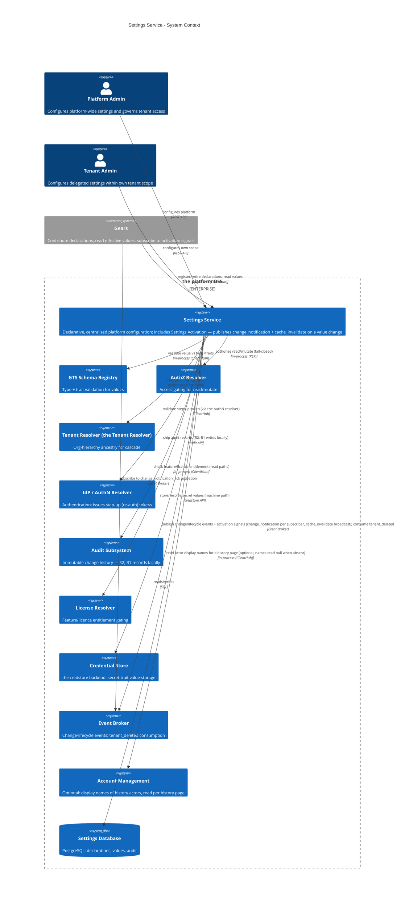
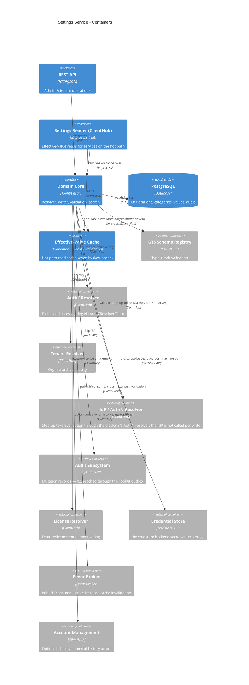
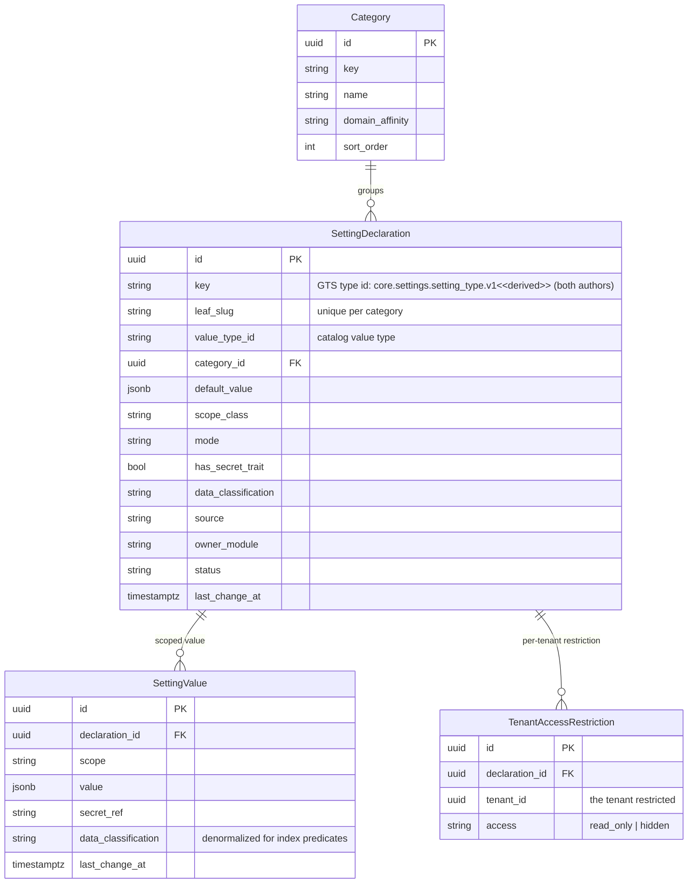
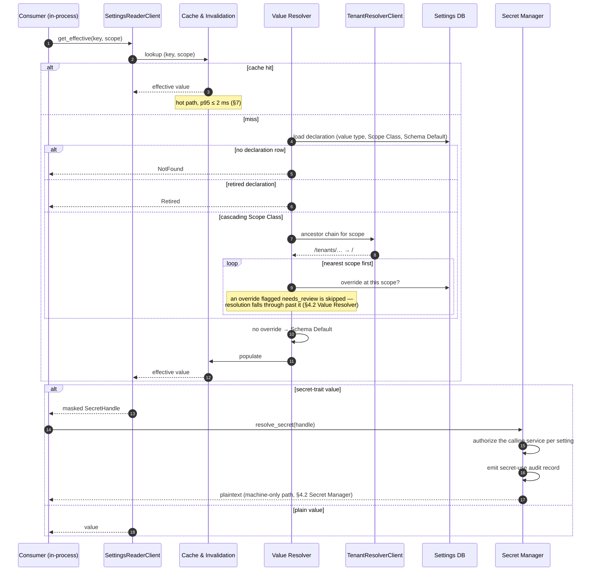
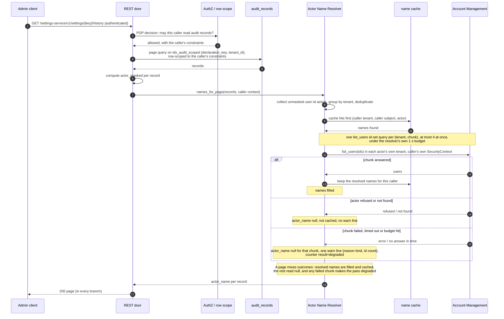

Created:  2026-07-28 by Virtuozzo International GmbH
Updated:  2026-10-28 by Virtuozzo International GmbH

# Technical Design — Settings Service

<!-- toc -->

- [1. Architecture Overview](#1-architecture-overview)
  - [1.1 Architectural Vision](#11-architectural-vision)
  - [1.2 Architecture Drivers](#12-architecture-drivers)
  - [1.3 Architecture Layers](#13-architecture-layers)
- [2. Goals / Non-Goals](#2-goals--non-goals)
  - [2.1 Goals](#21-goals)
  - [2.2 Non-Goals](#22-non-goals)
  - [2.3 Release Phasing](#23-release-phasing)
- [3. Principles & Constraints](#3-principles--constraints)
  - [3.1 Design Principles](#31-design-principles)
  - [3.2 Constraints](#32-constraints)
- [4. Technical Architecture](#4-technical-architecture)
  - [4.1 Domain Model](#41-domain-model)
  - [4.2 Component Model](#42-component-model)
  - [4.3 API Contracts](#43-api-contracts)
  - [4.4 External Interfaces & Protocols](#44-external-interfaces--protocols)
  - [4.5 Service-to-Service Pattern](#45-service-to-service-pattern)
  - [4.6 Interactions & Sequences](#46-interactions--sequences)
  - [4.7 Database schemas & tables](#47-database-schemas--tables)
  - [4.8 Security & Authorization](#48-security--authorization)
  - [4.9 Deployment Topology](#49-deployment-topology)
  - [4.10 Technology Stack](#410-technology-stack)
- [5. Risks / Trade-offs](#5-risks--trade-offs)
  - [5.1 Architectural Trade-offs](#51-architectural-trade-offs)
  - [5.2 Security and Performance Risks](#52-security-and-performance-risks)
- [6. Open Questions](#6-open-questions)
  - [6.1 From PRD (Cross-Reference)](#61-from-prd-cross-reference)
  - [6.2 Design-Specific Questions](#62-design-specific-questions)
- [7. Additional context](#7-additional-context)
  - [Feature Metrics](#feature-metrics)
  - [NFR Mapping & Scale Model](#nfr-mapping--scale-model)
  - [Testing Architecture](#testing-architecture)
- [8. Traceability](#8-traceability)

<!-- /toc -->

<!--
=============================================================================
TECHNICAL DESIGN DOCUMENT
=============================================================================
PURPOSE: Define HOW the system is built — architecture, components, APIs,
data models, and technical decisions that realize the requirements.

DESIGN IS PRIMARY: DESIGN defines the "what" (architecture and behavior).
ADRs record the "why" (rationale and trade-offs) for selected design
decisions; ADRs are not a parallel spec, it's a traceability artifact.

SCOPE:
  ✓ Architecture overview and vision
  ✓ Design principles and constraints
  ✓ Component model and interactions
  ✓ API contracts and interfaces
  ✓ Data models and database schemas
  ✓ Technology stack choices

NOT IN THIS DOCUMENT (see other templates):
  ✗ Requirements → PRD.md
  ✗ Step-by-step implementation flows → features/

STANDARDS ALIGNMENT:
  - IEEE 1016-2009 (Software Design Description)
  - IEEE 42010 (Architecture Description — viewpoints, views, concerns)
  - ISO/IEC 15288 / 12207 (Architecture & Design Definition processes)

ARCHITECTURE VIEWS (per IEEE 42010):
  - Context view: system boundaries and external actors
  - Functional view: components and their responsibilities
  - Information view: data models and flows
  - Deployment view: infrastructure topology

DESIGN LANGUAGE:
  - Be specific and clear; no fluff, bloat, or emoji
  - Reference PRD requirements using `cpt-cf-settings-service-fr-{slug}`,
    `cpt-cf-settings-service-nfr-{slug}` IDs
  - Reference ADR documents using `cpt-cf-settings-service-adr-{slug}` IDs
=============================================================================
-->

- [ ] `p1` - **ID**: `cpt-cf-settings-service-design-settings-service`

## 1. Architecture Overview

### 1.1 Architectural Vision

Design the **Settings Service** — the platform's single, centralized, declarative configuration capability. It manages platform-wide system settings: it organizes settings into categories, exposes typed keys with independent defaults, resolves effective values through the tenant hierarchy, validates and commits changes and makes them effective for running services, and governs visibility and audit per setting. It realizes the WHAT/WHY of [PRD-settings-service-202606160811](./PRD.md).

This document defines the complete Settings Service — its scope is the whole capability described below.

The service is delivered as a **Constructor Fabric Gear** — the platform's unit of composable, infrastructure-agnostic capability (reference example: the [`credstore` gear](../../credstore)). Like every gear it owns its API surface and database and is consumed through a **Rust-native SDK that facades local (in-process) vs. remote calls**; concretely it is bootstrapped by the Constructor Fabric **ToolKit** runtime (`cf-gears-toolkit`) and registers its typed clients in `ClientHub`, following the same SDK/implementation split, REST surface, and PostgreSQL persistence model used by the `authz-resolver` gear. It is shipped both as that **SDK** (for in-process access) and as the **gear implementation** (§4.9). It consumes the GTS Schema Registry for value typing, the Multi-Tenancy Model for the scope hierarchy, the RBAC Engine for access gating, the IdP for authentication and write step-up, the Credential Store for secret values, the platform Event Broker for change-lifecycle events and cross-instance cache invalidation, and the platform audit subsystem for change history.

### 1.2 Architecture Drivers

#### Functional Drivers

| Requirement | Design Response |
|-------------|-----------------|
| `cpt-cf-settings-service-fr-settings-category-model` | Category Management + Declaration Management components; flat categories with no-orphan delete enforced by the `ON DELETE RESTRICT` FK; declaration mutation classes (immediate / immutable / step-up gated); a read-only revival report lists what a revive brings back before it is confirmed (§4.3) |
| `cpt-cf-settings-service-fr-declaration-purge` | Declaration Management: `purge_declaration` on a retired, admin-authored declaration — step-up + `If-Match`; one transaction hard-deletes the row and, by cascade, its values, permissions and staged secrets; Credential Store entries released best-effort after commit (Secret Manager); audit `Remove` with the definition as pre-image |
| `cpt-cf-settings-service-fr-module-contributed-declarations` | Contribution Reconciler: idempotent `register_declarations` from gear init, gear-namespaced keys, `source=module_contributed` immutable to admins |
| `cpt-cf-settings-service-fr-contributed-lifecycle` | Reconciler match by version-stripped path; new/compatible/upgrade cases; retire → `status=retired` with values retained; re-declare-to-revive |
| `cpt-cf-settings-service-fr-setting-scope-class` | `ScopeClass` enum on the declaration drives resolution; per-class algorithm in the Value Resolver; a `global` setting takes no tenant-scoped value at all, whatever a tenant's permission says |
| `cpt-cf-settings-service-fr-typed-value-validation` | Type Validator against the setting's `value_type_id` + traits; `secret` routed to the Secret Manager; `public`/`pii`/`secret` classification drives masking |
| `cpt-cf-settings-service-fr-set-value` | Value Writer validates then commits per change; a `set` may carry several settings with per-item results and no atomicity across them |
| `cpt-cf-settings-service-fr-validate-before-set` | Value Writer `validate` is read-only and repeatable; a write to a declaration that requires elevated confirmation additionally needs a fresh step-up assertion verified by a `StepUpVerifier` |
| `cpt-cf-settings-service-fr-live-read-activation` | Commit-per-change, then local eviction, then signal publish; per-change result in the response; consumers self-react on `change_notification` |
| `cpt-cf-settings-service-fr-tenant-overrides` | `set` / `clone` at any tenant inside the caller's subtree; the override row is created at the target tenant |
| `cpt-cf-settings-service-fr-cascading-inheritance` | Ancestor-id walk via the Tenant Resolver, nearest-match wins; `inheritance_trail` on the read; bounded `cascading_impact` report; the trail names nothing above the reader tenant (§4.2 *Value Resolver*, *The upward disclosure boundary*) |
| `cpt-cf-settings-service-fr-tenant-scope-enforcement` | Sparse `tenant_permissions` rows store `read_only` or `hidden`; absence means `overridable`. The strictest row on the tenant's root-to-self chain wins. `PolicyEnforcer` and `SecureConn` enforce the caller's subtree, while effective tenant access gates administrative reads and writes (§4.1 *TenantAccessRestriction*, §4.2 *Tenant Access*). |
| `cpt-cf-settings-service-fr-authn-role-gating` | Bearer token via the AuthN Resolver, then a fail-closed `PolicyEnforcer` decision; step-up on a write to a declaration that requires it and on behavior-affecting declaration actions |
| `cpt-cf-settings-service-fr-per-setting-access` | §4.8 *Authorization Model*: a value operation names the setting's own key as the resource, so a grant covers one setting, a wildcarded subtree, or — on the base type — all of them; lists resolve it in two steps (*Listing under a narrowed grant*) |
| `cpt-cf-settings-service-fr-file-valued-settings` | §3 *Files*: a `file-reference`-trait value is an inline reference (`value`, §4.1) to a file in the `file-storage` gear, never the bytes. **Validated for shape only** — the two-field object `{ file_id, version_id }`, both required — with existence, content type, size and caller entitlement deliberately unchecked, so this service takes no dependency on `file-storage`. The reference is always pinned to a version, so a `bind` under it changes nothing until the setting is repointed; content is never indexed (§4.2 *Search*); `secret` + `file-reference` is rejected (`422`) while `pii` is carried. |
| `cpt-cf-settings-service-fr-audit-mutations` | Audit Emitter writes synchronously inside the mutation transaction, fail-closed; canonical `resource` id makes history an exact-match query; an actor is named only when its tenant is on the path from the reader tenant to the record's scope (§4.2 *Value Resolver*, *The upward disclosure boundary*); the history read adds `actor_name` beside `actor`, resolved from Account Management by the Actor Name Resolver, never for a masked or withheld actor and never failing the read (§4.2 *Actor Name Resolver*, §4.3) |
| `cpt-cf-settings-service-fr-feature-license-gating` | `licence_feature` checked through the License Resolver on administrative read paths only; the in-process reader is not gated |
| `cpt-cf-settings-service-fr-standard-advanced-mode` | `mode` on the declaration, carried on every declaration and browse item as a tag; no server-side filtering — a client groups locally; the preference lives with the console; every category carries its `advanced_count`, so the settings a client folds away are counted, not omitted (§4.3) |
| `cpt-cf-settings-service-fr-search-discoverability` | Trigram GIN indexes over key/display name/description/category/value with classification split into the index predicates; the same predicate expressions, evaluated per candidate without the indexes, serve browse's `q` (§4.3) |
| `cpt-cf-settings-service-fr-defaults-revert` | `default_value` column is authoritative and immutable; `revert` returns the resolved fallback, and `validate` reports it beforehand |
| `cpt-cf-settings-service-fr-domain-affinity-filtering` | Optional `domain_affinity` on category and declaration; hub filters by the admin's current domain |
| `cpt-cf-settings-service-fr-dependency-group-declaration` | **Deferred, not dropped** — the PRD carries this at `p3`, in scope. Not designed for v1 because no setting pair with a cross-setting invariant has been identified; the design agenda is the open question in §6.2 |
| `cpt-cf-settings-service-fr-bulk-effective-read` | `resolve_bulk` (key set) sharing one ancestry walk per scope, with independent per-key outcomes; surfaced on the SDK as `get_effective_bulk` and on REST as `GET /settings-service/v1/settings` filtered by key set and optionally narrowed by `q` (§4.3) — same visibility, scope and masking rules as the single read (§4.2 *Value Resolver*, §4.3, §4.5) |
| `cpt-cf-settings-service-fr-subject-scoped-values` | Value identity carries `(subject_type, subject_id)` beside `tenant_id`, giving four scope shapes — platform, tenant, and either of those with a subject — each with its own partial unique index, plus a `CHECK` requiring a subject to be named by both of its columns or by neither; subject-naming and subject-less requests resolve on independent tracks that meet only at the Schema Default, each walking the scope chain by Scope Class, never walking subjects as ancestors; scope shape and signal attributes are subject-aware from v1 while v1 writes only `NULL`s, so no migration is needed to switch it on (§4.2 *Value Resolver*, §4.7, [Settings Activation](./DESIGN-activation.md) §4.4) |
| `cpt-cf-settings-service-fr-barrier-default-seam` | `get_ancestors` marks a tenant **standalone**; inheritance into it is unchanged (the ancestor walk is not truncated), while the tenant is removed from every ancestor's subtree for reads and writes — excluded from single and bulk reads, from the search corpus, and from `cascading_impact`'s `changed[]` **and** `total_changed`. Isolation is per tenant, so no per-declaration flag exists (§4.2 *Value Resolver*, §4.2 *Value Writer*, §4.2 *Search*) |

#### NFR Allocation

| NFR ID | NFR Summary | Allocated To | Design Response | Verification Approach |
|--------|-------------|--------------|-----------------|----------------------|
| `cpt-cf-settings-service-nfr-performance-read-cache` | Cache-served effective reads stay on the hot path | Effective-Value Cache + Settings Reader | In-process cache keyed by `(key, scope)`; invalidate on change; `cache_ttl_seconds` backstop; resolve cost is O(depth), not O(tenant count) | Integration benchmark on a warm cache and on a seeded hierarchy |
| `cpt-cf-settings-service-nfr-reliability-validated-set` | An invalid or stale write stores nothing | Value Writer | Validation runs before persistence; the commit is guarded on `If-Match` and refuses a moved value `412` | API + E2E rejection and stale-write paths |
| `cpt-cf-settings-service-nfr-scope-isolation` | No cross-scope leakage on any read path | Value Resolver + Search + REST layer | Server-side subtree enforcement; `404` for non-visible settings; classification split in index predicates | Integration + E2E isolation tests per read path |
| `cpt-cf-settings-service-nfr-security-baseline` | AuthN, secret confidentiality, step-up, audit | Secret Manager + Audit Emitter + AuthZ | Secrets held by reference and masked on every administrative path; plaintext only via the audited machine path; fail-closed audit | API/E2E secret and audit tests |
| `cpt-cf-settings-service-nfr-efficiency-live-read` | No platform-initiated reload or restart | Value Writer | The writer commits and publishes signals only; consumers self-react | Assert zero reload/restart calls in write tests |
| `cpt-cf-settings-service-nfr-availability` | Read path stays available | Cache + Settings Reader | Warm reads served from cache; distinguishable `Unavailable` error so consumers own their degradation posture | Operational SLO from liveness aggregation |
| `cpt-cf-settings-service-nfr-scale-growth` | Tenant, setting, and audit volume | Data model + Audit Subsystem | Bounds in §7 *NFR Mapping & Scale Model*; audit volume and retention are requirements on the platform Audit Subsystem | Load test against the declared bounds |
| `cpt-cf-settings-service-nfr-ops-set-monitoring` | Aggregate change-failure visibility | Metrics | `settings_value_write_failure_ratio` on shared dashboards plus an alert-routing rule | Dashboard and alert-rule review |
| `cpt-cf-settings-service-nfr-versatility-gts-scope-class` | New types and gear declarations need no core change | Type Validator + Reconciler | Values validated against a registered value type — the gear's catalogue or one a module registers itself; declarations arrive at runtime | Add a value type (in a module's own namespace, or to the catalogue) and a gear declaration without touching the gear's code |

#### Architecture Decision Records

| ADR ID | Title |
| --- | --- |
| `cpt-cf-settings-service-adr-setting-key-gts-type-id` | [Setting Key Is a GTS Type Identifier](ADR/ADR-002-setting-key-gts-type-id.md) — `gts.cf.core.settings.setting_type.v1~<vendor>.<package>.<category>.<name>.v1~` for both authors; supersedes the retired instance-id decision |

### 1.3 Architecture Layers

```
┌─────────────────────────────────────────────────────────────┐
│         Consumers (gears, admin UI, tenant portal)          │
├─────────────────────────────────────────────────────────────┤
│  settings-service-sdk │ Reader + Contribution traits, DTOs  │
├─────────────────────────────────────────────────────────────┤
│  settings-service     │ REST, authz, validate, set, search  │
│  ┌──────────────────────────────────────────────────────┐   │
│  │ Domain: resolver · writer · validator ·              │   │
│  │         scope-class engine · secret manager ·        │   │
│  │         actor-name resolver                          │   │
│  ├──────────────────────────────────────────────────────┤   │
│  │ Infrastructure: effective-value cache · audit emitter│   │
│  └──────────────────────────────────────────────────────┘   │
├─────────────────────────────────────────────────────────────┤
│  External │ types-registry · tenant-resolver · authz/authn  │
│           │ credstore · event-broker · audit · license      │
│           │ account-management (opt.)                       │
├─────────────────────────────────────────────────────────────┤
│  Storage  │ PostgreSQL (declarations, values, audit)        │
└─────────────────────────────────────────────────────────────┘
```

| Layer | Responsibility | Technology |
|-------|---------------|------------|
| SDK | Public trait definitions, transport-agnostic models, errors, shared GTS type ids | Rust crate (`settings-service-sdk`) |
| Gear | REST surface, authorization, declaration lifecycle, value writes, resolution, search | Rust crate (`settings-service`), ToolKit gear, Axum |
| Domain | Effective-value resolution, Scope Class behaviour, the value write path, type validation, secret handling, actor display-name resolution (with its per-caller name cache) | In-process Rust modules |
| Infrastructure | Hot-path effective-value cache with signal-driven invalidation; fail-closed audit emission | In-memory cache, Event Broker client |
| External | Type and trait resolution, tenant ancestry, authentication and authorization decisions, secret storage, event transport, entitlement | `types-registry`, `tenant-resolver`, `authn-resolver`, `authz-resolver`, `credstore`, `event-broker`, `license-resolver`; optionally `account-management` (actor names on the history read). Audit is **not** external in R1 — the store is gear-local (§4.2 *Audit Emitter*) |
| Storage | Declarations, categories, values, audit records | PostgreSQL via `toolkit-db`, reached through `SecureConn` (§4.8 *The Data Path*) |

#### Context View



#### Container View



## 2. Goals / Non-Goals

### 2.1 Goals

- Category CRUD with no-orphan deletion. Categories are flat (single-level, no nesting) per PRD.
- Setting **Declaration** lifecycle — admin-authored and **module-contributed** (register/retire). The setting's **key** is a **GTS type identifier** for **both** authors — `gts.cf.core.settings.setting_type.v1~<vendor>.<package>.<category>.<name>.v1~`, derived from the Settings gear-owned base type and registered when the declaration is created (§4.7). The shape its value must take is separate: a curated toolkit **value type** (`gts.cf.core.settings.type_*~`) named by `value_type_id`. The declaration is kept separate from the value.
- First-class **Scope Class** (`global` / `cascading` / `local`) deriving cascade/override behaviour deterministically.
- **Typed values** validated against GTS schema + traits (scalar and structured), with rendering metadata exposure.
- **Secret values** — `secret`-trait settings backed by the Credential Store: plaintext never enters the settings DB, cache, search index, or audit trail; masked on every **administrative** read/search/list, with **no human reveal path**. Plaintext resolves only through the **machine-only runtime path** — the `SettingsReaderClient` SDK trait (§4.5), which `ClientHub` may bind locally or to a remote client (§4.9) — and only for a consuming service authorized to that specific setting; every resolution is audited as a secret-use event (§4.2 *Secret Manager*).
- **Effective-value resolution** with inheritance walk and source trace; hot-path **cache** with invalidation on change — local in-process. Cross-instance cache coherence is driven by the [Settings Activation](./DESIGN-activation.md) (separate design).
- **Validate, then set**: a read-only check before writing, a step-up-verified write that validates inline and refuses a stale value, and per-change result reporting. On a write the service **commits the value** and publishes the signals — a filtered **`change_notification`** per subscriber (consumer activation) and a **`cache_invalidate`** broadcast (replica cache); consumers read the new value **on demand** (pull) and activate it themselves. Proactive notification is owned by the [Settings Activation](./DESIGN-activation.md) (separate design).
- **Multi-tenant overrides**: set/clone/remove tenant overrides; server-side scope enforcement; visibility-gated reads; non-blocking cascading-impact warning.
- **Standard / Advanced mode** — a per-declaration tag, `standard` or `advanced`, carried on every read so a client groups locally; this service filters nothing on it, and counts it per category so nothing folded away goes uncounted (§4.1, §4.3).
- **Optimistic-concurrency conflict handling** — `If-Match`/ETag on every mutating call, so a concurrent edit fails loudly (`412`) instead of overwriting.
- **Events** — value-change, declaration, and secret-use events published through the platform Event Broker; the **`change_notification`** consumer signal and the **`cache_invalidate`** cross-instance cache broadcast are owned by the Settings Activation (separate design); `tenant_deleted` consumed for cleanup (§4.4).
- **Search** (cross-field), **Defaults & Revert**, **Domain Affinity filtering**.
- **Audit** of all mutations; **feature/licence gating**.
- **Gear SDK for in-process access** (`settings-service-sdk`: Settings Reader + Contribution clients) for services on the hot path.

### 2.2 Non-Goals

- **GTS type authoring / the schema registry itself** — owned by the `types-registry` gear. This service *consumes* types.
- **Managed-resource desired-state reconciliation** — owned by RMS. This service governs platform configuration, not managed resources.
- **Org-hierarchy CRUD and closure-table maintenance** — owned by the Tenant Resolver gear.
- **Role/permission CRUD and authorization decisions** — owned by RBAC Engine and the AuthZ Resolver Plugin.
- **Hot-reload / restart / template-regeneration execution** — this service commits values and publishes the signals (consumer `change_notification` + replica `cache_invalidate`); it never reloads or restarts a consumer in-process. Heavier activation (reload/restart/regenerate) for components that cannot self-react is owned by the [Settings Activation](./DESIGN-activation.md) and **deferred** (out of scope for v1).
- **Cross-region settings replication; ancestor-level batch writes across descendants; settings export/import** — deferred (PRD Out of Scope).
- **Bootstrap / boot-critical infrastructure config** (DB and broker endpoints, service identity, platform TLS, ports, domain) — deployment-owned, delivered via ToolKit config at gear init (§4.9, §4.8); never a managed setting.
- **Frontend visual design / mockups** — owned by a future frontend DESIGN document.

### 2.3 Release Phasing

This document describes the whole gear. It does not all ship at once, and the sections that carry the first release are not otherwise distinguishable from the ones that look ahead. Releases below are grouped by **what they depend on**, not by requirement priority: priority is the PRD's and stays there, reachable through each requirement id named here. The two axes genuinely differ. `cpt-cf-settings-service-fr-subject-scoped-values` is one requirement spanning two releases, because the PRD asks for its identity model from v1 and lets the implementation phase. And three requirements the PRD ranks below the first tier — `cpt-cf-settings-service-fr-defaults-revert`, `cpt-cf-settings-service-fr-per-setting-access` and `cpt-cf-settings-service-fr-barrier-default-seam` — ship in R1 regardless, because they need nothing that does not already exist and leaving them out would mean shipping a service whose absent behaviour someone could come to rely on.

#### R1 — configuration that resolves and changes safely, in-process

**The defining property: R1 depends on no gear that does not exist.**

Categories and declarations with their lifecycle (`cpt-cf-settings-service-fr-settings-category-model`, `cpt-cf-settings-service-fr-module-contributed-declarations`, `cpt-cf-settings-service-fr-contributed-lifecycle`, `cpt-cf-settings-service-fr-declaration-purge`); GTS typing, validation and secret protection (`cpt-cf-settings-service-fr-typed-value-validation`); Scope Class with cascade, override and source trace (`cpt-cf-settings-service-fr-setting-scope-class`, `cpt-cf-settings-service-fr-tenant-overrides`, `cpt-cf-settings-service-fr-cascading-inheritance`); per-tenant permission and subtree isolation including the standalone-tenant seam (`cpt-cf-settings-service-fr-tenant-scope-enforcement`, `cpt-cf-settings-service-fr-barrier-default-seam`); authentication and access-level gating, per setting (`cpt-cf-settings-service-fr-authn-role-gating`, `cpt-cf-settings-service-fr-per-setting-access`); a validated, step-up-verified write, effective on next read (`cpt-cf-settings-service-fr-set-value`, `cpt-cf-settings-service-fr-validate-before-set`, `cpt-cf-settings-service-fr-live-read-activation`); revert to ancestor or Schema Default (`cpt-cf-settings-service-fr-defaults-revert`); audited mutations and secret reveals (`cpt-cf-settings-service-fr-audit-mutations`); single and bulk effective reads (`cpt-cf-settings-service-fr-bulk-effective-read`); cross-field search (`cpt-cf-settings-service-fr-search-discoverability`); and the `mode` tag on browse items (`cpt-cf-settings-service-fr-standard-advanced-mode`).

Subject-scoped values (`cpt-cf-settings-service-fr-subject-scoped-values`) enter here as **identity model only** — the columns, the partial unique indexes and the subject-aware API shape (§4.1, §4.7) — with resolution over subjects deferred to R2, which is the split the PRD asks for.

Three things R1 supplies itself rather than waiting on the platform:

| Need | R1 answer |
|------|-----------|
| Audit, which every mutation fails closed on (§4.2 *Audit Emitter*) | A **gear-local sink** writing the record in the mutation's own transaction, and the store of record for the online window. R2 enqueues the same record into ToolKit's transactional outbox, whose handler posts it onward to the platform subsystem — an addition behind the same port, not a replacement |
| Step-up verification, without which every write refuses (§4.2 *Value Writer*) | The **default binding over the platform's AuthN resolver**, built here: the token is validated by `AuthNResolverClient::authenticate` — the path that admitted the session token — and the freshness claims are read from the token it vouched for |
| A verified identity for the caller of the reader and contribution traits (§5) | **Not needed here, and enforced rather than assumed.** R1 is **Embedded-only**: the traits are bound in-process, where the host process *is* the boundary. R1 publishes no REST contract for them and **fails at startup** if configuration asks for a remote binding, so "in-process only" is a check rather than a deployment promise (§4.8 *Trusted-Caller Boundary*) |

Not in R1, and what that costs: no consumer notification, so a consumer learns of a change by re-reading (which is what `cpt-cf-settings-service-fr-live-read-activation` requires anyway); no cross-replica invalidation — R1 is a single instance, and a second host serving the same database would be stale for at most `cache_ttl_seconds` until the R2 broadcast lands; no cleanup on tenant deletion, so a deleted tenant's rows persist until R2 consumes the event.

#### R2 — out of process, and the rest of the administrative surface

Waits on five things this design does not own: **verified machine caller identity** (which unlocks the non-embedded profiles), the **platform-wide elevated session** ("sudo") that step-up moves onto, the **platform Audit Subsystem**, a **tenant-deleted signal** from Account Management, and **per-feature licence entitlement**, which the platform currently implements at base-licence level only.

Contents: the out-of-process deployment profiles, with read authorization of the verified caller on the whole reader and the secret gate ahead of any existence answer (§4.8 *Trusted-Caller Boundary*); subject-scope resolution on top of R1's identity model; file-valued settings (`cpt-cf-settings-service-fr-file-valued-settings`); the anonymous read surface and its declaration flag (`cpt-cf-settings-service-fr-anonymous-exposable`); the elevated-confirmation flag and writes by authorized service principals (`cpt-cf-settings-service-fr-service-writes`); feature and licence gating (`cpt-cf-settings-service-fr-feature-license-gating`); tenant-deleted cleanup; and **step-up on the platform-wide elevated session**, bound behind the existing `StepUpVerifier` port (§4.2 *Value Writer*). R1's own binding carries step-up until then, so this is a substitution rather than a gap being filled. Both bindings satisfy `cpt-cf-settings-service-fr-validate-before-set` the same way — a re-verification bounded by a freshness window — and what the platform session adds is ownership of that window: it can be revoked, extended or observed, which a claim in an already-issued token cannot be.

R2 is the first release in which several replicas are the normal case, and **convergence between them ships with it**. `cpt-cf-settings-service-fr-replica-coherence` is served by the `cache_invalidate` broadcast, and that broadcast needs none of the activation machinery it was previously bundled with — no await-records, no supersession, no back-responses, just one event per write on a broker this release already publishes to. `cache_ttl_seconds` stays the backstop for a dropped signal, as the requirement demands.

#### R3 — consumers acknowledge

Consumer activation in full (`cpt-cf-settings-service-fr-consumer-activation`) — per-key subscription, filtered notification, back-response, supersession and the delivery queue — the subject of [Settings Activation](./DESIGN-activation.md). Replica convergence is **not** here: its `cache_invalidate` broadcast is designed in the same document but carries none of this machinery, so it lands in R2 (§2.3 R2) and this release carries only the consumer-facing half. With it, dependency groups (`cpt-cf-settings-service-fr-dependency-group-declaration`) and domain-affinity filtering (`cpt-cf-settings-service-fr-domain-affinity-filtering`).

## 3. Principles & Constraints

### 3.1 Design Principles

#### Declaration and Value Are Separate Planes

- [ ] `p1` - **ID**: `cpt-cf-settings-service-principle-declaration-value-split`

A setting's **declaration** (key, value type, Schema Default, Scope Class, metadata) is distinct from its **values** at each scope. Declarations are authored — by an administrator or contributed by a gear — and are addressed by immutable UUID on the management plane. Values are written and read by `key`. Keeping the planes separate is what allows a gear to own a setting's shape while an administrator owns its runtime value.

#### Values Are Written; Declarations Are Gated by Immutability

- [ ] `p1` - **ID**: `cpt-cf-settings-service-principle-write-scope`

The value write path covers value operations only. A declaration edit has no in-effect value to gate, so descriptive metadata applies immediately — but the fields that *would* change live resolution (Schema Default, value type, Scope Class) are immutable, and the two actions that change whether a setting resolves at all (retire, reactivate) require credential step-up. No ungated path can alter a live setting's resolution.

#### Behaviour Derives From One Declared Attribute

- [ ] `p1` - **ID**: `cpt-cf-settings-service-principle-scope-class-derivation`

Cascade and override behaviour is derived from the mandatory `ScopeClass`, never from independently-toggleable booleans. A setting must declare its class, so infrastructure settings are `global` by declaration rather than by remembering to disable a flag.

#### Single Source of Ancestry

- [ ] `p1` - **ID**: `cpt-cf-settings-service-principle-single-ancestry-source`

Tenant ancestry is owned by the Tenant Resolver. This gear stores a flat `tenant_id`, never a path, and never reconstructs the hierarchy from a string. A tenant re-parent therefore requires no stored-scope rewrite.

#### One Type System, Consumed Not Rebuilt

- [ ] `p1` - **ID**: `cpt-cf-settings-service-principle-consume-gts`

Values are validated against a registered value type resolved from `types-registry` — one of the gear's catalogue, or one a module registered itself (§4.7). This gear builds no parallel type system. A setting is registered as a GTS type (§4.7), but nothing on the read path asks the registry: declarations and values live in this gear's own tables.

#### Secrets Never Take a Human Path

- [ ] `p1` - **ID**: `cpt-cf-settings-service-principle-machine-only-secrets`

A `secret`-classified value is held by reference and masked on every administrative surface. Plaintext resolves only through the machine-only reader path, authorized per setting against the calling service and audited on every resolution. There is no administrative reveal operation.

#### Inform, Do Not Block

- [ ] `p1` - **ID**: `cpt-cf-settings-service-principle-inform-not-block`

Consequences are surfaced rather than prevented: cascading impact is a non-blocking warning, a flagged override falls through to a valid value instead of failing the read, and hard blocks are reserved for the irreversible or the invalid.

#### Fail Closed on Every Gate

- [ ] `p1` - **ID**: `cpt-cf-settings-service-principle-fail-closed`

Authorization, entitlement, type validation, and audit all fail closed. A mutation that cannot be authorized, validated, or recorded does not take effect.

### 3.2 Constraints

#### PostgreSQL primary storage

- [ ] `p1` - **ID**: `cpt-cf-settings-service-constraint-postgres-primary-storage`

Declarations, categories and values are stored in PostgreSQL via `toolkit-db`, reached through `SecureConn` so that every query carries an `AccessScope` (§4.8 *The Data Path*).

**This is a recorded deviation.** The platform's persistence story is DB-agnostic SeaORM through `toolkit-db`, and the **single-node** deployment shape — edge devices, on-prem appliances, development — is a supported topology (`docs/ARCHITECTURE_MANIFEST.md`). This gear requires PostgreSQL for its production shape. What forces that is narrower than the DDL suggests, so it is worth separating:

| Feature used | On SQLite |
|---|---|
| `pg_trgm` **GIN trigram indexes** (§4.7, §4.2 *Search*) | **No equivalent.** This is the only hard requirement. SQLite's FTS5 is token-based, not substring, so cross-field value search (`cpt-cf-settings-service-fr-search-discoverability`, `p2`) cannot be served the same way |
| **Partial indexes and their predicates** — `uq_value_scope`, `idx_values_needs_review`, the split search corpus | **Not Postgres-only.** SQLite has supported `WHERE`-qualified indexes since 3.8.0 with identical syntax, and `file-storage` already relies on that. The denormalization of `data_classification` onto `setting_values` (§4.7) is needed on both, for the same reason |
| `JSONB` | `TEXT` plus the JSON1 functions; weaker typing, and `jsonb_typeof` becomes `json_type` |
| `num_nonnulls(...)` (§4.7) | An equality of predicates, which §4.7's subject-columns `CHECK` already uses for exactly this reason. The two `CHECK`s should be written the same way |
| `BIGSERIAL` (`commit_seq`, activation §4.7) | An autoincrement integer column |

**MySQL is out of scope.** `toolkit-db` builds against it, but no gear in the workspace enables the feature — every one that uses `toolkit-db` declares `pg` and `sqlite`, or `sqlite` alone. This gear targets **PostgreSQL and SQLite**, and its migrations MUST no-op on a MySQL backend rather than fail, so a misconfigured workspace does not break outright. `chat-engine` sets that precedent for both halves of this record: its full-text index is emitted as backend-gated raw SQL, present on Postgres, deliberately skipped on SQLite where the query falls back to an unindexed `LIKE`, and a no-op on MySQL.

**In the single-node/edge shape**, then: everything the gear is *for* is portable — effective-value resolution, the ancestor-id cascade, scope isolation, the write path, activation and audit. **Value search is what degrades**, from an indexed substring match to a scan or to nothing. That is a `p2` capability, which is why running this gear on SQLite is a viable reduced configuration rather than a broken one.

**What is not yet decided is the migration shape.** `file-storage` and `chat-engine` both write per-backend DDL, branching on `get_database_backend()` and documenting where the backends diverge; this design's §4.7 states Postgres DDL only, and §7 names real PostgreSQL for every tier above unit, while the platform's CI runs a SQLite integration tier on every PR (`make test-integration LANE=toolkit-db-sqlite`, `docs/TESTING.md` §4). Either this gear writes the per-backend DDL and keeps that tier, or it records that its integration tests are Postgres-only. This is a **DESIGN follow-up**; it changes no contract either way.

#### Constructor Fabric Gear

- [ ] `p1` - **ID**: `cpt-cf-settings-service-constraint-supplied-as-gear`

Settings Service is **supplied as a Constructor Fabric Gear** — an SDK crate plus a gear implementation (§4.9), hosted by the Constructor Fabric **ToolKit** runtime and registering its typed clients in `ClientHub`. `ClientHub` resolves each dependency to an in-process implementation or a generated REST client per the active deployment profile, so consumers call the same SDK trait either way: co-located, effective-value reads run **in-process** via `SettingsReaderClient` (no network call on the hot path); when the gear runs out-of-process the same trait is served over REST.

#### Setting key by author

- [ ] `p1` - **ID**: `cpt-cf-settings-service-constraint-key-is-gts-type-id`

The setting `key` is a **GTS type identifier** `gts.cf.core.settings.setting_type.v1~<vendor>.<package>.<category>.<name>.v1~` for **both** authors. The base type is owned and registered by the Settings gear; toolkit does not own it. The derived half is the setting and has four segments before the version — `<vendor>.<package>.<namespace>.<type>` per the GTS grammar (§4.7), with no `gts.` prefix of its own. The category is always the third: a **module** provides its own half and the category is extracted from `<namespace>`; an **admin** setting uses `<vendor>.settings.<category>.<name>.v1`. The trailing `~` makes the key a type rather than an instance, which lets a policy name one setting (§4.8). The value's schema is separate: `value_type_id` names a toolkit-owned catalog type.

#### GTS validation

- [ ] `p1` - **ID**: `cpt-cf-settings-service-constraint-gts-value-validation`

Every value is checked against the setting's **value type** (`value_type_id`) + traits via `TypesRegistryClient`. This service builds no parallel type system: value shapes come from registered value types — the gear's catalogue or a module's own — never from the setting's own type. Values live in our own tables — never in the Registry.

#### Scope hierarchy

- [ ] `p1` - **ID**: `cpt-cf-settings-service-constraint-scope-hierarchy-paths`

Scopes are tenant-hierarchy paths: `/` (platform root) or `/tenants/{id}`. Ancestry resolved via `TenantResolverClient` (in-process).

#### Secrets

- [ ] `p1` - **ID**: `cpt-cf-settings-service-constraint-secrets-by-reference`

`secret`-trait values are backed by the Credential Store (the credstore backend). Plaintext never enters the settings DB, cache, search index, or audit trail — the row holds only an opaque `secret_ref`; values are masked on every **administrative** read/search/list and there is **no human reveal path**. Plaintext is resolved only through the **machine-only** Settings Reader path (§4.5), per-setting authorized and audited as a secret-use event (§4.2 *Secret Manager*).

#### Files

- [ ] `p2` - **ID**: `cpt-cf-settings-service-constraint-files-by-reference`

A `file-reference`-trait value names a file held by the `file-storage` gear; the bytes never enter the settings DB, cache, search index, or audit trail. The value is a two-field object — `{ file_id, version_id }` — and both fields are always present (*always pinned*, below). Unlike a secret the reference needs no side channel, a file id not being sensitive in itself, so it is an ordinary **inline** value in `value` (§4.1): no column, index, or size rule changes. The consumer fetches content straight from `file-storage`, which issues a signed URL against its own data plane, so no settings path ever carries bytes and the 64 KiB value cap (§4.2 *Type Validator*) stands untouched.

**What this does *not* mirror about a secret is the byte path.** A secret's plaintext flows *through* this service, and the SDK deliberately withholds a credstore-resolvable handle, because credstore knows nothing of settings or consumers and only this service can enforce per-setting authorization and the secret-use audit record (§4.2 *Secret Manager*). `file-storage` enforces its own access on both its control and data planes, so routing file content through here would buy no guarantee and cost the one property this section exists to keep. Stored by reference: alike. Who carries the content: opposite.

**The reference is always pinned to a version.** `file-storage` guarantees content immutability per version — a backend object lives at `/{file_id}/{version_id}` and is immutable, and a replacement is always a new version plus a pointer swap — so `version_id` *is* the identity of the bytes. A reference naming only `file_id` would instead resolve through that gear's `content_id` pointer, which an ordinary `bind` call swaps under optimistic CAS: content would change for every consumer with **no** value change, no write, no audit record and no activation signal. This design therefore has **no floating variant** — one shape, both fields, always. Showing consumers different content means repointing the setting at another version, which is an ordinary write (§4.2 *Value Writer*). A stored content checksum would add nothing: it would restate a fact `file-storage` already guarantees, this service never reads bytes so could never compare it, and a consumer that wants to verify its download reads the per-version hash from `file-storage` directly.

> **This rests on a `file-storage` invariant.** Version immutability is that gear's published contract, not something this service can verify — it never reads content. Were the invariant weakened, `version_id` would stop being a content identity and this section would need revisiting.

**The reference is stored, not validated — and this service takes no dependency on `file-storage` at all.** Writing a reference is validated for **shape** only: the declared type requires both fields, and JSON Schema enforces that. Whether the file exists, whether its content type or size is what the declaration expects, and whether the caller may use it are **not checked here**. The service never calls `file-storage`, holds no client for it, and does not appear in its dependency list; the responsibility for a reference being usable sits entirely with the caller that writes it.

This is consistent with how every other referent is treated. A setting typed `format: uri` may point at a host that no longer answers, and this service does not probe it; a `file-reference` is the same class of value, and per-reference validation would be the anomaly rather than the rule.

What follows from that, stated so nobody has to discover it:

- a mistyped or wrong-tenant reference is accepted silently, and the failure appears at each consumer when it fetches — never on a settings write and never as a settings-side signal;
- a reference whose file or version was deleted keeps resolving as a perfectly valid **value**; it is not flagged `needs_review`, does not block a write, and no event is consumed to detect it. A dangling reference is discovered at fetch, by the consumer, from `file-storage`;
- a caller that may write the setting may therefore attach a file it cannot itself read. Whether the consumer that fetches it can is between that consumer and `file-storage`.

**The reference does not own the file.** Removing the value, retiring the declaration, or deleting the tenant removes the *reference* — the file itself is never touched. Two reasons: this service did not create it (it existed before the setting, uploaded by its own owner), and it cannot see who else points at it, since another setting, another scope, or something outside settings entirely may hold the same reference; deleting would destroy data this service neither owns nor has a complete view of. This is the deliberate opposite of a secret, whose Credential-Store entry this service *does* create and which `delete_secret` therefore removes when the override is removed or applied away (§4.2 *Secret Manager*). Cleanup belongs to `file-storage`: owner deletion is already a requirement it carries, and long-lived orphans are its retention sweep's business. One useful consequence — a file-valued setting is **cloneable** where a secret one is not (`422 SecretNotCloneable`, §4.2 *Value Writer*): the hazard there is the source's credstore entry being deleted underneath the clone, and nothing here is ever deleted underneath anything.

**What the trait buys over a plain string.** Less than it might appear, and worth being exact about. Storage is identical and validation is now shape-only, so three things remain: the resolved trait set tells a client to render a file picker instead of a text box (`cpt-cf-settings-service-fr-typed-value-validation`); the reference is excluded from the search corpus (§4.2 *Search*); and combining it with `secret` is refused at declaration. Everything else a `file-reference` does, a structured string setting of the same shape would do too.

**`secret` is refused, PII is carried.** A type carrying both `secret` and `file-reference` is rejected at declaration (`422`). The `secret` trait promises an absolute — masked on every administrative path, **no human reveal path**, plaintext only through the machine-only reader, every resolution audited — while a file has its own independent access path through `file-storage`: masking the reference would hide a pointer to content anyone that gear authorizes still reads, none of it audited here. Promising a guarantee this service cannot keep is worse than refusing the combination, so a secret that happens to be file-shaped stays a secret value in the Credential Store. **PII is different and is supported.** Its promise is relative — unmasked only for a caller authorized for unmasked PII, masked everywhere else — and that is honourable over reference *metadata*, which can itself disclose (a filename carrying someone's name), so a `pii`-classified file reference is masked on administrative reads exactly like any other PII value (§4.2 *Search*, §4.3).

> **Prerequisite.** The `file-reference` trait must exist in the Types Registry. Nothing else: validation being shape-only, there is no client to add, no capability to wait on in `file-storage`, and no cross-gear prerequisite of any kind.

#### AuthN / step-up

- [ ] `p1` - **ID**: `cpt-cf-settings-service-constraint-step-up-at-idp`

OIDC bearer via the AuthN Resolver / IdP. A value write requires **step-up = re-authentication at the IdP**, not a password entered into this service: the frontend re-runs the IdP login ceremony and the service verifies only the resulting fresh token's claims. **The Settings Service never receives or verifies raw credentials** (§4.2 *Value Writer*).

#### AuthZ

- [ ] `p1` - **ID**: `cpt-cf-settings-service-constraint-rbac-policy-enforcer`

The AuthZ Resolver gates read/mutate against `gts.cf.core.settings.*` resources. The gear resolves `AuthZResolverClient` through `ClientHub` and builds the SDK's `PolicyEnforcer` over it — the enforcer is a struct from that SDK, not a separately resolvable trait — then adapts it behind a gear-local port so the domain layer never imports infra. A category may additionally be **restricted**, and then reaching its settings needs a grant on that category (§4.8 *Category access*).

#### Feature/licence entitlement

- [ ] `p1` - **ID**: `cpt-cf-settings-service-constraint-licence-entitlement-fail-closed`

Visibility gating by `licence_feature` uses the the License Resolver via `LicenseResolverApi` (in-process ClientHub): given the caller `Context` and a `licence_feature`, it returns allow/deny, **fail-closed** (deny on error). Applied on REST read/browse/search paths only — not the in-process Settings Reader hot path.

#### Account Management (optional)

- [ ] `p2` - **ID**: `cpt-cf-settings-service-constraint-account-management-optional`

Account Management (AM) is a **soft** dependency, used only to put a display name on the actor of a history record (§4.2 *Actor Name Resolver*). The gear depends on `account-management-sdk` as a crate, but AM is not a required runtime dependency: the client is looked up in `ClientHub` at each lookup, so gear registration order cannot turn names off, and a deployment without AM reads every name as `null`. AM is called with the caller's own `SecurityContext`, in the tenant the record says the actor acted from (§4.2 *Actor Name Resolver*) — no privileged context and no added permission; AM decides what the caller may see. An AM failure never fails a history read.

#### Audit & events

- [ ] `p1` - **ID**: `cpt-cf-settings-service-constraint-audit-and-events`

Mutations write an audit record in their own transaction, to the gear's `audit_records` store in R1 and shipped onward once the platform subsystem exists (§4.2 *Audit Emitter*); unlike RBAC v1, audit is **not** deferred here — it is a PRD show-stopper. Value-change, declaration, and secret-use events are published, and `tenant_deleted` is consumed, through the platform **Event Broker** (§4.4); local cache invalidation is in-process, while cross-instance coherence (`cache_invalidate`) and the consumer signal (`change_notification`) are owned by the Settings Activation (separate design).

#### Optimistic concurrency

- [ ] `p1` - **ID**: `cpt-cf-settings-service-constraint-optimistic-concurrency`

Every mutating call requires `If-Match`/ETag, so a concurrent edit fails loudly (`412`) instead of overwriting (§4.2 *Value Writer*, *Stale-write rejection*).

#### Activation model

- [ ] `p1` - **ID**: `cpt-cf-settings-service-constraint-effective-on-next-read`

A committed value is **effective on next read**; consumers read on demand (pull, §4.5). This service does not execute reload/restart. Proactive change notification, consumer reaction, and the orchestrated fallback for components that cannot self-react are owned by the [Settings Activation](./DESIGN-activation.md).

## 4. Technical Architecture

### 4.1 Domain Model

#### GTS Type Constants

| Constant | GTS Type Identifier |
|----------|---------------------|
| Category | `gts.cf.core.settings.category.v1~` |
| Setting Declaration | `gts.cf.core.settings.declaration.v1~` |
| Setting Value | `gts.cf.core.settings.value.v1~` |
| Effective Value | `gts.cf.core.settings.effective_value.v1~` |
| Change Set | `gts.cf.core.settings.change_set.v1~` |
| Setting Type (base) | `gts.cf.core.settings.setting_type.v1~` |

GTS identifiers follow `gts.<vendor>.<package>.<namespace>.<type>.v<MAJOR>[.<MINOR>]~`. These types are authored by the Settings gear, so their owner namespace is `cf.core.settings`, following other gear-owned types such as `cf.core.am.*`. They are registered from the Settings gear SDK, not shipped as toolkit-owned base types from `libs/toolkit-gts`.

Identity and shape are separate types. A setting `key` derives from `gts.cf.core.settings.setting_type.v1~`; its derived half is authored by the deploying party (module or admin), whose vendor is not necessarily `cf`. The value's shape is a **value type** named by `value_type_id`: one of the catalogue under `gts.cf.core.settings.type_*~`, or one a module registered itself. The catalogue sits in the gear's namespace because the gear is what defines and registers it, from `settings-service-sdk`: no toolkit library ships these, and an identifier naming one would point at an owner that does not exist.

> **Module-owned value types.** The catalogue is what this gear ships, not the only shapes there are. A module whose setting fits none of them registers its own value type in the Types Registry, under its own vendor and package — never under `gts.cf.core.settings.*`, which is this gear's — before it declares a setting of that type. It writes the type's traits in this gear's vocabulary (`x-gts-traits`, validated against the `x-gts-traits-schema`), and owns what they decide: `secret` is what makes values live by reference in the Credential Store, so a type that should carry it and does not keeps its values inline. It evolves the type by the registry's compatible minors; a breaking change is a new setting major, as for a catalogue type. The Type Validator resolves it like any catalogue type and adds no type of its own: the Registry stays the only type system, and a module-owned type is reviewed where the module is.

**Policies may target settings by GTS type id, wildcards included.** A policy can name one setting exactly, or a wildcarded subtree — `gts.cf.core.settings.setting_type.v1~acme.settings.billing.*`. Matching belongs to the platform authorization layer: this gear passes the key as the resource and does not interpret patterns itself (`cpt-cf-settings-service-fr-authn-role-gating`).

#### Entity: `Category`

| Field | Type | Required | Description |
|-------|------|----------|-------------|
| `id` | UUID | Yes | Unique category ID (UUIDv7). |
| `key` | string (1..128) | Yes | Globally-unique category slug (e.g. `network`). Used as the single category segment in admin setting keys (§4.2 *Declaration Management*), so it MUST NOT contain `/` (reserved path separator) and MUST be a GTS segment token — a lowercase letter or `_` first, then lowercase letters, digits and `_` — or no setting key could be composed under it (validated at create; the key is immutable). |
| `name` | string (1..256) | Yes | Human-readable name; globally unique (categories are flat — no nesting). |
| `description` | string (0..4096) | No | Category description. |
| `domain_affinity` | `DomainAffinity` | No | Optional administrative-domain binding (e.g. `infrastructure`, `commercial`). |
| `sort_order` | integer | Yes | Display ordering weight, lower first. The listing's default order, with `name` as the tiebreaker, and accepted in `$orderby` and `$filter` (§4.3). |
| `icon` | string | No | Icon token for the hub. |
| `created_at` / `updated_at` | `timestamptz` | Yes | UTC timestamps. |

**Invariants:** `key` and `name` globally unique; categories are flat (no nesting); deletion rejected while the category contains any setting declaration (no-orphan, `cpt-cf-settings-service-fr-settings-category-model`).

#### Entity: `SettingDeclaration`

The *definition* of a setting — distinct from its runtime value(s). Authored by a platform administrator or contributed by a gear.

| Field | Type | Required | Description |
|-------|------|----------|-------------|
| `id` | UUID | Yes | Unique declaration ID (UUIDv7). |
| `key` | string | Yes | Globally-unique setting id passed to `resolve` and used in REST value paths — a **GTS type identifier** `gts.cf.core.settings.setting_type.v1~<vendor>.<package>.<category>.<name>.v1~` for **both** authors (§4.2 *Declaration Management*, *Contribution Reconciler*), registered in `types-registry` when the declaration is created (§4.7). The Settings gear owns the base; the derived half identifies the setting. A module supplies its half, whose namespace segment names the category; an admin setting uses `<vendor>.settings.<category>.<name>.v1`. Consumers treat the whole `key` as opaque. |
| `category_id` | UUID | Yes | Owning category (FK). The category slug is embedded in the `key` (admin: the `<category>` segment; module: the namespace segment of the supplied id), and neither the slug nor this binding is editable, so the `key` is stable (invariants above). |
| `value_type_id` | string | Yes | GTS id of the **value type** the value is validated against — one of the gear's catalogue `gts.cf.core.settings.type_*~`, or a type a module registered in its own namespace (§4.7 *Module-owned value types*); either way **registered** in GTS before the declaration names it. Independent of `key` (§4.7). Carries the trait set (incl. `secret`). |
| `default_value` | JSON | Yes | Schema Default — the **authoritative** default: this column, not the value type, is the source of truth. Value types are **validation-only** (they carry no JSON-Schema `default` keyword), so there is no second, divergent default. **Mandatory** — every declaration carries a default, which is what makes resolution total (§4.2 *Value Resolver*); a declaration that omits it is rejected (`422 DefaultRequired`, §4.3). A setting with no *meaningful* default declares a value type that **admits `null`** and sets the default to JSON `null` — a value, not its absence. Read locally with the value rows — the GTS Registry is **not** on the resolution path. |
| `scope_class` | `ScopeClass` | Yes | `global` / `cascading` / `local` — derives cascade/override behaviour deterministically. |
| `mode` | `Mode` | Yes | `standard` or `advanced` — complexity split governing default visibility in the hub (§4.1 `Mode`; default `standard`). |
| `requires_step_up` | boolean | Yes | Whether changing this setting's value requires elevated confirmation. **Defaults to `true`** — a declaration that says nothing is protected. Clearing it is itself step-up-gated (§4.2 *Declaration Management*), and while it is `true` no service principal may write the setting (§4.2 *Value Writer*) (`cpt-cf-settings-service-fr-service-writes`). |
| `anonymous_exposable` | boolean | Yes | Whether the effective value may be served on the unauthenticated read surface (§4.3). Default `false`; **refused** when `data_classification` is `secret` or `pii` (`cpt-cf-settings-service-fr-anonymous-exposable`). |
| `domain_affinity` | `DomainAffinity` | No | Optional domain binding (overrides category default). |
| `has_secret_trait` | boolean | Yes | Denormalized from the value type's trait set for fast masking; `true` when `value_type_id` carries the `secret` trait (§4.2 *Secret Manager*). |
| `data_classification` | `DataClassification` | Yes | Sensitivity class of the setting's **value**: `public` / `pii` / `secret`. `secret` is *derived* from the value type's `secret` trait (it always accompanies `has_secret_trait = true`); `pii` is *declared* by the author, because a PII-bearing value — an alerting contact address, an operator name — need not carry the `secret` trait yet must not reach a caller unauthorized for unmasked PII. Default `public`. Drives masking (§4.2 *Secret Manager*) and the search corpus (§4.2 *Search*). |
| `source` | `DeclarationSource` | Yes | `admin_authored` or `module_contributed`. |
| `owner_module` | string | No | Owning module namespace; required when `source = module_contributed`. |
| `licence_feature` | string | No | Feature/licence flag gating visibility; enforced server-side on the REST read paths via the License Resolver (`LicenseResolverApi`; see §4.2 *Category Management* / *Declaration Management*/§4.2 *Search* and §4.8). |
| `status` | `DeclarationStatus` | Yes | `active` or `retired`. |
| `display_name` | string (1..256 Unicode characters after trimming, counted as code points the way `varchar(256)` counts them, with no control characters; the trimmed value is what is stored and what search matches; validated in the domain layer on both backends) | No | Optional human-readable label for consoles. Display only: not unique, not part of the `key`, and it changes nothing about resolution. When absent, a client derives a label from `leaf_slug`; the service does not synthesize one. Admin-authored declarations edit it in place via `PATCH` (§4.2 *Declaration Management*; an explicit `null` clears it); a contributed declaration receives it only from its owning gear's re-registration (§4.2 *Contribution Reconciler*), and `PATCH` is refused `409 ContributedDeclarationImmutable`. |
| `description` | string (0..4096) | No | Human-readable description. |
| `last_change_at` | `timestamptz` | Yes | When the **declaration's definition** last changed: the Schema Default, the value type, the status, and the metadata that changes what a reader is served — `data_classification`, `requires_step_up`, `anonymous_exposable`, `licence_feature`, `domain_affinity`. A `display_name`, `description` or `mode` edit moves `updated_at` (the tag) and **not** this column — **definition only, NOT a max over its values** (a value-aggregating field would leak cross-tenant activity). This is the *declaration arm* of the effective-value recency `max` computed on the admin read (§4.3); the *value arm* is `SettingValue.last_change_at`. |
| `created_at` / `updated_at` | `timestamptz` | Yes | UTC timestamps. |
| `created_by` | string | Yes | Author subject ID (or `system`/module for contributed). |

**Invariants:**
- `key` is globally unique and is a **GTS type identifier** for both authors (§4.7). Uniqueness is enforced by the Settings DB (`uq_declaration_key` on `key`; plus `UNIQUE(category_id, leaf_slug) WHERE status = 'active'` for the leaf-within-category rule, §4.7). The same key is what the gear registers in `types-registry`, so the DB and the Registry cannot name different settings.
- The `key`'s right (instance) half embeds the **category**: an admin id is `gts.<vendor>.settings.<category>.<name>.v1`; a gear id carries the category in its namespace segment (§4.2 *Contribution Reconciler*). The category is part of what the setting **is** — `network.timeout` and `database.timeout` are two settings, distinguished by that segment — not of how it is displayed, which is what `sort_order`, `icon` and the category's display `name` carry.
- The `key` is therefore **immutable for the life of the declaration**, and nothing an administrator can edit changes it: no operation renames a category slug (`update_category` covers `name`, `description`, `domain_affinity`, `sort_order`, `icon` — §4.2 *Category Management*) and none re-binds a setting's category (`update_declaration` is metadata only — §4.2 *Declaration Management*), while `key` itself is rejected in a `PATCH` (`422`, §4.3). A consumer that resolves a key keeps resolving it for as long as the declaration is active. Evolution mints a **new** declaration under a new key rather than rewriting this one (§5.1).
- The **version lives in the derived half's `.vN` suffix**. An **upgrade** — including a **breaking** value-shape change (a different `value_type_id`) — is a **new setting major** under the same version-stripped path, hence a **new key**; the old version and its values are retained and old values are copied to the new key with re-validation (§4.2 *Contribution Reconciler*). A same-major in-place metadata/compatible change keeps the key (§6).
- A declaration's identity (key/type, scope_class, source) is immutable for `module_contributed` declarations except through the register/retire lifecycle (§4.2 *Contribution Reconciler*); administrators MUST NOT alter a contributed declaration, only its values.
- `scope_class = global` ⇒ no tenant ever writes a tenant-scoped value, whatever its tenant access; a `global` setting MAY still be visible read-only.

#### Enum: `ScopeClass`

| Value | Override behaviour | Inheritance |
|-------|--------------------|-------------|
| `global` | Value lives only at `/`. Never overridable by a tenant. | Not inherited by tenants; tenant access decides whether the platform value is visible read-only. |
| `cascading` | Overridable at any permitted scope. | Inherits down the org hierarchy; descendants without an own override inherit the nearest ancestor override. |
| `local` | Overridable at a scope. | Applies only at the scope where set; never inherited by descendants. |

#### Enum: `TenantAccess`

`overridable` permits administrative reads and writes, `read_only` permits reads only, and `hidden` permits neither. Only `read_only` and `hidden` are stored; no restriction row means `overridable`.

#### Enum: `DeclarationSource` / `DeclarationStatus` / `DomainAffinity`

| Enum | Values |
|------|--------|
| `DeclarationSource` | `admin_authored`, `module_contributed` |
| `DeclarationStatus` | `active`, `retired` |
| `DomainAffinity` | open vocabulary (e.g. `infrastructure`, `commercial`); `NULL` = no affinity |
| `Mode` | `standard` (visible in Standard mode), `advanced` (hidden in Standard, visible in Advanced) |
| `DataClassification` | `public` (no special handling), `pii` (unmasked only for a caller authorized for unmasked PII; masked in every other administrative read and in audit/report output; governed by the platform retention/anonymization policy), `secret` (held by reference in the Credential Store, masked on every administrative path with no human reveal, plaintext only via the machine-only reader path — §4.2 *Secret Manager*) |

#### Entity: `SettingValue`

An **applied** override at a specific scope, distinct from the Schema Default.

| Field | Type | Required | Description |
|-------|------|----------|-------------|
| `id` | UUID | Yes | Unique value ID (UUIDv7). |
| `declaration_id` | UUID | Yes | Declaration this value belongs to (FK). |
| `tenant_id` | UUID | Yes | Scope as an id, not a path — **always a real tenant id, never `NULL`**. The **root tenant** carries platform scope: it is the single, install-time, undeletable ancestor of every tenant, so a value on it applies platform-wide by inheritance rather than by being outside the hierarchy (*Why the root tenant rather than `NULL`*, §4.7). Ancestry is resolved by the Tenant Resolver, never parsed from this field (§4.2 *Value Resolver*, §4.7). |
| `value` | JSON | No | The inline (non-secret) override value — a `file-reference` value is inline too, since a file id is not sensitive (§3 *Files*); `NULL` when the value is a secret held by reference. |
| `secret_ref` | string | No | Opaque Credential-Store reference for a `secret`-trait value (§4.2 *Secret Manager*); `NULL` for inline values. Exactly one of `value`/`secret_ref` is set. |
| `needs_review` | boolean | Yes | `true` when the value no longer validates against the setting's current GTS type (flagged by the Reconciler on an invalidating type upgrade, §4.2 *Contribution Reconciler*). Excluded from resolution until corrected; cleared on a valid re-set or revert (§4.7; PRD Schema/type-versioning decision). |
| `needs_review_detail` | string | No | Short reason for the flag, shown to the admin (§4.3); `NULL` when `needs_review = false`. |
| `last_change_at` | `timestamptz` | Yes | When this scoped value last changed. The *value arm* of the effective-value recency `max` (§4.3); on read only the **resolved** row's value contributes — never a max across sibling/descendant scopes. |
| `created_at` / `updated_at` | `timestamptz` | Yes | UTC timestamps. |
| `set_by` | string | Yes | Subject who set the value — an administrator identity, so PII on read: masked on the trail and in the review listing for a caller not authorized for unmasked PII (§4.3); withheld behind the mask token, whatever the entitlement, unless its recorded tenant lies on the path from the reader tenant down to the row's scope (§4.2 *Value Resolver*, *The upward disclosure boundary*). |
| `set_by_tenant` | UUID | No | The setter's own tenant, written with `set_by` on every write and copied with it; decides whether a reader is shown `set_by` (§4.2 *Value Resolver*, *The upward disclosure boundary*). `NULL` on a row written before it was recorded, withheld from every reader but a platform administrator. |

**Invariants:** at most one applied value per scope shape — with a subject and without — enforced by the two partial unique indexes (§4.7), with a subject named by both of its columns or by neither; exactly one of `value`/`secret_ref` is set — and **which** one follows the declaration's `secret` trait, both enforced by `CHECK` (§4.7); the serialized `value` MUST NOT exceed the **64 KiB** size cap (enforced on write by the Type Validator, §4.2 *Type Validator*); `global` declarations may only have a value at platform scope (`tenant_id` = the root tenant); `local` and `cascading` may have per-tenant values. For a tenant caller, the caller's own effective access must be `overridable`; an authorized ancestor may manage a restricted descendant (§4.1 *TenantAccessRestriction*).

#### Entity: `TenantAccessRestriction`

A row restricts one tenant's administrative access to one setting. No row means full tenant access (`overridable`).

| Field | Type | Required | Description |
|-------|------|----------|-------------|
| `id` | UUID | Yes | Unique row ID (UUIDv7). |
| `declaration_id` | UUID | Yes | Declaration this decision is about (FK). |
| `tenant_id` | UUID | Yes | The tenant it is about — the one **restricted**, not the one who decided. |
| `access` | `TenantAccess` | Yes | `read_only` or `hidden`. `overridable` is represented by no row. |
| `set_by` | string | Yes | Subject who recorded the decision — always an administrator of a **strict ancestor** of `tenant_id` (§4.2 *Tenant Access*). An administrator identity, so PII on read: masked on the permissions surface for a caller not authorized for unmasked PII, and not repeated in the restriction's audit images, whose record carries it as the actor (§4.2 *Audit Emitter*); withheld behind the mask token, whatever the entitlement, unless its recorded tenant lies on the path from the reader tenant down to the row's scope (§4.2 *Value Resolver*, *The upward disclosure boundary*). |
| `set_by_tenant` | UUID | No | The setter's own tenant, written with `set_by` on every write and copied with it; decides whether a reader is shown `set_by` (§4.2 *Value Resolver*, *The upward disclosure boundary*). `NULL` on a row written before it was recorded, withheld from every reader but a platform administrator. |
| `created_at` / `updated_at` | `timestamptz` | Yes | UTC timestamps. |

**Invariants:** one row per `(declaration_id, tenant_id)`; `access` is only `read_only` or `hidden`.

Effective access is the strictest value on the root-to-self chain:

```text
overridable < read_only < hidden
```

This makes access narrowing-only. A restriction is stored even when a stricter ancestor already dominates it, allowing a narrower exception to be prepared before a broader restriction is removed.

Restrictions gate tenant callers, not stored values. An existing override remains effective and inheritable after access becomes `read_only` or `hidden`.

#### Entity: `EffectiveValue` (computed, not persisted)

Returned by the resolver and the Settings Reader.

| Field | Type | Description |
|-------|------|-------------|
| `key` | string | Setting key — a GTS type id (both authors); see §1.3 `SettingDeclaration.key`. |
| `scope` | string | Requested scope: `/` (platform), a tenant, or — when the request names one — a **subject at either of those scopes**, `(scope, subject_type, subject_id)` (§4.7, `cpt-cf-settings-service-fr-subject-scoped-values`). The subject form is part of the shape from v1 so that adding subject scopes later is additive rather than a break; a request that names no subject resolves exactly as before. |
| `value` | JSON | Resolved value. |
| `source` | `EffectiveSource` | Where the value resolved from. |
| `source_scope` | string (optional) | Scope that provided the value (absent for Schema Default, and for a value inherited from a scope above the reader tenant — §4.2 *Value Resolver*, *The upward disclosure boundary*). |
| `fallback` | JSON | What the requested scope would resolve to **without a row of its own** — the nearest valid ancestor override for `cascading`, the platform row for a `global` setting read from a tenant, otherwise the Schema Default. Equal to `value` when the scope holds no override. Computed by the same walk with the own row left out, over the same root→self chain, so it names no scope the caller could not already see and discloses nothing a revert would not; the settings table's *Default* column beside *Custom*, and the Revert tooltip. Masked by the same rule as `value`. Administrative read only, like the trail's who/when: the consumer `EffectiveValueResponse` (§4.5) does not carry it. |
| `fallback_source` | `EffectiveSource` | `inherited` or `schema_default`; never `own_override`. |
| `fallback_scope` | string (optional) | Scope that supplies the fallback (absent for Schema Default, and for a fallback inherited from a scope above the reader tenant — §4.2 *Value Resolver*, *The upward disclosure boundary*). |
| `traits` | object | Resolved trait set (for rendering / pre-validation), from the setting's `value_type_id` (§1.3). |
| `inheritance_trail` | `TrailEntry[]` | Ordered scopes inspected during resolution — **limited to the caller's own ancestor chain** (root→self), never a sibling/descendant scope (same cross-tenant leak-safety invariant as `last_change_at`). The per-entry **who/when** (`set_by` + timestamp) is surfaced **only on the admin read** (§4.3); the consumer SDK `EffectiveValue` (§4.5) carries the trail's scopes but no setter or timestamp. The scopes above the reader tenant collapse into one leading anonymous entry (`above: true`, with `has_override` and `provided_value` and nothing else), and a setter not recorded on the path from the reader tenant to the row's scope is the mask token with `set_by_withheld: true` (§4.2 *Value Resolver*, *The upward disclosure boundary*). The identity is an administrator's, i.e. PII: masked for a caller not authorized for unmasked PII, as the audit actor is (§4.2 *Audit Emitter*), whatever the value's own classification. |

#### Enum: `EffectiveSource`

| Value | Description |
|-------|-------------|
| `own_override` | An override exists at the requested scope. |
| `inherited` | Resolved from a nearest-ancestor override (cascading). |
| `schema_default` | No override in the chain; the declaration's own default (§4.1 `default_value` — a declaration field, not a property of the value type). |

#### Entity Relationships



### 4.2 Component Model

```mermaid
graph TD
 subgraph API["API Layer"]
 rest_api["REST API<br/><small>HTTP/JSON · admin/tenant ops</small>"]
 reader_api["Settings Reader<br/><small>ClientHub · effective reads</small>"]
 end

 subgraph Domain["Domain Layer"]
 cat["Category Mgmt"]
 decl["Declaration Mgmt"]
 reconciler["Contribution Reconciler<br/><small>register/retire</small>"]
 validator["Type Validator<br/><small>GTS + traits</small>"]
 resolver["Value Resolver<br/><small>effective value + source trace</small>"]
 writer["Value Writer<br/><small>validate · step-up · commit · publish change_notification + cache_invalidate</small>"]
 secrets["Secret Manager<br/><small>store · mask · resolve (machine-only)</small>"]
 search["Search"]
 actorname["Actor Name Resolver<br/><small>history actor names · per-caller cache</small>"]
 scopeclass["Scope Class Engine"]
 end

 subgraph Infra["Infrastructure Layer"]
 cache["Effective-Value Cache<br/><small>local invalidation; cross-instance via cache_invalidate broadcast</small>"]
 emitter["Audit Emitter<br/><small>audit + event publish</small>"]
 end

 subgraph External["External Dependencies"]
 types[("GTS Registry<br/><small>ClientHub</small>")]
 authz[/"AuthZ Resolver<br/><small>ClientHub · AuthZResolverClient</small>"/]
 tenant[("Tenant Resolver<br/><small>ClientHub</small>")]
 idp[/"IdP / AuthN Resolver<br/><small>step-up token (AuthN resolver)</small>"/]
 audit[/"Audit Subsystem<br/><small>R2 — via ToolKit outbox</small>"/]
 licence[/"License Resolver<br/><small>ClientHub · entitlement</small>"/]
 credstore[("Credential Store<br/><small>the credstore backend</small>")]
 broker[/"Event Broker<br/><small>publish/consume</small>"/]
 am[/"Account Management<br/><small>ClientHub · optional</small>"/]
 pg[("PostgreSQL")]
 end

 rest_api -->|delegates| cat
 rest_api -->|delegates| decl
 rest_api -->|delegates| writer
 rest_api -->|delegates| search
 rest_api -->|reads| resolver
 rest_api -->|history page actors| actorname
 actorname -->|list_users<br/><small>caller context · optional</small>| am
 reader_api -->|hot read| cache
 reader_api -.->|miss| resolver
 reader_api -->|resolve plaintext<br/><small>authorized · audited</small>| secrets

 decl -->|validates default| validator
 decl -->|derives behaviour| scopeclass
 reconciler -->|reconciles declarations| decl
 writer -->|validates value| validator
 writer -->|derives override rules| scopeclass
 writer -->|store secret| secrets
 resolver -->|ancestry walk| tenant
 resolver -->|reads| pg
 resolver -->|mask secret| secrets
 validator -->|type+traits| types
 writer -->|invalidate (local)| cache
 writer -->|validate step-up token| idp
 writer -->|publish change_notification + cache_invalidate| broker
 secrets -->|store/resolve| credstore

 cat -->|reads/writes| pg
 decl -->|reads/writes| pg
 writer -->|reads/writes| pg
 search -->|reads| pg

 cat -->|authorize| authz
 decl -->|authorize| authz
 writer -->|authorize| authz

 cat -->|entitlement| licence
 decl -->|entitlement| licence
 search -->|entitlement| licence

 writer -->|audit| emitter
 secrets -->|secret-use audit| emitter
 emitter -->|records| audit
 emitter -->|publish events| broker
 broker -->|tenant_deleted / cache invalidate| cache
```

#### Component: Category Management

- [ ] `p1` - **ID**: `cpt-cf-settings-service-component-category-management`

**Dependencies:** PostgreSQL, `AuthZResolverClient` (with `PolicyEnforcer` built over it), `LicenseResolverApi` (License Resolver — feature/licence entitlement), Audit Emitter

**Operations:**

| Operation | Input | Output | Key Behavior |
|-----------|-------|--------|--------------|
| `create_category` | `CreateCategoryRequest`, `Context` | `Category` | Authorize `create` on `gts.cf.core.settings.category.v1~` (category governance is per-resource-type CRUD — create/read/update/delete — per §4.8). Reject duplicate `key`/`name` (`409`). Insert; audit. (`cpt-cf-settings-service-fr-settings-category-model`) |
| `update_category` | `id`, `UpdateCategoryRequest`, `Context` | `Category` | Authorize `update` on `gts.cf.core.settings.category.v1~`. Partial update (`name`, `description`, `domain_affinity`, `sort_order`, `icon`). Requires `If-Match` (optimistic concurrency, §4.3). |
| `delete_category` | `id`, `Context` | — | Authorize `delete` on `gts.cf.core.settings.category.v1~`. Reject (`409 CategoryNotEmpty`) if any declaration row references it — **including `retired` ones** (a retired declaration still occupies the category and its values are retained, §4.2 *Declaration Management*; no-orphan, `cpt-cf-settings-service-fr-settings-category-model`). Hard-delete only when no declaration row remains. The `409` carries the number of declaration rows still referencing the category, retired ones included (counted again after the refused transaction has rolled back, on a fresh connection — a failed statement leaves a PostgreSQL transaction unusable) — the total regardless of the caller's visibility: the refusal itself already discloses that the category is not empty, and the administrator needs the true number to clear it. Authoritative guard is the declaration→category FK `ON DELETE RESTRICT` (§4.7), which blocks regardless of `status`. |
| `get_category` / `list_categories` | filter, `Context` | `Category` / `Category[]` | Domain-filtered, visibility-gated, paginated, with `total_count`. Ordered by `sort_order` then `name` unless `$orderby` says otherwise: `$orderby` accepts `key`, `name` and `sort_order`, each `asc` or `desc`, and `name asc` is appended as the tiebreaker unless `name` is already an order key, so a page cursor is always total; `domain_affinity` is refused because it may be empty. Each category carries the caller's `setting_count` / `advanced_count` / `retired_count`, counted under the browse's own predicate by the Value Resolver's declaration listing and gated by the value `read` (§4.3 *Category Counts*). |

#### Component: Declaration Management

- [ ] `p1` - **ID**: `cpt-cf-settings-service-component-declaration-management`

Manages **admin-authored** declarations and serves reads for both authored and contributed declarations. Contributed declarations are written only via the Reconciler (§4.2 *Contribution Reconciler*).

**Dependencies:** `TypeValidator`, `ScopeClassEngine`, Category Management, PostgreSQL (including the `pending_secrets` store, §4.7), `LicenseResolverApi` (License Resolver — feature/licence entitlement), Audit Emitter, Secret Manager (`delete_secret`, which a purge also calls)

**Operations:**

| Operation | Input | Output | Key Behavior |
|-----------|-------|--------|--------------|
| `create_declaration` | `CreateDeclarationRequest`, `Context` | `SettingDeclaration` | Authorize `create` on `gts.cf.core.settings.declaration.v1~`. Verify category exists (`404`). The admin supplies `value_type_id` (a curated **value type** from `gts.cf.core.settings.type_*~`), plus a `vendor` and a leaf `name` (and optionally a `display_name`, 1..256 Unicode characters after trimming; an empty or whitespace-only value, or one containing a control character, is `400`, validated in the domain layer on both backends); validate each segment against the GTS grammar (lowercase, `[a-z0-9_]`, no `/`, `422` otherwise). Derive the version-stripped path `<vendor>.settings.<category>.<name>` and **look up its active declaration before composing a new key**. If one exists and the request changes a behavior-affecting field that requires a new major, evolve that declaration to the next free major (§4.3), even when the request's default `v1` key belongs to a retired predecessor; this precedence makes repeated evolution (`v1 → v2 → v3`) reachable. An exact repeat, or a request differing only in editable metadata, returns `409 DeclarationKeyConflict` (metadata uses `PATCH`) and never creates another major. With no active declaration on the path, compose `<vendor>.settings.<category>.<name>.v1`: revive that exact retired key if present, otherwise create it. Register a newly minted key in `types-registry` before inserting its row (§4.7). `key` is globally unique (`uq_declaration_key`) and leaf `name` is unique within its category among active declarations (`UNIQUE(category_id, leaf_slug) WHERE status = 'active'`). The category binding is fixed (§4.1). Validate the Schema Default against `value_type_id`; resolve `has_secret_trait`, reject a non-empty secret default, derive `secret` classification from the trait, otherwise accept `pii` or `public` (default `public`), and reject caller-supplied `secret` on a non-secret type. Default `mode` to `standard`. Set `source=admin_authored`; insert and audit. (`cpt-cf-settings-service-fr-settings-category-model`) |
| `update_declaration` | `id`, `UpdateDeclarationRequest`, `Context` | `SettingDeclaration` | Authorize `update` on `gts.cf.core.settings.declaration.v1~` (metadata; platform-scope-gated). Reject if `source=module_contributed` (`409 ContributedDeclarationImmutable`). Partial update of **metadata only** (`display_name`, `description`, `domain_affinity`, `licence_feature`, `mode`, `requires_step_up`, `anonymous_exposable`). Tenant access is managed separately (§4.2 *Tenant Access*). Clearing `requires_step_up` or enabling `anonymous_exposable` requires step-up, is platform-admin-only, and is audited. `default_value`, value type, and key are immutable. For the nullable metadata fields (`display_name`, `description`, `domain_affinity`, `licence_feature`) a field absent from the body is unchanged and an explicit `null` clears it; a present `display_name` must be 1..256 Unicode characters after trimming (`400` otherwise), and responses omit `display_name` when it is unset. Requires `If-Match` (§4.3). |
| `delete_declaration` | `id`, `Context` | `SettingDeclaration` (retired) | Authorize `delete` on `gts.cf.core.settings.declaration.v1~` (retire = soft-delete) **and require credential step-up** — retire drops a live setting out of resolution at once, so it is a **behavior-affecting authoring action** gated like a value change (step-up contract §4.2 *Value Writer*, authz §4.8). Reject if `source=module_contributed` (`409 ContributedDeclarationImmutable` — gear declarations retire via §4.2 *Contribution Reconciler*, they are not admin-deletable). **Immediate soft-delete** (retire) — it does not go through the value write path (`cpt-cf-settings-service-fr-set-value`): sets `status=retired` on the declaration (same terminal state as a gear retire, §4.2 *Contribution Reconciler*) in one transaction, invalidates cache, and publishes `cache_invalidate` for affected scopes + `event_declaration_retired` (§4.4). **Values are retained** in `setting_values` (not deleted) but are **excluded from resolution** — a read of a retired key returns the distinct `Retired` outcome (§4.2 *Value Resolver*/§4.5), symmetric with a gear retire. Recovery is by **re-declaring the key** — a `POST /settings-service/v1/declarations` at the same key revives this retired row (§4.3 re-declare-to-revive); an administrator ends the retention with `purge_declaration` (below); the disposition of values a gear's retire leaves behind is the open lifecycle question of §6. Requires `If-Match` (§4.3). Audit the retire with pre-images (§4.2 *Audit Emitter*). |
| `purge_declaration` | `id`, `if_match`, `step_up_assertion`, `Context` | — | Irreversible, and it frees the key and its category, so it is a behavior-affecting authoring action like retire. **Gates, before any row is read:** authorize `delete` on `gts.cf.core.settings.declaration.v1~` (`403`) and **require credential step-up** (`401`/`403`). **One transaction**, which **first takes the declaration row for update** (`lock_for_update`): `404` when it is absent or outside the caller's administrative domain (§4.8). The lock serializes the purge against a value write in flight, which holds the row for share until its commit — it commits first and its entry is collected, or it re-reads after the purge and finds no declaration — and against a concurrent revive or retire, which either commits first so the checks below see its result, or waits and then finds the row gone. **On the locked row**, judged in order: `409 ContributedDeclarationImmutable` for `source=module_contributed`, **before** status; `409 DeclarationNotRetired` unless `status=retired` — retire first, purge never retires; `If-Match` on the declaration's ETag (`428` absent / `412` stale). Then collect the `(tenant, secret_ref)` pairs of the declaration's `setting_values` rows and of its `pending_secrets` rows, keeping out every reference a row of another declaration still holds — an evolution copies the predecessor's references into the successor, so such an entry stays until the last declaration holding it is purged; hard-delete the `setting_declarations` row, guarded on the `updated_at` the `If-Match` named as retire's write is (no row → `412`) — `setting_values`, `tenant_permissions` and `pending_secrets` go by their existing `ON DELETE CASCADE` (§4.7); write the audit record (`Remove`, on the definition resource `cf.settings:{key}` (no tenant — where every declaration record goes, §4.2 *Audit Emitter*), pre-image = the declaration definition snapshot, no post-image, no stored value — a `remove` on the definition resource without a post-image is a purge, while a retire's `remove` carries the retired definition as its post-image); evict the key from the effective cache inside the transaction. **After commit:** evict again, as retire does; check the references kept for another declaration again on a fresh connection and add to the release every one no declaration holds any more — so of two purges sharing an entry and committed together, the later to commit releases it; then release the collected pairs through **a task detached from the request** — a dropped connection or a gateway timeout cannot cut it short — **at most 4 at a time**, each a Secret Manager `delete_secret(key, tenant, secret_ref)`. The release is **best-effort**: a refusal is logged (`error`, the key, the tenant and the error's log-safe text, never the secret) and counted in `settings_declaration_purge_secret_releases_total{result=ok\|failed}` (a release counts `ok`), and never undoes the purge (the gear's policy for a removed value: the committed row is the truth, an entry the store will not release is an orphan to log, found again in the Credential Store under the reference prefix the gear derives from the key and the tenant). The task logs one `info` line when it starts (key, number of entries, number kept for another declaration and the request id) and one when it ends (released and failed counts and the request id), so a process that stops in between leaves a start without an end. **The request waits for the task and then answers `204`**; when the client is gone, the task still finishes. **No domain event**: the declaration left resolution at retire and nothing is cached for it, so the audit record is the trail. Returns `204`, a hard delete (`cpt-cf-settings-service-fr-declaration-purge`). |
| `revival_report` | `CreateDeclarationRequest`, `limit?`, `Context` | `RevivalReport` | **Read-only.** Authorize `create` on `gts.cf.core.settings.declaration.v1~` and `read` on the settings value base type before the body is looked at (`403` whatever exists); a retired declaration failing the single read's gates answers `404 nothing_to_revive`, as none does. Run the create's own checks on the body in the create's order, stop where the create would ask for step-up, then the leaf-name check the revive meets at its write — the create's `400`/`404`/`409`, and `415`/`422` for the body, and `404 nothing_to_revive` when the body would not revive a declaration. Report the retained subject-less values of the declaration the body would revive within the caller's administration, re-validated as the revive would re-validate them: the first `limit` in traversal order, `total`, `total_needs_review`, `scanned` and `complete` (§4.3 *Revival report*). Stores nothing, needs no step-up, emits no audit. |
| `get_declaration` / `list_declarations` | filter, `Context` | declaration(s) | Visibility-, domain-, and licence-gated. Returns the setting `key` (a GTS type id), its `value_type_id`, `display_name` when set (omitted otherwise, never derived), and resolved `traits` for client rendering (`cpt-cf-settings-service-fr-typed-value-validation`). |

**Declaration mutation classes — what is immediate, what is immutable, what is step-up gated.** Declaration operations do not go through the value write path (§4.2 *Value Writer*), but they are **not** uniformly ungated: each field falls into one of three classes by its effect on live resolution.

| Class | Fields / actions | Gate |
|-------|------------------|------|
| **Descriptive metadata** | `display_name`, `description`, `mode`, `domain_affinity`, `licence_feature` | **Immediate**, `update` permission + `If-Match`. No gate needed: none of these changes an effective value. |
| **Behavior-affecting fields** | `default_value` (Schema Default), value **type**, `scope_class` | **Immutable** — an in-place edit is rejected (`422`, §4.3). The change is expressible only as a **replacement declaration** (a new key) or, for the type, a **new major version** (§4.2 *Contribution Reconciler*). No ungated edit can alter a live setting's resolution. |
| **Behavior-affecting actions** | **retire** (soft-delete, §4.2 *Declaration Management*), **reactivate** (re-declare-to-revive, §4.3) and **purge** (hard delete of a retired declaration, §4.3) | **Immediate + credential step-up** — retire and reactivate change whether a live setting resolves at all, and purge is irreversible and frees the key and its category, so all three are gated like a value change (§4.2 *Value Writer*, §4.8). |
| **Classification change** | `data_classification` (§4.1) | **Tightening** (`public` → `pii`) is immediate. **Loosening** (`pii` → `public`) requires **credential step-up** — it un-masks content previously withheld from callers without PII entitlement (§4.2 *Secret Manager*, *Search*). Neither alters effective-value resolution, so neither goes through the value write path. |

Step-up applies to the **administrative** retire/reactivate/purge path only. The module register/retire lifecycle (§4.2 *Contribution Reconciler*) is a machine caller with no interactive session to re-authenticate; it is governed by the contribution trust model (§4.8) instead.

**Invariants:**
- `default_value` (Schema Default) is independent of any override and is never destroyed by setting/reverting an override (`cpt-cf-settings-service-fr-defaults-revert`).
- Structured (object/array) defaults are supported, not only scalars.
- No declaration edit can change a live setting's effective resolution: resolution-affecting fields are immutable, and the two resolution-affecting actions require step-up (table above).
- A retired declaration's rows and Credential Store entries outlive it only until an administrator purges it; purge is the only path that hard-deletes a declaration.
- After a purge the key may be declared again under the **same value type only**: a create on a purged key registers the setting's own type again, and the Registry offers no replace (§4.7), as for any existing key. Audit records of the key — on the definition resource `cf.settings:{key}` and on the per-scope `cf.settings:{key}@{tenant}` — survive, so a re-declared key's history also shows the purged setting's records — accepted: the history is append-only, each record carries `declaration_key`, and the console may filter by time.

#### Component: Module Contribution Reconciler

- [ ] `p1` - **ID**: `cpt-cf-settings-service-component-module-contribution-reconciler`

Realizes **Module-Contributed Settings** (`cpt-cf-settings-service-fr-module-contributed-declarations`, `cpt-cf-settings-service-fr-contributed-lifecycle`): gears register Setting Declarations on install/upgrade, and administrators change values. A gear that must write a value does so in the separate role of an authorized **service principal** (§4.2 *Value Writer*, *Two gates, two questions*), never through this contract.

**Invocation (caller contract).** The owning gear invokes `register_declarations` from its own gear init **on every boot** — the reconcile is idempotent, so a repeated call is safe and the gear's declaration set simply converges (no separate install/upgrade hook is required; a version bump is picked up on the next boot). The **write-time ordering** against the Settings gear (the owner calls once Settings is reachable) and the **failure posture** when the call fails (fail-closed init vs. degrade) are the **owner gear's** responsibility, not this service's; the service guarantees only that the reconcile is idempotent and returns a typed error on failure.

**Dependencies:** Declaration Management, `TypeValidator`, PostgreSQL. **Not the Audit Emitter**: a contribution writes no audit record (§5.1), so this component never resolves a tenant and never calls out of its own transaction.

**Operations:**

| Operation | Input | Output | Key Behavior |
|-----------|-------|--------|--------------|
| `register_declarations` | `owner_module`, `ContributedDeclaration[]` | `ReconcileResult` | Idempotent reconcile of the gear's settings. Each `ContributedDeclaration` carries its own **derived half** (`<vendor>.<package>.<category>.<name>.vN`) and a **`value_type_id`** (a curated value type from `gts.cf.core.settings.type_*~`), and MAY carry an optional **`display_name`** (1..256 Unicode characters after trimming; empty, whitespace-only or containing a control character is refused for that item as the `ReconcileResult` item error `display_name_invalid`, with field-level detail) — applied on case (a) insert, updated in place by case (b) like the other metadata, and carried alike by a reactivation and by the successor row of an upgrade (case (c)); a re-registration that omits it **clears** the stored one (the owning gear is the sole authority over its metadata, as for `description`), and the change moves `updated_at` only, never `last_change_at`, riding the existing `event_declaration_updated` with its payload unchanged. The reconciler **extracts the category from the `<namespace>` slot** — the third of the id's four segments — and **auto-vivifies the category**: reuse the existing category by that slug or create it, then bind `category_id` (gears need no pre-seeded categories). The setting `key` is the **GTS type identifier** `gts.cf.core.settings.setting_type.v1~<derived-half>~`, whose base type is owned and registered by the Settings gear; the module supplies only the derived half. **Version lives in the derived half's `.vN` suffix**; "the same setting across versions" is the **version-stripped path** (e.g. `cf.toolkit.cat.sett1`). Per setting, matched by that stripped path: **(a) new** (no prior version) → insert with `source=module_contributed`; **(b) same major, metadata/compatible change** → update metadata in place, **preserving** administrator-set values — but a **changed `value_type_id` at the same major is not a metadata change**: it is rejected `422 ValueTypeChanged`, since accepting it would leave stored values under a type they were never validated against, and the contribution is telling us a new major (case (c)) rather than an edit; **(c) upgrade — a higher setting major** (`…sett1.v1` → `…sett1.v2`, optionally with a different `value_type_id`, e.g. `bool_flag.v1~`→`string.v1~`) → run the **upgrade migration** (below). A matched declaration that is currently **`retired`** is **reactivated** by the reconcile (status→active, cache invalidated, `event_declaration_reactivated` §4.4) — re-declaring revives it, as on the admin path (§4.3), and the retained values are re-validated before they go live, failures flagged `needs_review`. As on the admin path, a **module may not retype on revive**: a contributed `value_type_id` differing from the stored one is `422 ValueTypeChanged` whatever the declaration's status. The reconcile runs unattended on every gear start, so a retype here would be applied with nobody watching, and the setting's registered type could not follow it anyway (§4.3 *Re-declare to revive*); the module has the major it needs (case (c)) and is told to use it. The derived half's vendor/package/namespace MUST be well-formed and the `<category>` segment present (`422 KeyNotNamespaced` otherwise). The category is the gear's own namespace segment, so for a contributed setting the slug is the gear's property: it changes only when the gear ships a new id, which is a new declaration (§4.1 invariants). |
| `retire_declarations` | `owner_module`, `key[]` | `ReconcileResult` | Mark declarations `status=retired`. Values are retained but excluded from effective resolution — a read of a retired key returns the distinct `Retired` outcome, not `NotFound` and not the retained value (§4.2 *Value Resolver*/§4.5). Full disposition on gear removal is **OPEN** (§6). |
| `list_contributed` | `owner_module` | `SettingDeclaration[]` | Read the gear's contributed set (for upgrade diffing). |

**Contributed classification.** A `ContributedDeclaration` carries its own `data_classification` (§4.1): a gear contributing a PII-bearing setting — an alerting contact address, an operator name — MUST declare `pii`, while `secret` is **derived** from the value type's trait and never accepted from the caller. A gear upgrade may correct the class in place (reconcile case **b**), and the change re-syncs the denormalized copy on that setting's value rows (§4.7). Loosening the class (`pii` → `public`) on the machine path is governed by the contribution trust model (§4.8) rather than step-up, since a gear has no interactive session — a further reason the trust model matters (§6).

**Upgrade migration (new setting major).** A setting is upgraded by registering a **higher setting major** under the same version-stripped path — with any `value_type_id`, including a different value type (`bool_flag.v1~` → `string.v1~`). Both versions then coexist:

1. **Old version retained.** The prior declaration (old `key`, old value type) and **all its override values are kept** — read-only, resolving in the old shape. It is **not** retired or deleted by the upgrade; existing readers on the old key keep working (*eternal compatibility*).
2. **New version created.** The new declaration is inserted at the new `key`.
3. **Values copied + re-validated.** Each old override value is **copied** to the new declaration and **re-validated against the new value type** (§4.2 *Type Validator*). Copies that validate become normal overrides on the new key; copies that **fail** are inserted flagged **`needs_review`** (with `needs_review_detail`), excluded from resolution until an admin corrects them (§4.2 *Value Resolver*/§4.7) — no silent coercion.
4. **Succession is derived, not stored.** New and old share the same version-stripped path, so "which is the predecessor of `…v2`" is a query — the same-path row with the highest major `< 2` — and "all versions of this setting" is `GROUP BY` the version-stripped path. No `predecessor_key` column: the link is already encoded in the keys (consistent with the single-source-of-truth stance). The migration already holds both keys in the `register_declarations` call, so it needs no stored pointer to find the source.

Defaults (`default_value`) are re-validated against the new value type the same way; a failing default blocks the new declaration (`422`) since a declaration MUST have a valid default. This is the general form of the `needs-review` flow — a *compatible* (same-major, in-place) metadata change (case **b** above) still just updates metadata and preserves values with no copy.

**Worked example.** A `bool` setting upgraded to a `string`:

```text
before key:           gts.cf.core.settings.setting_type.v1~cf.toolkit.cat.sett1.v1~
before value_type_id: gts.cf.core.settings.type_bool_flag.v1~

after key:            gts.cf.core.settings.setting_type.v1~cf.toolkit.cat.sett1.v2~
after value_type_id:  gts.cf.core.settings.type_string.v1~
```

Both rows exist, matched by the version-stripped path `cf.toolkit.cat.sett1`, but only the successor is **active**: the `…sett1.v1` declaration is retired and its overrides are retained, while `…sett1.v2` is created. Each old `bool` override is copied and re-validated against `type_string.v1~`; failures are flagged `needs_review`. The setting key's base stays `setting_type.v1~`; only the derived setting major and the separate `value_type_id` change.

#### Component: Type Validator (GTS + traits)

- [ ] `p1` - **ID**: `cpt-cf-settings-service-component-type-validator`

**Dependencies:** `TypesRegistryClient` (GTS Schema Registry, in-process via ClientHub)

**Operations:**

| Operation | Input | Output | Key Behavior |
|-----------|-------|--------|--------------|
| `validate_value` | `gts_type_id`, `value` | `ValidationResult` | Resolve the type's JSON Schema + `x-gts-traits`. Validate structurally (JSON Schema 2020-12). Assert `format` keywords (`uri`, `ipv4`/`ipv6`, …) and trait-driven rules (cron dialect parses, regex compiles, dynamic-enum membership, entity-reference resolves — both decided on the type the instance is registered under, never on the id's prefix) as **hard** checks, not advisory (`cpt-cf-settings-service-fr-typed-value-validation`). Reject any value whose serialized JSON exceeds the **64 KiB** size cap (`413`/`422 ValueTooLarge`) — a settings value is a configuration datum, not a blob store; the cap bounds the hot cache, audit pre/post-images, and change-preview payloads. Reject any **number** that a round trip through IEEE-754 binary64 does not return unchanged in value (`422 ValueNotCanonical`) — integers beyond ±2⁵³ and decimals finer than a double resolves collapse, and activation compares values through a canonical encoding that cannot carry them ([Settings Activation](./DESIGN-activation.md) §4.1 *Canonical value encoding*); a setting needing more range or precision declares a **string** type instead. The guards run before the type is resolved; a leaf-bound trait sees the value's string leaves once, at most `MAX_TRAIT_LEAVES` (1,000) of them, and dynamic-enum members and entity references are resolved in one batch lookup of the distinct ids — a member is a registered instance derived from its source, never found by listing. Return field-level errors on failure. |
| `resolve_traits` | `gts_type_id` | `TraitSet` | Return the resolved trait set (incl. `secret`, `multiline`, cron dialect, dynamic-enum source, entity-reference) for rendering metadata (`cpt-cf-settings-service-fr-typed-value-validation`) and for create-time classification — a resolved `secret` trait marks the setting secret-backed so its values route through the Secret Manager (§4.2 *Declaration Management*, *Secret Manager*). |

> For a setting, the `gts_type_id` passed here is the setting's **`value_type_id`** (§1.3) — the value type the declaration names, from the catalogue or a module's own, for both module and admin settings. The Type Validator itself is generic — it validates a value against any GTS type id.

**Trusted-input note:** structured values are validated in full before they are stored; a `needs-review` flag covers the case where the type changes afterwards.

#### Component: Value Resolver

- [ ] `p1` - **ID**: `cpt-cf-settings-service-component-value-resolver`

Resolves the **effective value** with source trace; the hot read path (`cpt-cf-settings-service-fr-cascading-inheritance`, `cpt-cf-settings-service-nfr-performance-read-cache`).

**Dependencies:** PostgreSQL, `TenantResolverClient`, Cache

**Operations:**

| Operation | Input | Output | Key Behavior |
|-----------|-------|--------|--------------|
| `resolve` | `key`, `scope`, `Context` | `EffectiveValue` | Cache-first (§4.2 *Cache & Invalidation*). On miss, dispatch by Scope Class (below), populate cache, return. |
| `resolve_bulk` | `key[]` \| `category_id`, `scope`, `Context` | `Result<EffectiveValue>[]` | Batched resolution sharing one ancestry walk per scope. **Per-key outcomes:** each element is independently `Ok(EffectiveValue)` or `Err(Unavailable \| Retired \| NotFound)` for that key — a mixed batch **never fails wholesale** (one bad key does not fail the others). No `NeedsReview` variant: a flagged override falls through (below). |
| `review_listing` | `scope` (target tenant), filter, page, `Context` | review-listing items (fields: the §4.3 REST row) | The flagged subject-less overrides at the target and its non-standalone descendants. The tenant set is the target plus its non-standalone descendants under the subtree budget (§4.2 *Value Writer*, *Subtree fan-out bound*); the page is a keyset page over the flagged subject-less rows at those tenants, ordered by `declaration_id` then `tenant_id` (a total order, `uq_value_scope`), read through `idx_values_needs_review`, whose declaration passes browse's gates (the visibility predicate, the caller's `hidden` exclusion, the narrowed grant) and the filter; the page's declarations are read in one batch for `key`, `display_name` and `mode`. Not a resolution: the rows are served as stored, masked by classification, with the setter identity masked for a caller without the PII entitlement. `$orderby` and `$select` are refused. There is no row bound — a setting flagged across many tenants simply spans pages. |
| `effective_source` | `key`, `scope` | `EffectiveSource` + trail | Returns the inheritance trail (scopes inspected, which provided the value, when/by whom). |

**Resolution algorithm by Scope Class:**

| Scope Class | Algorithm |
|-------------|-----------|
| `global` | Read the platform-scope row (`tenant_id` = the root tenant) if present, else Schema Default. Tenant requests resolve the platform value **read-only** when the tenant is visible for this setting (below); never overridable by a tenant. |
| `cascading` | Ask `TenantResolverClient.get_ancestors` for the requested tenant's ancestor **ids** (root→…→self); resolve nearest-first over `WHERE declaration_id = ? AND tenant_id IN (<ancestor ids>)`, preferring the deepest match. The chain begins at the root tenant, so the platform-scope row is simply its first element and needs no disjunct of its own: return the first override found (`own_override` if it is the requested tenant, else `inherited`), else Schema Default. A **standalone** descendant does not change this walk — see *Standalone tenants* below. |
| `local` | Read the row for the requested `tenant_id` only. No ancestor walk; absence → Schema Default (no inheritance). |

**Tenant access uses the same ancestor lookup.** Load restriction rows for the root-to-tenant chain with one query, then take the strictest access: `hidden` over `read_only` over the absent-row default `overridable`. `local` and `global` values do not walk ancestors, but their administrative access still does.

Two consequences worth stating because they are easy to get backwards:

- **Access gates the caller, not the value.** A restricted tenant's existing value still resolves and remains inheritable. Resolution never uses access to choose the winning value row.
- **The in-process reader is not gated.** `SettingsReaderClient` resolves runtime configuration for gears, not administrative access.

**Standalone tenants: the runtime read path is unchanged, the administrative one is blocked.** `tenant-resolver` marks a tenant **standalone** (isolated / unmanaged). Effective-value resolution for that tenant is **exactly as for any other**: a consumer inside it reads through the Settings Read SDK and gets the same answer, inheritance from its parent chain included. It still runs on this platform and still needs the platform's defaults, so cutting its inheritance would leave it with nothing rather than with independence (`cpt-cf-settings-service-fr-barrier-default-seam`).

What is blocked is the **administrative** path from above: an administrator — platform-level, or any ancestor tenant's — **MUST NOT** read or set a standalone tenant's setting values. Reads and writes are blocked together, so `set`, `revert` and `clone` against a standalone target are rejected by the same check that hides it from reads. This is the same line the service already draws for licence gating (§4.2 *Search*, §4.5): administrative visibility is gated, runtime configuration resolution is not.

The block covers **every** administrative surface, including the three that would otherwise disclose indirectly rather than by oversight: `cascading_impact` (§4.2 *Value Writer*) omits a standalone descendant from `changed[]` **and** from `total_changed`, since a bare count still says the tenant exists and differs; the revival report (§4.3) omits a standalone descendant's retained value from `values[]` **and** from its counts, for the same reason, and says that the revive acts on it nonetheless; and the search corpus (§4.2 *Search*) excludes its rows, on the same footing as any value the caller cannot read. The inheritance trail names ancestors, never descendants; what it shows of the ancestors above the reader tenant is governed by the upward disclosure boundary below.

**The upward disclosure boundary.** The barrier hides what is below — a standalone subtree, from those above it; this boundary hides what is above, from those below it. The read API shows the full source of an effective value (`cpt-cf-settings-service-fr-cascading-inheritance`), so without it a tenant administrator would learn the tenants above them and who set values there. The rules, applied at render for each request — the resolver keeps the full trail, so a cached `(key, scope)` serves every reader and is redacted per reader:

1. **The reader tenant** is the caller's own tenant — the root for a platform administrator, who has nothing above it and for whom nothing changes. **Above the reader tenant** is its strict ancestors, read off the target's root-to-self chain: the trail surfaces (the single read, the browse, and the effective value embedded in a validate, revert or remove response) read that chain once per request for a tenant reader — a platform administrator needs none — and decide "above" from it, never from the trail, whose scopes depend on the Scope Class.
2. **Scopes above collapse.** On every administrative surface that shows provenance — the single read, browse items, the effective value embedded in a validate, revert or remove response — the trail entries for scopes above the reader tenant collapse into **one leading entry** carrying only `above: true`, `provided_value` (true when the winning row is above) and `has_override` (true when a scope above holds a valid, unflagged override — a flagged ancestor row is not the reader's to see, so it counts for nothing here and `needs_review` is false). No `scope`, no `tenant_id`, no `set_by`, no `last_change_at`. A `source_scope` or `fallback_scope` that would name a scope above is absent, as it is for a Schema Default; with `source` / `fallback_source` `inherited` that reads "inherited from above". The value and fallback are shown as before, masked by classification — the reader already receives them on the row. The scopes from the reader tenant down to the target stay complete. The collapse fails closed: an entry whose tenant is not on the target's current chain (a trail cached before a re-parent) and a scope that names no tenant of that chain count as above, and a reader tenant the chain does not hold sees every scope but the target's collapsed and no identity.
3. **A supplying tenant above collapses too.** The permissions surface names the tenant whose restriction supplies the effective access (`supplied_by`), on the read and on the set and clear responses alike; when that tenant is above the reader tenant it is absent and `supplied_from_above: true`, as `source_scope` is.
4. **Identities are shown only where they belong.** Seeing a value and seeing who set it are separate rights. A setter or actor identity — the trail's `set_by`, the review listing's `set_by`, the permissions surface's `set_by`, the history's `actor` — is shown only when its recorded tenant lies on the path from the reader tenant down to the scope the identity concerns — the row's scope for a value or a restriction, the record's tenant for a history record — as the hierarchy stands at the read; every other identity — above the reader tenant, moved off that path since (re-parented, even within the reader's subtree), deleted, or never recorded — is the mask token with `set_by_withheld: true` (`actor_withheld: true` on the history), whatever the reader's PII entitlement. A shown identity is masked for a reader without the unmasked-PII entitlement, as before. A value set at the reader's own scope by a platform administrator is therefore shown, and the administrator is not. Each surface takes that path from the target's chain: the trail surfaces read it once per request for a tenant reader, as above; the permissions read, the permissions set and clear responses and the history use the target's chain they already read; the review listing and the permissions list extend the target's or the caller's chain by the walk's parent links to each row's tenant. A definition record has no tenant, so its actor is on no path and withheld from every tenant reader. For a platform administrator every identity is shown, recorded or not.
5. **The writer's own tenant is recorded with the identity.** `setting_values.set_by_tenant` and `tenant_permissions.set_by_tenant` are written together with `set_by` on every insert, overwrite and upsert, and copied together with it when evolve or a module upgrade carries a value to the new key, so the tenant always belongs to the identity beside it; `audit_records.actor_tenant_id` is set once, at insert, as the store is append-only (§4.7). The tenant comes from the request's security context: a human or a service principal — a gear's own service principal included — records its subject tenant. A copied row keeps the original `set_by` and its `set_by_tenant`, since the identity beside it is still the original setter's. A machine act with no security context — the audit record of a gear's reconcile or upgrade — records no actor tenant, so that record's actor is withheld from every tenant reader and shown to a platform administrator. Rows and records written before the columns existed hold `NULL` and are withheld from every reader but a platform administrator (rule 4).
6. **Not covered.** The in-process reader is a trusted path (§4.8): it returns the trail's scopes and the source scope, never a setter or a timestamp, and a gear that relays them to a tenant user applies this boundary itself. The search corpus and the impact report name only the target and its descendants. The effective value's `last_change_at` keeps its value arm (§4.3): it tells when the inherited value changed, never who changed it or where.
7. **Compatibility.** This is a breaking change to the `/v1` administrative shapes: a trail entry's `scope` and `tenant_id` become optional (absent on the collapsed entry); `above`, `supplied_from_above`, `set_by_withheld` and `actor_withheld` are new; `source_scope`, `fallback_scope` and `supplied_by` may be absent for a value or access inherited from above (§4.3 *Read Rules*); and rows and records written before the writer's tenant was recorded read as withheld for every reader but a platform administrator.

**Scope Class is the dispatch key, and the set is open.** Resolution behaviour is a function of Scope Class and of nothing else — the table above is a total dispatch over the three classes. A further strategy (composition across the hierarchy, for instance, rather than nearest-match) is added as a **new class or a trait**, never by special-casing an existing one, so settings already declared keep the semantics they were declared with. This is what makes the class an authoring-time decision the administrator can rely on rather than a behaviour that can shift underneath a live setting.

**Subjects are a sideways dimension, not another level of the hierarchy.** A value may be attached to a subject at either scope — platform or tenant, `(scope, subject_type, subject_id)`, §4.7 — and when a request names a subject the resolver holds that subject **fixed** and resolves along the scope chain over rows carrying that same pair. Subject rows are **never** walked as ancestors: subjects do not form a hierarchy, so the ancestor walk stays a function of `tenant_id` alone and every algorithm above is unchanged when no subject is named. A declaration has **one** Scope Class (`setting_declarations.scope_class`, §4.7), and it governs both tracks: `cascading` climbs the tenant chain at a fixed subject, `local` does not, `global` reads platform scope. It is **not** declarable per subject type — one declaration cannot cascade at tenant scope while being `local` for some subject type, and the schema carries no per-subject-type class to express it. If a subject type ever needs different cascade behaviour for the same setting, that is a second declaration, not a second class on this one. A subject's deletion event removes that subject's rows exactly as `tenant_deleted` removes a tenant's (§4.4).

**Two independent tracks that meet only at the Schema Default.** A request naming a subject resolves over rows carrying **exactly that** `(subject_type, subject_id)` pair and over nothing else; a request naming no subject resolves over rows carrying **no** subject and over nothing else. Neither track ever answers the other's question:

- a subject row is never inherited by a *different* subject, nor by "any subject of this type";
- a subject row is never returned to a request that named no subject;
- **a subject-less row is never returned to a request that named a subject** — a value set at a tenant governs that tenant, not the subjects inside it.

Within its own track a request walks the scope chain by Scope Class exactly as the table above prescribes — `cascading` climbs the ancestors, `local` does not, `global` reads platform scope — with the subject pair **held fixed** throughout. That is what a `cascading` declaration cascades over on the subject track: the tenant chain, at one fixed subject. When the track yields nothing at any level, resolution ends at the declaration's **Schema Default**, which is the one thing both tracks share, so a read still always terminates.

The consequence worth stating plainly, because it is the part that surprises: configuring a setting **at a tenant** has **no effect** on any subject inside that tenant. A subject takes a value only from a row written for that subject — at its own scope, or at an ancestor when the subject type cascades. This is deliberate. The alternative, treating the tenant's value as a generic default for every subject beneath it, would make a value set for the tenant silently govern objects nobody set it for.

**Needs-review overrides fall through — the read always resolves a valid value.** If an override that would otherwise provide the effective value is flagged `needs_review` (§4.7 — its value no longer validates against the current type), the resolver **skips it** and continues: for `cascading`, to the nearest *valid* ancestor override, else the Schema Default; for `local`/`global`, to the Schema Default. The flagged value is **never served**, but the consumer always gets a usable value and is not handed a resolution error for a state it did not create. The flagged override is not discarded — it stays **excluded from resolution until corrected** and **visible on the admin read/listing** (§4.3: the review listing `GET …/settings/review`, and the `needs_review eq true` narrowing of browse and search at the scope whose own override is flagged) so an administrator can fix or revert it. **Rationale (fallthrough over fail-read):** a consumer needs a working value; quarantining the un-re-blessed override and surfacing it only to the admin who can act on it keeps the read path live while still never serving an invalid value. `NeedsReview` is therefore **not** a consumer-facing reader error (§4.5) — it is admin-only.


**Retired declarations resolve as not-found, distinctly.** A declaration with `status=retired` (§4.2 *Contribution Reconciler*) is excluded from resolution: `resolve` returns `Err(Retired { key })` — a **distinct** error, not `NotFound` and not a served value. Retained values (still in `setting_values`) are **not** returned. The distinct code lets a gear still reading the key during its own upgrade/rollback window tell "the platform retired this setting" apart from "this key was never declared," so it can drop the dependency rather than treat it as a transient miss. `Retired` is a **positive fact** — the declaration row exists with `status=retired`.

`NotFound` (no declaration row at all) deliberately **conflates two sub-cases the service cannot tell apart**: the owning gear has not registered yet (install/upgrade ordering — the key may appear later) versus the key never existed. The service only observes "no row"; it MUST NOT guess which. Distinguishing "wait" from "give up" is the **consumer's** responsibility, resolved from its own boot ordering and readiness contract (§4.5) — not a separate resolution outcome.

**Why a single ancestry source:** ancestry is owned by the Tenant Resolver; the resolver never reconstructs the hierarchy from scope strings beyond parsing `/tenants/{id}`. This keeps cascade semantics consistent with the Tenant Resolver and avoids a second source of truth.

#### Component: Tenant Access

- [ ] `p1` - **ID**: `cpt-cf-settings-service-component-tenant-permission`

Stores tenant restrictions and resolves effective access (`cpt-cf-settings-service-fr-tenant-scope-enforcement`).

**Dependencies:** PostgreSQL, `TenantResolverClient`, Cache

**Operations:**

| Operation | Input | Output | Key Behavior |
|-----------|-------|--------|--------------|
| `set_restriction` | `key`, `tenant`, `access`, `if_match`, `Context` | `TenantAccessRestriction` | Authorize `delegate`; require a strict-descendant target and `access ∈ {read_only, hidden}`. Compare `if_match` with the target row state, upsert atomically, audit, and invalidate the target plus **all descendants**, independent of Scope Class. Store the row even when an ancestor already imposes a stricter restriction. |
| `clear_restriction` | `key`, `tenant`, `if_match`, `Context` | — | Apply the same authorization and concurrency check, then delete the row. Absence means `overridable`; ancestor restrictions still apply. Invalidate the target and all descendants. |
| `resolve_access` | `key`, `chain`, `Context` | `TenantAccess` | Return the strictest row on the chain, or `overridable` when none exists. The Value Writer resolves the **caller's** access, not the target's. |
| `list_restrictions` | `key`, `subtree_root`, `Context` | `TenantAccessRestriction[]` | Return stored restrictions and their ETags inside the caller's subtree. |

**Why not oneself.** A tenant that could clear its own row could undo its provider's restriction. The platform is the root and therefore has no row of its own.

**Why `delegate` is distinct from `write`.** Changing a descendant's value and restricting that descendant are different powers.

**Concurrency.** A target-access read returns an ETag for its stored row or for the absent (`overridable`) state. `PUT` and `DELETE` require that token: missing `If-Match` returns `428`, and a changed row returns `412`. Comparison and mutation occur atomically, so concurrent delegates cannot silently overwrite each other.

#### Component: Value Writer

- [ ] `p1` - **ID**: `cpt-cf-settings-service-component-value-writer`

Validates and stores value changes (`cpt-cf-settings-service-fr-set-value`, `cpt-cf-settings-service-fr-validate-before-set`, `cpt-cf-settings-service-fr-live-read-activation`, `cpt-cf-settings-service-fr-tenant-overrides`, `cpt-cf-settings-service-nfr-reliability-validated-set`).

**Dependencies:** `TypeValidator`, `ScopeClassEngine`, Declaration Management, Secret Manager, `AuthZResolverClient` (with `PolicyEnforcer` built over it), IdP (step-up), Cache, Change Publisher (Settings Activation), Audit Emitter, PostgreSQL

**Operations:**

| Operation | Input | Output | Key Behavior |
|-----------|-------|--------|--------------|
| `validate` | `key`, `scope`, `value`, `Context`, `limit?`, `impact?` | `ValidationReport` | **Read-only.** Authorize `read` at scope. Validate the value via Type Validator and report: valid or not (with field-level detail), the current effective value and its source, and — for a `cascading` setting, unless the request says `impact: false` — the affected descendants via `cascading_impact`; a client that wants the type check alone, fetching the report asynchronously through `cascading_impact`, declines it. Stores nothing, needs no step-up, and returns the same answer for the same inputs, so a client may call it as often as it likes (`cpt-cf-settings-service-fr-validate-before-set`). |
| `set` | `changes[]` (`key`, `tenant`, `value`, `if_match`), `step_up_assertion`, `Context` | `SetResult[]` | Authorize `write` first. For an interactive request, verify step-up once when any declaration requires it; refuse a service principal for such a declaration. For each change, require the target to be in the caller's subtree, reject tenant-scoped writes to `global` settings, and require the **caller's own** effective access to be `overridable`. Validate the value and `if_match`, then commit the value and audit record atomically. Secret plaintext goes through the Secret Manager and only `secret_ref` is persisted. After all items settle, evict caches and publish the committed keys under `change_set_id`. Each item reports old value, new value, scope, and success or failure. |
| `revert` | `key`, `scope`, `if_match`, `step_up_assertion`, `Context` | `SetResult` | Clear the scope's override. The response carries the resulting fallback — nearest ancestor for a tenant scope, Schema Default for `/` (`cpt-cf-settings-service-fr-defaults-revert`); `validate` reports the same fallback beforehand. |
| `remove_value` | `key`, `scope`, `if_match`, `step_up_assertion`, `Context` | `SetResult` | Remove a **value** at a scope. Declaration removal is a separate, immediate soft-delete (retire) (§4.2 *Declaration Management*). |
| `clone` | `key`, `from_scope`, `to_scope`, `step_up_assertion`, `Context` | `SetResult` | Authorize `read` at the source and `write` at the target; both scopes must be in the caller's subtree. A tenant caller's own access must be `overridable`. Reject secret values with `422 SecretNotCloneable`; cloning a secret reference would couple the target to the source credential lifecycle. Clone copies only the effective value and creates no continuing link. |
| `cascading_impact` | `key`, `scope`, `value`, `Context`, `limit?` | `ImpactReport` | For `cascading`, list descendants whose effective value would change (current vs new), via the Tenant Resolver subtree. **Bounded:** returns the **first `limit`** changed descendants **in subtree traversal order** (BFS from the requesting scope — no ranking; there is no notion of a "more important" descendant), plus the **total count** `total_changed` and a `truncated` flag. It does **not** stream the full subtree; on very large subtrees the walk itself is capped (see below) and `truncated=true`. **Non-blocking** — informational only (`cpt-cf-settings-service-fr-cascading-inheritance`). **Standalone descendants are omitted** from `changed[]` and from `total_changed` — they are outside the caller's subtree for reading (§4.2 *Value Resolver*), and a count alone would still disclose them. |

**Impact report bound.** `cascading_impact` is an advisory preview, not a system-of-record query, so it MUST NOT run unbounded on a deep/wide subtree. It walks the requesting scope's subtree breadth-first via `get_descendants`, evaluating changed-vs-unchanged per descendant, and stops at a **node budget** (default 5,000 descendants scanned). `ImpactReport` carries `changed[]` (the first `limit` changed descendants in traversal order — **not** ranked), `total_changed` (the full count, up to the node budget), `scanned`, and `truncated` (true when either the node budget or `limit` was hit). A truncated report is still valid — it warns "≥ N descendants affected" — and the UI presents it as such; because the report is non-blocking (`cpt-cf-settings-service-fr-cascading-inheritance`), truncation never blocks the set. The walk resolves the subtree **in one pass**: the target's ancestor chain once, one set query over the chain and the whole subtree, each descendant's chain built in memory from the parent links the breadth-first walk kept — a fixed number of round trips whatever the subtree holds, where resolving each descendant on its own would cost a tenant-resolver call and two queries per node and turn a thousand-tenant subtree into seconds. It is bounded **in time** as well as in nodes: a walk that cannot gather its subtree within one second returns a truncated report with nothing scanned rather than holding the `validate` that carries it, since the node budget bounds what is examined and not how long a dependency may take to answer.

**Subtree fan-out bound.** The same node budget bounds every administrative walk of a subtree — the search corpus, the review listing, the restriction listing, the eviction on an access change — through one breadth-first walk; no unbounded descendants call exists in the gear. The tenant resolver's SDK bounds a descendants request by depth only, so the request carries a depth ceiling (32 levels, well above the ten-level anchor) and the budget is applied to what arrives; a node at the ceiling marks the walk cut. The request asks for live tenants only — `active` and `suspended`: a soft-deleted tenant is a tombstone kept for its retention window, neither administered nor read, and counting it would spend the budget on what no walk can act on. Where a cut would make an answer incomplete — search, the review listing, the restriction listing — the surface refuses with the bound named (`400 subtree_too_large`) rather than answering partially; the eviction falls back to evicting the setting key-wide; the impact report keeps its `truncated` flag and the revival report its `complete` flag, both advisory and both lower bounds when cut. A count-bounded or paginated descendants call is a tenant-resolver SDK change, noted as follow-up.


**Two gates, two questions.** Authorization asks *may this caller write this setting here* and applies to every caller. Elevated confirmation asks *has a human just proved they are present*, which only a human can answer. Conflating them is what would evict machine-managed settings — an OAuth refresh token a connector obtained, a sync cursor, the outcome of an automated probe — into a second configuration store, since no ceremony a service can perform means anything.

| Declaration | Interactive caller | Service principal |
|---|---|---|
| `requires_step_up = true` (default) | authorized, then step-up within the freshness window | **refused** — `403`, before validation |
| `requires_step_up = false` | authorized; ordinary session, no step-up | authorized; scoped service credential |

The upper-right cell is a rule, not an omission: a setting that needs a person to confirm it is by definition not one a machine may set, so the flag answers both questions at once. What a service may write is bounded by the authorization decision and by nothing else — being a service grants nothing.

**What bounds a service's writes, and what must not.** The decision's **subject** is the verified service principal carried by the caller's token (§4.8), and its **resource** is the setting key. Narrowing a grant to a service's own settings is therefore a matter of the resource pattern: the platform's permission model accepts a GTS wildcard on the resource (`docs/arch/authorization/PERMISSION_GTS_TYPE.md`, GTS §3.5), so a grant reads as the key with a wildcard on its derived half — every setting under a vendor's namespace, rather than every setting sharing a value type. The value type is not part of the key at all (§4.7), so it cannot be granted on by accident: a grant that covered every setting of the same shape would have to be written deliberately, and would cross gear boundaries.

**`owner_module` is not an authorization input.** It is caller-supplied on registration (§4.8) — authorizing a write by matching it against the caller would be checking a claim against a field the same caller filled in. It stays an attribute of the declaration, recording who contributed it, and never a right. Even once verified caller identity lands (§6), it would add an indirection the decision does not need: a verified `subject_id` is a service principal, not a module name, and the policy decision already answers the question directly.

**Clearing the flag is itself elevated.** `requires_step_up: true → false` is a **weakening** edit, and like `pii → public` (§4.2 *Declaration Management*) it requires step-up **whatever the flag currently says**, is platform-administrator-only, and is audited. Without that the control is decorative: a caller holding a live session could clear the flag and then write, with no re-verification anywhere in the sequence.

**Stale-write rejection.** A change carries the `SettingValue.last_change_at` (or the row version derived from it) the caller last read, as an `If-Match` ETag on the REST surface (§4.3). The commit is guarded on it: if the stored value moved in between, the change is rejected `412` and stores nothing, so one administrator cannot silently overwrite another's (`cpt-cf-settings-service-nfr-reliability-validated-set`). This is optimistic concurrency, **not** an idempotency key — no `Idempotency-Key` store exists here, the same stance §4.3 *Create idempotency* takes for the creating `POST`s. It does make a resubmitted `set` safe after a lost response: the resubmission either lands, because the first one did not, or is refused `412`, because it did. The tag itself is the row's timestamp at **microsecond** precision — what the store keeps, so a row and its reload agree on every backend — minted once per mutation, and a conditional write stamps strictly after the version it replaces, so two writes inside one microsecond still yield distinct tags.

**Set atomicity model.** A `set` **commits per change**, in its own transaction: the value write, its audit record (§4.2 *Audit Emitter*), and — for a `secret`-trait change — the `secret_ref` returned by the Secret Manager. All three are local-DB writes, so unlike the Credential Store leg they *can* be committed together, and committing them apart would leave a window where a value is live with no record of who set it. A single transaction across every change in the request is **not** available and **not** promised: a change may span the local DB and the Credential Store, which cannot be committed atomically together. A change that fails to commit stores nothing; changes already committed stay committed, and the response says which is which (`cpt-cf-settings-service-fr-set-value`). The one exception is a Dependency Group, which is `p3` (`cpt-cf-settings-service-fr-dependency-group-declaration`).

**A change is stored, then signalled.** A change counts as set only when its new value is **durably persisted** *and* the target scope's cache invalidation has been issued (with descendant invalidation emitted for `cascading` settings, §4.2 *Cache & Invalidation*). The order is fixed and not an implementation detail: **commit the value, then evict the local cache, then publish the signals** — so no consumer can observe an invalidation or a `change_notification` for a value that is not yet stored.

**Step-up contract.** Step-up is a **re-authentication ceremony at the IdP**, not a credential prompt in the settings UI. The **expected admin experience is re-entering the password** — but that prompt is presented and verified by the **IdP**, not by this service. The frontend redirects the admin to the IdP (`prompt=login` / `acr_values` / `max_age=0`); the IdP re-challenges (password by default; it MAY substitute MFA/passkey for SSO/WebAuthn/passwordless admins who have no password) and returns a fresh assertion. **The Settings Service MUST NOT receive or verify raw credentials.** Verification hands the fresh token to the **platform's AuthN resolver** — the same validation every session token gets, over the platform's own trust store and key cache — and then inspects its claims; this gear never calls the IdP itself. It checks:

- **signature** — the AuthN resolver authenticates the token (`AuthNResolverClient::authenticate`); a token it refuses is refused here. A resolver that cannot answer — down, without a plugin, failing internally — has passed no verdict on the token: that surfaces as **unavailable** (`503`), never as a step-up challenge, so the client retries rather than sends the person to re-authenticate against a dependency that is down;
- **`sub`** matches the current session's subject;
- **`auth_time`** is fresh — within the step-up **freshness window (≤ 5 min)** — this is the field that distinguishes a re-authenticated token from the morning's session token;
- **`acr` / `amr`** meet the required assurance level / methods.

The `step_up_assertion` input carries this fresh token. Because the token itself is the assertion (RFC 9470: a `401` challenge with `error="insufficient_user_authentication"`, `acr_values`, `max_age` drives the re-auth), the parameter MAY be folded into the bearer token in implementation. **The step-up contract itself is owned by the `authn-resolver` gear** — this service references it rather than defining its own. **IdP integration prerequisites** (record against IAM): the IdP MUST be configured to emit `auth_time`/`acr`/`amr` in tokens (often off by default), and the freshness window MUST be agreed. No IdP runtime dependency is added to the gear (§4.9) — the AuthN resolver is fetched from `ClientHub` at first use and validates the token from its own key cache — so there is **no per-set IdP-outage failure mode**; the C4 IdP relationship (§1.3) denotes token trust through the resolver, not a synchronous IdP call on the write path.

**Step-up verification is a swappable `StepUpVerifier` plugin.** The check above is the **default binding** — a `StepUpVerifier` over the platform's AuthN resolver. Unlike `TenantResolverClient` or `AuthZResolverClient` this trait is **defined by this gear**, not consumed from another — it exists so the domain layer states the rule (*setting a value requires a fresh re-authentication*) without importing token handling, which the layering lint forbids. Its shape follows the platform precedent for such ports: declared in the domain, adapted in infra, injected at construction. Because verification is a resolved trait, not hard-coded gear logic, a deployment can — **without editing the gear** — bind a **non-OIDC** verifier (SAML/LDAP/…) or an **added-factor** verifier. What a deployment may **not** bind is a verifier that does not verify: `cpt-cf-settings-service-fr-validate-before-set` requires credential re-verification wherever a declaration demands it, and carries no environment carve-out, so an always-satisfied binding does not implement this contract — it removes it, and a deployment running one is non-conformant however convenient it is in a sandbox. The default binding over the AuthN resolver is exactly what this contract specifies; the trait makes the *mechanism* pluggable, **never the requirement** — every binding must be capable of failing. The one sanctioned non-verifying binding is `MockStepUpVerifier`, and it exists only inside the test harness (§7 *Testing Architecture*).

**What the port is actually for: the R2 successor.** R1's binding reads `auth_time` from the token presented with the set — the check above, implemented here. **R2 waits on the platform-wide elevated session** ("sudo"): one re-authentication ceremony, then a bounded window during which privileged operations proceed without repeating it. It becomes the binding behind this same port: the verifier stops inspecting claims and asks the session one question instead. The requirement does not move, the write path does not change, and no call site is touched — which is the concrete substitution this trait exists to permit, rather than a speculative one.

Two things are worth stating plainly about that succession. **The primitive does not exist:** `SecurityContext` carries subject, tenant, token scopes and the bearer token, and nothing about elevation or authentication recency, so there is no field an `is_elevated()` could be derived from today. The platform's authorization design carries the whole subject as an open question — MFA support, which names RFC 9470 step-up and asks whether `SecurityContext` should gain `acr` / `amr` or an assurance level. R1's binding is one concrete answer to that question; choosing the platform-wide one is that document's business, not this one's.

**What changes is who owns the window, not the guarantee.** `cpt-cf-settings-service-fr-validate-before-set` asks for a re-verification that is *recent*, bounded by a freshness window — which is what both bindings provide. R1 reads the window off the token: `auth_time` records when the caller last authenticated, so several writes in one sitting pass on one ceremony and a write after the window is refused. A platform session holds the same window server-side, where it can also be **revoked, extended or observed** — none of which a claim in an already-issued token allows. That is the reason to move, and it is an improvement in control rather than a relaxation of the promise.

**No `StepUpVerifier` binding exists in the workspace today — and what is missing is smaller than it looks.** Setting a value and the behavior-affecting declaration actions (retire/reactivate/purge) are gated on this verification, so a reader should know its implementation status without inferring it. Three things are needed, none of them a new platform primitive:

| Needed | Owner | Note |
|--------|-------|------|
| the IdP configured to emit `auth_time` / `acr` / `amr` | deployment / IAM | **often off by default** (above); nothing to build |
| a verifier behind the `StepUpVerifier` trait, over the AuthN resolver | **this gear** — it is the default binding this design specifies, not a platform dependency to wait on (a deployment may substitute its own) | `AuthNResolverClient::authenticate` for the signature, then the claim comparisons above, executing **in-process**: `ClientHub` hands back a local object, not a remote service. The gear needs no key-set address; it loads only the freshness window and the optional pins at init (§4.9) |
| the admin console redirecting on the `401` challenge | admin console | `max_age=0` / `prompt=login`; without it a correct verifier refuses every interactive write to a protected declaration, because no fresh `auth_time` can exist |

What is **not** needed: a re-authentication method on `authn-resolver`, or a second-authentication gear. Step-up is a ceremony **browser ↔ IdP** (above) and this gear only inspects claims locally, so the absence of either is not what blocks a set. The PRD's approved interim mechanism is an **integrator-supplied implementation behind the same contract** — writing the verifier is sanctioned, redefining the contract is not.

Order matters when closing this, and it is an order of **binding**, not of authoring: the verifier can be written at any time, but binding it is what starts enforcement, and a bound verifier ahead of the console redirect will correctly refuse every set because no fresh `auth_time` can be obtained. So bind in this order — IdP claims emitted, console redirect in place, verifier bound last.

**With no `StepUpVerifier` bound, the gear starts, serves reads, and refuses every interactive write to a declaration that requires elevated confirmation** (`401`, the challenge above); writes to unprotected declarations and by authorized service principals are unaffected, since neither consults the verifier. This is the **floor under an unbound trait, not a phase to plan around**: the binding is this design's own to ship, so a deployment sitting in this state has an unfinished gear rather than an interim mode. Refusing to start is the wrong failure: settings reads are a **boot-time dependency** for the platform (§4.5 *Reader degradation contract*), so a gear that will not boot takes down every consumer that reads configuration at startup — a far larger outage than the loss of the administrative write path. Setting a value is the dangerous operation and is the one that fails closed. There is deliberately **no development or sandbox bypass** — no config flag that proceeds without verification — because such a flag is exactly the always-satisfied binding this contract rejects, and "non-production only" has never kept one out of production. The sanctioned non-verifying binding is `MockStepUpVerifier`, bound by the test harness and reachable no other way (§7 *Testing Architecture*).

#### Component: Secret Manager

- [ ] `p1` - **ID**: `cpt-cf-settings-service-component-secret-manager`

Handles `secret`-trait values, backed by the platform **Credential Store** (the credstore backend, the `credstore` gear; gear dependency `credstore`). Plaintext never enters the settings DB, cache, search index, or audit trail — the settings row holds only an opaque `secret_ref`. `create_declaration` (§4.2 *Declaration Management*) resolves `has_secret_trait` from the type's trait set to route the setting's values through this component.

**A secret setting has no secret default.** `default_value` is an ordinary JSONB column in the settings DB, so a `secret`-trait declaration's default MUST be a **non-secret placeholder** — never a live credential. The placeholder is an **empty value of the declared type** (`""` for a string-shaped secret type, JSON `null` for one that admits it); it is **not** an omitted default, which is rejected here exactly as on any other declaration (`422 DefaultRequired`, §4.1) — a secret setting resolves to its placeholder, not to nothing. One rule, both authoring paths: a gear's contributed declaration ships in source control to every installation, where a real credential would be a universally known shared secret; an administrator's declaration would put plaintext in the settings DB, which §4.8 forbids outright. `create_declaration` and `register_declarations` therefore reject a non-empty default on a secret-trait type (`422`). A real secret is set as a **value at a scope** through `set` (§4.2 *Value Writer*), which stores the plaintext here and persists only the `secret_ref` — the only path that keeps plaintext out of this database. Reverting that scope then falls back to the placeholder, i.e. to *not configured*, rather than resurrecting a previous credential.

**Dependencies:** Credential Store (the credstore backend), Audit Emitter

**Operations:**

| Operation | Input | Output | Key Behavior |
|-----------|-------|--------|--------------|
| `store_secret` | `key`, `scope`, `secret_ref`, `plaintext` | — | Write the secret to the credential store under a reference minted apart (`mint_reference`) and recorded in `pending_secrets` first, so an entry whose answer is lost is the sweep's rather than an orphan. Plaintext never persisted in the settings DB, cache, search index, or audit. |
| `mask` | `EffectiveValue`, `Context` | masked value | **Classification-aware masking.** A `secret` payload is replaced with a fixed mask token in every **administrative** read/search/list/audit response (`cpt-cf-settings-service-fr-typed-value-validation`). A `pii` payload is masked the same way **unless** the caller is authorized for unmasked PII. A `public` payload passes through. |
| `resolve_plaintext` | `key`, `scope`, `CallerIdentity` | plaintext | The **only** operation that yields plaintext, and it is **machine-only** — reachable solely through the `SettingsReaderClient` SDK trait (§4.5), never from this gear's REST API (§4.3 exposes no reveal endpoint) and never from a human-facing path. **Machine-only is not in-process-only:** `ClientHub` binds that trait to a local adapter *or* to a generated REST/gRPC client per the deployment profile (§4.9), so the operation may well travel a network — the guarantee is about *who* may call it, not *how far* the call comes from. What that costs while caller identity is unverified is the prerequisite below. Authorize the **calling service against that specific setting** (per-setting, not a blanket grant), fetch the plaintext from credstore, and emit a **secret-use** audit event (`event_secret_used`; the value stays masked in the record, §4.2 *Audit Emitter*). Plaintext MUST NOT be cached (§4.2 *Cache & Invalidation*) and MUST NOT be returned to any administrative caller. |
| `delete_secret` | `key`, `tenant`, `secret_ref` | — | Release the Credential Store entry when an override is removed/applied-away, and every entry a retired declaration held alone when it is purged (§4.2 *Declaration Management*; an entry another declaration still holds is kept); an absent entry counts as released. |


**Whose identity owns an entry — one service principal, the value's tenant.** Every entry is written `private`, owned by a single service principal this gear derives from its own name, in the tenant the value belongs to (`infra/secret_manager.rs`, `context`). Two alternatives were weighed and rejected:

- *The tenant's identity as owner* — an administrator's subject, or `tenant` sharing. The Credential Store exposes its own REST read of an entry to its owner, so a tenant administrator would gain a reveal path around this service — no per-setting authorization, no secret-use record — which the requirement of no human reveal path forbids outright. The owner must be a principal no person holds.
- *A service principal per tenant, derived by this gear* — it would not move the isolation boundary. The gear builds the whole store context in process — subject and tenant alike — and the store trusts it: no platform-issued credential proves which principal is calling. The same code that could address another tenant's entry would compute that tenant's principal too, so the pair would still be chosen by one party. A per-tenant principal is a boundary only when the platform issues each tenant's credential and the gear holds just the one it is serving; no such mechanism exists today, and the other first-party user of the store (`keycloak-idp-plugin`) follows the same single-principal model.

What isolates tenants, then, is two checks: the entry's tenant, which the store matches against the scope of this principal's Credstore Secret Operator grant; and this gear's per-setting gate on the machine path (`resolve_plaintext` above), the only place that knows the caller and the setting. Within the grant's scope the gear's gate is the boundary between tenants — a deliberate trade, since only the gear can authorize per setting and record the secret use. The blast radius of a bypass in the gear is therefore the scope of the grant, which provisioning sets and can narrow.

**Reader behaviour — plaintext flows *through* the service, not around it.** `SettingsReaderClient.get_effective` (§4.5) returns a secret-trait value masked as a `SecretHandle`. A consumer that needs the plaintext resolves that handle **through the Settings Reader** (`resolve_secret`, §4.5) — **not** by calling the Credential Store itself. The plaintext is handed over **wrapped** (`SecretString`): redacted in `Debug`, zeroed on drop, readable only through an explicit `expose_secret()` — the same kind of wrapper the Credential Store hands this service, so nothing between the store and the consumer holds the bytes in a bare string. Routing it through the service is what makes this design's two secret guarantees enforceable at all: per-setting authorization of the consumer, and one secret-use audit record per resolution. A consumer reading credstore directly would bypass both, so the SDK deliberately does not hand out a credstore-resolvable reference — the `SecretHandle` is opaque to the consumer and meaningless outside the reader.

**No human reveal path.** No administrative or REST operation returns a secret's plaintext — there is no `reveal` endpoint, permission, event, or metric. An administrator sets a secret value and thereafter sees it masked; they cannot read it back. Recovering a lost secret is a **re-set**, not a reveal. This is the machine-only model required by the gears PRD (`cpt-cf-settings-service-fr-typed-value-validation`).

**Data classification — `secret` is not the only sensitivity class.** A module-contributed setting can carry PII in a GTS-typed value without carrying the `secret` trait (an alerting contact address, an operator name), so masking cannot key on `secret` alone. Every declaration therefore carries a `data_classification` (§4.1): `public` passes through; **`pii`** is unmasked only for a caller authorized for unmasked PII, masked in every other administrative read and in audit/report output, and remains governed by the platform retention/anonymization policy; **`secret`** follows the machine-only model above. Search applies the same classes **before matching**, not merely to its output (§4.2 *Search*). PII authorization is an RBAC decision, not a Settings concept — the gate is a `PolicyEnforcer` check (§4.8), so this service classifies and enforces but does not define who is entitled to unmasked PII. Export/import of settings manifests is out of scope (PRD), so no classification rule is stated for it.

**Prerequisite — verified machine caller identity (§6).** Both per-setting authorization and audit attribution on the machine path need a **caller service identity**, which the gear's trusted-caller model for SDK traits (§4.8) deliberately does not establish. Until a service-identity model lands, the machine path enforces only the deployment trust boundary — whose extent is itself a deployment choice, since `ClientHub` binds this trait either in-process or to a remote client (§4.5) — and the secret-use record attributes the resolution to the caller's **declared** module rather than a verified one. Tracked as an open item (§6).

**Open question:** credential store (the credstore backend) by reference vs. inline envelope encryption in the persistence layer (per the Platform Persistence Layer PRD's "encrypted secrets"). The credstore approach is the working choice for stronger isolation and reuse of the existing deployment; confirm with persistence/security owners (§6).

#### Component: Search

- [x] `p1` - **ID**: `cpt-cf-settings-service-component-search`

**Dependencies:** PostgreSQL, `AuthZResolverClient` (with `PolicyEnforcer` built over it), `LicenseResolverApi` (License Resolver — feature/licence entitlement)

**Operations:**

| Operation | Input | Output | Key Behavior |
|-----------|-------|--------|--------------|
| `search` | `query`, `scope`, filter, `Context` | `SearchHit[]` | Cross-field match over key, display name, description, category name, **applied override values and Schema Defaults**. `display_name` is ordinary public declaration text — never classified, never masked, under the same visibility and licence filters as `key` and `description`. A hit whose matching content lives only in `default_value` is a **declaration-level** hit carrying **no scope** — the default belongs to the declaration, not to any tenant — while an override hit carries the `(setting, scope)` where it is set; both are subject to the same classification, visibility and licence filters. Returns a flat list with category breadcrumbs and the matched-field indicator, whose wire values attribute in the order `key`, `display_name`, `description`, `category_name`, `default_value`, `value`; every hit carries the declaration's `display_name` when set, omitted otherwise (`cpt-cf-settings-service-fr-search-discoverability`). Applies the **same** scope, tenant-visibility, and licence filters as browsing, and takes browse's `$filter` grammar, read by the same code: `needs_review eq true` narrows the hits to settings whose own override at the target is flagged, and a flagged override itself is never a hit; the setting's other overrides and fields match as usual. Two bounds, both refused past rather than cut: the corpus is at most the subtree budget of tenants, and a page fetches at most `SEARCH_OVERRIDE_LIMIT` (1,000) matching override rows (§4.2 *Value Writer*, *Subtree fan-out bound*). The same declaration predicate expressions serve the text narrowing `q` of settings-browse (§4.3), evaluated per candidate rather than through the indexes, with its value part matched after resolution against each row's effective and fallback values rather than against the subtree's stored rows; browse reports no hit. |

**Value search is over stored rows, not resolved values.** `cpt-cf-settings-service-fr-search-discoverability` requires searching *by value* with the same filters as browsing — it does **not** ask for a per-tenant resolved view. A value hit therefore matches either a stored `setting_values.value` (an *explicitly set* override) within the caller's visible subtree, reported as the `(setting, scope, value)` where it is set, or the declaration's `default_value`, reported as a **declaration-level hit with no scope** — together answering the admin question "where is value X set?". It deliberately does **not** resolve the inheritance cascade per tenant: an inherited value is not a hit at the inheriting scope (it is a hit at the ancestor that set it), and a Schema Default is a hit on its **declaration** rather than at every scope that happens to fall back to it. This bounds the work to an indexed row scan instead of resolving every setting per scope. "What value is *in effect* for tenant T" is a **read** (`GET /settings-service/v1/settings/{key}?tenant=T`, §4.3), not a search.

**Classification-aware matching — authorization applies *before* the match, not to the output.** Masking a result is not sufficient: whether a match **exists**, how many there are, and any returned snippet each leak content on their own. The corpus is therefore filtered by classification and caller authorization **before** matching (§4.1 `data_classification`):

- **`secret`** — never indexed and never matched at all. A secret is not discoverable through match existence, result counts, snippets, or timing; searching secret content is **unsupported**, not merely masked in the response (`cpt-cf-settings-service-fr-search-discoverability`).
- **`pii`** — matched only for a caller authorized for unmasked PII. For every other caller the PII value content is excluded from the corpus, so it is unreachable through a match, a count, or a snippet.
- **`public`** — matched normally, under the usual scope, visibility and licence filters.
- **`file-reference`** — neither the file id nor the pinned version is searchable content, and file **content** is never fetched, indexed, or matched. A file-valued setting stays discoverable by key, display name, description, and category like any other (§3 *Files*).
- **Structured values** — the text projection matches leaf values under the same rules; a `secret` leaf, or a `pii` leaf for an unauthorized caller, is excluded from the projection rather than masked after the fact.

The corpus covers only Schema Defaults and overrides the caller may **already read** in the requested scope — it never matches a value the caller could not otherwise retrieve.

**Index:** trigram (`pg_trgm`) GIN indexes on `setting_declarations.key`, `.display_name`, `.description`, `categories.name`, and on the **text projection** of both `setting_values.value` and `setting_declarations.default_value` (§4.7) — the latter because the corpus includes Schema Defaults, which live on the declaration and would otherwise be matchable only by an unbounded scan. Value search is therefore a substring/trigram match consistent with the other fields. Each projection carries a **pair** of partial indexes split by classification: one covering `public` rows — the corpus for a caller without PII entitlement — and one covering `pii` rows, queried **only** when the caller is authorized for unmasked PII (`idx_values_value_trgm` / `idx_values_value_pii_trgm`, `idx_declarations_default_trgm` / `idx_declarations_default_pii_trgm`). What that split does and does not guarantee is spelled out in §4.7; in particular it is an access path, not a barrier, and correctness rests on the classification predicate in the query rather than on the plan the planner happens to pick.

#### Component: Cache & Invalidation

- [ ] `p1` - **ID**: `cpt-cf-settings-service-component-cache-and-invalidation`

**Dependencies:** in-memory store (local to the service instance), Event Broker

**Operations:**

| Operation | Input | Output | Key Behavior |
|-----------|-------|--------|--------------|
| `get` | `key`, `scope` | `EffectiveValue?` | Hot-path lookup keyed by `(key, scope)`. |
| `populate` | `key`, `scope`, `EffectiveValue`, generation | stored? | Store the resolved value with the resolved source trace — only if the generation the read captured on its miss is still current for the key and the scope. A read overtaken by a write may carry a value older than the one that evicted the slot; refusing the store keeps the commit-then-evict order meaningful, and the next read resolves afresh. |
| `invalidate` | `key`, `scope` \| key-wide | — | Evict on the write, on the **local** instance. An access change evicts the target tenant and all descendants because their effective access may change, regardless of Scope Class (§4.2 *Tenant Access*); a subtree past the subtree budget is evicted key-wide instead. Cross-instance convergence is driven by the `cache_invalidate` broadcast. For a `cascading` value write, evict every cached scope for the changed key so descendants re-resolve lazily; the same for a `global` value write, since every tenant reads the root's row but each caches it under its own scope. |

**Why key-wide eviction:** a write at an ancestor does not activate descendant services (it activates its own scope only). Evicting the affected cached scopes for that key lets reads re-resolve the new effective value rather than serving stale values. Cross-instance convergence is signal-driven: the writing instance evicts locally, and peers evict on the `cache_invalidate` broadcast (Settings Activation, §4.4) so they do not serve stale values.

**Why this is not the `cluster` gear's distributed cache.** `cluster` is a real gear (`#[toolkit::gear(name = "cluster", capabilities = [stateful])]`). Its stated purpose includes a distributed cache, and `event-broker` already uses it. So the alternative needs an answer, not silence. The answer is that these are two different primitives, not two versions of one.

**What `cluster`'s cache is for.** It is a **coordination** primitive. Its own cache-storage requirement says that every value carries a version number that only grows, so a writer can update a value **only if nobody changed it first**. It calls that "the foundation for all cluster coordination patterns — counters, shard assignments, distributed locks, leader election". Its real consumers match this. `event-broker` publishes there which worker owns which topic shard. The Outbound API Gateway keeps per-tenant rate-limit counters there, and two replicas can raise the same counter without losing each other's increment. What it gives a gear is **shared state that lives nowhere else**, on whichever backend the operator picks — in-process, Postgres, Redis, K8s, NATS or etcd.

**What this cache is for.** It holds a **copy of rows this gear already owns**. It has one job: keep the hot read away from the database. There is no shared state here, no version to compare before writing, and nothing for two replicas to agree on. The settings DB is the source of truth, and the cache can be thrown away at any moment.

**Why they do not swap.** Any *shared* backend costs one hop per read — a `SELECT` on the Postgres binding, a network call on Redis. That is the same I/O this cache exists to remove, and the target is a 2 ms p95 hit (§7) on a path every gear touches at boot (§4.5). The one binding with no hop is `standalone`, but it is per-process. N replicas would then hold N stores that never see each other's writes, so there would be no coherence at all. And a profile binds exactly one cache provider (`ProfileConfig.cache`, required). No setting gives both local reads and shared state.

**What the design does take is the signal, not the store.** The `cache_invalidate` broadcast sends one message per write, instead of one hop per read. `cache_ttl_seconds` stays the backstop, as the requirement demands. `cluster` would fit better for coordination itself — leader election for the activation delivery loop. That is examined and also not taken: a `toolkit-db` advisory lock does the same job and adds no gear to the graph ([Settings Activation](./DESIGN-activation.md) §4.2).

**A hierarchy change invalidates too, not only a write.** A cached effective value for a `cascading` setting is a function of the tenant's **ancestor chain**, so a change to the hierarchy itself — a tenant re-parent, or a new tenant inserted mid-chain — can change the correct effective value with **no settings change involved**. Change-driven invalidation alone would therefore serve a stale value until the entry's TTL expired. The cache also evicts on a **hierarchy-change signal** from the Tenant Resolver: for every `cascading` declaration, the cached `(key, scope)` entries of the affected subtree are dropped so the next read re-resolves against the new ancestry. `tenant_deleted` (§4.4) is the special case already handled; re-parent / mid-chain insert is the general one. **Dependency:** the Tenant Resolver does not publish such a signal today (§4.4, §6) — until it does, `cache_ttl_seconds` below is the only backstop and the post-re-parent staleness window equals that TTL.

**Cache TTL — this cache owns the knob.** The local effective-value cache also evicts entries older than **`cache_ttl_seconds`** (default 30 s, which is also the ceiling: init refuses a longer value, and a zero — a deployment may shorten the backstop, never widen it) as a **backstop**: a missed `cache_invalidate` broadcast self-heals within the TTL, so no replica serves a value staler than `cache_ttl_seconds` after a change. The TTL is a property of **this** cache (and, symmetrically, of the reader-SDK consumer cache, §4.5); Settings Activation only **references** it as the backstop for its best-effort broadcast (activation §4.2 *Declaration Management* / *Value Writer*), it does not define it. **The cache holds values, never access decisions**: `hidden` is decided on every read by a fresh store query on the caller's chain (single read, page and search alike), and `read_only` is re-derived inside the write's own transaction at commit (§4.2 *Value Writer*) — so a tightened tenant access takes effect on the next request on every replica, and the TTL bounds only how stale a value's *content* may be on a replica that missed an invalidation.

**Cache bound — the working set is capped.** The cache holds at most **`cache_max_entries`** entries (default 500,000 — the sizing anchor in §7; a zero is refused at init). Entries are kept in store order beside the map: every store first drops the entries at the head that are past `cache_ttl_seconds`, so a cold entry does not wait for its own lookup to be evicted, and at capacity the store evicts from the head — under one TTL the entry nearest to expiry, which is what a background sweep would remove, done lazily and in amortized constant time. Deliberately not an LRU: with a 30 s TTL the two policies barely differ, and recency bookkeeping would add work to every hit under the lock. Subtree eviction tests tenant membership against a set built once, so a hierarchy or access change costs one pass over the cache, not one per tenant per entry.

#### Component: Actor Name Resolver

- [ ] `p2` - **ID**: `cpt-cf-settings-service-component-actor-name-resolver`

Puts a display name beside the actor of each history record (`cpt-cf-settings-service-fr-audit-mutations`, `cpt-cf-settings-service-actor-compliance-reviewer`). It is a read-side helper of the history endpoint (§4.3). It writes nothing: mutation responses carry no actor name, and the audit record is unchanged. The display name and the optional Account Management dependency are required by the PRD: `cpt-cf-settings-service-fr-audit-mutations` (PRD §5.7) states the name rules, and `cpt-cf-settings-service-actor-account-management` (PRD §2.2) declares the dependency as optional.

**Dependencies:** Account Management through `AccountManagementClient` (`account-management-sdk`), looked up in `ClientHub` — optional (`cpt-cf-settings-service-constraint-account-management-optional`).

**Operations:**

| Operation | Input | Output | Key Behavior |
|-----------|-------|--------|--------------|
| `names_for_page` | the page's records, caller `SecurityContext` | `actor_name` per record | One lookup per page, below. |

**What a record reads.** `actor_name` is:

- `null` when `actor_masked` is true. A masked actor never gets a name, and no lookup is made for it.
- `null` when `actor` is not a user id. A module actor's public module name is already in `actor`. The kinds are told apart by shape: a UUID-shaped `actor` is a user id, the nil UUID is the system context, and anything else is a module name.
- `"System"` for the nil id, the platform's system context, when it is unmasked, with no lookup.
- Otherwise the user's name from AM, or `null` when AM refuses the read, finds no such user visible to the caller, fails, answers too late, or is not deployed. A history read never fails because of AM.

The name is the display name, then first and last name, then the username. A blank value counts as absent.

**Lookup.** The resolver groups the page's user-id actors by the tenant to ask AM in: the record's `actor_tenant_id`, the tenant the actor acted from, taken from the request's security context when the record is written. A record without one — written before the column existed, or a machine act, whose actor is a module name or the nil id and is never looked up anyway — reads `null`; the resolver guesses no other tenant. It sends one `AccountManagementClient::list_users` id-set query per (tenant, chunk), always with the caller's own `SecurityContext`. AM decides whether this caller may list that tenant's users; the resolver uses no privileged context and adds no permission. Whatever AM does not return reads `null`.

The visibility boundary holds in both directions:

- An administrator of an ancestor or of the platform may read a descendant scope's history (the read itself is authorized by the PDP and row-scoped to the caller's constraints on `audit_records`, §4.8 *The Data Path*). That caller gets the name of each actor AM lets the caller list in the actor's own tenant — the scope's administrators in that scope's tenant, an ancestor administrator who wrote there in the ancestor's — and `null` otherwise.
- A tenant administrator reading a record an ancestor administrator wrote reads `null` for it: the actor is withheld by the upward disclosure boundary, masked, and never looked up, so an ancestor's display name is never shown to a subordinate tenant.

This relies on AM allowing an ancestor administrator to list a descendant tenant's users. Where it does not, names read `null` and nothing leaks.

**One lookup per page.** The resolver collects the page's actor ids, deduplicates them, and reads them in chunks of 200 per tenant group (`IdpUserPagination::MAX_TOP`), at most 4 chunks at once across the page's groups. All of it is inside one budget for the page: 1 s, which the resolver counts itself from the start of the lookup. Whatever is unresolved when the budget ends reads `null`. The cap of 4 concurrent chunks is per page request. The process-wide bound is the per-page budget times the number of concurrent history reads; there is deliberately no global cap.

**Cache.** A resolved name is kept in process memory for 5 minutes, for the caller AM gave it to and nobody else: the key is (caller tenant, caller subject, actor). A refused, absent or failed lookup is not kept, so a new user's name shows on the next read. A context without a real subject gets no lookup and keeps nothing (a defensive guard: the history route is authenticated, so this does not occur on the stated surface). The cache holds at most 10,000 names; a full cache drops its expired names, then all. A rename shows within 5 minutes. The 5-minute window is also the accepted staleness bound for a narrowed visibility or for a user erased or anonymized in AM: for at most 5 minutes a caller may still read a name AM would no longer give. No name is stored in the database.

A slow AM costs each page at most the budget, under the concurrency cap. There is deliberately no cross-request circuit breaker and no negative cache, so a recovered AM is used again on the next read. Administrative history traffic is low enough for that.

**Observability.** A chunk whose names degrade — an AM error, the budget, malformed paging, a query that cannot be built — logs one warn line with the reason kind and the id count only: no id, no profile, no error text, because actor ids are PII. Each lookup pass also counts once in `settings_actor_name_lookups_total` by `result`, with no actor identifier (§7). `ok` means every chunk answered inside the budget, or every actor was a cache hit and no AM call was made; refused or not-found answers count as `ok`, because they are AM's answers. `degraded` means at least one chunk errored, timed out, or hit a paging or query failure. `skipped` means no lookup was made for the page: no user-id actor to look up, AM absent from ClientHub, or a context without a real subject. The duration histogram carries the same `result` values. Refused and not-found answers are AM's normal answers and log nothing.

**Latency.** The lookup runs on the history read path, which carries the 2 s p95 target of the scoped audit query (`cpt-cf-settings-service-nfr-scale-growth`, §7). The target is split: at most 1 s for the audit query, a local index lookup taking milliseconds in the normal case, and at most 1 s for the name lookup, which runs after the query and keeps its own time from the moment it starts; the handler passes no deadline. The budget is a ceiling, not the expected cost: cache hits and a single AM round trip are the normal case. Names degrade to `null` rather than delay the page past the budget.

#### Component: Audit Emitter

- [ ] `p1` - **ID**: `cpt-cf-settings-service-component-audit-emitter`

Unlike RBAC v1, audit is a **show-stopper** here and is always active.

**Dependencies:** PostgreSQL (the audit store, below), Event Broker. **Not** the platform Audit Subsystem — see *The sink is a port with two bindings*.

**Operations:**

| Operation | Input | Output | Key Behavior |
|-----------|-------|--------|--------------|
| `audit` | `AuditRecord` | — | Write actor, target (`category + key + scope`), pre/post values, timestamp, outcome, request id for every mutation (create/change/revert/remove/clone) and for every **machine secret-use** (§4.2 *Secret Manager*); secret-use records carry a masked value (`cpt-cf-settings-service-fr-audit-mutations`). The record carries the actor's own tenant beside the identity (`actor_tenant_id`), which the history read uses for the upward disclosure boundary (§4.2 *Value Resolver*, *The upward disclosure boundary*). Each record's audit **`resource`** field is set to the canonical resource id below so the history read path (§4.3) can retrieve it. **Synchronous, fail-closed** — see below. |
| `emit` | `SettingsEvent` | — | Publish change-lifecycle and cache-invalidation events (§4.4) through the Event Broker. |

**Canonical audit resource id.** Every audit record this service writes carries a `resource` field formed from the setting key and the scope, so that per-(setting, scope) history (§4.3) is a plain `resource`-filtered query against the platform Audit Subsystem — over two resources: the scope's `cf.settings:{key}@{tenant_id}` and the setting's definition `cf.settings:{key}`, whose records (declaration created, changed, retired, purged) belong to no tenant, appear in every scope's history, and carry a `null` `tenant_id` in the response — no local audit table is introduced. The format is:

```
cf.settings:{key}@{tenant_id} # every scope — the root tenant's id is platform scope
```

- `{key}` is the `SettingDeclaration.key` (§4.1) — a GTS type identifier (both authors). It contains `~` (and, in the derived half, `.`), which does not collide with the `:`/`@` audit-resource delimiters, so the id stays parseable. Because the key is immutable (§4.1), a setting's per-(setting, scope) history is **continuous** for the life of the declaration: no metadata edit changes the `resource` id, so no trail is ever split by an administrative change.
- `{tenant_id}` is the **flat tenant UUID** owning the row (§4.1, §4.7 — the id-based scope model), uniformly and with no sentinel, because platform scope is the root tenant's id like any other (§4.7). We deliberately key on the **flat id, not a tenant *path*** (`…@{tenant_path}`): the path is derived state (ancestry is resolved by the Tenant Resolver, never stored, §4.2 *Value Resolver*/§4.7), so a path-based resource id would break every audit record on any reparent/rename, whereas the immutable tenant UUID stays valid for the life of the trail. A `(setting, scope)` tuple maps to exactly one resource id, so per-(setting, scope) history is a single **exact-match** query — no prefix or wildcard search is required. (A cross-scope view of one setting is not a Settings Service endpoint; the PRD delegates the global audit view to the platform audit surface, §4.3.)
- The **same formatter** MUST be used by the `audit` write (this component) and by the history read (§4.3); the format is a single point of truth. Secret settings are keyed by this identifier like any other — only the record's pre/post *values* are masked (`cpt-cf-settings-service-fr-audit-mutations`), never the resource id.

**The actor identity is itself classified.** An audit record's actor is an administrator identity, which is PII. Actor identity MUST carry a `public`/`pii` classification and, when `pii`, be unmasked only for a caller authorized for unmasked PII — masked in every other administrative audit read and in audit/report output — remaining governed by the platform retention/anonymization policy. Because per-(setting, scope) history is a **read-through** to the platform Audit Subsystem (§4.3), the masking is applied by that subsystem's redaction on the read side; this service's obligation is to **carry the classification on the record it writes**, not to re-implement redaction; the upward disclosure boundary is a position rule, not a redaction of the record, and the gear applies it on its own history read from the recorded actor tenant. The lawful basis and retention terms for processing administrator identities are set by the platform's approved privacy policy, which this service defers to rather than asserting one of its own.

**Fail-closed audit, without an external call in an open transaction.** Every mutation MUST be audited, and the record is written **inside the mutation's own database transaction, as the last step before commit**. If the write fails the mutation is rolled back and rejected (`503`); a mutation MUST NOT take effect unless its record was persisted. This closes the "changed but unlogged" gap: the platform never applies a change it could not record.

What it no longer does is call another service to get there. Calling an external system synchronously inside an open Postgres transaction is the pattern ToolKit's transactional outbox exists to prevent, and it bought three accepted limitations that all followed from the one choice: a record that commits while the mutation rolls back, an ambiguous timeout where neither side knows whether the record landed, and every mutation in this gear blocked whenever the audit endpoint is down. Writing to a local table in the same transaction removes all three by construction — the record and the change are one commit, so they cannot diverge, there is nothing to time out, and no third party's availability gates a write here.

**The sink is a port with two bindings.** The domain calls `AuditSink::append(txn, scope, record)` — taking the **transaction** is what makes atomicity a property of the signature rather than a convention, and taking the **`AccessScope`** keeps the audit write on the same row-scoped data path as everything else. The shape follows the platform precedent (`bss/ledger`'s `SecuredAuditSink`, whose implementors "persist one append-only audit record *in the supplied posting transaction*, so the record commits atomically with the disposition it audits, or rolls back with it").

- **R1 binds a gear-local store** (§4.7 `audit_records`), which is the system of record for the online retention window (§7 *Scale Model*).
- **R2 adds shipping**, not a replacement: the same transaction that writes the record also enqueues it into ToolKit's **transactional outbox** (`toolkit-db`), whose handler posts it to the platform Audit Subsystem for cross-gear query and long-term retention; the record forwarded carries `actor_tenant_id` beside the actor, so a read through the platform subsystem can apply the same boundary. The port does not change, no call site moves, and a shipping failure can never affect a mutation — by then the record is already committed.

  Delivery state stays in the outbox rather than in `audit_records`. Tracking it locally — a `shipped_at` column with a partial index over unshipped rows — is a hand-rolled work queue with the defect such queues have: nothing says which replica drains it, and a nullable timestamp read-then-written is a race between replicas. The outbox already answers that with per-partition locking or leases, and brings a dead-letter lifecycle and retry policy this design would otherwise have had to invent. R1 enqueues nothing, there being no subsystem to post to; its records live in the local store for the online window.

**Retention travels with the record.** Each record carries `retain_until`; absent one, the store's configured default applies. Masking is unchanged and happens before the record is built: a `secret`-classified value is never written in plaintext, a `pii` value is recorded with its class inside the image — so a value that was personal data when it was set stays masked for a reader without the entitlement after its setting is declassified — and the actor identity carries its own `public`/`pii` classification (below). The interim store therefore meets the same masking and retention guarantees as the platform subsystem it precedes, which is what makes it an approved interim mechanism rather than a shortcut.

**What the local store gives up, and what it does not.** Three limitations follow from calling an external service inside the transaction, and a local sink has none of them.

- **No phantom records.** An external write and a local commit cannot be made atomic, so a record can commit for a mutation that never took effect. Here they are one commit: the record exists exactly when the change does.
- **No timeout ambiguity.** There is no external call left to time out, so "rejected" no longer maybe-means "recorded".
- **No availability coupling.** A mutation no longer depends on another service being reachable. Fail-closed now means the local write must succeed, which fails only when the database itself is unavailable — in which case the mutation could not have committed anyway.

What remains is smaller and is a consequence of holding the store here rather than there. The online window lives in this gear's database and counts against its storage budget (§7 *Scale Model*); until shipping exists (R2), records are not queryable alongside other gears' audit, so a platform-wide investigation spanning several gears cannot be served from one place; and long-term retention beyond the online window has no destination yet, which is why `retain_until` is carried on the record from the start rather than added later.

### 4.3 API Contracts

**Every endpoint below is one `OperationBuilder` declaration.** A route on this platform is not a path string: it is a declaration carrying method, versioned path, `operation_id`, auth posture, licence posture, request/response schemas and registered error responses, which `OpenApiRegistry` collects into the gear's `/openapi.json` (`docs/ARCHITECTURE_MANIFEST.md` §3.3.3, and the architecture lints that enforce it). The tables below give method, path and semantics; the declaration is where the postures and schemas live. The shape this gear uses:

```rust
router = OperationBuilder::put("/settings-service/v1/settings/{key}/value")
    .operation_id("settings_service.set_value")
    .summary("Set a setting value at a scope")
    .tag(API_TAG)
    .authenticated()
    .require_license_features::<License>([...])
    .json_request::<SetValueRequest>(openapi, "The value and its If-Match precondition")
    .handler(handlers::set_value)
    .json_response_with_schema::<SetValueResponse>(openapi, StatusCode::OK, "Old and new value")
    .error_403(openapi)
    .standard_errors(openapi)
    .register(router, openapi);
```

Two things in that shape are load-bearing rather than stylistic. The typestate forces an auth posture, and every route declares `.authenticated()` **with one exception**: the anonymous read surface below, which declares `.anonymous().exposed()` and is the only route in this gear that a caller reaches without a token. Routes are internal by default on the visibility axis, so `.exposed()` is what puts it through the gateway — and it is the only place that pair appears. And `operation_id` is the gear-prefixed `settings_service.<verb>`, matching `types_registry.register` and its siblings, so generated clients namespace cleanly.

**Paths carry the gear name.** `/settings-service/v1/…`, never a bare `/v1/…`: the platform's versioned-path shape is `/{gear}/v1/{resource}` — `/types-registry/v1/types`, `/bss-pricing/v1/plans`, `/oagw/v1/routes` — and it holds for every gear in the workspace without exception.

All REST APIs follow the shared DNA REST contract: `snake_case` JSON; UUIDv7 IDs; ISO-8601 UTC timestamps with milliseconds; cursor pagination (`cursor`, `limit`) returning `{ "items": [...], "page_info": {...} }`; this gear's `page_info` carries, beside the shared cursors and `limit`, a **`total_count`** — how many rows the whole walk holds, counted under the page's own predicate (the caller's scope, the visibility rules, the `hidden` exclusion, the `$filter`) and never under the cursor, so every page of one walk reports the same total and the number discloses nothing the page does not; the listings that page one set and list another — the review listing (`GET /settings-service/v1/settings/review`, flagged rows across tenants) and the browse narrowed by `q`, which lists the matches of a wider candidate set — report none rather than a wrong one. The shared DNA envelope has no total; this is a superset of it, the same shape plus one field (`cpt-cf-settings-service-nfr-scope-isolation`); a bounded report returned by an action (`ImpactReport`, `RevivalReport`) is not a collection: it carries the first `limit` and its counts, with no cursor; errors use RFC 9457 `application/problem+json` (§4.3). **Collection `GET` endpoints** (`/settings-service/v1/declarations`, `/settings-service/v1/categories`, settings-browse, the review listing) adopt the platform **OData** surface — `$filter` / `$orderby` / `$select` (guideline §4.4) parsed via the shared `toolkit_odata` (`ODataQuery`/`Page`), the same as the AM gear — with allowed fields declared per endpoint via `x-odata-filter`/`-orderby`/`-select`; `tenant`/`scope` are **resolution context**, not filters (they stay named), and `GET /settings-service/v1/search` (§4.3, `cpt-cf-settings-service-fr-search-discoverability`) is a **purpose-built value-search** on `q` that takes the same `$filter` as settings-browse — `category_id eq`, `key eq`, `key in (...)`, `needs_review eq true`, joined by `and`, read by the same code and applied in the page query so the cursor pages the filtered set — and refuses `$orderby` and `$select`: hits come back ordered by key, and nothing is selected out of a hit. Settings-browse also takes a `q`, but as a narrowing over the declaration's text and the values its rows show: the page keeps its item shape and carries no hits and no matched field (§4.3 *Browse narrowing by text*). **`PATCH` bodies are JSON Merge Patch (RFC 7396)** (guideline §4.2). Mutating `PATCH`/`DELETE` on categories and declarations, and the declaration purge action, carry an optimistic-concurrency precondition: `GET` returns an `ETag` (derived from the normalized UTC `updated_at`) and the mutation requires `If-Match` — missing → `428`, stale → `412`.

**Create idempotency.** Resource-creating `POST`s (`/settings-service/v1/categories`, `/settings-service/v1/declarations`) use the guideline §4.8 idempotency strategy for **critical operations** — a **permanent DB unique constraint → `409`** (`uq_declaration_key`, category-key uniqueness), a *permanent* uniqueness guarantee, not a time-windowed cache. Because of that, a client's **lost-response retry** also lands on `409`; a client **MUST disambiguate** its own retry from a genuine conflict by **re-reading** (`GET` by key / list) — the service keeps **no `Idempotency-Key` store**. `POST` (not a key-addressed `PUT`-create) is required: the `key` is **server-composed** from the category slug plus the admin's `vendor` and `name` (§4.2 *Declaration Management*), so the client does not hold it before the call, while identity is the server-assigned UUIDv7 (§4.3 /). (The write path has its own retry story — `If-Match`-guarded, §4.2 *Value Writer*.)

**Success codes.** `GET` → `200`; `PUT`/`PATCH` → `200`. A resource-creating `POST` → `201 Created` + `Location`; an action `POST` on a sub-resource segment (`settings/{key}/validate`, `settings/{key}/impact`, `declarations/revival-preview`, `settings/{key}/value/revert`, `settings/{key}/value/clone`) → `200 OK` with a result body. A `DELETE` on a **category** → `204 No Content` (hard deletes, no body); a **declaration retire** (`DELETE /settings-service/v1/declarations/{id}`, soft-delete) → **`200 OK`** with the retired declaration body (`status=retired`, `updated_at` = retire time — the soft-delete tombstone per guideline §4.2, distinguishable from a hard delete); a **declaration purge** (`POST /settings-service/v1/declarations/{id}/purge`, hard delete) → `204 No Content`, the one action `POST` with no body because nothing remains to describe; **declaration create** (`POST /settings-service/v1/declarations`) → `201 Created`, or `200 OK` with `reactivated: true` on revive / `evolved: true` on evolution (§4.3); **declaration metadata edit** (`PATCH /settings-service/v1/declarations/{id}`) → `200 OK` — all take effect at once (declaration operations do not go through the value write path, `cpt-cf-settings-service-fr-set-value`).

**Action naming — one rule.** A non-CRUD action is a `POST` on a **path segment** under the resource it acts on (`settings/{key}/value/revert`, `settings/{key}/value/clone`). A **`GET`** computed sub-resource is a segment too (`settings/{key}/history`) — a sub-resource read, not an action. `POST /settings-service/v1/settings/{key}/validate` and `POST /settings-service/v1/settings/{key}/impact` are `POST`s because the candidate value travels in the body — a value may run to 64 KiB, which no query string carries — not because they mutate: both store nothing. `POST /settings-service/v1/declarations/revival-preview` is a `POST` for the same reason: the candidate declaration travels in the body, and it stores nothing either.

> **Why a segment and not `resource:verb`.** Nothing in the platform rejects a colon — axum 0.8 spells parameters `{name}`, so a colon is an ordinary literal character inside a segment, and `axum_to_openapi_path` rewrites only `{*`, so it would reach the generated OpenAPI intact. It is ruled out on precedent instead: **no `OperationBuilder` declaration in the workspace uses one**, and no platform guideline prescribes the convention. Plain segments cost nothing and match every other gear.


#### REST API — Categories

| Method | Endpoint | Description | Idempotency |
|--------|----------|-------------|-------------|
| `POST` | `/settings-service/v1/categories` | Create a category | No — unique key → `409`; lost-response retry disambiguated by re-read (§4.3 DNA) |
| `GET` | `/settings-service/v1/categories` | List categories (domain/visibility filtered, paginated) — OData `$filter` over `key`, `name`, `domain_affinity` and `sort_order`; `$orderby` over `key`, `name` and `sort_order`, `asc` or `desc`, default `sort_order asc` then `name asc`; `$orderby` over `domain_affinity` refused `400 odata_unsortable_field` (it may be empty, and a page cursor cannot carry an empty value) and over any undeclared field `UNSUPPORTED_ORDERBY_FIELD`; `$select` refused (§4.3 DNA); each item carries `setting_count` / `advanced_count` / `retired_count` for the caller (*Category counts* below) | Yes |
| `GET` | `/settings-service/v1/categories/{id}` | Get a category, with the same counts the listing carries | Yes |
| `PATCH` | `/settings-service/v1/categories/{id}` | Update category metadata | Yes |
| `DELETE` | `/settings-service/v1/categories/{id}` | Delete category (empty only) | Yes |

##### `GET /settings-service/v1/categories` — Category Counts

Each category on the page, and the single read of one, carries three counts for the caller: **`setting_count`**, every declaration the caller's browse of the category (`GET /settings-service/v1/settings?$filter=category_id eq …`) would list, whatever its status; **`advanced_count`**, those of them tagged `advanced`; **`retired_count`**, those `retired`. They are counted in one grouped statement per page under exactly the browse's predicate — one `read` decision on the value resource whose constraints become the scope of the count, the caller's administrative-domain visibility, and the `hidden` exclusion on the caller's own root-to-self chain (§4.8 *Listing under a narrowed grant*) — so a category's number agrees with the table under it, and a setting the caller may not see is in neither (`cpt-cf-settings-service-nfr-scope-isolation`). The counts are an aggregate over settings and are gated as settings are: a caller that holds the category `read` but not the value `read` receives the categories without the three fields, never counts of what it could not open. A category with nothing to count carries zeros. This is what lets a console draw its category rail — one row per category with its count — from one request rather than from every page of every category, and what answers the PRD's demand that the Advanced settings a client folds away be counted rather than silently omitted (`cpt-cf-settings-service-fr-standard-advanced-mode`, *Mode is a tag, not a filter* below).

##### `DELETE /settings-service/v1/categories/{id}` — Deletion Rules

| Condition | Error | Description |
|-----------|-------|-------------|
| Category exists | `404` | Not found |
| Category empty | `409 CategoryNotEmpty` | Must contain no declarations, active or retired; the `409` reports how many still reference it, on the pre-check and on the foreign-key path alike (`cpt-cf-settings-service-fr-settings-category-model`) |
| Actor authorized | `403` | `delete` on `gts.cf.core.settings.category.v1~` |

#### REST API — Setting Declarations

| Method | Endpoint | Description | Idempotency |
|--------|----------|-------------|-------------|
| `POST` | `/settings-service/v1/declarations` | Create an admin-authored declaration, evolve the active declaration on the same version-stripped path, or revive its exact retired `v1` key when no active declaration exists. Evolve and revive require credential step-up | No — lost-response retry disambiguated by re-read (§4.3 DNA) |
| `POST` | `/settings-service/v1/declarations/revival-preview?limit={n}` | **Revival report** — for a create body, the retained values the revive it would trigger brings back within the caller's administration: `key` and `declaration_id`, `values[]` (first `limit`, default 100, above 500 clamped, below 1 refused `400`, in traversal order; `tenant_id`, `scope`, masked `value`, `masked`, `needs_review` and its detail, withheld when masked), `total`, `total_needs_review`, `scanned`, `complete`; the create's own `400`, `404` (category not found included), `409`, `415`/`422`, `409 LeafNameTaken` judged after the create's checks, `404 nothing_to_revive` when the body would revive nothing, `503` when the Type Validator cannot answer; read-only, no step-up (§4.3 *Revival report*) | Yes |
| `GET` | `/settings-service/v1/declarations` | List declarations — OData `$filter` (e.g. `category_id`, `domain_affinity`), `$orderby` over the fields that are never empty (`key`, `category_id`, `mode`, `status`; a page cursor cannot carry an empty sort value), `$select` refused (§4.3 DNA); visibility/licence gated; each item carries `display_name` when set, omitted otherwise, never derived | Yes |
| `GET` | `/settings-service/v1/declarations/{id}` | Get a declaration (incl. `value_type_id` + resolved `traits`; `display_name` when set, omitted otherwise, never derived) | Yes |
| `PATCH` | `/settings-service/v1/declarations/{id}` | Update declaration metadata — **immediate** (admin-authored only) | Yes |
| `DELETE` | `/settings-service/v1/declarations/{id}` | **Immediately** retire a declaration — `status=retired`, values retained but excluded from resolution (**`200`** with the retired body — soft-delete tombstone; admin-authored only) — **step-up gated** (§4.2 *Declaration Management*) | Yes |
| `POST` | `/settings-service/v1/declarations/{id}/purge` | **Purge** a retired declaration — hard delete with its values, tenant permissions and staged secrets; Credential Store entries released after commit, best-effort; **`204`**; admin-authored only; **step-up gated**; requires `If-Match` (§4.2 *Declaration Management*, `cpt-cf-settings-service-fr-declaration-purge`) | No — a repeat answers `404` |


##### `POST /settings-service/v1/declarations` — Create Rules

| Condition | Error | Description |
|-----------|-------|-------------|
| Actor authorized | `403` | `create` on `gts.cf.core.settings.declaration.v1~` |
| Category exists | `404` | `category_id` must reference an existing category |
| Existing identity | evolve / revive / `409 DeclarationKeyConflict` | First query the version-stripped path derived from `(vendor, category, leaf name)`. If it has an active declaration and the request changes a behavior-affecting field that requires a new major, evolve **that active major**. If the request repeats the active declaration or changes only editable metadata, return `409`; the client re-reads after a lost response, and metadata changes use `PATCH`. Only when no active declaration exists, inspect the normally composed `v1` key and revive it if retired; otherwise create `v1`. The active-path lookup takes precedence over the retired exact-key lookup. The same leaf name MAY recur in a different category, and a retired declaration does not hold its name (`UNIQUE(category_id, leaf_slug) WHERE status = 'active'`) |
| Default present | `422 DefaultRequired` | `default_value` is **mandatory** (§4.1) — it is what makes resolution total. A setting with no meaningful default sends JSON `null` on a type that admits it; **omitting the field is not the same thing** and is rejected. Same rule for `register_declarations` (§4.2 *Contribution Reconciler*). |
| Default valid | `422` | `default_value` validated against the setting's value type (`value_type_id`) (field-level errors) |
| `display_name` length | `400` | A present `display_name` must be 1..256 Unicode characters after trimming; an empty or whitespace-only value, or one containing a control character, is refused (domain layer, both backends); an explicit `null` on create counts as unsupplied |
| Scope Class present | `422 ScopeClassRequired` | Every declaration MUST declare a Scope Class (`cpt-cf-settings-service-fr-setting-scope-class`) |
| Owner unchanged — **revive and evolve** | `409 ContributedDeclarationImmutable` | A `module_contributed` declaration changes only through its owning module: an administrative re-declaration refuses to revive a retired one, as it refuses to evolve an active one. The `settings` package an admin key is composed with is not reserved from modules, so a retired contribution can sit at exactly the composed key; the reconciler refuses the mirror case, a row it does not own (§4.2 *Contribution Reconciler*). Checked first — right after the key and the path are looked up, before the request's value type, classification or default is resolved and before step-up — since it decides who may change the row at all |
| Secret boundary unchanged — **revive and evolve** | `409 SecretnessChanged` | A re-declaration at a retired key, or of an active setting being evolved, MUST NOT name a type that flips `has_secret_trait`: secret and non-secret values are stored differently, and neither a revive nor an evolution's value copy re-interprets them. Checked before the value type, since crossing the boundary is always a retype too (§4.3 *Re-declare to revive*) |
| Scope Class unchanged — **revive only** | `409 ScopeClassChanged` | Scope Class decides where a value may exist; changing it rides the new-major path, not a revive (§4.3) |
| Value type unchanged — **revive only** | `409 ValueTypeChanged` | A re-declaration at a retired key MUST name the stored `value_type_id`: the setting's own GTS type is registered with it and the Types Registry does not replace a registered type; a retype of an active setting evolves it to a new major, a new key with its own type (§4.3 *Evolve by re-declaring*) |
| Leaf name free — **revive only** | `409 LeafNameTaken` | A retired declaration cannot be revived once an active declaration holds its leaf name in that category — the name was re-used, and the two cannot both be live (§4.3 *Re-declare to revive*) |
| Step-up verified — **evolve / revive** | `401`/`403` | Evolution retires the active predecessor; revive reactivates a retired declaration. Both affect live resolution and require step-up. A genuinely new declaration does not (§4.2 *Declaration Management*). |

The rows name the refusals, not their order: the create checks the body and the category first, then the declaration on the path and at the key, a module-contributed one, the value type's traits and the derived classification, the secret boundary, the Scope Class and the value type, then the Schema Default and the remaining body checks, and asks for step-up only after all of them; the leaf name is met at the revive's write (§4.3 *Revival report*).

**Evolve by re-declaring.** Before considering the normally composed `v1` key, the service looks for the active declaration on the request's version-stripped path. When the request changes a behavior-affecting field that requires a new major, the service evolves **that active major**: it mints the next free major (`…retry_policy.v1~ → …v2~`, then a later shape change `…v2~ → …v3~`), runs the upgrade migration (§4.2 *Contribution Reconciler*) — every value copied to the new key and re-validated, failures flagged `needs_review` — and retires the predecessor, so exactly one major is active. The response carries the new `key` and `evolved: true`; the operation requires credential step-up. A request matching the active declaration is not evolution: it returns `409 DeclarationKeyConflict`, preserving the lost-response retry contract instead of minting an accidental major.

**Re-declare to revive.** Revive is considered only when the request's version-stripped path has no active declaration. On the admin path, the normally composed `v1` key is revived if that exact declaration is retired; on the module path, `register_declarations` carries the explicit major and can revive that exact retired key when it is the highest major the path has used — a lower one is refused `major_regression` whatever the higher one's status, since reviving it beside a live newer major would break the one active major a path holds (§4.2 *Contribution Reconciler*). Revive keeps the row UUID, sets `status=active`, invalidates cache, emits `event_declaration_reactivated` (§4.4), and returns `200` with `reactivated: true`. Administrative revive requires credential step-up; module revive is governed by the contribution trust model (§4.8). A revive is refused with `409 LeafNameTaken` if another active declaration already holds `(category, leaf name)`. Its values remain retained; what was re-used is the name, not the history.
>
> **A revive keeps the value type; the retained values are re-validated against it.** The key no longer carries the value type (§4.7) — it is built from vendor, category and leaf name — so a re-declaration could name a different one and compose the same key. It is refused `409 ValueTypeChanged`, with nothing written: the setting's own GTS type (§4.7 *GTS Type & Schema Identifiers*) is registered with its payload narrowed to the declared value type, the Types Registry answers a second registration of that id with different content as already-exists and has no replace or unregister operation, so a retyped row would disagree with its registered type for good. A retype rides the new-major path instead: re-declaring the setting while a major is active evolves it (§4.3 *Evolve by re-declaring*), and the new key is a new type. Before anything is written the revive confirms the setting's own type under the stored value type — idempotent when the registry holds it — as a create registers before it inserts. Every **retained** `setting_value` is then re-validated before it goes live, since a value type may have gained a compatible minor revision while the setting sat retired: what validates goes live unchanged, and a flag it carried is cleared; what does not is flagged `needs_review` with its detail rather than discarded — admin-visible, and it falls through on read (§4.2 *Value Resolver*), exactly as an upgrade migration leaves it (§4.2 *Contribution Reconciler*).
>
> **Two changes a revive may not make, because they move values rather than re-interpret them.** The **secret boundary** is one: a non-secret setting's values live inline in `value`, a secret setting's live as `secret_ref` (§4.2 *Secret Manager*), so a re-declaration whose type flips `has_secret_trait` is refused `409 SecretnessChanged` — plaintext left in the value column is not a validation outcome. **Scope Class** is the other: it decides *where* a value may exist at all, so a re-declaration that changes it is refused `409 ScopeClassChanged` (a `global` setting has no tenant-scoped values to inherit). Both remain what they always were — behaviour-affecting fields that ride the new-major path (§6). Consequently a genuinely *fresh* declaration at a retired key is not possible while the retired row and its values exist; an administrator who wants one purges the retired **admin-authored** declaration first (`purge_declaration`, §4.2 *Declaration Management*) — the key then accepts a new declaration under the same value type, since the key's type registration outlives the row. A retired contribution at the key is refused `409 ContributedDeclarationImmutable` by both the revive and the purge, and waits for the module-path decision (§6.1). A revive takes the retired row for update before it reads it, and an evolution the active one, as a purge does, so of a revive and a purge racing on one row the one that commits first wins: a revive that then finds the row gone answers `404`, a purge that finds it active answers `409 DeclarationNotRetired`.

**Revival report.** A revive makes every retained value of the declaration effective again at once, wherever it is set, so before the administrator confirms it they are shown what comes back. `POST /settings-service/v1/declarations/revival-preview` takes the body of the create that would revive — the key is composed by the service, so the body is what an Admin Console holds at that point — and runs the create's own checks on it in the create's order, stopping where the create would ask for step-up, then adds the one check the revive meets only at its write: an active declaration off the body's path — another vendor or package — holding the leaf name in the category (`409 LeafNameTaken`); one on the body's own path would make the create an evolution. It answers what the create would answer — the create's own JSON answers for the body first (`400`, `415`, `422`), then the category `404` and the rest in the create's order — and `404 nothing_to_revive` when the body would create, evolve or duplicate rather than revive. Authorization is `create` on the declaration type and `read` on the settings value base type, as browse decides it, both before the body is looked at, so a caller without either is refused `403` whatever exists; the retired declaration, once found, must pass the single read's gates — the caller's grant on its key, the administrative domain, `hidden`, licence — and one that does not answers `404 nothing_to_revive`, exactly as no retired declaration does, so, beyond the create's own refusals — which a caller allowed to create gets from the create with the same body as well — the answer reveals nothing of a declaration the caller could not read. The report covers the part of the revive the caller administers: the caller's own tenant — the root for a platform administrator — and its descendants, walked breadth-first under the subtree node budget, standalone descendants and their subtrees left out of the list and the counts by the barrier (§4.2 *Value Resolver*); the revive, a platform-scope operation, re-validates every retained subject-less value and revives the declaration for all of them; the report does not count what the barrier hides, and it is this section, not the response, that records the wider reach. Subject-scoped values are identity model only in this release (§2.3 *Release Phasing*), so it covers subject-less values, as the review listing does. Every scanned value is re-validated as the revive would re-validate it, so `needs_review` is the state after the revive: a value that would be flagged re-enters the declaration flagged and falls through on read, a previously flagged one that validates again is reported clear, a secret, whose plaintext is not held here, is never flagged; `total_needs_review` counts them, and a Type Validator that cannot answer makes the report `503`, as it fails the revive. Each listed value is masked by the stricter of its stored classification and the one the body derives — the revive may change it either way — and `needs_review_detail` is withheld whenever the value is masked, since a validator message can echo the value. `values[]` holds the first `limit` in traversal order (default 100; a `limit` above 500 is clamped to it, one below 1 refused `400`); `total` counts the retained values found at the scanned tenants and `scanned` the tenants walked; `complete` false means the node budget or the depth ceiling cut the walk (§4.2 *Value Writer*, *Subtree fan-out bound*) and both counts are lower bounds, while with `complete` true a `values[]` shorter than `total` means only `limit` cut the list. The re-validation runs over the distinct retained values, each judged once whatever number of rows hold it: `total` comes from a count and `total_needs_review` from one grouped read of the distinct values with their multiplicity, while the listing is fetched in the walk's breadth-first order, a batch of tenants at a time, only until `limit` rows are in hand — so the work grows with `limit` and the number of distinct values, not with the subtree, and the node budget still bounds the walk. The report is advisory, like `cascading_impact`: a snapshot the revive does not check, read-only — nothing stored, no step-up, no audit, no cache touched; no resolution read returns a retired setting's retained values. Reactivation does not require it.

##### `PATCH`/`DELETE /settings-service/v1/declarations/{id}` — Rules

Both are **immediate** — declaration operations do not go through the value write path (§4.2 *Declaration Management*, `cpt-cf-settings-service-fr-set-value`). `PATCH` edits metadata in place (`200`) and evicts the key's cached effective values, which carry the classification and domain affinity, so a reclassification masks on the next read (a `display_name` edit is audited with pre/post images like any metadata edit and follows this same eviction rule); `DELETE` is a **soft-delete (retire)** — sets `status=retired` and returns **`200`** with the retired declaration body (`status=retired`, `updated_at` = retire time — the soft-delete tombstone per guideline §4.2; distinguishable from a hard delete and anchoring the re-declare / `If-Match` follow-up, §4.3), **retaining** the declaration's `setting_values` (excluded from resolution, recoverable by **re-declaring the key**, §4.3), with cache invalidation and `cache_invalidate` for affected scopes.

| Condition | Error | Description |
|-----------|-------|-------------|
| Declaration exists | `404` | Not found |
| Actor authorized | `403` | `update` on `declaration.v1~` (`PATCH`) / `delete` (`DELETE`) — platform-admin |
| Step-up verified — **`DELETE` only** | `401`/`403` | Retire is behavior-affecting and requires credential step-up (§4.2 *Declaration Management*). `PATCH` touches descriptive metadata only, changes no effective value, and needs none. |
| Not module-contributed | `409 ContributedDeclarationImmutable` | Contributed declarations are immutable to admins (retire via §4.2 *Contribution Reconciler*); values change via §4.3 |
| `display_name` length | `400` | A present value must be 1..256 Unicode characters after trimming; empty, whitespace-only or containing a control character is refused; `null` is accepted on `PATCH` only (clears it). A field absent from the body is unchanged |
| `owner_module`, `source`, `key`, `default_value` immutable | `422` | Immutable fields rejected if included in a `PATCH`. **`default_value`** (Schema Default) is **not** editable via `PATCH` — it is the stable declared floor (read-only per PRD); change the effective baseline via a platform-scope override (§4.3). The value **type** is immutable via the `key` (type change = re-key, §4.2 *Contribution Reconciler*). |

##### `POST /settings-service/v1/declarations/{id}/purge` — Rules

A purge is **immediate** and **irreversible**: it removes a retired, administrator-authored declaration for good (`cpt-cf-settings-service-fr-declaration-purge`). It does not retire — a declaration still `active` is refused.

| Condition | Error | Description |
|-----------|-------|-------------|
| Actor authorized | `403` | `delete` on `gts.cf.core.settings.declaration.v1~` — platform-admin |
| Step-up verified | `401`/`403` | Purge is behavior-affecting and requires credential step-up, presented as for every step-up-gated action (§4.2 *Value Writer*) |
| Declaration exists | `404` | Not found, or outside the caller's administrative domain (§4.8); a repeat of a completed purge answers `404`. The lookup takes the row for update |
| Not module-contributed | `409 ContributedDeclarationImmutable` | A contributed declaration is immutable to admins; the disposition of a gear-retired declaration's values is open (§6.1). Judged before status |
| Status is `retired` | `409 DeclarationNotRetired` | Retire first (`DELETE`); purge never retires |
| `If-Match` present and current | `428`/`412` | The declaration's ETag, as for retire (§4.3) |

**What the transaction removes.** The gates come first — authorization and step-up, before any row is read. The transaction then **takes the declaration row for update** (`lock_for_update`), which serializes it against a value write in flight (it holds the row for share until its commit: it commits first and its entry is collected, or it finds no declaration afterwards) and against a concurrent revive or retire (it commits first, or waits and then finds the row gone). On the locked row it judges contributed source, status and `If-Match` in the table's order, collects the `(tenant, secret_ref)` pairs of the declaration's `setting_values` and `pending_secrets` rows, except the references a row of another declaration still holds (an evolution shares them between the majors), hard-deletes the `setting_declarations` row — guarded on the `updated_at` the `If-Match` named, as retire's write is (no row → `412`) — and writes the audit record (`Remove`, on the definition resource `cf.settings:{key}` (no tenant — where every declaration record goes, §4.2 *Audit Emitter*), pre-image = the definition, no post-image, no stored value; a `remove` on the definition resource without a post-image is a purge, a retire's `remove` carries the retired definition as its post-image). `setting_values`, `tenant_permissions` and `pending_secrets` go with the row by their `ON DELETE CASCADE` (§4.7); the key leaves the effective cache inside the transaction and again after commit. Nothing is published: the declaration left resolution at retire, so there is no new domain event. A category whose last declaration was purged can be deleted (§4.3 *Deletion Rules*).

**After commit — the Credential Store.** The references kept for another declaration are checked again first, on a fresh connection: one no declaration holds any more joins the release, so two purges of declarations sharing an entry, committed together, still release it — the later re-check sees both commits (a double release is harmless, an absent entry counts as released). The gear releases the collected pairs through **a task detached from the request** — a dropped connection or a gateway timeout cannot cut it short — **at most 4 at a time**, each a Secret Manager `delete_secret(key, tenant, secret_ref)`. The task logs one `info` line when it starts (key, number of entries, number kept for another declaration and the request id) and one when it ends (released and failed counts and the request id), so a process that stops in between leaves a start without an end. **The request waits for the task and then answers `204`**; when the client is gone, the task still finishes. The release is **best-effort**: the purge is already committed and is the truth, so a refused release is logged (`error`, the key, the tenant and the error's log-safe text, never the secret) and counted (`settings_declaration_purge_secret_releases_total{result=failed}`; a release counts `result=ok`) and never undoes it — an entry the store will not release is an orphan to log, found again in the Credential Store under the reference prefix the gear derives from the key and the tenant, the same policy as a removed value.

**Re-declare, groups and consumers.** The key may be declared again under the same value type only; a different value type is refused `409`, as for any existing key (§4.7). Dependency Groups and per-key consumer subscriptions are not persisted by this gear today (§6.2, §2.3 R3), so a purge has nothing to cascade to there; should Dependency Groups be designed later (§6.2), a purged key is to be treated there as a missing key.

#### REST API — Setting Values (effective reads)

| Method | Endpoint | Description | Idempotency |
|--------|----------|-------------|-------------|
| `GET` | `/settings-service/v1/settings/{key}?tenant={tenant_id}` | Read the effective value with source trace + type/traits | Yes |
| `GET` | `/settings-service/v1/settings?tenant={tenant_id}` | Bulk effective read (browse) — OData `$filter` over `category_id eq`, `key eq`, `key in (…)` and `needs_review eq true`, which narrows the page to the settings whose own override at the target is flagged for review (each such item carries `needs_review` and its detail beside the fallthrough value; `needs_review eq false` is refused), and an optional text query `q`, trimmed and bounded as the search's `q` below (else `400`), which narrows the page to the settings whose key, `display_name`, description, category name, Schema Default, effective value or fallback value — the two values the row shows, never a shadowed ancestor's or a descendant's override — contains it, under the search's corpus rules (§4.2 *Search*: a `secret` value never, a `pii` value only for a caller entitled to read it unmasked, a flagged override never), the page keeping its ordinary item shape with no matched field and the cursor bound to `q` as to the filter and the target (§4.3 *Browse narrowing by text*), plus `$orderby` (§4.3 DNA) — `$select` is refused with `400`; `tenant` is resolution context. **By key set** as well as by category: `$filter=key in (…)` returns the named keys with **per-key outcomes** in the item list — a key the caller may not see or that does not exist is reported in its own entry, never as a failure of the whole request; the item outcomes are `resolved`, `not_found`, `retired`, `unavailable` and `error` — the former `needs_review` outcome with its `flagged` row is retired, a flagged own override being reported on the resolved item through `needs_review` and `needs_review_detail`; under `needs_review eq true` a visible key named in `key in (…)` whose own override is not flagged, and under a `q` a visible named key it does not match, is absent from the page, not reported `not_found` (`cpt-cf-settings-service-fr-bulk-effective-read`). Same visibility, scope, and secret-masking rules as the single read above. Every item carries its declaration's `display_name` when set, omitted otherwise, never derived, beside the `mode` tag | Yes |
| `GET` | `/settings-service/v1/settings/review?tenant={tenant_id}` | **Values needing review across the subtree** — one item per flagged subject-less override row at the target or a non-standalone descendant: `key`, `display_name` when set, `mode`, `tenant_id` (the tenant itself), `scope` (the tenant's path, in the form `source_scope` uses), the stored `value` masked by classification (`masked`), `needs_review_detail`, `last_change_at`, `set_by` (PII-masked without the entitlement, and withheld behind the mask token with `set_by_withheld` for a setter not recorded on the path from the reader tenant to the row's scope) and the row's `etag`; OData `$filter` over `category_id eq`, `key eq`, `key in (…)` (`needs_review` refused `400` — it is the listing), `$orderby` refused `400 odata_unsupported_option` (the order is fixed: declaration, then tenant), `$select` refused `400 odata_unsupported_option`; `limit`/`cursor` page over the rows with browse's defaults (§4.3 DNA), the cursor bound to the filter and the target; `400 subtree_too_large` past the subtree budget; `403` for a target outside the caller's subtree or standalone; same authorization, visibility and `hidden` rules as browse; a named key with no flagged row is simply absent; subject-less rows only — the data source for the admin migration prompt | Yes |
| `GET` | `/settings-service/v1/settings/{key}/permissions?tenant={tenant_id}` | Read one descendant's stored restriction, effective access, and ETag; absence is reported as `overridable` with an absent-state ETag; `set_by` withheld (`set_by_withheld`) and `supplied_by` absent (`supplied_from_above`) per the upward disclosure boundary (§4.2 *Value Resolver*) | Yes |
| `PUT` | `/settings-service/v1/settings/{key}/permissions?tenant={tenant_id}` | Store `read_only` or `hidden` for one descendant; requires `If-Match`; the response's `supplied_by` and `set_by` follow the upward disclosure boundary (§4.2 *Value Resolver*) | Conditional |
| `DELETE` | `/settings-service/v1/settings/{key}/permissions?tenant={tenant_id}` | Delete the restriction, making this pair `overridable`; requires `If-Match`; the response's `supplied_by` and `set_by` follow the upward disclosure boundary (§4.2 *Value Resolver*) | Conditional |
| `GET` | `/settings-service/v1/settings/{key}/permissions` | List stored restrictions and ETags inside the caller's subtree; each row's `set_by` withheld (`set_by_withheld`) per the upward disclosure boundary (§4.2 *Value Resolver*) | Yes |
| `POST` | `/settings-service/v1/settings/{key}/impact?tenant={tenant_id}` | Non-blocking cascading-impact report for the candidate in the body `{ value, limit }` (affected descendants, each masked by the setting's classification); bounded — `limit` (default 100, max 500) plus `total_changed`/`truncated` (§4.2 *Value Writer*). Read-only; a `POST` only because the candidate travels in the body | Yes |

> `{key}` in these paths is the setting `key` (URL-encoded) — a **GTS type identifier** for both authors; the `~`/`.` in the key are URL-encoded like any other characters and matched as an opaque string, not parsed. `{tenant_id}` is a bare the Tenant Resolver **tenant id** (UUID), not a path; **omitted ⇒ platform scope**. The service resolves ancestry from the id via the Tenant Resolver — it never parses a scope path (§4.2 *Value Resolver*, §4.7).

##### `PUT`/`DELETE /settings-service/v1/settings/{key}/permissions` — Permission Rules

`tenant` is the tenant being restricted, never the caller. The rules follow §4.2 *Tenant Access*:

| Condition | Error | Description |
|-----------|-------|-------------|
| Authorized | `403` | `delegate` on the setting's key (§4.8) |
| Target is a **strict descendant** | `403` | Inside the caller's subtree and not the caller itself. A caller restricting itself would be able to lift it again, which is the whole point of the rule |
| Access valid | `422` | `PUT` accepts only `read_only` or `hidden`; `overridable` is represented by `DELETE` |
| Setting exists and is visible to the caller | `404` | A caller cannot restrict what it cannot see; the response does not distinguish that from a missing setting (`cpt-cf-settings-service-nfr-scope-isolation`) |
| Current state matches | `428` / `412` | `If-Match` is required. It matches the stored-row ETag or the absent-state ETag returned by `GET`; comparison and mutation are atomic |

- **Recorded even when it changes nothing yet.** If an ancestor already imposes a stricter mode, the row is still written and may take effect when that restriction is lifted (§4.1 *TenantAccessRestriction*).
- **The read shows the source.** It returns effective access and the tenant whose row supplied the strictest restriction.
- **`DELETE` clears one row, not the chain.** It makes this pair `overridable`; an ancestor restriction may still determine the effective result.
- **No value is touched.** Values already set stay stored, keep resolving and keep being inherited (§4.2 *Value Resolver*).

##### `GET /settings-service/v1/settings/{key}` — Read Rules

- Returns `value`, `source`, `source_scope`, the `fallback` with its `fallback_source` and `fallback_scope` (the *Fields* table above — one read answers both columns of the settings table, and the parent scope need not be readable by the caller for its value to appear as the fallback), resolved `traits`, `inheritance_trail` (the trail and the source scopes are redacted for the reader as §4.2 *Value Resolver*, *The upward disclosure boundary* sets out; a compatibility note — a breaking change to the `/v1` administrative shapes: `scope` and `tenant_id` of a trail entry are optional; `above`, `set_by_withheld`, `actor_withheld` and `supplied_from_above` are new; `source_scope`, `fallback_scope` and `supplied_by` may be absent for what is inherited from above; and rows and records written before the writer's tenant was recorded read as withheld for every reader but a platform administrator (§4.2 *The upward disclosure boundary*, rule 7)), `last_change_at`, and — when the **scope's own override** is flagged `needs_review` (resolution falls through past it, §4.2 *Value Resolver*, but the admin must still see it) — `needs_review` + `needs_review_detail` (§4.7), so the admin sees both the effective (fallthrough) value and that the own override needs fixing; the value type is `value_type_id` (§1.3) for both authors (`cpt-cf-settings-service-fr-typed-value-validation`, `cpt-cf-settings-service-fr-cascading-inheritance`).
- **Value-only by design.** This read does not carry `display_name`; a console detail view composes the declaration read with this effective read, as it does for `description`.
- **`last_change_at` — recency of the effective value the caller sees.** Computed as **`max(declaration.last_change_at, resolved_row.last_change_at)`**, since the effective value is a function of both the declaration's definition (Schema Default / type) and the resolved override. The `max` is the correct semantics; the **only** care is that each arm stays leak-safe:
  - **declaration arm** = definition changes only (§1.3) — never an aggregate over the setting's values, so it carries no other tenant's activity;
  - **value arm** = the `last_change_at` of the **resolved** row only (own override → nearest-ancestor override → none if the effective value is the Schema Default) — always on the target's chain (root→target) — an ancestor row above the reader tenant may supply it, and only its timestamp is returned, never its scope or setter; **never** a max over the target's sibling or descendant scopes.
 Hence the returned timestamp tells when the value the caller receives last changed — never who changed it or where, which the upward disclosure boundary withholds above the reader tenant (§4.2 *Value Resolver*). A "when did this setting change **anywhere** in the subtree" view (a max over all overrides) is a **different** semantic, sound only for a platform-admin entitled to every scope, and is deliberately **not** provided on this read.
- This recency is **admin-facing only** — it is part of the `GET /settings-service/v1/settings/{key}` admin read, **not** the consumer effective-value read path (`SettingsReaderClient.get_effective` / `EffectiveValue`, §4.5, which carry no recency — consumers resolve values, they do not display recency).
- **Needs-review narrowing:** `$filter=needs_review eq true` on browse (and on search) keeps only the settings whose own subject-less override at the target is flagged, in the ordinary page shape — the flagged value is never served, the item carries the fallthrough value with `needs_review` and its detail, and nothing from a descendant is implied: a value flagged below the target does not mark the target's row.
- **Browse narrowing by text:** the optional `q` of `GET /settings-service/v1/settings` (trimmed, under the bounds `GET /settings-service/v1/search` states for its own `q` — 2..200 characters after trimming, else `400`) narrows the page to the settings it matches, in two parts that together cover the declaration's own public text, which the declaration read already gives any caller who can see the row, and the two values the row shows — never content the caller could not otherwise retrieve (§4.2 *Search*). The **declaration part** — `key`, `display_name`, `description`, the category's `name` and the text projection of the Schema Default — is the search's predicate expressions (§4.2 *Search*), classification split included, with the caller's PII entitlement decided before the query as search decides it; they are evaluated per candidate — one read over the batch's ids with the search's predicate expressions, never a `WHERE` conjunct of the page query, because a row may qualify by value alone — so the trigram indexes of §4.7 prune nothing here. The **value part** is matched by the handler against each candidate's resolved `value` and `fallback` exactly as `resolve_bulk` returns them, cache hit or miss (§4.2 *Value Resolver*), without regard to letter case as the search's predicates match — the override behind `source_scope` and the one behind `fallback_scope` — and only where the caller would receive them unmasked: a `public` value always, a `pii` value only for a caller entitled to read it unmasked, a `secret` value never; a structured value matches on its leaves, as search applies that rule (§4.2 *Search*). A flagged (`needs_review`) override never matches, because resolution has already fallen through past it — what falls through is what is matched. A shadowed ancestor override — one a nearer override hides, so neither `source_scope` nor `fallback_scope` names it and the row shows no value of it, the trail naming the scope without its value, or above the reader tenant only that a scope there holds one — never matches, nor does a descendant's override (no subtree walk, no subtree budget): nothing is read beyond the resolver's single elevated ancestor read, no ancestor row leaves it, and the page query runs under the caller's scope as every other access does (§4.8 *The Data Path*). A candidate qualifies when either part matches; a `retired` candidate qualifies by its declaration part alone, as a `secret` setting does; a candidate whose declaration part does not match, whose value could not be read because a dependency is unavailable, and whose value the caller would have seen unmasked, makes the request answer `503` — the narrowing cannot be decided, and is refused rather than paged through; a candidate whose declaration part matches qualifies whatever its value, so such a failure keeps its outcome entry on the page instead. A value the resolver already holds answers without the dependency, so only what has to be read again can refuse the page; and a dependency failing on the row read past a full page owes a cursor instead of refusing it; a candidate that fails on its own (`error`) keeps its outcome entry when its declaration part matches or its value would have been shown unmasked, so a defect is never hidden behind the narrowing; a value the caller could never see unmasked leaves the decision to the declaration part. Because the value part is decided after the query, the page is assembled in rounds, the shape §4.8 gives a narrowed grant (*Otherwise, per setting, in batches*): the page query — carrying the visibility and `hidden` gates and `$filter` as always, and the grant where it is compiled into the secure scope — fetches a candidate batch wider than the page; where the grant must instead be decided per batch (§4.8), that decision comes first and the value match after it, in the one loop; the batch is resolved in one bulk read, the matches are kept, and the next batch follows until the page is full or the candidates run out; the cursor continues after the last row kept — one qualifying row beyond the page is read to know whether a cursor is owed, so no empty trailing page is served. There is no cap beyond the catalogue bound (≤ 5,000 declarations, §7 *Scale Model*): the worst case, a `q` that matches nothing, is the catalogue read and resolved once in batches and answered with an empty page, never a refusal — bounded by the declaration count, never by the tenant count. The page keeps browse's ordinary item shape — one row per declaration — with no matched field and no hit list, nothing saying why a row qualified. `q` combines with `$filter` by conjunction and `$orderby` is unchanged. Every browse cursor is bound to the `$filter` and the target tenant, since the rows of a page depend on both — `needs_review eq true` is decided at the target, and the values `q` matches are its — and under `q` the binding covers the trimmed text as well, so a cursor replayed under another `$filter`, `q` (or without it) or target is refused `400` before any batch is read, as the review listing's is. Under `$filter=key in (…)` a visible key that `q` does not match is simply absent from the page, exactly as under `needs_review eq true`, while a key hidden from the caller, outside their grant or not declared keeps its `not_found` entry (`cpt-cf-settings-service-fr-bulk-effective-read`, `cpt-cf-settings-service-fr-search-discoverability`). Under `q` the page carries no `page_info.total_count`: it lists the matches of a wider candidate set, so a count of the page query would count the wrong set, and none is reported rather than a wrong one, as the review listing does.
- **Review listing:** `GET /settings-service/v1/settings/review?tenant={tenant_id}` returns the flagged subject-less overrides at the target and its non-standalone descendants, each at the scope where it must be fixed (backed by `idx_values_needs_review`, §4.7) — the data source for the admin migration prompt. The page is a keyset page over the flagged rows themselves, ordered by `declaration_id` then `tenant_id` (both non-null and unique as a pair for subject-less rows, `uq_value_scope`), so one setting flagged at thousands of tenants spans pages; `limit` counts rows with browse's default and maximum (§4.3 DNA), there is no row bound, and the cursor is bound to the filter and the target as browse's is. The `$filter` grammar is `category_id eq`, `key eq` and `key in (…)`, applied through the declaration subquery that also carries browse's gates — the visibility predicate, the caller's `hidden` exclusion and the narrowed grant; a named key with no flagged row is simply absent, with no per-key outcome here, unlike browse. Each page's items are joined with their declarations in one batch read for `key`, `display_name` and `mode`. The subtree budget walk stays as the source of the tenant set. Subject-scoped values are identity model only in this release (§2.3 *Release Phasing*), so both this listing and the needs-review narrowing cover subject-less overrides and subject-scoped values get their review surface with that feature. Resolution of a flagged override **falls through** to the nearest valid value (§4.2 *Value Resolver*) — never served, but visible here, and it blocks a write until fixed; the flag is cleared when a valid value is set or the override is reverted — the exact Reconciler flag-**set** rule (§4.2 *Contribution Reconciler*) and flag-**clear**-on-write step (§4.2 *Value Writer*) are the remaining follow-up.
  - `400` for an unmapped field, an unsupported operator, `needs_review` in the filter, `$orderby` or `$select`.
  - `403` for a target outside the caller's subtree or standalone.
  - `400 subtree_too_large` past the subtree budget.
  - `400` for a cursor replayed under another filter or another target.
- **Visibility-gated**, not Scope-Class-gated: a `global` setting a tenant is visible for is returned **read-only** to it; a setting not visible to the caller's scope returns `404` (never leaks existence) (`cpt-cf-settings-service-fr-tenant-scope-enforcement`, `cpt-cf-settings-service-nfr-scope-isolation`).
- Tenant callers are constrained server-side to their own subtree regardless of client-supplied `tenant`; a target outside the subtree is rejected (`cpt-cf-settings-service-fr-tenant-scope-enforcement`).

> **Writes live under `/value`.** Set / revert / clone / remove act on `/settings-service/v1/settings/{key}/value`, not on this read-only URI; rules below. The read always returns the **live** effective value, and its `last_change_at` is the ETag a write submits as `If-Match`.

#### REST API — Setting Values (writes)

| Method | Endpoint | Description | Idempotency |
|--------|----------|-------------|-------------|
| `POST` | `/settings-service/v1/settings/{key}/validate?tenant={tenant_id}` | **Check a value without storing it** — validity, current effective value + source, and (for `cascading`) the affected descendants, paginated. Read-only, needs no step-up, and not required before a write (`cpt-cf-settings-service-fr-validate-before-set`) | Yes |
| `PUT` | `/settings-service/v1/settings/{key}/value?tenant={tenant_id}` | **Set the value** at the target scope (`If-Match` + step-up required) | Yes (same value + same `If-Match` ⇒ same outcome) |
| `POST` | `/settings-service/v1/settings/batch` | **Set or revert several settings in one call** — each entry a `set` (default) or a `revert`; per-item results, no atomicity across items (below) | No |
| `POST` | `/settings-service/v1/settings/{key}/secret-stage?tenant={tenant_id}` | **Stage a secret ahead of the batch** — validate the plaintext as a set would, store it under this gear's principal, and answer with an opaque single-use `pending_id` and its expiry, never the reference and never the plaintext; the following batch names `{ "pending_id": … }` in place of the value. The value write gate without step-up: nothing live changes until the batch (§5 *A secret staged across the step-up redirect*). A non-secret declaration is refused `400 not_a_secret` | No |
| `POST` | `/settings-service/v1/settings/{key}/value/revert?tenant={tenant_id}` | **Revert** — clear the override at the target scope; the response carries the resulting fallback | Yes |
| `POST` | `/settings-service/v1/settings/{key}/value/clone?tenant={tenant_id}` | **Clone** — copy an effective value from another scope (`from` in body) as an override here | No |
| `DELETE` | `/settings-service/v1/settings/{key}/value?tenant={tenant_id}` | **Remove the value** at the target scope | Yes |

> `{key}` and `{tenant_id}` follow the read surface above: `{key}` is the URL-encoded GTS type id, matched as an opaque string; `{tenant_id}` is a bare tenant id, **omitted ⇒ platform scope**. Every write targets the caller's own tenant or a descendant within its subtree; a target outside it is rejected `403` (`cpt-cf-settings-service-fr-tenant-scope-enforcement`).

##### `PUT /settings-service/v1/settings/{key}/value` — Set Rules

| Condition | Error | Description |
|-----------|-------|-------------|
| Setting visible to caller | `404` | Hidden settings, and settings outside the caller's administrative domain, never leak |
| Caller may write | `403`/`409` | No tenant overrides a `global` setting. A tenant caller's own effective access must be `overridable`; the target tenant's access does not restrict an authorized ancestor writing there (`cpt-cf-settings-service-fr-setting-scope-class`, `cpt-cf-settings-service-fr-tenant-scope-enforcement`) |
| Value valid | `422` | Validated against type + traits (`cpt-cf-settings-service-fr-typed-value-validation`) |
| Value within size cap | `413`/`422 ValueTooLarge` | Serialized value MUST NOT exceed 64 KiB (§4.2 *Type Validator*) |
| Target within caller's subtree | `403` | The optional `tenant` targets the caller's own tenant or any **descendant**; an ancestor or sibling is rejected server-side. Omitted ⇒ the caller's own tenant. The override is created **at the target tenant** (`cpt-cf-settings-service-fr-tenant-overrides`) |
| Step-up verified | `401`/`403` | IdP credential re-verification required. The `401` carries the RFC 9470 challenge that drives the re-auth — `WWW-Authenticate: Bearer error="insufficient_user_authentication"` with `max_age` (and `acr_values` where an assurance level is required), so the client learns what to ask the IdP for rather than guessing (§4.2 *Value Writer*, step-up contract). Nothing is stored by the refusal (`cpt-cf-settings-service-fr-validate-before-set`, `cpt-cf-settings-service-fr-authn-role-gating`) |
| Value not changed since read | `412` | `If-Match` carries the ETag from the caller's last read; a value that moved in between is refused rather than overwritten (§4.2 *Value Writer*, *Stale-write rejection*) (`cpt-cf-settings-service-nfr-reliability-validated-set`) |
| Value stored | `200` | Response reports `old_value`, `new_value`, `scope` and the new `etag`. The value is committed, the local cache evicted and the signals (`change_notification` + `cache_invalidate`) published (§4.2 *Value Writer*); consumers read the new value on demand |

##### `POST /settings-service/v1/settings/batch` — Bulk Set Rules

The body carries a list of changes, each with its own `key`, optional `tenant`, an optional `op` — `set`, the default, or `revert` — a `value` for a set and none for a revert, and `if_match`. Step-up is verified **once for the request**, whatever the operations; the per-change conditions above are then evaluated per item.

- **A revert is an entry, not a second call.** The settings page stages edits and reverts alike and applies them in one press, so a revert travels in the same batch: the same gates, the same `If-Match` (the tag of the row being cleared), the same commit, recorded as `revert` in the entry's `operation`. A `set` without a value, a `revert` with one, or an unknown `op` is rejected `invalid` for that entry alone; a `revert` of a scope holding no override is rejected `not_found` alone — the code the single endpoint answers as `404`, and one the vocabulary already carries. `remove` is not offered here: it is the administrative deletion of a row, not something the page stages. A revert entry does not report what the scope fell back to; the client re-reads after Apply, and every effective-value read carries the fallback (*Read Rules* above).

- **Per-item results, no atomicity across items.** The response lists one entry per change — `old_value`, `new_value`, `scope`, and success or the error that rejected it. A change that fails stores nothing; the others still land (`cpt-cf-settings-service-fr-set-value`). The response status reflects the request, not the items: `200` when every item was answered, and the caller reads the outcomes.
- **Bounded.** At most 500 changes per request (§6); a larger body is rejected `422`.
- The only set that commits all-or-nothing is a **Dependency Group**, which is `p3` and not part of this surface (`cpt-cf-settings-service-fr-dependency-group-declaration`).

##### `POST /settings-service/v1/settings/{key}/value/revert` and `…/clone` — Revert & Clone Rules

`…/revert` clears the setting's override at the target scope; the effective value then falls back per Scope Class (`cpt-cf-settings-service-fr-defaults-revert`):

| Scope | Fallback after revert |
|-------|-----------------------|
| `/` (platform) | Schema Default |
| tenant scope | nearest-ancestor override, else Schema Default (`cascading`); Schema Default (`local`) |

- The response carries the resolved fallback; `/validate` reports the same fallback beforehand.
- Both accept the same optional `tenant` as the set endpoint: a tenant caller may act at its own tenant or any tenant within its subtree, while a platform admin MAY target a specific tenant (e.g. tenant offboarding/reset — multi-tenant Story 3). A target outside the caller's subtree is rejected (`cpt-cf-settings-service-fr-tenant-scope-enforcement`).
- `…/clone?tenant={to}` copies the effective value resolved at the `from` scope (request body) as an explicit override at the target tenant (§4.2 *Value Writer* `clone`, `cpt-cf-settings-service-fr-tenant-overrides`). **Both ends are authorized**: read on the `from` scope *and* write on the target, each within the caller's subtree — a source the caller may not read is rejected `403`, so clone cannot be used to lift a value out of a scope the caller has no access to. A `secret`-classified setting is **not cloneable at all** — `422 SecretNotCloneable` (§4.2 *Value Writer* `clone`); set it at the target with `PUT` instead.

#### REST API — Anonymous Read (unauthenticated)

| Method | Endpoint | Description | Idempotency |
|--------|----------|-------------|-------------|
| `GET` | `/settings-service/v1/public/settings?tenant={tenant_id}` | Effective values of the **anonymous-exposable** settings at that tenant, and nothing else (`cpt-cf-settings-service-fr-anonymous-exposable`) | Yes |

The single route in this gear declared `.anonymous().exposed()` — anonymous on the auth axis so the gateway does not demand a token, exposed on the visibility axis because routes are internal by default. It carries `.require_rate_limit()`: it is reachable by anyone, and the tenant parameter makes it cheap to iterate.

##### `GET /settings-service/v1/public/settings` — Rules

| Condition | Behaviour |
|-----------|-----------|
| Selection | Only declarations with `anonymous_exposable = true`, resolved at `tenant` by the ordinary cascade (§4.2 *Value Resolver*). Scope Class still applies. Tenant access restrictions govern administrative callers, not this explicitly public surface |
| Everything else | Absent, with no trace. Not listed, not counted, not reported as forbidden — a caller cannot learn that another setting exists |
| Unknown or empty tenant | The **same** response as a tenant with no exposable values: `200` with an empty set. Never `404`, never a distinguishable error — otherwise the route enumerates tenants |
| Secrets and PII | Unreachable by construction: the flag cannot be set on those classifications (§4.7 `CHECK`), so no masking decision is taken here and none can be got wrong |
| Writes | None. `GET` only; no other method is registered on this path |
| Caching | Responses are cacheable per tenant — they carry no caller-specific content, which is what makes an unauthenticated route safe to put behind a CDN |

**What this changes about the trust story.** The presentation gateway remains free to call the authenticated path and decide for itself (§4.8); this route exists so that decision does not have to live there. Marking a value moves the judgement into the declaration, where it is one list to review, refused outright for `secret` and `pii`, and audited when it changes — rather than a policy embedded in an edge service nobody reviews with the settings.

##### Activation tracking

A `set` request mints a **`change_set_id`**, and consumer activation is tracked against it — `GET /settings-service/v1/change-sets/{change_set_id}/activation` (+ `…/responses`), owned by the [Settings Activation](./DESIGN-activation.md) design (same gear, `p3`). The unit is the **request**, not the individual change: one `set` of five settings is one change set that consumers acknowledge together. It has an **unbounded** lifecycle — an activation stays open until the consumer answers — which is why it is a resource of its own rather than a field on the write's response.

#### REST API — Search, History & Preferences

| Method | Endpoint | Description | Idempotency |
|--------|----------|-------------|-------------|
| `GET` | `/settings-service/v1/search?q={query}&tenant={tenant_id}` | Cross-field search over `q`, trimmed and refused `400` unless 2..200 characters remain, taking browse's `$filter` (`category_id eq`, `key eq`, `key in (…)`, `needs_review eq true` — the last narrows to settings whose own override at the target is flagged; a flagged override itself is never a hit; the setting's other overrides and fields match as usual) (flat list, breadcrumbs, matched-field — `key`, `display_name`, `description`, `category_name`, `default_value`, `value`); every hit carries its declaration's `mode` and its `display_name` when set (omitted otherwise, never derived); `page_info.total_count` is the matching settings | Yes |
| `GET` | `/settings-service/v1/settings/{key}/history?scope={path}` | Per-(setting, scope) audit history — served from the gear's own `audit_records` store (see below) | Yes |

**Mode is a tag, not a filter.** Every declaration carries `mode` (`standard` or `advanced`, §4.1), and so does every item `GET /settings-service/v1/settings` returns and every search hit, so a client that reads a category groups the Advanced settings itself; it need not read a category whole to count them, since every category the listing returns carries its `advanced_count` beside its `setting_count` (*Category Counts* above). No listing accepts a `mode` parameter and nothing is excluded on the server: a filter here would have to know the caller's preference, and that preference is the console's — held with its theme and language in `simple-user-settings`, read by the console, never by this service. A category has no mode of its own: whether it is "Advanced-only" is derived, true exactly when every setting in it is `advanced`, so there is no category flag to author and nothing to drift out of step with the settings inside it (`cpt-cf-settings-service-fr-standard-advanced-mode`). The PRD's mode-filtered read remains a recorded requirement; its demand that the hidden Advanced settings be counted rather than silently omitted is met by the per-category `advanced_count`. Whether the mode concept survives at all is an open question there (§13), and until it is answered the tag and the count are the whole of what this service does with it.

**History reads the gear's own audit store.** `GET /settings-service/v1/settings/{key}/history` resolves the `(key, scope)` to the canonical audit resource id (`cf.settings:{key}@{tenant_id}`, §4.2 *Audit Emitter*) and queries `audit_records` (§4.7) on `(declaration_key, tenant_id)`, paginated and newest first. The **same formatter** produces the id on the write side and resolves it here, so the two cannot drift. Masking is already in the stored record — a `secret`-classified value was never written in plaintext — so the read applies no second value-masking implementation, and there is no reveal path to open; the actor rule of the upward disclosure boundary is a position rule the read applies from the recorded `actor_tenant_id`. Tenant scoping is the ordinary row-scoped path, not a forwarded concern. An actor is shown only when its recorded tenant lies on the path from the reader tenant down to the record's tenant; any other — above, unrelated, or unrecorded — is the mask token with `actor_withheld: true`, whatever the reader's PII entitlement (§4.2 *Value Resolver*, *The upward disclosure boundary*); a definition record's actor, a platform administrator or a gear, is therefore withheld from every tenant reader.

**Each history record carries `actor_name`.** The wire record has `actor` (masked when the identity is PII the caller may not see), `actor_masked`, and `actor_name: string | null`. `actor_masked` is computed per request: the actor identity is classified `pii` and the caller is not entitled to unmasked PII (§4.8); `actor` then carries the mask token. `actor_name` is `null` for a masked actor and for a module actor, `"System"` for the nil id, and otherwise the user's display name from Account Management, or `null` when it cannot be had. It is resolved server-side once per page, in the record's tenant and in the caller's own tenant, with the caller's own context (§4.2 *Actor Name Resolver*), so a caller sees only the names Account Management lets that caller see. The history read never fails because of Account Management (§4.2 *Actor Name Resolver*). The field exists on the read only; no name is stored in `audit_records`.

This also makes the scoped-query target (§7, p95 ≤ 2 s over the online window) a local index lookup on `idx_audit_scoped` rather than a synchronous call into another service — a target that was optimistic when it depended on a cross-service read-through. The optional actor-name lookup is the one cross-service call left on this path; it is bounded by its own 1 s budget, and degrades to `null` names instead of delaying the page (§4.2 *Actor Name Resolver*).

> **R2: read-through as well, not instead.** Once the platform Audit Subsystem exists and the outbox handler posts to it (§4.2 *Audit Emitter*), long-term and cross-gear queries belong there; this endpoint keeps serving the online window locally. If a deployment ever chooses to serve history from the subsystem instead, correctness relies only on its `resource` filter supporting **exact match** on this instance-level identifier — no prefix or wildcard is needed, since the requirement is per-(setting, scope), one id per query. That contract is worth confirming with the Audit team when the subsystem is designed; it is no longer a dependency this gear's first release carries.

#### Error Response Format (REST APIs)

All 4xx/5xx responses use `Content-Type: application/problem+json` (RFC 9457).

**The service does not compose these documents.** Under the platform canonical-error ADRs a gear maps its internal error to one of the **16 canonical categories**, and the platform derives `type`, `title`, `status`, and the placement of any detail from that category. The service therefore **MUST NOT** mint its own `gts://` type URI or choose its own status: doing so would put a second source of truth beside the platform renderer.

**Required fields:** `type` (`gts://...` URI naming the *canonical category*), `title`, `status`, `trace_id`.

**Field-level detail.** A validation rejection is the canonical **invalid-argument** category, which renders as **`400`** — there is no `422` category. Per-field detail travels in the document's `context.field_violations`, each entry carrying `field`, a stable machine-readable `reason`, and a human-readable `description`. Tooling matches on `reason`, never on prose.

**Example — validation rejection:**

```json
{
 "type": "gts://gts.cf.core.errors.err.v1~cf.core.err.invalid_argument.v1~",
 "title": "Invalid Argument",
 "status": 400,
 "detail": "Request validation failed",
 "trace_id": "01JXYZ...",
 "context": {
  "resource_type": "gts.cf.core.settings.declaration.v1~",
  "field_violations": [
   { "field": "value", "reason": "value_not_canonical", "description": "value must be a valid uri" }
  ]
 }
}
```

**Statuses with no canonical category.** `PATCH`/`DELETE` on categories and declarations, and the declaration purge action, return the `If-Match` preconditions **`428`** (header missing) / **`412`** (stale). Neither status has a canonical category — both nearest categories default to `400`, which a caller cannot distinguish from a malformed body. RFC 9110 reserves these two statuses for exactly these cases, so each is set as an explicit **HTTP transport override** on the canonical error. An override moves only the status, never the category, and only within the same status class.

The two are deliberately different answers: a **stale** tag means re-read and retry, an **absent** one means the client itself must change. Collapsing them would tell a broken client to retry forever.

### 4.4 External Interfaces & Protocols

The service publishes value-change and cache-invalidation events, and consumes `tenant_deleted`, through the platform **Event Broker** (gear dependency `event-broker`; §1.3/§1.3). Delivery follows the Event Broker's contract — **at-least-once** — so a consumer must tolerate a repeated event; ordering across events is not guaranteed. The Audit Emitter's `emit` operation (§4.2 *Audit Emitter*) is the publish path. Value changes are additionally observable through the audit trail (§4.3).

Event type identifiers follow `gts.<vendor>.<package>.<namespace>.<type>.v<MAJOR>~`. The envelope (id, timestamp, source, content type, transport) is owned by the platform event system and composed via the platform base event type `gts://gts.cf.core.events.type.v1~` (`guidelines/GTS.md` §2.1/§7).

#### Events Emitted

| Event Type (GTS) | Description | Payload Fields |
|------------------|-------------|----------------|
| `gts.cf.core.settings.event_value_changed.v1~` | A value was stored | `declaration_key`, `scope`, `actor` |
| `gts.cf.core.settings.event_value_change_failed.v1~` | A value change was rejected (durable notification, `cpt-cf-settings-service-nfr-reliability-validated-set`) — at the gate, at validation or at commit alike, so the events alone tell the whole outcome of one request | `declaration_key`, `scope`, `reason`, `detail`, `change_set_id` |
| `gts.cf.core.settings.event_declaration_registered.v1~` | Module contributed/upgraded a declaration | `owner_module`, `key` |
| `gts.cf.core.settings.event_declaration_updated.v1~` | A contributed declaration's descriptive metadata changed in place on its owner's reconcile. The **only** trail this change has: the administrative edit refuses a contributed row outright, so the unattended reconcile is the one path that can move these fields, and the contribution path writes no audit record (§5.1) | `owner_module`, `key` |
| `gts.cf.core.settings.event_declaration_retired.v1~` | Module retired a declaration | `owner_module`, `key` |
| `gts.cf.core.settings.event_declaration_reactivated.v1~` | A retired declaration was revived by re-declaring its key (admin `POST` or gear reconcile, §4.2 *Declaration Management* / *Contribution Reconciler*/§4.3) | `key`, `source`, `actor` |
| `gts.cf.core.settings.event_secret_used.v1~` | Security audit event for a **machine secret-use** — a plaintext resolution through the machine-only reader path; value masked (§4.2 *Secret Manager*) | `declaration_key`, `scope`, `resolving_service`, `request_id` |

> The identifiers above are the **payload `type`** constants (bare GTS type IDs). The corresponding **registered schema `$id`s** are the base-event-composed forms, derived from `gts.cf.core.events.type.v1~` (e.g. `gts://gts.cf.core.events.type.v1~cf.core.settings.event_value_changed.v1~`); the two forms denote the same event. These schemas are registered at gear init (§4.7). The consumer-facing **`change_notification`** signal and the **`cache_invalidate`** cross-instance cache broadcast are defined and owned by the [Settings Activation](./DESIGN-activation.md); this service publishes them on a write (§4.2 *Value Writer*).

#### Events Consumed

| Event Type | Source | Purpose |
|------------|--------|---------|
| `gts.cf.core.events.type.v1~cf.core.am.tenant_deleted.v1~` | Account Management (owns tenant lifecycle) | Clean up tenant-scoped overrides, permission rows (§4.7 `tenant_permissions`), in-flight change sets, and secret refs for deleted tenant scopes, per the disposition policy in §6. **Not published by Account Management today** — no tenant-lifecycle event type is defined and the gear has no publish path; tracked as a dependency (§6). Until it exists, tenant-scoped rows outlive their tenant and cleanup is operational, not event-driven. Note that AM `delete_tenant` is a **scheduled deletion saga restricted to leaf tenants** (it rejects a tenant with children), so the event — once it exists — will arrive per tenant, never for a subtree. |
| Subject-deleted signal, per registered subject type | The gear that owns that subject type | Clean up values scoped to a deleted subject — `WHERE subject_type = ? AND subject_id = ?` across every tenant — generalizing the `tenant_deleted` row above to the subject dimension (`cpt-cf-settings-service-fr-subject-scoped-values`, §4.7). One subscription per registered subject type rather than one universal event, because the owning gear differs per type and only that gear knows when its instance is gone. **Not consumed in v1**, which writes no subject-scoped rows; the subscription lands with the first subject type that does. Without it a subject's values would outlive the subject exactly as tenant-scoped rows outlive their tenant today. |
| Hierarchy-change signal (e.g. `gts.cf.core.events.type.v1~cf.core.am.tenant_reparented.v1~`) | Account Management (owns tenant lifecycle) | Evict cached effective values for the affected subtree: a re-parent or a mid-chain tenant insert changes the ancestor chain, and therefore the correct `cascading` effective value, with **no** settings change involved (§4.2 *Cache & Invalidation*). **Neither the event nor the underlying operation exists today** — AM maintains the hierarchy (`tenants.parent_id` + a `tenant_closure` table) but subtree reparenting is explicitly deferred post-v1, and `UpdateTenantRequest` carries no `parent_id`, so an established ancestor chain is immutable in v1. The staleness window this row guards against is therefore **not reachable in v1**; it becomes live only when AM ships `move_subtree`. Tracked as a dependency (§6); `cache_ttl_seconds` bounds the window if it lands before this service consumes the signal. |

#### Event-Driven Invalidation

The Value Writer (§4.2) publishes two signals (owned by the [Settings Activation](./DESIGN-activation.md)): a filtered **`change_notification`** per subscriber (consumer activation) and a **`cache_invalidate`** broadcast — the Cache component (§4.2 *Cache & Invalidation*) evicts on the broadcast so all instances converge after an ancestor's value changes. A rejected change raises a **durable failure notification** via `event_value_change_failed`.

#### Internal Activation & Cache Coherence (no internal REST surface)

Activation introduces **no internal REST endpoints and no platform service-token surface** — matching the [Settings Activation](./DESIGN-activation.md) design (§4.3 there). The two operations that might otherwise need internal token-only calls are both realized without an endpoint:

- **The value commit is in-process, not a separate call.** Step-up, validation, the guarded commit and the signal publish all happen inside the user-facing write (§4.3, §4.2 *Value Writer*). There is **no** `/internal/settings-service/v1/...:activate` endpoint: a second, service-token entry point would be needed for **split-process** execution, and nothing here is split. Retry safety comes from the `If-Match` guard: a resubmission either lands, because the first did not, or is refused `412`, because it did.
- **Cache invalidation is not a REST endpoint.** Cross-instance cache coherence is the **`cache_invalidate` broadcast event** (Settings Activation, §4.2 *Cache & Invalidation*/§4.4): every replica consumes it and evicts. There is **no** `cache:invalidate` HTTP endpoint.

### 4.5 Service-to-Service Pattern

The hot path: platform services read effective configuration in-process via `ClientHub` with cache invalidation — the **pull** read path: a consumer reads a value when it needs it (`cpt-cf-settings-service-nfr-performance-read-cache`). Proactive change notification (push) is owned by the [Settings Activation](./DESIGN-activation.md). These traits constitute the gear's **SDK for in-process access** (`settings-service-sdk`, §4.9); the SDK facades local-vs-remote, and the active deployment profile decides the binding (§4.9) — `ClientHub` resolves them to the in-process implementation when the gear is co-located, or to the same trait over REST when it runs out-of-process (§4.3).

**`SettingsReaderClient` trait:**

| Method | Input | Output | Description |
|--------|-------|--------|-------------|
| `get_effective` | `GetEffectiveRequest { key, scope }` | `EffectiveValueResponse` \| `Err(Unavailable \| Retired \| NotFound)` | Cache-first effective value; secret-trait values are returned masked as a `SecretHandle` (§4.2 *Secret Manager*). A `needs_review` override falls through to a valid value (§4.2 *Value Resolver*) — never surfaced here. Value-only by design: neither this nor `get_effective_bulk` carries `display_name`. May fail — see the degradation contract below. |
| `get_effective_bulk` | `keys[] \| category`, `scope` | `Result<Result<EffectiveValueResponse>[]>` | Batched read sharing one ancestry walk. **Two levels of failure.** The outer `Err` is the request's, when no key can be attempted: a list or a category's expansion past `BULK_LIMIT` (500) keys (`bulk_too_large`, never a partial set), a scope that is not a path, a category that cannot be enumerated (bad id, a stored key that does not parse — never shortened by the rows it could not name), the store or the platform scope unreachable. **Per-key outcomes:** otherwise each element is `Ok` or `Err(Unavailable \| Retired \| NotFound)` for that key — one key never fails the others. A category that files nothing is `Ok` with an empty batch, told apart from a failure. |
| `resolve_secret` | `SecretHandle` | plaintext \| `Err(Unauthorized \| Unavailable \| NotFound)` | **The sole plaintext path for a `secret`-trait value, and it is machine-only** (§4.2 *Secret Manager*). Resolves the opaque handle returned by `get_effective` into plaintext, authorizing the calling service **against that specific setting** and emitting one secret-use audit event per resolution. Plaintext is **never cached** and never crosses an administrative/human path. The handle carries no credstore coordinates, so a consumer cannot bypass this call. **An unconfigured secret resolves `NotFound`.** A `secret`-trait setting with no override anywhere resolves to its declaration's placeholder default (§4.2 *Secret Manager*), which is not a credential and has no `secret_ref`; `get_effective` still returns a `SecretHandle` — the shape does not vary by whether a credential exists — but `resolve_secret` on that handle returns `Err(NotFound)`, meaning *no credential is configured at any scope*. Here `NotFound` names the **credential**, not the declaration — unlike the resolver's `NotFound` (§4.2 *Value Resolver*), which means no declaration row exists; a `SecretHandle` is proof the declaration resolved, so the two cannot be confused at this call site. Deliberately **not** `Unauthorized` (the caller's rights are not the problem) and deliberately not the placeholder itself, since handing a placeholder to a backend as if it were a credential is the failure this prevents. A consumer can see it coming without the round trip: `source = schema_default` on the `EffectiveValueResponse` says the same thing (below). |
| `set_value` | `key`, `scope`, `value`, `if_match`, `Context` | `SetResult` | **R2.** Set a value as an authorized service principal (`cpt-cf-settings-service-fr-service-writes`). Same path as the REST write (§4.2 *Value Writer*): authorize, validate against the declared type, guard on `if_match`, commit with its audit record. No step-up is offered or accepted, and a declaration with `requires_step_up` is refused `403`. |

**`SettingsContributionClient` trait:**

| Method | Input | Output | Description |
|--------|-------|--------|-------------|
| `register_declarations` | `owner_module`, `ContributedDeclaration[]` | `ReconcileResult` | Gear install/upgrade registration (§4.2 *Contribution Reconciler*). |
| `retire_declarations` | `owner_module`, `key[]` | `ReconcileResult` | Module retire. |

The reader returns secret-trait values masked as an **opaque** `SecretHandle`; a consumer needing plaintext calls **`resolve_secret` on the same reader** (§4.2 *Secret Manager*), which authorizes it per setting and audits the resolution. This is the **only** plaintext path in the design — there is no `reveal` operation on the REST surface and no administrative or human-facing route to a secret's plaintext.

**"Not configured" is a source, not a value.** A successful read always carries a value: every declaration has a Schema Default (§4.1), so all three Scope Class algorithms terminate in one (§4.2 *Value Resolver*) and there is no fourth outcome for "declared, but nothing to serve." A consumer distinguishing *an administrator set this* from *nobody has touched it* therefore reads **`source`**, not the value — `schema_default` means no override exists anywhere in the chain. The value cannot carry that signal: a setting whose type admits `null` may legitimately be **set** to `null`, which is indistinguishable by inspection from a `null` default. The same rule is how a machine consumer detects an unconfigured credential — a `secret`-trait declaration's default is a non-secret placeholder (§4.2 *Secret Manager*), so `source = schema_default` on such a setting means **no credential is configured at any scope**, and the consumer MUST treat the placeholder as "absent" rather than hand it to its backend.

**Reader degradation contract.** Settings are a **boot-time dependency**, and the Settings Service — like any dependency (DB, broker) — can be unavailable. Handling that is the **consumer's responsibility**, not something this service masks. The contract is therefore minimal and explicit:

- `get_effective` returns either an effective value or a **distinguishable** error: `Unavailable` (DB/network/service down — the value could not be resolved; a retry may succeed) vs `Retired` (the declaration was retired by the platform — the setting is gone; a retry will **not** help, and the consumer SHOULD drop the dependency, §4.2 *Contribution Reconciler* / *Value Resolver*) vs `NotFound` (no declaration row — either the owning gear has not registered yet, so the key may appear later, or the key never existed; the service cannot tell these apart and does not guess). Consumers MUST distinguish these: retry/hold-last-known/degrade for `Unavailable`; stop reading for `Retired`; for `NotFound`, decide wait-vs-give-up from the consumer's own boot ordering/readiness. *(A `needs_review` override is **not** a consumer error — the resolver falls through past it to a valid value, §4.2 *Value Resolver*; it is an admin-only concern, §4.3.)*
- The consumer decides its own degradation posture (fail-fast with a red readiness probe, run on a last-known value, or fall back to a code-level default) — this service does **not** dictate it and does **not** substitute a Schema Default on failure (the Schema Default lives in the same DB, so it is equally unreachable when the DB is down).
- The reader SDK **MAY** serve a stale cached value within a bounded TTL (**`cache_ttl_seconds`**, default 30 s — this consumer cache owns the knob, symmetric with the replica cache §4.2 *Cache & Invalidation*) as a best-effort optimization on `Unavailable`; this is an implementation nicety, **not** a guarantee — consumers still MUST handle the error.
- On a cold boot with an empty cache and an unreachable service, `get_effective` fails; the consumer's readiness reflects the degradation.

**Anonymous rendering has two routes to configuration, and both are supported.** A surface drawn before anyone has logged in — a tenant-branded login page, a public catalogue page, the list of SSO providers to offer — needs per-tenant configuration.

The first route needs nothing new here: a **presentation gateway is an ordinary trusted in-platform caller**. It resolves the tenant from the request itself — per-tenant domain, provisioned subdomain, or a configured custom domain — calls `get_effective` at that tenant scope through the in-process reader, and puts what it chooses into an unauthenticated response. Mapping a request origin to a tenant is not this service's concern; it belongs to whoever owns tenant and branding resolution.

The second is the **anonymous read surface** (§4.3), and it exists because the first leaves one decision in the wrong place. When the gateway chooses what is safe to publish, that choice lives in an edge service, invisible to anyone reviewing the settings and unaudited when it changes. Marking a declaration `anonymous_exposable` moves the judgement onto the declaration: one list to review, **refused in the schema** for `secret` and `pii` (§4.7 `CHECK`), platform-admin-only, and audited. The route takes the tenant as a parameter and returns those settings' effective values and nothing else — no other setting, and no response that tells an empty tenant apart from a missing one, so it cannot be used to enumerate tenants.

The two are not alternatives. The gateway path stays for everything a gateway legitimately assembles from authenticated reads; the flag covers what should be publishable without an edge service deciding it. `data_classification` still describes **sensitivity**, not audience — which is exactly why the flag is a separate field, and why the two classifications that must never leave cannot carry it.

On the gateway path, deciding what is safe to expose remains the gateway's responsibility. Tenant access governs administrators, not anonymous publication. Two consequences differ:

- a **`secret`** value cannot leak this way by construction — the reader returns an opaque `SecretHandle` and plaintext requires `resolve_secret`, which is per-setting authorized and audited as a secret-use event (§4.2 *Secret Manager*);
- a **`pii`** value can. PII masking is defined for **administrative** reads (§4.1 `DataClassification`, §4.2 *Secret Manager* `mask`), while the reader hands a trusted caller the unmasked value on purpose — a consumer that needs an alerting contact address must receive it. Nothing on this path prevents a gateway from republishing a `pii`-classified setting anonymously; that restraint lives in the gateway. On the anonymous read surface it is not a matter of restraint: `pii` cannot carry `anonymous_exposable` at all, refused by a `CHECK` rather than by a handler (§4.7).

### 4.6 Interactions & Sequences

The two sequences below are the design's load-bearing interactions: the **administrator write path** (validated, step-up-gated, committed per change) and the **consumer read path** (in-process, cache-first, resolved along the scope chain). Component names in *italics* refer to §4.2.

Three further sequences follow: the **file-valued setting** (two client calls), the **history read with actor names** and the **purge of a retired declaration**.

#### Validate and set a value

- [ ] `p1` - **ID**: `cpt-cf-settings-service-seq-validate-and-set`

A caller may check a value first, then set it; the check is optional and the same validation runs inside the set. The set commits **per change** in its own transaction, so a failing change stores nothing while the others still land (§4.2 *Value Writer*). The step-up token is authenticated by the platform's AuthN resolver and its claims checked here — there is no per-set IdP call (§4.8).

```mermaid
sequenceDiagram
 autonumber
 actor Admin
 participant API as REST API (§4.3)
 participant VW as Value Writer
 participant CS as Credential Store
 participant DB as Settings DB
 participant Broker as Event Broker

 Admin->>API: POST /settings-service/v1/settings/{key}/validate (value, scope)
 API->>VW: validate against the key's value type (TypesRegistryClient)
 VW-->>Admin: valid? · current effective value + source · affected descendants (paged)
 Admin->>API: PUT /settings-service/v1/settings/{key}/value (value, If-Match, step-up token)
 VW->>VW: verify token — the AuthN resolver authenticates it; then sub-match, auth_time ≤ 5 min, acr/amr
 VW->>VW: validate value again
 alt secret-trait setting
  VW->>CS: put plaintext
  CS-->>VW: secret_ref
  Note over VW: only the ref is stored — plaintext never enters the settings DB
 end
 VW->>DB: commit value + audit record (+ secret_ref), guarded on If-Match
 alt value moved since the caller read it
  DB-->>Admin: 412 Precondition Failed (nothing stored)
 else committed
  VW->>VW: evict local cache
  VW->>Broker: publish change_notification + cache_invalidate broadcast
  Note over VW,Broker: change_notification per subscriber is owned by the<br/>[Settings Activation](./DESIGN-activation.md)
  VW-->>Admin: 200 old_value → new_value, scope, new etag
 end
```

#### Resolve an effective value

- [ ] `p1` - **ID**: `cpt-cf-settings-service-seq-effective-value-read`

The read path is in-process via `SettingsReaderClient` (§4.5) and never touches the GTS Registry. On a cache miss the *Value Resolver* walks the scope chain from most specific to the platform root, skipping any override flagged `needs_review`, and falls back to the declaration's Schema Default. Secret-trait values return masked; plaintext is a separate, per-setting-authorized, audited call.



#### Set and read a file-valued setting

- [ ] `p2` - **ID**: `cpt-cf-settings-service-seq-file-valued-setting`

The service never carries the bytes, so a file-valued setting is written in **two independent calls by the client**, not by this service: the file goes into `file-storage` first, then the reference is set like any other value (§3 *Files*). The read side is symmetric — the consumer receives the reference and fetches the content itself.

```mermaid
sequenceDiagram
    autonumber
    participant Adm as Admin Console
    participant FS as file-storage (control)
    participant FSD as file-storage (data plane)
    participant S as Settings Service
    participant Con as Consumer (in-process)

    Note over Adm,FSD: 1 — put the file where files live
    Adm->>FS: POST /files (metadata, gts_type)
    FS-->>Adm: file_id, version_id, upload_url
    Adm->>FSD: PUT bytes (upload_url)
    Adm->>FS: POST /files/{id}/bind

    Note over Adm,S: 2 — point the setting at it: an ordinary value change
    Adm->>S: set(key, {file_id, version_id})
    Note over S: shape only — file_id and version_id present; the reference itself is not checked
    S-->>Adm: SetResult
    Adm->>S: set (step-up, audit, activation)

    Note over Con,FSD: 3 — read: the service hands back the reference, nothing more
    Con->>S: get_effective(key, scope)
    S-->>Con: {file_id, version_id}
    Con->>FS: GET /files/{id}/download-url
    FS-->>Con: signed URL
    Con->>FSD: GET bytes
```

Two things follow from the shape of this flow. An orphan is possible by construction — step 1 can succeed and step 2 never happen, leaving a file nothing references — and that is `file-storage`'s retention concern, not this service's (§3 *Files*, *The reference does not own the file*). And the reverse is equally possible: step 2 can name a file that step 1 never created, because the reference is stored without being checked. A setting pointing at nothing is written successfully and fails at the consumer's fetch (§3 *Files*).

#### Read a setting's history with actor names

- [ ] `p2` - **ID**: `cpt-cf-settings-service-seq-history-actor-names`

The history read is a local index query. The actor names are added afterwards by one bounded lookup that never fails the page. A masked actor, a module actor and the nil id are never looked up (§4.2 *Actor Name Resolver*).



#### Purge a retired declaration

- [ ] `p2` - **ID**: `cpt-cf-settings-service-seq-declaration-purge`

The purge is one local transaction that first takes the declaration row for update: the declaration row, its cascades and the audit record commit together, and the `(tenant, secret_ref)` pairs are collected inside it. After the commit the pairs are released by a task detached from the request, at most 4 at a time, and the request waits for it and answers `204`; a refusal never undoes the purge (`cpt-cf-settings-service-fr-declaration-purge`, §4.2 *Declaration Management*).

```mermaid
sequenceDiagram
    autonumber
    participant Adm as Admin client
    participant API as REST door
    participant AZ as AuthZ
    participant SU as Step-up verifier
    participant DB as setting_declarations + cascades
    participant AE as Audit Emitter
    participant SM as Secret Manager
    participant RT as Release task
    participant CS as Credential Store

    Adm->>API: POST /settings-service/v1/declarations/{id}/purge<br/>If-Match, step-up assertion
    API->>AZ: PDP decision: delete on declaration.v1~
    AZ-->>API: allowed (or 403)
    API->>SU: verify the step-up assertion
    SU-->>API: fresh (or 401 / 403)
    rect rgb(235, 245, 235)
    Note over API,AE: one transaction
    API->>DB: take the declaration row for update (404 when absent or outside the domain);<br/>refuse module_contributed (409), status other than retired (409), check If-Match (428 / 412)
    API->>DB: collect (tenant, secret_ref) pairs of setting_values and pending_secrets<br/>that no other declaration's row still holds
    API->>DB: DELETE the setting_declarations row<br/>(cascade: setting_values, tenant_permissions, pending_secrets)
    API->>AE: Remove record: definition as pre-image, no post-image, no value
    API->>API: evict the key from the effective cache
    DB-->>API: commit
    end
    API->>API: evict the key again after commit
    API->>DB: check the kept references again: release any no declaration holds now
    API->>RT: start (key, pairs)
    Note over API,RT: a dropped connection does not stop RT
    loop each pair, at most 4 at a time
        RT->>SM: delete_secret(key, tenant, secret_ref)
        SM->>CS: release the entry
        alt released
            CS-->>SM: ok
            Note over RT: counter result=ok
        else refused or failed
            CS--xSM: error
            Note over RT: one error line (key, tenant, the error's log-safe text, never the secret), counter result=failed,<br/>the purge stands
        end
    end
    RT-->>API: done (ok, failed)
    API-->>Adm: 204 No Content
```

### 4.7 Database schemas & tables

> **Timestamps:** all timestamp columns use `TIMESTAMPTZ`; REST serializes ISO-8601 UTC with milliseconds. Tables exposed via `PATCH` set `updated_at = NOW` on every write; the `If-Match`/ETag precondition (§4.3) is derived from the normalized UTC `updated_at`. The `ETag` header sends that tag as a strong entity tag, in double quotes (RFC 9110); a body's `etag` field carries it bare, and `If-Match` accepts either.

#### Table: `categories`

| Column | Type | Nullable | Default | Constraints |
|--------|------|----------|---------|-------------|
| `id` | UUID | No | auto-generated | **PK** |
| `key` | `varchar(128)` | No | — | **Unique** (`uq_category_key`) |
| `name` | `varchar(256)` | No | — | **Unique** (`uq_category_name`) |
| `description` | `varchar(4096)` | Yes | — | |
| `domain_affinity` | text | Yes | — | |
| `sort_order` | integer | No | `0` | |
| `icon` | text | Yes | — | |
| `created_at` | `timestamptz` | No | current timestamp | |
| `updated_at` | `timestamptz` | No | current timestamp | |

**Indexes:** `idx_categories_name_trgm` (GIN `pg_trgm` on `name` for search); `uq_category_name` — unique on `name`. Categories are **flat** (no nesting), so category **name** is **globally unique**. Category **`key`** is likewise globally unique (`uq_category_key`) — it is the stable id; `name` is the display label.

#### Table: `setting_declarations`

| Column | Type | Nullable | Default | Constraints |
|--------|------|----------|---------|-------------|
| `id` | UUID | No | auto-generated | **PK** |
| `key` | text | No | — | **Unique** (`uq_declaration_key`) — GTS type id (both authors); see §1.3 |
| `leaf_slug` | text | No | — | Setting's own name slug — the `<name>` segment of the derived half (no `/`); **Unique per category among active declarations** (`uq_declaration_category_slug` on `(category_id, leaf_slug) WHERE status = 'active'` — a retired predecessor must not block its own successor, §4.3 *Re-declare to revive*), `cpt-cf-settings-service-fr-settings-category-model`) |
| `value_type_id` | text | No | — | GTS id of the value type (catalog `gts.cf.core.settings.type_*~`), independent of `key` (both authors, §1.3) |
| `category_id` | UUID | No | — | **FK** → `categories(id)` ON DELETE RESTRICT |
| `default_value` | JSONB | No | — | Schema Default — **authoritative** source of the default; the value type is validation-only (no `default` keyword). Independent of overrides. **NOT NULL** — every declaration carries a default, so the resolution chain always terminates in one (§4.2 *Value Resolver*) and no resolution outcome for "declared but valueless" has to exist. A setting with no meaningful default stores `'null'::jsonb`: a non-`NULL` column holding the JSON value `null`, the same distinction drawn on `setting_values.value` below. |
| `scope_class` | text | No | — | Check: `global`, `cascading`, `local` |
| `mode` | text | No | `'standard'` | Check: `standard`, `advanced` |
| `domain_affinity` | text | Yes | — | |
| `has_secret_trait` | boolean | No | `false` | Denormalized from GTS traits for fast masking (§4.2 *Secret Manager*) |
| `requires_step_up` | boolean | No | **`true`** | Default is the protective value: a row inserted without an opinion demands elevated confirmation |
| `anonymous_exposable` | boolean | No | `false` | Check: `NOT (anonymous_exposable AND data_classification IN ('secret','pii'))` — the flag and the two classifications that must never leave are mutually exclusive **in the schema**, not only in the handler (§4.3) |
| `data_classification` | text | No | `'public'` | Check: `public`, `pii`, `secret`; Check: `(data_classification = 'secret') = has_secret_trait` — the `secret` class is **derived** from the value type's trait and never set independently (§4.1) |
| `source` | text | No | `'admin_authored'` | Check: `admin_authored`, `module_contributed` |
| `owner_module` | text | Yes | — | Check: `(source='module_contributed') = (owner_module IS NOT NULL)` |
| `licence_feature` | text | Yes | — | |
| `status` | text | No | `'active'` | Check: `active`, `retired` |
| `display_name` | `varchar(256)` | Yes | — | Length bounds (1..256 Unicode characters after trimming, on the stored trimmed value) are enforced in the domain layer — SQLite does not enforce `varchar` length; trigram index on PostgreSQL only (`idx_declarations_display_name_trgm`, below) |
| `description` | `varchar(4096)` | Yes | — | |
| `last_change_at` | `timestamptz` | No | current timestamp | |
| `created_at` | `timestamptz` | No | current timestamp | |
| `updated_at` | `timestamptz` | No | current timestamp | |
| `created_by` | text | No | — | |

**Indexes:** `idx_declarations_category` (`category_id`); `idx_declarations_owner_module` (`owner_module`); `idx_declarations_domain` (`domain_affinity`); `idx_declarations_mode` (`mode`); `idx_declarations_key_trgm`, `idx_declarations_display_name_trgm`, `idx_declarations_desc_trgm` (GIN `pg_trgm` for search; PostgreSQL only — browse's `q` evaluates the same expressions per candidate and does not use them, §4.3 *Browse narrowing by text*); partial `idx_declarations_active` (`status`) where `status = 'active'`; and, so that Schema Defaults are searchable on the same terms as overrides (§4.2 *Search*), two partial trigram GIN indexes on the text projection of `default_value` mirroring the pair on `setting_values`: `idx_declarations_default_trgm` `WHERE data_classification = 'public' AND jsonb_typeof(default_value) <> 'null'` and `idx_declarations_default_pii_trgm` `WHERE data_classification = 'pii' AND jsonb_typeof(default_value) <> 'null'`. Here the classification predicate reads this table's own **authoritative** `data_classification`, so unlike `setting_values` no denormalization is needed; `secret` declarations fall outside both predicates, and their default is a non-secret placeholder in any case (§4.2 *Secret Manager*). The `jsonb_typeof` term keeps a **JSON-`null` default out of the corpus**: the column is `NOT NULL`, so a setting with no meaningful default holds `'null'::jsonb`, whose text projection is the literal `null` — indexing it would make the query `null` match every such setting. A default that is genuinely absent from search is the same outcome the nullable column gave, now stated rather than incidental.

`display_name` arrives in a new additive migration, following the backend-gated pattern of the existing ones: a nullable column with no backfill (existing rows stay `NULL` and read as absent) on PostgreSQL and SQLite, and the trigram index created on PostgreSQL only.

One additive migration adds `setting_values.set_by_tenant`, `tenant_permissions.set_by_tenant` and `audit_records.actor_tenant_id`: nullable `UUID` columns with no backfill, so existing rows and records read as unrecorded, which the upward disclosure boundary withholds from every reader but a platform administrator (§4.2 *Value Resolver*, *The upward disclosure boundary*). The gear learns the root tenant only at runtime, so not even root-scope rows can be backfilled in the migration. The two `set_by_tenant` columns are written with `set_by` on every write; the audit column is set once, at insert, since the audit trigger refuses `UPDATE`.

**Hard delete only by purge** (§4.2 *Declaration Management*): the `ON DELETE CASCADE` on `setting_values`, `tenant_permissions` and `pending_secrets` is what a purge relies on; nothing else deletes a declaration row.

#### Table: `setting_values`

| Column | Type | Nullable | Default | Constraints |
|--------|------|----------|---------|-------------|
| `id` | UUID | No | auto-generated | **PK** |
| `declaration_id` | UUID | No | — | **FK** → `setting_declarations(id)` ON DELETE CASCADE |
| `tenant_id` | UUID | No | — | Scope, stored as an id — **not** a path, and never `NULL`: the root tenant carries platform scope (below); a tenant UUID ⇒ that tenant's scope. No string parsing; ancestry is never derived from this column (§4.2 *Value Resolver*). |
| `subject_type` | text | Yes | `NULL` | GTS **type** id of the subject a value is attached to at its scope — platform or tenant (`cpt-cf-settings-service-fr-subject-scoped-values`) — an integration, a host, a workload. This is the **registered** half: the type exists in GTS, the individual subjects do not. `NULL` ⇒ the value is scoped to the tenant (or platform) itself, which is every value v1 writes. |
| `subject_id` | text | Yes | `NULL` | The subject's **own** identifier within its type — a runtime identity, minted when the subject is created rather than composed at authoring time in the chain form a setting `key` uses (§1.3). It identifies a GTS-typed instance, as the PRD says, but **carries no type inside it**, which is the difference that matters here. Its form is declared by the subject type's GTS registration (a UUID for most types; text here because a type may legitimately be keyed by a natural identifier instead, and forcing UUID would exclude those). It is **not** unique on its own: two subject types may mint the same id, so identity is always the **pair** with `subject_type`. `NULL` exactly when `subject_type` is. |
| `value` | JSONB | Yes | — | Inline (non-secret) override value. SQL `NULL` means **no inline value in this column** (the value is a secret ref) and is not the JSON value `null`: a setting whose type admits `null` stores `'null'::jsonb`, a non-`NULL` column, so the exactly-one constraint below reads it as a value like any other |
| `secret_ref` | text | Yes | — | Credential-Store reference for a `secret`-trait value (§4.2 *Secret Manager*); `NULL` for inline values |
| `data_classification` | text | No | `'public'` | Check: `public`, `pii`, `secret`. **Denormalized** from the owning declaration (§4.1) so the search-index predicates below can reference it — a partial-index predicate cannot reach another table (see the note under Constraints/Indexes). Copied on write, re-synced when the declaration's classification changes. |
| `needs_review` | boolean | No | `false` | `true` when this override no longer validates against the setting's current GTS type — set by the Reconciler on an invalidating type upgrade (§4.2 *Contribution Reconciler*). Blocks a write until corrected; cleared when a valid value is set or the override is reverted (per the PRD type-versioning policy, `cpt-cf-settings-service-fr-typed-value-validation`). |
| `needs_review_detail` | text | Yes | — | Short human-readable reason the value was flagged (e.g. "value no longer matches enum after type v2 upgrade"); surfaced to the admin (§4.3). `NULL` when `needs_review = false`. |
| `last_change_at` | `timestamptz` | No | current timestamp | Recency of this override, and the value behind the read's `ETag`: a write guards on it via `If-Match` (§4.2 *Value Writer*, *Stale-write rejection*) |
| `created_at` | `timestamptz` | No | current timestamp | |
| `updated_at` | `timestamptz` | No | current timestamp | |
| `set_by` | text | No | — | |
| `set_by_tenant` | UUID | Yes | — | The setter's own tenant, written with `set_by` (§4.1); `NULL` on rows written before it was recorded |

**Constraints/Indexes:** `CHECK (num_nonnulls(value, secret_ref) = 1)` — **exactly** one of the two is set, so a row can be neither doubly-valued nor valueless; the earlier `value IS NULL OR secret_ref IS NULL` admitted both-`NULL`, a row the resolver has no way to interpret. `CHECK ((data_classification = 'secret') = (secret_ref IS NOT NULL))` ties **which** of the two is set to the declaration's `secret` trait, mirroring `(data_classification = 'secret') = has_secret_trait` on `setting_declarations` (§4.7) and checkable here only because that column is denormalized onto this table (note below). `idx_values_declaration` (`declaration_id`); partial `idx_values_needs_review` (`declaration_id`, `tenant_id`) `WHERE needs_review` for the review listing and the needs-review narrowing (§4.3); two partial trigram GIN indexes on the text projection of `value`, splitting the search corpus by classification (§4.2 *Search*): `idx_values_value_trgm` `WHERE secret_ref IS NULL AND data_classification = 'public'` — the corpus for a caller **without** PII entitlement — and `idx_values_value_pii_trgm` `WHERE secret_ref IS NULL AND data_classification = 'pii'`, queried **only** for a caller authorized for unmasked PII. Secret values are absent from these indexes because they are absent from the **column**: a `secret` row has `value IS NULL` by the `CHECK` above, so there is no secret content in the searchable projection for any plan to reach — the `secret_ref IS NULL` predicate is belt-and-braces, not the guarantee, and it is this absence that satisfies the no-timing-leak requirement for secrets. For **PII** the split is an **access path, not a barrier**: a partial index constrains what is indexed, never what the planner may scan, so a sequential scan can still evaluate `pii` rows. Correctness does not depend on the plan — the classification predicate in the query keeps PII out of every match, count and snippet returned to an unentitled caller, which is what `cpt-cf-settings-service-fr-search-discoverability` requires — but the split must not be read as a plan-level guarantee that such rows are never touched. Closing that last gap would take RLS or a physically separate projection; neither is required by the stated privacy rules, which name timing for secrets only.

> **Why `data_classification` is denormalized onto this table.** The authoritative classification lives on `setting_declarations` (§4.7 above), but a Postgres **partial-index predicate can only reference columns of the table being indexed** — so an index predicate on the *declaration's* classification is not expressible from `setting_values`. The column is therefore copied here on write and re-synced if a declaration's classification changes, exactly as `has_secret_trait` is denormalized onto the declaration for fast masking. Post-filtering with a join would work functionally, but the classification could then not appear in an index predicate at all — so the split corpus, and with it the access path that normally keeps an unentitled caller's scan off PII rows, would not exist (§4.2 *Search*).

Uniqueness is **two partial** unique indexes — one per scope shape. Only the subject halves may be `NULL`, and Postgres treats `NULL`s as distinct in a plain unique index, so the shape without a subject needs its own predicate:

| Shape | Index | Predicate |
|-------|-------|-----------|
| no subject | `uq_value_scope` (`declaration_id`, `tenant_id`) | `subject_type IS NULL` |
| with subject | `uq_value_scope_subject` (`declaration_id`, `tenant_id`, `subject_type`, `subject_id`) | `subject_type IS NOT NULL` |

> **Why the root tenant rather than `NULL`.** Encoding platform scope as `tenant_id IS NULL` would put the row outside the tenant hierarchy — and therefore outside every filter the platform's data path can express. `AccessScope` narrows a query with `Eq`, `In`, `InGroup`, `InGroupSubtree` and `InTenantSubtree` and has no null predicate, while `NULL IN (…)` is never true in SQL, so a scoped read could not see that row at all. Carrying the root tenant's id makes platform scope an ordinary member of the ancestor chain `get_ancestors` already returns: the cascade predicate collapses to a single `IN`, the uniqueness indexes halve from four to two, and the `@platform` sentinel leaves the audit resource id. It costs nothing semantically — the tree is single-rooted by a database invariant in Account Management (`ux_tenants_single_root`), and the root is created at platform install and cannot be deleted, so a value on it already reaches every tenant by inheritance.

Both subject columns are **load-bearing** in the subject index: `subject_id` is a per-type runtime identity, unique only within its type, so the pair is what identifies a subject. Putting the type first also lets those indexes serve a by-type lookup — "every value scoped to any host in this scope" — with no further index. *At most one*, not exactly one: an index rejects a duplicate, it does not create a row, and a declaration resolving from its Schema Default alone legitimately has no `setting_values` row at all (§4.2 *Value Resolver*). One `CHECK` keeps the subject halves from degenerating: `CHECK ((subject_type IS NULL) = (subject_id IS NULL))` — a subject is named by both halves or by neither, written as an equality of predicates rather than with `num_nonnulls`, which is Postgres-only. **A subject is not required to sit inside a tenant**: a subject may exist at platform scope, which is now simply a subject-scoped row whose `tenant_id` is the root tenant's. `tenant_id` references a platform tenant; it is not a DB foreign key here (tenants live in the Multi-Tenancy Model, not this schema) — a `tenant_deleted` event drives cleanup, and a subject-deleted event does the same for `(subject_type, subject_id)` (§4.4).

**Why the subject columns exist before anything writes them.** `cpt-cf-settings-service-fr-subject-scoped-values` requires the identity model, the API shape, and the uniqueness indexes to be subject-aware **from v1**, while allowing the implementation to phase — tenant scope first, subject scopes later. The constraint that forces the columns in now is the one on migration: nothing may ship that would need a data migration to add a subject scope, and retrofitting a column into a unique index is exactly such a migration. Carrying two nullable columns and one extra partial index costs a v1 that writes only `NULL`s almost nothing; adding them later costs a rebuild of the uniqueness rules on a live table.

**Scope is an id, resolution is by ancestor-id lookup.** `tenant_id` holds a single id — never a path, and never `NULL` — so ancestry is **not** encoded in the column and is never derived from it. The subject columns extend the scope **sideways, not upward**: a subject-scoped row belongs to exactly one tenant and never participates in the ancestor walk, so ancestry stays a property of `tenant_id` alone and the query below is unchanged for tenant-scoped resolution. Cascade resolution asks `TenantResolverClient.get_ancestors` (§4.2 *Value Resolver*) for the ancestor id list and reads with one exact-match set query: `WHERE declaration_id = ? AND tenant_id IN (<ancestor ids>))` — served by `idx_values_declaration` + the partial unique indexes. There is no prefix/`LIKE` scan and no scope-prefix index: the Tenant Resolver is the single source of ancestry, so a tenant re-parent needs no stored-scope rewrite.

#### Table: `tenant_permissions`

| Column | Type | Nullable | Default | Constraints |
|--------|------|----------|---------|-------------|
| `id` | UUID | No | auto-generated | **PK** |
| `declaration_id` | UUID | No | — | **FK** → `setting_declarations(id)` ON DELETE CASCADE |
| `tenant_id` | UUID | No | — | The tenant this row restricts (never the one that recorded it) |
| `access` | text | No | — | Check: `access IN ('read_only', 'hidden')`. `overridable` is represented by no row (§4.1 *TenantAccessRestriction*) |
| `set_by` | text | No | — | Subject who recorded it, an administrator of a strict ancestor |
| `set_by_tenant` | UUID | Yes | — | The setter's own tenant, written with `set_by` (§4.1); `NULL` on rows written before it was recorded |
| `created_at` / `updated_at` | `timestamptz` | No | current timestamp | |

**Indexes:** `uq_tenant_permission` — unique on `(declaration_id, tenant_id)`, one restriction per pair and the upsert target of `set_restriction` (§4.2 *Tenant Access*); `idx_tenant_permission_tenant` (`tenant_id`) supports subtree listings.

**Restrictions survive soft-retire.** Retiring a declaration changes its status; it does not delete its access rows. Re-declaring the same key revives the declaration with the restrictions unchanged. The FK cascade applies only to a hard deletion of the declaration. Tenant deletion removes that tenant's rows with its values (§4.4 `tenant_deleted`).

**No row for the root tenant.** Nobody is above the root to record one. A `global` setting's platform value is unaffected: it has no tenant-scoped value to write (§4.1).

#### Table: `pending_secrets`

A secret staged ahead of the batch that commits it (§5 *A secret staged across the step-up redirect*). The plaintext is already in the Credential Store, under the same `private` entry of this gear's principal an ordinary write creates; the row ties the caller's token to that entry for the minutes between the stage and the batch. It is also the record of every entry this gear is about to create: an ordinary set mints its reference, writes a row here, and only then creates the entry, deleting the row inside its commit transaction — so a create whose answer was lost, or a write that never reached its commit, is the sweep's within the window rather than an orphan nobody can find.

| Column | Type | Nullable | Default | Constraints |
|--------|------|----------|---------|-------------|
| `id` | UUID | No | auto-generated | **PK** — the `pending_id` the caller holds, minted by this gear |
| `declaration_id` | UUID | No | — | **FK** → `setting_declarations(id)` ON DELETE CASCADE |
| `tenant_id` | UUID | No | — | The scope the value is for, as a tenant id (§4.1) |
| `subject_id` | text | No | — | The subject that staged it; the only one whose batch may claim it |
| `secret_ref` | text | No | — | The Credential Store reference the batch adopts as the row's `secret_ref` |
| `created_at` | `timestamptz` | No | current timestamp | |
| `expires_at` | `timestamptz` | No | — | Ten minutes past the stage, fixed by the design: the batch must have run by then, and after it the token is refused |

**Indexes:** `idx_pending_secrets_expires` (`expires_at`) — the sweep's lookup.

**Single-use, consumed with the commit.** A batch change naming the token consumes the row inside the transaction that commits the value, in one statement that also re-asserts `expires_at`: a commit that lands adopts the entry and takes the row with it; a commit that fails leaves both — the token stays claimable until it expires, and the entry was the stage's to create, not the batch's to release. A token that is unknown, expired, or names another declaration, tenant or subject rejects that change `invalid`, the row untouched. What nobody claimed is swept — the entry released first, the row removed once the release succeeded, a failed release leaving the row for the next pass — by the managed lifecycle once a minute and opportunistically by the next stage. The stage itself writes an audit record with `operation = stage` and a masked post-image, so an abandoned stage is not traceless. A purge of the declaration collects the rows' `(tenant, secret_ref)` pairs — except a reference another declaration still holds — before the cascade removes them and releases the entries after commit — a staged entry is not stranded when its declaration goes.

#### Table: `audit_records`

The gear-local audit store (§4.2 *Audit Emitter*). Append-only: no `UPDATE`, no `DELETE` outside retention pruning.

| Column | Type | Nullable | Default | Constraints |
|--------|------|----------|---------|-------------|
| `id` | UUID | No | UUIDv7 | **PK** |
| `resource` | text | No | — | The canonical audit resource id, `cf.settings:{key}@{tenant_id}` (§4.2 *Audit Emitter*) — one formatter, shared with the history read |
| `declaration_key` | text | No | — | Denormalized from `resource` so the scoped query is an index lookup rather than a string match |
| `tenant_id` | UUID | Yes | — | Scope as an id, matching `setting_values` (§4.1), and **`NULL` for a record about a definition** — a declaration or a category, which is platform-wide and sits at no scope. The rationale that makes platform scope the root tenant's id on `setting_values` (*Why the root tenant rather than `NULL`*, below) does not carry here: it turns on a scoped read having to **find** the row, and a definition's record is one no per-`(setting, scope)` read is looking for. Borrowing a tenant for it would have meant a Tenant Resolver lookup from inside the writing transaction, which is what stopped contributing gears from booting (§5.1) |
| `operation` | text | No | — | Check: `create`, `change`, `revert`, `remove`, `clone`, `secret_use`, `stage` — the last for a secret staged ahead of the batch that commits it (§4.7 *Table `pending_secrets`*). The spellings are the stored and the wire form and are permanent once shipped: adding one is compatible (the check is widened by migration; readers treat the field as an open string set), renaming or removing one is breaking, and the service fails a read on a stored value it does not know rather than defaulting it — the same for `outcome` and `actor_classification` |
| `actor` | text | No | — | Acting subject, one of three kinds: an administrator's subject id as a UUID string (classification `pii`); a contributing module's name (`public`); or the nil UUID for the platform's system context, which no write path produces today; should one appear, it is classified like any non-module actor (`pii`) and reads "System" in history only when unmasked, never looked up. The display name is not stored; the history read adds it as `actor_name` (§4.2 *Actor Name Resolver*) |
| `actor_classification` | `DataClassification` | No | — | The actor identity is itself classified (§4.2 *Audit Emitter*) |
| `actor_tenant_id` | UUID | Yes | — | The actor's own tenant, set at insert (§4.2 *Audit Emitter*); `NULL` on records written before it was recorded |
| `pre_value` / `post_value` | JSONB | Yes | — | Masked before the record is built; a `secret`-classified value is never written in plaintext |
| `outcome` | text | No | — | Check: `success`, `failure` |
| `request_id` | text | No | — | Correlates the record with the request that produced it: the platform **`x-request-id`** (set by the api-gateway, written to the access log, returned to the caller), so a row joins to the access-log line and the id the caller saw. **Not** the W3C `trace_id` (that lives in the Problem envelope / logs). A non-HTTP path such as the contribution reconciler mints a fresh UUID |
| `change_set_id` | UUID | Yes | — | Set for records produced under one change set, so a change set's records are retrievable together (activation §4.7) |
| `occurred_at` | `timestamptz` | No | current timestamp | |
| `retain_until` | `timestamptz` | Yes | — | Retention horizon; `NULL` ⇒ the store's configured default (§4.2 *Audit Emitter*) |

**Indexes:** `idx_audit_scoped` (`declaration_key`, `tenant_id`, `occurred_at DESC`) — serves the per-(setting, scope) history read directly, which makes the audit query itself a local index lookup; the optional, budget-bounded actor-name lookup (§4.2 *Actor Name Resolver*) is the one cross-service call on that path; `idx_audit_retention` (`retain_until`) `WHERE retain_until IS NOT NULL` and `idx_audit_default_horizon` (`occurred_at`) `WHERE retain_until IS NULL`, for pruning — the second is the one nearly every record leaves by, so the daily pass reads a day's rows rather than the table. The pass deletes in bounded batches, each its own commit, capped per tick: a batch selects its ids through the horizon indexes and deletes them by primary key, since one `DELETE … WHERE id IN (subquery)` is planned by PostgreSQL as a scan of the whole table; a backlog after an outage clears over several ticks rather than in one long statement.

**Invariants:** append-only in the mutation's own transaction — the record and the change it audits share one commit and cannot diverge (§4.2 *Audit Emitter*) — and append-only at the store: a trigger carried by the gear's migration refuses every `UPDATE`, and on PostgreSQL a `DELETE` while an explicit `retain_until` hold is in force or while the record is younger than the greater of the platform minimum of twelve months and the configured retention, which the gear writes into the one-row `settings_audit_policy`, seeded by a migration at the minimum and left in place by that migration's rollback, before every retention pass — a guard against a mistake in code, not against a privileged database writer, which is for database roles and R2's off-box copy; retention pruning of expired rows is the one delete the table sees. Rows are written through the same `AccessScope`-scoped path as every other write, so an audit row is never visible outside its tenant.

#### GTS Type & Schema Identifiers

Settings domain entities have canonical JSON Schemas with GTS-compliant `$id` identifiers, registered during gear init via `TypesRegistryClient.register(...)`. Naming follows the four-segment shape `gts.cf.core.settings.<type>.v1~`: `<type>` encodes the category — entities (`category`, `declaration`, `value`, `effective_value`, `change_set`), errors (`error_<name>`), events (`event_<name>`, §4.4).

| Schema | GTS `$id` | Status |
|--------|-----------|--------|
| Category | `gts://gts.cf.core.settings.category.v1~` | Registered at gear init |
| Setting Declaration | `gts://gts.cf.core.settings.declaration.v1~` | Registered at gear init |
| Setting Value | `gts://gts.cf.core.settings.value.v1~` | Registered at gear init |
| Effective Value | `gts://gts.cf.core.settings.effective_value.v1~` | Registered at gear init |
| Change Set | `gts://gts.cf.core.settings.change_set.v1~` | Registered at gear init (activation status resource type, §4.8 / Settings Activation) |
| Setting Type (base) | `gts://gts.cf.core.settings.setting_type.v1~` | Gear-owned abstract base (`x-gts-abstract: true`) for every concrete setting key; registered at gear init |

The settings **event** schemas (`event_value_changed`, `event_value_change_failed`, `event_declaration_registered`, `event_declaration_retired`, `event_declaration_reactivated`, `event_secret_used`; §4.4) are also registered at gear init; their registered `$id`s are the base-event-composed forms, derived from `gts.cf.core.events.type.v1~` (e.g. `gts://gts.cf.core.events.type.v1~cf.core.settings.event_value_changed.v1~`). The `change_notification` and `cache_invalidate` signal schemas are owned by the Settings Activation. The `change_set` **resource type** (read scope for activation status, activation §4.8) is a control-plane type registered **here** — the signal schemas stay with Activation, the RBAC resource type sits under the settings registry.

> **Three roles, one owner, all visible in the identifier.** The Settings gear owns its **control-plane** entity/event types — the shape of our rows and messages (a category, a declaration, a value, and so on) — under `gts.cf.core.settings.*~`. It owns the abstract `gts.cf.core.settings.setting_type.v1~` base from which concrete setting keys derive. And it owns the **value types** a setting's value conforms to: a small curated catalogue under `gts.cf.core.settings.type_*~` (`bool_flag`, number ranges, `url`, choice lists, …), each a registered GTS type named by a declaration's `value_type_id`. The three answer different questions — what a row is, which setting this is, what shape its value takes — but they are one gear's to define, and the namespace says so.
>
> A **setting is itself a registered GTS type**, derived from the Settings gear-owned `setting_type` base:
>
> ```text
> gts.cf.core.settings.setting_type.v1~<vendor>.<package>.<category>.<name>.v1~
> ```
>
> The derived half is four segments before the version and carries no `gts.` prefix — that prefix appears once, at the head of the chain. The trailing `~` is the entire difference between a type identifier and an instance identifier, and it is what lets an authorization policy name one setting, or a wildcarded subtree of settings, in a permission's `resource_type` (§4.8, `docs/arch/authorization/PERMISSION_GTS_TYPE.md`).
>
> - **Module** settings: the gear supplies the derived half; its vendor/package segments follow **who authored the gear** — CF-authored modules use `cf.settings.<category>.<name>.v1`, third-party-vendor modules `<vendor>.<vendor_package>.<category>.<name>.v1`. The `<category>` segment is the category the setting belongs to (extracted by the reconciler — §4.2 *Contribution Reconciler*).
> - **Admin** settings: the derived half is `<vendor>.settings.<category>.<name>.v1` — `<vendor>`/`<name>` entered by the admin, `<category>` = the category it was created in (§4.2 *Declaration Management*).
>
> **When the type is registered.** The abstract `setting_type` base is defined in the Settings gear SDK and registered at gear init; it is not part of `libs/toolkit-gts`. Both declaration-authoring paths then call `TypesRegistryClient::register_type_schemas` before inserting the row, composing the concrete setting schema from that base and the setting's `value_type_id`. The composed schema carries **no `default`** — the Schema Default lives in the `default_value` column alone (§4.1), and registration must not give it a second home. Because the parent is registered first, the Registry can resolve the chain; it rejects a child whose parent is absent (`FailedPrecondition`). Registration is idempotent, so a retry after a failed create re-registers the same type rather than minting a second one, and a create that fails leaves no declaration behind. The reverse — a type registered whose insert then failed — is possible and harmless: a type with no declaration resolves but names nothing, and the retry reuses it. A revive registers nothing new: it confirms the type under the stored value type before it writes, and refuses a re-declaration naming another value type (§4.3 *Re-declare to revive*), because the Registry answers a changed schema at a registered id as already-exists and offers no replace — the registered type and the declaration's value type never disagree.
>
> **Retiring or purging a declaration does not unregister its type.** The registry has no unregister operation, so a retired or purged setting's type stays resolvable — which is what makes re-declare-to-revive (§4.3) a lookup rather than a re-mint. The service still never invents value *shapes*: those come from the curated catalog, added as reviewed design-time changes.

#### Compatibility mode for value types

**Value types** (`value_type_id`, §1.3) are registered under **`backward`** compatibility with a **closed** content model. The GTS Registry decides — automatically, by schema diff at registration time — whether a new value-type version is compatible; the Settings Service does not adjudicate this itself. The mode defines the boundary the rest of this design relies on:

- A revision the Registry accepts as **backward-compatible** is a **minor** version of the value type (e.g. add an optional field, widen an enum). A setting referencing it needs no upgrade: its `key` and `value_type_id` are unchanged and a `vN` lookup on the value type resolves to the latest minor; old stored overrides still validate, so values are preserved.
- A change that would break already-stored values (add a required field, retype a field) — or any switch to a **different value type** (`bool_flag`→`string`) — is expressed as an **upgrade of the setting**: a **new setting major** whose `value_type_id` names the new value type (§4.2 *Contribution Reconciler*). The old version and its values are **retained**; old values are **copied** to the new key and re-validated, failures flagged `needs_review` (§4.2 *Contribution Reconciler*). The value-type change itself is not shoe-horned into the *value type's* own major — the value type is a shared catalog entry — it drives a **new setting version** instead.

We pin `backward` (not `forward` or `full`) for value types because the reader that must survive is a **new schema reading an already-stored value** — exactly the backward guarantee. `forward` optimizes the opposite direction (old readers, new data), which this service has no need for.

### 4.8 Security & Authorization

#### Authorization Model

Authorization is enforced server-side via `PolicyEnforcer` over the AuthZ Resolver (fail-closed); reads are gated by **visibility**, mutations by **role**.

**Action vocabulary** — the permitted actions on the settings resource types:
- **`read`** — resolve / browse / search effective values; list declarations and categories.
- **`write`** — change a *value* (set / revert / remove / clone).
- **`create`** — create a `declaration` or a `category`.
- **`update`** — edit a `declaration`'s metadata (platform-scope-gated) or a `category`.
- **`delegate`** — set or clear a descendant tenant's access restriction (`read_only` / `hidden`, §4.2 *Tenant Access*). Distinct from `write`: changing a value and restricting its administrator are different powers.
- **`delete`** — **retire** a `declaration` (soft-delete, `status=retired`) or **purge** a retired one (hard delete, irreversible) — one grant covers both, each a separate step-up-gated call (§4.2 *Declaration Management*) — or delete an (empty) `category`.
- **No `reveal` action** — secret plaintext has no administrative action or endpoint at all. It resolves only through the **machine-only** reader path (`resolve_secret`, §4.5), authorized per setting against the calling service and audited as a secret-use event (§4.2 *Secret Manager*).

> **No coarse `manage` action.** Definition governance is **per-resource-type CRUD** (`declaration` / `category` → `create` / `read` / `update` / `delete`), matching the platform PEP pattern (AM, RMS, RBAC service), so "may edit but not retire" or "may create but not delete categories" are grantable via `{operation, target_type}` role rules. A platform-admin bundle aggregates these through a role definition with `operation: "*"` (RBAC engine) — no umbrella action needed. **Value** actions stay upsert-style: `value` keeps `write` (a value write is an upsert at `(key, tenant)`, §4.2 *Value Writer*), distinct from the UUID-addressed `update` of declarations/categories.

**What a value operation names as its resource.** A value operation — resolve, browse, search, set, revert, clone, validate — names **the setting itself**: its `key`, which is a GTS type id (§4.7). A definition operation names the control-plane type of the row it touches (`declaration`, `category`, `change_set`). A grant on the gear-owned base `gts.cf.core.settings.setting_type.v1~` reaches every setting derived from it (implicit derived-type coverage, GTS §3.6); a wildcard such as `…setting_type.v1~acme.settings.billing.*` reaches a subtree; a grant naming one key reaches exactly that setting. The gear passes the key as the resource and leaves matching to the platform.

| Operation | Required permission | Scope | Unauthorized response |
|-----------|---------------------|-------|------------------------|
| Any call without valid authentication | Valid bearer token (AuthN Resolver) | — | `401`. AuthN runs before AuthZ. |
| Read effective value / browse / search | `read` on the **setting's key** (§4.7), plus caller access other than `hidden` and licence | Caller scope subtree | `404` for hidden settings (no existence leak, `cpt-cf-settings-service-nfr-scope-isolation`) |
| Set a value (set/revert/remove) | `write` on the **setting's key** (§4.7); a tenant caller's own effective access must be `overridable` | Target scope, within the caller's subtree | `403`/`409` |
| Set or clear a tenant's access restriction | `delegate` on the **setting's key**; target is a strict descendant, never the caller itself (§4.2 *Tenant Access*) | Strictly below the caller | `403` |
| **Clone** a value | `read` at the source and `write` at the target; a tenant caller's own effective access must be `overridable`. Both scopes must be in its subtree (§4.2 *Value Writer*) | Source + target scope | `403`/`409` |
| Create declaration / category | `create` on `gts.cf.core.settings.declaration.v1~` / `gts.cf.core.settings.category.v1~` | Platform (admin) | `403` |
| Update declaration / category (metadata) | `update` on `gts.cf.core.settings.declaration.v1~` / `update` on `gts.cf.core.settings.category.v1~` | Platform only | `403`; tenant access is changed only through the strict-descendant `delegate` operation (`cpt-cf-settings-service-fr-tenant-scope-enforcement`) |
| Retire declaration (soft-delete) | `delete` on `gts.cf.core.settings.declaration.v1~` **+ IdP step-up** — behavior-affecting: it drops a live setting out of resolution (§4.2 *Declaration Management*) | Platform (admin) | `401`/`403`/`409` |
| Purge declaration (hard delete of a retired one) | `delete` on `gts.cf.core.settings.declaration.v1~` **+ IdP step-up** — behavior-affecting: it is irreversible and frees the key and its category (§4.2 *Declaration Management*) | Platform (admin) | `401`/`403`/`404`/`409` |
| Reactivate declaration (re-declare-to-revive) | `create` on `gts.cf.core.settings.declaration.v1~` **+ IdP step-up** — behavior-affecting: it puts a setting back into live resolution (§4.3). The **module** revive path is machine-side and not step-up gated (§4.2 *Contribution Reconciler*). | Platform (admin) | `401`/`403` |
| Report a revival (`POST /settings-service/v1/declarations/revival-preview`) | `create` on `gts.cf.core.settings.declaration.v1~` **and** `read` on the settings value base type, decided before the body is looked at; the retired declaration must pass the single read's gates — **no step-up** (read-only, §4.3 *Revival report*) | Platform (admin) for the `create` check; values read at the caller's own tenant and its non-standalone descendants | `403` whatever exists; `404 nothing_to_revive` for a declaration the caller could not read, as for none |
| Delete (empty) category | `delete` on `gts.cf.core.settings.category.v1~` — **no step-up**: an empty category holds no setting, so its removal changes no effective value | Platform (admin) | `403`/`409` |
| Set a value as a **service principal** | `write` at the target scope, with the **verified service principal from the token** as subject and the setting key as resource; a grant is narrowed by a GTS wildcard on the key's derived half, never by the declaration's caller-supplied `owner_module` (§4.2 *Value Writer*). **No step-up** — a service has no interactive re-authentication to offer — and a declaration with `requires_step_up` is refused `403` before validation (§4.2 *Value Writer*) | The scopes the decision allows | `403` |
| Read anonymous-exposable values (`GET /settings-service/v1/public/settings`) | **None** — the one unauthenticated route (§4.3). Selection is the `anonymous_exposable` flag, not a permission; `secret`/`pii` cannot carry it (§4.7) | The tenant named in the parameter | `200` with an empty set for an unknown tenant — never a distinguishable error |
| Validate a value (`POST /settings-service/v1/settings/{key}/validate`) | `read` on the **setting's key** — **no step-up** (read-only, §4.2 *Value Writer*) | Own scope subtree | `403` |
| Read activation status (`GET /settings-service/v1/change-sets/{change_set_id}/activation`) | `read` on `gts.cf.core.settings.change_set.v1~` | The change set's tenant subtree | `404` when not visible (activation §4.8) |
| Resolve a secret's plaintext (`resolve_secret`, machine path) | **Machine-only — no administrative action exists.** Authorized **per setting** — the resource is that setting's key, so a service is granted the secrets it needs one at a time or by wildcard — against the **calling service**, and audited as a secret-use event (§4.2 *Secret Manager*); but against a **declared** identity while a verified one is still a prerequisite (§6), so both the check and the attribution are bounded by the trusted-caller boundary below, not stronger than it. | Caller's scope | `403` |
| Internal **SDK traits** (`SettingsReaderClient` read; `SettingsContributionClient` register/retire) | **Trusted caller** — no in-service service-identity check (§6). Caller owns `tenant_id` correctness/scope-read right (read) and `owner_module` correctness (contribution). Valid **within the deployment's trust boundary** only. | — | — |

**Administrative domain.** A declaration outside the caller's administrative domain — the `domain_affinity` constraint the policy decision point returns on the caller's `AccessScope` (§4.2 *Category Management*) — answers `404` on every operation that loads it by key: the read, the history, browse and search, every value write (set, clone, revert, remove, a batch entry, validate, impact), and the tenant-access operations, exactly as a `hidden` setting does. An operation authorized twice, such as a clone's `read` and `write`, sees only the domains both answers allow. None of the three settings resources declares `domain_affinity` as a PEP property yet, and the constraint compiler fails a constraint on an undeclared property closed, so today a policy that narrows one of them by domain is a `403` on every route of that resource rather than a narrowing; the checks above are what hold once the property is declared.

`PATCH`/`DELETE` on categories and declarations, and the declaration purge action (`POST …/{id}/purge`), additionally require the `If-Match` precondition (§4.3).

**Access binds the writer, not the target.** A tenant caller may write only when its own effective access is `overridable`. An authorized ancestor may still write at a restricted descendant, which supports centrally managed per-tenant limits. The descendant's stored value remains effective and inheritable. The check is made at the gate and again inside the commit transaction, where the write holds the declaration row for share; a restriction change takes that row for update, so a write in flight either commits before the restriction or sees it and is refused.

`scope_class = global` is the separate case, and it is stronger than any row: **nobody**, platform administrator included, writes a tenant-scoped value, because a `global` setting has none to write.

> Grants live in the deployment's policy manager, not here: this gear asks and enforces, stores no roles, and cannot assign anything. It owes the platform a published list of what can be granted — its actions as permission entries of `gts.cf.toolkit.authz.permission.v1~` — and that is not done yet.

#### Listing under a narrowed grant

A point read asks about one setting and is answered by one decision. A list — browse, search, the review listing, `list_declarations`, and the bulk read of a named key set (`resolve_bulk`, §4.2) — can ask neither once per row nor not at all, so it asks in two steps.

**First, one ask on the base type.** Allowed means the caller holds a grant covering every setting derived from it (GTS §3.6), so the page needs no further question. This is the ordinary case — an administrator holding the plain settings right — and it costs one decision, as it did before settings were nameable individually.

**Otherwise, per setting, in batches.** A narrower grant is a pattern, and patterns are the platform's to match, not ours — the gear cannot tell from its own tables which settings a grant covers. So the page is assembled the way the platform's PEP guidance describes (`docs/arch/authorization/DESIGN.md`): fetch a candidate batch wider than the page, evaluate the candidates in **one** request (`POST /access/v1/evaluations`, the AuthZEN batch endpoint), keep what is allowed, refill until the page is full or the candidates run out.

Three properties hold whichever step answers:

- **Absent, not marked.** A setting the caller may not read is missing from the page and count; a point read answers `404` (`cpt-cf-settings-service-nfr-scope-isolation`). The `hidden` exclusion is part of the page query — `NOT IN` the declarations a `hidden` row on the caller's chain names — so a page is cut and counted after it, never shortened by a post-filter that would let the gap speak.
- **A decision filter, not a row scope.** Tenant scoping still arrives as constraints compiled into an `AccessScope` (*The Data Path*, below). The batch answers only "may this caller see this setting".
- **Narrowing only.** A grant does not override `hidden`, licence, or subtree checks.

**What it costs.** One decision for the whole page in the common case; one batch request per refill round in the narrowed one — never one request per setting. The platform's decision cache would remove most of what remains, but its protocol is explicitly unspecified (`docs/arch/authorization/DESIGN.md`, *Authorization Decision Caching*), so nothing here leans on it.

#### The Data Path: What Is Scoped, and the One Read That Is Not

Every query this gear issues goes through `SecureConn`, which takes an `AccessScope` and compiles it into automatic `WHERE` clauses; the platform states plainly that there is no unscoped shortcut, and a lint rejects raw SQL outside migrations. Authorization therefore does not end at a yes/no: `PolicyEnforcer`, built over `AuthZResolverClient`, compiles the decision into the `AccessScope` that narrows the query. This section maps every access this design performs onto that path, and names the one that steps outside it — which is what makes the exception reviewable rather than incidental.

| Access | Entity | Scope | |
|--------|--------|-------|---|
| Read or write a value at the caller's own scope | `setting_values` | the constraints the PDP returns for the caller | ordinary |
| An administrator writing a descendant's value | `setting_values` | the same — a tenant's closure runs **downward**, so descendants are already inside it | ordinary |
| Audit | `audit_records` | the caller's constraints; the audit sink takes the scope explicitly (§4.2 *Audit Emitter*) | ordinary |
| Reading or listing definitions | `categories`, `setting_declarations` | **unconstrained — these entities have no tenant dimension** | not an exception, see below |
| **Resolving an effective value** | `setting_values` | **elevated to the caller's ancestor chain** | the one exception |

**Definitions carry no tenant, so there is nothing to scope.** Categories and declarations are platform-wide and have no `tenant_id`; applying a tenant property would deny every row. Access is instead narrowed by the authorization decision plus tenant access and licence predicates.

**The ancestor walk is a real elevation, and it is the only one.** Resolving a `cascading` value reads rows belonging to the caller's ancestors, and an ancestor is never inside the caller's closure — a closure runs downward. So this read cannot be expressed with the caller's own scope, and it should not be: **receiving a value inherited from an ancestor is not the same as being entitled to read that ancestor's settings.** A tenant administrator must not be able to enumerate a parent's overrides or see what the parent set for a sibling. The walk is therefore the service deriving a result on the caller's behalf, not the caller exercising authority — the case the platform's trust elevation exists for, and the shape Account Management already uses for its own hierarchy reads (`AccessScope::allow_all()` behind a single named call site).

Three rules keep it reviewable:

- **One call site.** The elevation lives in the Value Resolver's ancestor read and nowhere else — the single read and the batch read of a browse page are the same read in the same component. Every other access in the table above uses the caller's scope; browse's `q` matches its value part against the resolved values the resolver returns and reads nothing more (§4.3 *Browse narrowing by text*).
- **The chain is not chosen by the caller.** It comes from `TenantResolverClient.get_ancestors` for the requested scope (§4.2 *Value Resolver*), so the elevated read is bounded by the platform's own view of ancestry, not by anything the request supplies.
- **Only the resolved value leaves.** The caller receives the effective value for its own scope and the `inheritance_trail`, which is limited to its own ancestor chain (§4.1). No ancestor row, and no sibling's value, is ever returned. What the trail shows of the chain above the reader tenant, and whose identities, is bounded further by the upward disclosure boundary (§4.2 *Value Resolver*).

#### Security Controls

| Control | Implementation |
|---------|----------------|
| Data at rest | PostgreSQL TDE for the settings DB. Secret-trait values are **never** stored in the settings DB — plaintext lives only in the Credential Store (the credstore backend); the settings row holds an opaque `secret_ref` (§4.2 *Secret Manager*). |
| Data in transit | TLS 1.3 for REST; in-process `ClientHub` calls have no network boundary. |
| API authentication | OIDC bearer via AuthN Resolver; a write to a declaration that requires elevated confirmation also requires IdP credential step-up. |
| API authorization | `PolicyEnforcer` over the AuthZ Resolver, fail-closed; tenant scope forced server-side. |
| Tenant subtree isolation | Every read/search/list/mutate is constrained to the caller's own subtree server-side (own tenant or a descendant); a target outside the subtree is rejected; never relies on client-side filtering (`cpt-cf-settings-service-fr-tenant-scope-enforcement`, `cpt-cf-settings-service-nfr-scope-isolation`). |
| Upward disclosure boundary | A tenant reader's trail collapses the scopes above the reader tenant into one anonymous entry, and a setter or actor is shown only when its recorded tenant lies on the path from the reader tenant down to the scope it concerns; every other identity, including one never recorded, is the mask token with `set_by_withheld` / `actor_withheld` whatever the PII entitlement; a platform administrator sees everything (§4.2 *Value Resolver*). |
| Tenant Access vs Scope Class | Administrative reads require access other than `hidden`; tenant writes require the writer's access to be `overridable`. Scope Class independently determines where values may exist (§4.1 *TenantAccessRestriction*). |
| Feature/licence gating | Gated settings/categories excluded server-side across all REST read/browse/search paths via License Resolver entitlement checks (`LicenseResolverApi`, fail-closed); the in-process `SettingsReaderClient` hot path is not licence-gated — services receive values regardless of UI entitlement (`cpt-cf-settings-service-fr-feature-license-gating`). |
| Audit | Every mutation writes an immutable audit record (`cpt-cf-settings-service-fr-audit-mutations`). |
| Secret confidentiality | `secret`-trait values are stored by reference in the Credential Store (the credstore backend); masked on every **administrative** read/search/list/audit path, with **no human reveal path**. Plaintext is returned only through the **machine-only** reader path (`resolve_secret`, §4.5), authorized per setting against the calling service and audited as a secret-use event; never cached in plaintext (§4.2 *Secret Manager*, *Cache & Invalidation*). |
| File confidentiality | A `file-reference` value carries an id, never content, so nothing in this service masks or proxies a file — and nothing here checks it either. Access to the file is enforced entirely by `file-storage` on its own control and data planes, for every reader including the one that wrote the reference (§3 *Files*). |
| Data classification | Every setting value carries `public` / `pii` / `secret` (§4.1). `pii` is unmasked only for a caller authorized for unmasked PII, and masked in every other administrative read and in audit/report output; `secret` has no human path at all. Search enforces the classes **before matching**: the classification predicate in the query keeps withheld content out of every match, count and snippet, whatever plan the planner picks. **Timing is guaranteed for `secret` only** — its content is absent from the searchable column altogether — since the split index predicates are an access path, not a barrier (§4.2 *Search*, §4.6). Audit actor identities are classified the same way (§4.2 *Audit Emitter*). A masked actor never gets a display name, and resolved names are cached per caller only (§4.2 *Actor Name Resolver*). The name is a transient read-side projection of the classified actor identity and falls under the same platform retention and privacy policy as the identity itself: never persisted — held only in the per-caller, 5-minute in-process cache (§4.2 *Actor Name Resolver*) — and never logged. |
| Input validation | GTS type + trait validation on every value; Scope Class / overridability checks; scope-path validation; namespaced-key check for contributed declarations. |
| Contributed-declaration protection | Module-contributed declarations are immutable to admins (values only). |
| Optimistic concurrency | Every mutating call requires `If-Match`, so a concurrent edit fails `412` instead of overwriting (§4.2 *Value Writer*). |
| Declaration mutation gating | No declaration edit can silently change a live setting's resolution: descriptive metadata is immediate, resolution-affecting fields (`default_value`, value type, `scope_class`) are **immutable** (`422`; change via replacement declaration / new major version), and the two resolution-affecting actions — **retire** and **reactivate** — require credential step-up (§4.2 *Declaration Management*, §4.3, §4.8). |
| Fail-safe writes | A value changes only through an explicit, step-up-verified write that validates first; a rejected change stores nothing and raises an `event_value_change_failed` notification (§4.4) (`cpt-cf-settings-service-nfr-reliability-validated-set`). |

#### Trusted-Caller Boundary

The gear's two internal SDK traits — `SettingsReaderClient` and `SettingsContributionClient` — take their caller on trust: `Context` is accepted as given and `owner_module` is a caller-supplied string. Whether that is sound depends entirely on **how the deployment binds them**, and the two cases are not a matter of degree.

**Bound in-process, there is nothing to verify.** `ClientHub` hands back an `Arc<dyn Trait>` and the call is an ordinary Rust method call: it carries no caller identity, the `Arc` may be held by anything in the process, and the hub knows only which gear *resolved* the trait, not which code later invokes it. No platform mechanism changes this, and none is missing — whoever reached `ClientHub` already runs in this address space and can read the same memory directly, without going through a trait at all. **The process is the boundary**, and authenticating inside it would guard against an actor already past it.

**Bound remotely, the boundary is gone and must be rebuilt.** Same trait, a network hop, no code difference (§4.5, §4.9) — and the gear cannot tell the two cases apart. What such an exposure permits, concretely:

- **Read** — the caller supplies `tenant_id` and the service resolves against it without checking the caller's right to that scope, so any reachable caller reads any tenant's effective values, permission rows notwithstanding.
- **Contribution** — `owner_module` is caller-supplied, so any reachable caller can register declarations under another gear's namespace or **retire** that gear's settings, removing them from resolution platform-wide.
- **Secret plaintext** — `resolve_secret` authorizes and attributes against a **declared** caller identity (§6), so both the per-setting check and the audit record are only as strong as this boundary.

**R1 forbids the remote binding rather than warning about it.** `ClientWiring::Local` is ToolKit's default — a contract is bound remotely only when configuration says so, per contract (`client_wiring.<key>`). R1 therefore does two things instead of stating a requirement the gear cannot check: it publishes **no REST contract** for these two traits, so there is nothing to reach; and it **fails at startup** if `client_wiring` names `Rest` or `Grpc` for either. A misconfiguration is then a boot failure, not a silent hole.

**R2 lifts the restriction against a platform model that already exists.** Out-of-process binding requires the caller to present a verified identity, and the platform decided how in its accepted **two-plane authentication** ADR (`docs/arch/toolkit-oop/ADR/`, ADR-0008): tenant-scoped calls carry a `SecurityContext` obtained from a user JWT or an **S2S client-credentials** JWT and are authorized normally, with **per-hop re-validation** rather than a propagated unsigned envelope; non-tenant platform calls carry a `PlatformSecurityContext` and no AuthZ. The exchange itself is available today — `AuthNResolverClient::exchange_client_credentials` is on the public trait, not a plugin-only method. So what R2 adds is not a missing primitive but **this gear's use of it**: the traits must require that context and bind `owner_module` to its verified `subject_id` instead of accepting a string. With a verified caller the reader stops trusting it for metadata too: every read is authorized against that caller — `get_effective` and `get_effective_bulk` included, which in R1 answer `NotFound`, `Retired` and a secret's opaque handle to any in-process caller — and `resolve_secret` runs its per-setting gate before it answers not-found, retired or not-a-secret, so a caller without the grant is refused alike whether the key exists or not. In R1 that ordering would hide nothing, since the same answers come from the plain read. The platform-plane ADR (ADR-0006) sets mTLS + SPIFFE as the end-state trust root, reached in phases; a deployment ahead of that phase still owes network-level isolation, but it is no longer the only control.

**Unaffected in either case:** the user-facing REST surface (§4.3) keeps full authentication, authorization, and tenant-subtree enforcement. This section governs the internal SDK traits alone and never a human-initiated operation.

#### Bootstrap

At service startup the gear seeds a minimal category set (idempotent upsert) and registers its GTS control-plane schemas. There is no privileged in-service bootstrap of values: platform-admin access derives from the RBAC platform-admin assignment (see the `authz-resolver` gear). Contributed declarations arrive via the Reconciler as gears install.

Config required to reach the settings-store, or to load before `ClientHub` init, is **deployment-owned bootstrap config** (ToolKit-provided at gear init, §4.9) and MUST NOT be registered as a managed setting — doing so would make the store depend on a value it holds. Classification test: if a service needs it to start before this service is reachable, it is bootstrap, not a setting.

### 4.9 Deployment Topology

The Settings Service is **supplied as a Constructor Fabric Gear** — a composable, infrastructure-agnostic capability that owns its API surface and database and is consumed through a **Rust-native SDK that facades local (in-process) vs. remote calls**. It mirrors the layout of the reference [`credstore` gear](../../credstore): an **SDK crate** (in-process access) plus a **gear implementation crate**, with optional **plugins** for swappable backends. The gear is hosted by the Constructor Fabric **ToolKit** runtime (`cf-gears-toolkit` / `HostRuntime`) and registers its typed clients in `ClientHub` — the same SDK/implementation shape used by the RBAC Service.

**Gear layout** (mirrors `gears/credstore/`):

| Crate / dir | Role | `credstore` analogue | Recommended path |
|-------------|------|----------------------|------------------|
| `settings-service-sdk` | **SDK for in-process access** — the public contract only: SDK traits (`SettingsReaderClient`, `SettingsContributionClient`), transport-agnostic models (DTOs), errors, shared GTS type IDs. Consumers depend on this crate alone and never see transport types (SDK-first separation, manifest §3.3.1) | `credstore-sdk` | `gears/settings-service/settings-service-sdk` |
| `settings-service` | **Gear implementation** — ToolKit gear crate (`#[toolkit::gear]` bootstrap + capability declaration): REST adapters, DB, migrations, domain/infra layers, local `ClientHub` adapter. Depends on the SDK, never the reverse (§3.3.1) | `credstore` | `gears/settings-service/settings-service` |
| `plugins/` | Optional plugin gears — the host defines the plugin interface in its SDK; plugin gears implement it and register scoped in `ClientHub` by GTS instance ID, selected by vendor/priority. **None required** | `plugins/static-credstore-plugin` | `gears/settings-service/plugins` |
| `docs/`, `QUICKSTART.md` | Gear documentation + quickstart | `docs/`, `QUICKSTART.md` | `gears/settings-service/` |

**SDK facade & deployment topology.** Consumers depend only on `settings-service-sdk` and call its trait; they never see transport types. `ClientHub` resolves each binding to an in-process implementation or a generated REST/gRPC client via `DirectoryService`, chosen by the active **deployment profile** — not a per-gear toggle — so gear code works identically in-process and out-of-process **without source changes** (manifest §3.3.1; `toolkit-oop`). The three profiles: **Embedded** (all gears in one process — edge / on-prem / dev), where settings reads are the in-process **pull** hot path (§4.5); **Self-Hosted** (separate OS processes, on-prem); and **K8s Native** (each gear its own pod) — in the latter two the same `SettingsReaderClient` trait is served over REST (§4.3).

**Gear declaration:**

| Property | Value |
|----------|-------|
| Gear name | `settings-service` |
| Dependencies | Declared two ways, because the distinction decides what this gear forces on the rest of the platform. `GearRegistry::discover_and_build()` topologically sorts on `deps` and fails startup on a name it cannot resolve, so a `deps` entry is an **ordering** claim — *this gear must be initialised before me* — not a statement that we call it.

**`deps = [types_registry]`.** The one gear this service calls during its **own** init: registering the settings GTS schemas (Bootstrap, §4.8) is a real call, so types-registry must already be up. R2 adds `event_broker`, when the `tenant_deleted` subscription is taken out at init.

**Everything else via `#[toolkit::consumes]`** — `authz-resolver` (`AuthZResolverClient`, with the SDK's `PolicyEnforcer` built over it), `tenant-resolver` (`TenantResolverClient`), `credstore` (`CredStoreClientV1`), `event-broker` (`EventBrokerApi`) in R1, and `simple-user-settings` (`SimpleUserSettingsClientV1`, the per-user mode preference — §4.3) plus `license-resolver` from R2. All are used on the **request** path, never during our init, so the client is resolved when first needed rather than eagerly. `consumes` wires it without an ordering edge, and — unlike simply omitting the name — keeps the dependency's `inventory::submit!` registration linked and registers a directory-resolving proxy in the out-of-process profiles. In R1, which is Embedded-only (§2.3), the wiring short-circuits to the co-located implementation and readiness flips immediately.

**Must be built first:** `license-resolver` — the gear is documentation only, there is no crate to depend on, and the platform implements licence validation at base-licence level with per-feature entitlement still pending. A platform **audit** gear exists under no name at all. R1 waits on neither (§2.3): licence gating ships in R2, and audit is a gear-local store written inside the mutation's own transaction (§4.2 *Audit Emitter*). **No IdP gear dependency** — the step-up re-authentication happens **browser ↔ IdP** (the apply request arrives already bearing a fresh token); the gear hands that token to the **platform's AuthN resolver** — fetched from `ClientHub` at first use, never during init, and deliberately not in `deps` — and reads its claims once the resolver has vouched for it (§4.2 *Value Writer*), so the IdP is not a per-write runtime dependency and the gear configures no key-set address at all. Step-up verification is a **`StepUpVerifier`** port this gear declares — default binding = the AuthN-resolver verifier (§4.2 *Value Writer*); a deployment may bind a non-OIDC or added-factor verifier **without gear code** — but never an always-satisfied one: the mechanism is pluggable, the requirement is not (§4.2 *Value Writer*). |
| Capabilities | `db`, `rest`, `stateful` — the last for the one long-running task this gear owns, the managed-lifecycle tick that sweeps staged secrets nobody claimed (§4.7 *Table `pending_secrets`*) |

> **Why not `system`.** The ToolKit runtime re-partitions gears at init into *all system gears first, then all non-system gears* (`registry::gears_by_system_priority`), preserving the dependency topo-order only *within* each group. A `system` `settings-service` would therefore init **before** `types-registry`, and registering the settings GTS schemas (§4.8 *Bootstrap*) would fail. `system` is intentionally **not** declared (the reference `authz-resolver` gear omits it for the same reason). The reader's early availability is instead provided by dependency ordering — a gear that must read effective values during its own init declares `settings-service` in its `deps`.

> **The constraint that follows, and who it binds.** That last sentence is one half of a cycle: a gear reading settings at init declares `settings-service` and initialises **after** us, while anything in our own `deps` initialises **before** us. A gear in both positions makes the graph unsortable and the **host does not start** — not this gear, the host. Keeping `deps` to what we actually call during our init is what shrinks that exposure to a single name: **`types-registry` must not read a setting during its own init**, and from R2 the same holds for `event-broker`. Every other gear is free, because we consume rather than depend on it. The rule is worth a lint: discovering it as a topo-sort failure during a rollout is the expensive way to learn it.

**Lifecycle hooks:**

| Hook | Responsibility |
|------|----------------|
| Gear init | Load config (incl. the step-up **freshness window** and the optional issuer/audience pins, §4.2 *Value Writer* — no key-set address: the token is validated by the AuthN resolver); resolve `TypesRegistryClient` (called here) and construct the `StepUpVerifier` (default: over the AuthN resolver, fetched at first use — a gear-owned port, §4.2 *Value Writer*); construct services/repos. The consumed clients — authz, tenant-resolver, credstore, event-broker — are **not** resolved here: they are wired by the proxy-wiring phase and fetched at first use, which is what keeps them off this gear's `deps` (above); register `SettingsReaderClient` + `SettingsContributionClient` in `ClientHub`; register settings GTS schemas (incl. event schemas, §4.7) in types-registry; subscribe to `tenant_deleted`. |
| Gear lifecycle | Declares `LifecycleCapability`. `start` and `stop` follow the runtime's cancellation token and shutdown deadline; a write is served inside its request, so shutdown has no background write work to drain. |
| Database migrations | Apply settings schema migrations (§4.7). |
| REST registration | Register versioned REST routes + OpenAPI docs (§4.3). There are **no** internal token-only routes — activation commits in-process and cache coherence is the `cache_invalidate` broadcast (§4.4). |
| Reader availability | The in-process reader is available to any gear that declares `settings-service` in its own `deps` — dependency ordering runs `settings-service` init first. (`system` is intentionally not declared — see the capabilities note above.) |

### 4.10 Technology Stack

| Concern | Choice | Notes |
|---------|--------|-------|
| Language / runtime | Rust, ToolKit gear (`#[toolkit::gear]`) | SDK crate plus gear implementation crate, per the gear packaging model |
| HTTP surface | Axum, OpenAPI-documented REST | RFC 9457 problem details; OData on collection lists via `toolkit_odata` |
| Persistence | PostgreSQL via `toolkit-db`, reached through `SecureConn` with a `PolicyEnforcer`-compiled `AccessScope` (§4.8 *The Data Path*) | Partial and trigram GIN indexes; UUIDv7 keys. Postgres is required rather than one backend of three — recorded as a deviation in §3.2 |
| In-process wiring | `ClientHub` | Resolves each dependency to a local implementation or a generated REST client per deployment profile |
| Type validation | JSON Schema 2020-12 + `x-gts-traits` | Resolved from `types-registry`; validation only, never a second default |
| Secret storage | `credstore` gear | Values held by opaque reference; plaintext never in this gear's database, cache, index, or audit |
| Eventing | Event Broker | Change lifecycle, declaration lifecycle, secret-use, and the two activation signals |
| Search | `pg_trgm` GIN | Substring match over key, display name, description, category name, and non-secret value projections |
| Observability | Prometheus scrape targets | Metrics enumerated in §7 *Feature Metrics* |

## 5. Risks / Trade-offs

### 5.1 Architectural Trade-offs

Decisions taken during design, with the alternative that was rejected and the residual cost.

- **Upgrade & old-key reader support — RESOLVED: eternal compatibility + migrate**. An **upgrade** is a **new setting major** under the same version-stripped path (`…sett1.v1`→`…sett1.v2`), optionally referencing a different value type (§4.2 *Contribution Reconciler*). The service keeps **both** versions:
  - **Old version retained, retired.** The old `key`, its declaration and its override values are **kept** — nothing is deleted — but the upgrade **retires** the old declaration, so the leaf name is free for the successor (§4.7) and only one major of a setting is ever active. A reader still holding the old key gets the distinct `Retired` outcome rather than a stale value (§4.2 *Contribution Reconciler*); that is the cost of one live major, and it is paid deliberately — the alternative, two majors resolving side by side, splits a tenant's value across keys and leaves an administrator unable to say what a tenant's value is without naming a version. `v1`/`v2` values diverge from that point (the old snapshot is frozen; there is no `v2→v1` down-conversion — a breaking shape change makes it impossible in general, which is the point of a new major).
  - **Values migrated to the new version.** Old override values are **copied** to the new key and **re-validated** against the new value type; failures are flagged **`needs_review`** and excluded from resolution until fixed (§4.2 *Contribution Reconciler* / *Value Resolver*). Old↔new succession is **derived from the shared version-stripped path** (no stored pointer).
  - **No deprecation *window*, and no timer** — the retirement happens **at the upgrade**, not after a grace period the service could not size: reads are unregistered pull (§4.5), so it cannot know when the last old-key reader is gone. Values are never removed on a timer either: an upgraded or gear-retired declaration and its retained values are not removed today — purge refuses `module_contributed` declarations — and their disposition is open (§6.1, PRD §13).
  - **Legacy-version visibility (follow-up):** because each version is a separate declaration, the admin UI/`list_declarations` MUST be able to surface a setting's **retired predecessors** (grouped by version-stripped path, older majors marked superseded) so old-key overrides remain viewable/editable/purgeable — otherwise they are unmanageable. Grouping and predecessor are **derived from the key** (stripped path + major); with `needs_review` already present, the grouped listing/UX affordance is a **DESIGN follow-up** (not a blocker for the model).
- **Admin type-evolution & module-level type versioning — RESOLVED: evolution rides the re-key/upgrade path; no `module_type_version` field**. An admin-authored setting evolves by the **same major re-key path** as a gear setting: a value-shape change is a **new setting major** under the shared version-stripped path → a **new key**, with old values **copied to the new key and re-validated** (§4.2 *Contribution Reconciler*). There is **no dedicated `evolve_declaration` operation** — the generic re-key mechanism is the single evolution path for both authors, so an admin setting evolves **without value loss** — no retire-and-recreate that would drop every scoped value. There is **no `module_type_version` field** (§1.3, §4.2 *Contribution Reconciler* `register_declarations`, §4.4 event, §4.7 schema): compatible-vs-upgrade detection is driven entirely by the instance id's `.vN` **major** on the version-stripped path (§4.2 *Contribution Reconciler* cases a/b/c), so a separate module-level version would be inert while still requiring ordering/comparison semantics to be defined; the design omits it rather than specifying it.
- **Service-to-service authorization for the SDK traits — RESOLVED: out of scope; trusted caller**. The gear's two internal SDK traits — `SettingsReaderClient` (read) and `SettingsContributionClient` (contribution write) — treat the **caller as trusted**, whether resolved in-process via `ClientHub` or served over REST out-of-process (§4.9). The Settings Service does **not** implement a service-identity AuthN/AuthZ model of its own for them.
  - **Read (`get_effective`):** the caller **supplies the `tenant_id`** for effective-value resolution and is **responsible for its correctness and for its own right to read that scope**. The service resolves against the given `tenant_id` and does **not** verify caller↔tenant authorization, nor re-gate permission or `global` for a service reader. Scope-read authorization over the network hop is the **caller's** responsibility.
  - **Contribution (`register_declarations`/`retire_declarations`):** `owner_module` stays **caller-supplied and taken on trust** — the service verifies only that keys sit under the *claimed* gear's namespace (§4.2 *Contribution Reconciler*), not that the caller *is* that module. **Accepted risk:** a caller that can reach the contribution trait can register or **retire** declarations under another gear's `owner_module` (silently removing another gear's settings from resolution). This is accepted under the trust assumption below, not mitigated in-service.
  - **What this rests on, and until when:** the caller is trusted because it is **in the same process** — R1 binds these traits in-process only, publishes no REST contract for them, and fails at startup if configuration asks for a remote binding (§4.8 *Trusted-Caller Boundary*). So the assumption is enforced rather than declared. R2 allows the remote binding and closes the gap with the platform's accepted two-plane model: a `SecurityContext` from an S2S client-credentials exchange, with `owner_module` bound to its verified `subject_id` instead of taken as a string.
  - **Unaffected:** the **user-facing** REST surface (§4.3) keeps full RBAC + tenant-subtree enforcement (§4.8) — admin value/declaration writes and reads are authorization-checked. This decision covers **only** the gear's internal service-to-service SDK traits, not any human-initiated operation.
- **Declaration operations do not use the value-write path.** Create and metadata update apply immediately; delete soft-retires the declaration while retaining values and access restrictions; a purge of a retired declaration removes it with them (§4.2 *Declaration Management*). Changing a descendant's access is also separate: it requires `delegate` and a strict-descendant target (§4.2 *Tenant Access*, §4.8).
- **Last-change recency — RESOLVED: `max` of definition-change and resolved-value-change, no cross-tenant leak**. The admin read (§4.3) returns `last_change_at = max(declaration.last_change_at, resolved_row.last_change_at)` — the honest recency of the effective value the caller sees. The `max` is the right semantics only with both arms scoped narrowly: were the declaration `last_change_at` to mean "the declaration **or any of its values**," it would fold every tenant's override into a platform-visible field. So the declaration arm is definition-only (§1.3), and the value arm is the **resolved** row only (own→ancestor→default) — always in the caller's ancestor chain, never a max over sibling/descendant scopes. Recency is **admin-only** — not on the SDK reader / `EffectiveValue` (§4.5). A "changed anywhere in the subtree" view is a distinct, platform-admin-only semantic, deliberately not provided here.
- **Schema Default authority — RESOLVED: the `default_value` column is authoritative**. The setting's **value type** is **validation-only** and carries no `default` keyword, so the default has a single home (the DB column), read locally with the values (GTS Registry off the resolution path). No column-vs-type divergence, no sync rule.
- **Reader degradation — RESOLVED: consumer's responsibility**. The service returns a distinguishable `Unavailable` error (§4.5); consumers handle resolve-failure like any dependency outage. (A `needs_review` override is not a consumer error — it falls through to a valid value, §4.2 *Value Resolver*.) The service does not substitute a Schema Default on failure; the SDK MAY serve stale-from-cache (bounded TTL) best-effort. Settings are a boot-time dependency and cold-boot failure surfaces via the consumer's readiness.
- **Setting discovery — RESOLVED: settings are listed from the Settings DB, value types from the Registry.** A setting is a registered GTS type, but "list all settings" is still a Settings-DB query (§4.3 `list_declarations`): the Registry holds the type, the DB holds the declaration with its values and lifecycle. What the Registry lists is the small curated **value-type** catalog (`gts.cf.core.settings.type_*~`) — the shapes an admin may pick from. Eligibility is built in: `create_declaration`/`register_declarations` reference a catalog value type via `value_type_id`, so an arbitrary/inappropriate shape cannot slip in; a genuinely new shape is a reviewed design-time addition to the catalog.
- **Setting identity — RESOLVED: key is a GTS *type* id for both authors**. `gts.cf.core.settings.setting_type.v1~<derived-half>~`, registered when the declaration is created (§4.7). The base belongs to the Settings gear; the value shape remains a separate toolkit catalog type (`gts.cf.core.settings.type_*~`) named by `value_type_id`. Both module and admin settings are uniformly GTS-referenceable and policy-addressable.
  - **Key = `gts.cf.core.settings.setting_type.v1~<vendor>.<package>.<category>.<name>.v1~`.** A module supplies its derived half and the reconciler extracts `<category>` from its namespace segment; an admin half is `<vendor>.settings.<category>.<name>.v1`. The Settings gear registers the base from its SDK rather than adding it to `libs/toolkit-gts`.
- **Dual addressing (declarations by UUID, values/history by key) — OPEN: the split holds, its justification is unwritten.** Consumers read by `key`; the management plane addresses declarations by UUIDv7 (§4.3). Deriving the split from key mutability does not work, because the `key` is immutable (§4.1). What it does rest on — server-composed keys, CRUD over a row identified by its primary key, and keeping the consumer contract off management-plane identifiers — is a **DESIGN follow-up**, not a blocker: the surface itself is unaffected either way.
  - **Uniqueness lives in the Settings DB.** `key` is globally unique (`uq_declaration_key`, §4.7) and the leaf `name` is unique within its category **among active declarations** (`UNIQUE(category_id, leaf_slug) WHERE status = 'active'`, `cpt-cf-settings-service-fr-settings-category-model`). The type registered in `types-registry` carries that same key, so the two cannot name different settings.
  - **Value shapes come from the catalog.** The value is validated against the value type named by `value_type_id` (§1.3/§4.7). `secret` trait, structured shapes, etc. all come from that catalog type, never from the setting's own type.
  - **The category binding is fixed — RESOLVED: a closed door, not a trade.** The category is part of the setting's identity (`network.timeout` vs `database.timeout`), so it sits in the key; presentation lives on the category row (`sort_order`, `icon`, display `name`). Consequently **a category slug cannot be renamed and a setting cannot be moved between categories**: `update_category` does not expose the slug, `update_declaration` does not re-bind `category_id`, and `key` is rejected in a `PATCH`. This costs consumers nothing — there is no transition for a read to survive — and it is recorded because the limit is real and easy to mistake for an oversight. Should product later want re-shelving, the path is a new declaration under a new key plus a value migration: a scoped addition, not a gap.

 **Consequence — reference-only-GTS rule is satisfied for all settings.** Because every setting key is a valid GTS type id, declaration **events** (§4.4) and **audit** (§4.2 *Audit Emitter*) reference settings by a GTS-conformant `key` uniformly; there is **no admin-vs-module referenceability asymmetry**. Setting types and value types occupy the Registry; per-tenant values and overrides stay in the Settings DB, off the Registry hot path.
- **Step-up model — RESOLVED: re-authentication at the IdP; the service never receives raw credentials**. Step-up is a re-auth ceremony at the IdP (`prompt=login`/`acr_values`/`max_age=0`) that produces a fresh token; the Settings Service has the platform's AuthN resolver authenticate the token and then checks its claims — `sub`-match, `auth_time` freshness (≤ 5 min), `acr`/`amr` level — and never handles a password (§4.2 *Value Writer*). This supports SSO/WebAuthn/passwordless admins and keeps the service off the credential-attack surface. No IdP **runtime** dependency is added (the resolver validates from its own key cache, §4.9), so there is no per-write IdP-outage failure mode; the C4 IdP relationship denotes token trust through the resolver, not a synchronous call. The step-up **contract itself is owned by the `authn-resolver` gear** and referenced here. **IAM integration prerequisites:** the IdP MUST emit `auth_time`/`acr`/`amr` (often off by default) and the freshness window MUST be agreed.
- **Step-up verification is a swappable `StepUpVerifier` plugin — RESOLVED**. The AuthN-resolver-backed claims check is the **default** binding (§4.2 *Value Writer*/§4.9), not hard-coded gear logic; a deployment may bind a non-OIDC verifier (SAML/LDAP/…) or an added-factor verifier **without editing the gear** — consistent with how `authn`/`policy`/`tenant` are resolved — but **not** an always-satisfied one: the mechanism is pluggable, the requirement is not (§4.2 *Value Writer*). The default binding is preserved: token validation by the platform's AuthN resolver, the step-up contract owned by the `authn-resolver` gear, and no per-write IdP call. An earlier revision had the gear fetch the IdP's JWKS itself; that made every deployment name a key-set address the platform already trusts through the resolver, and gave the gear a trust store of its own to keep in step with the platform's — retired in favour of the resolver.

- **A secret staged across the step-up redirect — RESOLVED: the gear stages it, the console carries an opaque `pending_id`** (frontend OQ-5). The console assembles a change set locally and applies it in one batch **after** step-up, which is a full redirect to the identity provider; a staged secret's plaintext cannot sit in the browser across that redirect, and applying secrets on Save, outside the batch, was rejected on the frontend side. Resolution: a secret is staged by **this gear**, ahead of the redirect, through a `POST /settings-service/v1/settings/{key}/secret-stage` that validates the value against the declaration's type and calls the Secret Manager's `store_secret` exactly as `stage()` already does (§4.2 *Secret Manager*) — same `SharingMode::Private` entry under **this gear's own principal**, so the ownership that carries the no-reveal-path promise never moves. What comes back to the console is **not** the credential-store reference but a `pending_id` this gear mints and owns: a row of `(pending_id, declaration_id, tenant_id, subject_id, secret_ref, created_at, expires_at)`. That token is what survives the redirect. The following batch names it in place of a plaintext value for a `secret`-trait target; the write path resolves it against `(declaration, tenant)`, refuses a `subject_id` other than the one that staged it and an `expires_at` in the past, and adopts the existing `secret_ref` as `Staged::Set { inline: None, secret_ref }` rather than storing a second time. The row is single-use and dropped on the way through, so a failed commit releases the entry by the ordinary `discard()` path; an abandoned one is released by a sweep on `expires_at`, which deletes the row and the credential-store entry together. Staging needs the same `write` authorization a set needs and **no step-up** — nothing live changes until the batch — and emits its own audit record, distinct from the commit's, so a stage that is never claimed is not traceless.
  - **Rejected: the console writes to the credential store itself and sends only the reference.** The credential store's read gate is ownership-based — `OwnerId(ctx.subject_id())` against the row's owner for a `private` secret — so an entry created under an administrator's own identity is readable **by that administrator**, which is precisely what the `secret` trait forbids (§3 *Secrets*, no human reveal path). `CredStoreClientV1` carries no ownership transfer or claim operation to move it to this gear's principal afterwards, so there is no second step that would repair it.
  - **Rejected: hand the console the credential-store `secret_ref` instead of a token of our own.** Neither reason is confidentiality — possession of a reference grants nothing, since the read is gated on the caller's identity, not on knowing the string. The reasons are that the **`generic` secret type this gear writes carries no expiry at all** (only `expirable`-trait types accept `expires_at`), so an abandoned staging entry would linger with nothing to reap it; and that the reference is composed from `(key, tenant)` plus a nonce, **binding it to the setting but not to the administrator who staged it**, so any other caller holding `write` on the same pair could replay a reference it came across into a live commit. A token this gear mints closes both without asking the credential store for a new capability.
  - **Residual cost.** One table, one endpoint, one sweep, and a staged-but-unclaimed secret occupying a credential-store entry until the sweep reaches it. The alternative that avoids the table — registering an `expirable` secret type for this gear's use — buys the expiry but not the caller binding, and costs a type registration and its review in another gear.

- **The audit record's scope is optional — RESOLVED: a definition borrows none**. A contributing gear could not boot a host: `register_declarations` runs from the gear's own start, and the audit record it wrote per changed declaration needed a `tenant_id` the column would not let it omit. A declaration is platform-wide and has no tenant, so the only id to put there was the **root tenant's** — which is not a constant but a **Tenant Resolver lookup**, made from inside the reconcile's own transaction, where `toolkit-db` refuses a fresh connection (`ConnRequestedInsideTx`). It failed in microseconds with no SQL issued, and the static resolver never showed it because it answers from configuration and opens no connection at all.
  - **The first fix was wrong, and is recorded because the reasoning was the instructive part.** The record was withdrawn from the contribution path on the argument that a declaration has no scope to write one against. The premise is false in this very corpus: `create_declaration` on the administrative path writes exactly such a record, this document's own §4.7 asks for one, and platform scope is a scope. The real fault was **ordering**, not scopelessness — and withdrawing the record broke two PRD clauses that attach "MUST be audited" to the act itself: clearing `requires_step_up` (§5.7) and marking or un-marking `anonymous_exposable` (§5.7). The reconcile is the *only* path that can move either on a contributed declaration, the administrative edit refusing a contributed row outright, so the withdrawal left the one change that most needs a trail with none.
  - **What is true instead.** The tenant is a property of what the record is *about*. A **value** set, reverted, removed or cloned, a tenant's access restricted, a secret resolved — each happens at a scope, and the record carries it. A **definition** — a declaration or a category — is platform-wide and happens at no scope, so its record carries `NULL` and the write asks nobody for an id. The rationale that keeps `setting_values` free of `NULL` (§4.7, *Why the root tenant rather than `NULL`*) turns on a scoped read having to **find** the row; a definition's record is one no per-`(setting, scope)` read is looking for, and the history endpoint reaches it through an explicit `IS NULL` branch alongside the scope's own records, so "who defined this setting" and "who changed its value here" read as one story.
  - **What it costs, and what it buys.** A scopeless row cannot satisfy a tenant predicate, so every such append runs unconstrained — already true of every audit write but the category one, which moved to match. In exchange the declaration and category paths resolve no tenant at all: two cross-gear lookups leave the write path, the contribution reconcile stops depending on another gear being serviceable while its own host boots, and the record that PRD §5.7 requires is written where it always should have been.
  - **Unchanged: the trail is per changed row, not per call.** The reconcile is idempotent and a boot that converges returns `Outcome::Unchanged` above every record site, writing nothing. A gear that ships the same declarations on every restart leaves one entry at install and one per upgrade, not one per boot.

### 5.2 Security and Performance Risks

- **No hierarchy-change signal from Account Management** — a cached `cascading` effective value depends on the tenant's ancestor chain, so a **re-parent** or a mid-chain tenant insert would change the correct value with no settings change to trigger invalidation (§4.2 *Cache & Invalidation*, §4.4). Account Management publishes **no** tenant-lifecycle events today — neither `tenant_deleted` nor a hierarchy-change event. **Not exploitable in v1:** AM defers subtree reparenting post-v1 and exposes no `parent_id` mutator, so an established ancestor chain cannot change; a mid-chain insert is equally unreachable, since `create_tenant` only attaches a new tenant under an existing parent. Consequence once AM ships `move_subtree`: after a re-parent a replica may serve the pre-move effective value for up to `cache_ttl_seconds` (default 30 s). Mitigation: the TTL backstop bounds it; the durable fix is an AM hierarchy-change event this service consumes. Raise with the Account Management gear owners **before** reparenting lands, not after.
- **Activation of non-self-reacting components** — heavier activation (reload/restart/regenerate) for components that cannot re-read on a signal is owned by the [Settings Activation](./DESIGN-activation.md) and **deferred** (out of scope for v1 — depends on orchestration primitives that do not yet exist). This service commits values and publishes the signals (`change_notification` + `cache_invalidate`); it never executes restarts in-process.
- **Cross-instance cache coherence depends on the broadcast** — peers evict on the `cache_invalidate` broadcast (§4.2 *Cache & Invalidation*); a dropped broadcast could leave a peer serving a stale value until its own TTL. Mitigation: the `cache_ttl_seconds` backstop (§4.2 *Cache & Invalidation*). Broadcast durability and transport (Event Broker) are owned by the [Settings Activation](./DESIGN-activation.md).
- **Durable failure notification depends on the Event Broker** — `event_value_change_failed` (§4.4) requires the Event Broker; the write's own response and the audit trail remain the authoritative, broker-independent record.
- **GTS type versioning of stored values** — the `needs-review` flow has a representation (`setting_values.needs_review`, §4.7), a resolver contract (**fall through** past the flagged override — admin-visible, excluded from resolution — §4.2 *Value Resolver*), a listing API (§4.3), and a stuck detector (`settings_needs_review_total`, §7 *Feature Metrics*). What still depends on **GTS Schema Registry compatibility rules landing** is the *automatic* compatible-vs-breaking classification at upgrade time; until those land, whether a given type change invalidates existing values must be determined conservatively (treat as invalidating → flag `needs_review`) rather than auto-classified.
- **GTS Registry unavailable** — the Registry is on the **validate** path (resolving a setting's **value type** to check a value at write time; registering **value types**, and the setting's own type when its declaration is created, §4.7), not on the effective-value **read** hot path (values resolve from local tables) and not on setting listing (settings are DB rows, §4.3). If the Registry is slow or down: **creating a setting fails-closed** if its referenced value type cannot be resolved/validated or its own type cannot be registered; **setting a value also fails-closed**, since the value is validated against its value type via the Registry; value-type registration and gear reconcile **retry** with backoff idempotently; existing value reads and setting listing are unaffected. Validation verdicts MUST NOT be cached to "ride out" an outage, to avoid accepting values against a stale type.
- **Audit availability bounds write availability — by design, and the coupling is narrower than it looks** — every mutation records its audit entry as its last, fail-closed step (§4.2 *Audit Emitter*), so a write is only as available as the audit sink. In R1 that sink is the gear's **own table in the mutation's own transaction** (§2.3): "audit store unavailable" means the gear's own database is unavailable, in which case the write could not commit either — there is no second dependency on the write path. R2 keeps the local record and enqueues it into ToolKit's transactional outbox, whose handler posts it onward, so the external audit subsystem's availability never bounds a write. A best-effort asynchronous record was considered and rejected: a mutation whose audit entry may be lost is not an audited mutation (`cpt-cf-settings-service-fr-audit-mutations`).
- **Deadline and retry of the fail-closed dependency calls** — every AuthN Resolver, AuthZ Resolver (PEP) and credstore call this gear makes is a **single in-process `ClientHub` call** under the API gateway's request deadline (about 30 s), which ToolKit owns and gears are told not to duplicate with transport middleware of their own. There is **no retry and no backoff** in this gear: each call is one shot, and a dependency that does not answer in time fails the request closed (§4.2 *Value Writer*, *Secret Manager*; PRD §Actors). A remote binding's transport timeout belongs to the wiring and to the callee's own client, not to this document — a number here would be an unenforceable copy of a setting that lives elsewhere.
- **Account Management for actor names** — the history read's name lookup is a single-shot call to AM with no retry and deliberately no circuit breaker or negative cache; its cost is bounded per page (≤ 1 s, 4 chunks) but not process-wide, and a cached name may outlive a visibility change or an erasure in AM by up to 5 minutes (§4.2 *Actor Name Resolver*). A slow or absent AM degrades names to `null` and never fails the read.
- **Secret storage model — OPEN** — credential store (the credstore backend) by reference vs. inline envelope encryption in the persistence layer (§4.2 *Secret Manager*). The credstore approach is the working choice for stronger isolation and reuse of the existing deployment; confirm with persistence/security owners.

## 6. Open Questions

### 6.1 From PRD (Cross-Reference)

- **Retired-declaration value lifecycle — RESOLVED for the admin path, OPEN for the module path.** An admin-retired declaration (§4.2 *Declaration Management*) is purged on demand with `purge_declaration`: its values, tenant permissions and staged secrets go with it and its Credential Store entries are released after commit, best-effort (`cpt-cf-settings-service-fr-declaration-purge`, §4.3). Until it is purged, v1 retains the values, excluded from resolution and recoverable by **re-declaring the key** (revive, §4.3). **OPEN:** the disposition of the administrator-set values of a declaration **retired by its gear** (§4.2 *Contribution Reconciler*) — purge / archive / retain orphaned — is undecided; purge refuses `module_contributed` (`409 ContributedDeclarationImmutable`), so a category holding only such declarations stays undeletable until it is decided. Owner: this design with product — target resolution: before GA.

### 6.2 Design-Specific Questions

- **Descendant user listing in Account Management — OPEN.** Whether Account Management lets an ancestor administrator list a descendant tenant's users is not settled (§4.2 *Actor Name Resolver*). If it does not, descendant actor names read `null` and nothing leaks. Owner: Account Management.
- **PRD amendment for actor names — RESOLVED.** The PRD now requires the display name on the history read (`cpt-cf-settings-service-fr-audit-mutations`, §5.7, with the §9 acceptance criterion) and declares Account Management an optional system actor and dependency (`cpt-cf-settings-service-actor-account-management`, §2.2 and §10).
- **Atomic commit of a group of interdependent settings — OPEN (external requirement).** The write model (§4.2 *Value Writer*) commits **per change**: each change lands in its own transaction, a failed one stores nothing, and already-committed ones stay committed. The gears PRD requirement `cpt-cf-settings-service-fr-dependency-group-declaration` introduces a **Dependency Group** — a declared set of interdependent settings with a cross-setting constraint over their combined values, set all-or-nothing, with the **resulting configuration** of the scope validated before commit. **No pair of settings with such an invariant has been identified in the platform** — neither the PRD nor any story states such a requirement — so the mechanism is **deferred rather than designed**: the PRD carries the requirement at `p3`, in scope, and it will be specified once product confirms concrete setting pairs. What must be settled if product confirms the requirement: (a) the concrete setting pairs that need the invariant, without which there is nothing to specify a constraint language against; (b) the representation of the constraint itself (expression language / JSON Schema over a tuple / a GTS type) and its validation at declaration time; (c) the atomicity boundary — one Postgres transaction covers inline values only, while a group containing a `secret`-classified setting also touches the Credential Store and cannot be atomic in general (§4.2 *Secret Manager*); (d) whether a group may span admin-authored and contributed settings, and settings of different gears; (e) behaviour when a member override is flagged `needs_review` (it is excluded from resolution, so the whole group becomes inapplicable — §4.2 *Value Resolver*). This is phasing, not divergence: the requirement stands at `p3` and the items above are its design agenda. Note that (c) and (e) are substantive limits rather than gaps to be filled — a group spanning a `secret`-classified setting cannot be made atomic by any schema or contract change, and group membership interacts with `needs_review` exclusion by construction — so whatever is specified later will have to live with both.
- **No `StepUpVerifier` binding exists yet — RESOLVED.** The binding ships with the value write path (`infra/step_up.rs`): the platform's AuthN resolver authenticates the presented token, and the gear checks `sub`, `auth_time` and `acr`/`amr` on the token it vouched for. A deployment configures at most the freshness window and the issuer/audience pins; with no `step_up` section the verifier is bound with the defaults, and there is no bypass flag by design. What remains outside this gear is an IdP that emits `auth_time`/`acr`/`amr` and the admin console's redirect on the challenge.
- **Verified caller identity for the SDK traits — DECIDED for R2, not open.** The machine-only plaintext path (§4.2 *Secret Manager* `resolve_plaintext`, §4.5 `resolve_secret`) authorizes the calling service **per setting** and attributes a **secret-use** audit record to it, and `register_declarations` / `retire_declarations` take `owner_module` on trust. Both want an identity the caller cannot choose for itself. What that means differs by binding, and conflating the two is what made this look open. **In-process there is nothing to verify**: an `Arc<dyn Trait>` call carries no caller, and whoever reached `ClientHub` already shares the address space — the process is the boundary (§4.8). **Out-of-process the identity exists and is specified**: the platform's accepted two-plane ADR carries a `SecurityContext` from a user or **S2S client-credentials** JWT with per-hop re-validation, and `AuthNResolverClient::exchange_client_credentials` is on the public trait today. The remaining work is this gear's own — require that context on both traits and bind `owner_module` to its verified `subject_id` rather than accepting a string — and it is scoped to R2, which is where the remote binding is first allowed (§2.3, §4.8). Until then R1 fails at startup on a remote `client_wiring`, so the gap cannot be reached by configuration. What stays genuinely undecided is narrower: **which** identity the per-setting `resolve_secret` check authorizes against, since a verified `subject_id` is a service principal rather than a module name, and the mapping between the two is not written anywhere yet. Owner: this design, with the platform AuthN model as given; resolve before these traits are bound outside the host process.
- **ETag granularity under sub-millisecond writes** — the `If-Match`/ETag precondition (§4.3, §4.7) derives the ETag from the normalized UTC `updated_at`. Two writes to the same row within the same serialized timestamp tick would produce an identical ETag, so a stale write could pass `If-Match`. **Recommended resolution:** back the ETag with a monotonic per-row `version` counter (or `xmin`) incremented on every write, rather than a timestamp, so concurrent edits always differ. Confirm in DESIGN before implementation.
- **Orphaned secret ref on a rolled-back write** — a secret-backed `set` writes the plaintext to the Credential Store before opening the transaction, so a commit that then rolls back (an invalid value caught late, a lost `If-Match` race) leaves the credstore entry with no row referencing it (§4.2 *Value Writer*, *Secret Manager*). It leaks, it does not corrupt: nothing can reach an unreferenced entry. **Recommended resolution:** delete the entry on a failed commit (idempotent), with a reconciliation sweep as a backstop. Confirm in DESIGN before implementation.
- **Tenant-deleted cleanup — disposition policy OPEN** — the service consumes `gts.cf.core.events.type.v1~cf.core.am.tenant_deleted.v1~` (§4.4) to clean up tenant-scoped overrides, in-flight change sets, and secret refs, but the **disposition policy** is unresolved: (a) **hard delete** satisfies GDPR-style erasure but destroys audit pre-images and is unrecoverable if the event fires in error; (b) **soft delete** (`deleted_at`, grace period) preserves recoverability but needs a purge job; (c) **audit-preserve + hard delete** deletes live data but retains audit records. **Open:** confirm with product and compliance owners.

## 7. Additional context

### Feature Metrics

All metrics exposed as Prometheus scrape targets.

| Vector | Metric | Type | Labels | Description | Target Threshold |
|--------|--------|------|--------|-------------|------------------|
| **Efficiency** | `settings_changes_committed_total` | Counter | `change_type`, `outcome` | Changes committed, by type and outcome | — |
| **Performance** | `settings_effective_read_duration_seconds` | Histogram | `source` (`cache`,`resolve`), `scope_class` | Effective-value read latency (hot path) | cache p95 ≤ 2ms |
| **Performance** | `settings_rest_request_duration_seconds` | Histogram | `method`, `endpoint`, `status_code` | REST API request latency; covers the effective-value and mutating routes, `GET …/history` falls under the "Scoped audit query (p95)" row (≤ 2 s) | p95 ≤ 50ms |
| **Performance** | `settings_cache_hit_ratio` | Gauge | `scope_class` | Effective-value cache hit ratio | ≥ 0.95 |
| **Reliability** | `settings_service_up` | Gauge | `instance` | Liveness; availability SLO computed externally over 30 days (§7 *NFR Mapping & Scale Model*) | — |
| **Reliability** | `settings_value_writes_total` | Counter | `result` (`stored`,`rejected`) | Per-change write outcomes; rejections feed durable notifications | — |
| **Reliability** | `settings_value_write_failure_ratio` | Gauge | — | Write failure rate, derived from `settings_value_writes_total` — the **aggregate operator-facing** signal, distinct from the per-administrator `event_value_change_failed` notification. Published to the shared platform dashboards with an **alert-routing rule** for platform-wide failure conditions (e.g. a bad value-type rollout failing writes across many unrelated admins and scopes), which a per-admin notification cannot surface | alert on sustained > 1% |
| **Security** | `settings_audit_events_total` | Counter | `kind` (`mutation`,`secret_use`) | Audit volume emitted by this service — capacity tracking against the declared annual bound (§7 *NFR Mapping & Scale Model*) | — |
| **Reliability** | `settings_needs_review_total` | Gauge | `source` (`admin_authored`,`module_contributed`) | Overrides flagged `needs_review` awaiting an admin fix (stuck-needs-review detector, §4.2 *Value Resolver*/§4.7). A flagged override falls through on read without an error, so this is the operator's signal; refreshed once a minute by the gear's lifecycle, every source published each time, zero included, so a fixed backlog reads zero. The gauge counts the subject-less rows the review listing shows; which settings and scopes are affected is that listing's to show (§4.3) | — |
| **Reliability** | `settings_actor_name_lookups_total` | Counter | `result` (`ok` = every chunk answered inside the budget, refused or not-found included; `degraded` = a chunk errored, timed out, or hit a paging or query failure; `skipped` = no lookup made) | Actor-name lookup passes on the history read, one per pass; carries no actor identifiers (§4.2 *Actor Name Resolver*) | — |
| **Performance** | `settings_actor_name_lookup_duration_seconds` | Histogram | `result` (same values as the counter) | Duration of one actor-name lookup pass | p95 ≤ 1 s |
| **Reliability** | `settings_audit_retention_passes_total` | Counter | `result` (`ok`,`failed`) | Daily audit retention passes (§4.7 `audit_records`). A failed pass and one with nothing to prune both delete nothing; this tells them apart — alert on `failed`, or on no `ok` for two days | — |
| **Reliability** | `settings_audit_records_pruned_total` | Counter | — | Audit records deleted past their retention horizon | — |
| **Reliability** | `settings_declaration_purge_secret_releases_total` | Counter | `result` (`ok`,`failed`) | Credential Store releases after a declaration purge (§4.2 *Declaration Management*); the release task also logs one `info` line at its start (key, entry count, kept count, request id) and one at its end (released, failed, request id). A `failed` release leaves an orphan entry the purge could not remove — alert on `failed` | — |
| **Reliability** | `settings_resolve_failures_total` | Counter | `reason` (`unavailable`) | Reader resolve failures — surfaces consumer-visible degradation (§4.5). `needs_review` is not a resolve failure — it falls through (§4.2 *Value Resolver*). | — |
| **Security** | `settings_authz_denial_total` | Counter | `operation`, `reason` | Authorization denials | — |
| **Security** | `settings_step_up_total` | Counter | `operation` (`set`,`retire`,`reactivate`,`evolve`,`update`,`purge`), `result` | Step-up verification outcomes — value writes (§4.2 *Value Writer*) and every step-up-gated declaration action: retire, reactivate, evolve, a metadata update that loosens the classification or clears a step-up flag, and purge (§4.2 *Declaration Management*); the declaration actions share one gate, which counts each under its own operation | — |
| **Security** | `settings_secret_use_total` | Counter | `result` (`allowed`,`denied`) | Machine secret-use — plaintext resolutions through the machine-only reader path (§4.2 *Secret Manager*) | — |
| **Versatility** | `settings_declarations_total` | Gauge | `source` (`admin_authored`,`module_contributed`), `status` | Declaration count by source/status | — |
| **Versatility** | `settings_values_total` | Gauge | `scope_class`, `scope_kind` (`platform`,`tenant`) | Override count by class/scope | — |

### NFR Mapping & Scale Model

| NFR | Target | PRD AC | Measurement |
|-----|--------|--------|-------------|
| Effective-value read — cache hit (p95) | ≤ 2 ms | `cpt-cf-settings-service-nfr-performance-read-cache` | `settings_effective_read_duration_seconds{source="cache"}`; in-process reader hot path |
| Effective-value read — cache miss/resolve (p95) | ≤ 15 ms | `cpt-cf-settings-service-nfr-performance-read-cache` | Same histogram `source="resolve"`; ancestry walk + DB read |
| REST API latency (p95 / p99) | ≤ 50 ms / ≤ 100 ms | `cpt-cf-settings-service-nfr-performance-read-cache` | `settings_rest_request_duration_seconds`; covers the effective-value and mutating routes, the declaration purge excluded: its duration grows with the Credential Store entries it releases (§4.2 *Declaration Management*). `GET …/history` is governed by the "Scoped audit query (p95)" row (≤ 2 s, including the actor-name lookup) |
| Cache hit ratio | ≥ 0.95 | `cpt-cf-settings-service-nfr-performance-read-cache` | `settings_cache_hit_ratio`; invalidation only on change |
| Write success | ≥ 99.9% of value writes | `cpt-cf-settings-service-nfr-reliability-validated-set` | `settings_value_writes_total`; a rejected change is resubmittable |
| Availability | 99.95% over rolling 30-day window | `cpt-cf-settings-service-nfr-reliability-validated-set` | Aggregated `settings_service_up`; PostgreSQL HA + service replicas |
| Change-failure alerting | A platform-wide change-failure condition raises an alert | `cpt-cf-settings-service-nfr-reliability-validated-set` | `settings_value_write_failure_ratio` on the shared platform dashboards + an alert-routing rule (§7 *Feature Metrics*) — aggregate, not per-administrator |
| Audit volume | ≥ 50,000,000 audit events per **platform instance** per year (aggregate) | `cpt-cf-settings-service-fr-audit-mutations` | `settings_audit_events_total`; capacity per §7 *NFR Mapping & Scale Model*. **Requirement on the platform Audit Subsystem**, which owns the store — this service emits and must not be throttled by it |
| Audit online retention | ≥ 12 months, configurable | `cpt-cf-settings-service-fr-audit-mutations` | Enforced by this gear over `audit_records` (§4.7): each record carries `retain_until`, absent one the configured default applies, and pruning runs over `idx_audit_retention`. Once records are shipped (R2) the platform's own retention and anonymization policy governs the copy held there (§4.2 *Audit Emitter*) |
| Scoped audit query (p95) | ≤ 2 s over the online window | `cpt-cf-settings-service-fr-audit-mutations` | `GET /settings-service/v1/settings/{key}/history` (§4.3) — served from the gear's own `audit_records` on `idx_audit_scoped` (§4.3, §4.7), budgeted ≤ 1 s p95 for the query plus ≤ 1 s for the optional actor-name lookup, which keeps its own budget (§4.2 *Actor Name Resolver*) |
| Scope isolation | Zero cross-tenant / cross-scope leaks | `cpt-cf-settings-service-fr-tenant-scope-enforcement`, `cpt-cf-settings-service-nfr-scope-isolation` | Server-side scope enforcement; verified by integration + E2E isolation tests (§7 *Testing Architecture*) |
| Secret confidentiality | Zero plaintext on any administrative/human path (read/search/list/audit); plaintext only via the machine-only reader path | `cpt-cf-settings-service-fr-typed-value-validation`, `cpt-cf-settings-service-nfr-performance-read-cache` | Masking on every administrative path; credential-store storage; **100%** of machine plaintext resolutions audited as secret-use (§4.2 *Secret Manager*); verified by API/E2E secret tests (§7 *Testing Architecture*) |

#### Scale Model

The targets above are validated against these order-of-magnitude bounds. They are design anchors, not SLAs: they size the cache (§4.2 *Cache & Invalidation*), the search index (§4.2 *Search*), and the cascading-impact walk (§4.2 *Value Writer*), and bound the JSONB value size. Concrete capacity numbers are a product/deployment call; these are the working assumptions the design is dimensioned for.

| Dimension | Bound | Anchors / rationale |
|-----------|-------|---------------------|
| Setting declarations (platform total) | ≤ 5,000 | Admin-authored + module-contributed across all gears. Bounds cache key-space and search-index size. |
| Categories | ≤ 500 | Browsing/breadcrumb structure only. |
| Tenants (tenant-hierarchy nodes) | ≤ 100,000 | Service-provider hierarchy (providers → resellers → customers). Bounds worst-case cache scope-space and cascading-impact fan-out — **not** resolve latency (see below). |
| Hierarchy depth | ≤ 10 levels | Bounds the ancestor walk in `cascading` resolve (§4.2 *Value Resolver*): resolve cost is O(depth). Ten levels matches the depth floor the gears PRD requires (`cpt-cf-settings-service-nfr-scale-growth`). |
| Explicit override rows (`setting_values`) | ≤ 1,000,000 | Most tenants inherit; only a fraction override. This — not `declarations × tenants` — is what value search and the search GIN index scale on (§4.2 *Search*). |
| Cached effective entries per instance | ≤ 500,000 | Hot working set of `(key, scope)` pairs, not the full cross-product. Sizes cache memory + eviction. |
| Effective-value reads (in-process, per instance) | ≤ 5,000 req/s | Hot path; validates the cache-hit p95 ≤ 2 ms and hit-ratio ≥ 0.95 targets. |
| REST mutating requests (aggregate) | ≤ 50 req/s | Human-driven admin traffic; validates REST p95 ≤ 50 ms (purge excluded). |
| Changes per bulk set | ≤ 500 | Bounds the per-change work in one request (§4.3 *Bulk Set Rules*); a larger body is rejected `422`. |
| Audit events (per platform instance, per year) | ≤ 50,000,000 | Aggregate across all tenants — mutations and machine secret-use combined (under ~2 events/s average with peak headroom; ≈ 500/tenant/year over 100,000 tenants). Settings mutations are infrequent administrative actions, so the bound is stated **per platform instance**, never per tenant — a per-tenant figure would imply an unrealistic platform-wide total. |
| Audit online retention window | ≥ 12 months (configurable) | Sizes the gear-local `audit_records` store the history read queries (§4.3, §4.7) and bounds the scoped-query p95; older records archived or purged per the platform retention/anonymization policy. |
| JSONB value size per override | ≤ **64 KiB**, a single hard cap | Structured settings are config, not blobs. An unbounded value would break cache sizing and the search text-projection. Not a soft/hard pair: a larger value is rejected outright at validation by the Type Validator (`413`/`422 ValueTooLarge`, §4.2 *Type Validator*, §4.3), so nothing above the cap exists to plan capacity for. |

**Resolve latency is O(depth), not O(tenant-count).** The 100k-tenant bound sizes the cache and search index; a single `resolve` only walks ancestors (≤ 10, §4.2 *Value Resolver*), so read latency is insulated from tenant growth. The cache-miss/resolve p95 ≤ 15 ms target holds independent of tenant count.

**The override-row bound (≤ 1M), not the `declarations × tenants` cross-product (~500M), is the real search/index cost.** §4.2 *Search* deliberately scopes value search to stored override rows rather than per-scope resolution, so the search NFR scales on this bound, keeping value search an indexed row scan.

### Testing Architecture

#### Testing Levels

| Level | Database | Network | What is real | What is mocked |
|---|---|---|---|---|
| **Unit** | No DB — in-memory trait mocks | No network | Resolver cascade logic, Scope Class behaviour, write path, validation error mapping | All repositories (`InMemory*`), `MockGtsValidator`, `MockTenantResolver`, `MockAuthZ`, `MockChangePublisher` |
| **Integration** | Real PostgreSQL (testcontainers, per-test tx rollback) | No network — direct repo/service calls | Repositories, constraints, partial indexes, ancestor-id cascade queries, cascade resolution, migrations | External clients outside the gear boundary |
| **API** | Real PostgreSQL (testcontainers) | In-process HTTP (`Router::oneshot`) | REST handlers, domain services, repositories, DB | `PolicyEnforcer` (Allow/Deny), `MockGtsValidator`, `MockTenantResolver`, IdP step-up verifier |
| **E2E** | Real PostgreSQL (Docker/hosted) | Real HTTP to running service | Everything: AuthZ, DB, audit, network | Nothing — full production-like stack |

#### Level 1: Unit Tests (Domain Layer)

**Infrastructure:** none (in-process only).

**Mock boundaries:**

| Mock | Purpose | Pattern |
|------|---------|---------|
| `InMemoryDeclarationRepository` | HashMap store keyed by `id`/`key` | `with_declarations(vec![...])` |
| `InMemoryValueRepository` | Store keyed by `(declaration_id, tenant_id)`, the root tenant's id being platform scope | `with_values(vec![...])` |
| `MockGtsValidator` | Configurable validate/resolve-traits result | `.with_validate_result(Ok/Err)`, `.with_traits(...)` |
| `MockTenantResolver` | Ancestry/subtree responses | `.with_ancestors(scope, vec![...])`, `.with_subtree(...)` |
| `MockChangePublisher` | Capture published `change_notification` / `cache_invalidate` signals | assert on captured signals |
| `MockSimpleUserSettings` | — | not needed: this service neither stores nor reads the mode preference; mode is a tag on each item (§4.3) |
| `MockLicenseResolverApi` | feature/licence entitlement allow/deny (fail-closed) | `.with_decision(feature, Allow/Deny)`, `.with_error(...)` |
| `MockSecretManager` | store/mask/resolve secret values | `.with_ref(...)`, `.with_resolve(Ok/Err)` |
| `MockEventPublisher` | Capture published events | assert on captured events |
| `MockAuditSink` | Capture audit records | assert on captured records |

| What to test | What is mocked | Verification target |
|---|---|---|
| `cascading` resolution — nearest-ancestor override | `InMemoryValueRepository`, `MockTenantResolver` | Returns ancestor value with `source=inherited`, correct `source_scope` |
| `cascading` resolution — no override | repos | Falls back to Schema Default, `source=schema_default` |
| `global` resolution — tenant read | repos, resolver | Returns platform value read-only; tenant override rejected |
| `local` resolution — descendant | repos, resolver | No inheritance; descendant gets Schema Default |
| Standalone descendant — inheritance still flows down | `MockTenantResolver` marking a descendant standalone | A `cascading` setting resolves into the standalone tenant from its parent chain exactly as into a non-standalone sibling: same value, same `source=inherited`, same trail (`cpt-cf-settings-service-fr-barrier-default-seam`) |
| Standalone descendant — invisible to its ancestor | repos, resolver | The ancestor's administrator gets nothing of the standalone tenant's own state through any read path: single read, bulk read, listing, change history |
| Standalone descendant — excluded from impact and search | `cascading_impact`, search | The descendant appears in neither `changed[]` **nor** `total_changed`, so the count itself discloses nothing; its stored values match nothing in the ancestor's search — no hit, no count, no snippet |
| Standalone descendant — writes rejected with reads | `set` / `revert` / `clone` targeting the standalone tenant from its ancestor | Rejected by the subtree check, not silently stored: a caller that cannot read the tenant cannot blind-write it either |
| Subject-scoped identity — uniqueness across both shapes | repos | Rows with and without a subject coexist for one declaration and tenant, while a second row of the **same** shape violates that shape's partial unique index. Includes the case the subject `NULL`s make easy to miss: two subject-less rows for the same `(declaration, tenant)` must collide, which only the `subject_type IS NULL` index catches |
| Subject-scoped identity — degenerate shapes rejected | repos | `subject_type` without `subject_id`, and the reverse, violate the both-or-neither `CHECK`. A subject row with `tenant_id IS NULL` is **accepted**: a subject may exist at platform scope |
| Subject-scoped resolution — tracks are independent | repos, resolver | With a value set at tenant *T* and none for subject *H*: a request naming *H* resolves to the **Schema Default**, not to *T*'s value; a request naming no subject resolves to *T*'s value and never sees a subject row; with a `cascading` declaration and a row for *H* at an ancestor, the request naming *H* finds that row and still ignores *T*'s subject-less value |
| Bulk effective read — per-key outcomes | repos, resolver | A key set mixing readable, hidden and non-existent keys returns one entry per key with its own outcome and **no** wholesale failure; masking, visibility and scope match the single read (`cpt-cf-settings-service-fr-bulk-effective-read`) |
| Validation — invalid value | `MockGtsValidator` returns Err | `422` field-level error; nothing stored |
| Set — commit + publish | repos, `MockAuditSink`, `MockChangePublisher` | Value written; local cache invalidated; `change_notification` + `cache_invalidate` published, in that order |
| Set — value write and audit record are one transaction | repos, commit fault injected between the two writes | Neither lands: no effective value, and no audit record for a value that is not there (§4.2 *Value Writer*) |
| Set — stale `If-Match` | value changed since the caller read it | `412`; nothing stored, and the stored value is the other writer's (`cpt-cf-settings-service-nfr-reliability-validated-set`) |
| Bulk set — one item fails | repos, one change invalid | The failing item stores nothing and reports its error; the others are stored; the response carries one entry per item (§4.3 *Bulk Set Rules*) |
| Validate — read-only and repeatable | repos, `MockAuditSink` | Two identical `validate` calls return the same report; nothing is written and no audit record is emitted |
| Validation — `format`/cron/regex trait assertion | `MockGtsValidator` | Hard-fail (not advisory) on bad format (`cpt-cf-settings-service-fr-typed-value-validation`) |
| Set — override stored | repos, `MockAuditSink` | Value and its audit record commit in one transaction; the effective value changes (`cpt-cf-settings-service-fr-set-value`) |
| Set — override `global`/non-overridable | repos | Rejected `403`/`409` (`cpt-cf-settings-service-fr-setting-scope-class`, `cpt-cf-settings-service-fr-tenant-scope-enforcement`) |
| Revert at tenant scope — fallback preview | resolver | Computes nearest-ancestor fallback before commit (`cpt-cf-settings-service-fr-defaults-revert`) |
| Revert at platform scope — default intact | repos | Override cleared; Schema Default unchanged (`cpt-cf-settings-service-fr-defaults-revert`) |
| Declaration create — default mandatory | repos | An **omitted** `default_value` → `422 DefaultRequired`; an explicit JSON `null` on a type admitting `null` is **accepted**, stored as `'null'::jsonb`, and resolves with `source=schema_default` — the two are not the same input (§4.1) |
| Declaration create — secret-trait type | `MockGtsValidator` resolves `secret` trait, `MockSecretManager` | `has_secret_trait=true`; a **non-empty** `default_value` → `422`; an **empty** placeholder is accepted and stored inline, with the Secret Manager **not** called for it; an **omitted** default → `422 DefaultRequired` like any other declaration (§4.2 *Secret Manager*) |
| Secret masking on read | `MockSecretManager` | Read/search/list return the mask token, never plaintext (`cpt-cf-settings-service-fr-typed-value-validation`) |
| Tenant access — open by default | a freshly contributed setting, no restriction rows | Effective access is `overridable`; no row is created by the read |
| Tenant access — strictest mode wins | an ancestor has `hidden`, a descendant has `read_only` | Effective access remains `hidden`; siblings outside the restricted branch are unaffected |
| Tenant access — cannot restrict oneself | a tenant administrator targeting its own tenant | `403`, no row written |
| Tenant access — redundant row is recorded | a child is already `hidden`; its child is set to `read_only` | The row is stored and becomes effective if the ancestor restriction is cleared |
| Tenant access — a value outlives a restriction | a value exists, then the tenant becomes `read_only` | The value still resolves and is inherited; a write by that tenant is refused `403` |
| Tenant access — writer, not target, is checked | an overridable ancestor writes at a read-only descendant | The write is allowed; the descendant's own write remains refused |
| Tenant access — the in-process reader is not gated | a tenant is `hidden`, a gear reads through `SettingsReaderClient` | The effective value is returned; access governs administrative paths only |
| Tenant access — invalid stored mode refused | `PUT` with `access=overridable` | `422`; the client must use `DELETE` to remove the restriction |
| Tenant access — missing precondition | permission `PUT` or `DELETE` without `If-Match` | `428`; nothing changes |
| Tenant access — stale precondition | another delegate changes the row after it was read | `412`; the newer restriction remains stored |
| Per-setting access — a base grant covers everything | a caller granted `read` on `gts.cf.core.settings.setting_type.v1~` | The page returns after **one** decision; no per-setting evaluation is issued |
| Per-setting access — a wildcard grant admits its subtree | `…setting_type.v1~acme.settings.billing.*` over a mixed catalogue | Browse and search return that vendor's billing settings only; a single read of any other answers `404` |
| Per-setting access — a grant naming one key | a grant on exactly one setting | That setting reads; its neighbour in the same category does not |
| Per-setting access — the page is refilled, not shortened | denials scattered through the candidate rows | The page comes back full, assembled from more than one batch round, and the total excludes the denied settings |
| Per-setting access — narrows only | a granted setting whose caller access is `hidden` | Still not returned: the grant does not widen tenant access |
| Evolve — active path mints the next major | an active `…retry_policy.v1~` with stored values, re-declared with a different value type | `…retry_policy.v2~` created and active, values copied and re-validated (failures `needs_review`), `v1` retired, response carries `evolved: true` |
| Evolve — repeated evolution follows the active major | retired `…retry_policy.v1~`, active `…retry_policy.v2~`, then the same admin identity is re-declared with another behavior-affecting shape change | The active-path lookup wins over the retired `v1` key: `v3` is created, `v2` is retired, and `v1` stays retired |
| Evolve — lost-response retry does not mint a major | `v1 → v2` succeeds but its response is lost; the same request is repeated while matching `v2` | `409 DeclarationKeyConflict`; `v2` stays active and no `v3` is created; the client re-reads `v2` |
| Revive — refused once the name was re-used | a retired `…retry_policy.v1~` and an active declaration of another vendor with the leaf name `retry_policy` in the same category | `409 LeafNameTaken`; the retired declaration and its retained values are untouched |
| Revive — retype refused | a retired `bool_flag` declaration with stored values, re-declared as `string` | `409 ValueTypeChanged`; the row stays retired with its type, Schema Default and values, and no type is registered (§4.3 *Re-declare to revive*) |
| Revive — re-validation under the same type | a retired `bool_flag` declaration holding a flagged `true` and a stored `"aggressive"`, re-declared as `bool_flag` | Reactivated; the setting's type is confirmed in the registry first; `true` has its flag cleared, `"aggressive"` is flagged `needs_review` with a detail and falls through on read |
| Revive — secret boundary refused | a retired non-secret declaration re-declared with a `secret`-trait type | `409 SecretnessChanged`; nothing is reactivated and no plaintext value is left under a secret type |
| Revive — Scope Class refused | a retired `cascading` declaration with tenant values, re-declared as `global` | `409 ScopeClassChanged`; the tenant-scoped values are untouched |
| Revival report — what comes back | a retired declaration with retained values at the root, a child and a grandchild, one no longer valid and one flagged earlier that validates again; the create body | `200`: the declaration's `key` and id; the three values in traversal order, the invalid one `needs_review` with its detail, the earlier-flagged one clear; `total` 3, `total_needs_review` 1, `complete` true; nothing written, no audit, no step-up asked |
| Revival report — standalone barrier | a retained value at a standalone descendant and one below it | Neither listed nor counted |
| Revival report — masking and detail | a `pii` retained value no longer valid; a secret one; a stored `public` value under a body deriving `pii` | For a caller without the PII entitlement the `pii` value is the mask token and its detail withheld, `needs_review` still true; the secret is the mask token for every caller and never flagged; the `public` value is masked by the stricter classification |
| Revival report — empty | a retired declaration with no retained value in the caller's administration | `200`, `values` empty, `total` 0, `complete` true |
| Revival report — nothing to revive | a create body at a key with no retired declaration; one with an active admin-authored declaration on its path | `404 nothing_to_revive`, distinct from a missing category's `404` |
| Revival report — the create's answers | a missing category; a malformed segment; an active module-contributed declaration on the path; an invalid Schema Default | The create's own `404`, `400`, `409 ContributedDeclarationImmutable` and `400`, in the create's order, nothing listed |
| Revival report — revive refusals | other value type; other Scope Class; secret boundary; a leaf name held by an active declaration off the body's path in the category, also beside an invalid Schema Default | The revive's `409`s; the leaf name judged after the create's checks, so the invalid default answers first |
| Revival report — refusal order | a body that changes both the Scope Class and the value type | `409 ScopeClassChanged`, the create's order |
| Revival report — authorization | `create` without `read` on the settings value base type; a retired declaration `hidden` for the caller | `403` whatever exists; `404 nothing_to_revive`, the same answer as when nothing is retired |
| Revival report — domain and licence | a declaration outside the caller's administrative domain; one behind a licence the tenant lacks | `404 nothing_to_revive`, as when nothing is retired |
| Revival report — disclosure | an active module-contributed declaration on the body's path that the caller could not read | `409 ContributedDeclarationImmutable`, as the create with the same body answers; no value listed |
| Revival report — bounded | more retained values than `limit`; a subtree past the node budget; `limit` 1000; `limit` 0 | The first `limit` and exact counts; `complete` false and lower-bound counts; clamped to 500; `400` |
| Revival report — validator outage | the Type Validator cannot answer | `503`, nothing listed |
| Module contribution — value type changed at the same major | a gear re-registering one setting with a different `value_type_id` and no major bump | `422 ValueTypeChanged`; the stored declaration and its values are untouched |
| File-valued setting — stored by reference, unvalidated | a reference naming a file id and version that do not exist | Accepted and stored inline in `value`; **no call leaves the service**; no bytes in the database, cache, search index, or audit record |
| File-valued setting — a `bind` under a pinned reference changes nothing | `bind` swaps the file's current version while a setting pins the old one | No value change and no activation signal; consumers keep reading the pinned version until the setting is repointed |
| File-valued setting — secret exclusivity | a type carrying both `secret` and `file-reference` | Rejected at declaration (`422`) |
| File-valued setting — PII reference is masked | a `pii`-classified file reference read by an unauthorized caller | Reference metadata masked on the administrative read; unmasked for a caller authorized for unmasked PII |
| File-valued setting — never searchable by content | a file whose name and content match the query | Not matched on either; still matched by key, display name, description, and category |
| Machine secret-use — authorized vs. unauthorized consumer | `MockSecretManager` | `resolve_secret` returns plaintext for a consumer authorized to **that** setting and emits `event_secret_used` with the value masked; an unauthorized consumer gets `Unauthorized` and no plaintext (§4.2 *Secret Manager*) |
| Machine secret-use — unconfigured secret | `MockSecretManager` | A `secret`-trait setting with no override anywhere: `get_effective` returns a `SecretHandle` like any other, with `source=schema_default`; `resolve_secret` on it returns `NotFound` — **not** `Unauthorized`, and never the placeholder default as plaintext (§4.5) |
| Classification-aware masking | `MockSecretManager`, `MockAuthZ` | `public` passes through; `pii` masked for a caller without PII entitlement and unmasked for one with it; `secret` masked for every administrative caller regardless of entitlement (§4.2 *Secret Manager*) |
| Classification derivation on create | `MockGtsValidator` | `secret` trait ⇒ `data_classification = secret` (derived); an author-supplied `secret` on a non-secret type → `422`; absent class defaults to `public` (§4.2 *Declaration Management*) |
| Hierarchy change invalidates cascading entries | `MockTenantResolver`, cache | A re-parent signal evicts the affected subtree's cached `(key, scope)` entries for `cascading` declarations; the next resolve reflects the new ancestor chain (§4.2 *Cache & Invalidation*) |
| Clone of a secret is refused | `MockGtsValidator` resolves `secret` trait | `clone` on a secret-trait setting → `422 SecretNotCloneable`; nothing stored and no Credential-Store call is made |
| Clone authorizes the source scope | `MockAuthZ`, `MockTenantResolver` | A clone whose `from` scope the caller may not read is rejected `403` and stores nothing; an authorized clone writes the value at the target (§4.2 *Value Writer*) |
| Mode is a tag on every browse item | repos | Every `SettingItemDto` carries its declaration's `mode`; nothing is excluded and no `mode` parameter exists (`cpt-cf-settings-service-fr-standard-advanced-mode`) |
| Category counts follow the caller's view | repos | `GET /settings-service/v1/categories` and the single read carry `setting_count` / `advanced_count` / `retired_count` per category, counted after the `hidden` exclusion and the domain visibility and equal to the browse of the category; zeros for an empty category; absent for a caller without the value `read` (`cpt-cf-settings-service-fr-standard-advanced-mode`, `cpt-cf-settings-service-nfr-scope-isolation`) |
| Listing totals | repos | Every listing's `page_info.total_count` is the size of the filtered set, the same on every page of one walk and counted after the `hidden` exclusion — under `needs_review eq true` the size of the narrowed set; the review listing reports none, and so does the browse under `q`; the permissions listing reports its length |
| Display name on browse, search and declaration reads | repos | `SettingItemDto`, every search hit and the declaration `GET`/list carry `display_name` when set and omit it when unset — never derived from `leaf_slug`; the effective-value reads (`GET /settings-service/v1/settings/{key}`, `GET /settings-service/v1/public/settings`, `get_effective`, `get_effective_bulk`) do not carry it |
| Declaration create — with and without `display_name` | repos | Returned when set, omitted when unset, never derived; empty/whitespace-only and 257-character values → `400`, 1 and 256 Unicode characters (multi-byte included) accepted (domain layer, both backends) |
| Declaration `PATCH` — `display_name` set, cleared, untouched | repos | A value sets it, an explicit `null` clears it, an absent field leaves it unchanged; the edit moves `updated_at` and the ETag but not `last_change_at`; empty value → `400` |
| Module contribution — `display_name` re-registration | repos | Case (b) changes it in place and moves `updated_at` only; a re-registration that omits it clears the stored value; admin `PATCH` of `display_name` on the contributed declaration → `409 ContributedDeclarationImmutable` |
| Search — display-name-only hit | repos | A query matching only a declaration's `display_name` returns it with `matched_field = display_name`, with the same visibility and licence filtering as a `key` hit |
| Module contribution — namespaced key required | repos | `422 KeyNotNamespaced` for un-namespaced key (`cpt-cf-settings-service-fr-module-contributed-declarations`) |
| Module contribution — compatible upgrade preserves values | repos | Declaration updated; admin values preserved (`cpt-cf-settings-service-fr-contributed-lifecycle`) |
| Module contribution — breaking change flags values | repos | Affected overrides `needs-review`, and a write to one is refused until it is fixed |
| Cascading impact — descendants listed | resolver subtree, capped (default 5,000 scanned; `limit` default 100/max 500) | Affected descendants with current vs new; bounded + `truncated` flag; non-blocking (`cpt-cf-settings-service-fr-cascading-inheritance`, §4.2 *Value Writer*) |
| Licence/feature gating — entitled vs not | `MockLicenseResolverApi` (allow/deny/error) | Gated declaration excluded when denied; **fail-closed** on error (hidden); ungated visible (`cpt-cf-settings-service-fr-feature-license-gating`) |
| Domain-affinity filtering | repos | Categories/settings filtered to the current domain; cross-domain hidden; declaration `domain_affinity` overrides category default |
| Error mapping — domain → API variants | none | Every variant has a `From` impl, 100% coverage |

#### Level 2: Integration Tests (Persistence Layer)

**Infrastructure:** PostgreSQL via `testcontainers`; per-test tx rollback; unique scope/tenant UUIDs for committed-data cases.

| What to test | Setup | Verification target |
|---|---|---|
| Category/declaration/value CRUD | Seed categories + declarations | Rows persisted with correct fields and FKs |
| No-orphan category delete | Category with a declaration | `ON DELETE RESTRICT` blocks; succeeds when empty (`cpt-cf-settings-service-fr-settings-category-model`) |
| Declaration key uniqueness | Insert duplicate `key` | `uq_declaration_key` violation |
| Value uniqueness per tenant | Insert duplicate `(declaration_id, tenant_id)` for a non-null tenant | `uq_value_tenant` violation |
| Platform-row uniqueness | Insert two rows for one declaration at the root tenant | `uq_value_scope` violation (NULLs collide via the partial index) |
| Permission row invariant | Insert `access='overridable'` | `CHECK` violation; only `read_only` and `hidden` are stored (§4.7 `tenant_permissions`) |
| Ancestor-id cascade query | Seed a platform row (the root tenant) + rows for tenants `A` and `B`; resolve for `B` with ancestor ids `[root, A, B]` from `MockTenantResolver` | `WHERE declaration_id = ? AND tenant_id IN (ancestor ids)` returns nearest-ancestor override; no prefix/`LIKE` scan |
| Partial active-declaration index | Mix `active`/`retired` | Index filters retired from active reads |
| Tenant isolation | Seed tenant A values; query as tenant B | Empty result set (real WHERE generation) |
| Pagination | Seed N declarations | Cursor traversal: all items, no duplicates, stable order |
| OData list query | `GET /settings-service/v1/declarations?$filter=…&$orderby=…&$select=…` | Allowed fields filter/sort/project (`toolkit_odata`); disallowed field → `UNSUPPORTED_FILTER_FIELD`/`UNSUPPORTED_ORDERBY_FIELD`; a field that may be empty filters but is refused for `$orderby` (`odata_unsortable_field`), since a page cursor cannot carry an empty sort value; cursor locks `$filter`/`$orderby`/`$select` (guideline §4.4) |
| Search trigram | Seed varied keys/display names/descriptions | `pg_trgm` GIN returns expected substring matches |
| Migration idempotency | Run migrations twice | Second run is a no-op |

#### Level 3: API Tests (REST Layer)

**Infrastructure:** in-process HTTP + real PostgreSQL + real domain services.

**Mock boundaries:**

| Dependency | Mock | Why |
|---|---|---|
| `AuthZResolverClient` (under `PolicyEnforcer`) | `MockAuthZClient` (Allow) / `DenyingAuthZClient` | Isolate from AuthZ infra — the enforcer is a struct, so the substitution point is the client beneath it |
| License Resolver (licence/feature) | `MockLicenseResolverApi` (allow/deny, fail-closed) | Deterministic entitlement gating without the License Resolver |
| Audit sink | `MockAuditSink` | Capture audit records to assert mutations are audited |
| GTS Registry | `MockGtsValidator` | Deterministic type validation |
| Tenant Resolver | `MockTenantResolver` | Deterministic ancestry |
| `AccountManagementClient` | `MockAccountManagementClient` (answers by id; counts calls; variants: absent from ClientHub, erroring, slow past the budget) | Deterministic name resolution without AM |
| IdP step-up | `MockStepUpVerifier` (pass/fail) | Exercise step-up gating on a value write and on the behavior-affecting declaration actions retire/reactivate/purge (§4.2 *Declaration Management*, *Value Writer*) |
| Step-up verifier is a resolved binding | two `MockStepUpVerifier` instances standing in for different mechanisms | The verifier is ClientHub-resolved rather than hard-coded — swapping the binding changes **which** check runs, and the write is refused whenever the bound verifier rejects, whichever one is bound. No binding that always succeeds is exercised as a supported configuration: the requirement is not deployment-optional (§4.2 *Value Writer*) |
| Credential Store | `MockSecretManager` | Deterministic store/mask/resolve without the credstore backend |
| Event Broker | `MockEventPublisher` | Capture emitted events without a broker |
| Database / domain services | Real | API layer delegates to real logic |

| What to test | Method | Verification target |
|---|---|---|
| Create category | `POST /settings-service/v1/categories` | `201`, `Location`, body matches schema |
| Delete non-empty category | `DELETE /settings-service/v1/categories/{id}` | `409 CategoryNotEmpty` |
| Category counts and listing total | `GET /settings-service/v1/categories`, `GET /settings-service/v1/categories/{id}` | Per-category counts and `page_info.total_count` present and equal to the browse; counts absent and the listing still `200` for a caller without the value `read` |
| List categories in display order | categories sharing a weight and spanning more than one page: `GET /settings-service/v1/categories` with no `$orderby`, with `$orderby=sort_order asc`, `desc`, `$filter=sort_order eq N`, and `$orderby=domain_affinity asc` | Default and `asc` pages ordered by `sort_order` then `name asc`; `desc` reverses the weight only, equal weights still by `name asc`; the order reproduced across cursor pages where equal weights straddle a boundary; the filter narrows the page to that weight; `domain_affinity` → `400 odata_unsortable_field` |
| Create declaration — happy/duplicate/invalid default | `POST /settings-service/v1/declarations` | `201` / `409` / `422` |
| Patch/delete contributed declaration | `PATCH`/`DELETE /settings-service/v1/declarations/{id}` | `409 ContributedDeclarationImmutable` |
| Retire admin declaration (soft-delete) | `DELETE /settings-service/v1/declarations/{id}` | `200` with retired body (`status=retired`, `updated_at`); values retained; contrast category hard delete → `204` |
| Patch/delete with stale/missing `If-Match` | `PATCH`/`DELETE /settings-service/v1/declarations/{id}` | `428` (missing) / `412` (stale) (§4.3) |
| Create declaration — secret-trait type | `POST /settings-service/v1/declarations` | `201` when the default is empty/absent (stored inline); a non-empty default → `422`; no plaintext in DB (§4.2 *Secret Manager*) |
| No secret plaintext on any REST path | every read / search / list / audit route | Secret values masked everywhere; **no** `reveal` route exists (a request to any such path → `404`); plaintext is unreachable through the REST surface (§4.2 *Secret Manager*) |
| PII excluded from the search corpus before matching | `GET /settings-service/v1/search?q=` | A caller without PII entitlement gets **no match, no count, and no snippet** for content held only in a `pii` value — match existence itself does not leak; an entitled caller matches it. Secret content is never matched for anyone (§4.2 *Search*) |
| Retire / reactivate require step-up | `DELETE /settings-service/v1/declarations/{id}`, `POST /settings-service/v1/declarations` (retired key) | Both succeed with a fresh step-up assertion and return `401`/`403` without one; `PATCH` of descriptive metadata needs none (§4.2 *Declaration Management*, §4.3) |
| Classification loosening requires step-up | `PATCH /settings-service/v1/declarations/{id}` | `public` → `pii` applies immediately; `pii` → `public` without step-up → `401`/`403` (§4.2 *Declaration Management*) |
| Validate a value | `POST /settings-service/v1/settings/{key}/validate` | Valid / invalid reported with the current effective value and source; for `cascading`, affected descendants paged; nothing stored and no step-up required |
| Set value — valid/invalid/non-overridable | `PUT /settings-service/v1/settings/{key}/value` | `200` / `422` / `403`–`409`; on success `old_value`, `new_value`, `scope` and a new `etag` |
| Set value at subtree tenant — own / descendant / out-of-subtree | `PUT /settings-service/v1/settings/{key}/value?tenant={tenant_id}` | Stored at own tenant and at a descendant (override created at target); out-of-subtree target (ancestor/sibling) → `403` (`cpt-cf-settings-service-fr-tenant-overrides`, `cpt-cf-settings-service-fr-tenant-scope-enforcement`) |
| Set without step-up | `PUT /settings-service/v1/settings/{key}/value` (step-up fails) | `401`/`403` with the RFC 9470 challenge; nothing stored |
| Set with stale `If-Match` | `PUT /settings-service/v1/settings/{key}/value` (value changed since read) | `412`; nothing stored |
| Set/clear tenant access with stale or missing `If-Match` | `PUT`/`DELETE /settings-service/v1/settings/{key}/permissions?tenant={tenant_id}` | `428` when missing; `412` when the row changed; the newer restriction remains stored |
| Retire and revive preserve tenant access | retire a declaration with restriction rows, then re-declare its key | The same rows and effective access are restored; no restriction is deleted or reset |
| Purge retired admin declaration | `POST /settings-service/v1/declarations/{id}/purge` | `204`; a following `GET` → `404`; values, permissions and staged secrets gone; the category is deletable when no other declaration references it (`cpt-cf-settings-service-fr-declaration-purge`) |
| Purge active declaration | `POST /settings-service/v1/declarations/{id}/purge` on an `active` declaration | `409 DeclarationNotRetired`; nothing removed |
| Purge contributed declaration | `POST /settings-service/v1/declarations/{id}/purge` on a retired `module_contributed` declaration | `409 ContributedDeclarationImmutable`, judged before status; nothing removed |
| Purge without a fresh step-up | `POST /settings-service/v1/declarations/{id}/purge` | `401`/`403`; nothing removed |
| Purge with a stale `If-Match` | `POST /settings-service/v1/declarations/{id}/purge` | `412`; nothing removed |
| Purge with a missing `If-Match` | `POST /settings-service/v1/declarations/{id}/purge` | `428`; nothing removed |
| Purge audit record | purge a retired declaration with earlier records | Exactly one `remove` record on the definition resource `cf.settings:{key}` with the definition as pre-image, no post-image and no stored value; the key's earlier records, definition and per-scope, are unchanged (`cpt-cf-settings-service-fr-declaration-purge`) |
| Purge releases Credential Store entries | purge a declaration holding a secret-trait value and a staged secret | Both entries released after commit, best-effort; a released entry counts `result=ok`, a refused one leaves the purge done, logs one `error` line (key, tenant and the error's log-safe text, no secret) and counts `result=failed` |
| Purge after an evolution keeps shared entries | evolve a secret setting, retire nothing more, purge its retired predecessor | `204`; none of the entries the successor still holds is released; the successor still resolves its secret values; the start line reports them as kept |
| Purge releases many entries | purge a declaration holding more secret entries than the release limit | The release task runs at most 4 at a time, the `204` follows its end, and a client that disconnects does not stop it: every entry is released or counted `failed` |
| Re-declare a purged key | `POST /settings-service/v1/declarations` at the purged key | `201` under the same value type; a different value type → `409` as for any existing key; the history shows the purged setting's records too |
| Revert to default/inherited | `POST /settings-service/v1/settings/{key}/value/revert` | `200` with the resolved fallback; platform → Schema Default, tenant → nearest ancestor else Schema Default (`cpt-cf-settings-service-fr-defaults-revert`) |
| Read-your-write | `PUT /settings-service/v1/settings/{key}/value` then `GET /settings-service/v1/settings/{key}` | The read returns the value just written, with the `etag` the write returned |
| Bulk set — mixed outcomes | `POST /settings-service/v1/settings/batch` (one item invalid) | One entry per item; the invalid one carries its error and stored nothing, the others are stored; over 500 items → `422` |
| Read secret setting — masked | `GET /settings-service/v1/settings/{key}` | Mask token returned, never plaintext (`cpt-cf-settings-service-fr-typed-value-validation`) |
| Read effective value — own/inherited/default | `GET /settings-service/v1/settings/{key}` | Correct `source`, `source_scope`, `traits` |
| Read not-visible setting | `GET /settings-service/v1/settings/{key}` | `404` (no existence leak) (`cpt-cf-settings-service-nfr-scope-isolation`) |
| Browse narrowed at the target | `GET /settings-service/v1/settings?tenant=T&$filter=needs_review eq true` with one setting flagged at T, one flagged only at T's child, one clean | Only the setting flagged at T, resolved, with `needs_review` and its detail |
| Browse narrowed, named unflagged key | `GET /settings-service/v1/settings?tenant=T&$filter=needs_review eq true and key in (…)` naming a visible key whose own override is not flagged | That key is absent, with no `not_found` entry |
| Browse `needs_review eq false` | `GET /settings-service/v1/settings?tenant=T&$filter=needs_review eq false` | `400` |
| Browse narrowed, paging | `GET /settings-service/v1/settings?tenant=T&$filter=needs_review eq true` paged with `limit` and `cursor` | No repeat, no gap across the narrowed pages |
| Review listing — subtree rows | `GET /settings-service/v1/settings/review?tenant=T` with flags at T, at a child and at a standalone descendant | One item per (setting, tenant) at T and the child; the standalone descendant's row absent |
| Review listing — item fields | `GET /settings-service/v1/settings/review?tenant=T` | Each item carries `scope` path, masked `value`, detail, setter, `etag`, `display_name` when set, and `mode` |
| Review listing — secret masking | The review listing over a `secret` flagged row | `value` is the mask token and `masked` is `true`, with or without the PII entitlement |
| Review listing — PII masking | The review listing over a `pii` flagged row, with and without the PII entitlement | `value` and `set_by` masked without the entitlement, unmasked with it, a `set_by` not recorded on the path from the reader tenant to the row's scope withheld either way |
| Review listing — `hidden` | `GET /settings-service/v1/settings/review?tenant=T` with a hidden setting flagged | The hidden setting's rows are absent |
| Review listing — target gate | `GET /settings-service/v1/settings/review?tenant=X` with X outside the caller's subtree, then X standalone | `403` in both cases |
| Review listing — `needs_review` in the filter | `GET /settings-service/v1/settings/review?tenant=T&$filter=needs_review eq true` | `400` |
| Review listing — `$orderby` | `GET /settings-service/v1/settings/review?tenant=T&$orderby=key asc` | `400 odata_unsupported_option` |
| Review listing — `$select` | `GET /settings-service/v1/settings/review?tenant=T&$select=key` | `400 odata_unsupported_option` |
| Review listing — named key without flagged rows | `GET /settings-service/v1/settings/review?tenant=T&$filter=key in (…)` naming a key with no flagged row in the subtree | No item for that key, and no per-key outcome |
| Review listing — cursor under another filter | a cursor minted under `$filter=category_id eq A`, replayed under `category_id eq B` or another `tenant` | `400` |
| Review listing — paging across one setting | One setting flagged at more tenants than `limit`, paged by `cursor` | The rows continue on the next page in the same order; nothing repeated or skipped |
| Review listing — budget | `GET /settings-service/v1/settings/review?tenant=T` over a subtree past the budget | `400 subtree_too_large` |
| Search narrowed at the target | `GET /settings-service/v1/search?q=…&tenant=T&$filter=needs_review eq true` | Hits only for settings flagged at T; a flag below T does not qualify |
| Browse narrowed by text | `GET /settings-service/v1/settings?tenant=T&q=retention` | A page of browse items, in browse's shape, holding exactly the settings whose key, display name, description, category name or Schema Default contains the text, or whose effective or fallback value does within the caller's corpus; a `secret` value, a shadowed ancestor's override and a descendant's override never qualify; a retired setting qualifies by its declaration text alone, an unavailable dependency under a value that could have matched answers `503`, and a setting that fails on its own keeps its outcome entry; a visible key named in `key in (…)` that does not match is absent, a hidden or undeclared one keeps `not_found` |
| Browse cursor bound to `q` and the target | `GET /settings-service/v1/settings?q=…&cursor=…`, `?tenant=…&cursor=…` | A cursor minted under one `q` and replayed under another, or without it, is refused `400`; so is one minted at one target tenant and replayed at another, with or without `q` |
| Browse `q` bounds | `GET /settings-service/v1/settings?tenant=T&q=a`, a `q` of 201 characters, a whitespace-only `q` | `400` for each, the bounds of `GET /settings-service/v1/search`; a `q` of 2 characters after trimming is accepted |
| Browse `q` classification | `q` whose only match is a `pii` value, a flagged own override, or an ancestor override hidden by a nearer one | The `pii` match qualifies the row only for a caller entitled to read it unmasked; the flagged override and the shadowed override never qualify it, and the page gives no sign either matched |
| Browse `q` with `$filter` | `GET /settings-service/v1/settings?tenant=T&q=…&$filter=category_id eq C` | Only the settings in C that `q` matches — the conjunction, never either alone |
| Browse `q` refills the page | More matches than `limit`, scattered through the candidate rows | The page comes back full, assembled from more than one candidate batch, and the cursor continues after its last row with nothing repeated or skipped |
| Browse `q` matching nothing | A `q` no setting matches, over a catalogue wider than one candidate batch | An empty page with no cursor, never a refusal; the catalogue is read and resolved once in batches |
| Search respects filters | `GET /settings-service/v1/search` | Scope/visibility/mode honored (`cpt-cf-settings-service-fr-search-discoverability`) |
| Service write — allowed where the flag is clear | `MockAuthZ` allows; declaration with `requires_step_up = false` | Value committed with its audit record; no step-up asked for or accepted (`cpt-cf-settings-service-fr-service-writes`) |
| Service write — `owner_module` is not a right | a service principal writing a declaration whose `owner_module` names it, with no policy grant | `403` — the field is an attribute, not an authorization input (§4.2 *Value Writer*) |
| Service write — refused where the flag is set | same, declaration with `requires_step_up = true` (the default) | `403` **before** validation; nothing stored |
| Clearing `requires_step_up` is itself elevated | `PATCH /settings-service/v1/declarations/{id}` with `requires_step_up: false`, no step-up | `401`/`403`; the flag is unchanged, so a live session cannot clear it and then write |
| Gate order | unauthorized caller with a valid step-up, and an authorized caller with none | The first is refused on authorization without the step-up being consulted; the second only reaches step-up because authorization passed |
| Anonymous read — only flagged settings | `GET /settings-service/v1/public/settings?tenant=…` with one flagged and one unflagged declaration | The flagged setting's effective value is returned; the unflagged one is absent, uncounted and unmentioned (`cpt-cf-settings-service-fr-anonymous-exposable`) |
| Anonymous read — no tenant enumeration | unknown `tenant`, and a known tenant with nothing flagged | Byte-identical `200` with an empty set in both cases; no `404`, no distinguishable error |
| Anonymous read — no token required, writes absent | request without a bearer; `PUT`/`POST` on the same path | `200` without authentication; every other method `405` |
| `anonymous_exposable` refused for secret and PII | `PATCH /settings-service/v1/declarations/{id}` setting the flag on a `secret` and on a `pii` declaration | Rejected by the schema `CHECK`, not only the handler (§4.7); un-marking always allowed |
| Licence/feature gating across read paths | `GET /settings-service/v1/settings/{key}`, `GET /settings-service/v1/search`, `GET /settings-service/v1/categories`, `GET /settings-service/v1/declarations` | Un-entitled caller (`MockLicenseResolverApi` deny) gets gated setting/category excluded on every read/search/list path; fail-closed on decision error (`cpt-cf-settings-service-fr-feature-license-gating`) |
| Domain-affinity filtering | `GET /settings-service/v1/categories`, `GET /settings-service/v1/declarations` | Results filtered to the admin's current domain; cross-domain hidden; platform-admin "All domains" view returns all |
| Audit written on every mutation | `POST`/`PATCH`/`PUT`/`DELETE` | Each mutating call writes an audit record (actor, target, pre/post masked, request id) captured via `MockAuditSink` (`cpt-cf-settings-service-fr-audit-mutations`) |
| History page names its actors | a history page of records by several users, one of them repeated | One lookup pass per page: one id-set query per (tenant, chunk), over the deduplicated ids; each record carries the user's name in `actor_name` (`cpt-cf-settings-service-fr-audit-mutations`) |
| Masked actor reads `null` | a history page for a caller not entitled to unmasked PII | `actor_masked` is true and `actor_name` is `null`; no lookup is made for that actor |
| Module actor reads `null` | a record written by a contributing module | `actor` is the module name and `actor_name` is `null`; no lookup is made |
| Nil id reads "System" | a record whose actor is the nil id (unmasked caller) | `actor_name` is `"System"`; no lookup is made |
| Account Management absent or failing | no client in `ClientHub`; a client that errors; a client that outlasts the budget | `200` with every `actor_name` `null`; the page returns within the budget |
| Ancestor administrator reads a descendant scope's history | a descendant scope's records written by its administrator, and one written by an ancestor administrator; read by the ancestor, then by the descendant administrator | The ancestor gets the descendant administrators' names and, for the record it wrote, its own: each actor is asked for in the tenant it acted from. The descendant administrator reads `null` for the ancestor's record, whose actor is withheld and never looked up. The `MockAccountManagementClient` answers per tenant and records that the ancestor's record is asked in the ancestor's tenant; a lookup that asks the record's tenant for it fails the scenario |
| Large page is read in chunks | more than 200 distinct actors on one page | Read in chunks of 200, at most 4 at once |
| Lookup outlasts the budget | a client slower than the 1 s budget | Unresolved names are `null`, the resolved ones are set |
| Cache is bounded | more than 10,000 distinct names | The cache holds at most 10,000 names; a full cache drops expired names, then all |
| A context without a subject keeps nothing in the cache (defensive guard) | a context with no real subject reads a page | No AM call is made, names are `null`, nothing is cached, `result=skipped` |
| Name fallback order | a user with a display name; one with only first and last; one with only a username; one with all blank | Display name, then first and last, then username; blank values are skipped; all blank reads `null` |
| Definition record is looked up in its actor's tenant | a definition record (no `tenant_id`) by a user id | The lookup asks AM in the record's `actor_tenant_id` |
| Degraded chunk logs no identity | a chunk that fails | One warn line with the reason kind and the id count; no id and no profile text |
| Cached name is per caller | the same actor read twice by one caller, then by another caller | The second read of the first caller makes no lookup; the other caller makes its own |
| Refused or absent name is not cached | a lookup refused or finding no user, then the user becoming visible | The next read looks up again and shows the name |
| Mode never filters | a category holding both `standard` and `advanced` settings | Browse and search return every setting with its `mode`; no request parameter changes the set (`cpt-cf-settings-service-fr-standard-advanced-mode`) |
| History per setting/scope | `GET /settings-service/v1/settings/{key}/history` | Pre/post values returned (`cpt-cf-settings-service-fr-audit-mutations`) |
| Upward boundary — collapse at the reader and below | `GET /settings-service/v1/settings/{key}` as a tenant administrator, once at its own scope and once at a descendant target, with overrides above, at and below the reader tenant | One leading `above` entry carrying only `provided_value` and `has_override`, no `scope`, `tenant_id`, `set_by` or `last_change_at`; entries from the reader tenant down to the target complete |
| Upward boundary — platform administrator | The same reads, the review listing, the permissions surface and the history as a platform administrator | The full trail, every setter and every history actor, no `above` entry |
| Upward boundary — source scopes | `GET /settings-service/v1/settings/{key}` for a value inherited from above the reader tenant | `source_scope` and `fallback_scope` absent with `source` `inherited`; a Schema Default keeps `schema_default` and absent scopes |
| Upward boundary — flagged ancestor | A flagged (`needs_review`) override above the reader tenant, with no valid override above | The collapsed entry's `has_override` is false and `needs_review` is false |
| Upward boundary — supplying tenant | `GET /settings-service/v1/settings/{key}/permissions?tenant=T` with the effective access supplied by a restriction above the reader tenant | `supplied_by` absent and `supplied_from_above: true` |
| Upward boundary — platform administrator's row at the reader's scope | A value at the reader's own scope set by a platform administrator, read by the tenant with and without the PII entitlement | `value` shown; `set_by` is the mask token with `set_by_withheld: true` in both cases |
| Upward boundary — setter in the reader's subtree | A value set by an administrator of the reader tenant or a descendant | `set_by` shown, masked only without the PII entitlement |
| Upward boundary — unrecorded setter | A row whose `set_by_tenant` is `NULL`, read by a tenant administrator and by a platform administrator | Withheld with `set_by_withheld: true` for the tenant, shown to the platform administrator |
| Upward boundary — re-parent | A setter recorded under a tenant that is no longer on the path from the reader tenant to the row's scope after a re-parent, including one re-parented within the reader's subtree | A setter moved off the path from the reader tenant to the row's scope is withheld, also within the reader's subtree |
| Upward boundary — permissions write response | `PUT …/permissions` by a reseller over a tenant whose access is supplied by a restriction above the reseller | `supplied_by` absent, `supplied_from_above` true; the caller's own `set_by` shown |
| Upward boundary — overwrite rewrites the tenant | A tenant overwriting a platform administrator's row, then the platform administrator overwriting the tenant's | `set_by_tenant` follows `set_by` each time: shown after the first, withheld after the second |
| Upward boundary — evolve and module upgrade | Evolve and a module upgrade carrying a value to the new key | `set_by_tenant` is copied with `set_by` |
| Upward boundary — machine act in history | `GET …/history` as a tenant administrator over a record written by a gear's reconcile or upgrade | The record's actor withheld (`actor_withheld`); the record has no actor tenant |
| Upward boundary — copied row keeps its setter | A tenant administrator's value carried by evolve or a module upgrade, read by that tenant administrator | `set_by` shown: the copy kept the original `set_by_tenant` |
| Upward boundary — deleted setter tenant | A row whose recorded tenant was deleted | Withheld from a tenant reader; shown to a platform administrator |
| Upward boundary — permissions list | `GET …/permissions` listing restrictions set by an ancestor above the reader tenant | Each such row's `set_by` withheld |
| Upward boundary — reader re-parented | The reader tenant moved under another parent | The collapse follows the new chain on the next read; nothing above the new chain is named |
| Upward boundary — history | `GET /settings-service/v1/settings/{key}/history` as a tenant administrator over records by an actor at the reader tenant, by an actor above it, and a definition record | The first actor shown (masked without the PII entitlement); the others the mask token with `actor_withheld: true` |
| Upward boundary — review listing and permissions surface | The review listing and `GET /settings-service/v1/settings/{key}/permissions` over rows set by a setter at, below and above the reader tenant | The same identity rule: shown at or below, `set_by_withheld: true` otherwise |
| Upward boundary — cached read | Two readers at different tenants of one cached `(key, scope)` | Each gets its own redaction of the same resolved trail |
| Home tenant recorded on write | A write by a tenant administrator and by a service principal, then read the three stores | `setting_values.set_by_tenant`, `tenant_permissions.set_by_tenant` and `audit_records.actor_tenant_id` hold the writer's own tenant; the audit column is never updated |
| AuthZ deny / unauthenticated | any | `403` / `401` |
| RFC 9457 error format | trigger each category | `type`,`title`,`status`,`trace_id` present |

#### Level 4: E2E Tests (Python / pytest)

**Infrastructure:** running service (Docker/local), `pytest` + `httpx`; audit asserted against the gear's own `audit_records` store.

**Planned location:** `testing/e2e/modules/settings-service/`

| What to test | Marker | Verification target |
|---|---|---|
| Declaration → set → read (pull) | `@pytest.mark.smoke` | Full lifecycle; the effective value changes for the reader after the write |
| Cascading override + cross-instance re-resolution | `@pytest.mark.smoke` | An ancestor write evicts locally and publishes `cache_invalidate`; peer instances converge; descendants re-resolve on next read |
| Secret setting — set → masked admin read → machine resolve | — | Plaintext never in any administrative read/search/audit; masked everywhere; `resolve_secret` through the reader returns plaintext to an authorized consumer and writes a masked secret-use audit record; no REST route yields plaintext |
| Tenant isolation — two tenants | — | Tenant A values invisible to tenant B; scope forced server-side |
| Visibility — global read-only to tenant | — | Tenant sees value read-only; cannot override |
| Step-up enforcement on a write | — | The write is blocked without step-up; allowed after |
| Module contribution lifecycle | — | Register/upgrade preserves values; retire excludes from resolution |
| Search & mode filters | — | Cross-field results (key, display name, description, category, value) honor scope/visibility; Standard mode hides Advanced |
| Value search over applied overrides | — | Substring match on non-secret `setting_values.value` in the caller's subtree returns the `(setting, scope)` where set; an inherited/Schema-Default value is not a hit at the inheriting scope; secret values never matched (§4.2 *Search*, `cpt-cf-settings-service-fr-search-discoverability`) |
| Value search matches a Schema Default | — | A setting whose matching content lives **only** in `default_value` is returned as a declaration-level hit carrying no scope — the default is in the corpus, it is simply not attributed to a tenant — under the same classification, visibility and licence rules as an override (§4.2 *Search*) |
| Licence/feature gating | — | Un-entitled tenant: gated setting/category absent from real read/search/list responses (fail-closed); entitled tenant sees it; in-process reader still resolves the value (`cpt-cf-settings-service-fr-feature-license-gating`) |
| Domain-affinity filtering | — | Hub returns only current-domain categories/settings; cross-domain hidden; platform-admin "All domains" view returns all |

#### What Must NOT Be Mocked

| Component | Why |
|---|---|
| Ancestor-id cascade resolution queries (integration + API) | Inheritance correctness depends on real `WHERE tenant_id IN (ancestor ids)` generation against seeded rows, with ancestry supplied by the Tenant Resolver. This is also the only elevated read in the design (§4.8 *The Data Path*), so its bounds — the chain comes from the Tenant Resolver, and no ancestor row leaves — are worth asserting here rather than trusting |
| DB constraints (uniqueness, global check) | At-most-one and invariant enforcement are DB-level |
| Tenant isolation scoping | Must verify the `WHERE` clauses `SecureConn` generates from a real `AccessScope`, not application-level filtering. The domain doubles above substitute the repository port and never reach `SecureConn`, so scope enforcement is exercised **only** from the persistence level upward — a unit test passing says nothing about isolation (§4.8 *The Data Path*) |
| FK `ON DELETE RESTRICT`/`CASCADE` (categories, values) | No-orphan and cleanup invariants are DB-level |

#### Concurrency Testing

Concurrent writes to the same setting and scope exist. Tests:

1. **Operations needing protection:** concurrent `set` on the same `(declaration_id, scope)`.
2. **Policy:** the commit is guarded on the `If-Match` the caller submitted, so of two concurrent writers one commits and the other is refused `412` — never a lost update (§4.2 *Value Writer*, *Stale-write rejection*).
3. **Test pattern:** seed a declaration + scope; spawn N tasks issuing `set` with the **same** `If-Match` and a barrier-synchronized start; assert exactly one commits, the rest return `412`, the stored value is the winner's, and each stored change has exactly one audit record. Observe `pg_stat_database.deadlocks` stays at zero.
4. **Optimistic concurrency elsewhere:** concurrent `PATCH`/`DELETE` on the same declaration/category, or a purge, with a stale `If-Match` return `412` (§4.3).
5. **Purge against a concurrent change:** a purge racing a revive of the same declaration — exactly one wins, and an active declaration is never deleted; a purge racing a value write that stores a secret — the write commits first and the purge releases its entry, or the write finds no declaration and discards the entry it already stored, as any failed secret write does (§4.2 *Value Writer*); no reference is left uncollected.

#### NFR Verification Mapping

| NFR | PRD AC | Test level | How verified |
|---|---|---|---|
| Effective read cache hit p95 ≤ 2 ms | `cpt-cf-settings-service-nfr-performance-read-cache` | Integration + micro-benchmark | Timed reader hot path on a warm cache |
| Effective read resolve p95 ≤ 15 ms | `cpt-cf-settings-service-nfr-performance-read-cache` | Integration | Timed ancestry walk + DB read on seeded hierarchy |
| REST p95 ≤ 50 ms / p99 ≤ 100 ms (purge excluded) | `cpt-cf-settings-service-nfr-performance-read-cache` | API + load test | `settings_rest_request_duration_seconds` under offered load |
| Cache hit ratio ≥ 0.95 | `cpt-cf-settings-service-nfr-performance-read-cache` | Integration | Invalidation only on a write; assert ratio over a read workload |
| Write success ≥ 99.9% | `cpt-cf-settings-service-nfr-reliability-validated-set` | API + E2E | Write outcome counters; rejection and stale-write paths |
| Availability 99.95% | `cpt-cf-settings-service-nfr-reliability-validated-set` | Ops / runtime | Aggregated `settings_service_up`; HA validated operationally |
| History p95 ≤ 2 s | `cpt-cf-settings-service-nfr-scale-growth` | API + load test | History page timed with a healthy AM and with a slow AM (mock client that outlasts the budget; lookup ≤ 1 s by its own budget): stays ≤ 2 s and names degrade to `null` |
| Scope isolation — zero leaks | `cpt-cf-settings-service-fr-tenant-scope-enforcement`, `cpt-cf-settings-service-nfr-scope-isolation` | Integration + E2E | DB isolation tests + cross-tenant E2E scenarios |

## 8. Traceability

- **PRD**: [PRD.md](./PRD.md)
- **ADRs**: [ADR/](./ADR/) — `cpt-cf-settings-service-adr-setting-key-gts-type-id` (§1.2 *Architecture Decision Records*)
- **Features**: [features/](./features/) — TBD, not yet authored for this gear
- **Activation design**: [DESIGN-activation.md](./DESIGN-activation.md)
