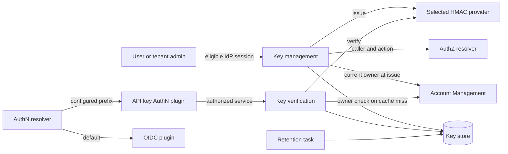

# Technical Design — API Key Management


<!-- toc -->

- [1. Architecture Overview](#1-architecture-overview)
  - [1.1 Architectural Vision](#11-architectural-vision)
  - [1.2 Architecture Drivers](#12-architecture-drivers)
  - [1.3 Architecture Layers](#13-architecture-layers)
- [2. Principles & Constraints](#2-principles--constraints)
  - [2.1 Design Principles](#21-design-principles)
  - [2.2 Constraints](#22-constraints)
- [3. Technical Architecture](#3-technical-architecture)
  - [3.1 Domain Model](#31-domain-model)
  - [3.2 Component Model](#32-component-model)
  - [3.3 API Contracts](#33-api-contracts)
  - [3.4 Internal Dependencies](#34-internal-dependencies)
  - [3.5 External Dependencies](#35-external-dependencies)
  - [3.6 Interactions & Sequences](#36-interactions--sequences)
  - [3.7 Database schemas & tables](#37-database-schemas--tables)
  - [3.8 Deployment Topology](#38-deployment-topology)
- [4. Additional context](#4-additional-context)
- [5. Traceability](#5-traceability)

<!-- /toc -->

- [ ] `p1` - **ID**: `cpt-cf-api-key-management-design-api-key-management`
## 1. Architecture Overview

### 1.1 Architectural Vision

API Key Management owns the credential record from issuance to removal. A user manages keys through REST or the Rust SDK. Both paths call the same service, which authorizes the operation under the user's identity and commits the change to the gear's database.

When a script presents a key, the AuthN resolver calls a separate verification interface. The gear checks the credential and its owner's standing and returns the recorded owner identity. AuthN constructs the user's context. Each consuming gear continues to authorize its own operations under current policy.

### 1.2 Architecture Drivers

#### Functional Drivers

| PRD driver | Design response |
|---|---|
| `cpt-cf-api-key-management-fr-management-auth`, `cpt-cf-api-key-management-fr-no-escalation` | AuthN establishes eligibility for each management call. The domain service checks PDP permission and imposes the additional issuance conditions. |
| `cpt-cf-api-key-management-fr-issuer-eligibility`, `cpt-cf-api-key-management-fr-owner-exists`, `cpt-cf-api-key-management-fr-owner-tenant-active` | One Account Management (AM) lookup checks the user in the recorded home tenant. Only verification may reuse a positive observation. |
| `cpt-cf-api-key-management-fr-key-limit`, `cpt-cf-api-key-management-fr-admin-revoke`, `cpt-cf-api-key-management-fr-retention` | Issuance and bulk revocation serialize per owner. Cleanup uses stored lifecycle timestamps and can run after the owner disappears. |
| `cpt-cf-api-key-management-fr-hmac-provider` | The SDK provider contract supports the bundled file/env plugin and vendor KMS plugins. Exercise issuance and verification through both (§3.2). |

#### NFR Allocation

| PRD NFR | Design and verification |
|---|---|
| `cpt-cf-api-key-management-nfr-secret-strength`, `cpt-cf-api-key-management-nfr-no-secret-exposure` | OS randomness, an issuance MAC, and separate issuance and metadata types. Exercise all response and telemetry paths with a known test credential. |
| `cpt-cf-api-key-management-nfr-record-integrity` | Verify the issuance MAC before trusting the stored identity or lifetime (§3.7). Test rejection of fabricated rows, modified bound fields, and revoked rows with cleared revocation metadata. |
| `cpt-cf-api-key-management-nfr-hmac-rotation` | The provider supports overlapping key versions (§3.2). Test planned promotion across two instances and rejection of the withdrawn version while the successor remains usable. |
| `cpt-cf-api-key-management-nfr-verify-latency`, `cpt-cf-api-key-management-nfr-owner-check-interval` | Measure warm-owner verification at p95 ≤ 10 ms inside the gear. Test the cold path against a delayed AM with a configurable deadline (default ≤ 2 s) and observe the last instant at which a cached result is valid (interval default ≤ 300 s). |
| `cpt-cf-api-key-management-nfr-revocation-propagation` | Verify against committed primary data on every request. Test revocation on one instance and verification on another against the configured bound (default ≤ 60 s), including AuthN reuse at the receiving service. |
| `cpt-cf-api-key-management-nfr-security-events`, `cpt-cf-api-key-management-nfr-operational-signals` | Capture committed lifecycle events, verification latency, cache use and outcome counters. Exercise AM denial and outage separately. Use fixed metric labels and keep known key IDs in event or diagnostic fields. |

### 1.3 Architecture Layers

- [ ] `p1` - **ID**: `cpt-cf-api-key-management-tech-layering`

Under `gears/system/api-key-management/`, the proposed `api-key-management-sdk` crate defines management and verification traits, inputs, results, errors and the HMAC provider SPI. The bundled `plugins/static-hmac-plugin` implements that SPI. The `api-key-management` crate contains the REST adapter (`api`), services and repository contracts (`domain`), and AM and database adapters (`infra`). ToolKit runs migrations and owns the retention task lifecycle.

## 2. Principles & Constraints

### 2.1 Design Principles

- [ ] `p1` - **ID**: `cpt-cf-api-key-management-principle-owner-identity`

The caller identity authorizes key management. The gear's service identity authorizes owner lookups. The recorded owner and home tenant stay fixed for the lifetime of a key, including after deletion of the user. An administrator can therefore complete offboarding using local records alone.

### 2.2 Constraints

- [ ] `p1` - **ID**: `cpt-cf-api-key-management-constraint-credential-origin`

Management requires positive evidence of a user access token issued by the IdP independently of an API key. AuthN owns credential origin across process boundaries. The proposed integration in §3.3 keeps this operation-specific evidence outside the general `SecurityContext`. A missing proof, an API key, or an exchanged token derived from one cannot admit a management call.

## 3. Technical Architecture

### 3.1 Domain Model

- [ ] `p1` - **ID**: `cpt-cf-api-key-management-entity-api-key`

An API key has a public UUID, an owner (home tenant, subject ID and type), a name, a display hint, issuance and expiration times and an optional revocation. A retained row with a revocation is always `revoked`. Otherwise its status is `expired` from the expiration instant, and `active` before it. Expiration and retention use UTC instants. A positive owner check only affects authentication eligibility.

The v1 wire format is `<configured prefix>v1_<key_id>.<secret>`, for example `cfk_v1_<key_id>.<secret>`. P1 generates a random UUIDv4 as the public key ID. The parser dispatches on the API key format marker (`v1_` for this layout) and accepts any UUID version in canonical lowercase hyphenated form. This lets the issuer change UUID generators without changing the wire format. The literal dot precedes exactly 48 unpadded base64url characters encoding 36 random bytes. Underscores are valid inside the secret.

The hint shows the issuance prefix and the last four secret characters, leaving 264 bits of random material undisclosed. The full credential stays in redacted memory and is disclosed only in the committed issuance response. Keep readers for previously released versions. Once a prefix change is effective in AuthN and this gear, only keys with the configured prefix are eligible. Restoring a previous prefix restores eligibility for its unexpired, unrevoked keys.

### 3.2 Component Model

- [ ] `p1` - **ID**: `cpt-cf-api-key-management-component-key-service`



Management enforces permission, scope and lifecycle transitions. Verification exposes one exact credential lookup to authorized authentication services. The retention task deletes due rows in bounded batches. The gear obtains its database connections through ToolKit. Two repository operations run without an end-user context. The authenticated verifier can fetch one row by its public UUID. The runtime-owned retention task can select and remove due records. Neither interface accepts general queries.

#### HMAC key provider

- [ ] `p1` - **ID**: `cpt-cf-api-key-management-component-hmac-provider`

The gear selects one configured vendor's GTS plugin instance through scoped ClientHub. The SDK defines a provider snapshot with exactly one **current** key for issuance and verification, and zero or more **verification-only** keys for rollover. Each entry has a stable, non-secret key ID. Verification-only entries may carry a UTC acceptance deadline, enforced on every use. Key IDs are unique and never reassigned to different material. Plugin registration publishes discovery metadata only. [ToolKit plugin contracts](../../../../docs/toolkit_unified_system/03_clienthub_and_plugins.md)

The provider must supply a nonempty `mac_key_id` for every key. A successful issuance returns `(mac_key_id, issuance_mac)` from the same pinned signing handle. The ID is bound into the MAC input, and the gear persists the pair. Verification selects a handle by that stored ID. Raw key bytes stay inside the plugin. The static plugin computes HMAC-SHA-256 locally. A vendor can implement the same interface by fetching secret versions from a secret manager or by delegating MAC operations to a KMS with non-exportable keys. The contract is private to the gear and its trusted provider. The verification route exposes only the credential verification result. Provider outages fail closed as unavailable. A remote provider's latency counts toward the verification budget in §1.2.

**Static sources.** Supply the complete key set as a YAML file or in one environment variable, `API_KEY_MANAGEMENT_HMAC_KEYS`, containing JSON. Both encode `current: {id?, secret}` and `retired: [{id?, secret, expires_at?}]`. Each secret is base64 encoding of at least 32 cryptographically random bytes. When `id` is omitted, the static plugin derives it at load time as unpadded base64url of HMAC-SHA-256 keyed by the decoded secret bytes over the ASCII label `api-key-management/key-id/v1`. Explicit IDs follow the same secret into retirement. Reject empty or duplicate effective IDs before publishing the snapshot. When set, the environment variable takes precedence for the entire set, including an empty retired list. Environment changes take effect on process restart. Secret values are redacted from errors, logs, metrics and debug output.

**File reload.** Load and validate the whole file before reporting readiness. Watch the parent directory and reopen the configured path after a change, including atomic rename or a projected-volume symlink swap. Periodically reconcile the path to recover missed events. Publish a validated snapshot atomically so each operation uses one generation. An unreadable or invalid update makes HMAC operations unavailable until a valid snapshot is loaded. Report reload health without secret material. Stop the watcher with the gear runtime.

**Rotation across replicas.** First distribute the new ID as verification-only to every verifier and confirm adoption. Then promote it to current and keep the previous ID verification-only. After the last issuer switches and its in-flight issuances finish, keep the old version available for verification for the maximum lifetime that could have been issued under it. The KMS policy must allow this overlap. A compromised version can be withdrawn early. This changes the server key ID independently of the client-visible `v1_`. Test replacement during verification, missed events, invalid-to-valid recovery, retired-key expiry and rotation across two instances.

### 3.3 API Contracts

- [ ] `p1` - **ID**: `cpt-cf-api-key-management-interface-key-operations`

The proposed authorization resource is `gts.cf.core.api_key_management.api_key.v1~`, with `id`, `owner_id` and `owner_tenant_id` as supported properties. Declare one well-known permission instance per action in ToolKit inventory for collection at startup using the [platform permission type](../../../../docs/arch/authorization/PERMISSION_GTS_TYPE.md). The proposed routes below share the prefix `/api-key-management/v1`. Each row maps to one management SDK operation.

| REST operation | SDK operation / PDP action | Authorized target | Success |
|---|---|---|---|
| `POST /keys` | `issue / create` | New key owned by the calling user in their home tenant | 201, Location, metadata and secret |
| `GET /keys` | `list_own / list` | Caller's own retained keys | 200, metadata page |
| `GET /keys/{id}` | `get_own / get` | Caller's own key | 200, metadata |
| `POST /keys/{id}:revoke` | `revoke_own / revoke` | Caller's own key | 204 |
| `GET /tenants/{tenant}/keys` | `list_admin / admin_list` | Keys in a currently administered tenant, optionally filtered by owner | 200, metadata page |
| `POST /tenants/{tenant}/keys/{id}:revoke` | `revoke_admin / admin_revoke` | One key in a currently administered tenant | 204 |
| `POST /tenants/{tenant}/users/{owner}/keys:revokeAll` | `revoke_all / admin_revoke_all` | All active keys of that recorded owner in the administered tenant | 204 |

Every entry obtains a PDP decision for the caller and action. The repository intersects the compiled scope with the route's target and, for self-service, the caller's owner tuple. On create, the scope must cover the prospective row. Administrative access requires an explicit policy grant for the administrative action and tenant. Enable the administrative surface only with an action-aware PDP policy. A deployment with only a tenant-visibility policy must refuse administrative operations. Denial or evaluation failure prevents writes and secret disclosure.

Declare the proposed IdP-user-token policy in `OperationBuilder` on every management route. The gateway and individual gear listeners apply it before the handler. This policy is a proposed extension to [OperationBuilder](../../../../libs/toolkit/src/api/operation_builder.rs) and the AuthN adapters. AuthN supplies a request-bound, opaque proof containing the verified caller context, constructible only by the authenticator. The local management trait requires that proof. A remote adapter presents the user's credential and the receiver verifies it under the same policy. Client-supplied origin fields carry no authority. Issuance also requires a user subject and exactly `["*"]` scopes.

Register versioned operations, operation IDs, request/response schemas, standard errors and license metadata with the runtime's OpenAPI registry. Return `Cache-Control: no-store` for issuance and prohibit request/response body recording on credential paths. Lists use a cursor over descending creation time and ID. Map domain errors to canonical RFC 9457 Problems, including invalid input (400), missing eligible authentication (401), denied permission (403) and the same not-found response (404) for absent, purged or out-of-scope key IDs. A full active-key quota returns 429. An unavailable PDP or AM dependency returns 503 and issuance creates no record.

The verification SDK accepts an independently authenticated platform caller and the full secret through a redacted input. Its service admission policy grants verification only to designated AuthN workloads, including local callers. Remote verification uses a protected internal transport with workload authentication and confidentiality. The only successful result contains the key ID, owner tuple, expiration and token scopes `["*"]`. AuthN maps credential rejection to unauthenticated and inability to establish validity to unavailable. Internal reason codes stay out of both wire outcomes.

### 3.4 Internal Dependencies

| Gear | Contract and use |
|---|---|
| AuthN resolver | Routes matching credentials to verification, preserves OIDC and client-credentials routing, supplies admission evidence and constructs the owner's context. A failed API key verification terminates authentication. [PRD integration contracts](./PRD.md#72-external-integration-contracts) |
| AuthZ resolver | `PolicyEnforcer` obtains PDP decisions and resource constraints for every management operation. [ToolKit authorization](../../../../docs/toolkit_unified_system/06_authn_authz_secure_orm.md) |
| Types Registry / ClientHub | Discover the configured HMAC provider and resolve its versioned scoped client. |
| Account Management | `get_user(service_ctx, home_tenant_id, owner_id)` checks presence in an active home tenant. Obtain the gear's own service bearer with the platform client-credentials exchange. The deployment grants its service principal the user lookup permission in the applicable tenants (currently AM's user `LIST` action). [AM implementation](../../account-management/account-management/src/domain/user/service.rs) |

#### Bearer routing configuration (P1)

The proposed `authn-resolver` configuration maps a literal bearer prefix to a registered AuthN plugin instance. For example, a deployment using the proposed API key plugin could configure:

```yaml
gears:
  authn-resolver:
    config:
      vendor: constructorfabric
      prefix_routes:
        "cfk_": "gts.cf.toolkit.plugins.plugin.v1~cf.core.authn_resolver.plugin.v1~cf.builtin.api_key_authn.plugin.v1"
```

The resolver matches the raw bearer value case-sensitively before invoking a plugin. Validate nonempty, unambiguous prefixes, reject duplicates and overlaps, and validate target IDs against the AuthN plugin schema. Resolve a matching target by its exact instance ID through scoped ClientHub. Plugin metadata and priority cannot create or override a prefix route. Match the whole API key family (`cfk_`), leaving wire-version parsing to the gear.

A configured route remains reserved if its target is missing or unavailable (503). A plugin rejecting the credential ends authentication (401). Neither outcome invokes OIDC. Unmatched bearers and client-credentials exchange go directly to the default plugin without consulting the API key verifier. Keep prefix handlers out of default-plugin selection. An omitted prefix has no reservation in this config-only model. Roll out the route to every gateway and standalone AuthN listener before enabling issuance under a new prefix.

### 3.5 External Dependencies

The platform database holds issued key records. Each deployment keeps the HMAC key set under separate access controls outside that database. ToolKit supplies the database pool, migrations and the approved cryptographic provider. AM and AuthN own all communication with the IdP. The deployment supplies the service credential, enforces admission limits on issuance and verification, and bounds diagnostic logging.

### 3.6 Interactions & Sequences

#### Issuance and verification

- [ ] `p1` - **ID**: `cpt-cf-api-key-management-seq-issue-and-verify`

**Use cases**: `cpt-cf-api-key-management-usecase-issue-and-use`, `cpt-cf-api-key-management-usecase-owner-deleted`.

1. **Issue.** With eligible authentication and an allowed `create`, perform a fresh AM lookup as the gear. On success, prepare the fresh credential and its issuance MAC using the current key before taking a database lock. Under the owner lock, check the active-key count and insert the complete record in one transaction. Commit before disclosing the secret. Retrying after a lost response issues a new key subject to the same limit. The owner can identify and revoke the unused one.
2. **Verify.** Admit the AuthN service, validate the credential syntax and read the committed row by its public key ID from the primary. Fetch validity fields, `mac_key_id` and the issuance MAC in that read. For an active row, verify the MAC once over the presented full credential and the stored fields before trusting its owner or contacting AM. A missing row, expired or revoked credential, mismatched MAC, or withdrawn key ID yields the uniform invalid-credential result. Failure to obtain an authoritative provider result yields verification unavailable. Reuse a positive observation for the exact owner tuple only within its original freshness interval. On a miss, query AM under the service identity and a bounded deadline. Recheck expiration and observation age before returning.
3. **Handle owner changes.** Confirmed absence or an inactive tenant produces invalid credential. After restoration, a still-valid key becomes usable on a fresh successful observation. AM denial, timeout, unsupported capability or an ambiguous response produces verification unavailable when a fresh check is needed. Counts distinguish these causes using bounded labels. Key verification and administrative actions never turn a dependency failure into permanent revocation.

#### Revocation and offboarding

- [ ] `p1` - **ID**: `cpt-cf-api-key-management-seq-revoke`

**Use cases**: `cpt-cf-api-key-management-usecase-revoke`, `cpt-cf-api-key-management-usecase-offboard`.

After caller authentication and authorization, validate the required reason against the actor's [allowed reasons](./PRD.md#revocation-reason), even on a retry. Under the same per-owner lock as issuance, choose a single cutoff and conditionally revoke each targeted key active at that instant. Clear the issuance MAC in the same update and retain the metadata for the retention period. Revocation only withdraws access and works even if the HMAC provider is unavailable. Previously revoked keys keep their original reason and time. Expired keys keep their expired state. Bulk revocation and subsequent issuance serialize at the lock. Both administrative paths use the recorded owner identity even after AM deletes the user.

After commit, emit one structured event per created or newly revoked key with the time, operation, key ID, owner, tenant, actor and applicable reason. An idempotent no-op emits none. Event retention follows the platform logging policy.

### 3.7 Database schemas & tables

- [ ] `p1` - **ID**: `cpt-cf-api-key-management-db-key-store`

[database.sql](./database.sql) defines the P1 physical schema in PostgreSQL syntax. Backend migrations preserve its constraints and access paths on SQLite, PostgreSQL and MySQL. The physical table names use the `api_key_management__` prefix.

| Table | Purpose |
|---|---|
| `api_keys` | One retained credential per row. Verification looks up the public UUID. Owner and administrator listings page by creation time and ID. Cleanup selects rows by retention deadline. |
| `api_key_owners` | One local lock row per owner tuple. Writers create or lock it atomically, including on first issuance, before taking any key row lock. |

- [ ] `p1` - **ID**: `cpt-cf-api-key-management-dbtable-api-keys`
- [ ] `p1` - **ID**: `cpt-cf-api-key-management-dbtable-api-key-owners`

The row's UUID primary key supports the sole credential-store read. The 32-byte issuance tag is HMAC-SHA-256 over a canonical encoding of the fixed domain label `cf.api-key-management/active/v1`, the full credential, owner tenant UUID, owner UUID, owner type, issuance time, expiration time and server MAC key ID, in that order. Encode strings as UTF-8 prefixed with their big-endian u32 byte length, UUID fields as 16 bytes and UTC instants as signed big-endian i64 Unix microseconds normalized before insertion. The credential carries the prefix, format version, key ID and client secret. Require the parsed API key format version to match `format_version`. The stored `created_at` and `expires_at` are authoritative for issuance time and expiration. Treat the public UUID as opaque for all time and age decisions. Verify the tag in constant time locally or through the provider's MAC verification operation. Only an active record can authenticate. Revocation discards its MAC, so clearing revocation metadata alone cannot restore it. An attacker limited to writing the credential database cannot mint a valid binding or change its owner or expiry. Replay of a previously valid row remains possible until its credential expires or its HMAC key is withdrawn.

Scope ordinary reads and mutations through `SecureConn`. Count active keys across the entire owner tuple under its lock, including keys invisible to a narrower management query. Database uniqueness rejects collisions with retained key IDs. The transaction runner retries serialization conflicts with no externally visible side effects. Cover first issuance, simultaneous last-slot requests, bulk revoke racing issuance, and cleanup racing a new issue on supported backends.

Set `purge_after` to expiration plus 90 days at issue and bring it forward on first revocation to the earlier lifecycle instant plus 90 days. A cancellable task drains overdue rows at startup and periodically, rechecking eligibility under lock. It removes empty owner rows and leaves security events intact. Alert on the age of the oldest due row so cleanup meets the 24-hour bound during normal service and after recovery.

### 3.8 Deployment Topology

- [ ] `p1` - **ID**: `cpt-cf-api-key-management-topology-service`

Embedded and remote clients share SDK semantics. Instances share a primary database and keep only bounded local caches of positive owner checks. A restart empties the cache. P1 forwards API keys only across protected connections to services that accept and reverify them. Downstream consumers enforce the key's expiration, the revocation bound and owner-check freshness for every new authentication decision. AuthN owns any future token exchange.

## 4. Additional context

The following decisions remain open before design sign-off.

- **AM.** Agree how a successful lookup timestamps or bounds the age of both observations. Account for upstream lag in the reuse budget. The SDK must distinguish confirmed absence or inactivity from loss of visibility or availability without parsing error messages. AM already distinguishes user-scoped and tenant-scoped not-found results. Inactive tenants currently share a generic validation result with other failures. Agree a stable typed inactive result with AM.
- **AuthN and ToolKit.** Agree on the positive route policy, SDK proof and local/remote verifier admission. Test raw, exchanged and unknown-origin credentials through each management entry point. Confirm action-aware administrative grants in the target PDP policy.
- **Gear configuration.** The PRD proposes a 90-day default lifetime, a one-year maximum and 10 active keys per owner. On startup require a positive owner limit, a positive default lifetime at most the maximum, and a nonempty prefix disjoint from other accepted credential formats. Coordinating prefix changes across the resolver and gear is an operator responsibility. [PRD open questions](./PRD.md#13-open-questions)

P2 adds the optional verification policy `cpt-cf-api-key-management-fr-max-key-age`. When enabled, the verifier uses the authenticated timestamps to calculate `min(expires_at, created_at + max_key_age)`. AuthN must enforce that cutoff on new decisions and account for policy changes when reusing results. The stored expiration stays authoritative for lifecycle and retention.

P2 also adds last-used reporting, durable audit delivery and permanent revocation on authoritative owner deletion. P1's manual replacement procedure requires a free active-key slot. The operator guide covers replacement, prefix changes, AM grants and verification failures.

## 5. Traceability

The [PRD](./PRD.md) defines the acceptance criteria and external contracts. Sections 1.2 and 3.6 map the mechanisms to the driving requirements and use cases. This draft has no gear-specific accepted ADRs.
