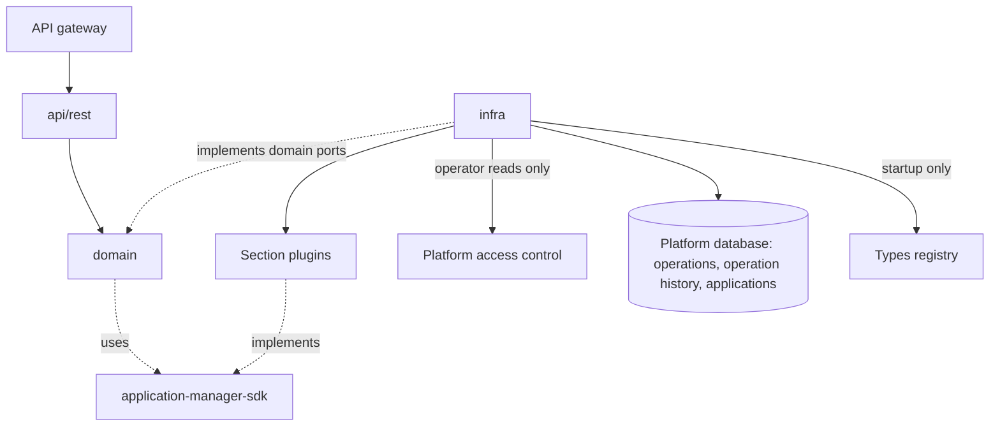
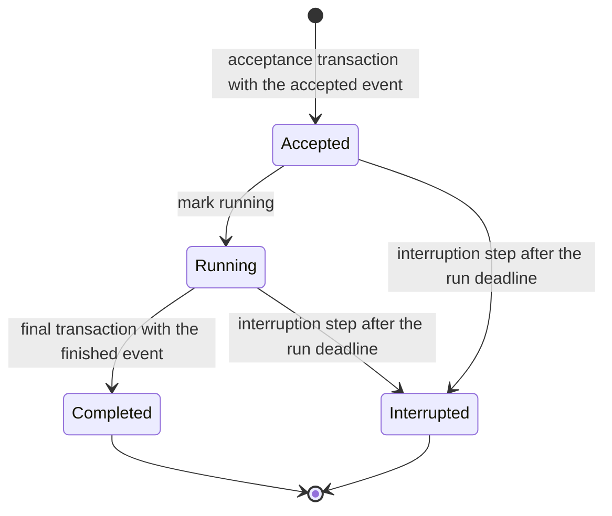
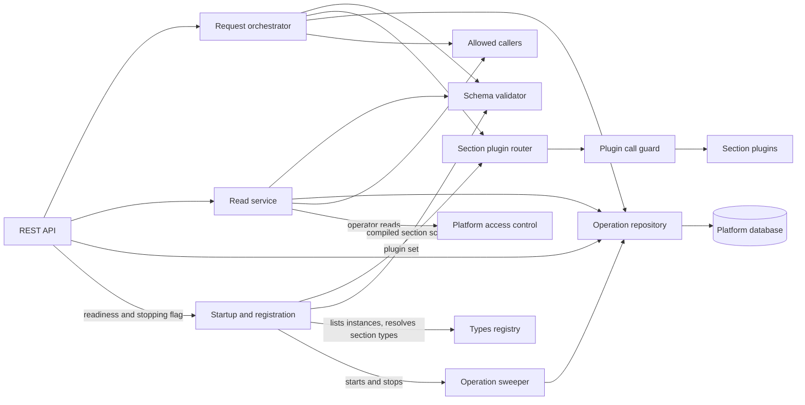
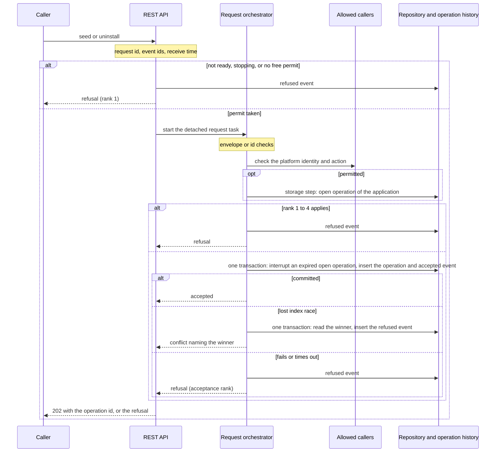
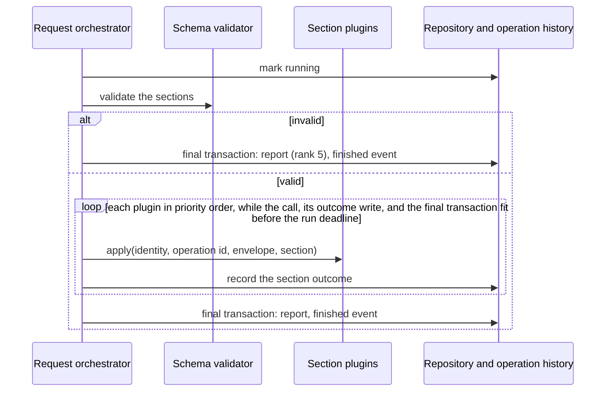
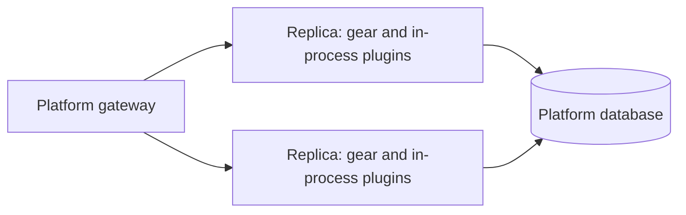

<!-- Created: 2026-10-05 by Constructor Tech -->

# Technical Design — Application Manager

How the Application Manager runs each seed and uninstall as an operation: quick synchronous checks, an operation id, whole-manifest validation, ordered dispatch to section plugins, and an append-only operation history. Written for gear implementers and section-plugin authors.

- [ ] `p3` - **ID**: `cpt-cf-application-manager-design-overview`

<!-- toc -->

- [1. Architecture Overview](#1-architecture-overview)
  - [1.1 Architectural Vision](#11-architectural-vision)
  - [1.2 Architecture Drivers](#12-architecture-drivers)
  - [1.3 Architecture Layers](#13-architecture-layers)
- [2. Principles & Constraints](#2-principles--constraints)
  - [2.1 Design Principles](#21-design-principles)
  - [2.2 Constraints](#22-constraints)
- [3. Technical Architecture](#3-technical-architecture)
  - [3.1 Domain Model](#31-domain-model)
  - [3.2 Component Model](#32-component-model)
  - [3.3 API Contracts](#33-api-contracts)
  - [3.4 Internal Dependencies](#34-internal-dependencies)
  - [3.5 External Dependencies](#35-external-dependencies)
  - [3.6 Interactions & Sequences](#36-interactions--sequences)
  - [3.7 Database schemas & tables](#37-database-schemas--tables)
  - [3.8 Deployment Topology](#38-deployment-topology)
- [4. Additional context](#4-additional-context)
  - [4.1 Observability](#41-observability)
  - [4.2 Configuration](#42-configuration)
  - [4.3 Platform Deviations](#43-platform-deviations)
- [5. Traceability](#5-traceability)

<!-- /toc -->

## 1. Architecture Overview

### 1.1 Architectural Vision

The Application Manager is a thin orchestrating gear on the ToolKit gear model. It owns one manifest envelope, one operations table, one append-only operation history, one table of installed applications, and one fixed sequence of checks, history inserts, and plugin calls. All domain meaning lives in section plugins, and the gear never talks to the systems they provision.

The plugin set and the section schemas, read from the registered section types, are fixed at startup, and every seed validates the whole manifest before it dispatches anything ([ADR 0001](./ADR/0001-cpt-cf-application-manager-adr-section-plugin-fan-out.md)). Seed and uninstall run as background operations within a run window ([ADR 0002](./ADR/0002-cpt-cf-application-manager-adr-async-operations.md)). History events go to the append-only operation history in the transaction of the change they describe ([ADR 0003](./ADR/0003-cpt-cf-application-manager-adr-operation-history.md)). Allowed callers in configuration grant the seeding actions on the platform plane, the PDP decides the operator reads, and records are unrestricted ([ADR 0004](./ADR/0004-cpt-cf-application-manager-adr-platform-level-access.md)).

### 1.2 Architecture Drivers

#### Functional Drivers

| Requirement | Design Response |
|---|---|
| `cpt-cf-application-manager-fr-manifest-envelope` | The schema validator checks the envelope before acceptance (`cpt-cf-application-manager-entity-manifest`). |
| `cpt-cf-application-manager-fr-application-id` | Bounded opaque text, compared exactly with a binary collation (`cpt-cf-application-manager-entity-manifest`, `cpt-cf-application-manager-dbtable-operations`). |
| `cpt-cf-application-manager-fr-opaque-version` | Passed unchanged to `apply` and recorded as sent (`cpt-cf-application-manager-entity-manifest`). |
| `cpt-cf-application-manager-fr-required-sections` | The schema validator requires exactly the key set (`cpt-cf-application-manager-component-schema-validator`). |
| `cpt-cf-application-manager-fr-unique-section-keys` | Startup fails on a repeated or malformed key (`cpt-cf-application-manager-component-startup-registration`). |
| `cpt-cf-application-manager-fr-section-priority` | The registered GTS instance priority, lowest first; equal priorities fail startup. |
| `cpt-cf-application-manager-fr-startup-checks` | Checks made once at `start`, with no retry (`cpt-cf-application-manager-component-startup-registration`). |
| `cpt-cf-application-manager-fr-validate-before-dispatch` | `cpt-cf-application-manager-principle-validate-then-dispatch`, `cpt-cf-application-manager-seq-seed`. |
| `cpt-cf-application-manager-fr-plugin-served-schemas` | The registered section type is the only source of section rules, read once at `start` (`cpt-cf-application-manager-component-startup-registration`). |
| `cpt-cf-application-manager-fr-plugin-extensibility` | Plugins are separate gears that register an instance of the section plugin GTS type (`cpt-cf-application-manager-constraint-toolkit-plugin-model`). |
| `cpt-cf-application-manager-fr-async-operations` | `cpt-cf-application-manager-component-request-orchestrator`, `cpt-cf-application-manager-entity-operation`. |
| `cpt-cf-application-manager-fr-one-operation-per-application` | A unique index on open operations (`cpt-cf-application-manager-dbtable-operations`). |
| `cpt-cf-application-manager-fr-ordered-dispatch` | `cpt-cf-application-manager-component-section-plugin-router`. |
| `cpt-cf-application-manager-fr-pass-through` | `cpt-cf-application-manager-principle-pass-through`, `cpt-cf-application-manager-principle-minimal-state`. |
| `cpt-cf-application-manager-fr-plugin-owned-semantics` | The plugin interface offers `apply` and `remove` only (`cpt-cf-application-manager-interface-section-plugin-api`). |
| `cpt-cf-application-manager-fr-outcome-categories` | The outcome table in [§3.3](#33-api-contracts). |
| `cpt-cf-application-manager-fr-outcome-precedence` | The outcome table in [§3.3](#33-api-contracts). |
| `cpt-cf-application-manager-fr-response-content` | Refusal bodies and the outcome report; the Retriable column of the outcome table says what to fix, retry, or request ([§3.3](#33-api-contracts)). |
| `cpt-cf-application-manager-fr-bounded-plugin-calls` | `cpt-cf-application-manager-component-plugin-call-guard`. |
| `cpt-cf-application-manager-fr-dependency-failures` | Rank 1 and the acceptance row of the outcome table in [§3.3](#33-api-contracts). |
| `cpt-cf-application-manager-fr-uninstall` | `cpt-cf-application-manager-seq-uninstall`. |
| `cpt-cf-application-manager-fr-discovery` | `cpt-cf-application-manager-component-read-service`. |
| `cpt-cf-application-manager-fr-operation-read` | `cpt-cf-application-manager-component-read-service`, `cpt-cf-application-manager-component-operation-sweeper`. |
| `cpt-cf-application-manager-fr-authentication` | Seeding, discovery, and operation-read routes are `.platform_authenticated()`; the history read and the application list are `.authenticated()`; plugins get the caller's platform identity (`cpt-cf-application-manager-entity-caller-identity`). |
| `cpt-cf-application-manager-fr-authorization` | `cpt-cf-application-manager-component-allowed-callers` and the PDP, with plugin-level authorization, in [§3.3](#33-api-contracts). |
| `cpt-cf-application-manager-fr-list-applications` | `cpt-cf-application-manager-dbtable-applications`, written in the final transactions; `cpt-cf-application-manager-seq-list-applications`. |
| `cpt-cf-application-manager-fr-history-event` | `cpt-cf-application-manager-dbtable-operation-history`, `cpt-cf-application-manager-component-operation-repository`. |
| `cpt-cf-application-manager-fr-history-read` | `cpt-cf-application-manager-component-read-service`. |
| `cpt-cf-application-manager-fr-history-ordering` | `cpt-cf-application-manager-principle-trace-before-change`. |
| `cpt-cf-application-manager-interface-seeding` | `cpt-cf-application-manager-interface-rest-api`. |
| `cpt-cf-application-manager-interface-operations` | `cpt-cf-application-manager-interface-rest-api`. |
| `cpt-cf-application-manager-interface-discovery` | `cpt-cf-application-manager-interface-rest-api`. |
| `cpt-cf-application-manager-interface-applications` | `cpt-cf-application-manager-interface-rest-api`. |
| `cpt-cf-application-manager-contract-section-plugin` | `cpt-cf-application-manager-interface-section-plugin-api`. |

#### NFR Allocation

| NFR ID | Allocated To | Design Response |
|---|---|---|
| `cpt-cf-application-manager-nfr-history-completeness` | `cpt-cf-application-manager-component-operation-repository` | Every path ends in a refused event or in the acceptance transaction, and every final state writes its finished event with the report ([§3.7](#37-database-schemas--tables)). |
| `cpt-cf-application-manager-nfr-platform-scope` | `cpt-cf-application-manager-component-operation-repository` | Unrestricted entities with no tenant column, reached only through the gear ([ADR 0004](./ADR/0004-cpt-cf-application-manager-adr-platform-level-access.md)). |
| `cpt-cf-application-manager-nfr-authorized-before-plugin` | `cpt-cf-application-manager-component-request-orchestrator`, `cpt-cf-application-manager-component-read-service` | The allowed-callers check precedes the conflict read, the acceptance, and every plugin call. |
| `cpt-cf-application-manager-nfr-bounded-call-time` | `cpt-cf-application-manager-component-plugin-call-guard` | Every plugin call goes through the guard ([§4.2](#42-configuration)). |
| `cpt-cf-application-manager-nfr-bounded-request-time` | `cpt-cf-application-manager-component-request-orchestrator`, `cpt-cf-application-manager-component-operation-sweeper` | A checked synchronous budget and a run deadline per operation ([§4.2](#42-configuration)). |
| `cpt-cf-application-manager-nfr-no-partial-on-invalid` | `cpt-cf-application-manager-component-request-orchestrator` | Dispatch is reachable only after acceptance and a valid manifest. |
| `cpt-cf-application-manager-nfr-availability` | `cpt-cf-application-manager-component-startup-registration`, `cpt-cf-application-manager-topology-replicas` | After startup, readiness depends only on the published startup result. |
| `cpt-cf-application-manager-nfr-operational-signals` | `cpt-cf-application-manager-component-operation-repository`, `cpt-cf-application-manager-component-plugin-call-guard` | Platform telemetry ([§4.1](#41-observability)). |

#### Key ADRs

| ADR ID | Decision Summary |
|---|---|
| `cpt-cf-application-manager-adr-section-plugin-fan-out` | Every section plugin takes part; plugins and their section schemas are discovered once at startup. |
| `cpt-cf-application-manager-adr-async-operations` | Background operations with a bounded synchronous phase and a run window; a plugin call is stopped at its time limit. |
| `cpt-cf-application-manager-adr-operation-history` | An append-only history table written in the transaction of the change it describes. |
| `cpt-cf-application-manager-adr-platform-level-access` | Allowed callers in configuration grant the seeding actions on the platform plane; the PDP decides history reads and the application list; unrestricted records. |

### 1.3 Architecture Layers



- [ ] `p3` - **ID**: `cpt-cf-application-manager-tech-layers`

The gear uses the platform layer model ([gear layout and SDK pattern](../../../../docs/toolkit_unified_system/02_gear_layout_and_sdk_pattern.md)). Plugin gears depend only on the SDK crate, and REST is the only consumer surface.

| Layer | Responsibility | Technology |
|---|---|---|
| API (`api/rest/`) | Routes, DTOs, Problem bodies, the not-ready gate | OperationBuilder; canonical errors (RFC 9457) |
| Domain (`domain/`) | Orchestration, operation lifecycle, reads, the allowed-callers check, validation, dispatch order, outcome ranking; owns the ports | `#[domain_model]`; JSON Schema Draft-07 through `jsonschema` |
| Infrastructure (`infra/`) | Call guard, ClientHub and policy adapters, operation repository, sweeper, startup, telemetry | ClientHub; types registry; PolicyEnforcer; SeaORM through SecureConn; OpenTelemetry |
| SDK (`application-manager-sdk`) | Section plugin interface, models, error kinds, GTS types | Rust traits; GTS |

## 2. Principles & Constraints

### 2.1 Design Principles

When principles conflict, the earlier one in this list wins: Trace Before Change; Honest, Deterministic Outcomes; Validate Everything, Then Dispatch; Bounded Waiting; Pass Through, Never Interpret; Plugin Set Fixed at Startup; Minimal State.

#### Pass Through, Never Interpret

- [ ] `p2` - **ID**: `cpt-cf-application-manager-principle-pass-through`

The gear checks shape against schemas it does not own and moves each section unchanged to its owner. It gives no meaning to versions, re-seeds, section type versions, or section content.

**ADRs**: `cpt-cf-application-manager-adr-section-plugin-fan-out`

#### Plugin Set Fixed at Startup

- [ ] `p2` - **ID**: `cpt-cf-application-manager-principle-startup-fixed-plugin-set`

The plugin set, its keys, its priority order, and the compiled section schemas are built once at startup and fixed for the process lifetime.

**ADRs**: `cpt-cf-application-manager-adr-section-plugin-fan-out`

#### Validate Everything, Then Dispatch

- [ ] `p2` - **ID**: `cpt-cf-application-manager-principle-validate-then-dispatch`

Dispatch starts only after every check of [§3.6](#36-interactions--sequences) has passed. Seed validation and the discovery combined schema share one composition rule.

**ADRs**: `cpt-cf-application-manager-adr-section-plugin-fan-out`

#### Trace Before Change

- [ ] `p2` - **ID**: `cpt-cf-application-manager-principle-trace-before-change`

No plugin receives anything until the operation and its accepted event have committed, at the write points of [§3.7](#37-database-schemas--tables).

**ADRs**: `cpt-cf-application-manager-adr-operation-history`

#### Honest, Deterministic Outcomes

- [ ] `p2` - **ID**: `cpt-cf-application-manager-principle-honest-outcomes`

Every seed and uninstall ends in exactly one category from the outcome table in [§3.3](#33-api-contracts). The gear fails closed, and every write to an operation is guarded, so an operation has one final state.

#### Bounded Waiting

- [ ] `p2` - **ID**: `cpt-cf-application-manager-principle-bounded-waiting`

The gear drops a plugin call at the time limit and dispatches the next section. The section plugin keeps its own data consistent, for example with a transaction, and the gear never undoes plugin work. Request tasks are detached from the HTTP request.

**ADRs**: `cpt-cf-application-manager-adr-async-operations`

#### Minimal State

- [ ] `p2` - **ID**: `cpt-cf-application-manager-principle-minimal-state`

The gear keeps only operation records, the operation history, and application records, and none holds manifest content. The operation history is a record for people who debug a request, and application records answer which applications are installed; the gear serves both through their reads and never decides from them.

**ADRs**: `cpt-cf-application-manager-adr-operation-history`, `cpt-cf-application-manager-adr-platform-level-access`

### 2.2 Constraints

#### ToolKit Gear and Plugin Model

- [ ] `p2` - **ID**: `cpt-cf-application-manager-constraint-toolkit-plugin-model`

The section plugin type and the section base type `gts.cf.core.application_manager.section.v1~` are GTS types. Instances are listed and section types, with their schemas, are resolved in the types registry, and clients are looked up in ClientHub by exact GTS id ([ClientHub and plugins](../../../../docs/toolkit_unified_system/03_clienthub_and_plugins.md)).

**ADRs**: `cpt-cf-application-manager-adr-section-plugin-fan-out`

#### Platform Authentication and Policy Enforcement

- [ ] `p2` - **ID**: `cpt-cf-application-manager-constraint-platform-auth`

Authentication belongs to the platform pipeline, and the gear is supported only with gateway authentication and platform-plane authentication enabled. Seed, uninstall, discovery, and the operation read are platform-plane routes, granted by the allowed callers ([two-plane auth ADR](../../../../docs/arch/toolkit-oop/ADR/0008-cpt-cf-adr-two-plane-auth.md)). The history read and the application list are tenant-plane routes, decided by PolicyEnforcer ([AuthN, AuthZ and secure ORM](../../../../docs/toolkit_unified_system/06_authn_authz_secure_orm.md)). Caller credentials never reach plugins.

**ADRs**: `cpt-cf-application-manager-adr-platform-level-access`

#### Secure ORM for Operations and the Operation History

- [ ] `p2` - **ID**: `cpt-cf-application-manager-constraint-secure-orm`

All storage access goes through SecureConn, with all three entities declared unrestricted ([database patterns](../../../../docs/toolkit_unified_system/11_database_patterns.md)). Raw SQL appears only in migrations.

**ADRs**: `cpt-cf-application-manager-adr-platform-level-access`

#### Canonical Error Model

- [ ] `p2` - **ID**: `cpt-cf-application-manager-constraint-canonical-errors`

Every error response is a canonical Problem with no extension member ([canonical error system](../../../../docs/arch/errors/DESIGN.md)). The outcome of an accepted operation is data in its report, not an error.

#### No Stored Manifest Content

- [ ] `p2` - **ID**: `cpt-cf-application-manager-constraint-no-manifest-content`

Manifest content lives only in memory. Operation records, history rows, logs, traces, metrics, and error text carry only the fields that `cpt-cf-application-manager-entity-outcome-report`, `cpt-cf-application-manager-entity-history-event-content`, and [§4.1](#41-observability) name, and errors never carry values.

**ADRs**: `cpt-cf-application-manager-adr-operation-history`

#### Restart for Plugin Changes

- [ ] `p2` - **ID**: `cpt-cf-application-manager-constraint-restart-for-plugin-change`

A change to the section plugin set, its priorities, its section schemas, or the allowed callers takes effect only after a restart.

**ADRs**: `cpt-cf-application-manager-adr-section-plugin-fan-out`

#### Configured Time Limit Only

- [ ] `p2` - **ID**: `cpt-cf-application-manager-constraint-configured-time-limit`

The plugin-call time limit is `plugin_call_timeout`, exactly as configured, for every call kind.

## 3. Technical Architecture

### 3.1 Domain Model

**Technology**: Rust types marked `#[domain_model]`; GTS types for the section plugin, the section base type, the authorization resource, and the outcome report; JSON Schema Draft-07.

**Location**: `application-manager-sdk/src/models.rs`, `application-manager-sdk/src/gts.rs`, and `application-manager/src/domain/`.

**Core Entities**:

- [ ] `p2` - **ID**: `cpt-cf-application-manager-entity-manifest`

**Manifest.** A JSON object with exactly `application`, the envelope, and `sections`, one member per section key. The envelope holds exactly `id` and `version`: non-empty text of at most `max_envelope_text_length` bytes with no control character (Unicode Cc). An uninstall id follows the same rule.

- [ ] `p2` - **ID**: `cpt-cf-application-manager-entity-section`

**Section.** The JSON value under one key of `sections`, passed unchanged to its plugin's `apply` with the envelope.

- [ ] `p2` - **ID**: `cpt-cf-application-manager-entity-outcome-category`

**Section outcome.** `succeeded`, `rejected`, `not_permitted`, or an internal failure: `internal_failure`; `timed_out`, whose effect is unknown; `not_sent`, refused by the in-flight cap; or `not_dispatched`, when the request task failed before the call or the call no longer fit before the run deadline. Request-level categories are defined only by the outcome table in [§3.3](#33-api-contracts).

- [ ] `p2` - **ID**: `cpt-cf-application-manager-entity-outcome-report`

**Outcome report.** The PRD's operation report, written into the operation record as the operation runs and validated against the outcome report GTS type.

| Member | Content |
|---|---|
| `operation_id`, `action` | The operation id; `seed` or `uninstall` |
| `category` | Category of a completed operation; absent while open and when interrupted |
| `interrupted` | True when the operation ended at its run deadline |
| `application` | Seed: `id` and `version`. Uninstall: `id`. |
| `sections` | Per plugin with a recorded outcome, in priority order: `key`, `outcome`, `section_type` (the exact GTS id) for a validated seed section, and for `rejected` and `not_permitted` the plugin's `detail` (cut at `PLUGIN_DETAIL_MAX_BYTES`) and optional `location` |
| `problems` | Section validation problems: `location` (JSON Pointer), `rule` (a JSON Schema keyword, `missing_section`, or `unknown_section`), `message` |
| `unavailable` | Items with a `dependency` (`operation_storage`, `application_manager`) and a `reason` (`unreachable`, `timed_out`, `not_ready`, `at_capacity`) |

- [ ] `p2` - **ID**: `cpt-cf-application-manager-entity-operation`

**Operation record.** One per accepted request: id, application id, action, status, category, report, accepted, started, and finished times, run deadline, and finished event id. It holds no manifest content and no caller identity.



- **Run deadline.** Set at acceptance ([§4.2](#42-configuration)) so that every plugin call, its outcome write, and the final transaction fit. A plugin call starts only when `plugin_call_timeout` + 2 × `storage_call_timeout` still fit before it, so the call, its outcome write, and the final transaction end by the deadline. When a call no longer fits, that plugin and every later one get `not_dispatched`, and the final transaction completes the operation as internal failure.
- **Status guard.** Writes match only an open record before its deadline; the interruption step matches only one past it. The first final write wins.
- **Interruption step.** One transaction sets interrupted, keeps the section outcomes so far, and inserts the finished event. For a seed, the same transaction writes the application record. The sweeper, the operation read, and the acceptance run it on an expired open operation, which covers a lost task and a failed final transaction.
- **Supervisor completion.** When a request task fails after acceptance, the operation goes Running, then Completed as internal failure, with `not_dispatched` for plugins not yet called.
- **Retention.** The sweeper purges a final record `operation_retention` after it finished.

- [ ] `p2` - **ID**: `cpt-cf-application-manager-entity-caller-identity`

**Caller identity.** The validated platform identity from the caller's `PlatformSecurityContext`, with no credential: its kind and, for a Kubernetes service account, the namespace, service-account name, and pod when known; for SPIFFE, the trust domain, name, and version. Every plugin call receives it. A plugin's own permission check is a rule of the plugin on this identity, because the PDP never evaluates a platform identity.

- [ ] `p2` - **ID**: `cpt-cf-application-manager-entity-history-event-content`

**History event content.** A request has one refused event, or an accepted event followed by a finished event; an acceptance that timed out after it committed has all three. Each event id is a time-ordered UUID assigned at receive. The request id is the operation id of an accepted request and the correlation id of its events.

| Field | Accepted | Finished | Refused |
|---|---|---|---|
| Event id, kind, action, write time | Yes | Yes | Yes |
| Correlation id | `operation_id` | `operation_id` | `request_id` |
| Application | Seed: id and version. Uninstall: id. | As accepted | Id and version within the limits; outside them, byte length and SHA-256 digest |
| Section keys (seed) | Keys of the key set, plus a count of other keys | No | As accepted, when `sections` is an object |
| Caller identity and receive time | Yes | No | Yes |
| Result | None | Category or interrupted marker; problem count and rule tokens; section outcome per key of the key set, with section types; unavailable items | Category; problem count and rule tokens; busy operation id; or unavailable items |

History rows carry no other manifest content: no section body, no problem location or message, and no plugin detail.

### 3.2 Component Model

Domain components call ports, infrastructure components implement them, and `gear.rs` composes them. Tests replace every port with a double.



#### REST API

- [ ] `p2` - **ID**: `cpt-cf-application-manager-component-rest-api`

**Why**: The only caller-facing surface.

**Scope**: Registers the routes, assigns the request id, event ids, and receive time, and runs the gate: a seed or uninstall before startup ends, after `stop` begins, or with no free request-task permit gets a rank 1 refusal with a refused event.

**Boundaries**: It does not authenticate or authorize, and decides no category apart from the gate refusal.

**Related**: `cpt-cf-application-manager-component-request-orchestrator`, `cpt-cf-application-manager-component-read-service`, `cpt-cf-application-manager-component-startup-registration`.

#### Request Orchestrator

- [ ] `p1` - **ID**: `cpt-cf-application-manager-component-request-orchestrator`

**Why**: Precedence, acceptance, history ordering, and dispatch must run as one sequence on every path.

**Scope**: Runs each seed and uninstall as a supervised request task through [§3.6](#36-interactions--sequences), decides the category by the outcome table, and performs the supervisor completion. The task completes even when the HTTP request is dropped.

**Boundaries**: It holds no plugin set or schema logic, writes no table itself, and never undoes or resumes work.

**Related**: `cpt-cf-application-manager-component-operation-repository`, `cpt-cf-application-manager-component-schema-validator`, `cpt-cf-application-manager-component-section-plugin-router`.

#### Read Service

- [ ] `p2` - **ID**: `cpt-cf-application-manager-component-read-service`

**Why**: Reads record no history event and decide no category, so they stay apart from the orchestrator.

**Scope**: When the allowed callers allow `read_schema` or `read_operation`, it lists keys or returns schemas from memory, or reads one operation record, interrupting it first when expired. After a PDP permit for `read_history` or `read_applications`, it reads one page of history events, narrowed to one operation when the filter names it, or one page of application records.

**Boundaries**: It makes no plugin call and returns no manifest content or caller subject.

**Related**: `cpt-cf-application-manager-component-operation-repository`, `cpt-cf-application-manager-component-schema-validator`.

#### Allowed Callers

- [ ] `p1` - **ID**: `cpt-cf-application-manager-component-allowed-callers`

**Why**: Every platform-plane route needs one rule for who may take which action.

**Scope**: Built in `init` from `allowed_callers` ([§4.2](#42-configuration)). It answers whether a validated platform identity may take one of `seed`, `uninstall`, `read_schema`, and `read_operation`, matching a service account by namespace and name and a SPIFFE identity by trust domain and name.

**Boundaries**: It is in memory, has no unavailable answer, never consults the PDP, and does not change before the next start.

**Related**: `cpt-cf-application-manager-component-request-orchestrator`, `cpt-cf-application-manager-component-read-service`.

#### Schema Validator

- [ ] `p2` - **ID**: `cpt-cf-application-manager-component-schema-validator`

**Why**: Seed validation and the combined schema must follow one rule.

**Scope**: Owns the envelope schema, composes each section type's schema under its key with the `$id` `urn:cf:application-manager:section:<key>`, and lists every problem with its location. At `start` it compiles each section schema once, off the async executor with the linear-time `regex` engine and `SCHEMA_REGEX_SIZE_LIMIT` and `SCHEMA_REGEX_DFA_SIZE_LIMIT`; a schema that refers outside its resolved document or fails to compile is unusable and fails startup.

**Boundaries**: It keeps the compiled schemas only in memory, unchanged until the next start, and its messages never contain manifest values.

**Related**: `cpt-cf-application-manager-component-request-orchestrator`, `cpt-cf-application-manager-component-read-service`.

#### Section Plugin Router

- [ ] `p1` - **ID**: `cpt-cf-application-manager-component-section-plugin-router`

**Why**: Routing uses only the startup plugin set, so a manifest cannot select a plugin.

**Scope**: Calls `apply` or `remove` one at a time in priority order, continuing after failures, with the caller identity and operation id.

**Boundaries**: It never retries, never consults the types registry, and does not record outcomes or check the run deadline.

**Related**: `cpt-cf-application-manager-component-plugin-call-guard`, `cpt-cf-application-manager-component-startup-registration`.

#### Plugin Call Guard

- [ ] `p2` - **ID**: `cpt-cf-application-manager-component-plugin-call-guard`

**Why**: One slow plugin must not hold up the rest of the dispatch; the guard makes "drop at the time limit" uniform.

**Scope**: Runs each call up to `plugin_call_timeout` and drops it at the limit, enforces `plugin_max_in_flight` per plugin (`not_sent`), and turns panics and transport errors into internal errors.

**Boundaries**: It does not decide what a timeout means for its caller.

**Related**: `cpt-cf-application-manager-component-section-plugin-router`, `cpt-cf-application-manager-component-startup-registration`.

#### Operation Repository

- [ ] `p2` - **ID**: `cpt-cf-application-manager-component-operation-repository`

**Why**: The only writer of operation records, the operation history, and application records, and the owner of the status guard.

**Scope**: Runs every storage step and transaction of [§3.6](#36-interactions--sequences) and [§3.7](#37-database-schemas--tables), each bounded by `storage_call_timeout`, and reports "storage cannot answer", "index violated", and "operation final" as distinct results.

**Boundaries**: It decides no category, runs no schedule, and never updates or deletes a history row.

**Related**: `cpt-cf-application-manager-component-request-orchestrator`, `cpt-cf-application-manager-component-operation-sweeper`.

#### Operation Sweeper

- [ ] `p2` - **ID**: `cpt-cf-application-manager-component-operation-sweeper`

**Why**: Every operation must reach a final state, and final records must not grow without bound.

**Scope**: On every replica, every `SWEEP_INTERVAL` it interrupts up to `MAINTENANCE_BATCH_SIZE` expired open operations, and every `PURGE_INTERVAL` it purges final records past `operation_retention`. A failed step is logged and runs again next interval.

**Boundaries**: It makes no plugin call, never deletes an open record, and never purges the operation history or application records.

**Related**: `cpt-cf-application-manager-component-operation-repository`.

#### Startup and Registration

- [ ] `p1` - **ID**: `cpt-cf-application-manager-component-startup-registration`

**Why**: Configuration and plugin-set problems must stop the gear at deploy time.

**Scope**: In `init` it validates settings and registers the section plugin GTS type and the section base type. A hand-implemented `start` makes each check of `cpt-cf-application-manager-fr-startup-checks` once: it reads each instance's `priority` and `section_type`, resolves the section type, derives the key, and has the schema validator compile the section type's schema, with no plugin call. It then publishes the startup result; a failure exits the host with a reason from [§4.1](#41-observability). An empty plugin list gives an empty key set.

**Boundaries**: It never runs again after startup and never selects plugin instances by vendor.

**Related**: `cpt-cf-application-manager-component-section-plugin-router`, `cpt-cf-application-manager-component-operation-sweeper`.

### 3.3 API Contracts

- [ ] `p2` - **ID**: `cpt-cf-application-manager-interface-rest-api`

- **Contracts**: `cpt-cf-application-manager-interface-seeding`, `cpt-cf-application-manager-interface-operations`, `cpt-cf-application-manager-interface-discovery`, `cpt-cf-application-manager-interface-applications`
- **Technology**: REST with JSON bodies, canonical Problem errors, OpenAPI from OperationBuilder ([REST OperationBuilder](../../../../docs/toolkit_unified_system/04_rest_operation_builder.md))

| Method | Path | Description | Permission | Plane |
|---|---|---|---|---|
| `POST` | `/application-manager/v1/applications` | Seed: submit a manifest | `seed` | Platform |
| `DELETE` | `/application-manager/v1/applications/{application_id}` | Uninstall by id in one percent-encoded segment | `uninstall` | Platform |
| `POST` | `/application-manager/v1/applications:uninstall` | Uninstall with `application_id` in the body | `uninstall` | Platform |
| `GET` | `/application-manager/v1/applications` | List installed applications | `read_applications` | Tenant |
| `GET` | `/application-manager/v1/operations/{operation_id}` | Read one operation | `read_operation` | Platform |
| `GET` | `/application-manager/v1/operation-history?$filter=operation_id eq {operation_id}` | List history events; `$filter` is optional | `read_history` | Tenant |
| `GET` | `/application-manager/v1/section-keys` | List section keys in priority order | `read_schema` | Platform |
| `GET` | `/application-manager/v1/section-keys/{section_key}/schema` | One section schema with its section type | `read_schema` | Platform |
| `GET` | `/application-manager/v1/manifest-schema` | The combined schema with every section type | `read_schema` | Platform |

All routes are unstable and `.no_license_required()`. Platform-plane routes are `.platform_authenticated()` and tenant-plane routes are `.authenticated()`. Seed, uninstall, the operation read, the history read, the application list, and the combined-schema read are bound to gateway rate-limit and in-flight zones. An accepted request gets 202 with `operation_id`, `status` `accepted`, and a `Location` header. The operation read returns the record and, once final, the outcome report.

**History read.** A paged OData list on the toolkit's pager ([OData and pagination](../../../../docs/toolkit_unified_system/07_odata_pagination_select_filter.md)) that returns `Page<T>` of history events in `event_id` order. `$filter` is optional and takes only `operation_id` (Uuid, `eq` or `in`), which matches `correlation_id`; the request id of a refusal matches the same way. Without `$filter`, the read lists every history event. `limit` defaults to `HISTORY_PAGE_MAX_LIMIT` and may not exceed it; `cursor` comes from `page_info`. `$orderby`, `$select`, and any other filter field are 400. An id with no events gives an empty page. Query errors use the platform OData reason codes ([Pagination](../../../../guidelines/DNA/REST/QUERYING.md)).

**Application list.** A paged OData list on the same pager that returns `Page<T>` of application records in `application_id` order: `application_id`, `version`, `operation_id`, `category` or `interrupted`, and `finished_at`. `$filter` is optional and takes only `application_id` (`eq` or `in`). `limit` defaults to `APPLICATION_PAGE_MAX_LIMIT` and may not exceed it; other query options are 400, as for the history read.

**Outcome table.** The one normative statement of outcome categories, precedence, and HTTP mapping. The first matching rank decides.

| Rank | Outcome category | Decided in | Canonical error | HTTP | Retriable |
|---|---|---|---|---|---|
| 1 | Temporarily unavailable: not ready or at the request-task cap (the gear's own temporary inability), or storage cannot answer for a permitted caller | Synchronous refusal | `service_unavailable` | 503 | Yes, after the retry delay |
| 2 | Not permitted: the caller is not allowed for the action | Synchronous refusal | `permission_denied` | 403 | No; obtain the permission |
| 3 | Conflict: an open operation of the application before its run deadline | Synchronous refusal | `aborted` | 409 | Yes, once the named operation is final |
| 4 | Invalid manifest: an envelope problem, or an uninstall id outside the limits | Synchronous refusal | `invalid_argument` | 400 | No; fix the request |
| Acceptance | Temporarily unavailable: the operation and accepted event cannot commit, or the winner of a lost index race cannot be read | Synchronous refusal | `service_unavailable` | 503 | Yes, after the retry delay |
| Gear defect | Internal failure: the request task fails before it answers | Synchronous refusal | `internal` | 500 | Yes, send again |
| 5 | Invalid manifest: a section problem (seed) | Operation report | — | — | No; fix the named sections |
| After dispatch 1 | Not permitted by a section plugin | Operation report | — | — | No; obtain the plugin's permission |
| After dispatch 2 | Plugin rejected | Operation report | — | — | No; fix the named sections |
| After dispatch 3 | Internal failure: a plugin fails or times out, a call is `not_sent`, or a plugin is `not_dispatched` (supervisor completion or a call that no longer fit) | Operation report | — | — | Yes, send again |
| — | Succeeded | Operation report | — | — | Not applicable |

Storage is consulted only for a permitted caller. Sections are checked only inside the operation, so a seed with envelope and section problems ends at rank 4 and lists the section problems once the envelope is valid. An interrupted operation has no category. A gear defect is not ranked: the refused event records internal failure. The seeding documentation publishes the Retriable column as the guidance of `cpt-cf-application-manager-fr-response-content`.

**Refusal bodies.** Canonical Problems with no extension member. The `detail` carries the request id; temporarily unavailable carries `REFUSAL_RETRY_AFTER_SECONDS`; not permitted names the action; conflict has reason `application_busy` and names the open operation; invalid manifest lists field violations (location, rule token, message). Reads end as 400 (a history or application query the read does not take), 403, 404 (unknown key, or unknown, malformed, or purged operation id), or 503. Plugin `Internal` text, PDP internals, and storage errors are only logged; plugin `Rejected` and `NotPermitted` detail is returned cut at `PLUGIN_DETAIL_MAX_BYTES`.

**Authorization.** Two levels:

- **Gear level, platform plane.** The allowed callers (`cpt-cf-application-manager-component-allowed-callers`) decide `seed`, `uninstall`, `read_schema`, and `read_operation` from the caller's platform identity ([ADR 0004](./ADR/0004-cpt-cf-application-manager-adr-platform-level-access.md)). A caller not allowed for the action is rank 2, or 403 for a read; the check has no unavailable answer. `cpt-cf-application-manager-nfr-authorized-before-plugin` concerns this level.
- **Gear level, tenant plane.** PolicyEnforcer decides `read_history` and `read_applications` on the resource type `gts.cf.core.application_manager.application.v1~` with no tenant, within `pdp_call_timeout`. `EvaluationFailed` or no answer is 503; `Denied`, `CompileFailed`, or a permit with any constraint is 403.
- **Plugin level.** A plugin that needs a permission of its own refuses `apply` or `remove` with `NotPermitted`, which is After dispatch 1.

| Action | PRD permission | Operations | Decided by |
|---|---|---|---|
| `seed` | Seed | Seed | Allowed callers |
| `uninstall` | Uninstall | Both uninstall forms | Allowed callers |
| `read_operation` | Read operations | Read an operation | Allowed callers |
| `read_schema` | Read schemas | The three discovery reads | Allowed callers |
| `read_history` | Read history | Read history events | PDP |
| `read_applications` | Read applications | List installed applications | PDP |

- [ ] `p2` - **ID**: `cpt-cf-application-manager-interface-section-plugin-api`

- **Contracts**: `cpt-cf-application-manager-contract-section-plugin`
- **Technology**: ToolKit plugin model; GTS type `gts.cf.toolkit.plugins.plugin.v1~cf.core.application_manager_section.plugin.v1~`; scoped ClientHub client
- **Location**: `application-manager-sdk/src/section_plugin_api.rs`, the normative plugin contract, including plugin obligations

| Operation | Called | Receives | Returns |
|---|---|---|---|
| `apply` | Seed operation, priority order | Caller identity, operation id, envelope, its section | Success or an error kind |
| `remove` | Uninstall operation, priority order | Caller identity, operation id, application id | Success or an error kind |

Error kinds: `Rejected` (detail and optional JSON Pointer location) gives `rejected`; `NotPermitted` (detail) gives `not_permitted`; `Internal` (logged only) gives `internal_failure`. A timeout gives `timed_out` and dispatch continues.

**Registration.** Each plugin registers a derived type of `gts.cf.core.application_manager.section.v1~` and one instance of the section plugin type:

| Field | Holds |
|---|---|
| `priority` | The dispatch and removal priority |
| `properties.section_type` | The GTS id of the exact version of the plugin's derived section type, constrained by `x-gts-ref` to `gts.cf.core.application_manager.section.v1~*` |

The section type must be derived directly from the base type, as one segment `<vendor>.<package>.<namespace>.<type>.v<major>[.<minor>]~`; any other shape fails startup with `invalid_section_type`. The section key is that segment without its version and trailing `~`: `gts.cf.core.application_manager.section.v1~acme.iam.access.roles.v1.2~` gives `acme.iam.access.roles`. Two instances whose section types differ only in version share a key and fail startup with `duplicate_section_key`. The derived section type is the section schema: it holds the section's content rules as a Draft-07 schema, and the gear reads it once at `start`.

Additive changes within `v1` are compatible; any other change is a new GTS type version.

### 3.4 Internal Dependencies

| Dependency Gear | Interface Used | Purpose |
|---|---|---|
| types-registry | `TypesRegistryClient` | Register the plugin GTS type and the section base type in `init`; list instances and resolve section types with their schemas once at `start` |
| authz-resolver | PolicyEnforcer | Decisions for `read_history` and `read_applications` |
| api-gateway | Platform REST host | Authentication on both planes, `SecurityContext` or `PlatformSecurityContext`, request protection, readiness, routing |
| Section plugin gears | `cpt-cf-application-manager-interface-section-plugin-api` | `apply`, `remove` |

The gear declares `deps = [types_registry, authz_resolver]` and the capabilities `db`, `rest`, and `stateful`, and never depends on plugin crates. Plugins receive the caller's platform identity without a credential.

### 3.5 External Dependencies

| Dependency | Interface Used | Purpose |
|---|---|---|
| Platform database | SeaORM through SecureConn, migrations | The operations, operation history, and applications tables |
| Platform telemetry | ToolKit tracing, metrics, structured logging | Logs, metrics, traces, signals |

### 3.6 Interactions & Sequences

#### Startup and Plugin Discovery

**ID**: `cpt-cf-application-manager-seq-startup`

At `start`, the startup component lists plugin instances once, reads their priorities and section types, resolves the section types and the clients, derives every key, compiles every section schema, starts the sweeper, and publishes the startup result (`cpt-cf-application-manager-component-startup-registration`).

#### Synchronous Checks and Acceptance

**ID**: `cpt-cf-application-manager-seq-pre-dispatch-gate`

**Use cases**: `cpt-cf-application-manager-usecase-first-seed`, `cpt-cf-application-manager-usecase-reseed`, `cpt-cf-application-manager-usecase-uninstall`, `cpt-cf-application-manager-usecase-seed-failed`

**Actors**: `cpt-cf-application-manager-actor-seeding-caller`, `cpt-cf-application-manager-actor-operator`



No path makes a plugin call. When a refused event cannot be recorded, the refusal keeps its category and the missing event is logged and signalled; when the lost-race transaction fails, the refusal is at the acceptance rank and nothing more is inserted. A seed with no usable id runs the storage step with the empty id.

#### Seed Operation

**ID**: `cpt-cf-application-manager-seq-seed`

**Use cases**: `cpt-cf-application-manager-usecase-first-seed`, `cpt-cf-application-manager-usecase-reseed`, `cpt-cf-application-manager-usecase-seed-failed`

**Actors**: `cpt-cf-application-manager-actor-seeding-caller`, `cpt-cf-application-manager-actor-section-plugin`



Plugins left when the loop stops early get `not_dispatched`, so the report ranks internal failure. A re-seed takes the same path. A failed section-outcome update keeps the outcome in memory for the final transaction. Every final transaction of a seed, including the interruption step and the supervisor completion, also writes the application record.

#### Uninstall Operation

**ID**: `cpt-cf-application-manager-seq-uninstall`

**Use cases**: `cpt-cf-application-manager-usecase-uninstall`

**Actors**: `cpt-cf-application-manager-actor-operator`, `cpt-cf-application-manager-actor-seeding-caller`, `cpt-cf-application-manager-actor-section-plugin`

Like the seed dispatch loop with `remove(identity, operation id, application id)` and no validation step: every plugin receives `remove`, whether or not the application was seeded, and an empty key set gives a succeeded uninstall. A final transaction that completes the uninstall as succeeded also deletes the application record; any other final state leaves it.

#### Read an Operation

**ID**: `cpt-cf-application-manager-seq-operation-read`

**Actors**: `cpt-cf-application-manager-actor-seeding-caller`, `cpt-cf-application-manager-actor-operator`

When the allowed callers allow `read_operation`, the read service interrupts an expired open operation, then returns the status and, once final, the report.

#### Interrupted Sweep and Purge

**ID**: `cpt-cf-application-manager-seq-operation-sweep`

The sweeper interrupts expired open operations and purges old final records in guarded batches (`cpt-cf-application-manager-component-operation-sweeper`).

#### Discovery of Keys and Schemas

**ID**: `cpt-cf-application-manager-seq-discovery`

**Use cases**: `cpt-cf-application-manager-usecase-discovery`

**Actors**: `cpt-cf-application-manager-actor-seeding-caller`, `cpt-cf-application-manager-actor-operator`

When the allowed callers allow `read_schema`, the read service returns from memory the key list, or one or every section schema with its section type. It makes no plugin call.

#### List Installed Applications

**ID**: `cpt-cf-application-manager-seq-list-applications`

**Actors**: `cpt-cf-application-manager-actor-operator`, `cpt-cf-application-manager-actor-platform-access-control`

After a PDP permit for `read_applications`, the read service returns one page of application records. It makes no plugin call, and an access-control or storage failure ends the read as 503.

### 3.7 Database schemas & tables

- [ ] `p3` - **ID**: `cpt-cf-application-manager-db-operations`

All three tables are created by the gear's migrations on PostgreSQL, MySQL, and SQLite. Text columns use a binary, no-pad collation.

#### Table: operations

**ID**: `cpt-cf-application-manager-dbtable-operations`

| Column | Type | Description |
|---|---|---|
| `operation_id` | UUID | Time-ordered; PK |
| `application_id` | text, at most `APPLICATION_ID_MAX_BYTES` | Exact application id |
| `action` | enum | `seed` or `uninstall` |
| `status` | enum | `accepted`, `running`, `completed`, `interrupted` |
| `category` | enum, nullable | Set exactly when `completed` |
| `report` | JSON | The outcome report so far |
| `accepted_at` | timestamp | Receive time |
| `started_at` | timestamp, nullable | Set by mark running |
| `finished_at` | timestamp, nullable | Set exactly when final; retention counts from it |
| `run_deadline` | timestamp | End of the run window |
| `finished_event_id` | UUID | Id of the finished event |

A unique index on `application_id` over `accepted` and `running` rows admits one open operation per application across replicas (partial index on PostgreSQL and SQLite, stored generated column on MySQL); an expired one is interrupted by the next acceptance. Indexes on (`status`, `run_deadline`) and `finished_at` serve the sweep and purge.

#### Table: operation_history

**ID**: `cpt-cf-application-manager-dbtable-operation-history`

| Column | Type | Description |
|---|---|---|
| `event_id` | UUID | Time-ordered; PK |
| `kind` | enum | `accepted`, `finished`, `refused` |
| `correlation_id` | UUID | The request id; indexed |
| `action` | enum | `seed` or `uninstall` |
| `written_at` | timestamp | Write time |
| `content` | JSON | `cpt-cf-application-manager-entity-history-event-content` |

The table is insert-only, unrestricted, and kept without a purge. The operation repository is its only writer, at three write points:

- the accepted event, in the acceptance transaction with the operation record;
- the finished event, in the final transaction with the report, including the interruption step and the supervisor completion;
- a refused event, in its own transaction before the refusal answers.

#### Table: applications

**ID**: `cpt-cf-application-manager-dbtable-applications`

| Column | Type | Description |
|---|---|---|
| `application_id` | text, at most `APPLICATION_ID_MAX_BYTES` | Exact application id; PK |
| `version` | text, at most `APPLICATION_ID_MAX_BYTES` | Version of the last finished seed, as sent |
| `operation_id` | UUID | That seed's operation |
| `category` | enum, nullable | That seed's category; null when it was interrupted |
| `interrupted` | boolean | True when that seed was interrupted |
| `finished_at` | timestamp | When that seed finished |

The table is unrestricted and kept without a purge. The operation repository is its only writer, in the final transactions that insert a finished event:

- every final transaction of a seed upserts the row of its application;
- the final transaction of an uninstall that completes as succeeded deletes it.

### 3.8 Deployment Topology

- [ ] `p3` - **ID**: `cpt-cf-application-manager-topology-replicas`



Replicas share only the database, and each runs its own sweeper under the status guard. An operation runs on the replica that accepted it; any replica can read or interrupt it. The healthcheck is not ready until the startup result is published. On `stop`, the gear sets the stopping flag, drains request tasks until the host's stop deadline, and stops the sweeper.

## 4. Additional context

### 4.1 Observability

**Logs** carry the correlation id, trace id, action, category, section key, and call kind, never section, manifest, or schema content. A refusal by the allowed callers logs the identity kind, namespace or trust domain, and name. For application ids and versions, logs carry only the byte length and SHA-256 digest; spans follow the same rule.

**Metrics** count synchronous answers, operations by category and interruption, durations, plugin call timeouts and cap refusals, allowed-callers refusals by action, request tasks in flight, history events recorded and not recorded, unavailable dependencies, sweeps and purges, and startup failures. Section keys are labels; application and operation ids never are.

**Signals** for operator thresholds: history events not recorded, rising interruptions, repeated timeouts or cap refusals per key, an unavailable dependency, failing sweeps, request tasks at the cap, and a startup failure.

**Startup failure reasons**: `types_registry_unreachable`, `plugin_properties_unreadable`, `section_type_unresolved`, `invalid_section_type`, `section_schema_unusable`, `plugin_client_unresolved`, `duplicate_section_key`, `equal_priority`, `invalid_setting`.

**Traces**: a span per synchronous phase linked to a span per operation, with child spans for plugin calls and guarded writes.

### 4.2 Configuration

Settings live under `gears.application-manager.config`. Each is required with no default; a missing or invalid value fails `init` with `invalid_setting`.

| Setting | Meaning | Validation |
|---|---|---|
| `plugin_call_timeout` | Time limit of every plugin call; unit of the run window | Positive duration |
| `run_window_margin` | Added to the run window for validation and scheduling delay | Positive duration |
| `operation_retention` | Lifetime of a final operation record | Positive duration |
| `plugin_max_in_flight` | Calls in flight per plugin instance | Positive integer |
| `max_request_tasks` | Seed and uninstall request tasks per replica | Positive integer |
| `max_envelope_text_length` | Maximum bytes of the application id and version | Positive, at most `APPLICATION_ID_MAX_BYTES` |
| `pdp_call_timeout` | Deadline of one PDP decision, for the history read and the application list | Positive duration |
| `allowed_callers` | Platform identities, each with its `actions` (`seed`, `uninstall`, `read_schema`, `read_operation`) | See below |
| `storage_call_timeout` | Bound of every storage access | Positive duration |

Constants: `APPLICATION_ID_MAX_BYTES`, `SCHEMA_REGEX_SIZE_LIMIT`, `SCHEMA_REGEX_DFA_SIZE_LIMIT`, `LOG_TEXT_MAX_BYTES`, `PLUGIN_DETAIL_MAX_BYTES`, `REFUSAL_RETRY_AFTER_SECONDS`, `HISTORY_PAGE_MAX_LIMIT`, `APPLICATION_PAGE_MAX_LIMIT`, `SWEEP_INTERVAL`, `PURGE_INTERVAL`, `MAINTENANCE_BATCH_SIZE`, `GATEWAY_REQUEST_DEADLINE` (30s).

**Allowed callers.** Each entry has an `identity` and a non-empty list of `actions`. A `KubernetesServiceAccount` identity names `namespace` and `service_account` and matches any pod; a `Spiffe` identity names `trust_domain` and `name` and matches any version. Any other identity kind is invalid in an entry and never matches a caller. `init` fails with `invalid_setting` on an unknown action, an empty `actions` list, or two entries with the same identity. An empty list is valid and allows nobody.

```yaml
allowed_callers:
  - identity: { type: KubernetesServiceAccount, namespace: deploy, service_account: app-seeder }
    actions: [seed, uninstall, read_schema, read_operation]
```

**Synchronous time budget.** At most 3 × `storage_call_timeout` (storage step, acceptance, and refusal or lost-race transaction); `init` fails when this exceeds `GATEWAY_REQUEST_DEADLINE`.

**Run window.** The run deadline is the acceptance commit time plus N × (`plugin_call_timeout` + `storage_call_timeout`) for the plugin calls and their outcome writes, plus 2 × `storage_call_timeout` for mark running and the final transaction, plus `run_window_margin`, with N the number of plugins, for a seed or an uninstall. Every plugin therefore receives its call unless the request task is delayed by more than the margin.

### 4.3 Platform Deviations

- **Eager plugin discovery**: every plugin instance is discovered once at `start`, with no lazy resolution or `choose_plugin_instance` ([ADR 0001](./ADR/0001-cpt-cf-application-manager-adr-section-plugin-fan-out.md); platform plugin model owners).
- **Platform-level access**: unrestricted entities, allowed callers in configuration for the seeding actions, and tenant-free PDP decisions for the operator reads ([ADR 0004](./ADR/0004-cpt-cf-application-manager-adr-platform-level-access.md); authz-resolver and secure ORM owners).
- **Detached work**: request tasks do not take the shutdown token, so an accepted operation is not cut short by a stop (ToolKit lifecycle owners).
- **Hand-implemented lifecycle**: the gear implements `RunnableCapability`, so a failed startup check fails the start phase (ToolKit lifecycle owners).
- **In-process plugins only**, until the platform guarantees plugins register before dependants start (platform plugin model owners).
- **Gateway deadline**: the gateway does not expose its 30s deadline, so the gear pins it as `GATEWAY_REQUEST_DEADLINE` (api-gateway owners).
- **Error format**: refusals carry the request id and the busy operation id as text in `detail` (canonical error system owners).

## 5. Traceability

- **PRD**: [PRD.md](./PRD.md)
- **ADRs**:
  - `cpt-cf-application-manager-adr-section-plugin-fan-out` — [0001](./ADR/0001-cpt-cf-application-manager-adr-section-plugin-fan-out.md)
  - `cpt-cf-application-manager-adr-async-operations` — [0002](./ADR/0002-cpt-cf-application-manager-adr-async-operations.md)
  - `cpt-cf-application-manager-adr-operation-history` — [0003](./ADR/0003-cpt-cf-application-manager-adr-operation-history.md)
  - `cpt-cf-application-manager-adr-platform-level-access` — [0004](./ADR/0004-cpt-cf-application-manager-adr-platform-level-access.md)
- **Platform baselines**: [Architecture Manifest](../../../../docs/ARCHITECTURE_MANIFEST.md), [ClientHub and plugins](../../../../docs/toolkit_unified_system/03_clienthub_and_plugins.md), [lifecycle](../../../../docs/toolkit_unified_system/08_lifecycle_stateful_tasks.md), [canonical error system](../../../../docs/arch/errors/DESIGN.md), [AuthN, AuthZ and secure ORM](../../../../docs/toolkit_unified_system/06_authn_authz_secure_orm.md)
