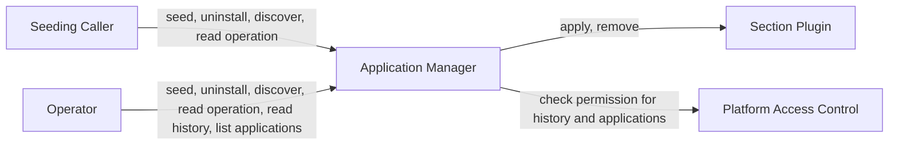

<!-- Created: 2026-10-05 by Constructor Tech -->

# PRD — Application Manager

The Application Manager must give every environment one trusted entry point where an application announces that it is installed, and must pass each part of that announcement to the section plugin that owns it. This PRD is written for platform product owners and for the application teams that seed their applications.

<!-- toc -->

- [1. Overview](#1-overview)
  - [1.1 Purpose](#11-purpose)
  - [1.2 Background / Problem Statement](#12-background--problem-statement)
  - [1.3 Goals (Business Outcomes)](#13-goals-business-outcomes)
  - [1.4 Glossary](#14-glossary)
- [2. Actors](#2-actors)
  - [2.1 Human Actors](#21-human-actors)
  - [2.2 System Actors](#22-system-actors)
  - [2.3 Actor Context](#23-actor-context)
- [3. Operational Concept & Environment](#3-operational-concept--environment)
  - [3.1 Gear-Specific Environment Constraints](#31-gear-specific-environment-constraints)
- [4. Scope](#4-scope)
  - [4.1 In Scope](#41-in-scope)
  - [4.2 Out of Scope](#42-out-of-scope)
- [5. Functional Requirements](#5-functional-requirements)
  - [5.1 Manifest and Validation](#51-manifest-and-validation)
  - [5.2 Dispatch and Outcomes](#52-dispatch-and-outcomes)
  - [5.3 Lifecycle](#53-lifecycle)
  - [5.4 Discovery, Operation Reads, and Installed Applications](#54-discovery-operation-reads-and-installed-applications)
  - [5.5 Access Control and Operation History](#55-access-control-and-operation-history)
- [6. Non-Functional Requirements](#6-non-functional-requirements)
  - [6.1 Gear-Specific NFRs](#61-gear-specific-nfrs)
  - [6.2 NFR Exclusions](#62-nfr-exclusions)
- [7. Public Library Interfaces](#7-public-library-interfaces)
  - [7.1 Public API Surface](#71-public-api-surface)
  - [7.2 External Integration Contracts](#72-external-integration-contracts)
- [8. Use Cases](#8-use-cases)
  - [First Seed](#first-seed)
  - [Re-Seed or Upgrade](#re-seed-or-upgrade)
  - [Uninstall an Application](#uninstall-an-application)
  - [Seed Refused or Partly Failed](#seed-refused-or-partly-failed)
  - [Discover the Manifest Shape](#discover-the-manifest-shape)
- [9. Acceptance Criteria](#9-acceptance-criteria)
- [10. Dependencies](#10-dependencies)
- [11. Assumptions](#11-assumptions)
- [12. Risks](#12-risks)
- [13. Open Questions](#13-open-questions)
- [14. Traceability](#14-traceability)

<!-- /toc -->

<!--
=============================================================================
PRODUCT REQUIREMENTS DOCUMENT (PRD)
=============================================================================
PURPOSE: Define WHAT the system must do and WHY — business requirements,
functional capabilities, and quality attributes.

SCOPE:
  ✓ Business goals and success criteria
  ✓ Actors (users, systems) that interact with this gear
  ✓ Functional requirements (WHAT, not HOW)
  ✓ Non-functional requirements (quality attributes, SLOs)
  ✓ Scope boundaries (in/out of scope)
  ✓ Assumptions, dependencies, risks

NOT IN THIS DOCUMENT (see other templates):
  ✗ Stakeholder needs (managed at project/task level by steering committee)
  ✗ Technical architecture, design decisions → DESIGN.md
  ✗ Why a specific technical approach was chosen → ADR/
  ✗ Detailed implementation flows, algorithms → features/

STANDARDS ALIGNMENT:
  - IEEE 830 / ISO/IEC/IEEE 29148:2018 (requirements specification)
  - IEEE 1233 (system requirements)
  - ISO/IEC 15288 / 12207 (requirements definition)

REQUIREMENT LANGUAGE:
  - Use "MUST" or "SHALL" for mandatory requirements (implicit default)
  - Do not use "SHOULD" or "MAY" — use priority p2/p3 instead
  - Be specific and clear; no fluff, bloat, duplication, or emoji
=============================================================================
-->
## 1. Overview

### 1.1 Purpose

The Application Manager is a platform gear that learns which applications are installed in an environment. When an application is deployed, a seeding caller sends it a manifest: one document that describes the application and carries one section for each section plugin.

The Application Manager checks the whole manifest and dispatches each section to the section plugin that owns it. It holds no domain logic. All domain logic and all rollback live in the section plugins. The system keeps an operation history of every seed and uninstall request.

Seed and uninstall run as operations. Quick checks refuse a bad request at once. Otherwise the caller gets an operation id and reads the operation to learn how the request ended.

### 1.2 Background / Problem Statement

An environment usually runs only a subset of all applications, and some services need to know which ones. A navigation menu that shows items only for installed applications is one example. There is no single trusted place where an application announces itself, so each service would need its own way to learn about installs.

Without a shared entry point, every application team must know every interested service and call each one differently. Failures are hard to trace, because there is no shared record of the requests each application made and when. A new kind of seeded data means changing every application's deployment process by hand.

The Application Manager is that one door. The seeding caller sends one manifest. Section plugins decide what each part means and where the data goes, including systems outside the platform such as an identity provider or an API gateway. Services that rely on seeded data never call the Application Manager. Only section plugins deal with them.

The Application Manager also keeps an operation history of every seed and uninstall request.

Market positioning: not applicable, because this is an internal platform gear.

### 1.3 Goals (Business Outcomes)

Each goal is met when its success check holds at the first stable release and at every later release.

- **An invalid manifest changes nothing.** Success check: for every request that ends as invalid manifest, no section plugin receives data.
- **Every seed and uninstall is traced.** Success check: every seed and uninstall request that reaches the system, including a failed one, has a history event in the operation history. The only exception is a refusal whose history event could not be recorded, and that failure is logged and signalled (`cpt-cf-application-manager-nfr-history-completeness`).
- **New kinds of seeded data need no gear change.** Success check: a section plugin is added and removed with no change to the Application Manager's code (`cpt-cf-application-manager-fr-plugin-extensibility`).
- **Manifests can be built from discovery.** Success check: a manifest built only from the combined schema that discovery returns passes validation.
- **Failures are actionable.** Success check: every failed request states its outcome category, and the caller can tell what to fix, retry, or request.

There is no formal user-satisfaction metric, because the user group is small, known, and internal.

### 1.4 Glossary

| Term | Definition |
|------|------------|
| Application id | Non-empty text, within stated limits, that names an application. The system never parses it or checks its format. It only compares two ids by exact text. |
| Manifest | The whole document submitted for one application: an envelope plus its sections. |
| Envelope | The part of a manifest that names the application by its id and version. |
| Section | The part of a manifest meant for one section plugin, addressed by its section key. |
| Section type | A type that one section plugin registers, derived directly from the section base type. It names the section and gives its section key. |
| Section key | The name of the section type that one section plugin registers, without the section base type or any version, for example `acme.iam.access.roles`. |
| Section plugin | A platform plugin that registers one section type, which holds the schema for its section, and one priority, and applies and removes sections. It owns all domain logic and any rollback. |
| Priority | A value that each section plugin registers. It fixes the order of dispatch on seed and of removal on uninstall. No two section plugins share one. |
| Seed | Submitting a manifest for an application. The system checks it and dispatches each section to its section plugin. |
| Uninstall | Asking every section plugin to remove an application by its id. |
| Operation | The background run of one accepted seed or uninstall request. It has a status (accepted, running, completed, or interrupted) and, once final, a report. A request that fails a quick check is a refusal: it gets an answer at once and no operation. |
| Outcome category | The single overall result of a seed or uninstall request that is not interrupted, such as succeeded or invalid manifest (`cpt-cf-application-manager-fr-outcome-categories`). |
| Run window | The time an operation may run before it is interrupted. It is bounded and follows from the operator-set section-plugin time limit and the number of section plugins. |
| Request id | The id that links a refusal or an operation report to its history events; for an accepted request it is the operation id. |
| Allowed callers | The configured list of platform workload identities, each with the actions it may take: seed, uninstall, read schemas, and read operations. |
| Installed application | An application with a record in the system: its last seed reached a final state, including interrupted, and no uninstall of it has succeeded since. |
| Operation history | The append-only table that holds the history events of every seed and uninstall request (`cpt-cf-application-manager-fr-history-event`). Reads are not recorded. |

## 2. Actors

> **Note**: Stakeholder needs are managed at project/task level by steering committee. Document **actors** (users, systems) that interact with this gear.

### 2.1 Human Actors

#### Operator

**ID**: `cpt-cf-application-manager-actor-operator`

- **Role**: Runs the platform, deploys section-plugin changes, and sets configuration, including the allowed callers. Can also act as a seeding caller by hand with an allowed platform identity, for example to re-seed or to uninstall an application. Reads history events and installed applications with their own login through the platform's standard authentication.
- **Needs**: To follow an operation and read how it ended. To list history events, or those of one operation. To list installed applications. To know which section keys a manifest needs. To get a clear signal when something in the gear fails.

### 2.2 System Actors

#### Seeding Caller

**ID**: `cpt-cf-application-manager-actor-seeding-caller`

- **Role**: An authenticated platform workload, or an operator using one, listed in the allowed callers, that acts for an application. It sends manifests and uninstall requests, reads discovery and operations when allowed, and never receives calls from the system.

#### Section Plugin

**ID**: `cpt-cf-application-manager-actor-section-plugin`

- **Role**: A platform plugin that registers its section type, which holds its schema, and its priority, and applies and removes its section. Called by the system.

#### Platform Access Control

**ID**: `cpt-cf-application-manager-actor-platform-access-control`

- **Role**: Decides whether a caller may read history events or list installed applications. Called by the system.

### 2.3 Actor Context

## 3. Operational Concept & Environment

> **Note**: Runtime, OS, architecture, lifecycle policy, and integration patterns are defined once at the project/foundational level, not per gear. Foundational sources for this repository: [Architecture Manifest](../../../../docs/ARCHITECTURE_MANIFEST.md) and the [security guidelines](../../../../guidelines/SECURITY.md). This gear has no parent gear with its own PRD.

### 3.1 Gear-Specific Environment Constraints

- The Application Manager works platform-wide. The whole environment shares one set of seeded applications, with no per-tenant view.
- Every actor, including an operator acting by hand, reaches the gear only as an authenticated subject through the platform's standard authentication. The gear has no login of its own. The platform turns away requests that fail its own checks, and those never reach the gear.
- The system **MUST NOT** write manifest content into its own logs, diagnostics, or error text.
- Section plugins own section data. The system owns operation records and the operation history.
- The interfaces are machine-facing, with no end-user screens.

## 4. Scope

### 4.1 In Scope

- A manifest made of an envelope and one required section per section key.
- Checking the whole manifest before any section plugin receives data.
- Dispatch of sections in priority order, and uninstall by application id in the same order.
- Seed and uninstall as background operations, one at a time per application.
- Reading an operation by its id.
- Discovery of section keys and schemas.
- Clear outcome categories for every request.
- An operation history of every seed and uninstall request.
- A record of installed applications, and listing it.
- Access control: allowed callers for seed, uninstall, discovery, and operation reads; platform access control for history reads and the application list.
- Failing to start on any plugin-set or configuration problem.

### 4.2 Out of Scope

- Kubernetes and deployment tooling. A seeding job or an operator is only an example of a caller.
- Credential provisioning for seeding callers.
- A login of the gear's own. Authentication belongs to the platform.
- Per-tenant installs.
- Giving meaning to versions or to re-seeds. Section plugins decide.
- Replaying or driving re-seeds. Each application's seeding caller is responsible.
- Rollback across several section plugins.
- Idempotency keys on seed and uninstall requests.
- Retry rules after a failed, partly failed, or interrupted request.
- Validation rules for adding or removing a section plugin.
- Reconciliation of section-plugin state with what is seeded.
- Deciding who may read history events or list installed applications; platform access control owns that.
- Resuming or cancelling operations.

## 5. Functional Requirements

> **Testing strategy**: All requirements verified via automated tests (unit, integration, e2e) targeting 90%+ code coverage unless otherwise specified. Document verification method only for non-test approaches (analysis, inspection, demonstration).

### 5.1 Manifest and Validation

#### Manifest Envelope

- [ ] `p1` - **ID**: `cpt-cf-application-manager-fr-manifest-envelope`

The system **MUST** accept a manifest made of an envelope and a set of sections, **MUST** require the envelope to carry an application id and a non-empty version, and **MUST** treat a manifest with a missing or empty id or version as invalid.

- **Rationale**: One predictable shape lets every seeding caller and every section plugin rely on the same identity for an application.
- **Actors**: `cpt-cf-application-manager-actor-seeding-caller`

#### Opaque Application Id

- [ ] `p1` - **ID**: `cpt-cf-application-manager-fr-application-id`

The system **MUST** accept any non-empty text within the stated limits (a maximum length set by the operator, no control characters) as an application id and as a version. It **MUST NOT** parse the id, normalise it, or check its format, and **MUST** compare ids only by exact text. A manifest whose id or version breaks the limits **MUST** be refused at once as invalid manifest, before any operation starts. A missing or invalid maximum length setting stops the system from starting.

- **Rationale**: Application teams already have their own names. Treating the id as opaque avoids a second naming scheme.
- **Actors**: `cpt-cf-application-manager-actor-seeding-caller`

#### Opaque Version

- [ ] `p1` - **ID**: `cpt-cf-application-manager-fr-opaque-version`

The system **MUST** treat the application version as opaque text. It **MUST NOT** parse, compare, or sort versions, and **MUST** pass the version to section plugins on seed.

- **Rationale**: Only a section plugin knows what a version means for its data.
- **Actors**: `cpt-cf-application-manager-actor-seeding-caller`

#### Required Sections

- [ ] `p1` - **ID**: `cpt-cf-application-manager-fr-required-sections`

The system **MUST** require a section for every section key, and **MUST** treat as invalid a manifest with a missing section or with a key that no section plugin owns. The result **MUST** name the missing or unknown keys. When no section plugin exists, a valid manifest has an empty set of sections.

- **Rationale**: Strict rules keep every section plugin in step with every application and make a wrong manifest visible at once. Adding a section plugin therefore fails every next seed whose manifest lacks the new section, on purpose: each seeding caller must add that section to its manifest before seeding again.
- **Actors**: `cpt-cf-application-manager-actor-seeding-caller`

#### Unique Section Keys

- [ ] `p1` - **ID**: `cpt-cf-application-manager-fr-unique-section-keys`

The system **MUST** map each section key to exactly one section plugin, **MUST** fail to start when two section plugins' section types share a key, and **MUST** keep the key set unchanged until the next start.

- **Rationale**: Conflicts show up at deploy time rather than at seed time, and routing stays clear.
- **Actors**: `cpt-cf-application-manager-actor-operator`

#### Section Plugin Priority

- [ ] `p1` - **ID**: `cpt-cf-application-manager-fr-section-priority`

The system **MUST** use the priority that each section plugin registers to fix the dispatch order on seed and the removal order on uninstall, from the lowest value to the highest, and **MUST** fail to start when two section plugins register the same priority.

- **Rationale**: A fixed, registered order makes dispatch predictable and lets section-plugin authors decide which section plugin goes first.
- **Actors**: `cpt-cf-application-manager-actor-operator`

#### Startup Checks

- [ ] `p1` - **ID**: `cpt-cf-application-manager-fr-startup-checks`

The system **MUST** fail to start on any plugin-set or configuration problem: the plugin registration facility cannot answer; a section plugin's priority or section type cannot be read; a section type cannot be resolved, is not derived directly from the section base type, or holds a schema the system cannot use; two section plugins share a key; two share a priority; or a setting is missing or invalid. It **MUST NOT** read an unreachable plugin registration facility as "no section plugins". When the facility answers with no section plugins, the system **MUST** start with an empty set of section keys.

- **Rationale**: Problems must show up at deploy time, when an operator is watching, and not later at seed time.
- **Actors**: `cpt-cf-application-manager-actor-operator`

#### Whole-Manifest Validation

- [ ] `p1` - **ID**: `cpt-cf-application-manager-fr-validate-before-dispatch`

For every seed, the system **MUST** validate the whole manifest: the envelope, and each section against the schema of the section type its section plugin registers. If any part is invalid, the system **MUST NOT** dispatch anything to any section plugin, and **MUST** list every problem with its location in the manifest.

- **Rationale**: Validating everything first prevents half-applied installs caused by a bad manifest.
- **Actors**: `cpt-cf-application-manager-actor-seeding-caller`

#### Section Schema Ownership

- [ ] `p1` - **ID**: `cpt-cf-application-manager-fr-plugin-served-schemas`

The system **MUST** treat the section type that each section plugin registers as the only source of the schema for its section, **MUST NOT** keep rules of its own for any section, and **MUST** read the section types at startup, so a schema change applies after a restart.

- **Rationale**: The section plugin knows its domain and publishes its rules with its section type. Keeping the rules in one place avoids drift between schema and behaviour, and seeding never waits on a section plugin to learn them.
- **Actors**: `cpt-cf-application-manager-actor-seeding-caller`
- **Verification Method**: Inspection: no section rules are held outside the section plugins.

#### Section-Plugin-Driven Extensibility

- [ ] `p1` - **ID**: `cpt-cf-application-manager-fr-plugin-extensibility`

The system **MUST** let a kind of seeded data be added or removed only by adding or removing a section plugin, with no change to the system's own code.

- **Rationale**: New kinds of seeded data must not wait for a change to a shared gear.
- **Actors**: `cpt-cf-application-manager-actor-operator`
- **Verification Method**: Demonstration: a test section plugin is added and removed with no change to the system's code.

### 5.2 Dispatch and Outcomes

#### Seed and Uninstall as Operations

- [ ] `p1` - **ID**: `cpt-cf-application-manager-fr-async-operations`

The system **MUST** run every accepted seed and uninstall request as an operation. It **MUST** first make quick checks and refuse a request that fails one at once, with its outcome category, without creating an operation and without calling any section plugin. An accepted request **MUST** get an operation id, and the system **MUST** answer with it before any section-plugin call. An operation **MUST** be in one of four states: accepted, running, completed, or interrupted. Every operation **MUST** reach a final state, completed or interrupted, within a bounded run window. The system **MUST NOT** resume an interrupted operation.

- **Rationale**: A seed calls every section plugin in turn, so it can take longer than the platform request deadline. Quick checks still answer at once, and the run window gives every operation a known end.
- **Actors**: `cpt-cf-application-manager-actor-seeding-caller`, `cpt-cf-application-manager-actor-operator`

#### One Operation per Application

- [ ] `p1` - **ID**: `cpt-cf-application-manager-fr-one-operation-per-application`

The system **MUST** run at most one seed or uninstall operation per application at a time. While an operation for an application is accepted or running, a new request for the same application **MUST** be refused at once as conflict, and the refusal **MUST** name the running operation. Operations for different applications **MUST NOT** wait for each other. A section-plugin call that an operation started before the end of its run window **MAY** still be running when the next operation for the application starts.

- **Rationale**: Overlapping operations for one application would interleave dispatches to the section plugins. One operation at a time gives each application one clear current state.
- **Actors**: `cpt-cf-application-manager-actor-seeding-caller`, `cpt-cf-application-manager-actor-operator`

#### Ordered Dispatch That Continues Past Failures

- [ ] `p1` - **ID**: `cpt-cf-application-manager-fr-ordered-dispatch`

After validation succeeds, the system **MUST** dispatch sections to their section plugins one at a time in priority order, **MUST** keep dispatching after a section plugin fails, and **MUST** record the outcome of each section.

- **Rationale**: One failing section plugin must not stop the others from receiving data. One at a time keeps behaviour easy to follow.
- **Actors**: `cpt-cf-application-manager-actor-seeding-caller`

#### Section Dispatch Without Interpretation

- [ ] `p1` - **ID**: `cpt-cf-application-manager-fr-pass-through`

The system **MUST** give each section plugin only its own section, unchanged, with the envelope. It **MUST NOT** compare or merge sections, or keep section state between seeds.

- **Rationale**: Domain meaning belongs to section plugins, so the system holds no domain logic.
- **Actors**: `cpt-cf-application-manager-actor-seeding-caller`

#### Section-Plugin-Owned Rollback and Re-Seed Semantics

- [ ] `p1` - **ID**: `cpt-cf-application-manager-fr-plugin-owned-semantics`

The system **MUST** leave rollback, replace-or-update behaviour, idempotency, and version rules to the section plugins. It **MUST** validate, dispatch, and record every seed on its own, and **MUST NOT** undo anything after a failed dispatch.

- **Rationale**: Only the section plugin knows what re-seeding or undoing means for its data.
- **Actors**: `cpt-cf-application-manager-actor-seeding-caller`

#### Caller-Visible Outcome Categories

- [ ] `p1` - **ID**: `cpt-cf-application-manager-fr-outcome-categories`

The system **MUST** report every seed and uninstall request that is not interrupted as exactly one of these outcome categories. An interrupted operation has no outcome category.

- succeeded: every section, or every section plugin for uninstall, succeeded;
- invalid manifest: the manifest failed validation, and nothing is dispatched;
- plugin rejected: a section plugin refused its section as unacceptable;
- not permitted: the caller is not allowed for the action, or a section plugin refuses it for an extra permission of its own;
- conflict: another operation for the same application is accepted or running;
- internal failure: a section plugin failed unexpectedly or exceeded the time limit, or the system itself failed unexpectedly;
- temporarily unavailable: a needed dependency could not answer, nothing is dispatched, and the caller can retry.

- **Rationale**: Callers need to tell "fix my manifest" from "try again later" from "ask for access".
- **Actors**: `cpt-cf-application-manager-actor-seeding-caller`, `cpt-cf-application-manager-actor-operator`

#### Outcome Precedence

- [ ] `p1` - **ID**: `cpt-cf-application-manager-fr-outcome-precedence`

When several outcome categories apply, the system **MUST** pick one by a fixed precedence, so the same situation always gives the same answer. It **MUST NOT** tell a caller not permitted or conflict when it could not check permission or running operations.

- **Rationale**: A fixed answer gives the same result for the same situation and never hides an outage behind a wrong category.
- **Actors**: `cpt-cf-application-manager-actor-seeding-caller`, `cpt-cf-application-manager-actor-operator`

#### Response Content

- [ ] `p1` - **ID**: `cpt-cf-application-manager-fr-response-content`

Every refusal and every report of a completed operation **MUST** carry the outcome category, what to fix, retry, or request, and the request id. A refusal for conflict **MUST** name the running operation. A report **MUST** give the outcome of each section, or of each section plugin for uninstall, and every problem with its location for invalid manifest. The report of an interrupted operation **MUST** say so and give the section outcomes recorded so far.

- **Rationale**: Per-section results let callers act on partial failures, and the link to the history events supports investigation.
- **Actors**: `cpt-cf-application-manager-actor-seeding-caller`, `cpt-cf-application-manager-actor-operator`

#### Bounded Plugin Calls

- [ ] `p1` - **ID**: `cpt-cf-application-manager-fr-bounded-plugin-calls`

The system **MUST** apply one configurable time limit to every section-plugin call and **MUST** stop a call that exceeds it. A section that exceeds the time limit **MUST** count as an internal failure, and dispatch **MUST** continue with the remaining sections. Keeping a section's data consistent when its call is stopped is the section plugin's responsibility, for example by doing its work in one transaction.

- **Rationale**: One slow section plugin must not hang a whole request, and operators must be able to tune the limit.
- **Actors**: `cpt-cf-application-manager-actor-operator`
- **Verification Method**: Test: a section plugin that exceeds the time limit has its call stopped, its section ends as an internal failure, and the next section is dispatched.

#### Dependency Failures at Run Time

- [ ] `p1` - **ID**: `cpt-cf-application-manager-fr-dependency-failures`

The system **MUST** fail closed when platform access control cannot answer a history read or an application list: it **MUST** refuse the read as temporarily unavailable. When storage cannot answer, the system **MUST** refuse the request as temporarily unavailable and dispatch nothing.

- **Rationale**: An outage of a platform service must never let a request through unchecked or leave half-applied changes.
- **Actors**: `cpt-cf-application-manager-actor-seeding-caller`, `cpt-cf-application-manager-actor-operator`

### 5.3 Lifecycle

#### Uninstall

- [ ] `p1` - **ID**: `cpt-cf-application-manager-fr-uninstall`

The system **MUST** let an authorized caller uninstall an application by its id, as an operation. The operation **MUST** ask every section plugin to remove the application, one at a time in priority order, and continue after failures. The system **MUST NOT** check whether the application is seeded. What an uninstall means for an application that a section plugin does not know is that section plugin's decision.

- **Rationale**: Retiring an application must clean up every section plugin's data from a single request.
- **Actors**: `cpt-cf-application-manager-actor-seeding-caller`, `cpt-cf-application-manager-actor-operator`

### 5.4 Discovery, Operation Reads, and Installed Applications

#### Discovery of Section Keys and Schemas

- [ ] `p1` - **ID**: `cpt-cf-application-manager-fr-discovery`

The system **MUST** let an authorized caller list the current section keys, read the current schema for one section key, and read the combined schema for a whole manifest. Schemas **MUST** come from the registered section types and be returned with their section type. A read **MUST NOT** call any section plugin. Reads end as not permitted, not found, or temporarily unavailable, and the outcome categories of seed and uninstall do not apply to reads.

- **Rationale**: Application teams need to know what to put in a manifest before they seed.
- **Actors**: `cpt-cf-application-manager-actor-seeding-caller`, `cpt-cf-application-manager-actor-operator`

#### Reading an Operation

- [ ] `p1` - **ID**: `cpt-cf-application-manager-fr-operation-read`

The system **MUST** let a caller with the read operations permission read an operation by its id and get its status, and its report once it is final. The permission **MUST** be separate from the seed and uninstall permissions. An unknown or purged id **MUST** end as not found. A read **MUST NOT** call any section plugin and **MUST NOT** return manifest bodies, section content, or the caller subject. The system **MUST** keep each operation record for an operator-set retention period after the operation is final, then purge it. Reads end as not permitted, not found, or temporarily unavailable, and the outcome categories of seed and uninstall do not apply to reads.

- **Rationale**: An accepted request ends in the background, so callers need a way to learn how it ended. A separate permission lets operators decide who may see results without granting the right to seed.
- **Actors**: `cpt-cf-application-manager-actor-seeding-caller`, `cpt-cf-application-manager-actor-operator`

#### Listing Installed Applications

- [ ] `p1` - **ID**: `cpt-cf-application-manager-fr-list-applications`

The system **MUST** keep one record per installed application. A seed operation that reaches a final state **MUST** record its application, or update the record, with the version, the operation id, the outcome category or the interrupted marker, and the finish time, in the same change that finishes the operation. An uninstall that completes as succeeded **MUST** remove the record in the same change; any other uninstall outcome **MUST** leave it unchanged. The system **MUST** let a caller with the read applications permission list the records page by page, and **MUST** give them no meaning beyond this rule. A list **MUST NOT** call any section plugin. Lists end as invalid query, not permitted, or temporarily unavailable.

- **Rationale**: Services such as a navigation menu need one trusted answer to which applications are installed.
- **Actors**: `cpt-cf-application-manager-actor-operator`

### 5.5 Access Control and Operation History

#### Caller Authentication

- [ ] `p1` - **ID**: `cpt-cf-application-manager-fr-authentication`

The system **MUST** accept seed, uninstall, discovery, and operation read requests only from platform workloads authenticated through the platform's workload authentication, and history reads and the application list only from subjects authenticated through the platform's standard authentication. It **MUST NOT** offer a bypass, a shared secret, or a login of its own, for any actor.

- **Rationale**: Seeding changes what other services believe is installed, so every request must be traceable to a known workload or subject.
- **Actors**: `cpt-cf-application-manager-actor-seeding-caller`, `cpt-cf-application-manager-actor-operator`
- **Verification Method**: Inspection: no route or setting skips platform authentication.

#### Caller Authorization

- [ ] `p1` - **ID**: `cpt-cf-application-manager-fr-authorization`

The system **MUST** decide each of six permissions separately. Seed, uninstall, read schemas, and read operations **MUST** be granted only by the allowed callers in its configuration, per caller and per action. Read history and read applications **MUST** be decided by platform access control. The system holds no tenant scope. A section plugin that needs an extra permission **MUST** be able to refuse a request as not permitted.

- **Rationale**: Seeding and uninstalling change what other services believe is installed, so they are granted only to known workloads in reviewed configuration. History and the application list are operator reads, governed like other operator access.
- **Actors**: `cpt-cf-application-manager-actor-seeding-caller`, `cpt-cf-application-manager-actor-operator`

#### Operation History

- [ ] `p1` - **ID**: `cpt-cf-application-manager-fr-history-event`

The system **MUST** record a history event for every seed and uninstall request that reaches the system, including a refused one, in its operation history. The operation history **MUST** be an append-only table, and it **MUST** be the only place where the system keeps history events. The only exception is a refusal whose history event could not be recorded (`cpt-cf-application-manager-fr-history-ordering`).

- **Rationale**: One trail of every request lets operators trace what happened. An append-only table means a recorded history event is never changed or removed.
- **Actors**: `cpt-cf-application-manager-actor-operator`
- **Verification Method**: Inspection: history events are only ever appended to the operation history, and no other place keeps them.

#### Reading History Events

- [ ] `p1` - **ID**: `cpt-cf-application-manager-fr-history-read`

The system **MUST** let a caller with the read history permission list history events page by page, and optionally narrow the list to one operation by its operation id. The request id of a refusal **MUST** narrow the list the same way. An id with no history events **MUST** give an empty list. A read **MUST NOT** call any section plugin. Reads end as invalid query, not permitted, or temporarily unavailable. Which callers hold the permission is decided by platform access control and is outside this system.

- **Rationale**: Operators trace a request from its history events without direct access to storage.
- **Actors**: `cpt-cf-application-manager-actor-operator`

#### History Before Dispatch

- [ ] `p1` - **ID**: `cpt-cf-application-manager-fr-history-ordering`

The system **MUST NOT** dispatch anything for a request until its accepted event is recorded in the operation history. A refusal **MUST** record its refused event in the operation history before it answers. If that fails, the refusal **MUST** still return its outcome category, and the failure **MUST** be logged and signalled to operators. The finished event **MUST** be recorded in the operation history together with the final report.

- **Rationale**: No change happens without a recorded history event, and the operation history and the operation report always tell the same story.
- **Actors**: `cpt-cf-application-manager-actor-seeding-caller`

## 6. Non-Functional Requirements

> **Global baselines**: Project-wide NFRs (performance, security, reliability, scalability) are defined once at the project/foundational level. Baseline sources: [Architecture Manifest](../../../../docs/ARCHITECTURE_MANIFEST.md) and the [security guidelines](../../../../guidelines/SECURITY.md). This gear has no parent PRD. Only gear-specific NFRs are listed here.
>
> **Testing strategy**: NFRs verified via automated benchmarks, security scans, and monitoring unless otherwise specified.

### 6.1 Gear-Specific NFRs

#### Complete Operation History

- [ ] `p1` - **ID**: `cpt-cf-application-manager-nfr-history-completeness`

Every seed and uninstall request that reaches the system **MUST** have its history events in the operation history, whatever its outcome. The only exception is a refusal whose history event could not be recorded (`cpt-cf-application-manager-fr-history-ordering`).

- **Threshold**: In every test run, the history events in the operation history match the operations created, the operations that reached a final state, and the refusals, with no gaps. No history event exists for a change that did not commit. The only request without a history event is a refusal whose event could not be recorded, and that failure is logged and signalled.
- **Rationale**: An operation history with gaps cannot be trusted.
- **Verification Method**: Automated tests.

#### Platform-Wide Scope

- [ ] `p1` - **ID**: `cpt-cf-application-manager-nfr-platform-scope`

The system **MUST** treat all seeded applications as one platform-wide set, **MUST NOT** make operation records, history events, and application records owned by or visible per tenant, and **MUST** make them reachable only through the system's access checks.

- **Threshold**: No read or write of an operation record, history event, or application record made on behalf of a caller skips the access check. No per-tenant copy of them exists.
- **Rationale**: Installed applications are a property of the environment, not of a tenant.
- **Verification Method**: Inspection of the public surface and of data ownership, plus tests on every action.

#### No Section Plugin Call Without Authorization

- [ ] `p1` - **ID**: `cpt-cf-application-manager-nfr-authorized-before-plugin`

The system **MUST NOT** call any section plugin, for dispatch or removal, for a caller who is not authorized for that action.

- **Threshold**: Zero section-plugin calls for requests from callers not allowed for the action, in tests on every action.
- **Rationale**: Callers without permission must not trigger section-plugin work.

#### Bounded Plugin Call Time

- [ ] `p1` - **ID**: `cpt-cf-application-manager-nfr-bounded-call-time`

The system **MUST** stop waiting for any section-plugin call once the time limit has passed. Operators **MUST** be able to set the time limit by configuration, and the system **MUST NOT** hardcode it.

- **Threshold**: Every section-plugin call ends within the time limit. Changing the setting changes the limit with no code change. A missing or invalid setting stops the system from starting.
- **Rationale**: A stuck section plugin must not block seeding callers for an unbounded time.

#### Bounded Request Time

- [ ] `p1` - **ID**: `cpt-cf-application-manager-nfr-bounded-request-time`

The system **MUST** answer every seed and uninstall request within the platform request deadline, with a refusal or with an operation id, and **MUST** bring every operation to a final state within its run window.

- **Threshold**: With test plugins that always reach the time limit, every immediate answer comes within the platform request deadline, and every operation is completed or interrupted by the end of its run window.
- **Rationale**: Deployment pipelines need a predictable upper bound for a seed, and the platform ends any request that runs past its deadline.

#### No Dispatch on Invalid, Unavailable, or Conflicting Requests

- [ ] `p1` - **ID**: `cpt-cf-application-manager-nfr-no-partial-on-invalid`

The system **MUST NOT** dispatch anything to any section plugin for a request that ends as invalid manifest, temporarily unavailable, or conflict.

- **Threshold**: Zero section dispatches for requests that end in these categories.
- **Rationale**: Bad input and platform outages must never cause partial installs.

#### Availability

- [ ] `p2` - **ID**: `cpt-cf-application-manager-nfr-availability`

The system **MUST** meet the platform availability baseline. Seeding is unavailable while a section-plugin change restarts the gear.

- **Threshold**: No gear-specific availability percentage applies. The platform baseline applies, and seeding resumes once the restart completes.
- **Rationale**: Deploys must not wait on this gear.

#### Operational Signals

- [ ] `p2` - **ID**: `cpt-cf-application-manager-nfr-operational-signals`

The system **MUST** give operators a visible signal for history events that failed to record, for startup failures, and for section-plugin timeouts that reach an operator-set count. It **MUST** make counts of each outcome category, of section-plugin-call timeouts, and of interrupted operations observable.

- **Threshold**: Each signal condition raises an operator-visible signal in tests, and the counts can be read by operators.
- **Rationale**: Operators must notice failures early.

### 6.2 NFR Exclusions

- Per-tenant isolation: not applicable, because the gear is platform-wide.
- High-volume throughput targets: not applicable, because the set of section keys is small and seeds are infrequent deploy-time requests.
- Rate limiting at gear level: not applicable, because callers are trusted subjects. Platform request protection applies.
- Retention and cleanup of history data: out of scope.
- MFA, SSO, and session management: not applicable, because the gear has no interactive sessions.
- Safety: not applicable, because the gear only handles information.
- Usability, accessibility, and internationalization: not applicable, because the interfaces are machine-facing with known internal users.
- Regulatory compliance, legal, and privacy topics: platform baselines apply. Data-subject requests go to the owner of the data.
- Geographic availability, disaster recovery, SLA, and support tier: inherited from the platform baseline.
- Training material and help system: not applicable, because there is no end-user UI.

## 7. Public Library Interfaces

### 7.1 Public API Surface

#### Seeding and Uninstall Interface

- [ ] `p1` - **ID**: `cpt-cf-application-manager-interface-seeding`

- **Type**: REST API
- **Stability**: unstable, until the first stable release.
- **Description**: Lets an authorized seeding caller submit a manifest and uninstall an application by its id. An accepted request returns an operation id at once. A refused request returns its outcome category, what to fix, retry, or request, the request id, and the running operation id for conflict.
- **Breaking Change Policy**: Additive changes are backward compatible. Changes to the manifest envelope, outcome categories, or operation states need a major version bump and notice to application teams.

#### Operations Interface

- [ ] `p1` - **ID**: `cpt-cf-application-manager-interface-operations`

- **Type**: REST API
- **Stability**: unstable, until the first stable release.
- **Description**: Lets a caller with the read operations permission read an operation by its id: its status and, once final, its report. Lets a caller with the read history permission list history events, optionally narrowed to one operation by its operation id.
- **Breaking Change Policy**: Additive changes are backward compatible. Changes to operation states, outcome categories, or report content need a major version bump and notice to application teams.

#### Discovery Interface

- [ ] `p1` - **ID**: `cpt-cf-application-manager-interface-discovery`

- **Type**: REST API
- **Stability**: unstable, until the first stable release.
- **Description**: Lets an authorized caller list section keys, read one section schema, and read the combined schema.
- **Breaking Change Policy**: Additive changes are backward compatible. Removing or renaming returned information needs a major version bump and notice to application teams.

#### Applications Interface

- [ ] `p1` - **ID**: `cpt-cf-application-manager-interface-applications`

- **Type**: REST API
- **Stability**: unstable, until the first stable release.
- **Description**: Lets a caller with the read applications permission list installed applications page by page, each with its version, the operation id and outcome of its last seed, and when that seed finished.
- **Breaking Change Policy**: Additive changes are backward compatible. Removing or renaming returned information needs a major version bump and notice to its readers.

### 7.2 External Integration Contracts

#### Section Plugin Contract

- [ ] `p1` - **ID**: `cpt-cf-application-manager-contract-section-plugin`

- **Direction**: required from client
- **Actors**: `cpt-cf-application-manager-actor-section-plugin`
- **Protocol/Format**: Platform plugin model. Each section plugin:
  - registers one section type, derived directly from the section base type, which holds the schema for its section, and one priority; the section key is derived from the section type;
  - applies its section for an application, and removes an application on uninstall;
  - reports failures as plugin rejected, not permitted, or internal failure;
  - receives the caller's platform identity with every call, and uses its own service credentials, never the caller's.
- **Compatibility**: Changes to the contract need coordinated updates of all section plugins. A schema change is a new section type version and applies after a restart of the system.

## 8. Use Cases

### First Seed

- [ ] `p2` - **ID**: `cpt-cf-application-manager-usecase-first-seed`

**Actor**: `cpt-cf-application-manager-actor-seeding-caller`

**Preconditions**:

- The caller is authorized to seed, and the manifest has a section for every section key.

**Main Flow**:

1. The seeding caller submits the manifest and gets an operation id.
2. The system validates the whole manifest and dispatches each section in priority order.
3. The caller reads the operation until it is final and sees the outcome of each section.

**Postconditions**:

- The operation is completed and reports succeeded.

### Re-Seed or Upgrade

- [ ] `p2` - **ID**: `cpt-cf-application-manager-usecase-reseed`

**Actor**: `cpt-cf-application-manager-actor-seeding-caller`

**Preconditions**:

- The application may already be seeded, with any version.

**Main Flow**:

1. The seeding caller submits a manifest with a new version or new content.
2. The system handles it exactly like a first seed, as a new operation.
3. Each section plugin decides whether to replace, update, or ignore its section.

**Postconditions**:

- The new operation has its own history events in the operation history.

### Uninstall an Application

- [ ] `p2` - **ID**: `cpt-cf-application-manager-usecase-uninstall`

**Actor**: `cpt-cf-application-manager-actor-operator`

**Other actors**: `cpt-cf-application-manager-actor-seeding-caller`

**Preconditions**:

- The caller is authorized to uninstall.

**Main Flow**:

1. The caller requests an uninstall by application id and gets an operation id.
2. The system asks each section plugin to remove the application, in priority order.
3. The caller reads the operation until it is final and sees the result of each section plugin.

**Postconditions**:

- The operation is completed.

### Seed Refused or Partly Failed

- [ ] `p2` - **ID**: `cpt-cf-application-manager-usecase-seed-failed`

**Actor**: `cpt-cf-application-manager-actor-seeding-caller`

**Preconditions**:

- The caller is authorized to seed.

**Main Flow**:

1. The seeding caller submits a manifest.
2. If the system refuses the request, it returns the outcome category at once, with what to fix, retry, or request.
3. If the request is accepted and some sections fail, the caller reads the operation and sees each section outcome in the report.
4. The caller fixes the problem and seeds again.

**Postconditions**:

- The caller knows the outcome category, or the outcome of each section, and what to do next.

### Discover the Manifest Shape

- [ ] `p2` - **ID**: `cpt-cf-application-manager-usecase-discovery`

**Actor**: `cpt-cf-application-manager-actor-seeding-caller`

**Preconditions**:

- The caller is authorized to read schemas.

**Main Flow**:

1. The caller lists the section keys.
2. The caller reads the combined schema for a whole manifest.
3. The caller builds a manifest from the combined schema.

**Postconditions**:

- The manifest passes validation.

## 9. Acceptance Criteria

- [ ] An accepted seed or uninstall returns an operation id before any section-plugin call (`cpt-cf-application-manager-fr-async-operations`).
- [ ] A request that fails a quick check gets its outcome category at once, creates no operation, calls no section plugin, and has a refused event in the operation history.
- [ ] A valid manifest with every required section completes as succeeded, and sections are dispatched in priority order.
- [ ] A manifest with a missing, unknown, or invalid section, or with an invalid id or version, reports invalid manifest, dispatches nothing, and lists each problem with its location.
- [ ] When one section plugin fails, the others still receive their sections, and the report shows each section outcome.
- [ ] A section plugin that exceeds the time limit is an internal failure and does not block the remaining sections.
- [ ] A request to which several outcome categories apply always gets the same single category (`cpt-cf-application-manager-fr-outcome-precedence`).
- [ ] When permission or running operations cannot be checked, the answer is temporarily unavailable, never not permitted or conflict.
- [ ] A section plugin that refuses its section as unacceptable gives plugin rejected, and a section plugin that refuses for an extra permission of its own gives not permitted, after the allowed callers have permitted the request (`cpt-cf-application-manager-fr-outcome-categories`).
- [ ] An uninstall asks every section plugin to remove the application, in priority order, even one never seeded, and continues after failures (`cpt-cf-application-manager-fr-uninstall`).
- [ ] A caller not allowed for the action causes no section-plugin call, and each of the seed, uninstall, read schemas, read operations, read history, and read applications permissions is separate (`cpt-cf-application-manager-fr-authorization`).
- [ ] Seed, uninstall, discovery, and operation reads are granted only to platform identities in the allowed callers, for their listed actions, and history reads and the application list only by platform access control.
- [ ] A finished seed records or updates its application, a succeeded uninstall removes it, any other uninstall outcome leaves it, and listing applications returns the records page by page with no section-plugin call (`cpt-cf-application-manager-fr-list-applications`).
- [ ] A second request for an application with an accepted or running operation is refused as conflict naming that operation, while other applications proceed.
- [ ] Reading an operation returns its status and, once final, its report, ends as not found for an unknown or purged id, and makes no section-plugin call.
- [ ] Listing history events returns them page by page, narrowing by an operation id or a refusal's request id returns only that request's events, an id with no events gives an empty list, and no read makes a section-plugin call (`cpt-cf-application-manager-fr-history-read`).
- [ ] An operation that is not final at the end of its run window is reported as interrupted and is not resumed.
- [ ] When storage cannot answer, the request is refused as temporarily unavailable and nothing is dispatched; when platform access control cannot answer, a history read or an application list is refused as temporarily unavailable.
- [ ] Every seed and uninstall request that reaches the system, including a refused one, has its history events in the operation history (except a refusal whose history event could not be recorded), and no history event exists for a change that did not commit (`cpt-cf-application-manager-nfr-history-completeness`).
- [ ] History events are only ever appended to the operation history, and no other place keeps them (`cpt-cf-application-manager-fr-history-event`).
- [ ] Nothing is dispatched until the accepted event is recorded in the operation history, the finished event is recorded together with the final report, and a refusal whose event cannot be recorded still returns its category and is logged and signalled (`cpt-cf-application-manager-fr-history-ordering`).
- [ ] The system fails to start when the plugin registration facility cannot answer, a section plugin's priority or section type cannot be read, a section type cannot be resolved, is not derived directly from the section base type, or holds a schema the system cannot use, two section plugins share a key, two share a priority, or a setting is missing or invalid, and starts with an empty key set when no section plugin exists.
- [ ] After a failed dispatch the system undoes nothing (`cpt-cf-application-manager-fr-plugin-owned-semantics`).
- [ ] A schema read calls no section plugin, and a read for an unknown section key ends as not found (`cpt-cf-application-manager-fr-discovery`).
- [ ] Discovery returns the current section keys and schemas, and a manifest built from the combined schema passes validation.
- [ ] Inspection shows no way to read manifests, no way to resume or cancel an operation, and no manifest content in logs.
- [ ] Every refusal and every report of a completed operation carries the outcome category, what to fix, retry, or request, and the request id (`cpt-cf-application-manager-fr-response-content`).
- [ ] Each section plugin gets only its own section, unchanged, with the envelope, and no per-section state is kept (`cpt-cf-application-manager-fr-pass-through`).
- [ ] Application ids are compared as exact text and never parsed, and the version is passed to section plugins unchanged (`cpt-cf-application-manager-fr-application-id`, `cpt-cf-application-manager-fr-opaque-version`).
- [ ] Discovery returns each schema with its section type (`cpt-cf-application-manager-fr-discovery`).
- [ ] Each listed operational signal is raised in tests, and the counts can be read (`cpt-cf-application-manager-nfr-operational-signals`).

## 10. Dependencies

| Dependency | Description | Criticality |
|------------|-------------|-------------|
| Section plugins | Each provides application of its section on seed, and removal of an application on uninstall, and answers with success, plugin rejected, not permitted, or internal failure. | p1 |
| Platform workload authentication | A validated platform identity for every seed, uninstall, discovery, and operation read request. | p1 |
| Platform access control | A permit or deny for each read history and read applications request, given the caller subject and the action. | p1 |
| Plugin registration facility | The list of section plugins with their priorities and section types, and the schema each section type holds, at startup. | p1 |
| Platform storage | Storage for operation records, the operation history, and application records. | p1 |
| Platform error format | The standard format for failed responses, able to carry the outcome category, what to fix, the running operation id, and the request id. | p1 |
| Platform observability facility | A place to send operational logs, metrics, and operator signals. | p2 |

## 11. Assumptions

- The set of section keys is small and bounded, and fixed while the Application Manager runs.
- Seeding callers authenticate as platform workloads, and their credentials are provisioned outside this gear. Operators list them in the allowed callers.
- Seeding happens at deploy time and not on user request paths.
- Seeding callers read an operation at a moderate pace and are allowed the read operations action.
- Operators set the operation retention long enough for callers to read each operation after it ends.
- Seeding callers keep secrets, such as passwords or keys, out of manifests. The system does not detect or remove them.

## 12. Risks

| Risk | Impact | Mitigation |
|------|--------|------------|
| A section plugin is slow or down during seeding | Its section ends as an internal failure when the section plugin fails or times out during dispatch | Configurable time limit, per-section results in the report, and retry by seeding again |
| Partial success leaves section plugins out of step | Some services see the application and others do not | Section-plugin-owned rollback, per-section results, and retry |
| A priority change reorders dispatch | A section plugin that relies on another's data sees a different order | Order changes are intentional, and section-plugin authors document how they choose a priority |
| A manifest carries a secret | The secret could reach the system's logs, diagnostics, or error text | The seeding callers' responsibility to keep secrets out of manifests (see Assumptions), and the rule that the system does not write manifest content into its own logs |
| An operation is interrupted | The application is left partly seeded or removed | The report shows the section outcomes so far, the caller seeds or uninstalls again, and operators see a count of interrupted operations |
| The platform error format cannot carry the added refusal content | A caller refused as conflict cannot tell which operation to wait for | The format is raised with the platform owners, and operation reports still carry the full result |

## 13. Open Questions

None.

## 14. Traceability

Links to related specification artifacts.

- **Design**: [DESIGN.md](./DESIGN.md)
- **ADRs**: [ADR/](./ADR/)
- **Features**: not applicable — this gear's document set has no separate feature specifications.
