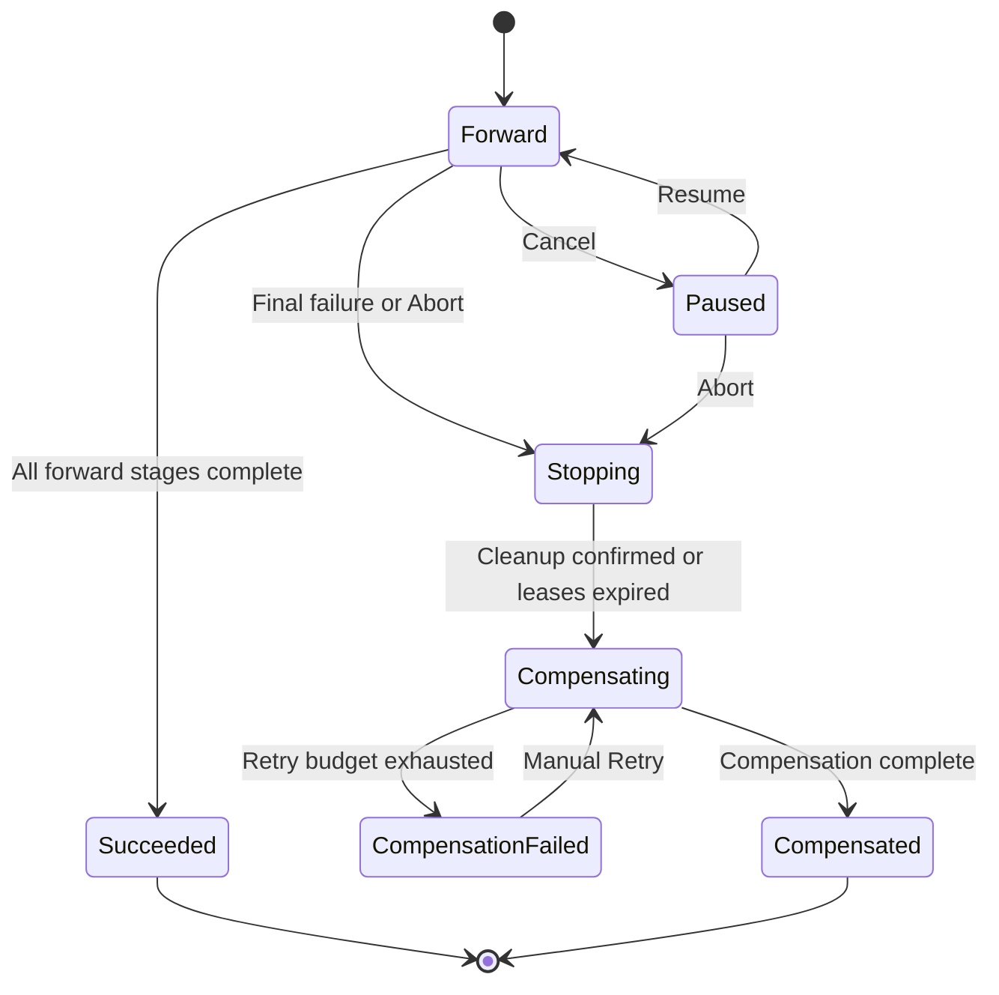
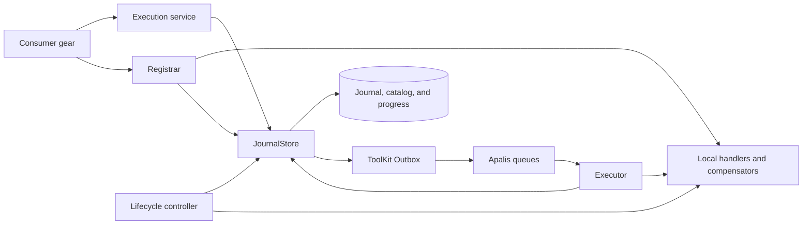
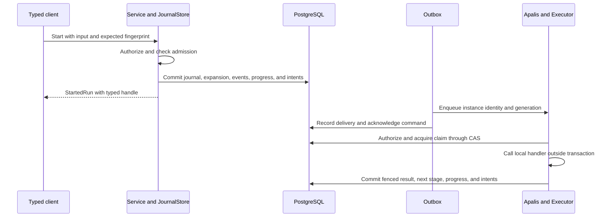
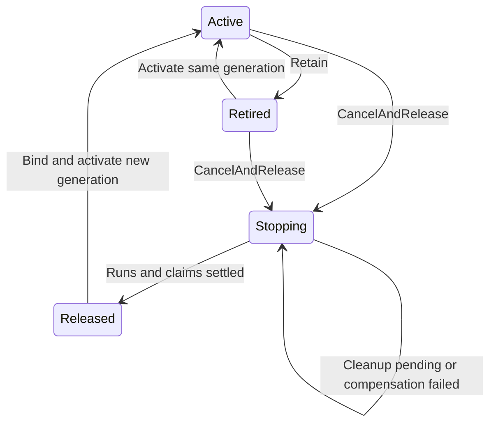

# Technical Design: Durable execution

This document describes the implementation of the [PRD](PRD.md).
Use the [technical terms](#23-terminology) with the meanings given there.

- [ ] `p3` - **ID**: `cpt-cf-durable-execution-design-runner`

<!-- toc -->

- [1. Architecture Overview](#1-architecture-overview)
  - [1.1 Architectural Vision](#11-architectural-vision)
  - [1.2 Architecture Drivers](#12-architecture-drivers)
  - [1.3 Architecture Layers](#13-architecture-layers)
- [2. Principles & Constraints](#2-principles--constraints)
  - [2.1 Design Principles](#21-design-principles)
  - [2.2 Constraints](#22-constraints)
  - [2.3 Terminology](#23-terminology)
  - [2.4 Documentation Language](#24-documentation-language)
- [3. Technical Architecture](#3-technical-architecture)
  - [3.1 Domain Model](#31-domain-model)
  - [3.2 Component Model](#32-component-model)
  - [3.3 API Contracts](#33-api-contracts)
  - [3.4 Internal Dependencies](#34-internal-dependencies)
  - [3.5 External Dependencies](#35-external-dependencies)
  - [3.6 Interactions & Sequences](#36-interactions--sequences)
  - [3.7 Database schemas & tables](#37-database-schemas--tables)
  - [3.8 Deployment Topology](#38-deployment-topology)
- [4. Additional Context](#4-additional-context)
- [5. Traceability](#5-traceability)

<!-- /toc -->

## 1. Architecture Overview

### 1.1 Architectural Vision

The gear owns the journal, storage migrations, execution control, and host lifecycle.
Consumer gears supply local Rust handlers through `cf-gears-durable-execution-sdk`.
The journal controls work eligibility, retries, checkpoints, fan-out, and compensation.
Apalis transports delivery identifiers and supplies workers.
ToolKit Outbox connects journal commits to queue delivery.

PostgreSQL stores the shared catalog and journal.
Local registries store handler bindings.
Applications must restore these bindings after each restart.

### 1.2 Architecture Drivers

#### Functional Drivers

| PRD requirement | Mechanism |
|---|---|
| `cpt-cf-durable-execution-fr-admission` | One transaction for the accepted run and publication intent. |
| `cpt-cf-durable-execution-fr-progress` | Confirmed checkpoints and separate activity instances. |
| `cpt-cf-durable-execution-fr-continuation` | Epoch checks, retry budgets, and late handler binding. |
| `cpt-cf-durable-execution-fr-cancellation` | Forward pause, cancellation tokens, and lease recovery. |
| `cpt-cf-durable-execution-fr-registration` | Catalog revisions, generations, and definition release. |
| `cpt-cf-durable-execution-fr-queues` | Exact-name routes and separate queue worker pools. |
| `cpt-cf-durable-execution-fr-coalescing` | One active run and one pending successor per scoped slot. |
| `cpt-cf-durable-execution-fr-inspection` | Authorized progress without payload access. |
| `cpt-cf-durable-execution-fr-typed-results` | Typed handles and fingerprint checks before payload reads. |
| `cpt-cf-durable-execution-fr-fanout` | Persisted expansion, stable indexes, and ordered results. |
| `cpt-cf-durable-execution-fr-compensation` | Persisted compensation with a separate retry budget. |
| `cpt-cf-durable-execution-fr-projection` | A committed progress projection and event cursor. |

#### Non-Functional Drivers

| PRD requirement | Mechanism | Test area |
|---|---|---|
| `cpt-cf-durable-execution-nfr-fencing` | Journal CAS, claim fences, catalog locks, and leases. | Stale claims and concurrent workers. |
| `cpt-cf-durable-execution-nfr-delivery` | Transactional Outbox and delivery recovery. | Queue failures and worker crashes. |
| `cpt-cf-durable-execution-nfr-authorization` | Fresh PDP decisions and SecureORM scopes. | Tenant isolation and access revocation. |
| `cpt-cf-durable-execution-nfr-lifecycle` | Host cancellation and one shutdown budget. | Start, stop, and runtime failure. |

#### Key ADRs

- [ADR 0001](adrs/0001-apalis-with-transactional-outbox.md): publication transactions.
- [ADR 0002](adrs/0002-task-execution-framework-selection.md): transport selection.
- [ADR 0003](adrs/0003-typed-sdk-and-journal-boundary.md): public SDK and internal journal.
- [ADR 0004](adrs/0004-saga-fanout-and-progress.md): run identity, fan-out, compensation, and progress storage.

### 1.3 Architecture Layers

| Layer | Responsibility |
|---|---|
| SDK | Typed authoring, handles, contracts, and observation models. |
| Domain | Journal transitions, stage execution, definition lifecycle, and registry rules. |
| Infrastructure | Authorized services, storage, migrations, Outbox, adapter, and executor. |
| Composition root | ClientHub registration, configuration, readiness, and host lifecycle. |

## 2. Principles & Constraints

### 2.1 Design Principles

- [ ] `p1` - **ID**: `cpt-cf-durable-execution-principle-journal-authority`

The journal is the authority for execution.
Queue delivery can repeat.
Each state change checks persisted ownership and uses a short transaction.
Transactions do not call handlers or external providers.
Repeated transaction attempts must not repeat an external call.

### 2.2 Constraints

- [ ] `p1` - **ID**: `cpt-cf-durable-execution-constraint-runtime-boundary`

PostgreSQL is necessary for the full runtime.
SQLite supports journal and storage tests.
Journal and catalog access uses scoped ToolKit DB operations.
Direct SQLx access applies only to the official adapter's `apalis` schema.
The adapter uses workspace SQLx and TLS settings.

The component is unreleased.
The current storage format rejects unsupported versions.
There are no legacy readers or fingerprint fallbacks.
Use a clean development or test database.
The gear does not delete existing databases.

### 2.3 Terminology

#### Technical Nouns

| Term | Meaning |
|---|---|
| Gear | A ToolKit component with SDK capabilities and a managed lifecycle. |
| Workflow | A sequence of declared execution stages. |
| Definition | A named, versioned workflow contract and its local bindings. |
| Contract | The serializable stages, data sources, policies, and limits for a definition. |
| Fingerprint | The hash of the serialized contract identity. |
| Handler | The local Rust function that performs one invocation. |
| Activity template | A step declared in a workflow definition. |
| Activity instance | One run-specific invocation identified by template, optional index, and phase. |
| Forward execution | Business work before compensation. |
| Run | One persisted execution with input, owner, and progress. |
| Stage | A sequential step, static parallel group, or runtime fan-out group. |
| Fan-out | Expansion of a run-specific item list into durable activity instances. |
| Branch | One activity instance in a parallel or fan-out stage. |
| Join | The ordered collection of successful branch outputs. |
| Saga | A workflow with automatic compensation enabled. |
| Compensator | A handler that reverses a confirmed successful activity's business effect. |
| Compensation | Execution of declared compensators after final failure or Abort. |
| Receipt | A stored output that identifies a confirmed provider operation. |
| Checkpoint | A successful activity output committed to the journal. |
| Confirmed success | A successful activity result stored in a committed checkpoint. |
| Successful process exit | A process exit with status zero after the example assertions complete. |
| Journal | Persisted execution state that controls work eligibility. |
| Projection | The stored progress view without input, result, or history payloads. |
| Payload | Serialized application input or output. |
| Claim | Time-limited ownership of one activity instance. |
| Lease | The time interval during which a claim supplies execution ownership. |
| Fence | A claim counter that rejects results from an old owner. |
| CAS | Compare-and-swap update that checks the expected run revision. |
| Epoch | Execution counter advanced by manual Retry or Resume. |
| Catalog | Shared definition contracts and registration lifecycle records. |
| Registration generation | Catalog counter that distinguishes released and reactivated bindings. |
| Binding | A local handler or compensator attached to a registered contract. |
| Delivery generation | Counter that invalidates older queue delivery messages. |
| Publication intent | A committed record that makes queue publication necessary. |
| Outbox | ToolKit transaction records and delivery processing for publication commands. |
| Cursor | The last committed event sequence number in a run's progress. |
| Idempotency key | A stable provider key used to prevent a repeated business effect. |
| Reconciliation | Recovery that compares persisted state with eligible work or provider effects. |
| PDP | Policy decision point that supplies current authorization constraints. |
| SecureORM | Scoped database operations that apply authorization constraints. |

#### Technical Verbs

Use these verbs only with the software meanings given here.

| Verb | Meaning |
|---|---|
| Authorize | Get and apply a current policy decision for an operation. |
| Check | Compare software state, identifiers, policies, or query output with an expected value. |
| Confirm | Record the successful result or completed cleanup of a software operation. |
| Declare | Add stage, dependency, or policy metadata to a workflow contract. |
| Enforce | Apply a software permission, constraint, or limit to an operation. |
| Bind | Attach a local handler to a registered contract. |
| Claim | Acquire persisted ownership before a handler call. |
| Commit | Complete a database transaction successfully. |
| Compensate | Run a declared compensator for a confirmed successful activity. |
| Decode | Convert a stored payload into its requested Rust type. |
| Deduplicate | Prevent another business effect from a repeated request. |
| Enqueue | Add a delivery message to a named queue. |
| Hydrate | Load normalized payload and history records into execution state. |
| Materialize | Store the run-specific instances and inputs for a stage. |
| Persist | Store data so it survives process restart. |
| Reconcile | Compare saved state and restore the necessary delivery or cleanup. |
| Register | Store a contract or attach its local bindings through the registry. |
| Serialize | Convert a value into its stored or transported representation. |
| Support | Make a documented software operation available to a caller. |

API command names such as Cancel, Abort, Retry, Resume, Retain, and CancelAndRelease keep their SDK meanings.
Do not use pause and Abort as synonyms.
Use compensation consistently for saga business cleanup.

### 2.4 Documentation Language

Use [ASD-STE100 Issue 9](https://www.asd-ste100.org/about_STE.html) as the English writing reference for these documents.
Use short sentences and active verbs.
Give one instruction in each procedural sentence.
Use a maximum of 20 words in a procedural sentence.
Use a maximum of 25 words in a descriptive sentence.
Put a necessary condition before its instruction.
Use one term consistently for each technical meaning.

Keep Rust identifiers, code, commands, URLs, schema names, and traceability IDs unchanged.
These are technical names, not ordinary English prose.
Use **MUST** and **MUST NOT** as requirement labels in the PRD.
They mark mandatory behavior.

## 3. Technical Architecture

### 3.1 Domain Model

See the [domain source](../durable-execution/src/domain/) and [SDK source](../durable-execution-sdk/src/).

| Model | Responsibility |
|---|---|
| `Journal` | Run input, owner, fingerprint, execution epoch, revision, and delivery generation. |
| `ExecutionState` | The only execution engine: materialized stages, activity instances, selected inputs, receipts, and execution phase. |
| `Definition` | Contract, registration state, revision, generation, and revocation boundary. |
| `Registry` | Local contracts and generation-specific handler bindings. |

`StageSpec` distinguishes sequential, static parallel, and runtime fan-out stages.
Every contract carries a `DataFlowSpec`; low-level definitions use `DataFlowSpec::independent`.
Low-level definitions are built from `DefinitionParts`; `build` validates them once.
A built `ExecutionDefinition` is immutable and caches its contract and fingerprint.
A stage materializes its instances when the previous stage checkpoints.
A pause records stages that complete meanwhile but starts no new stage.
An activity template belongs to a definition.
An activity instance belongs to a run.
Its identity contains the template ID, optional fan-out index, and execution phase.
Each instance has its own attempts, fence, lease, due time, and checkpoint.
Queue delivery includes this identity and its encoded activity ID.
The runtime rejects inconsistent delivery identities.

The contract fingerprint includes stages, data sources, dependencies, policies, compensation, and fan-out limits.
Run-specific item counts are outside the fingerprint.
Rust functions and type names are outside the fingerprint.
Use a new versioned definition name for a changed payload format or changed business behavior.

Run revision controls aggregate CAS updates.
Claim fences reject stale owners.
Retry and Resume advance the execution epoch.
Release and reactivation change the registration generation.
Delivery generation rejects old queue messages.
These counters have separate checks.

#### Fan-out execution

When a stage becomes eligible, the runtime selects its exact input list.
One transaction stores item inputs, stable indexes, publication intents, events, and progress.
Recovery uses the saved expansion.
It does not create the same branches again.
An empty list completes with an empty result and no handler calls.
Join returns results in input order.
Retry repeats only unfinished branches.

The default stage limit is 1024 items.
The default stage concurrency is 16.
Configured item limits are 1 through 1024.
Configured stage concurrency is 1 through 128.
A run can have at most 4096 forward activity instances.
This limit includes sequential and static parallel instances.
An incorrect expansion fails before branch execution.
The journal records `fanout_limit_exceeded` as a stage error.

Persisted running claims enforce stage concurrency across processes through CAS.
The queue pool also enforces its configured concurrency on each host.
An expansion creates publication intents for all branches.
Subsequent delivery refresh uses available stage capacity.

#### Saga execution

`.saga()` enables automatic compensation after a permanent forward failure or exhausted retries.
Explicit Abort also stops forward work and starts compensation for a saga.
The runtime stops new forward claims and signals active handlers.
Compensation waits for confirmed cleanup or lease expiry.

The runtime compensates only confirmed successful activities with declared compensators.
It uses reverse stage order and reverse branch-index order.
One compensator runs at a time.
Each compensator receives the original invocation input and successful output.
Its stable idempotency key differs from the forward key.

The original failure or Abort reason stays separate from the compensation error.
Progress exposes `Compensating`, `CompensationFailed`, and `Compensated` as separate states.
After compensation retries are exhausted, the run becomes `CompensationFailed`.
Manual Retry repeats the failed compensator and continues the remaining compensation.
Successful compensation checkpoints stay complete.
`Compensated` rejects forward Retry and Resume.
A new run is necessary for another business attempt.

This diagram shows saga phases.
`Paused` is a forward execution condition.
`Stopping` reports `Cancelling` while forward claims stay unsettled.
Cancel during compensation is rejected.
Abort does not change a successful or completed run.
Host shutdown keeps the execution phase for recovery.
Abort is final for workflows without saga compensation too.

### 3.2 Component Model

#### SDK services

- [ ] `p1` - **ID**: `cpt-cf-durable-execution-component-services`

`Service` authorizes caller operations and constructs domain transitions.
`Registrar` authorizes contract registration and local handler binding.
Both use `JournalStore` for persistence.
Binding requests a delivery refresh.
If refresh fails, registration stays correct and periodic reconciliation retries delivery.

#### Journal storage

- [ ] `p1` - **ID**: `cpt-cf-durable-execution-component-storage`

`JournalStore` owns scoped CRUD, hydration, CAS, catalog locks, request keys, and coalescing.
Its transaction stores journal changes, normalized records, events, progress, and Outbox commands together.
Wake signals run only after commit.
Periodic scans recover a lost signal.
Shared catalog locks order execution against exclusive definition changes.

#### Execution and lifecycle

- [ ] `p1` - **ID**: `cpt-cf-durable-execution-component-runtime`

`Runtime` owns named queues, Outbox delivery, and dispatch.
`Executor` claims an instance before it calls a local handler.
It checks authorization, registration generation, cancellation, timeout, and claim ownership during execution.
Heartbeats renew the lease.
Lease renewal does not change the activity timeout.
Heartbeat intervals use `Delay` to prevent catch-up bursts.

Shutdown uses one monotonic budget from `shutdown_timeout_secs`.
For budget `T`, reserve `R = min(5 seconds, T / 6)`.
Handler cleanup ends by `T - 2R`.
Runtime draining ends by `T - R`.
The lifecycle wait ends by `T`.
Cleanup is also limited by the confirmed lease.
The host's `RunOptions.shutdown_deadline` can shorten this budget.
Its default is 35 seconds.

Unconfirmed termination leaves the claim for lease recovery.
Shutdown does not request business Cancel or discard checkpoints.
Readiness clears when the host stops or fails.
Readiness does not confirm PDP availability.
An aborted Rust task does not confirm termination of external work.

### 3.3 API Contracts

The [SDK traits](../durable-execution-sdk/src/api.rs) resolve through ClientHub.

| Interface | Operations |
|---|---|
| `DurableExecution` | `start`, `get`, `events`, `result`, `history`, `cancel`, `abort`, `retry`, `resume`. |
| `WorkflowRegistry` | `register`, `register_contract`, `registration`, `unregister`, `activate`. |
| `ExecutionInspector` | `inspect`, `list`. |

`WorkflowRegistryExt::register_workflow` registers a built workflow and returns its typed `WorkflowRef<I, O>`.
`WorkflowRef` computes the contract fingerprint once; typed calls reuse it.
`DurableExecutionClient::start` returns `StartedRun<I, O>`.
It exposes a typed handle, run ID, requested coalescing generation, and coalescing flag.
`DurableExecutionClient::wait` and `wait_until` poll progress until a predicate holds.
`DurableExecutionClient::watch` streams progress after each committed event until the run settles.
`RunHandle<I, O>` contains the run ID and expected contract identity.
`WorkflowRef::attach(run_id)` restores a handle from a saved ID.
Attach does not read storage or grant access.

Use a handle for typed `result` and `step_result` reads.
For object-safe result reads, supply the definition name, expected fingerprint, and `ResultSelector`.
The service checks authorized run identity before payload hydration.
Checkpoint reads also check that the selector belongs to the expected contract.
A different contract returns `FailedPrecondition`, even if its JSON is compatible.
A typed payload decode failure returns `Internal`.

`WorkflowBuilder` supports `.then`, `.parallel`, `.for_each`, and `.saga()`.
Static tuple branches can have different output types.
Static list branches have one output type.
Static joins keep declaration order.
Runtime fan-out consumes `Vec<Item>` and produces `Vec<Output>`.
Sequential, static parallel, and fan-out checkpoints have different types.
Static `.branches()` returns references directly.
Fan-out `.branch(index)` creates a typed selector.
Reads check branch existence and readiness.

Supply the timeout argument to `Step::new`, `Step::with_deps`, and `Step::activity`.
Build rejects zero timeouts and timeouts above 24 hours.
Build also checks IDs, policies, and checkpoint dependencies.
`Step::with_deps` declares earlier checkpoints and passes their decoded values to the handler.
The dependency type comes from the reference, so an undeclared read cannot compile.
Build reports the first violation as a `DefinitionErrorKind` with the step ID.
Pre-build references share a private, write-once contract descriptor.
Only a successful build sets its final fingerprint.

Forward handlers and compensators receive `ActivityContext`.
It has named metadata and cancellation accessors, and no public fields.
The compensation phase has its own instance identity and idempotency key.
`ActivityError` carries an `ErrorCode`: 1..=64 bytes of `[a-z0-9_]`.
Invalid code text becomes `invalid_error_code`, so error details never become public codes.
`ActivityResultExt` maps provider errors with `or_retryable` and `or_permanent`.
Error formatting contains only the allowed error code.
Public authoring Debug output excludes handlers, payloads, and credentials.
The `test-util` feature adds `testing::TestRuntime` for in-memory workflow unit tests.
It applies the runtime's stage materialization, fan-out and instance limits, panic and timeout handling, and saga order.
Its checkpoint reads reject references of other or unbuilt workflows, and its `Debug` output omits payloads.

`get` and `inspect` select only the stored progress projection in one scoped query.
`list` uses one count query and one paginated projection query.
These reads do not hydrate journal, input, result, or history payloads.
Projection and event cursor belong to the same committed transition.
Event sequence numbers increase per run without fixed revision blocks.
Results and history use separate authorized reads.
Recorded timestamps and checkpoint origin epochs stay exact.

`register_contract` supports hosts without handlers.
Registration of an existing contract does not reactivate a definition.
During `Stopping`, exact saga bindings can be restored for compensation.
Activation stays prohibited until release.
After `Released`, binding prepares a new generation and `activate` opens it.
There is no user-facing REST or gRPC binding.

### 3.4 Internal Dependencies

AuthN supplies service identity from configured client credentials.
`PolicyEnforcer` gets current PDP scopes.
SecureORM applies these scopes to ToolKit DB operations.
The host supplies migrations, ClientHub, configuration, and lifecycle control.

Worker identity does not replace the original execution owner.
Compensators must authorize access to consumer resources.
Cleanup under `Stopping` applies only to the same registration generation.
An unconstrained `cancel_definition` grant is necessary for `CancelAndRelease` in the shared catalog.

### 3.5 External Dependencies

The journal and adapter use the same PostgreSQL database through separate pools.
Named queues share the adapter pool.
The current adapter pool has a maximum of four connections.
Queue delivery uses one transport attempt.
The journal controls business retries and redelivery.
Adapter due times round upward to whole seconds.
Adapter heartbeat and orphan recovery do not establish journal ownership.

### 3.6 Interactions & Sequences

#### Submit and execute

**ID**: `cpt-cf-durable-execution-seq-submit`

**Use case**: `cpt-cf-durable-execution-usecase-background-work`

Failure before enqueue leaves the Outbox command pending.
Failure after enqueue can cause duplicate delivery.
Generation and claim checks reject obsolete work.
An external effect before checkpoint commit can repeat.
The provider must support idempotency or reconciliation.

#### Recover a lost worker

**ID**: `cpt-cf-durable-execution-seq-recovery`

**Use case**: `cpt-cf-durable-execution-usecase-worker-recovery`

Recovery scans expired claims under current authorization.
It checks the registration generation and persisted phase.
It keeps expansions and confirmed forward and compensation checkpoints.
An exhausted forward retry budget starts saga compensation without an extra forward call.
Missing handlers defer execution without extra attempts.
A contract mismatch blocks execution.

#### Revoke and release

**ID**: `cpt-cf-durable-execution-seq-release`

**Use case**: `cpt-cf-durable-execution-usecase-retire-definition`

Unregister checks revision and cancellation permission under an exclusive catalog lock.
`Retain` closes admission, but existing work can continue.
`CancelAndRelease` records `Stopping` and revokes forward execution for that generation.
Reconciliation requests Abort for sagas, including paused and failed runs.
Other runs follow cancellation and claim cleanup.
Saga bindings stay available until compensation completes.
`CompensationFailed` keeps the definition in `Stopping`.
Authorized Retry can continue that compensation.

Hosts release local bindings after authorized observation of release.
Restart restores matching saga bindings while `Stopping`.
Metadata-only hosts also reconcile definitions.
A remote process cannot free another host's local `Arc` objects.

### 3.7 Database schemas & tables

The [migrations](../durable-execution/src/infra/storage/migrations/) define columns, constraints, and indexes.

| Table | Contents |
|---|---|
| `durable_runs` | Owner, definition, fingerprint, revisions, journal header, versioned progress, status filter, and scheduling fields. |
| `durable_activities` | Instance identity, template, item index, phase, stage, checkpoint state, fence, lease, and due time. |
| `durable_attempts` | Per-instance attempt records. Completed records stay immutable. |
| `durable_epochs` | Archived execution state, including compensation cause and instance identity. |
| `durable_events` | Per-run event sequence and event records. |
| `durable_start_keys` | Scoped request-key hash, input hash, and original run reference. |
| `durable_coalescing` | Scoped slot, revision, active run, and successor run. |
| `durable_outbox` | Run delivery-generation intent and delivery acknowledgment. |
| `durable_definitions` | Shared contract, registration revision, generation, and lifecycle state. |
| `durable_delivery_outbox_*` | ToolKit publication commands and leased delivery records. |
| `apalis.*` | Official queue adapter tables. |

Activity constraints distinguish template, index, and phase.
Claim indexes support stage scheduling.
Normalized records store invocation inputs, receipts, attempts, and epoch history outside control metadata.
The run row stores a private, versioned progress projection.
Correct progress stays readable when separate payload or history data is corrupt.
Payload corruption still fails reads that use those records.
The format has no compatibility reader for older stored records.

### 3.8 Deployment Topology

An API host can register contracts and submit work without handler bindings.
An execution host restores local handlers and compensators.
All hosts in the deployment share contracts, catalog, journal, and queue names.
Queue concurrency applies per host pool.
Fan-out stage concurrency applies across persisted claims on all hosts.
See [README configuration](../README.md#configuration) for host flags, credentials, and binding recovery.
The [Config source](../durable-execution/src/config.rs) defines all settings and validation.

## 4. Additional Context

Compensation is not a distributed transaction.
Only declared compensators and confirmed outputs participate in compensation.
Providers must reconcile an external effect that occurred before a lost checkpoint.
Keep credentials in local provider clients.
Store only necessary business input and receipts.

See the [examples](../durable-execution/examples/README.md), [Makefile](../../../../Makefile), and [CI workflow](../../../../.github/workflows/ci.yml).

## 5. Traceability

- [PRD](PRD.md): requirements, use cases, and acceptance evidence.
- [ADR 0001](adrs/0001-apalis-with-transactional-outbox.md): publication boundary.
- [ADR 0002](adrs/0002-task-execution-framework-selection.md): transport choice.
- [ADR 0003](adrs/0003-typed-sdk-and-journal-boundary.md): public and persisted models.
- [ADR 0004](adrs/0004-saga-fanout-and-progress.md): stage runtime and storage format.
- [Composition root](../durable-execution/src/gear.rs): lifecycle and capability registration.
- [Executor](../durable-execution/src/infra/executor.rs): claims and handlers.
- [Storage](../durable-execution/src/infra/storage/): transactions and queries.
