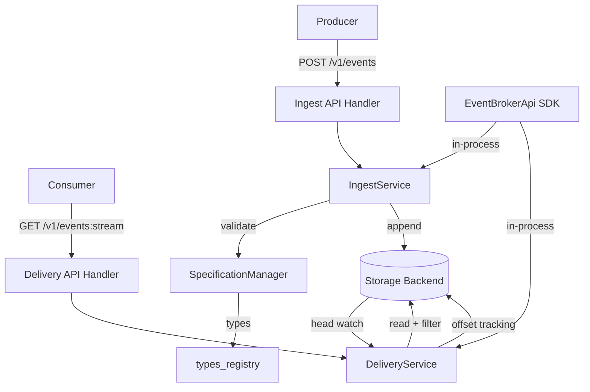
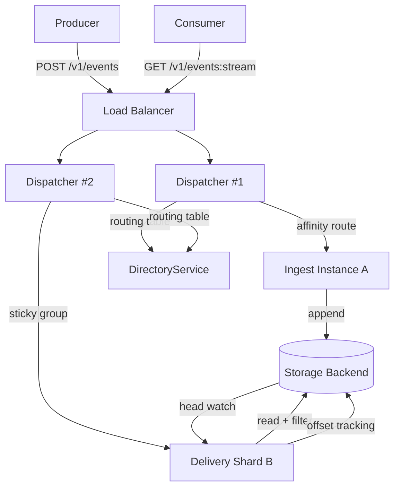
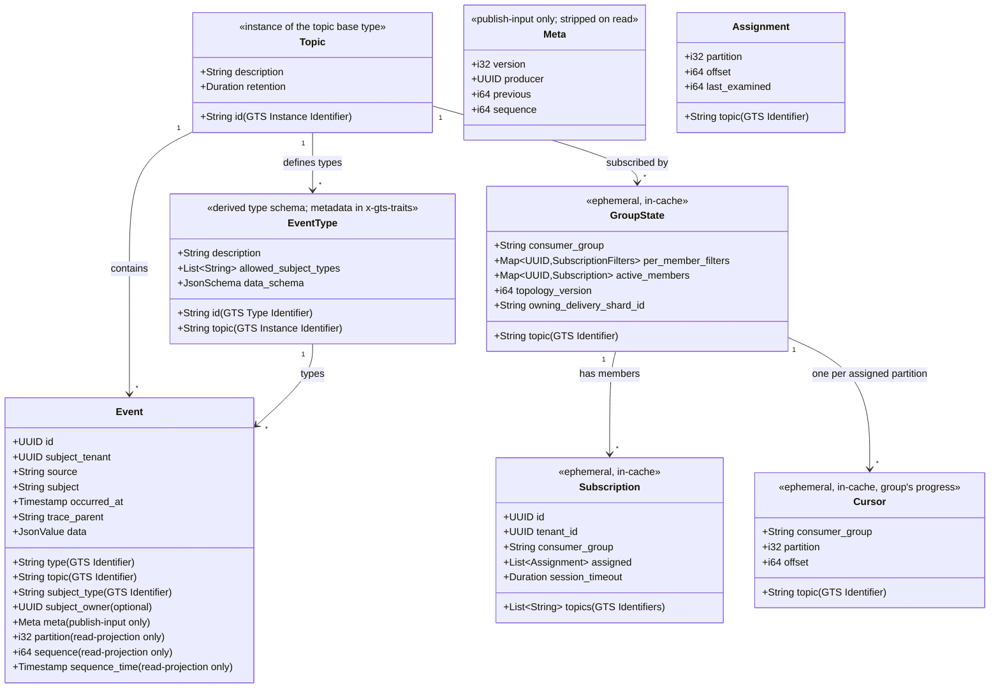
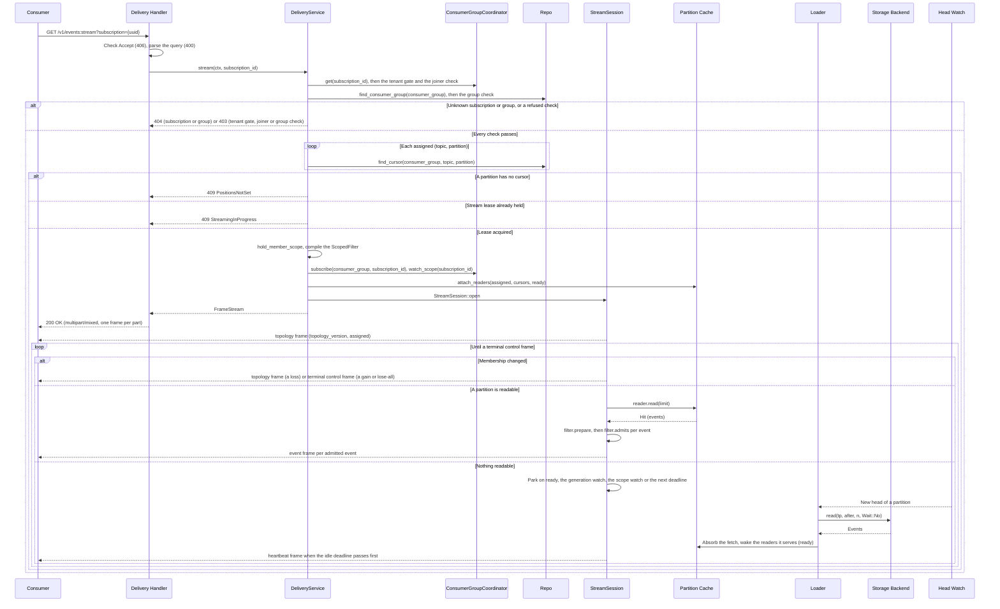

# Technical Design — Event Broker

<!-- toc -->

- [1. Architecture Overview](#1-architecture-overview)
  - [1.1 Architectural Vision](#11-architectural-vision)
  - [1.2 Architecture Drivers](#12-architecture-drivers)
  - [1.3 Architecture Layers](#13-architecture-layers)
  - [1.4 High-Level Architecture Diagram](#14-high-level-architecture-diagram)
- [2. Principles & Constraints](#2-principles--constraints)
  - [2.1 Design Principles](#21-design-principles)
  - [2.2 Constraints](#22-constraints)
- [3. Technical Architecture](#3-technical-architecture)
  - [3.1 Domain Model](#31-domain-model)
  - [3.2 Component Model](#32-component-model)
  - [3.3 API Contracts](#33-api-contracts)
  - [3.4 Internal Dependencies](#34-internal-dependencies)
  - [3.5 External Dependencies](#35-external-dependencies)
  - [3.6 Interactions & Sequences](#36-interactions--sequences)
  - [3.7 Database schemas & tables](#37-database-schemas--tables)
  - [3.8 Deployment Topology](#38-deployment-topology)
- [4. Additional Context](#4-additional-context)
  - [4.1 Deployment Modes](#41-deployment-modes)
  - [4.2 Caching Strategy](#42-caching-strategy)
  - [4.3 Metrics and Observability](#43-metrics-and-observability)
  - [4.4 Audit Logging](#44-audit-logging)
  - [4.5 Security Considerations](#45-security-considerations)
  - [4.6 Out of Scope](#46-out-of-scope)
  - [4.7 Open Questions](#47-open-questions)
  - [4.8 Future Developments](#48-future-developments)
- [5. Traceability](#5-traceability)
  - [5.1 PRD ↔ DESIGN Traceability](#51-prd--design-traceability)
  - [5.2 ADRs](#52-adrs)
  - [5.3 Standards & External References](#53-standards--external-references)
  - [5.4 Companion Documents](#54-companion-documents)

<!-- /toc -->

## 1. Architecture Overview

### 1.1 Architectural Vision

The Event Broker is a composite, tenant-scoped event streaming module for Gears. It provides an append-only, GTS-typed event log with monotonic per-`(topic, partition)` sequences, enabling decoupled inter-module communication and reliable replay.

**This design is an MVP.** The consumption surface is intentionally narrow - the subscription stream, served over two transports (`GET /v1/events:stream` and `GET /v1/events:sse`) - and several non-essential capabilities are explicitly deferred to post-MVP. Every endpoint, table, and trait is shaped so that planned extensions (anonymous offset-based reads, gRPC consumption, sticky-Kafka rebalancing, etc.) are **additive non-breaking changes** when delivered. See §4.6 Out of Scope and §4.8 Future Developments for the full deferred list.

The architecture follows a **multi-service decomposition** with four internal services:

- **Ingest Service**: Producer-facing. Accepts events, validates against GTS schemas, resolves each event's partition key and appends it to the topic's storage backend, which assigns partition and sequence. In cluster mode every ingest instance handles every topic; an instance's `affinity` is a routing hint for the dispatcher, never a boundary (not yet implemented, tracked in #5552 and #5701) (see [feature 0005](features/0005-backend-registry-and-routing.md)).
- **Delivery Service**: Consumer-facing. Manages subscriptions, serves event streams, tracks consumer offsets. In cluster mode, delivery is **sharded by consumer group** - the dispatcher uses sticky sessions to route all instances of a consumer group to the same delivery shard (not yet implemented, tracked in #4438).
- **Dispatcher Service**: HTTP gateway that routes requests between ingest and delivery services. In cluster mode, the dispatcher routes producer requests by **affinity** - preferring the live ingest instances whose published affinity matches the topic most specifically, falling back to any live instance (not yet implemented, tracked in #5552 and #5701) - and performs **consumer-group sticky routing** for consumers (directing consumer requests to the delivery shard owning the consumer group) (not yet implemented, tracked in #4438). Optional - not needed in standalone mode.
- **Storage Backend**: Pluggable persistence layer. Each backend plugin links a `backend::Provider` into the build; the deployment names every backend instance it runs in the `backends` registry (a GTS backend `type` plus the plugin's own settings), and `backend_routing` maps each topic to a registry entry. See [feature 0005 §2](features/0005-backend-registry-and-routing.md#2-configuration) and [feature 0007 §2.7](features/0007-storage-backend-api.md#27-provider).

All four services are implemented as **domain traits within a single `event_broker` crate**, using DDD-Light layering. In standalone mode they run in-process, communicating directly via trait calls. In cluster mode, a **ClusterCapabilities** platform abstraction provides the coordination primitives (a cache with watch notifications, leader election, distributed locks) needed for ingest and delivery to scale independently; instance discovery comes from `DirectoryService`.

The dispatcher is a **stateless HTTP router** - it routes producer requests from a routing table built from `DirectoryService` instances and their published affinity (not yet implemented, tracked in #5552 and #5701) ([feature 0005 §4](features/0005-backend-registry-and-routing.md#4-processes--business-logic-cdsl)) and consumer requests by group ownership (not yet implemented, tracked in #4438), but does **not** relay notifications. Delivery learns partition heads from each backend's own `watch` ([feature 0007 §4.2](features/0007-storage-backend-api.md#42-head-watch)), bypassing the dispatcher entirely. This means multiple dispatcher instances can run behind a load balancer without coordination.

Storage backends are separate plugin crates that implement the `backend::Backend` trait and provide a `backend::Provider` linked into the build ([feature 0007 §2.1, §2.7](features/0007-storage-backend-api.md#21-trait)). This allows third-party or deployment-specific backends without modifying the core event broker code.

The **producer client library** (`cf-gears-event-broker-sdk`) is built on top of `toolkit-db`'s transactional outbox. Producers enqueue events within their business transaction via the outbox; the outbox pipeline (sequencer → processor) then delivers them to the ingest service. This gives producers **transactional guarantees** - events are only published if the business transaction commits - and **exactly-once semantics** via the idempotent producer protocol. A gear without a database publishes through `DirectProducer`, which uses the same protocol with a producer id registered when it is built and its chain head in memory: no transactional guarantee, and its deduplication does not survive a restart. The same outbox machinery also powers the ingest service itself: ingested events flow through the ingest outbox group their topic belongs to, in ingest partition `murmur3("{topic}:{key}") % group.partitions` ([feature 0005 §2.5](features/0005-backend-registry-and-routing.md#25-outbox-groups), [feature 0007 §4.1](features/0007-storage-backend-api.md#41-ingest-write-path)) before being appended to the storage backend and broadcast to delivery.

### 1.2 Architecture Drivers

**ID**: `cpt-cf-evbk-design-drivers`

| Driver | Source | Influence |
|---|---|---|
| Decoupled inter-module communication | Platform need | Append-only event log with per-topic ordering |
| GTS-typed events | `cpt-cf-evbk-fr-event-type-registration` | Events validated against JSON Schema registered per event type |
| Reliable replay | FR: replay | Monotonic per-topic sequences, offset-based consumption |
| Streaming consumption | `cpt-cf-evbk-fr-streaming-delivery` | `GET /v1/events:stream` (and `:sse`): events pushed as they arrive, heartbeats while idle |
| Consumer group support | `cpt-cf-evbk-fr-subscription-join` | Subscription resources with filters and session management |
| Batch production | `cpt-cf-evbk-fr-publish-batch` | Atomic batch writes up to 100 events of one topic, across producer ids |
| Idempotent publishing | `cpt-cf-evbk-fr-producer-modes` | Deduplication per `(producer, topic)` chain, kept as long as the producer registration |
| Multi-tenant isolation | Gears platform | All data tenant-scoped via SecureConn |
| Flexible deployment topology | NFR: deployment modes | Standalone (all-in-one) and cluster (ingest + delivery + dispatcher) |
| Gears integration | Gears platform | Single-executable deployment, trait-based DI, secure ORM |

**Architecture Decision Records**:

- `cpt-cf-evbk-adr-service-decomposition` — Multi-service composite (ingest, delivery, dispatcher, storage backends); single-binary/multi-mode process shape; per-mode `cluster` gear resolution. See [`ADR/0007-service-decomposition.md`](ADR/0007-service-decomposition.md).
- Storage backends, backend registry and routing - see [`features/0005-backend-registry-and-routing.md`](features/0005-backend-registry-and-routing.md) (registry, routing, affinity, dispatcher routing table) and [`features/0007-storage-backend-api.md`](features/0007-storage-backend-api.md) (`backend::Backend`, `backend::Provider`)
- `cpt-cf-evbk-design-sequence-assignment` — Three-sequence model: producer chain (`previous`, `sequence`) for ingest-side dedup (chained / monotonic / stateless modes); outbox sequence (toolkit-db) for in-pipeline order preservation; offset (backend) for consumer-visible ordering
- future ADR (idempotent-producers) - Idempotent producers via `meta.producer` + per-`(producer, topic)` sequence tracking. No epoch fencing - sequence ordering itself acts as the fence.
- future ADR (consumer-lifecycle) — Subscription-based consumers with session timeout and offset tracking
- future ADR (outbox-ingest) — Outbox-based producer library and ingest pipeline built on `toolkit-db` outbox
- future ADR (cluster-capabilities) - Platform-level cluster coordination abstraction (a cache with watch notifications, leader election, locks) with pluggable providers
- Stream wake-up through each backend's head watch and `read(..., Wait::No)` - see [`features/0007-storage-backend-api.md`](features/0007-storage-backend-api.md) §4.2-4.3
- `cpt-cf-evbk-adr-offset-semantics` — Consumer-visible broker sequences start at 1 and backend adapters translate native offsets into the broker-logical sequence space. See [`ADR/0001-offset-semantics.md`](ADR/0001-offset-semantics.md).
- `cpt-cf-evbk-adr-partition-selection` — Broker-authoritative partition selection from the JSON Pointer the event type declares, defaulting to the event's tenant; producers provide neither a partition nor a partition key. See [`ADR/0002-partition-selection.md`](ADR/0002-partition-selection.md).
- `cpt-cf-evbk-adr-event-schema` — Single canonical event schema with read/write field markers, `meta` write-only producer protocol fields, and consumer-visible `sequence` naming. See [`ADR/0003-event-schema.md`](ADR/0003-event-schema.md).
- `cpt-cf-evbk-adr-idempotent-producer-protocol` — Producer mode is declared at registration and enforced per request, with broker-side chain state for idempotent publishing. See [`ADR/0004-idempotent-producer-protocol.md`](ADR/0004-idempotent-producer-protocol.md).
- `cpt-cf-evbk-adr-subscription-filter-typing` — JOIN uses topic-anchored `interests[]` with typed filter engines and topic-scoped type-pattern resolution. See [`ADR/0005-subscription-filter-typing.md`](ADR/0005-subscription-filter-typing.md).
- `cpt-cf-evbk-adr-offset-authority` — Consumer progress durability belongs to the consumer; the broker owns only runtime cursors seeded by SEEK. See [`ADR/0006-offset-authority.md`](ADR/0006-offset-authority.md).
- `cpt-cf-evbk-adr-topic-log-identity` - Topic log identity (draft): a broker-minted log id per topic, stored by its backend, to detect a backend that does not hold the topic's log. See [`ADR/0008-topic-log-identity.md`](ADR/0008-topic-log-identity.md).

The consumption transport surface (`/events:stream` for `multipart/mixed`, `/events:sse` for `text/event-stream`) is documented as a feature. See [`features/0004-consumption-transport.md`](features/0004-consumption-transport.md). Backend registry, routing and affinity, topic provisioning and the storage backend API are features [0005](features/0005-backend-registry-and-routing.md), [0006](features/0006-topic-provisioning.md) and [0007](features/0007-storage-backend-api.md).

### 1.3 Architecture Layers

**ID**: `cpt-cf-evbk-design-layers`

| Layer | Responsibility | Key Components |
|---|---|---|
| **Transport** (`api/rest/`) | HTTP handling, request parsing, response serialization | Axum handlers, DTOs, extractors, OperationBuilder route registration |
| **Domain** (`domain/`) | Business logic, service traits, repository contracts | `IngestService`, `DeliveryService`, `SpecificationManager`, domain models, repository traits |
| **Infrastructure** (`infra/`) | Persistence, cluster coordination, GTS provisioning | Storage backends, ClusterCapabilities integration, type provisioning |
| **SDK** (`event-broker-sdk/`) | Public API for inter-module communication | `EventBrokerApi` trait, SDK models, error types |

**ID**: `cpt-cf-evbk-tech-dependencies`

| Technology | Purpose |
|---|---|
| Rust / Axum | HTTP transport, async runtime |
| SeaORM + `toolkit-db` | Database persistence (PostgreSQL, MySQL, SQLite) |
| `ClusterCapabilities` (Gears platform) | Cluster coordination: a cache with watch notifications, leader election, distributed locks. Pluggable providers (standalone/in-process, Postgres, Redis, K8s) |
| `toolkit-security` | Bearer token authentication & authorization |
| `types_registry` | GTS schema/instance registration |

### 1.4 High-Level Architecture Diagram

**ID**: `cpt-cf-evbk-design-overview`

#### Standalone Mode



#### Cluster Mode

The dispatcher's affinity route and routing table in the diagram are not yet implemented (tracked in #5552 and #5701); today it forwards each request to any registered instance of its role.



## 2. Principles & Constraints

### 2.1 Design Principles

**ID**: `cpt-cf-evbk-principle-immutable-log`

**Immutable log**: Events are append-only. Once written, events are never modified or reordered. Retention may remove older segments.

**ID**: `cpt-cf-evbk-principle-per-topic-ordering`

**Per-topic ordering**: Sequence numbers are monotonically increasing within a topic. No ordering guarantees across topics.

**ID**: `cpt-cf-evbk-principle-tenant-scope`

**Tenant scoping**: All database reads/writes use secure ORM with tenant scoping. Topics, events, subscriptions, and cursors are strictly isolated per tenant.

**ID**: `cpt-cf-evbk-principle-no-auto-retry`

**No automatic retries**: The broker does not retry failed writes or consumption. Retry logic is the client's responsibility.

**ID**: `cpt-cf-evbk-principle-rfc9457`

**RFC 9457 Problem Details**: All broker errors use `application/problem+json` format with GTS type identifiers.

**ID**: `cpt-cf-evbk-principle-typed-events`

**Typed events**: Events are identified by GTS type identifiers and validated against JSON Schema associated with the event type at publish time.

**ID**: `cpt-cf-evbk-principle-abi-registration`

**ABI-only registration**: Topics and event types are registered through the local Rust SDK (in-process) and specification configuration. The REST API does not expose topic/event-type creation — these are infrastructure concerns managed by module code, not end users.

**ID**: `cpt-cf-evbk-principle-topology-transparent`

**Topology-transparent**: Business logic is identical regardless of deployment mode. The `ClusterCapabilities` abstraction hides whether services communicate in-process (standalone) or via external coordination (cluster). Delivery wakes on the heads each backend's `watch` reports, pushed or polled, without knowing the medium ([feature 0007 §4.2](features/0007-storage-backend-api.md#42-head-watch)).

**ID**: `cpt-cf-evbk-principle-tenant-on-event`

**Tenant is on the event, not on the group.** Every event carries a `subject_tenant`. Every event read is tenant-scoped: an interest reads one tenant with an ownership filter (`only_mine`, the default: the caller's own events in its own tenant; `entire_tenant`; `tenant_subtree_included`, see §3.2 "Consume Authorization"), and each delivered event passes `consume` checks on its tenant, owner, topic and type. But tenant is **NOT** part of routing, group identity, or the cursor key - group identity is the `consumer_group` GTS identifier (globally unique by namespacing for named instances, by UUID for anonymous), and multiple tenants both being authorized to use the same named instance (not yet implemented, tracked in #5702) are intentionally in the same group, cooperatively consuming with per-tenant filtering applied at read time. An anonymous group is joined only by the principal that created it, in its tenant (`403 ConsumerGroupNotOwned` otherwise); its members' interests may still name other tenants, each filtered at read time.

Inter-service traffic uses a well-known `ROOT_TENANT_ID` constant for the event's `subject_tenant` field, so platform-internal events are tenant-tagged like any others. `ROOT_TENANT_ID` is exposed by the platform's `tenant-resolver` SDK.

This separation has consequences: see R52 (cross-tenant cooperative consumption can leave a tenant with empty assigned partitions) and R57 (filter-saturation requires offset adviser to avoid re-scanning). Both are documented as known design properties with mitigations.

### 2.2 Constraints

**ID**: `cpt-cf-evbk-constraint-modkit-deploy`

Single-executable deployment via Gears framework. Standalone mode is the default.

**ID**: `cpt-cf-evbk-constraint-multi-sql`

Multi-SQL backend portability: the ingest DB supports SQLite, PostgreSQL and MySQL/MariaDB. SQLite runs only in `standalone` mode. `toolkit-db` requirement; the schema is portable through the `toolkit-db` schema builder, with native UUID and timestamp types and `VARCHAR(N)` strings sized by their format, and no backend-specific features. Sequence generation must work correctly across all backends.

**ID**: `cpt-cf-evbk-constraint-event-size`

Per-event hard size limit: **60 KiB** (61,440 bytes) - combined headers + payload: the event's whole JSON encoding, `data`, `trace_parent`, `meta` and every other member, as the SDK's `EventV1::encoded_len` measures it (`EventV1::MAX_ENCODED_BYTES`). Enforced at ingest per event right after the request is parsed, before the event type is looked up and before anything is written; an event over it is refused `413` with reason `event_too_large`, naming the event's position (`events[<index>]`, index `0` on a single publish). The SDK producers check the same limit before they send or enqueue; a deduplicating producer counts the largest `meta` it later stamps. The 4 KiB between this limit and the toolkit outbox's 64 KiB row limit (`EventV1::OUTBOX_RESERVE_BYTES`) holds what an outbox row adds around an event: the broker's ingest row (the topic twice, the partition key, the stored event's empty server-stamped members, the stored `meta`'s internal `producer_id` key, which is 3 bytes longer than the wire `producer` the size counts, and the `stored_wait` flag a synchronous publish's row carries) and the SDK producer-outbox envelope (the topic, the producer mode, the client agent). Larger events MUST be split or referenced (a referenced-payload mechanism is post-MVP).

Partition-key cap: the value an event type's partition-key pointer resolves to is at most **1024 bytes** in its JSON string form, escapes counted and quotes not (`EventV1::MAX_PARTITION_KEY_BYTES`). The ingest outbox row stores the key beside the event, so without a cap a key resolved from a long `data` member would double the event's share of the row. A longer key is refused `400` with reason `partition_key_too_long` (field `events[<index>].partition_key`), after the size check and before anything is written; the SDK producers refuse it before they send or enqueue.

**ID**: `cpt-cf-evbk-constraint-batch-limit`

Batch size hard limit: 100 events per request, 1 MiB total payload. Prevent resource exhaustion on the ingest path. Per-event size limit (60 KiB) applies independently - a max batch fits ~17 max-sized events.

## 3. Technical Architecture

### 3.1 Domain Model

**ID**: `cpt-cf-evbk-design-domain-model`



**Key Domain Entities**:

- **Topic** (an instance of `gts.cf.core.events.topic.v1~`): A named logical event stream, identified by the instance's own GTS identifier. It carries the stream's own data - `id`, `description`, `retention` - and declares no traits. A topic is divided into **partitions**, whose count is broker configuration, resolved per topic from its resolved settings and handed to the backend with the topic ([feature 0007 §2.6](features/0007-storage-backend-api.md#26-provision-query-maintain)). All sequencing, offsets, and ordering semantics are scoped to a single `(topic, partition)`. Persistence properties are determined by the chosen storage backend (e.g., a backend over process memory loses its log on restart; one over a durable medium keeps it). Declared by its owning gear in the GTS inventory, seeded through the registry's `entities:` configuration, or written through its platform API; never created through the broker's REST API.
- **Event Type** (a derived type schema under `gts.cf.core.events.event.v1~`): Defines the payload contract for a category of events by narrowing the base event schema, plus the trait metadata governing them - owning topic, allowed subject types. Declared by its owning gear in the GTS inventory, seeded through the registry's `entities:` configuration, or written through its platform API; never created through the broker's REST API.
- **Event** (`gts.cf.core.events.event.v1~`): An immutable record in a `(topic, partition)` log. The `partition` is **backend-assigned**: ingest resolves the partition key - the member the event type's partition-key pointer names, which defaults to `subject_tenant`, so a tenant's events are totally ordered unless its type says otherwise - and the backend maps that key to a partition ([feature 0007 §2.2](features/0007-storage-backend-api.md#22-append); [`ADR/0002-partition-selection.md`](ADR/0002-partition-selection.md), under revision); producers set neither `partition` nor a routing key on publish input. The `sequence` (formerly `offset`) is the **broker-logical, consumer-visible ordering key** returned by the storage backend boundary, monotonic within `(topic, partition)` and starting from 1 on a fresh partition (see [§ Offset Semantics](#offset-semantics) and [ADR-0001](ADR/0001-offset-semantics.md)). Backends may use native positions internally (Kafka offset / DB row sequence / file segment offset / etc.) but MUST translate them before exposing `sequence`. `sequence_time` records when the backend assigned the public sequence. The producer chain `meta.producer` / `meta.previous` / `meta.sequence` lives inside the publish-input `meta` block (chained / monotonic modes; absent in stateless), is used for ingest-side dedup, and is stripped from the consumer read projection. See §3.2 "Producer Modes" and §3.7 "Two Sequences".
- **Subscription** (`gts.cf.core.events.subscription.v1~`): An **ephemeral** resource representing a single consumer instance. Lives in the cache (ClusterCapabilities-backed), not in the broker's database. Has a UUID identity, a TTL (`session_timeout`), and a list of assigned `(topic, partition)` pairs across one or more topics. When session expires, the subscription is removed from its group automatically. Subscriptions never outlive the consumer process.
- **ConsumerGroup** (`gts.cf.core.events.consumer_group.v1~`): A GTS-typed consumer group identifier. **Persistent broker resource** stored in `event_broker_consumer_group` (one row per registered group). Two creation paths, one table - but each path is exclusive to one of the two GTS-instance shapes:
  - **Anonymous** (UUID-backed): `gts.cf.core.events.consumer_group.v1~{uuid}`. Created **only** via `POST /v1/consumer-groups`. The UUID is **broker-minted** at create time; the caller's request carries no `id` and the broker returns the composed GTS identifier in both the response body and the `Location` header. Caller's `tenant_id` and principal become the row's owner. The caller then distributes the returned identifier to its consumer fleet via its own coordination mechanism (DB, ConfigMap, env var). Use case: a single tenant's private consumer pool — disposable, not shared.
  - **Named** (well-known): `gts.cf.core.events.consumer_group.v1~vendor.audit-processor.v1`. Provisioned **only** via `types_registry` - the registering module's principal owns the row (not yet implemented, tracked in #5702). The broker reads `types_registry` at startup and upserts each named consumer-group instance into `event_broker_consumer_group` (idempotent; not yet implemented, tracked in #5702). Use case: shared platform groups intended for cross-tenant or cross-module consumption with explicit `:consume` grants on the concrete GTS instance (not yet implemented, tracked in #5702).
  
  `POST /v1/consumer-groups` always produces an anonymous identifier - there is no way for the caller to request a named shape via this endpoint. Named groups MUST be registered via `types_registry` (not yet implemented, tracked in #5702). Each shape has one provisioning path; no overlap.
  
  **JOIN authorization** (`POST /v1/subscriptions`):
  - The row MUST exist in `event_broker_consumer_group` → `404 ConsumerGroupNotFound` otherwise.
  - **Anonymous groups**: only the principal that created the group (its subject, in its tenant) may JOIN it (`403 ConsumerGroupNotOwned` otherwise, compared before any PDP call); then the group check asks the policy for `consume` on the group (`403 ConsumerGroupNotAuthorized` when refused) - cross-tenant sharing of anonymous groups is post-MVP via a `shared_with` mechanism (§4.8).
  - **Named groups**: caller MUST hold an explicit `consume` permission on the concrete GTS instance via the `authz-resolver` PEP (e.g., `gts.cf.core.events.consumer_group.v1~vendor.audit-processor.v1:consume`) (not yet implemented, tracked in #5702). No tenant-equality short-circuit - named groups are first-class platform resources gated by explicit grants. This is the path for legitimate cross-tenant or cross-module shared consumption: the platform / operator grants `consume` to specific principals, and they can JOIN.
  
  This structurally eliminates the cross-tenant accidental-collision bug R52 flagged: anonymous groups are bound to their creating principal; named groups require explicit permission (not yet implemented, tracked in #5702). The "first JOIN claims it" race condition is gone.
- **GroupState**: The runtime state of a consumer group. **Ephemeral**, lives in the cache, keyed by the consumer_group GTS identifier (the string alone — no topic, no tenant). Holds active subscriptions and their per-member topic lists and filters, partition assignments per `(topic, partition)`, topology version, and the owning delivery instance endpoint. **Each member can have its own topic subset and filter set** — there is no canonical topic list or canonical filter at the group level (see "Per-Member Subscriptions" below). The group lives as long as its longest-lived active member; an empty group is reaped.
- **Cursor**: Group-scoped offset tracking, held in cache. Keyed by `(consumer_group, topic, partition)`. Stores `offset` (session cursor set by SEEK; broker emits from offset+1) and `last_examined` (offset adviser, see R57). Survives subscription churn, delivery instance failover, and group emptiness. **`topic` is in the key for partition disambiguation only** (a partition number is meaningless without saying "of which topic") — `topic` is NOT part of group identity.

**Sequence scope** is `(topic, partition)` — sequence numbers are globally unique within `(topic, partition)`, regardless of tenant. Topic GTS identifiers are globally unique by construction (vendor-namespaced).

**Group identity** is the `consumer_group` GTS identifier - a full GTS string, globally unique by construction (vendor namespacing for named instances; UUID uniqueness for anonymous instances). Only the principal that created an anonymous group may JOIN it, in its tenant (`403 ConsumerGroupNotOwned` otherwise), so the instances that share an anonymous identifier through out-of-band coordination all run as that principal. Cross-tenant collision via accidentally-matching named instances is prevented by GTS namespace ownership (vendor.foo.v1 is registered and owned) (not yet implemented, tracked in #5702).

**Per-member subscriptions** (Kafka shared-subscription model with per-member parameters): A consumer group can include members with **different topic lists** and **different filters**. There is no canonical topic list and no canonical filter at the group level. Each JOIN's `topics` and `filters` apply to that member alone:
- The group's effective topic set is the **union** of all active members' topic lists
- A `(topic, partition)` pair can only be assigned to a member that subscribes to that topic
- Each member's filter is applied to events delivered to it
- Cursor is shared per `(consumer_group, topic, partition)` regardless of which member processed events at any given moment
- During a rolling deploy where v1 (filters F1) and v2 (filters F2) coexist, partitions migrate organically; the **single-consumer-per-partition invariant** ensures no partition is ever processed by two filters simultaneously, but at the moment of partition handover the cursor reflects the previous owner's processing position. This is documented as accepted rollout behavior (see R60).
- Operators wanting strict atomic semantics (no overlap of filter generations) use a hard-stop deploy (drain v1, deploy v2 — orchestrated via k8s or similar)

**Why subscription/group state is ephemeral**: subscription columns (`id`, `session_timeout`, plus per-member `topics` and `filters`) are session-lifetime data; nothing about a subscription needs to outlive the consumer process. Keeping this state in the DB would create write churn on every JOIN/POLL/expire for no persistence value. Cache-based state makes JOIN/POLL/ACK primarily in-memory operations and keeps the cursor (the only persistent piece) correctly group-scoped.

#### Topic Schema

A named, partitioned log of events identified by a GTS topic identifier. See [`schemas/gts.cf.core.events.topic.v1~.schema.json`](schemas/gts.cf.core.events.topic.v1~.schema.json).

**Base type**: `gts.cf.core.events.topic.v1~`. It declares the members every topic carries: `id` and `description`, both required, and an optional `retention`.

A concrete topic is an **instance** of that base, for example `gts.cf.core.events.topic.v1~vendor.users.v1`. It is declared by its owning gear in the GTS inventory, seeded through the registry's `entities:` configuration, or written through its platform API; the broker registers nothing, and `event-broker-sdk` declares the base type in the inventory. Events are instances of their event type; the topic is the stream those events land in.

**A topic carries the stream's own data, and nothing else.** What it is called, what it is for, and how long its events are kept are properties of the stream, so they live on the topic. How many partitions the broker gives it and which backend stores them are the broker's concerns, configured there - the partition count per topic in the resolved settings, the storing backend per `backend_routing` ([feature 0005 §2.2](features/0005-backend-registry-and-routing.md#22-backend-routing)); see §4.1 "Deployment Modes". A topic declares no traits.

Members of a topic instance:
- `id` (**required**): the topic's own full GTS identifier, carrying `x-gts-instance-ref: "/$id"`, so it must be an instance of the topic type it is validated against.
- `description` (**required**): what the stream carries, for a reader deciding whether to subscribe to it.
- `retention` (String, ISO 8601 Duration, optional): how long events on this topic are kept. Absent means the broker's configured default. This is event retention, distinct from producer chain state, which lives as long as its producer registration - see §3.2 "Producer Modes".
- `consolidation`: reserved for compaction policy. Not defined yet.

**Resolved settings**: what a topic *is* comes from its registered instance; how this deployment *runs* it comes from `event-broker` configuration. The two are folded into one resolved record at startup and refreshed on a cadence, and everything that needs a partition count, a retention bound or a backend reads that record through `SpecificationManager` rather than either source directly - so a retention pass and a publish to the same topic cannot disagree about it. Each setting resolves independently and by authorship: the configuration entry keyed by the topic's own identifier, then the entry keyed by the instance-less key for its type, then what the topic itself declares, then the built-in default. A built-in never displaces a statement, which is what makes a topic's declared `retention` survive a deployment that mentions none.

Exactly one role maintains that record. **Ingest** reads `types-registry`, resolves against configuration and writes the result to the shared database; **delivery** reads it back and needs none of the `topics` configuration that shaped it, but carries the same `backends` registry and `backend_routing` as ingest so that it reads each topic from the backend ingest writes it to ([feature 0005 §2](features/0005-backend-registry-and-routing.md#2-configuration)); a **dispatcher** holds none of it.

Durability of the event log is a backend choice, not the gear's: the database the platform provisions holds ingest and delivery metadata - cursors, consumer groups, producers, the specification cache, the ingest outbox - while the events live in storage the backend opens for itself, named in that backend's own settings.

**API projection**: `GET /v1/topics` returns a DTO per topic, projected from the registered instance:

| Field | Source in the instance |
|---|---|
| `id` | the instance's `id` |
| `description` | the instance's `description` |
| `retention` | the instance's `retention`, parsed into canonical units |

**Partition count is broker configuration.** Each partition is an independent ordered log; events on the same partition see total order, events across partitions have no ordering guarantee. The count is set in broker configuration, keyed by topic identifier, and defaults to 8 for any topic no entry names - configuration always carries an entry for the topic type, so a registered topic always resolves a count and a deployment that configures no topics still serves them.

The count is not something a topic author is asked to choose, and not something an operator has to choose per stream:

1. **It's a one-way decision.** Re-partitioning is essentially impossible in any log-based system without breaking per-key ordering for every key already published. Kafka, Kinesis, and Pulsar all have this constraint. Asking for the choice once per topic multiplies the number of times it can be got wrong.
2. **The right value depends on the deployment, not the stream.** How much parallelism a consumer group can use is a property of the broker's capacity and the fleet consuming from it. A topic author registering a stream from another gear's init has no view of either.
3. **Kafka community consensus.** Kafka's broker-level `num.partitions=1` default is widely considered a footgun - operational guidance is universally "always specify explicitly." The default here errs high rather than low for the same reason.

An operator *may* override it for one topic, which is what the per-topic key is for: a stream whose consumer fleet is sized differently from the rest gets its own entry, and every other topic keeps the deployment-wide value. What no topic can do is carry the count itself - the same topic type is sized differently on a laptop and in production, and its author has no view of either.

There is no mechanism to grow or shrink partitions on a live topic; the migration path is "create new topic, dual-write, cut consumers over."

**Producer chain vs. consumer sequence**: there are two distinct numbering spaces. The producer chain (`meta.previous`, `meta.sequence`) is producer-assigned per `(producer, topic)` for ingest dedup and is publish-input-only - stripped on the read projection. The consumer-visible `sequence` (formerly `offset`) is backend-assigned per `(topic, partition)` and appears only on the read projection. See §3.2 "Producer Modes" and §3.7 "Two Sequences".

#### Event Type

A concrete event type is a **derived GTS type schema** chained under `gts.cf.core.events.event.v1~`, not a
resource the broker stores. It is declared by its owning gear in the GTS inventory, seeded through the registry's
`entities:` configuration, or written through its platform API; the broker registers nothing, and
`event-broker-sdk` declares the base type in the inventory. A published event is an instance of the derived type,
and the derived schema *is* the payload contract, narrowing the base's `data` member.

The Rust base is `event_broker_sdk::gts::EventV1<P>`. Owning gears declare derived types with
`#[toolkit_gts::gts_type_schema(base = EventV1, ..)]`; their fields define `data`, and the macro
submits the schema to the inventory. A payload-bearing declaration requires `data`; a unit declaration
leaves it optional. See the [SDK declaration example](../event-broker-sdk/README.md#gts-event-declarations).

The metadata governing a type lives in its `x-gts-traits`, whose shape the base declares in
`x-gts-traits-schema`. Trait keywords are schema-only, so none of these can appear in a published event - a
producer cannot supply them even by mistake:

- `topic` (GTS topic identifier, required): the stream events of this type are published to.
- `allowed_subject_types` (Array of GTS patterns, default `[]`): subject types an event of this type may
  reference. Each entry is a concrete Type (e.g. `gts.cf.core.acm.user.v1~`), a wildcard suffix (e.g.
  `gts.cf.core.acm.*`), or a bare base Type covering its derived family. Enforced at publish time, complementary
  to the `subject_type:produce` authorization check (see §3.3 - the two are independent dimensions: authz is
  *capability*, traits are *correctness*).

Values are merged along the derivation chain, so a base may set a default that a derived type overrides. The
broker resolves the effective trait object from the schema it was provisioned with. A worked example of a
third-party derived event type is committed at [`schemas/examples/`](schemas/examples/).

**API projection**: `GET /v1/event-types` returns a DTO per type, projected from the resolved schema so that
callers work with plain fields instead of trait plumbing:

| Field | Source in the resolved schema |
|---|---|
| `id` | the schema's own `$id`, a GTS type identifier ending in `~` |
| `topic` | the `topic` trait, a GTS instance identifier |
| `description` | the schema's `description` |
| `allowed_subject_types` | the `allowed_subject_types` trait |
| `partition_key` | the `partition_key` trait, a JSON Pointer naming the event member the partition is derived from; the base defaults it, so every event type reports one |
| `data_schema` | the payload contract composed from the type's `data` narrowings along the derivation chain |

`data_schema` is a projection, not a stored field: the broker composes it on the fly from the schema the type was
provisioned with, so it cannot drift from the contract that ingest validates against.

#### Event Schema

**Base type**: `gts.cf.core.events.event.v1~`

A single canonical JSON Schema (`schemas/gts.cf.core.events.event.v1~.schema.json`) describes the event resource for both publish input (`POST /v1/events`, `POST /v1/events:batch`) and read responses (stream / query). Per-direction semantics are encoded via JSON Schema field-level markers: `writeOnly` fields are accepted on publish and stripped on read; `readOnly` fields are server-stamped on read and rejected if supplied on publish. See [`ADR/0003-event-schema.md`](ADR/0003-event-schema.md).

Round-trip fields (present in both directions):

- `id` (UUID): Client-provided unique event identifier.
- `type` (String, GTS Identifier, ASCII): Event type reference. The owning topic is not an event field - the broker resolves it from the `topic` trait on this type's derived GTS type schema (see "Event Type" above).
- `subject_tenant` (UUID): Tenant the event belongs to. **Producer-supplied**; ingest validates the producer's principal is authorized to publish to this tenant via the platform's authz resolver: a nil value is refused with `400 InvalidTenant` before authorization, and publishing into a self-managed tenant below the caller needs the barrier right (`produce_ignore_barrier` on the event type).
- `source` (String, ASCII): Origin of the event (e.g., service name).
- `subject` (String, ASCII): Subject entity identifier. Required. Used for event correlation, filtering, and consumer semantics. An event type that needs subject-level ordering points its partition-key trait at this member.
- `subject_type` (String, GTS Identifier, ASCII): Subject-type reference — the type of entity the event is about. Required and NOT derivable from `type` (event types may be generic across multiple subject kinds; body-less events have no `data` to introspect).
- `subject_owner` (UUID, optional): The platform principal of the subject's tenant the event is addressed to; absent (or `null` on publish) for a tenant-wide event. **Producer-supplied**: a nil UUID is refused with `400 InvalidSubjectOwner` before authorization, and the owner is not checked against the tenant. A REST read omits it when unset; the SDK's `EventV1` carries `null`. An event type whose partition key is `/subject_owner` must narrow the member to a required string (`"type": "string"`, listed in `required`) in one of its own `allOf` branches (or an ancestor's below the base), or the type is excluded when the broker loads its specification; a publish of such a type with no owner is refused with `400 PartitionKeyUnresolved`, after its `data` is validated.
- `occurred_at` (Timestamp, ISO 8601): When the event occurred (producer-stamped).
- `trace_parent` (String, optional): W3C Trace Context parent. Validated at ingest against the W3C tracecontext format (`^[0-9a-f]{2}-[0-9a-f]{32}-[0-9a-f]{16}-[0-9a-f]{2}$`); malformed values are rejected with `400 InvalidArgument` (reason `invalid_event_field`), and a malformed stored `trace_parent` (an event written before ingest checked the field) is dropped on delivery by the SDK: an SDK consumer receives the event without it and a warning is logged, while the REST delivery payload carries the stored value. Carried on read for consumer-side trace correlation.
- `data` (Object, optional): Event payload, validated against the event type's `data_schema`. May be absent for body-less events. **The only field where UTF-8 is permitted**; all other event string fields are ASCII per platform convention.

`writeOnly` fields (publish-only; stripped on read):

- `meta` (Object, optional): Publish-time transport-metadata block carrying producer-protocol fields. Versioned (`meta.version`), per-event. Carries `producer`, `previous`, `sequence` per the registered producer mode. Omit entirely for stateless publish. See [`ADR/0003-event-schema.md`](ADR/0003-event-schema.md) and [`ADR/0004-idempotent-producer-protocol.md`](ADR/0004-idempotent-producer-protocol.md).

`readOnly` fields (server-stamped; rejected with `400 InvalidBody` if supplied on publish):

- `partition` (i32, readOnly): Backend-assigned topic partition for the event, chosen by the storage backend from the event's partition key. Producers MUST NOT supply it on publish; publish bodies that contain `partition` are rejected as read-only field violations. It appears on read-side events for consumers, where it identifies the `(topic, partition)` ordering, cursor, and assignment scope.
- `sequence` (i64): Server-assigned monotonic ordering key per `(topic, partition)`. **Consumer-visible ordering key** — same value space as `cursor.max_sequence` / `received` / `sent` / `offset`. Distinct from `meta.sequence` (publish-only producer-side chain field).
- `sequence_time` (Timestamp): When the server assigned `sequence`.

The `required` array is the union of publish-required and read-required fields; producers using strict validators that don't honor `readOnly` MUST filter `partition`/`sequence`/`sequence_time` before submission. The broker enforces per-direction semantics at the wire regardless of the producer's validator behavior: `partition` is never producer authority; it is backend-assigned and appears only on read-side events.

The producer chain (`meta.producer`, `meta.previous`, `meta.sequence`) is publish-only and never surfaces to consumers. See §3.7 "Two Sequences".

The ingest stamp (the publishing caller's tenant and principal, from its `SecurityContext`; none for an anonymous caller) is internal: ingest stores it with the event on the backend contract's `Event`, for audit and limits, and never delivers it. A publish body carrying `meta.ingest_tenant` or `meta.ingest_actor` is refused with `400 InvalidBody` (an unknown `meta` field).

#### Subscription Schema (Ephemeral, In-Cache)

An ephemeral session a consumer instance opens against a consumer group; carries its `interests[]`, `assigned` partitions, and session liveness state. Lives in cache only, not in the broker's database. See [`schemas/gts.cf.core.events.subscription.v1~.schema.json`](schemas/gts.cf.core.events.subscription.v1~.schema.json) and [`ADR/0005-subscription-filter-typing.md`](ADR/0005-subscription-filter-typing.md).

**Base type**: `gts.cf.core.events.subscription.v1~`

The schema is the wire shape returned by `POST /v1/subscriptions` and the cache record's data. The consumer declares one or more topic-anchored typed-filter `interests[]`, each with optional paired engine-typed filter expression:

- `id` (UUID): Server-generated subscription identifier (created at JOIN, expires when session does).
- `consumer_group` (String, GTS Identifier): The consumer group this subscription belongs to. Required.
- `client_agent` (String): RFC 9110 User-Agent grammar; ASCII; 1–256 bytes. Informational hint, logs-only.
- `interests` (Array of `Interest`, at least 1 (not yet enforced, tracked in #5978), at most 64): Topic-anchored typed-filter selections. Each `Interest` carries:
  - `topic` (String, GTS identifier) — required; the partition/rebalance/authz unit.
  - `subject_tenant` (UUID, optional) - the tenant the interest reads; the caller's own tenant when absent (echoed resolved). Not the nil UUID (`400 InvalidTenant`).
  - `ownership_filter` (String enum `"only_mine"` | `"entire_tenant"` | `"tenant_subtree_included"`, default `"only_mine"`) - which events of that tenant the interest reads: `only_mine` the events of the caller's own tenant whose `subject_owner` is the caller (an event with no owner never matches; any other `subject_tenant` is refused with `400 InvalidTenant`); `entire_tenant` every event of `subject_tenant`; `tenant_subtree_included` the events of `subject_tenant` and the tenants below it that the consume scope admits. `max_depth` is not accepted (`400 InvalidBody`).
  - `barrier_mode` (String enum `"respect"` | `"ignore"`, default `"respect"`) - how to handle `self_managed = true` tenant boundaries when the interest's tenant context is decided. `"respect"` stops at barriers (default); `"ignore"` crosses them with the barrier right (platform services only); no effect under `only_mine`. Mirrors `tenant_resolver_sdk::BarrierMode`.
  - `types` (Array of String, at least 1 (not yet enforced, tracked in #5978), at most 32) - GTS event-type-instance patterns; wildcards per GTS spec §10.
  - `subject_types` (Array of String, at most 32, optional) - GTS type patterns matched against the event's `subject_type`. A delivery filter, not an access grant; absent or `[]` means no selector. JOIN checks each exact entry against the consume scope (§3.2 "Consume Authorization").
  - `filter` (Object optional) — consolidated per-interest filter with required `engine` (GTS identifier of filter engine) and `expression` (engine-specific source string, ≤4096 bytes). Absent means no filter. Replaces the former flat paired-optional `expression_type` + `expression` fields.
  Per ADR-0005. Different members of the same group MAY declare different `interests[]` sets (rolling-deploy preserved by construction).
- `assigned` (Array of `{topic, partition}` pairs): Subset of the group's `(topic, partition)` pairs assigned to this subscription by the rebalance algorithm. Computed at JOIN and updated on every topology change. Topic-centric; matches the existing seek mechanics. The topic set is the union of `interest.topic` values across all interests (broker doesn't derive topics — they're explicit on the wire).
- `topology_version` (i64): the subscription's current topology version, returned on JOIN, read and listing; SEEK carries the value the caller last observed.
- `session_timeout` (String, ISO 8601 Duration): a JOIN input, not returned on JOIN, read or listing: how long the subscription survives a dropped stream before it is reaped (default: `PT30S`). The resulting expiry is internal and not exposed.
- `created_at` (String, ISO 8601): When the subscription was created (at JOIN). The stable sort key for `GET /v1/subscriptions`, which returns subscriptions newest-first (`created_at` descending, `id` as tiebreaker).
- (cache-internal, not on the wire) `compiled_interests` — for each interest, the resolved concrete-type-set and the optional compiled `FilterEngine` handle. Lifetime = subscription. Evicted with the subscription on `session_timeout`.
- (cache-internal, not on the wire) `joiner` - the principal that JOINed the subscription: its subject, tenant and subject type, not its token scopes. Only that principal may stream, seek or LEAVE the subscription (`403 SubscriptionNotOwned` otherwise).

#### GroupState Schema (Ephemeral, In-Cache)

The cache record describing a running consumer group. The group identity (its GTS) is in the cache key, not in the schema fields.

Cache key: `evbk.group.{consumer_group_gts}` — the full GTS identifier.

Fields:
- `consumer_group` (String, GTS Identifier): Identity (the GTS string — globally unique by namespacing or UUID)
- `active_members` (Map<UUID, Subscription>): Currently active subscriptions in the group, each with its own `topics` list and filter set
- `assignments` (Map<`(topic, partition)`, subscription_id>): Which subscription owns each `(topic, partition)`. Each member is only assigned partitions for topics it subscribes to.
- `topology_version` (i64): Monotonically increased on every membership/assignment change
- `owning_endpoint` (String): Endpoint of the delivery instance that owns this group's state (claimed via `cluster.distributed_lock` on first JOIN (not yet implemented, tracked in #4438); JOIN publishes the owner to the routing cache as `group-owner/{group uuid}`, see §3.2 "Subscription Resolution Cache")
- `created_at`, `updated_at` (Timestamps)

**No canonical topic list, no canonical filter at the group level.** Each member's `topics` and `filters` apply to that member alone. The group's effective topic set is the union across active members; partition assignment respects per-member topic subscriptions. See "Per-Member Subscriptions" in §3.1 entity descriptions.

TTL: the longest remaining `session_timeout` window across active members. An empty group is reaped immediately. Cursor state lives in the runtime cache for active subscription sessions (see "Cursor Schema" below).

#### Cursor Schema (Ephemeral, In-Cache, Group-Scoped)

Cursors live in the **ClusterCapabilities-backed runtime cache**. Keyed by `(consumer_group, topic, partition)`. Stores `offset` (session cursor set by SEEK; broker emits from offset+1) and `last_examined` (highest offset the broker has scanned for this group on that `(topic, partition)`, used by the offset-adviser feature — see R57). Cache providers may preserve this runtime state across shard transitions. Consumers that need durable progress track offsets in their own store and initialize each new subscription session from that store.

`topic` is in the cursor key for **partition disambiguation only** — partition `0` of `topic_A` and partition `0` of `topic_B` are distinct cursors. `topic` is NOT part of group identity (which is `consumer_group` alone).

Per-subscription progress (the `sent` position concept - "delivered but not yet confirmed") lives in cache as part of subscription state - purely advisory. Topic-level positions (`received`, `max_offset`) are derivable from `backend.resolve(Latest)` - the partition head - and the heads the backend's `watch` reports ([feature 0007 §2.4, §4.2](features/0007-storage-backend-api.md#24-resolve)), and don't need cache entries of their own.

#### Offset Semantics

**ID**: `cpt-cf-evbk-design-offset-semantics`

Authoritative reference for offset vocabulary across the entire design. See [ADR-0001](ADR/0001-offset-semantics.md) for the full rationale.

Two boundary values govern the readable window of a `(topic, partition)`:

- **Retention floor (RF)** — sequence number of the oldest event still available on the partition. Events with sequence < RF have been purged by the backend's retention policy. RF ≥ 1 always (see below).
- **High-water mark (HWM)** — the highest sequence the partition has ever *assigned*: the sequence of the last event appended, which `resolve(Latest)` answers. Assignment is strictly increasing and may have gaps, and presence is sparser still, so the HWM is recorded state rather than a prediction: erasing the newest event never lowers it, and a cursor a consumer already holds is never retroactively invalidated. On a partition nothing has been written to, HWM = 0, and the next event admitted takes a sequence above HWM.

**Sequence floor**: storage backends MUST assign sequences starting from 1. Sequence 0 is never assigned. This is a hard backend conformance contract (see [ADR-0001](ADR/0001-offset-semantics.md)). As a result, RF ≥ 1 always on any partition that has ever had an event written to it.

**An emptied partition**: where retention has removed every event there is no oldest surviving sequence, so RF has no value and the only cursor the partition admits is its HWM. No lower position can be honoured, because no event remains for delivery to resume from. A partition nothing has ever been written to behaves identically, admitting only `0`.

**Cursor semantics** (last-processed-offset model): the cursor stored per `(consumer_group, topic, partition)` represents the sequence of the last event successfully processed by the group. The broker delivers the events it holds **strictly above** the cursor.

A sequence space is assigned in strictly increasing order, possibly with gaps, and populated sparsely - a medium may spend positions on records of its own, retention removes prefixes, and one partition carries many tenants' events while a subscription sees a subset - so `cursor + 1` is where the broker resumes *scanning*, not necessarily where the next event is. The first event a consumer receives after a cursor `N` is the lowest sequence greater than `N` that the partition still holds. The shorthand "emits from `offset + 1`" used elsewhere in this document means exactly this. A cursor is likewise a position rather than an event: it may name a sequence that no event occupies, and frequently does - `RF - 1` is precisely the sequence retention removed.

| Cursor value | Meaning | Broker emits from |
|---|---|---|
| `0` | Nothing processed yet — start of stream | `1` (= RF on a fresh topic where RF = 1) |
| `N` (≥ 1) | Last processed event had sequence `N` | `N + 1` |

**Valid cursor range**: `[RF − 1, HWM]`

Since RF ≥ 1, it follows that RF − 1 ≥ 0. The minimum valid cursor is therefore always `0` — no negative values are reachable on the wire, in the database, or in SDK types. The cursor type is `u64`-compatible (implementations may also use `i64` with a guaranteed ≥ 0 invariant).

**SEEK sentinel resolution** (`POST /v1/subscriptions/{id}:seek`):

| Sentinel | Resolves to | Broker emits from |
|---|---|---|
| `"earliest"` | `RF − 1` (= `0` on a fresh topic; ≥ 0 always) | RF (oldest retained event) |
| `"latest"` | HWM | Next event admitted after this SEEK |
| `"at:<ISO-8601>"` | Offset of first event with `sequence_time ≥ timestamp`, minus 1 | That event (or the next admitted if timestamp is beyond HWM) |
| Integer `N` | `N` (validated: must be in `[RF − 1, HWM]`) | `N + 1` |

A SEEK value outside `[RF − 1, HWM]` is rejected with `400 OffsetOutOfRange`: one `positions` field violation per offending position, with reason `below_retention_floor` or `above_high_water_mark`.

#### GTS Base-Type Quick Reference

The broker owns the following GTS base types. A concrete event type is a **derived type schema** under its base; concrete topics, consumer groups, and subscriptions are **instances** of theirs. The broker owns no subject base type (see the note below the table). Topics and event types are registered in `types_registry` by their owning gear, not by the broker (see §"Topic Schema" and §"Event Type").

| Base type | Concept | Source |
|---|---|---|
| `gts.cf.core.events.topic.v1~` | Topic base type; a concrete topic is an instance of it | [`schemas/gts.cf.core.events.topic.v1~.schema.json`](schemas/gts.cf.core.events.topic.v1~.schema.json) |
| `gts.cf.core.events.event.v1~` | Event (single schema, `readOnly` / `writeOnly` markers per direction) | [`schemas/gts.cf.core.events.event.v1~.schema.json`](schemas/gts.cf.core.events.event.v1~.schema.json), [`ADR/0003-event-schema.md`](ADR/0003-event-schema.md) |
| `gts.cf.core.events.consumer_group.v1~` | Consumer group resource | [`schemas/gts.cf.core.events.consumer_group.v1~.schema.json`](schemas/gts.cf.core.events.consumer_group.v1~.schema.json) |
| `gts.cf.core.events.subscription.v1~` | Subscription resource (ephemeral, in-cache) | [`schemas/gts.cf.core.events.subscription.v1~.schema.json`](schemas/gts.cf.core.events.subscription.v1~.schema.json), [`ADR/0005-subscription-filter-typing.md`](ADR/0005-subscription-filter-typing.md) |
| `gts.cf.core.events.backend.v1~` | Storage backend plugin contract | [`features/0007-storage-backend-api.md`](features/0007-storage-backend-api.md) |
| `gts.cf.core.events.filter.v1~` | Filter engine plugin contract | [`ADR/0005-subscription-filter-typing.md`](ADR/0005-subscription-filter-typing.md) |

`gts.cf.core.events.subject_type.v1~` appears in the broker design as an *authz-scope* resource type only (in `<gts_pattern>:<action>` permission grammar). An event's `subject_type` is any GTS type id the producer chooses, typically its own domain type (`gts.acme.crm.accounts.tenant.v1~`); the broker declares no subject type and only checks the id against the event type's `allowed_subject_types`.

#### Validation Pipeline

End-to-end flow when a producer publishes an event:

1. **Authentication / authorization** at the API edge. `toolkit-security` populates `SecurityContext`; `authz-resolver` enforces `event_type:produce` and `subject_tenant`-related scopes via the platform tenant resolver. Rejected publishes return `403`.
2. **Envelope field validation** against the bounds `gts.cf.core.events.event.v1~.schema.json` declares (per [`ADR/0003-event-schema.md`](ADR/0003-event-schema.md)). `source` and `subject` are printable ASCII (`0x20`-`0x7E`) within their declared byte lengths; structural conformance and the closed property set are enforced by the deserializer, which rejects an unknown or `readOnly` field before this point. `trace_parent`, when present, matches the base schema's W3C traceparent pattern (`^[0-9a-f]{2}-[0-9a-f]{32}-[0-9a-f]{16}-[0-9a-f]{2}$`). A violation returns `400 InvalidArgument` with one `context.field_violations[]` entry naming the field, and a `reason`: `ascii_only` or `field_too_long` for `source` and `subject`, so a caller knows whether to re-encode or shorten, and `invalid_event_field` for `trace_parent`. Encoding is reported ahead of length, since shortening a mis-encoded value would not make it acceptable. This step precedes event-type lookup, so a publish whose envelope is malformed is rejected for that reason even when its `type` is also unregistered.
3. **Read-only field rejection.** If the publish body contains any `readOnly` field (`partition`, `sequence`, `sequence_time`), the broker rejects with `400 InvalidBody` naming the offending field.
   **Event size.** After the envelope field checks (`source`, `subject`, `trace_parent`, `type`), each event's encoding is measured against the 60 KiB per-event limit (see `cpt-cf-evbk-constraint-event-size`); an event over it is rejected `413` with reason `event_too_large`. In a batch it runs for every event after the batch's count, emptiness, repeated-id and total-payload checks; on either path it runs before the event type is resolved or authorized.
   **Tenant and owner.** After the size check, a nil `subject_tenant` is refused with `400 InvalidTenant` and a nil `subject_owner` with `400 InvalidSubjectOwner`, before authorization; in a batch, for every event before any is authorized.
4. **Event-type lookup.** The broker reads `event.type` (a GTS event-type identifier) and resolves it via `types_registry.get(event.type)`. Unknown event types are rejected with `404 EventTypeNotFound`.
5. **Subject-type membership.** `event.subject_type` is a GTS Type id (the *kind* of entity, not one instance of it) that MUST match one of the patterns in `event_type.allowed_subject_types` (concrete Type match, `.*` wildcard suffix, or bare base Type with implicit derived-type coverage). Violations return `400 SubjectTypeNotAllowed`; a malformed or instance-shaped `subject_type` itself returns `400 InvalidSubjectType`. (Corrected from an earlier `422` here, which was never reflected in the authoritative Hard-Error Catalog table below - that table's generic `InvalidArgument`/`400` mapping is what the implementation actually uses.)
6. **Per-type payload validation.** The broker validates `event.data` against the payload contract the event type's resolved schema narrows out of the base's `data` member - the same contract `GET /v1/event-types` projects as `data_schema`. Validation failure returns `422 SchemaViolation`, whose `(payload)` field violation says what is wrong without echoing submitted content. Events declared as body-less (whose contract admits no `data`) reject publishes carrying `data`.
7. **Partition key resolution.** Per [`ADR/0002-partition-selection.md`](ADR/0002-partition-selection.md) (under revision): the event type's `partition_key` trait is a JSON Pointer naming the member of the event whose value is the event's partition key. Ingest resolves that value only; the backend maps it to one of the topic's partitions at append ([feature 0007 §2.2](features/0007-storage-backend-api.md#22-append)). The base defaults the pointer to `/subject_tenant`, so a type that declares nothing partitions per tenant. An event carries no partition key of its own: a publish body naming one is rejected against the schema's closed property set. A pointer resolving to nothing, to null, or to a container is rejected rather than falling back to something else: a type keyed on `/subject_owner` refuses an event with no owner (`400 PartitionKeyUnresolved`), and since `data` is validated first (step 6), an event with bad `data` and no owner gets the `422`. A resolved key over 1024 bytes is rejected `400` with reason `partition_key_too_long` (see `cpt-cf-evbk-constraint-event-size`).
8. **Producer-mode shape check.** If `meta` is present, the broker validates `meta.version`, `meta.producer`, and the chained / monotonic / stateless mode-shape per [`ADR/0004-idempotent-producer-protocol.md`](ADR/0004-idempotent-producer-protocol.md). It runs after the checks of steps 1, 4 and 5 and the topic's provisioning check, and before steps 6 and 7; a refusal is `400` with the code in the detail (`MetaWithoutProducerId`, `ChainModeFieldsMissing`, `MonotonicModeFieldsViolation`, `UnknownMetaVersion`), and a `meta.producer` that is not registered is `404 ProducerNotFound`.
9. **Ingest enqueue and outbox handoff.** The event passes to the toolkit-db outbox; the backend's `append` assigns `partition`, `sequence` and `sequence_time` later. See §3.6 "Event Publish Flow."

Read-side delivery applies a smaller surface: the broker strips `writeOnly` `meta` from query / stream responses; `readOnly` `partition`/`sequence`/`sequence_time` fields are populated from storage. No re-validation against `data_schema` on read - the data was validated at ingest.

### 3.2 Component Model

**ID**: `cpt-cf-evbk-component-model`

#### Module Structure

In the tree below, the dispatcher's routing table and affinity routing are not yet implemented (tracked in #5701); the dispatcher forwards each request to a registered instance of the role, round-robin, preferring ready ones.

In the same tree, `cluster.rs` resolves the cluster cache, leader election and lock; the broker uses only the cache, for the routing markers, and its topology notifications and leader election are not yet implemented (tracked in #5979).

```text
gears/system/event-broker/
├── event-broker-sdk/              # Public API: traits, models, errors, producer client
│   └── src/
│       ├── lib.rs                 # Re-exports
│       ├── api.rs                 # EventBrokerApi trait
│       ├── backend/               # backend::{Backend, Provider, BackendError} - storage plugin contract (feature 0007)
│       ├── models.rs              # SDK types (Topic, EventType, Event, Subscription, Cursor)
│       ├── producer.rs            # Outbox-based producer client (wraps toolkit-db outbox)
│       └── error.rs               # EventBrokerError
│
└── event-broker/                  # Single module crate with internal service isolation
    └── src/
        ├── lib.rs                 # Public exports
        ├── module.rs              # ModKit module wiring & deployment mode selection
        ├── config.rs              # EventBrokerConfig
        ├── api/rest/              # Transport layer
        │   ├── handlers/          # Split by domain service, not by entity -
        │   │   │                 # every handler calls exactly one of
        │   │   │                 # IngestService/DeliveryService (below)
        │   │   ├── action_suffix.rs # Shared `:action` path-suffix parsing (matchit
        │   │   │                    # limitation, gears-rust#4463)
        │   │   ├── ingest/       # IngestService-backed handlers
        │   │   │   ├── events.rs      # POST /v1/events, POST /v1/events:batch
        │   │   │   ├── producers.rs   # POST /v1/producers, GET cursors, POST :reset
        │   │   │   ├── topics.rs      # GET /v1/topics, GET /v1/topics/segments
        │   │   │   └── event_types.rs # GET /v1/event-types
        │   │   └── delivery/     # DeliveryService-backed handlers
        │   │       ├── streaming.rs   # GET /v1/events:stream, GET /v1/events:sse
        │   │       ├── consumer_groups.rs # CRUD for consumer groups
        │   │       └── subscriptions.rs # JOIN, list, read, leave, seek
        │   ├── routes/            # OperationBuilder route registration
        │   ├── dto.rs             # REST DTOs (serde + utoipa)
        │   ├── error.rs           # Error response mapping
        │   └── extractors.rs      # Custom Axum extractors
        ├── domain/                # Business logic (no infra dependencies)
        │   ├── ingest.rs          # IngestService trait + impl
        │   ├── delivery.rs        # DeliveryService trait + impl
        │   ├── specification.rs   # SpecificationManager: topic/type registration & cache
        │   ├── model.rs           # Domain entities (Topic, EventType, Event, Subscription, Cursor)
        │   ├── repo.rs            # Repository traits (SubscriptionRepo, CursorRepo, ConsumerGroupRepo)
        │   ├── cluster.rs          # ClusterCapabilities usage (pub/sub, leader election)
        │   ├── idempotency.rs     # Idempotency key computation and checking
        │   └── error.rs           # DomainError
        ├── infra/                 # Infrastructure implementations
        │   ├── storage/           # Storage facade over the broker's own database
        │   │   ├── storage.rs     # Storage: ConsumerGroupRepo/CursorRepo/SubscriptionRepo/
        │   │   │                 # ActiveStreamMarker
        │   │   ├── entity/        # SeaORM entities
        │   │   └── migrations/    # SeaORM migrations
        │   ├── cluster/           # ClusterCapabilities integration
        │   ├── loader/            # Fills partition caches ahead of readers
        │   │   └── heads.rs       # Per-partition heads from each backend's watch (feature 0007 §4.2)
        │   ├── metrics.rs         # Ingest outbox retries and stall age (feature 0007 §4.1)
        │   ├── workers/           # Background workers (broker-owned only;
        │   │   │                 # event deletion is the storage backend's
        │   │   │                 # responsibility, see §3.7 Key Invariants)
        │   │   └── reaper.rs      # Expired subscription + idempotency cleanup
        │   ├── dispatcher/        # Optional HTTP gateway; routing table per feature 0005 §4
        │   │   ├── proxy.rs       # Proxy handler (routes to ingest service by affinity)
        │   │   └── router.rs      # Router handler (routes to delivery service)
        │   └── type_provisioning.rs  # GTS type registration
        └── test_support/          # Test utilities

plugins/                           # storage backend plugin crates; each documents itself
```

**Crate Naming**: Directory names hyphenated (`event-broker-sdk`), package names `cf-gears-` prefixed (`cf-gears-event-broker-sdk`), library names underscored (`event_broker_sdk`).

#### Internal Services

**ID**: `cpt-cf-evbk-component-services`

##### IngestService (`domain/ingest.rs`)

Producer-facing. Owns the write path. Built on the `toolkit-db` transactional outbox.

Responsibilities:
- Accept single and batch event submissions
- Validate events against topic specification and event type JSON Schema (via SpecificationManager)
- Resolve each event's partition key from the event type's `partition_key` pointer; the backend maps the key to a partition with its own deterministic function, and publish input carries no partition hint. Reject any top-level `partition` field on publish input with `400 InvalidBody`, and any `partition_key` in the body along with it - grouping is the type's decision, not the publisher's. See [`ADR/0002-partition-selection.md`](ADR/0002-partition-selection.md)
- Enqueue validated events into its outbox group's ingest partition `murmur3("{topic}:{key}") % group.partitions` ([feature 0005 §2.5](features/0005-backend-registry-and-routing.md#25-outbox-groups)) (atomic with validation), so events of one key reach the backend in publish order
- Enforce idempotent producer guarantees - track sequence state per `(producer, topic)`, detect and reject out-of-order or duplicate submissions
- Append events to the topic's backend (via outbox handler); the backend assigns partition and sequence ([feature 0007 §4.1](features/0007-storage-backend-api.md#41-ingest-write-path))

Key methods:
- `publish_event(ctx, event_dto) → Result<PublishAck>`
- `publish_batch(ctx, events) → Result<BatchAck>`

##### DeliveryService (`domain/delivery.rs`)

Consumer-facing. Owns the read path and subscription lifecycle.

Responsibilities:
- Manage subscription lifecycle in cache (JOIN creates, DELETE removes, TTL expires) (not yet implemented, tracked in #5979)
- Manage GroupState in cache (claim ownership on first JOIN, release on last LEAVE) (not yet implemented, tracked in #5979)
- Serve stream connections with server-side cursor tracking
- Apply each member's filters (per-member, declared at JOIN; no canonical group filter)
- **Apply defense-in-depth authz filter**: every event a stream reads is decided against the member's consume scope (tenant, event-type and subject-type constraints the PDP returned, kept on the coordinator member) before it is sent to the consumer - regardless of what the backend returned. A misbehaving or malicious backend cannot leak cross-(tenant, scope) data through this layer. See §3.2 "Consume Authorization". (Resolves R16.)
- **Tolerate sparse offsets**: backends may delete events anytime per their retention. `read` returns events in `offset` order but consecutive offsets are not guaranteed; cursor advances by the highest offset seen, not by `+1`. (Resolves R09.)
- Keep each member alive while its stream is open; its `session_timeout` counts from the moment the stream closes

Key methods:
- `join(ctx, request) -> Result<JoinOutcome>` - adds the member to its group in the owning instance's coordinator and writes the two routing markers
- `leave(ctx, subscription_id) → Result<()>` — removes from group, triggers rebalance
- `stream(ctx, subscription_id) -> Result<FrameStream>` - opens the subscription's event stream after the open checks (§3.3 Subscription Lifecycle Endpoints); the stream carries topology changes in-band
- `seek(ctx, subscription_id, topology_version, targets: Vec<SeekTarget>) -> Result<Vec<SeekPosition>>` - seeds the cursor position for each assigned `(topic, partition)` before a stream is opened; `topology_version` fences the seek against a concurrent rebalance

##### Subscription Resolution Cache

**ID**: `cpt-cf-evbk-component-subscription-resolution`

The dispatcher routes requests with `subscription_id` only - no `consumer_group` or `topic` in the URL. Routing is two cache lookups: first to find the group, then to find the instance owning it (not yet implemented, tracked in #4438).

```
Cache 1 - Subscription Resolution:
  Key:    subscription-group/{subscription_id}
  Value:  consumer_group
  TTL:    none - removed when the subscription is reaped, leaves, or is evicted by a JOIN

Cache 2 - Group Owner:
  Key:    group-owner/{group uuid}   (the UUID the consumer group's id ends in)
  Value:  the owning delivery instance's id
  TTL:    none - removed when the group's last member is removed
```

JOIN writes both markers before the member exists. The dispatcher does not read them yet: it forwards a delivery request to any registered delivery instance (owner-aware routing not yet implemented, tracked in #4438).

Dispatcher request handling for any request other than JOIN (not yet implemented, tracked in #4438):

```
GET /v1/events:stream?subscription={S}         (or :seek, /subscriptions/{S}, DELETE)
  ↓
1. cache.get("subscription-group/{S}") → { consumer_group }
   (cache miss → 404 SubscriptionNotFound; consumer SDK re-JOINs)
2. cache.get("group-owner/{group uuid}") → owning instance → endpoint
   (cache miss or stale → trigger new-group placement; see "New-Group Placement" below)
3. forward request to endpoint
4. on forward failure: dispatcher's circuit breaker opens for endpoint, cache entry treated stale,
   request triggers re-placement
```

`POST /v1/subscriptions` (JOIN) is the only endpoint that doesn't start with subscription_id resolution - the consumer provides `consumer_group` and `interests[]` directly in the body (per [ADR-0005](ADR/0005-subscription-filter-typing.md)). JOIN writes both cache entries (subscription resolution and the group owner), plus the compiled-filter handles for each interest's optional `filter: {engine, expression}` object (not yet implemented, tracked in #5978).

The exact value shape of the subscription resolution cache is an implementation detail (may include `topology_version` for early stale-detection, owning_endpoint, etc.). The dispatcher only needs `consumer_group` to forward.

##### GroupState Cache

**ID**: `cpt-cf-evbk-component-group-state`

Holds active members (each with their own topic list and filters), partition assignments, topology version, owning delivery instance endpoint (not yet implemented, tracked in #5979). Manipulated only by the owning delivery instance, under `cluster.distributed_lock` for mutating operations (not yet implemented, tracked in #5979):

```
Cache key:    evbk.group.{consumer_group}
Value:        GroupState (see §3.1 schema)
TTL:          longest remaining session_timeout window across active_members; auto-reaped when empty
Lock:         evbk.group.{consumer_group}.rebalance
```

Member lifecycle: subscriptions live in the owning delivery instance's memory, never in the cluster cache, which holds only routing markers (subscription -> group, group -> owning instance). Each member is `Joined` (joined, no stream yet), `Streaming`, or `Disconnected` (its stream dropped - detected the instant the connection closes). `Joined` lives at most `subscription.join_timeout_secs` (default 60); `Disconnected` lives at most the member's own `session_timeout`, holding its partitions meanwhile so a reconnect resumes without a rebalance; `Streaming` has no limit. A per-instance sweep (every second) reaps members past their state's lifetime and redistributes their partitions (same rebalance path as LEAVE). A new JOIN evicts the group's `Disconnected` members.

The cluster cache (`ClusterCacheV1`; the provider varies - Redis, Postgres LISTEN/NOTIFY, a K8s custom resource with watch, in-memory for standalone) holds the routing markers today. Required primitives:

| Primitive | Used for |
|---|---|
| `cache.get(key)` | Resolve a subscription to its group and a group to its owning instance (not yet implemented, tracked in #4438); read group state (not yet implemented, tracked in #5979) |
| `cache.put(key, value, ttl)` | Write the routing markers (subscription -> group, group -> owning instance) at JOIN; write group state (not yet implemented, tracked in #5979) |
| `cache.put_if_absent(key, value, ttl)` | CAS create-on-first-JOIN of group state (not yet implemented, tracked in #5979) |
| `cache.delete(key)` | Remove the routing markers on DELETE (LEAVE), on a JOIN's eviction of a member, and when the sweep reaps a member; it removes the group -> owning instance marker only when the group's last member is removed |
| `cache.put` + `cache.watch` (notification key) | Per-group topology change notifications (not yet implemented, tracked in #5979); per-`(topic, partition)` heads come from each backend's `watch`, not the cluster ([feature 0007 §4.2](features/0007-storage-backend-api.md#42-head-watch)) |
| `cluster.distributed_lock(key, ttl)` | Group rebalance serialization (not yet implemented, tracked in #5979) |

##### SpecificationManager (`domain/specification.rs`)

Shared by both ingest and delivery. Owns topic/event-type metadata.

Responsibilities:
- Load and cache topic and event type specifications
- Keep every specification it has loaded: a load upserts and never deletes a cached topic or
  event type
- Look up a topic or event type by GTS identifier, and resolve an identifier to its cache row's
  internal ID
- Recompile a payload validator when its `data_schema` fingerprint changes
- Compile and cache JSON Schemas for event type validation

Key methods:
- `get_topic(id) → Result<Option<Topic>>`
- `get_event_type(id) → Result<Option<EventType>>`
- `validate_event_data(event_type, data) → Result<()>`
- `list_topics() → Result<Vec<Topic>>`
- `list_event_types() → Result<Vec<EventType>>`
- `resolve_topic_id(id) → Result<i64>`
- `resolve_event_type_id(id) → Result<i64>`
- `topic_state(topic) → Result<Option<TopicState>>`
- `provision_topics(backends, limits) → usize`

**Current implementation status** (`eb-gts-type-registration`): `cf.core.events.topic.v1~` and
`cf.core.events.event.v1~` are base GTS type schemas declared in
`event-broker-sdk` (`#[gts_type_schema(..., base = true)]`), which `types-registry` seeds from the
process-wide `toolkit-gts` inventory at startup. `SpecificationManager`'s production implementation
is `infra/specification.rs`'s `TypesRegistrySpecificationManager`, which serves topics and event
types from the gear database's specification cache (`event_broker_spec_cache`). `bulk_load` fills
that cache from `types-registry` through `PlatformTypesRegistryApi`, resolved from `ClientHub`, at
start and on the `workers.specification_refresh_interval_secs` cadence. It sees only the registry's
database catalogue, which the GTS inventory, the registry's `entities:` configuration and
platform-API writes fill; an entity registered through the legacy `TypesRegistryClient` is not
visible to it. Compiled payload validators are keyed by a fingerprint of their `data_schema`, so a
changed schema recompiles; lookups are by GTS identifier, with no lookup by UUID.
Cursor storage is durable and SeaORM-backed (`Storage`'s `impl CursorRepo` in
`infra/storage/facade.rs`), and events go straight to the topic's `backend::Backend`, resolved
through `backend_routing` ([feature 0005 §2.2](features/0005-backend-registry-and-routing.md#22-backend-routing)); the old
`TopicRepo`/`EventRepo` traits and the `InMemoryDomainRepo` that once backed them no longer exist.

##### ClusterCapabilities (Platform Dependency)

**ID**: `cpt-cf-evbk-component-cluster-capabilities`

The event broker consumes the platform-level cluster system module (see `gears/system/cluster/docs/DESIGN.md`) through `cluster-sdk`, with no `deps = [cluster]` edge in its GDL (`deps = []`). A host that runs the event broker must therefore link the `cluster` gear itself (co-located, as the standalone deployment does) or enable `cluster-sdk/grpc-client` to reach a remote one; without either, `EventBrokerCluster::resolve` returns an unbound cache and readiness reports the misconfiguration. The module exposes three independent primitives, each as a versioned facade struct:

- **`ClusterCacheV1`** - KV with TTL, version-based CAS, and watch notifications. Methods: `get`, `put`, `delete`, `contains`, `put_if_absent`, `compare_and_swap`, `watch`, `watch_prefix`, `scan_prefix`, `watch_prefix_polling`, `scoped`.
- **`LeaderElectionV1`** - leader election with TTL and renewal config.
- **`DistributedLockV1`** - TTL-bounded distributed locks with explicit async release.

Instance discovery is **not** a cluster-gear primitive. The cluster gear serves cache,
leader election and locks only; registering and discovering service instances is
`DirectoryService`'s job (ADR-0009, instance-addressable discovery), which every gear
already registers with at startup.

Every ingest and delivery instance registers in `DirectoryService` under its role's name (`event-broker-ingest`, `event-broker-delivery`) and publishes the label `evbk-affinity=<group>`, naming the affinity group it selects (not yet implemented, tracked in #5552). The dispatcher fetches every instance of both roles on a fixed refresh cadence and rebuilds its routing table whole; a stale table costs isolation for at most one refresh, never a failed request (not yet implemented, tracked in #5701) ([feature 0005 §4.1-4.2](features/0005-backend-registry-and-routing.md#41-published-label)).

There is **no separate pub/sub primitive**. The cluster module deliberately keeps reliable messaging out of scope (per its DESIGN.md §"Lightweight Notifications, Not Messaging"). The broker realizes its own pub/sub semantics on top of `ClusterCacheV1::put` + `ClusterCacheV1::watch` (not yet implemented, tracked in #5979): a publisher does `cache.put(notif_key, marker, ttl=short)` to trigger watchers; subscribers do `cache.watch(notif_key)` and act on the `Changed` event (the watch event carries only the key and the event type, no payload - consumers consult their local data structures or `cache.get` if they need state).

**How the event broker uses each primitive**:

| Use Case | Primitive | Concrete API | When |
|---|---|---|---|
| Topology change notifications (per consumer group) | `ClusterCacheV1` | `cache.put("evbk.topology:{group}", version, ttl=long)` → watchers wake on `Changed` | When group rebalance happens or ownership migrates (not yet implemented, tracked in #5979) |
| Routing markers (subscription -> group, group -> owning instance) | `ClusterCacheV1` | `cache.put / delete` | JOIN writes them; DELETE, a JOIN's eviction and the sweep remove them, the group marker only when the group's last member is removed |
| Group state (not yet implemented, tracked in #5979) | `ClusterCacheV1` | `cache.get / put / put_if_absent / compare_and_swap` | Across the owning delivery instance's request handling |
| Group rebalance serialization | `DistributedLockV1` | `lock.try_lock("evbk.group.{group}.rebalance", ttl)` | Per-group rebalance critical section (not yet implemented, tracked in #5979) |
| Worker singleton (Reaper) | `LeaderElectionV1` | `election.elect("evbk.worker.reaper")` | Ensures one Reaper runner across the cluster (not yet implemented, tracked in #5979) |
| Instance discovery | `DirectoryService` | `list_instances("event-broker-ingest" \| "event-broker-delivery")`, every refresh | Dispatcher, to build its routing table (not yet implemented, tracked in #5701); delivery shard, to consult instance liveness on circuit-breaker open (not yet implemented, tracked in #4438) |
| Instance registration | `DirectoryService` | registration under the role's name with the label `evbk-affinity=<group>` (not yet implemented, tracked in #5552); deregistration on drain | Ingest and Delivery instances at startup / graceful shutdown |

Throughout the design, prose phrasings like *"ingest publishes a notification"* / *"delivery subscribes"* are shorthand for the `cache.put` + `cache.watch` realization above (not yet implemented, tracked in #5979).

The event broker does not care which provider backs the cluster module (standalone/in-process, Postgres, Redis, K8s) - the platform layer handles that. In standalone mode, the standalone provider serves the cache in memory and derives leader election and locks from it, in process, with zero external dependencies.

#### Storage Backend Plugin System

**ID**: `cpt-cf-evbk-component-storage-backend-plugin`

Each storage backend plugin links a `backend::Provider` into the build. The deployment names every backend instance it runs in the `backends` registry of event-broker configuration - a GTS backend `type` plus that plugin's own settings - and the provider builds one `backend::Backend` per registry entry. The plugin validates its own settings and rejects a key it does not define; a registry entry whose type no linked provider serves, or whose settings its provider rejects, stops the process at start ([feature 0005 §2.1, §2.4](features/0005-backend-registry-and-routing.md#21-backend-registry), checks C1/C2).

##### Plugin Trait

The contract is `backend::Backend` in `event-broker-sdk/src/backend/`, with `backend::Provider` and `backend::BackendError` beside it. It takes no `SecurityContext`: backends are plugins linked into the gear, and one that reaches a remote store does so with its own credentials. Its operations, their types and their semantics are specified in [feature 0007 §2](features/0007-storage-backend-api.md#2-backend-contract); its errors in [feature 0007 §2.8](features/0007-storage-backend-api.md#28-errors).

The backend knows nothing about cluster coordination, subscriptions, or producer state.

**Design rationale** - what the backend owns and what it does NOT own:

| Concern | Owner | Why |
|---|---|---|
| Partition and sequence assignment | Backend | It maps each event's partition key to a partition and numbers each partition from 1; media position writes in their own way (Kafka offsets, DB sequences, stream ids) and translate to the broker-logical sequence ([feature 0007 §2.2](features/0007-storage-backend-api.md#22-append)). |
| Head-change discovery | Backend `watch` (`Native` or `Poll`), followed by each delivery loader | A medium that can push does; one that cannot is polled through `resolve(Latest)` behind the same interface ([feature 0007 §2.5, §4.2](features/0007-storage-backend-api.md#25-watch)). |
| Idempotency tracking | IngestService | Producer state is a cross-cutting concern independent of storage medium. |
| Subscription/cursor management | DeliveryService | Consumer state has its own lifecycle (expiry, SEEK positions) unrelated to event storage. |

##### Backend Type vs. Backend Instance

Two separate concerns are involved in resolving "which backend stores this topic":

| Concept | Identity | Declared Via | Example |
|---|---|---|---|
| **Backend Type** | GTS type derived from the base storage-backend type | `backend::Provider::backend_type` of a provider linked into the build | `gts.cf.core.events.backend.v1~vendor.events.backend.example.v1~` - the *kind* of storage |
| **Backend Instance** | Registry name | An entry in the `backends` registry ([feature 0005 §2.1](features/0005-backend-registry-and-routing.md#21-backend-registry)) | `audit` - one deployment of that type |

A single backend type may have many registry entries. Each entry is built once per process and shared by every topic routed to it.

##### Backend Type Registration (GTS Type Extension)

Storage backends are GTS types that **extend a common base type**:

```text
Base type:
  gts.cf.core.events.backend.v1~

Concrete types (each named by its plugin's provider; illustrative):
  gts.cf.core.events.backend.v1~vendor.events.backend.kafka.v1~
  gts.cf.core.events.backend.v1~vendor.events.backend.s3.v1~
```

The base type defines the contract; concrete types extend it with backend-specific schemas (e.g., `gts.cf.core.events.backend.v1~vendor.events.backend.example.v1~`).

Each backend plugin crate provides a `backend::Provider` ([feature 0007 §2.7](features/0007-storage-backend-api.md#27-provider)): `backend_type()` names its concrete GTS type, and `build(context)` builds one backend from the settings of a registry entry of that type and the process's role (`ingest`, `delivery` or `standalone`, from `mode`; a `cluster_dispatcher` builds none).

##### Backend Instance Registration (Backend Registry)

Backend instances are the named entries of the `backends` registry: each is a `type` plus the plugin's own settings, with credentials written as `${VAR}` references expanded from the environment. Every ingest and delivery instance carries the same registry; a dispatcher holds none. See [feature 0005 §2](features/0005-backend-registry-and-routing.md#2-configuration).

##### Topic → Backend Selection (Backend Routing)

`backend_routing` maps topic keys to registry names: the entry keyed by a topic's own identifier wins over the instance-less key `gts.cf.core.events.topic.v1~`, which is mandatory, so every topic resolves to a registry entry ([feature 0005 §2.2](features/0005-backend-registry-and-routing.md#22-backend-routing)). Before a topic takes its first event, ingest provisions it on that backend and records the outcome in `event_broker__topic_binding` ([feature 0006](features/0006-topic-provisioning.md)). A registered topic not yet provisioned reads as an empty partition: head 0, cursor range `[0, 0]`, SEEK resolves to 0; the backend answers `NotProvisioned` and delivery maps it. Whether the backend that routing names really holds the topic's log is [ADR-0008](ADR/0008-topic-log-identity.md)'s to decide.

##### Backend Types

A backend type is named by the plugin that provides it, and a build carries the plugins it links. This document names none: each plugin's own documentation states its type, its settings, and how it meets feature 0007. Any medium (a database, a log, a directory, an object store) is a plugin crate linked into the build, without modifying the event broker core.

#### Background Workers

**ID**: `cpt-cf-evbk-component-workers`

Workers run as background tasks managed by the module lifecycle. Each worker acquires a distributed lock (a cluster `DistributedLockV1` lock in cluster mode, no-op in standalone) before processing to prevent duplicate work across nodes.

| Worker | Responsibility | Trigger |
|---|---|---|
| **Reaper** | Cleans up expired subscriptions (`expires_at < now()`) and stale `event_broker_producer` rows (no publish to any topic within the platform-wide producer-registration TTL), together with their `event_broker_producer_sequence` chain rows (not yet implemented, tracked in #5651). | Periodic (default: 60s) |

**Enforcing event retention is the backend's responsibility.** A topic declares how long its events are kept, and the broker passes that policy to the backend; it has no `Cleaner` or `RetentionWorker` of its own. Compaction and event deletion are likewise the backend's. Backends MAY delete events at any time - including mid-stream gaps - and consumers / the delivery service treat the offset stream as a sparse log: `read` returns events ordered by `offset` but consecutive offsets are not guaranteed. The ingest outbox auto-vacuums its own messages once `backend.append` acknowledges them; that's the only event-related cleanup the broker performs, and it's part of standard `toolkit-db` outbox behavior.

#### Request Routing

| Path Pattern | Service | Purpose |
|---|---|---|
| `POST /v1/events` | Ingest | Publish single event |
| `POST /v1/events:batch` | Ingest | Publish batch of events |
| `POST /v1/producers` | Ingest | Register a producer (mint its `id`) |
| `GET /v1/producers/{id}/cursors` | Ingest | Read per-topic last_sequence for desync recovery |
| `POST /v1/producers/{id}:reset` | Ingest | Operator-driven chain reset (preserves the producer `id`) |
| `POST /v1/consumer-groups` | Delivery | Create anonymous consumer group (broker-minted id) |
| `GET /v1/consumer-groups` | Delivery | List consumer groups |
| `GET /v1/consumer-groups/{id}` | Delivery | Read a consumer group |
| `DELETE /v1/consumer-groups/{id}` | Delivery | Delete a consumer group (only if no active members) |
| `POST /v1/subscriptions` | Delivery | JOIN — create subscription against a consumer group |
| `GET /v1/subscriptions` | Delivery | List active subscriptions (OData: `$filter`, `limit`, `cursor`) |
| `GET /v1/subscriptions/{id}` | Delivery | Read a single subscription |
| `DELETE /v1/subscriptions/{id}` | Delivery | LEAVE — terminate a subscription |
| `GET /v1/events:stream` | Delivery | Multipart event stream (long-lived, one event per part) |
| `GET /v1/events:sse` | Delivery | SSE event stream (browser-native; opt-in per deployment, not yet implemented, tracked in #5984) |
| `POST /v1/subscriptions/{id}:seek` | Delivery | SEEK — set per-partition starting cursor; accepts integer offsets and sentinels including `"at:<timestamp>"` |
| `GET /v1/topics` | Shared | List topics (OData: `$filter`, `limit`, `cursor`) |
| `GET /v1/topics/segments` | Ingest | Get topic segment manifest for a `(topic, partition)`; routed by its `topic` parameter ([feature 0005 §4.3](features/0005-backend-registry-and-routing.md#43-choosing-an-instance)) |
| `GET /v1/event-types` | Shared | List event types (OData: `$filter`, `limit`, `cursor`; read-only) |

#### Streaming Mechanism

**ID**: `cpt-cf-evbk-component-streaming-delivery`

> **Transport surface**: `/events:stream` is the default v1 consumption transport - long-lived `multipart/mixed` over `Transfer-Encoding: chunked`, emitting one event per multipart part with heartbeats at a 5 s default cadence to keep idle connections alive. `/events:sse` is an additive endpoint (`text/event-stream`) for browser-direct consumers, opt-in per deployment (not yet implemented, tracked in #5984). Both share the frame schema (`event` / `heartbeat` / `topology` / `control`) - see [`features/0004-consumption-transport.md`](features/0004-consumption-transport.md). The previous `/events:poll` endpoint is retired.

Streaming delivery reads from a per-partition in-memory cache that a per-instance loader fills ahead of readers, woken by the partition heads its backends' `watch` reports ([feature 0007 §4.2-4.3](features/0007-storage-backend-api.md#42-head-watch)).

1. Consumer sends `GET /v1/events:stream?subscription={uuid}` and holds the response open. The open checks, in order, the caller's identity, the subscription and the caller's right to consume as its tenant, that the caller is the principal that joined the subscription, the consumer group and the policy's `consume` on it, the cursors and the stream lease, then makes the member hold a consume scope and starts the stream's scope refresh worker (§3.3 Subscription Lifecycle Endpoints; §3.2 "Consume Authorization").
2. The delivery service attaches one **reader** per assigned `(topic, partition)`, seeded from the persisted cursor, against that partition's cache. A partition's cache is created on first attach, not at bootstrap - an instance cannot know which partitions it will be assigned until a group joins.
3. A reader reads forward from its own position. The read is bounded in both events and bytes, and it returns one of three outcomes: events, *caught up for now*, or *not accounted for yet*. The third is not an error - it means nothing has established what lies at that position, and a reader must never advance over it.
4. Matching events are filtered against the subscription's interests and the member's consume scope, and emitted, one frame each. Non-matching events still advance the reader's frontier, which is what stops a heavily filtered subscription from pinning a partition in memory.
5. With nothing to read, the session parks on a single waker shared across every partition it holds - one await for the whole assignment rather than one per partition - bounded by its next due frame, so an idle stream still heartbeats.
6. The loader turns unserved reader positions into backend fetches. One fetch serves every reader standing at the same position, which is where the fan-out saving actually comes from: a thousand groups reading one partition are a thousand registrations on one cache, collapsed into one read.
7. Absorbing a fetch wakes only the readers whose next wanted sequence it covers, and reclamation frees spans no reader still needs - dead spans first, then wide gaps between reader clusters, then byte pressure.
8. On subscription termination or consumer disconnect → the stream ends, releasing its readers, its stream lease and its group membership together.

**Why the per-partition cache** (resolves R39): without it, every event publish triggers N independent `query + filter + respond` cycles for N consumer groups subscribed to the topic. The cache means each span is fetched **once** by the partition's owner and served to every reader over the same memory - no per-group backend re-query, no fan-out amplification at the storage layer.

**Segments, not a window.** A partition's residency is a set of fetch-sized segments, each recording a span it has *fully accounted for* - every sequence in it either present or shown absent by a range check on a successful fetch. Segments are never merged: adjacency is a predicate a read evaluates while walking, not a physical concatenation. That distinction is load-bearing rather than stylistic. Merging would make the steady state a deep copy of the resident set on every fetch, and - worse - it would defeat reclamation, because one merged span per partition is freeable only when every reader has passed its end.

The offset stream is **sparse**: sequences are assigned in strictly increasing order, possibly with gaps, and are not contiguously readable, so the accounted-span model is what lets a reader step over what storage has shown to be gone while never stepping over what nothing has established. See R09.

**What bounds memory.** Each partition has a byte ceiling enforced against measured footprint at absorb time, not against an estimate. Above it, reclamation runs immediately; below it, a slow tick shrinks targets. A reader that falls behind costs refetches rather than unbounded residency, and data is lost only when storage retention overtakes it - never to memory pressure.

**What decides how far ahead to load.** A partition's *runway* is how far past its readers the loader tries to keep resident, sized as a bandwidth-delay product: the rate its readers are actually consuming, multiplied by how long a refill takes. Sizing on consumption rate rather than on shortfall is deliberate - a shortfall-driven loop feeds back on itself, because being behind requests more, which lengthens the queue, which puts it further behind.

Runway is a *residency target* rather than a fetch size, so what the loader actually asks for is the target minus what is already resident ahead of the reader. Targets are granted from a per-instance byte budget: at or below a soft limit nothing happens, between soft and hard the next recompute shrinks targets without forcing anything out, and above hard the cache trims immediately. Under contention the budget favours the demands serving the most readers per byte, so pressure costs throughput and never data.

A reader that examines events far faster than it delivers them - a scan with a highly selective filter - is capped rather than rewarded, since granting it more runway would evict spans that many readers are using to serve one that is discarding almost everything.

The head path bypasses the dispatcher and the cluster entirely - each delivery loader watches the heads of its live partitions through the backend that serves them, one watch per topic, reopened with backoff when it fails. A medium that can push heads does (PostgreSQL `LISTEN`); one that cannot is polled through `resolve(Latest)` behind the same stream.

A backend reports a head only **after** the events it covers are stored, so a woken read never races the write it was woken for, and a woken reader knows whether anything lies above its position before it reads. A tail at its partition's known head issues no fetch until the head moves, and the loader reads with `read(tp, offset, n, Wait::No)` once woken. Before the first head arrives, the tail is read blind, and a per-partition poller backs off on empty reads from a short floor to a ceiling, resetting on the first read that returns events. A head is a hint - a lost or late one costs a late wake, and `resolve(Latest)` is the authority. The backoff gates only speculative fetches - never a refetch of a span something has already accounted for above.

#### Producer Modes (Chained / Monotonic / Stateless)

**ID**: `cpt-cf-evbk-component-idempotent-producers`

The broker supports three producer modes - **chained**, **monotonic**, **stateless** - for ingest-side idempotent publishing. **Mode is declared once at producer registration** (`POST /v1/producers { "mode": "chained" | "monotonic", "client_agent": "<agent>" }`) and enforced per request. Stateless publish does not register; the producer omits the `meta` block entirely and the broker performs no dedup. Producer-protocol fields (`producer`, `previous`, `sequence`) live inside the publish-time `meta` block on the event (marked `writeOnly` per [ADR-0003](ADR/0003-event-schema.md)) and are stripped on the consumer-visible read response.

Chain state lives in `event_broker_producer_sequence`, one row per `(producer_id, topic)`: a producer id is not bound to a topic, and the first accepted publish of an id to a topic creates that row from the event's numbers. Producer registration lives in `event_broker_producer`. A chain row lives as long as its registration: the registration carries a `last_seen_at` timestamp that a publish to any topic refreshes, and the Reaper reaps registration rows per the platform-wide producer-registration TTL (default `P30D`) together with their chain rows (not yet implemented, tracked in #5651); the next publish referencing an aged-out `producer_id` returns `404 ProducerNotFound`.

Operator-driven chain reset is available via `POST /v1/producers/{id}:reset` (preserves the producer `id`; principal-bound; audited).

A batch targets one topic and may carry events of several producer ids, plus stateless events; a batch whose events resolve to more than one topic is rejected with `400 MixedTopics`. It is validated as runs per `(producer, topic)` in request order and is all-or-nothing: one violation rejects the whole batch and nothing is enqueued; duplicates are skipped. The run rules are in [ADR-0004](ADR/0004-idempotent-producer-protocol.md) and [feature 0001](features/0001-idempotent-producers.md).

For the full normative surface — wire shapes, registration ergonomics, mode-shape enforcement, error catalog, atomicity contract, principal binding, desync recovery flows, reset semantics, producer-registration TTL, acceptance criteria, and test plan — see [`docs/features/0001-idempotent-producers.md`](features/0001-idempotent-producers.md), [`ADR/0004-idempotent-producer-protocol.md`](ADR/0004-idempotent-producer-protocol.md), and [`ADR/0003-event-schema.md`](ADR/0003-event-schema.md).

#### Subscription Lifecycle

**ID**: `cpt-cf-evbk-component-subscription-lifecycle`

Subscriptions are session-lifetime resources with session-timeout-based expiry:

1. `POST /v1/subscriptions` creates a subscription with `interests[]` (topic-anchored typed-filter selections per [ADR-0005](ADR/0005-subscription-filter-typing.md)) and `session_timeout`. JOIN validation is all-or-nothing — see ADR-0005 § JOIN Validation Order.
2. The subscription must open its stream within `subscription.join_timeout_secs` (default 60) or it is reaped.
3. Once streaming it is never reaped; when its stream drops it has `session_timeout` to reconnect.
4. The per-instance sweep reaps a subscription past either limit (which also evicts the compiled-filter handles).

Consumer progress is tracked by the consumer via SEEK (`POST /v1/subscriptions/{id}:seek`), not by a broker-side ACK. See [ADR-0006](ADR/0006-offset-authority.md).

`interests[]` and the compiled filter handles are immutable after creation. To update interests, create a new subscription and retire the old one. This avoids race conditions between filter updates and open streams.

#### Consume Authorization

What a consumer may read is decided per **interest group**: the interests of one subscription that share a topic and a tenant context (`GroupKey`), in the order each group's first interest appears. A group costs at most three PDP calls, whatever its number of interests and patterns; §3.3 "Authentication & Authorization" lists their resources, properties and codes:
- **I**, the barrier right (`consume_ignore_barrier` on the topic), only for an `ignore` group; a decision only.
- **E**, the consume scope (`consume` on the topic), whose answer is compiled and kept.
- **R**, the tenant check, asked only after E is refused, to tell a tenant refusal from a topic refusal.

An interest's ownership filter sets its group's tenant context, and the narrowing delivery applies before the scope:

| `ownership_filter` | Tenant context of I, E and R | Narrowing per event |
|---|---|---|
| `only_mine` (default) | the caller's own tenant, root only, barriers respected; the interest's `barrier_mode` has no effect, so no I | `subject_tenant` is the caller's tenant and `subject_owner` is the caller; an event with no owner never matches |
| `entire_tenant` | the interest's `subject_tenant`, root only, the interest's barrier mode | `subject_tenant` is the interest's tenant |
| `tenant_subtree_included` | the interest's `subject_tenant` with its subtree, the interest's barrier mode | none: the consume scope's tenant constraints decide |

`only_mine` and `entire_tenant` interests on one topic and the caller's own tenant share a context, so they form one group; each keeps its own narrowing. Each PDP call of the delivery service is bounded by `streaming.authz_eval_deadline_secs`.

##### JOIN

- **Candidates.** For each group JOIN reads the event types registered on the group's topic from the specification cache (`get_event_type_candidates`): one query on the `(kind, topic)` index, which reads at most 257 rows. A topic with more than 256 (`EventTypeCandidates::CAP`) is over the cap, and its types are not listed. The spec cache never deletes a type (#5756), so a type removed from the registry stays a candidate and the PDP still decides it.
- **What E names.** The group's event-type patterns, and, unless the topic is over the cap, the candidates the patterns match (`event_types`) and the union of the subject types those candidates allow (`event_subject_type_patterns`). That union is not sent when it holds more than 256 patterns (`MAX_SUBJECT_TYPE_PATTERNS`). Every list is sorted and deduplicated, so equal groups send equal requests and share a memo entry.
- **Order.** The groups are decided in turn, and the first refusal ends the JOIN. A JOIN always asks the PDP: it writes the memo and never reads it.
- **Post-check.** Once every group is allowed, each exact `types` and `subject_types` entry is checked against its group's scope (`ConsumeGroup::post_check`). An exact type pattern that matches some candidates is refused `403 EventTypeNotAuthorized` when the scope admits none of them. An exact subject type that overlaps a subject type a matched candidate allows is refused `403 SubjectTypeNotAuthorized` when no constraint of the scope admits it. Wildcards, an entry that matches no candidate and a topic over the cap are not checked: the broker cannot tell what they will match. An exact subject type that no allowed pattern covers and that covers none of them is not checked either, even when it partly overlaps one; skipping it never widens delivery, because the consume scope still gates each event (a known gap, tracked in #5976).
- **`unmatched_types`.** A `types` entry that matches no event type registered on its topic never refuses the JOIN: the `201` body (`JoinSubscriptionResponseDto`) lists it in that interest's `unmatched_types`. Over the cap only exact entries are looked up, by id (`get_registered_event_types`), and a wildcard is never reported. A read or a listing of the subscription does not carry the field.
- **Cost.** One I/E/R sequence per group per JOIN, the candidate query, and the registered-type lookup on an over-cap topic. The JOIN-side scans (the candidate matching behind E and the post-check, and `unmatched_types`) compare each of a group's patterns with each candidate, with no await between them: at the caps (64 interests x 32 types against 256 candidates) they take about 40 ms of CPU per group in the worst case, from scans measured at about 13 ms each on a release build.

##### The memo

- **What it holds.** One memo per delivery instance (`ScopeMemo`), shared by JOIN, stream open and the refresh workers. It keeps each allowed I and each kept E for `streaming.authz_scope_ttl_secs`. A refusal is never kept, so a grant fixed after a `403` counts on the next JOIN.
- **Key.** The request the PDP receives, serialized, plus a fingerprint: subject, action, resource and its properties, the tenant context, the token scopes, `require_constraints`, capabilities and supported properties. Two calls share an answer only when they send the same thing; a caller whose token scopes change is asked again. The bearer token is outside the key, so an answer outlives the caller's token for at most its TTL (#5502).
- **Who reads.** JOIN writes and never reads. Stream open and the refresh worker read it, and write what they had to ask.
- **Bound.** At most 1,024 entries (`ScopeMemo::CAPACITY`). A new key that finds the memo full drops the expired entries; if it is still full, nothing is stored and the next open or refresh asks the PDP again.

##### The member's consume scope

- **Where it lives.** On the coordinator member (`CachedScope`): the principal it was evaluated for (subject, subject type, subject tenant and token scopes, not the token), and per interest group the compiled scope, the candidates the group's patterns match and the group's expiry. It is removed with the member, on every removal path.
- **Writes.** A store or a clear is a compare-and-swap on a generation the coordinator assigns and never reuses for the member, also after a clear.
- **Reads.** A session reads the scope through a watch that wakes on every applied store and on a clear, and closes when the member is removed.

##### Stream open

After the identity check, the tenant gate, the joiner check, the group check, the cursors and the stream lease (§3.3 Subscription Lifecycle Endpoints), the open makes the member hold a scope:
- It reuses the scope the member holds when it was evaluated for the same principal and none of its groups has expired.
- Otherwise it evaluates each group in turn: the candidate query, then I and E through the memo. A live memo entry is reused: a reused I skips I, and a reused E skips E and R. An answer the memo does not hold is asked as JOIN asks it, with JOIN's codes. There is no post-check at open.
- It stores the result with a compare-and-swap on the generation it read. When another writer superseded the store, the open reads the member's scope again and reuses it when it serves, or evaluates and stores once more; a second supersession answers `500`. A member that is gone answers `404 SubscriptionNotFound`.
- **Windows.** Group `k` of `G` serves for `ttl x (1 + k / G)` (`ScopeExpiry`), `ttl` being `streaming.authz_scope_ttl_secs`, so the groups of one member are not all due at once. A group built from a reused memo entry serves no later than that entry.
- **Cold-open worst case.** An open that misses the memo evaluates up to 64 groups one after another, each call up to one deadline. That can outlast the member's lifetime (`join_timeout` before its first stream, `session_timeout` after one drops): the sweep reaps the member, the open answers `404`, and the SDK re-JOINs.

##### Delivery decisions

Delivery makes no PDP call per event. An event is delivered when some interest on its topic selects it, the interest's ownership narrowing holds for it, and that interest's plan for the event's type admits it (`ScopedFilter`):
- **Plans.** A candidate type's plan comes from the group's stored scope. Any other type (registered after the scope was evaluated, or on a topic over the cap) gets one single-type E per type per group window: the group's E with `event_types` naming that type alone and `event_subject_type_patterns` the subject types it allows (sent when it allows some, at most 256), which one indexed point read of the type supplies.
- **One wave per read batch.** At most `SINGLE_TYPE_CONCURRENCY` (5) single-type evaluations run at once (one per interest group and type), each round under its own deadline, `streaming.authz_eval_deadline_secs`. A batch that needs more is cut before the first event of a type past the wave, and the session reads the rest again. The first event of a batch is never cut: its asks run in rounds of at most `SINGLE_TYPE_CONCURRENCY`, one round after another, so a first event that needs many rounds against a slow PDP can take several deadlines. The stream sends no heartbeat while those rounds run, so the silence can outlast the consumer's self-heal window and the SDK then reconnects. The bound is per stream, half the gear database pool's default size; each evaluation holds a pool connection only for its point read.
- **Outcomes.** A type refused (denied, not compilable, or nothing enforceable) is a deny until the group's next window: its events are examined, not delivered, with one warning per type per window. A failed evaluation, the deadline, or a failed point read (`StorageUnavailable`) fails the batch: the stream tears down (`teardown`) before anything of the batch is queued or reported as progress, so the batch is read again by the next stream.
- **Caps.** At most `PLAN_CAP` (1,280) plans per interest and `SELECTOR_CACHE_CAP` (1,024) subject-type selector results per interest; past either, a type is decided without being kept. At most `SINGLE_CAP` (1,024) single-type results per group; past it, the oldest is evicted and asked again on its next event.
- **A new scope generation.** A group whose scope, candidates and expiry are unchanged keeps its decisions; any other group starts over, so a group renewed into a new window asks again. A batch being decided keeps the decisions it was prepared with, and the next read uses the new scope. A scope stored for another principal fails every later batch, which tears the stream down.
- **Held reader.** While a batch's single-type decisions are awaited (up to the deadline), its reader is held at its pre-read position so the batch's span stays resident: a partition-cache cost for that wait, not a correctness issue.

##### Refresh and expiry

- **One worker per open stream, not per member** (`ScopeRefresh`, a `toolkit-taskward` worker): only a session reads the scope, so a member without a stream has no worker, and its next open evaluates any expired group. The session holds the worker's cancellation guard, so dropping the stream stops the worker; a cancelled pass writes nothing.
- **Lead.** Each group is renewed one refresh lead before it expires: one deadline per PDP call the renewal makes (I and E for `ignore`, E for `respect`) plus 2 s for the candidate query, so 12 s and 22 s at the defaults. A renewal is the candidate query, then I for an `ignore` group, then E, as the opener; it asks no R.
- **Memo.** A renewal reuses only a memo entry that still serves one lead past the renewal's start (`MemoUse::OutlivingPast`), so it never reuses the answer it replaces. The renewed group gets a new window of `authz_scope_ttl_secs` from that start, with no stagger.
- **Outcomes.**
  - Allowed: stored at once with a compare-and-swap on the generation last read; every other group keeps its entry, so delivery keeps its decisions.
  - Refused (denied, not compilable, or nothing enforceable, on I or E): the scope is cleared, which tears the stream down.
  - A failed evaluation or the deadline: the group is tried again 1 s after the failure, doubling up to 5 s, never later than its expiry, while the current scope serves.
  - A failed candidate query: the group keeps its candidates, marked stale, and E is asked with the list the worker last had. With no list yet (the open reused a held scope and the group has not been renewed since), the group is tried again as after a failed evaluation.
- **Concurrency.** At most `REFRESH_CONCURRENCY` (4) renewals run at once, earliest expiry first. An open spaces a member's expiries `ttl / G` apart, so the refresh keeps up while a renewal takes at most `L <= 4 x ttl / G`; past that a group reaches its expiry before its renewal ends, and the scope is cleared, which tears the stream down. `k` groups due together keep up while `ceil(k / 4) x L` stays within their lead. With the read batches' 5, one stream holds at most 9 database connections at once, each for one short read.
- **Expiry.** The session ends the stream itself (`teardown`) once the scope's earliest group expiry passes, so a worker that died or fell behind never extends a window.
- **Revocation latency.** A revoked grant takes effect at the group's next renewal that asks the PDP, within one of the group's windows; a renewal that reuses a memo entry another open asked before the revocation defers it by at most that entry's TTL. The stream ends at once when the renewal is refused.

#### Offset Tracking (Cursor)

**ID**: `cpt-cf-evbk-component-cursor`

Each subscription tracks three positions within the topic. The broker does not durably store consumer-confirmed progress — see [ADR-0006](ADR/0006-offset-authority.md).

```text
                  cursor    sent     received    max_sequence
                    │        │          │            │
                    ▼        ▼          ▼            ▼
Events: ─────[1]──[2]──[3]──[4]──[5]──[6]──[7]──[8]──[9]──→
              ▲              ▲                        ▲
              │              │                        │
          SEEK sets      delivered to            ingested
          start point    consumer                into topic
```

| Position | Meaning | Updated By |
|---|---|---|
| `max_sequence` | Highest sequence assigned in the topic | IngestService (on publish) |
| `received` | Highest sequence persisted and broadcast | IngestService (after persistence + broadcast) |
| `sent` | Highest sequence delivered to this consumer in the current session | DeliveryService (when the stream queues a read batch's event frames) |
| `cursor` | Starting offset set via SEEK; broker emits from `cursor + 1` | Consumer via `POST /v1/subscriptions/{id}:seek` |

`cursor` is ephemeral — cache-backed, valid for the lifetime of the subscription session. On reconnect the consumer re-SEEKs from its own persistent store. The gap between `cursor` and `sent` is events delivered but not yet processed client-side. The gap between `sent` and `received` is available for the next delivery cycle. `cursor ∈ [0, HWM]` — always non-negative since sequences start at 1 (see [§ Offset Semantics](#offset-semantics)).

#### Outbox-Based Producer and Ingest Pipeline

**ID**: `cpt-cf-evbk-component-outbox-ingest`

The `toolkit-db` transactional outbox is the foundation for both the **producer client library** (SDK-side) and the **ingest service** (server-side). This reuses proven infrastructure — the outbox's four-stage pipeline (enqueue → sequencer → processor → vacuum), per-partition ordering, and transactional guarantees — rather than building a parallel mechanism.

##### Producer Client (SDK)

Modules that produce events build the SDK's `OutboxSetup`, which starts a transactional producer outbox and hands back its `OutboxProducer`:

```rust
// Built once at startup; wires the producer to its outbox queue.
let setup = OutboxSetup::builder()
    .broker(Arc::clone(&broker))
    .db(db.clone())
    .security_context(ctx.clone())
    .source("user-service")
    .client_agent("user-service/1.0")
    .registration(OutboxRegistration::managed(ProducerMode::Chained, "users.created"))
    .topics(["gts.cf.core.events.topic.v1~vendor.users.v1"])
    .event_type_patterns(["gts.cf.core.events.event.v1~vendor.users.*"])
    .queue("event-broker-producer", Partitions::of(16))
    .build()
    .await?;
let handle = setup.start(Outbox::builder(db.clone())).await?;
let producer = handle.producer().clone();

// Inside a business transaction: enqueue an event. `in_transaction` fires
// the returned wake only if the transaction commits.
// `user_created` is an `EventV1` built with `EventV1::builder(UserCreatedV1 { user_id, /* … */ })`.
toolkit_db::outbox::in_transaction(&db, |txn| Box::pin(async move {
    let wake = producer.enqueue(txn, user_created).await?;
    Ok(((), wake))
})).await?;
```

A registration key is non-blank, carries no leading or trailing whitespace, and is at most 255 bytes. An outbox queue name follows the same three rules and uses only ASCII letters, digits, `.`, `_` and `-`, starting and ending with a letter or digit (toolkit-db's queue-name rule).

Under the hood, `OutboxProducer::enqueue()` writes an outbox row inside the caller's transaction, to the queue named by the setup builder's `.queue(..)`, in outbox partition `(murmur3_x86_32("{topic}:{key}") & 0x7FFFFFFF) % partitions`, where `key` is the event's partition-key value. The outbox handler then delivers the event to the ingest service (in-process call in standalone mode, HTTP/gRPC in cluster mode).

This gives producers:
- **Transactional safety** — events are only visible if the business transaction commits
- **At-least-once delivery** - the outbox retries a transient failure until the ingest acknowledges; a message the broker refuses for good is moved to the outbox's dead-letter table
- **Exactly-once via idempotent producer** - with a managed registration, the ingest deduplicates using the outbox partition's producer id and the message's outbox `seq` as the producer sequence; an `OutboxRegistration::Stateless` producer has no broker-side dedup

A gear without a database publishes through `DirectProducer`. It registers a fresh producer id when it is built, in mode chained by default or monotonic, never stateless, and keeps its chain heads in memory. It serializes its publishes per topic. At most `max_waiting_per_topic` publishes (default 64) wait on one topic; the next fails at once with `ProducerBusy`. After a publish whose outcome it does not see (an error or a dropped future), re-publishing the same event (same `id`) before any other publish on that topic resends the numbers it carried, so the broker answers `Duplicate` if the first attempt was stored; any other publish on that topic re-reads the producer's head from the broker first. Fresh numbers answered `Duplicate` were taken by an earlier request whose outcome the producer did not see: it resends the event once with the next numbers, and a second `Duplicate` fails the publish with `SequenceTaken`. A `SequenceViolation` answer means the numbers were stale: the next publish, the same event included, re-reads the head. Not covered: if an earlier request of another event, whose outcome was not seen, commits the numbers an event was last sent with, re-publishing that event is answered `Duplicate` although it was not stored; the broker deduplicates on the numbers, not on the event id (#5660). Likewise, a re-publish whose earlier attempt was stored is answered `SequenceViolation` when an earlier request whose outcome was not seen reaches the broker later and moves the head past it; the next publish then stores the event again. It does not retry an error by itself. Each restart registers a new producer id, and the earlier ids stay until the registration reaper removes them (not yet implemented, tracked in #5651); a re-publish across a restart is not deduplicated.

##### Ingest Pipeline

The ingest service uses the toolkit-db outbox internally to **preserve per-key order** between event arrival and backend append. The outbox does NOT assign the broker partition or sequence - the backend does that, on append. The outbox's role is order preservation only. See §3.7 "Two Sequences" for the full story.

```text
HTTP POST /v1/events
    → IngestService.publish_event()
        → Validate (SpecificationManager)
        → Chain check (using meta.previous + meta.sequence; not the consumer-visible sequence)
        → outbox.enqueue(&txn, ingest_partition = murmur3("{topic}:{key}") % group.partitions, {event, key})
            // atomic with the (producer_id, topic) chain update
            // outbox sequencer assigns its OWN per-partition sequence (internal,
            //   never exposed) for the queue ordering guarantee
    → Response: 202 Accepted, status only (broker sequence
      not yet assigned; see "Sync vs Async Persist Modes" in §3.7). An idempotent
      duplicate is 200 with no body. Prefer: wait=N -> 201 once stored, 202 on timeout.

Asynchronously, in the outbox processor:
    → backend.append(topic, [KeyedEvent(key, event)], flush)
        → Backend maps the key to a partition and ASSIGNS broker-logical sequence
          (native positions stay internal: a backend translates them with a fixed
          mapping, or seeds each partition so its first position is 1)
        → Returns Appended::Heads (highest sequence per partition touched)
          or Appended::Accepted (heads arrive later through watch)
    → Ack outbox message (delivery learns the heads through the backend's watch)
```

The ingest outbox is split into named outbox groups, one toolkit-db queue each with its own partitions; a topic drains through the group whose pattern matches it most specifically, and an event's ingest partition is `murmur3("{topic}:{key}") % group.partitions` ([feature 0005 §2.5](features/0005-backend-registry-and-routing.md#25-outbox-groups), [feature 0007 §4.1](features/0007-storage-backend-api.md#41-ingest-write-path)). Head-of-line blocking stays inside a group.
- **Per-key order preservation** - events of one key share a slot, and the outbox sequencer keeps their order from enqueue to `backend.append`; the backend maps that key to one partition
- **Crash recovery** - unprocessed outbox messages are retried on restart; `append` is not required to be idempotent, so a retry after an ambiguous failure may store events twice (open, [feature 0007 §2.2, §6](features/0007-storage-backend-api.md#22-append))
- **Backpressure** — the outbox's configurable concurrency and pacing controls ingest throughput
- **Decoupled append latency** - slow backends (Kafka with `acks=all`, S3, etc.) don't block producer's ack; the producer gets 202 in milliseconds (single outbox enqueue), and backend append completes asynchronously

**The outbox's internal per-partition sequence number** assigned by its sequencer stage is NOT the broker sequence — it's an internal queue ordering number, used only to guarantee in-order processor delivery, never exposed in the API or stored by the backend.

**The vacuum stage** (last of the outbox's four stages) is implemented entirely by `toolkit-db`'s outbox library — not by the broker. Vacuum's cluster ownership, failure recovery, leader election, and any tuning live in `toolkit-db`. The broker contributes nothing beyond using the outbox.

##### Two outboxes — intentional layering

The producer SDK has its own outbox, and the ingest service has its own outbox. **Both exist in standalone mode**, and both live in the same DB process. This is intentional, not redundant. They solve different problems:

| Outbox | Problem solved | Boundary it guarantees |
|---|---|---|
| Producer outbox (toolkit-db, in producer module's DB schema) | Transactional write integrity — if the producer's business transaction commits, the event WILL reach the broker, even if the broker is unreachable right now | At-least-once delivery from producer to broker, atomic with business state |
| Ingest outbox (toolkit-db, in event-broker module's DB schema) | In-pipeline order preservation + decoupling backend latency from HTTP latency | At-least-once persistence to backend, per-key order |

**No table-name collision in standalone**: every Gears module owns its own DB schema (platform invariant), so the producer's outbox tables in the producer module's schema and the ingest outbox tables (prefix `event_broker__ob_default`) in the event-broker's schema are distinct tables in the same database. The producer SDK never names the ingest's outbox table - it talks to its own module's outbox and lets `IngestService` (in-process trait call in standalone, HTTP in cluster) handle the rest.

##### Ack Semantics

Each outbox layer has an independent retry / durability boundary:

- **Producer outbox** considers an event delivered when the ingest API returns `201`, `202` or `200` (duplicate) - i.e., the event is durably enqueued in the ingest outbox AND `event_broker_producer_sequence.last_sequence` has advanced atomically. The producer outbox does NOT wait for `backend.append`; that's the ingest outbox's job.
- **Ingest outbox** considers an event delivered when `backend.append` returns `Ok(Appended)` - the backend has durably stored the event; with `Appended::Heads` positions are known at once, with `Appended::Accepted` they reach delivery through `watch`.
- **Synchronous mode** (requested with the standard `Prefer: wait=N` header, RFC 7240, N capped by configuration) extends the HTTP response timing: ingest mints a trace internally, subscribes to it and enqueues in one transaction, then holds the request until `backend.append` stores the events or N elapses. `Prefer: respond-async` names the default async behaviour and is a no-op. See [`features/0001-idempotent-producers.md`](features/0001-idempotent-producers.md) §5.1.

This layering means a slow backend never blocks the producer outbox; a misconfigured ingest never silently drops producer commits.

#### Dispatcher Routing

**ID**: `cpt-cf-evbk-component-dispatcher-routing`

In cluster mode, the dispatcher routes producer requests (ingest path) and consumer requests (delivery path) using two independent strategies. Neither relies on exclusive `(topic, partition)` ownership for correctness — the toolkit-db outbox handles ingest serialization at row granularity (see R03), and delivery uses cache-based instance lookup (R04 / R58).

##### Ingest Routing (Two Modes)

Every ingest instance handles every topic. The dispatcher only prefers some instances for some topics, by the **affinity** each instance publishes in `DirectoryService` (not yet implemented, tracked in #5552 and #5701); it never excludes one ([feature 0005 §2.3, §4](features/0005-backend-registry-and-routing.md#23-affinity)). Two deployment layouts follow from it:

**Mode H - Hetero (default)**: no instance selects an affinity group, so every instance is in the `default` group (`["*"]`) (not yet implemented, tracked in #5552) and the dispatcher round-robins across the registered ingest instances, preferring ready ones. The toolkit-db outbox serializes each slot across all of them via claim-based locking.

**Mode S - Sharded**: some instances select an affinity group covering some topics (not yet implemented, tracked in #5552). The dispatcher prefers the live instances whose affinity matches the topic most specifically and falls back to any live instance (not yet implemented, tracked in #5701). Dedicated instances isolate workload (a loud topic, tenant grouping, hardware affinity) (not yet implemented, tracked in #5552); a request that lands elsewhere is handled the same.

Both layouts are one mechanism, and moving between them is a configuration rollout. The choice is operational - workload isolation vs single-pool simplicity.

##### Pattern Syntax (`affinity`)

Not yet implemented: affinity groups, their patterns and the label are tracked in #5552. A configuration naming `affinity_groups` or `affinity` fails to load today.

Affinity groups are named in the shared configuration, identical on every instance, and each instance selects one:

```yaml
affinity_groups:
  audit: ["gts.cf.core.events.topic.v1~vendor.audit.*", "gts.cf.core.events.topic.v1~vendor.security.v1"]
affinity: audit
```

Absent `affinity` selects `default`, which is `["*"]`. The instance publishes the `DirectoryService` label `evbk-affinity=<group>`, `default` included. Group names are `[a-zA-Z0-9_-]`, at most 63 characters; startup check C7 stops an instance whose `affinity` names no defined group ([feature 0005 §2.4](features/0005-backend-registry-and-routing.md#24-startup-consistency-check)).

Pattern syntax — minimal and unambiguous:

| Pattern shape | Meaning | Example |
|---|---|---|
| `*` (alone) | Match any topic | catch-all default |
| `<prefix>.*` | Match any topic GTS string starting with `<prefix>.` | `gts.cf.core.events.topic.v1~vendor.audit.*` matches `gts.cf.core.events.topic.v1~vendor.audit.v1` |
| Exact string | Match only this exact topic GTS | `gts.cf.core.events.topic.v1~vendor.users.v1` |

Rules:
- The wildcard `*` is allowed **only as a complete suffix segment**: it must follow a literal `.` (or be the entire pattern as a catch-all).
- No mid-string wildcards (`gts.cf.*.audit.*` is invalid).
- No prefix wildcards (`*.users.v1` is invalid).
- Pattern is matched against the full topic GTS string.
- Multiple patterns per group: matched if any pattern matches.
- A malformed pattern stops the instance at start ([feature 0005 §2.4](features/0005-backend-registry-and-routing.md#24-startup-consistency-check), C6).

##### Dispatcher Matching Algorithm (Sharded Mode)

The dispatcher routes from a routing table it rebuilds from `DirectoryService` on every refresh, ranks live instances into tiers by how specifically their affinity covers the request's topics, round-robins within the best non-empty tier, and ends every chain in all live instances (not yet implemented, tracked in #5701). It rejects nothing for lack of a matching affinity: its own answers are `503` when it cannot resolve an instance of the role or complete the forward to it and `413` for an oversized body. See [feature 0005 §4.2-4.4](features/0005-backend-registry-and-routing.md#42-routing-table).

##### Why no exclusive ownership

Ingest has no single owner per topic or per `(topic, partition)` (see R03). The outbox's claim-based locking serializes each slot at row granularity inside the toolkit-db outbox, regardless of how many ingest instances exist or how the dispatcher routes. Affinity (not yet implemented, tracked in #5552 and #5701) is a **load-distribution choice**, not a correctness invariant:

- Without affinity, the dispatcher may send events of one key to two ingest instances at the same time - the outbox slot serializes them.
- With affinity, dedicated instances see most of their topic's traffic (not yet implemented, tracked in #5552 and #5701), but a request for it may still land on any instance - a fallback, a stale routing table, a direct call - and is handled the same.

The benefit of dedicated instances is **resource isolation** (a misbehaving topic doesn't starve other topics' workers; tenant or workload grouping by instance) - not correctness or sequence safety.

Hot-topic concerns (R30) are addressable in either layout: without affinity, multiple workers drain the outbox concurrently subject to the per-slot serialization claim; with affinity, dedicate instances to the hot topic (not yet implemented, tracked in #5552 and #5701).

##### Delivery Routing (Cache-Based, Not Hash-Based)

A `consumer_group` is owned by exactly one delivery instance at a time. The mapping is held in the cluster cache (ClusterCapabilities KV) and looked up on every request (not yet implemented, tracked in #4438) - there is **no consistent-hash routing**.

```
Cache (ClusterCapabilities):
  group-owner/{group uuid} → the owning delivery instance's id

  TTL'd and refreshed by the owning instance via heartbeat (write-with-TTL) (not yet implemented, tracked in #4438).
```

Dispatcher per-request flow (not yet implemented, tracked in #4438):
1. Resolve `subscription_id → consumer_group` (subscription resolution cache)
2. Look up `evbk.group.endpoint:{consumer_group}` → owning endpoint
3. Forward request to that endpoint
4. On forward failure: dispatcher's circuit breaker trips for that endpoint; cache entry is treated as stale; request triggers re-placement

This ensures:
- **Cursor consistency** — a single instance manages each group's in-cache state, avoiding split-brain offset tracking (cursor itself is in the DB, but the in-memory `assignments` and `last_examined` write-back path is single-writer)
- **Efficient state caching** — the owning instance can hold subscription filters and recent events for its groups
- **Ordered delivery within a group** — no cross-node coordination needed

##### New-Group Placement

When a JOIN arrives for a `consumer_group` with no cache entry (= new group) (not yet implemented, tracked in #4438):

1. **Prefer instances with affinity for this group's topics** - the dispatcher ranks live delivery instances by how specifically their affinity covers every interest's topic (not yet implemented, tracked in #5701) ([feature 0005 §4.3](features/0005-backend-registry-and-routing.md#43-choosing-an-instance)). Within the chosen tier, pick one **under cap** - `max_groups_per_delivery_instance` (default `1000`, configurable per deployment).
2. **Fallback: cluster-level "who can take it?"** — broadcast via KV watch / queue / leader election (mechanism deferred to ClusterCapabilities provider). First instance under cap claims ownership atomically (CAS create on `evbk.group.endpoint:{consumer_group}`).
3. **All instances at cap → 503 with `Retry-After`** (not yet implemented, tracked in #4438). Operator's signal to scale out delivery shards.
4. The chosen instance writes the cache entry, runs the JOIN, and starts owning the group.

**Why cap on groups, not on streams**: a group is the durable unit of state held by a delivery instance (cursor sticky, GroupState in cache, partition assignments). Number of stream connections varies with consumer-instance count; capping that directly is fragile. Capping groups gives operators a predictable scale-out trigger and bounds total stream count transitively (1000 groups × ~3 members average = ~3000 open streams per shard, well within tokio's comfort zone).

##### Failover

If a delivery instance B becomes unavailable, the broker uses **`DirectoryService` as the source of truth for liveness** (not yet implemented, tracked in #4438) - never any single dispatcher's local view. This prevents one dispatcher's connectivity blip from causing cluster-wide ownership thrashing.

**Cache invalidation under partial connectivity**: when a dispatcher A's circuit-breaker opens against delivery instance B, A MUST consult `DirectoryService` to check B's liveness **before** invalidating the shared `evbk.group.endpoint:{...}` cache entry:

1. **A circuit-breaks on B** — local outbound failures (HTTP timeout, connection refused) trip A's per-endpoint circuit-breaker.
2. **A consults SD**: `sd.discover(role: delivery, instance: B)`.
3. **If B is alive in SD** → only A's local circuit-breaker engages. The shared `evbk.group.endpoint:{...}` cache is untouched. Other dispatchers continue routing to B normally. A retries with backoff; if A's network recovers, normal routing resumes. If A's local breaker stays open past a configured budget, A surfaces a 503 to incoming requests for groups it can't reach (operator's signal that A is partitioned).
4. **If B is deregistered** (heartbeat lapsed, SD evicted B) — the dispatcher invalidates the shared cache entry; subsequent JOINs trigger new-group placement. Convergence on B's actual death is bounded by SD's heartbeat-loss detection (typically 10–30s).
5. **If SD itself is unreachable** from A — A assumes worst-case (B alive); local-only circuit-breaker; no shared-cache invalidation. Pessimizes the rare "B is actually dead AND SD is unreachable from A" case but avoids the much worse "A causes split-brain when B is fine."

**Why the SD check is structural** (not optional): without it, A's local connectivity loss would invalidate the shared cache → other dispatchers re-place the group on a different shard C via CAS → C claims ownership while B is still alive with open streams → split-brain (two delivery instances owning the same group). The SD check is the bridge between A's local view and consensus-truth liveness.

**After cache invalidation, group recovery**:
- Affected groups go through new-group placement on next request (not yet implemented, tracked in #4438).
- Subscription state is gone (was in B's pod memory or in cache TTL'd against B's lease (not yet implemented, tracked in #5669)) - consumer SDKs see `410 Gone` (graceful; not yet answered, tracked in #5977) or `404 SubscriptionNotFound` (ungraceful) and re-JOIN cleanly.
- Group cursor: cache entry survives if the cache provider is persistent (Postgres, K8s, or Redis with disk persistence) and not bound to B's lease (not yet implemented, tracked in #5669). New owner reads `evbk.cursor:{group}:{topic}:{partition}` and resumes from `offset`. If the cache also lost the cursor, recovery falls through to `earliest_available_offset` per `backend.resolve(Earliest)` (consumers re-process per at-least-once).

##### Dispatcher Routing Table

The ingest half of the table below - routing by topic affinity from each instance's `evbk-affinity` label, most specific tier first - is not yet implemented (tracked in #5552 and #5701); today the dispatcher forwards each ingest route to a registered ingest instance, round-robin, preferring ready ones. The delivery half - the group-ownership cache lookup and the placement of a new group - is not yet implemented either (tracked in #4438); today each delivery route goes to a registered delivery instance, round-robin, preferring ready ones.

```text
┌──────────────────────────────────────────────────────────────────────┐
│                          Dispatcher                                   │
├──────────────────────────────────┬───────────────────────────────────┤
│   Ingest Routes                  │   Delivery Routes                 │
│                                  │                                   │
│   POST /v1/events                │   GET /v1/events:stream           │
│   POST /v1/events:batch          │   GET /v1/events:sse              │
│   POST /v1/producers             │   POST /v1/consumer-groups        │
│   GET  /v1/producers/{id}/       │   GET  /v1/consumer-groups        │
│        cursors                   │   GET  /v1/consumer-groups/{id}   │
│   POST /v1/producers/{id}:reset  │   DELETE /v1/consumer-groups/{id} │
│   GET  /v1/topics/segments       │   POST /v1/subscriptions          │
│                                  │   GET  /v1/subscriptions          │
│                                  │   GET  /v1/subscriptions/{id}     │
│                                  │   DELETE /v1/subscriptions/{id}   │
│                                  │   POST .../{id}:seek              │
│                                  │                                   │
│   Route by: topic affinity       │   Route by: consumer_group        │
│                                  │                                   │
│   Routing table from             │   Strategy: cache lookup          │
│   DirectoryService + each        │     evbk.group.endpoint:{group}   │
│   instance's evbk-affinity;      │     → delivery instance endpoint  │
│   most-specific tier first,      │                                   │
│   round-robin within it,         │   On miss / failure:              │
│   any live instance last         │     trigger new-group placement   │
│   (feature 0005 §4)              │     (see "New-Group Placement")   │
│                                  │                                   │
│   No live instance → 503         │                                   │
├──────────────────────────────────┴───────────────────────────────────┤
│   Shared Routes (any instance, no special routing)                   │
│   GET /v1/topics, GET /v1/event-types                                │
└──────────────────────────────────────────────────────────────────────┘
```

The dispatcher's job for delivery routes is **cache-lookup-and-forward** - no routing computation, just a string-keyed cache read (not yet implemented, tracked in #4438). For ingest routes, it's a lookup in the routing table: the most specific affinity tier first, round-robin within it, any live instance last (not yet implemented, tracked in #5701). In standalone mode, the dispatcher is not needed - all traffic goes to the single process.

### 3.3 API Contracts

**ID**: `cpt-cf-evbk-interface-api`

> **Authoritative wire contract**: the full request/response shapes for every endpoint
> below live in [`openapi.yaml`](openapi.yaml) and the per-resource JSON Schemas under
> [`schemas/`](schemas/). This section keeps endpoint **summaries** and behavioral
> contracts; concrete payloads are not duplicated here. Where prose below contains
> illustrative JSON examples (kept for readability), the authoritative shape is the
> referenced openapi path.

#### Event Response Shape (Common)

Every event a read returns (an `event` frame of `GET /v1/events:stream` or `GET /v1/events:sse`) carries the same fields: it is the event as read, which validates against the event schema (`gts.cf.core.events.event.v1~`, with its `readOnly` fields and without `meta`), and it carries no `topic`: the consumer resolves the topic from the event's `type`.

> _Illustrative example removed; authoritative shape: [openapi.yaml](openapi.yaml)._

`partition` is backend-assigned (not producer-set); `meta.producer` / `meta.previous` / `meta.sequence` are producer chain fields inside the publish-input `meta` block (chained / monotonic modes; `meta` absent in stateless); `sequence` and `sequence_time` are backend-assigned consumer-visible fields (populated by the time consumers see the event via `read`). A publish response carries no `sequence`; the publish answers are in "Sync vs Async Persist Modes" (§3.7), and the two sequences in "Two Sequences" (§3.7).

#### Event Production (Ingest)

**POST /v1/events** — Publish a single event.

Request body:

| Field | Type | Required | Description |
|---|---|---|---|
| `id` | UUID | Yes | Client-provided unique event identifier |
| `type` | String (GTS) | Yes | Event type identifier. The owning topic is resolved from this type's `topic` trait. |
| `occurred_at` | String (ISO 8601) | Yes | When the event occurred |
| `source` | String | Yes | Origin service/component |
| `subject` | String | Yes | Subject entity identifier |
| `subject_type` | String (GTS) | Yes | Subject type identifier |
| `subject_tenant` | UUID | Yes | Tenant identifier |
| `trace_parent` | String | No | W3C Trace Context parent |
| `data` | Object | No | Event payload (omitted → treated as `null`) |
| `meta` | Object | No | Producer-protocol block (chained/monotonic). Omit for stateless publish. Fields below. |

`meta` block (the event schema's `writeOnly` `meta`):

| Field | Type | Required | Description |
|---|---|---|---|
| `version` | i32 | Yes (when `meta` present) | Meta block version. |
| `producer` | UUID | Conditional | Producer registered via `POST /v1/producers`, bound to the calling principal. Present in chained/monotonic modes. |
| `previous` | i64 | Conditional | Chained mode only. Predecessor's `sequence` for this `(producer, topic)`. |
| `sequence` | i64 | Conditional | Chained and monotonic modes. The producer's own sequence for this `(producer, topic)`. |

`partition`, `sequence`, and `sequence_time` are `readOnly` and MUST NOT be supplied on publish; a body containing any of them is rejected `400 InvalidBody` naming the offending field. The backend assigns `partition` from the event's partition key - the value at the event type's partition-key pointer - and it appears (with the backend-assigned `sequence`) on read-side events only.

Request headers:
- `Prefer: wait=N` (optional, RFC 7240): hold the response until the events are stored on the backend or N seconds elapse, N capped by configuration; see "Sync vs Async Persist Modes" in §3.7. `Prefer: respond-async` names the default async behaviour (no-op).

**Producer identity travels in `meta.producer`, not a header.** Producers register via `POST /v1/producers` to obtain an `id` UUID bound to their principal, then set it in the publish body's `meta` block. When present, the broker applies the mode the producer registered with (`chained` or `monotonic`, [ADR-0004](ADR/0004-idempotent-producer-protocol.md)), not a mode inferred from the fields set; a monotonic producer's publish that carries `meta.previous`, or no `meta.sequence`, is rejected `400 MonotonicModeFieldsViolation`, and a chained producer's publish that lacks `meta.previous` or `meta.sequence` is rejected `400 ChainModeFieldsMissing`. When `meta` is absent (stateless mode), there is no broker-side dedup. The broker rejects a publish whose `meta.producer` doesn't match a producer registered to the call's principal (`403 Forbidden`) (not yet implemented on publish, tracked in #5982).

When the producer's local chain state is no longer trustworthy (DB restore, corruption, etc.), the recommended path is `GET /v1/producers/{producer_id}/cursors` to read the broker's view and reconcile. If the producer cannot reconcile, registering a fresh producer (another `POST /v1/producers`) starts a new chain - the old id's chain rows are reaped with its registration (not yet implemented, tracked in #5651). For operator-driven chain reset (preserving the producer `id`), call `POST /v1/producers/{producer_id}:reset` - see [`docs/features/0001-idempotent-producers.md`](features/0001-idempotent-producers.md) §4.6.

**Publish is asynchronous by default.** Ingest durably persists the event to its own store, acks the producer `202 Accepted` (`200 OK` when the event is a duplicate), then delivers to the storage backend out of band. The response carries no `sequence` (assignment is async).

- **Async (default)**: `202 Accepted` once the event is durably enqueued in the ingest outbox (atomic with the producer chain update).
  ```
  HTTP 202 Accepted          (status only, no body)
  ```
- `200 OK` - an idempotent duplicate (a lost-ack retry of the producer chain's current head). The event is already durable; nothing is written and the response carries no body.

Synchronous persistence is requested with the standard `Prefer: wait=N` header (RFC 7240, N capped by configuration). Ingest mints a per-publish trace internally (never on the wire), subscribes to it before the enqueue commits, enqueues the admitted rows under it, and is told by the outbox's own trace machinery once every row is stored: it answers `201 Created` once the events are stored, `202 Accepted` when N elapses first, and `200 OK` when every event is a duplicate. A backend failure is retried, never answered: it shows as `202` on timeout. A malformed `Prefer: wait` value (one that is not a non-negative whole number of seconds) is rejected `400`; a numeric value larger than the cap simply clamps to it. `Prefer: respond-async` names the default (async) behaviour and is accepted as a no-op.

Note the asymmetry of `200` for a synchronous caller: unlike `201`, it confirms only that the event is already durable in the ingest outbox (an idempotent duplicate), not that it has been stored on the backend. A **chained** or **monotonic** caller retrying a lost `201` therefore gets `200`, not another `201`. A **stateless** event is never a duplicate (there is no chain to deduplicate against), so its retry is admitted and stored again, answered `201` (or `202` on timeout) like any first publish.

Errors (an error about the stream names the targeted stream in `context.resource_name`, a request-level `400` names the request, and an unknown producer names the producer resource; see §3.3 "Error Response Format"):
- `400` - Read-only/unknown field on the body, a `meta` block its producer's mode does not admit (`MetaWithoutProducerId`, `ChainModeFieldsMissing`, `MonotonicModeFieldsViolation`) or a `meta.version` newer than the broker supports (`UnknownMetaVersion`), a resolved partition key over 1024 bytes (reason `partition_key_too_long`, field `events[0].partition_key`), or a malformed `Prefer: wait` value
- `400 InvalidTenant` - the event's `subject_tenant` is the nil UUID; refused before any authorization
- `400 InvalidSubjectOwner` - the event's `subject_owner` is the nil UUID; refused before any authorization
- `400 PartitionKeyUnresolved` - the event's type is keyed on `/subject_owner` and the event has no owner; checked after its `data` (`422` first)
- `413` - the event's encoding is over the 60 KiB per-event limit (reason `event_too_large`, field `events[0]`)
- `403 TenantIdNotAuthorized` - the caller may not publish into the event's `subject_tenant`: the tenant check and the barrier check are both denied
- `403 NotAuthorizedToProduce` - the caller's own tenant lacks `produce` on the event type
- `403` - Caller's principal doesn't match the registered owner of the producer (not yet implemented on publish, tracked in #5982; the cursor read and reset enforce it)
- Every publish `403` is the generic permission-denied body: it names the request resource and carries the denial text as `reason`, not the code above
- `404` - Topic or event type not registered, or the `meta.producer` is not registered (never registered, or reaped after the producer-registration inactivity TTL, not yet implemented, tracked in #5651)
- `412 SequenceViolation` - a chained producer's chain does not advance from the broker's `last_sequence` (`previous == last && sequence > last`; gaps are accepted) and the event is not a resend of the head (`sequence == last`, answered `200`). A monotonic producer never gets it: a `sequence` at or below `last_sequence` is a duplicate (`200`). The `sequence_mismatch` violation's `description` names `index`, `producer`, `topic` and `last_sequence` as `key=value` text. Recover via `GET /v1/producers/{producer_id}/cursors`.
- `422 SchemaViolation` - the event `data` does not satisfy the event type's `data_schema`
- `503` - the event's topic is not yet provisioned on its storage backend, the broker's database or ingest pipeline is unavailable (including a producer-chain write that exhausted its contention retries), or no ingest instance is reachable (retryable)

**POST /v1/events:batch** - Publish multiple events of one topic, of one or several producer ids. The batch is all-or-nothing.

Request body: `{ "events": [...] }`

Limits and rules:
- Maximum 100 events per batch
- Maximum 1MB total payload
- Every event resolves to the same topic; events may carry several producer ids, and stateless events; the batch is validated as runs per `(producer, topic)` in request order, each run against that chain's `last_sequence` (run rules: [ADR-0004](ADR/0004-idempotent-producer-protocol.md), [feature 0001](features/0001-idempotent-producers.md))
- All-or-nothing: the first violation rejects the whole batch with `412 SequenceViolation` or a `400`, and nothing is enqueued; duplicates are skipped and the rest is enqueued

**Response** (same as `POST /v1/events`): `202 Accepted` once all non-duplicate events are durably enqueued in the outbox; `200 OK` when every event is a duplicate (a lost-ack resend; a batch carrying a stateless event is never all duplicates). Every answer is status-only (no per-event body). `Prefer: wait=N` applies to the batch as a whole, with the status codes of a single publish.

Errors (the run rules are checked before any chain state is read):
- `400` - a malformed `Prefer: wait` value (one that is not a non-negative whole number of seconds)
- `400 empty_batch` - the batch has no events (field `events`)
- `400 duplicate_event_id` - an `event.id` repeated within the batch; names the repeat (field `events[<index>].id`)
- `400 malformed_run` - a chained run's events do not link, or a monotonic run's sequences do not strictly increase; names the first offending event (field `events[<index>].meta`)
- `400 MixedTopics` - the batch's event types resolve to more than one topic
- `400 InvalidTenant` - an event's `subject_tenant` is the nil UUID; names the event as `event <index>: ...`; refused before any event is authorized
- `400 InvalidSubjectOwner` - an event's `subject_owner` is the nil UUID; names the event as `event <index>: ...`; refused before any event is authorized
- `400 MetaWithoutProducerId`, `ChainModeFieldsMissing`, `MonotonicModeFieldsViolation` or `UnknownMetaVersion` - an event's `meta` block breaks its producer's mode, or its `meta.version` is newer than the broker supports; the detail does not name the event. Atomic batch rejection.
- `403 TenantIdNotAuthorized` - the caller may not publish into an event's `subject_tenant` (tenant check and barrier check both denied). Atomic batch rejection.
- `403 NotAuthorizedToProduce` - the caller's own tenant lacks `produce` on an event's type. Atomic batch rejection.
- `404 EventTypeNotFound`, `TopicNotFound` or `ProducerNotFound` - an event's type, the topic its type names, or its `meta.producer` is not registered. Atomic batch rejection.
- `413 BatchTooLarge` - Batch exceeds size limits (event count or total bytes); reason `batch_too_large`, field `batch.count` or `batch.bytes`
- `413 event_too_large` - an event's encoding is over the 60 KiB per-event limit; names the event (field `events[<index>]`)
- `400 partition_key_too_long` - an event's resolved partition key is over 1024 bytes; names the event (field `events[<index>].partition_key`)
- `412 SequenceViolation` - a run neither advances nor duplicates its chain's committed head; names the run's first event `index`, its `producer` and `topic`, and the committed `last_sequence`. Atomic batch rejection.
- `422 SchemaViolation` - an event's `data` does not satisfy its event type's `data_schema`. Atomic batch rejection.
- `503` - the batch's topic is not yet provisioned on its storage backend, the broker's database or ingest pipeline is unavailable (including a producer-chain write that exhausted its contention retries), or no ingest instance is reachable (retryable). Nothing is enqueued.

A batch is not split by partition: the backend assigns each event's partition.

#### Producer Lifecycle (Ingest)

The full lifecycle:

```
# ── Stateless (no registration) ─────────────────────────────────────
POST   /v1/events                                # PUBLISH (no dedup)
       Header: (none)                            # producer identity is in meta; absent here
       Body:
         type:       <GTS-id>                   # REQUIRED; owning topic comes from its `topic` trait
         subject_tenant: <uuid>                 # REQUIRED
         data:       { ... }                     # REQUIRED; validated against type's JSON Schema
         # meta block absent — broker skips dedup entirely
       Returns 202: Accepted (async persist). Prefer: wait=N -> 201 stored | 202 timeout

# ── Chained / Monotonic (idempotent) ────────────────────────────────
POST   /v1/producers                             # REGISTER — mint producer id
       Body:
         mode: chained | monotonic               # REQUIRED
         client_agent: <agent>                   # REQUIRED
       Returns 201:
         id: <uuid>                              # bound to calling principal
         mode: chained | monotonic               # as registered
         client_agent: <agent>                   # as registered

POST   /v1/events                                # PUBLISH (with dedup)
       Header: (none)                            # producer identity is meta.producer (below), not a header
       Body:
         type:       <GTS-id>
         subject_tenant: <uuid>
         data:       { ... }
         meta:
           producer:    <uuid>                  # REQUIRED; the registered producer id
           sequence:    <i64>                   # monotonic chain counter
           previous:    <i64>                   # chained only: last accepted sequence
       Returns 202 (accepted) | 200 (duplicate - no body)
       Returns 412: SequenceViolation            # chain broken; see RECOVERY below

GET    /v1/producers/{id}/cursors                # RECOVERY — read broker's last_sequence
                                                 # Use when local chain state is lost or diverged
                                                 # (DB restore, restart, 412 SequenceViolation).
       Returns 200:
         {id, client_agent,                      # reconcile local counter against broker's view
          topics:[{topic, last_sequence}]}

POST   /v1/producers/{id}:reset                  # RESET (operator) — clear chain state
                                                 # Preserves the producer id; audited.
       Body:
         topic:     <GTS-id>  # optional; scope to one (producer, topic) chain; omit to clear all
       Returns 200
```

**POST /v1/producers** — Register a producer. Returns a server-issued `id` (UUID) bound to the calling principal.

Request body: `{ "mode": ..., "client_agent": ... }`, both required and immutable (ADR-0004); no topic - a producer id may publish to any topic. After the body checks (`400`), the tenant check (`produce` on the tenant scope, rooted at the caller's own tenant, barriers respected) must allow before the producer is written: `403 TenantIdNotAuthorized` otherwise.

Response (`201 Created`):
> _Illustrative example removed; authoritative shape: [openapi.yaml](openapi.yaml)._

Subsequent `POST /v1/events` requests carrying this id in `meta.producer` are accepted only when the call's principal matches the registered owner (`403 Forbidden` otherwise) (not yet implemented on publish, tracked in #5982). Stateless producers don't call this endpoint and omit the `meta` block.

**GET /v1/producers/{producer_id}/cursors** - Read the broker's known `last_sequence` per topic for a registered producer. Used for desync recovery (DB restore, restart without persistent state, suspected divergence).

Response (`200 OK`):
> _Illustrative example removed; authoritative shape: [openapi.yaml](openapi.yaml)._

Object grouped by topic (carries the echoed `id` / `client_agent`), with one `last_sequence` per topic; future fields (e.g., `last_seen_at`, `mode`) are additive - extending without breaking.

Errors, in this order (`POST /v1/producers/{producer_id}:reset` asks the same checks in the same order):
- `404 ProducerNotFound` - Producer not registered
- `403 TenantIdNotAuthorized` - the tenant check (`produce` on the tenant scope, rooted at the producer's tenant, barriers respected) is denied
- `403 ProducerNotOwned` - Caller's principal doesn't own this producer

#### Event Consumption (Delivery)

The MVP exposes **one consumption surface**, the subscription stream, over two transports that carry the same frames: `GET /v1/events:stream` (`multipart/mixed`) and `GET /v1/events:sse` (`text/event-stream`). All consumers go through the `POST /v1/subscriptions` (JOIN) → `POST /v1/subscriptions/{id}:seek` (SEEK) → stream cycle. Anonymous / stateless reads are intentionally out of scope for v1; see §4.6 Out of Scope and §4.8 Future Developments for the planned anonymous offset-based read.

**The SDK's delivered event names no topic.** The consumer resolves it from the event's `type` (the REST payload carries no `topic` member), because a topic is what an event's type declares. The consumer resolves the event types of its declared topics when it starts, so resolution during delivery is a local lookup, and resolves a type registered after that on first sight - the same shape as the producer, which resolves its declared event types at init. The `topology` and `control` frames still name a topic per position, because a position is an assignment coordinate rather than event data.

**GET /v1/events:stream** - Opens the subscription's stream: a `200 OK` whose `multipart/mixed` body carries one frame per part for as long as the stream stays open. Subscription-based: the stream starts each assigned `(topic, partition)` at the stored cursor of the subscription's consumer group, and from then on the stream's own read position moves with delivery. A single subscription can be assigned partitions across multiple topics (the topics this member declared at JOIN, intersected with the group's effective topic set).

| Parameter | Type | Required | Description |
|---|---|---|---|
| `subscription` | UUID | Yes | Subscription to stream (created via `POST /v1/subscriptions`) |

Any other query parameter (for example `limit` or `timeout`) is refused `400` `InvalidArgument` (`format: "InvalidQuery: <detail>"`), on both transports; a request whose `Accept` excludes the transport's media type is answered `406` first.

The request has no body. The stream starts each assigned partition at its stored cursor; consumers set cursors with `POST /v1/subscriptions/{id}:seek` before opening the stream.

Behavior:
1. The stream opens with a `topology` frame: the subscription's `topology_version` and its assigned partitions with their positions.
2. Events are delivered as `event` frames, one event per frame, as they become readable on the assigned partitions.
3. An idle stream carries `heartbeat` frames (see **Streaming connection** below). There is no request timeout and no empty response.
4. A partition whose filter has rejected at least the configured drift threshold of events since it last reported gets its position, at the next progress check, in a non-terminal `control` frame with `code: "progress"` (see R57).
5. A continuing stream sends a full `topology` snapshot for the latest observed streamable generation. Intermediate generations may coalesce. A gain or lose-all ends the stream with a terminal `control` frame. See **Rebalance handling** below.
6. The broker also ends a stream with a terminal `control` frame, `reason: "teardown"`, when the member's consume scope is cleared or expires, when reads stay unanswerable for longer than the broker's tolerance, or when deciding a batch of events fails (for example, when the authorization decision cannot be made).

A JOIN that would leave the new member with no partition is refused `429 GroupAtCapacity` (feature 0004) (not yet implemented, tracked in #5978); there are no zero-partition standby members.

Response: `200 OK`, `multipart/mixed` (one frame per part)

> _Illustrative example removed; authoritative shape: [openapi.yaml](openapi.yaml)._

A `topology` frame's `assigned` lists every `(topic, partition)` the stream reads from then on (at open, or after the change the frame reports); a terminal `control` frame's `positions` lists every partition the stream was reading when it ended (its final positions); a `progress` frame's `positions` lists only the partitions it reports. Each entry carries its `offset`, the last sequence delivered in this stream (it starts at the stored cursor's `offset`), and `last_examined`, the last sequence examined in this stream, delivered or not (see R57). Both are per session and never persisted, both only move forward, and `last_examined` is never below `offset`. When this member's filter rejects all events scanned, `last_examined` advances while `offset` stays put. When events match, `offset` moves to the last one delivered and `last_examined` to the last one examined, which may be higher. (Filter is per-member: this advancement reflects the current owner's filter.)

Errors (a code with a catalog row has its body described under **Error Response Format**):
- `400 InvalidArgument` - a missing or unparsable `subscription`, or any other query parameter (`format: "InvalidQuery: <detail>"`)
- `401` - the caller is not authenticated (answered by the API gateway before the handler)
- `403 TenantIdNotAuthorized` - the caller has no identity, may not consume as the subscription's tenant, or is refused a barrier right or a tenant check; `403 SubscriptionNotOwned` - the caller is not the principal that joined the subscription; `403 ConsumerGroupNotAuthorized` - the policy refuses `consume` on the subscription's consumer group; `403 TopicNotAuthorized` - the consume scope of an interest's topic is refused
- `404 SubscriptionNotFound` - the subscription expired, was deleted, or is no longer a group member; `404 ConsumerGroupNotFound` - the subscription's consumer group is no longer registered
- `406` - the `Accept` header excludes the transport's media type (checked before anything else)
- `409 PositionsNotSet` - an assigned partition has no stored cursor (one violation per unseeded partition)
- `409 StreamingInProgress` - another stream on this subscription is open
- `410 Gone` - the subscription was terminated by an ownership change (not yet answered, tracked in #5977)
- `500` - an internal failure, for example a member scope store superseded on every attempt, or a group-check answer that does not compile
- `503` - the consumer group read, a cursor read or an interest group's candidate query fails

`GET /v1/events:sse` answers the same, its `406` naming `text/event-stream`.

**Pre-stream SEEK and start-position resolution** (per ADR-0006). Consumer progress is owned by the consumer. See [ADR-0006](ADR/0006-offset-authority.md).

The SDK's `OffsetStore` trait owns the "where do I start?" decision. Its `load_position(group, topic, partition)` method returns a [`ResolvedPosition`]:

- `Exact(i64)` — the last offset the consumer has already processed, read from its own persistent store. The broker emits from `offset + 1`.
- `Earliest` — server-resolved sentinel. The broker sets the cursor to `retention_floor - 1` at admission, so subsequent emission begins at `retention_floor`.
- `Latest` — server-resolved sentinel. The broker sets the cursor to the current high-water mark at admission, so the consumer receives only events admitted *after* the SEEK lands.
- `AtTime(DateTime)` — server-resolved sentinel. The broker resolves to the offset of the first event whose `sequence_time ≥ timestamp` (storage time; `occurred_at` is the producer's untrusted claim and never moves a position) and sets the cursor accordingly. Wire form: `"at:<ISO-8601>"`.

Each built-in `OffsetManager` (`LocalDbOffsetManager`, `InMemoryOffsetManager`) requires a `Fallback` (`Earliest` | `Latest`) argument in its constructor — the policy applied when the backing store has no cursor for a `(group, topic, partition)`. Optional per-partition seed overrides for replay/backfill via `.with_overrides([...])`.

**Dispatcher flow:**

1. JOIN: `POST /v1/subscriptions` → assignments + the subscription's `id`.
2. For each assigned `(topic, partition)`: call `offset_manager.position(...)` to get a `ResolvedPosition`.
3. SEEK: `POST /v1/subscriptions/{id}:seek` with the resolved per-partition values (integer or sentinel string).
4. Stream: `GET /v1/events:stream?subscription=...`.

**Sentinel resolution semantics on the broker** (SEEK endpoint):

- Request body carries a required `topology_version` (the value the caller last observed for the subscription) and a `positions` map keyed by topic GTS id, each mapping to an array of `{ partition, value }`, where `value` accepts `int64 | "earliest" | "latest" | "at:<ISO-8601>"`. Integers are last-processed offsets; the broker validates against `[retention_floor - 1, high_water_mark]` and rejects out-of-range with `400 OffsetOutOfRange` (one `positions` field violation per offending position, reason `below_retention_floor` or `above_high_water_mark`).
- `"earliest"` → cursor set to `retention_floor - 1` (emit from retention floor onwards).
- `"latest"` → cursor set to current high-water mark (emit only future events).
- `"at:<ISO-8601>"` → cursor set to the broker-logical sequence immediately before the first event whose `sequence_time ≥ timestamp`. Timestamp before retention floor → `retention_floor - 1`; timestamp beyond HWM → HWM (consumer will wait for future events). Malformed timestamp → `400 InvalidTimestamp`.
- Response body returns the resolved integer offsets in the same `positions` map shape (topic GTS id → array of `{ partition, value }`) for audit.

**`:stream` defensive backstop**: `GET /v1/events:stream` rejects with `409 PositionsNotSet` (one `positions_not_set` violation per unseeded partition; see Error Response Format) when any assigned partition has no committed cursor in the subscription's group. A well-behaved SDK seeds positions before opening the stream via `POST /v1/subscriptions/{id}:seek` and never observes this on the happy path; the SDK recovers from it by re-resolving via `position()` and re-SEEKing after a re-JOIN (sharing the `SubscriptionRecoveryExhausted` budget).

**Rebalance handling** (see [`features/0004-consumption-transport.md`](features/0004-consumption-transport.md)). An observed strict partition **loss** or newer version with the same set sends a full non-terminal `topology` snapshot with the retained assignment and current positions. Intermediate generations may coalesce. An observed **gain** or **lose-all** sends a terminal `control` frame with reason `rebalanced` or `lose_all`, respectively, and all final positions, then the stream closes gracefully. Terminating the subscription is not yet implemented, tracked in #5977. While the member survives, a raw client can reopen under the same id if the current assignment has group cursors. The SDK, for both plain and transactional consumers, re-JOINs for a new `subscription_id`, SEEKs, and reopens. SEEK is available before a stream opens.

**SEEK is pre-stream-only**: `POST /v1/subscriptions/{id}:seek` is valid only before a stream is open; it accepts any value in `[RF − 1, HWM]` (including backward, for replay - there is no forward-only rule). While `:stream` is open, its read position advances with delivery but is not stored (only SEEK writes the stored cursor); a SEEK against an open stream is rejected with `409 StreamingInProgress`.

**SEEK is fenced against a concurrent rebalance**: the request carries a required `topology_version` — the `topology_version` the caller last observed for the subscription (from JOIN or a subscription read). The broker compares it to the subscription's current `topology_version` as a wholesale guard, checked after subscription/topic resolution but **before** any per-partition assignment check and before any cursor write. If they differ, the whole seek is rejected `412 TopologyVersionMismatch` (nothing seeded). This exists because SEEK runs in the pre-stream window, where no open stream exists to deliver an in-band `topology` frame: a concurrent JOIN can rebalance and reassign a partition between the caller reading its assignment and issuing the SEEK. The fence tells that stale-view case (retriable) apart from a genuine `partition_not_assigned` (a client error); `partition_not_assigned` therefore fires only when the version matches. **Recovery is a REST re-read**, deliberately unlike the open-stream case: the caller re-reads the subscription (`GET /v1/subscriptions/{id}`) for the current `topology_version` and `assigned` set, then re-seeks. The `412` body carries neither — the re-read is the single source of truth. (Contrast the open-stream rebalance recovery in `features/0004-consumption-transport.md`, which is the in-band `topology` frame and does not cover the pre-stream window.)

#### Topic Introspection

**GET /v1/topics** — List available topics.

The metadata reads (`GET /v1/topics`, `GET /v1/topics/segments`, `GET /v1/event-types`) show what the caller may read: a topic it may consume, or one of whose event types it may publish, in its own tenant; an event type whose topic it may consume, or which it may publish. Producers read specs to validate; consumers may read them too, for example for code generation. The lists apply `$filter` first and leave out what the caller may not read, with no error; a read check whose evaluation fails answers `500`.

Response: `200 OK`

> _Illustrative example removed; authoritative shape: [openapi.yaml](openapi.yaml)._

Each item is a DTO projected from the topic's registered instance, carrying `id`, `description`, and `retention`. See §"Topic Schema" for the projection table.

The partition count is broker configuration rather than topic data, so it is not reported here. A consumer subscribing with explicit assignment learns the partition set from its assignment; the backend assigns each event's partition from its partition key.

**GET /v1/topics/segments** — Get storage segments for a `(topic, partition)`.

| Parameter | Type | Required | Description |
|---|---|---|---|
| `topic` | String (GTS) | Yes | Topic identifier |
| `partition` | i32 | Yes | Partition within the topic. Segments are tracked per `(topic, partition)`. |
| `$orderby` | String | No | Sort order (default: `start_sequence asc`) |
| `limit` | i32 | No | Records per page (default: 100, max: 100) |

Response: `200 OK`

> _Illustrative example removed; authoritative shape: [openapi.yaml](openapi.yaml)._

Errors:
- `403 TopicNotAuthorized` - the caller may not read the topic; answered before the topic lookup, so a refused caller cannot tell a registered topic from a missing one
- `400 InvalidPartition` — Partition out of range
- `404` — Topic not found

#### Consumer Group Lifecycle (Delivery)

**ID**: `cpt-cf-evbk-interface-consumer-group-protocol`

Consumer groups are persistent broker resources (`event_broker_consumer_group` table). Each group's GTS shape determines its provisioning path: **anonymous** (UUID-backed) groups via `POST /v1/consumer-groups`; **named** (vendor-namespaced) groups via `types_registry` registration (not yet implemented, tracked in #5702). JOIN authorization differs by shape: anonymous → the creator check (only the principal that created the group, in its tenant, may JOIN it), then the group check (`consume` on the group); named → explicit `:consume` permission via PEP (not yet implemented, tracked in #5702).

**POST /v1/consumer-groups** — Register an **anonymous** consumer group. The broker mints the group identifier server-side; the request body MUST NOT carry an `id`.

Request body:
> _Illustrative example removed; authoritative shape: [openapi.yaml](openapi.yaml)._

Response (`201 Created`, `Location: /v1/consumer-groups/<encoded-gts-id>`):
> _Illustrative example removed; authoritative shape: [openapi.yaml](openapi.yaml)._

The broker generates a fresh UUID per request, composes the `gts.cf.core.events.consumer_group.v1~<uuid>` identifier, and returns it in both the response body and the `Location` header. `tenant_id` and `owner_principal_id` are pulled from `SecurityContext` at create time and are non-overridable. `kind` is always `anonymous` for this endpoint. The caller distributes the returned `id` to its consumer fleet via its own coordination mechanism (DB, ConfigMap, env var) — the coordination point is post-create, not pre-create.

Errors:
- `403 TenantIdNotAuthorized` - the caller's subject or tenant id is the nil UUID, answered after the body's text checks and before the PDP call
- `403 ConsumerGroupNotAuthorized` - the caller lacks `define` on `gts.cf.core.events.consumer_group.v1~`, asked with the caller's own tenant as the root (root only, barriers respected), so a tenant-aware PDP decides it in that tenant
- `500` - the `define` evaluation fails or its answer does not compile; no group is created

(The create path takes no caller-supplied `id`, so it has nothing to validate or collide on. A malformed group id on JOIN, get or delete is a `400` field violation on `consumer_group` (reason `invalid_event_field`). A named group id answers `501` (not yet implemented, tracked in #5702); the catalog's `NamedGroupRequiresRegistry` is its JOIN-side error (not yet implemented, tracked in #5702).)

**GET /v1/consumer-groups/{id}** — Read a registered consumer group. Returns the full record.

Errors: `400 TextField` for a malformed id (reason `invalid_event_field`), `403 TenantIdNotAuthorized` (a caller whose subject or tenant id is the nil UUID, before any read; or an anonymous group's tenant gate), `404 ConsumerGroupNotFound`, `501` for a named group id (not yet implemented, tracked in #5702).

**GET /v1/consumer-groups** - List the consumer groups the caller may consume: the anonymous groups of the tenants it may consume as (one tenant gate per distinct tenant; a refused tenant's groups are left out, not refused) plus the named groups whose group check allows it (named groups are not yet implemented, tracked in #5702). A caller whose subject or tenant id is the nil UUID gets `403 TenantIdNotAuthorized` before any read.

**DELETE /v1/consumer-groups/{id}** - Remove a consumer group from the registry. Allowed only to the principal that created it (its subject, in its tenant) and only when there are no active members (the in-memory consumer-group coordinator holds no member of the group).

Errors: `400 TextField` for a malformed id (reason `invalid_event_field`), `403 TenantIdNotAuthorized` (a caller whose subject or tenant id is the nil UUID, before any read; or an anonymous group's tenant gate, `manage` on its tenant), `403 ConsumerGroupNotOwned` (after the tenant gate: the caller is not the principal that created the group), `404 ConsumerGroupNotFound`, `409 ConsumerGroupHasActiveMembers`, `501` for a named group id (not yet implemented, tracked in #5702).

**Note on named groups**: there is no REST endpoint to register a named consumer group. Named groups MUST be declared in `types_registry` (compile-time per registering module) (not yet implemented, tracked in #5702). At startup, the broker reads all instances of `gts.cf.core.events.consumer_group.v1~` from `types_registry` and upserts each into `event_broker_consumer_group` (idempotent; ownership stays with the registering module's principal) (not yet implemented, tracked in #5702). This keeps named groups as platform-level resources, not arbitrary client-created identifiers.

#### Subscription Lifecycle Endpoints (Delivery)

**ID**: `cpt-cf-evbk-interface-subscription-protocol`

The subscription endpoints follow the **Confluent REST Proxy v2 / Strimzi Kafka Bridge** convention — the de-facto Kafka REST contract used by Confluent REST Proxy, Strimzi Kafka Bridge (CNCF, Apache 2.0), Karapace, and Redpanda Pandaproxy. This makes the API instantly familiar to anyone who has consumed Kafka via HTTP.

The full lifecycle:

```
POST   /v1/subscriptions                          # JOIN
       Body:
         consumer_group:   <GTS-id>              # REQUIRED; named or anonymous UUID-backed
         client_agent:     <str>                  # REQUIRED; RFC 9110; 1–256 bytes
         interests:                               # REQUIRED; at least 1 (not yet enforced, tracked in #5978), at most 64
           - topic:        <GTS-id>              # REQUIRED; partition/rebalance/authz unit
             subject_tenant: <uuid>              # optional; default the caller's tenant
             ownership_filter: only_mine|entire_tenant|tenant_subtree_included  # optional; default only_mine
             barrier_mode: respect|ignore        # optional; default respect
             types:        [<pattern>, ...]       # REQUIRED; 1-32 GTS event-type-instance patterns (at least 1 not yet enforced, tracked in #5978)
             subject_types: [<pattern>, ...]      # optional; at most 32 GTS type patterns matched against the event's subject_type
             filter:                             # optional
               engine:     <GTS-id>             # full GTS identifier of the filter engine
               expression: <str>                # engine-specific expression ≤4096 bytes
         session_timeout:  <ISO-8601-duration>   # optional; default PT30S
       Returns 201:                               # JoinSubscriptionResponseDto
         id:               <uuid>
         consumer_group, client_agent, created_at
         interests:        [...]                  # the echo, each with unmatched_types: the types
                                                  # entries that match no registered event type
         topology_version: <i64>
         assigned:         [{topic, partition}, ...]  # topic+partition only; no offsets in assignment

POST   /v1/subscriptions/{id}:seek               # SEEK (pre-stream, required before first stream open)
                                                 # Consumer seeds starting position for each assigned
                                                 # (topic, partition) — from its own DB, or a sentinel.
       Body:
         topology_version: <int>                  # required; the version the caller last observed
         positions:
           "<topic-GTS-id>":                      # map keyed by topic GTS id
             - partition: <int>
               value: <last-processed-offset>     # int64 from consumer's own DB
                    | "earliest"                   # broker resolves to retention_floor-1
                    | "latest"                     # broker resolves to current HWM
                    | "at:<ISO-8601>"              # broker resolves to first event at or after timestamp
       Returns 200:
         positions:
           "<topic-GTS-id>":
             - partition: <int>
               value: <resolved-integer-offset>   # sentinels resolved to integers
       Refusals, in check order (the handler's 400 for an unparsable value comes first):
       Returns 403:  TenantIdNotAuthorized - the caller's subject or tenant id is the nil UUID
       Returns 404:  SubscriptionNotFound - the subscription is not a group member
       Returns 403:  TenantIdNotAuthorized - the caller may not consume as the subscription's tenant
       Returns 403:  SubscriptionNotOwned - the caller is not the principal that joined the subscription
       Returns 404:  ConsumerGroupNotFound - the subscription's consumer group is no longer registered
       Returns 403:  ConsumerGroupNotAuthorized - the policy refuses consume on the consumer group
       Then 409 StreamingInProgress, 404 TopicNotFound, 412 TopologyVersionMismatch, and per
       entry 409 PartitionNotAssigned, 404 PartitionNotFound or 400 OffsetOutOfRange (§3.6
       "SEEK (Cursor Advance) Flow"). Also 500 for a failed PDP evaluation or a tenant-gate or
       group-check answer that does not compile, and 503 for a failed consumer group read,
       topic lookup, position resolution on the backend or cursor write
       # If omitted, broker returns 409 PositionsNotSet on the first stream open.
       # SEEK is pre-stream-only; a SEEK while :stream is open returns 409 StreamingInProgress.

GET    /v1/events:stream?subscription={uuid}     # STREAM - multipart/mixed streaming delivery
       Returns 200:  long-lived multipart/mixed stream; each part carries one frame:
                       kind: event      → one delivered event
                       kind: heartbeat  → idle marker (5 s default cadence)
                       kind: topology   → full assignment snapshot (open + non-terminal change)
                       kind: control    → cursor carrier (code: progress | terminal)
       Open refusals, in check order (the handler's 400 and 406 come first):
       Returns 403:  TenantIdNotAuthorized - the caller's subject or tenant id is the nil UUID
       Returns 404:  SubscriptionNotFound - the subscription is not a group member
       Returns 403:  TenantIdNotAuthorized - the caller may not consume as the subscription's tenant
       Returns 403:  SubscriptionNotOwned - the caller is not the principal that joined the subscription
       Returns 404:  ConsumerGroupNotFound - the subscription's consumer group is no longer registered
       Returns 403:  ConsumerGroupNotAuthorized - the policy refuses consume on the consumer group
       Returns 409:  PositionsNotSet - SEEK was not called for one or more assigned partitions
       Returns 409:  StreamingInProgress - a stream is already open on this subscription
       Then the member's consume scope (§3.2 "Consume Authorization"): the 403s, 500s
       and 503s JOIN answers for an interest group, 404 when the member left meanwhile,
       500 when the scope store is superseded twice
       Also 500 for a failed PDP evaluation or a tenant-gate or group-check answer that
       does not compile, and 503 for a failed consumer group read, cursor read or
       candidate query
       Returns 410:  SubscriptionTerminated - re-JOIN required (not yet answered, tracked
                     in #5977; a reaped or left member answers 404)

DELETE /v1/subscriptions/{id}                    # LEAVE — terminate subscription
       Returns 204

GET    /v1/subscriptions                         # LIST — OData-filterable page of subscriptions
                                                 # Ordered newest-first (created_at desc, id tiebreaker).
       Returns 200:
         items:      [{ id, consumer_group, assigned: [{topic,partition}],
                        topology_version, created_at }]
         page_info:  { next_cursor, prev_cursor, limit }

GET    /v1/subscriptions/{id}                    # READ — single subscription by id
       Returns 200:
         id:               <uuid>
         consumer_group:   <GTS-id>
         assigned:         [{topic, partition}, ...]
         topology_version: <i64>
         created_at:       <datetime>
```

**Consumer group identifier**: `consumer_group` is **required** and must be a GTS identifier conforming to `gts.cf.core.events.consumer_group.v1~`. Two patterns:
- **Named**: `gts.cf.core.events.consumer_group.v1~vendor.audit-processor.v1` - registered in `types_registry` with an owning principal. Authorization on JOIN is enforced via the GTS instance permission system (not yet implemented, tracked in #5702). Used by CF modules and operator-managed services.
- **Anonymous**: `gts.cf.core.events.consumer_group.v1~{uuid}` - UUID-backed, ad-hoc. `POST /v1/consumer-groups` creates the identifier; the consumer is responsible for sharing the UUID across its instances via its own coordination mechanism (DB, ConfigMap, env var, etc.). Suitable for public-API callers with no pre-registered name.

The broker validates GTS format on every JOIN. Named identifiers must already be registered in `types_registry` (not yet implemented, tracked in #5702); anonymous (UUID-backed) identifiers must already be created by `POST /v1/consumer-groups` (`404 ConsumerGroupNotFound` otherwise).

**Multi-topic, per-member subscriptions**: A `consumer_group` may consume from multiple topics, and **each member can have its own topic list and filter set**. The group's effective topic set is the union of all active members' topic lists. Partition assignment respects per-member subscriptions: a `(topic, partition)` is assigned only to a member that subscribes to that topic. There is no canonical topic list, no canonical filter at the group level, and no `400 GroupTopicMismatch` / `400 GroupFilterMismatch` errors on JOIN — JOINs always succeed regardless of topic/filter differences across members. See R60 for the rollout transition semantics.

**State location**: The broker holds the assignment and the stored cursors. The stream request carries no offsets: the stream starts each assigned partition at its stored cursor, which only SEEK writes.

**Topology change handling** (see **Rebalance handling** above). The session narrows its readers on an observed strict loss (retains at least one partition and gains none). On strict loss or a newer observed generation with the same partitions, the continuing stream sends a full `topology` snapshot with the new `topology_version` and the retained assignment with its current positions. Intermediate generations may coalesce. An observed gain or lose-all ends the stream with a terminal `control` frame.

**Subscription termination on ownership change**: when the delivery shard owning a consumer group releases ownership (graceful shutdown, scale-down) (not yet implemented, tracked in #4438), the in-pod subscription state - `subscription_id`, in-flight partition assignments, open streams - is lost. The new owner runs a fresh rebalance and has no record of the old `subscription_id`. Consumers must re-JOIN to recover. The group's cursors are rows of the gear database (`event_broker_cursor`), written only by SEEK, so they survive the shard transition and a new subscription of the group resumes from them.

**Delivery shard graceful shutdown** (e.g., k8s SIGTERM) (not yet implemented, tracked in #4438):
1. End each open stream with a terminal `control` frame, `reason: "teardown"`, carrying its final positions; a later stream open or SEEK on that subscription answers `410 Gone`, body `{ "detail": "Subscription terminated; re-JOIN to recover" }` (not yet answered, tracked in #5977).
2. Release group ownership in the cache (`evbk.group.endpoint:{group_G}` cleared).
3. Deregister from `DirectoryService` (framework drain).
4. Process exits.

Ungraceful kill (SIGKILL / crash) skips steps 1-3: consumer connections drop, dispatcher's circuit breaker on the dead endpoint invalidates the cache (not yet implemented, tracked in #4438), the consumer SDK's next stream open routes through dispatcher → fresh resolution → new owner shard, which doesn't recognize the old `subscription_id` and returns `404`. From the SDK's perspective the recovery path is identical to the 410 case (a 410 is not yet answered, tracked in #5977).

**SDK behavior on `410 Gone` (not yet answered, tracked in #5977) or `404 SubscriptionNotFound` at stream open** (normative): the SDK MUST call `POST /v1/subscriptions` again with the original `consumer_group` and `interests[]` to obtain a fresh subscription `id` and assignment, and SEEK from its resolved positions (§3.3 "Event Consumption (Delivery)", Dispatcher flow). Streaming resumes from the new subscription.

**Streaming connection — proxy interaction**: corporate proxies and load balancers (NLB / ALB) typically apply idle-connection cuts at ~60 s. The broker counteracts this by emitting `heartbeat` frames on idle subscriptions at a 5 s default cadence (configurable per deployment) — strictly under the common 60 s threshold. Consumers (notably the in-tree `cf-gears-event-broker-sdk`) additionally implement the drop-on-Nth-heartbeat self-healing pattern (default K=10 ≈ 50 s of silence → reconnect + re-JOIN) to recover from silently-degraded connections (mid-path NAT churn, ALB rebalance, etc.) — see [`features/0004-consumption-transport.md`](features/0004-consumption-transport.md). The broker does not detect or compensate for proxy behavior beyond emitting heartbeats; the rest is a consumer-side responsibility.

`topology_version` continues to cover within-session partition rebalances (member JOIN/LEAVE while the subscription is alive). Ownership transitions (not yet implemented, tracked in #4438) are NOT signaled via `topology_version` - they go through the 410/404 → re-JOIN path above (a 410 is not yet answered, tracked in #5977).

**Position shape** (each entry of a frame's `assigned` or `positions`): `{ "topic": <string>, "partition": <i32>, "offset": <i64>, "last_examined": <i64> }`. `offset` is the last sequence delivered in this stream, starting at the stored cursor's `offset` for `(consumer_group, topic, partition)`. `last_examined` is the last sequence examined in this stream, delivered or not (see R57 for the offset-adviser rationale). Both are per session and never persisted, both only move forward, and `last_examined` is never below `offset`.

**Explicit SEEK only**: Durable cursor advancement is the consumer's explicit responsibility - there is no broker-side auto-commit. The consumer SEEKs (pre-stream-only) from its own store; while it streams, the stream's read position advances with delivery and the broker stores none of it. The at-least-once delivery guarantee holds as long as consumers persist progress only after successfully processing events.

#### Error Response Format

**ID**: `cpt-cf-evbk-interface-error-codes`

All errors follow RFC 9457 Problem Details (`application/problem+json`) using the canonical `toolkit-canonical-errors` categories. The `type` field is always a canonical GTS category URI of the form `gts://gts.cf.core.errors.err.v1~cf.core.err.<category>.v1~`. `status` is the value returned by `CanonicalError::status_code()` for that category, except for the codes that use a `TransportOverride` (`canonical-error-transport-overrides`, `gears-rust#4465`) to surface the literal status this doc's contract specifies while keeping their canonical category (`type`/`title` unaffected): `SchemaViolation` (`422`), `SequenceViolation` and `TopologyVersionMismatch` (`412`), `BatchTooLarge` and `EventTooLarge` (`413`), and `PositionsNotSet`, `StreamingInProgress`, `ConsumerGroupHasActiveMembers` and `PartitionNotAssigned` (`409`). Domain identity (which specific resource was not found, which field failed, etc.) is expressed via `context.resource_type` / `context.resource_name` or structured violation arrays - not via a domain-specific `type` URI. A publish-path error about the stream (SequenceViolation, SchemaViolation) names the targeted stream as its resource (`resource_type: "gts.cf.core.events.topic.v1~"`, `resource_name`: the resolved topic id). Every `400` and `413` the broker builds itself (from a domain error, the stream query check or the dispatcher's proxied-body limit) names the request (`resource_type: "gts.cf.core.events.request.v1~"`); a list endpoint's query-option `400` (`$filter`, `$orderby`, `$select`, `limit`, `cursor` or an unsupported `$` option) names the query (`resource_type: "gts.cf.core.odata.query.v1~"`); a `400` for malformed JSON syntax or an unparsable path id or query parameter, and the gateway's body-limit `413`, carry no resource. `ProducerNotFound` names the producer resource (see its row). The specific fault lives in the violation entry.

| Domain error | HTTP | Canonical category | `type` URI suffix | Retriable | `context` |
|---|---|---|---|---|---|
| BadTypePattern, InvalidSeekValue, InvalidTimestamp, InvalidPartition | 400 | `InvalidArgument` | `invalid_argument` | No | `format: <code>: <detail>`; `resource_type: "gts.cf.core.events.request.v1~"`. A JOIN `types` or `subject_types` entry that is not a GTS pattern, or a `types` entry that cannot match any event type; a SEEK value that is none of an integer, `earliest`, `latest` or `at:<timestamp>`, or whose timestamp does not parse; a topic-segments read whose partition is outside the topic's partitions |
| NamedGroupRequiresRegistry (not yet implemented, tracked in #5702) | 400 | `InvalidArgument` | `invalid_argument` | No | `constraint` |
| ProducerNotFound | 404 | `NotFound` | `not_found` | No | `resource_type: "gts.cf.core.events.producer.v1~"`, `resource_name: <producer id>`. Names the producer (not the topic): an unknown producer is the producer's own registration to restore, and its outbox recovers by re-registering. The producer id is a validated UUID by the time existence is checked, so it rides in `resource_name`; the detail reproduces no submitted content |
| SchemaViolation | 422 (`TransportOverride`; category is `InvalidArgument`) | `InvalidArgument` | `invalid_argument` | No | `field_violations: [{field: "(payload)", reason: "schema_validation"}]`, `resource_type: "gts.cf.core.events.topic.v1~"`, `resource_name: <topic>`. Says what is wrong without echoing submitted content |
| BatchTooLarge | 413 (`TransportOverride`; category is `InvalidArgument`) | `InvalidArgument` | `invalid_argument` | No | `field_violations`: one `{field, description, reason: "batch_too_large"}`, `field` being `batch.count` (too many events) or `batch.bytes` (total payload too large); `resource_type: "gts.cf.core.events.request.v1~"` |
| EventTooLarge | 413 (`TransportOverride`; category is `InvalidArgument`) | `InvalidArgument` | `invalid_argument` | No | `field_violations`: one `{field: "events[<index>]", description: "<bytes> bytes encoded, over the limit of <max>", reason: "event_too_large"}`; `resource_type: "gts.cf.core.events.request.v1~"`. Carries no part of the event |
| PartitionKeyTooLong | 400 | `InvalidArgument` | `invalid_argument` | No | `field_violations`: one `{field: "events[<index>].partition_key", description: "<bytes> bytes, over the limit of <max>", reason: "partition_key_too_long"}`; `resource_type: "gts.cf.core.events.request.v1~"`. Carries no part of the key |
| Validation | 400 | `InvalidArgument` | `invalid_argument` | No | `format: <code>: <detail>`; `resource_type: "gts.cf.core.events.request.v1~"` |
| InvalidBody | 400 | `InvalidArgument` | `invalid_argument` | No | `format: InvalidBody: <detail>`; `resource_type: "gts.cf.core.events.request.v1~"`. A request body the handler reads itself and refuses: a publish or batch body that is not valid JSON for the request, a read-only or unknown field included (`parse_body`); a non-empty consumer-group create or producer `:reset` body that does not parse; a JOIN interest whose `filter.engine` is not a GTS instance id or that sends `max_depth`; a SEEK `positions` object that names the same topic key more than once. A parse failure's detail is the JSON parser's message |
| TextField | 400 | `InvalidArgument` | `invalid_argument` | No | `field_violations`: one `{field, description, reason}`, `reason` being `ascii_only` or `field_too_long` for a text rule, `user_agent_grammar` for a `client_agent` that breaks the RFC 9110 User-Agent grammar (judged after encoding and length), or `invalid_event_field` for a malformed identifier or `trace_parent`; `resource_type: "gts.cf.core.events.request.v1~"`. Carries no part of the submitted value |
| OffsetOutOfRange | 400 | `InvalidArgument` | `invalid_argument` | No | `field_violations`: one `{field, description, reason}` per offending entry, `field` being `positions`, `reason` being `below_retention_floor` or `above_high_water_mark`. `description` names the entry's topic and partition and quotes the valid range, which is broker state, and no part of the submitted position. The code-format form (`format: OffsetOutOfRange: the requested position is <side> the valid range [<floor>, <ceiling>]`, `<side>` being `below` or `above`, from the storage-backend error conversion in `domain/error.rs`) has no reachable emitter in the shipped backends; a third-party backend that returns `OffsetOutOfRange` outside SEEK would reach it. |
| InvalidSubjectType, SubjectTypeNotAllowed, InvalidSubjectTypePattern | 400 | `InvalidArgument` | `invalid_argument` | No | `format: <code>: <detail>`; `resource_type: "gts.cf.core.events.request.v1~"` |
| InvalidTenant | 400 | `InvalidArgument` | `invalid_argument` | No | `format: <code>: <detail>`; `resource_type: "gts.cf.core.events.request.v1~"`. A publish whose event's `subject_tenant` is the nil UUID, or a JOIN interest whose `subject_tenant` is the nil UUID or, under `only_mine`, a tenant other than the caller's |
| InvalidSubjectOwner | 400 | `InvalidArgument` | `invalid_argument` | No | `format: <code>: <detail>`; `resource_type: "gts.cf.core.events.request.v1~"`. A publish whose event's `subject_owner` is the nil UUID |
| TooManyInterests, TooManyTypes, TooManySubjectTypes | 400 | `InvalidArgument` | `invalid_argument` | No | `format: <code>: <detail>`; `resource_type: "gts.cf.core.events.request.v1~"`. JOIN's limits, checked before any read or PDP call: more than 64 interests, or more than 32 `types` or `subject_types` entries in one interest |
| TopicNotFound | 404 | `NotFound` | `not_found` | No | `resource_type: "gts.cf.core.events.topic.v1~"`, `resource_name: <topic>` |
| EventTypeNotFound | 404 | `NotFound` | `not_found` | No | `resource_type: "gts.cf.core.events.event_type.v1~"`, `resource_name: <type>` |
| SubscriptionNotFound | 404 | `NotFound` | `not_found` | No | `resource_type: "gts.cf.core.events.subscription.v1~"`, `resource_name: <id>` |
| ConsumerGroupNotFound | 404 | `NotFound` | `not_found` | No | `resource_type: "gts.cf.core.events.consumer_group.v1~"`, `resource_name: <group_id>` |
| ConsumerGroupNotOwned | 403 | `PermissionDenied` | `permission_denied` | No | `reason: <detail>`; `resource_type: "gts.cf.core.events.consumer_group.v1~"`. The caller is not the principal that created the anonymous group (its subject, in its tenant). JOIN asks it before any PDP call; `DELETE /v1/consumer-groups/{id}` asks it after the group's tenant gate |
| SubscriptionNotOwned | 403 | `PermissionDenied` | `permission_denied` | No | `reason: <detail>`; `resource_type: "gts.cf.core.events.subscription.v1~"`. The caller is not the principal that joined the subscription (its subject, tenant and subject type; not its token scopes). Stream open (`:stream`, `:sse`), seek and LEAVE ask it after the subscription's tenant gate, with no PDP call |
| ProducerNotOwned | 403 | `PermissionDenied` | `permission_denied` | No | `reason: <detail>`; `resource_type: "gts.cf.core.events.producer.v1~"` |
| TopicNotAuthorized | 403 | `PermissionDenied` | `permission_denied` | No | `reason: <detail>`; `resource_type: "gts.cf.core.events.topic.v1~"`. JOIN and stream open (a refused consume scope (E) whose tenant check (R) allows or does not compile), and a topic-segments read whose caller may not read the topic (before the topic lookup) |
| EventTypeNotAuthorized | 403 | `PermissionDenied` | `permission_denied` | No | `reason: <detail>`; `resource_type: "gts.cf.core.events.event_type.v1~"` |
| SubjectTypeNotAuthorized | 403 | `PermissionDenied` | `permission_denied` | No | `reason: <detail>`, naming the entry; `resource_type: "gts.cf.core.events.request.v1~"`. JOIN's post-check: an exact `subject_types` entry that overlaps a subject type a matched candidate allows, when no constraint of the consume scope admits it |
| ConsumerGroupNotAuthorized | 403 | `PermissionDenied` | `permission_denied` | No | `reason: <detail>`; `resource_type: "gts.cf.core.events.consumer_group.v1~"`. The group check refuses `consume` on the consumer group: JOIN, stream open (`:stream`, `:sse`) and seek ask it; stream open and seek reuse an allow that JOIN, a seek or an earlier open left in the memo, and ask the PDP otherwise. A consumer-group create whose `define` check is refused answers it too |
| TenantIdNotAuthorized, NotAuthorizedToProduce | 403 | `PermissionDenied` | `permission_denied` | No | `reason: <detail>`; `resource_type: "gts.cf.core.events.request.v1~"`. `TenantIdNotAuthorized` comes from publish (R and I denied); JOIN (a refused or uncompilable barrier right (I), or a denied tenant check (R)); stream open (the subscription's tenant gate, a refused or uncompilable barrier right (I), or a denied tenant check (R)); seek, read (`GET /v1/subscriptions/{id}`) and LEAVE of a subscription (the subscription's tenant gate); get and delete of an anonymous group (the group's tenant gate); producer register (the tenant check at the caller's tenant), and the producer cursor read and reset (the tenant check at the producer's tenant); and a JOIN, stream open, seek, read or LEAVE of a subscription, a subscription or consumer-group list, or a consumer-group create, get or delete whose caller's subject or tenant id is the nil UUID |
| ConsumerGroupHasActiveMembers | 409 (`TransportOverride`; category is `FailedPrecondition`) | `FailedPrecondition` | `failed_precondition` | No | `violations: [{type: "consumer_group_has_active_members", subject: <group_id>, description: <detail>}]` |
| PositionsNotSet | 409 (`TransportOverride`; category is `FailedPrecondition`) | `FailedPrecondition` | `failed_precondition` | No | `violations`: one `{type: "positions_not_set", subject: "<topic>:<partition>", description: "call POST /v1/subscriptions/<subscription-id>:seek before re-opening the stream"}` per unseeded partition |
| StreamingInProgress | 409 (`TransportOverride`; category is `FailedPrecondition`) | `FailedPrecondition` | `failed_precondition` | No | `violations: [{type: "streaming_in_progress", subject: <subscription-id>, description: "one stream per subscription; a second stream or a SEEK is refused while it is open"}]`. A second stream or any SEEK is refused while a stream is open |
| PartitionNotAssigned | 409 (`TransportOverride`; category is `FailedPrecondition`) | `FailedPrecondition` | `failed_precondition` | No | `violations: [{type: "partition_not_assigned", subject: "<topic>:<partition>", description: <detail>}]`. Fires only when the seek's `topology_version` matches current, so the caller's view is up to date and this is a genuine client error |
| TopologyVersionMismatch | 412 (`TransportOverride`; category is `FailedPrecondition`) | `FailedPrecondition` | `failed_precondition` | Yes | `violations: [{type: "topology_version_mismatch", subject: "<subscription-id>", description: "subscription topology changed; re-read the subscription and re-seek"}]`. Minimal body: no `topology_version`, no assignment - the caller re-reads the subscription (the single source of truth) and re-seeks |
| SequenceViolation | 412 (`TransportOverride`; category is `FailedPrecondition`) | `FailedPrecondition` | `failed_precondition` | No | `violations: [{type: "sequence_mismatch", subject: "(producer)", description: "index=<n> producer=<id> topic=<topic> last_sequence=<n>"}]` (`index` is the run's first event, `0` on a single publish; `last_sequence`, the committed head, comes last), `resource_type: "gts.cf.core.events.topic.v1~"`, `resource_name: <topic>` |
| EmptyBatch, DuplicateEventId, MalformedRun (reasons `empty_batch`, `duplicate_event_id`, `malformed_run`) | 400 | `InvalidArgument` | `invalid_argument` | No | `field_violations`: one `{field, description, reason}`, `reason` being the code and `field` being `events` (`empty_batch`) or `events[<index>].id` / `events[<index>].meta`, naming the event by its position; `resource_type: "gts.cf.core.events.request.v1~"` |
| RateLimited | 429 | `ResourceExhausted` | `resource_exhausted` | Yes | `violations: [{subject: "RateLimited", description: <detail>, retry_after_seconds: <n>}]` |
| StorageUnavailable; a publish to a topic not yet provisioned ([feature 0006 §4.2](features/0006-topic-provisioning.md#42-publishing-to-a-topic-not-yet-provisioned)) | 503 | `ServiceUnavailable` | `service_unavailable` | Yes | `{}`. `detail` is always the generic `Service temporarily unavailable`; the cause (for example a topic not provisioned yet, or an unreachable database, cluster cache, event storage backend or instance) and its source chain are logged at `warn`, never on the wire. On JOIN: the consumer group read, an interest group's candidate query, the registered-type lookup on a topic over the candidate cap, the topic lookup and the routing-marker write. On stream open: the consumer group read, a cursor read and an interest group's candidate query. On SEEK: the consumer group read, the topic lookup, the resolution of a position on the topic's storage backend and the cursor write. On the consumer-group routes: the consumer group insert, list read, read and delete. On the producer routes: the producer insert, the producer read, its cursor read and its chain delete. On the topic routes: the topic list read, a topic's event type read, the topic lookup and the segment read on the backend; on the event-type list, the specification store read. During a stream, a failed single-type point read ends the stream instead (§3.2 "Consume Authorization") |
| Internal broker invariant failure | 500 | `Internal` | `internal` | No | `{}` - no server-side diagnostic on wire: `detail` is always the generic `An internal error occurred. Please retry later.`, and the diagnostic is logged at `error` |
| Unimplemented | 501 | `Unimplemented` | `unimplemented` | No | `resource_type: "gts.cf.core.events.consumer_group.v1~"`; `detail` is `named consumer groups are not implemented`. A named consumer-group id on JOIN, get or delete of a consumer group, answered by the handler before the domain call (named consumer groups not yet implemented, tracked in #5702) |

**Standard Fields** (RFC 9457 + platform extension):
- `type`: canonical GTS category URI — `gts://gts.cf.core.errors.err.v1~cf.core.err.<category>.v1~`
- `title`: category title (e.g. `"Not Found"`, `"Invalid Argument"`, `"Failed Precondition"`)
- `status`: HTTP status code
- `detail`: human-readable explanation specific to this occurrence; a `500` or `503` carries its category's generic text instead, so no backend, topic or driver detail reaches the wire
- `instance`: URI reference identifying the specific occurrence (boundary/middleware-injected)
- `trace_id`: distributed tracing correlation (boundary/middleware-injected)
- `context`: category-specific structured payload (always present; may be `{}`)

`context` is composed only from what `toolkit-canonical-errors` can produce - its builder resolves a closed set (field violations, precondition violations, quota violations, a format message, a constraint message, a reason) and the resource error contributes `resource_type` / `resource_name`. The entries are fixed shapes: `{field, description, reason}` and `{type, subject, description}`. The gear adds no key of its own: detail with no key of its own goes into a violation's `description`, which is why a sequence violation carries the broker's `last_sequence` and an out-of-range seek carries its valid range as text rather than as fields. The wire type is free-form JSON, so this is a constraint the gear and SDK honour by always going through the builder, not one the serializer enforces.

#### Authentication & Authorization

**Authentication** (Inbound, Client → Event Broker): Bearer token via `toolkit-security`.

**Authorization**: Per-(resource, action) checks via the platform's `authz-resolver` framework - `PolicyEnforcer::access_scope_with(&ctx, &RESOURCE_TYPE, "action", resource_id, &req).await?`. The PEP returns either `EnforcerError::AccessDenied` or an `AccessScope`: an OR of constraints, each an AND of filters. Publish and the tenant and group gates use only the allow or the deny. A consume scope (E) is compiled once and kept, and delivery applies it to each event in memory; only `eq` and `in` filters on `owner_tenant_id`, `owner_id`, `event_type` and `event_subject_type` (`CONSUME_PROPS`) can be enforced (§3.2 "Consume Authorization").

**Permission grammar**: `<gts_pattern>:<action>` where `<gts_pattern>` is a valid GTS pattern — a bare base (e.g., `gts.cf.core.events.topic.v1~`, matches everything under it), a concrete identifier (e.g., `gts.cf.core.events.topic.v1~vendor.events.tenants.v1`), or a wildcard suffix (e.g., `gts.cf.core.events.topic.v1~vendor.audit.*`). Patterns let a single grant cover a family.

**Resource types and actions**:

| Resource (GTS type) | `produce` | `consume` | `define` |
|---|---|---|---|
| `gts.cf.core.events.topic.v1~` | producers | consumers | ABI / operator registration |
| `gts.cf.core.events.event.v1~` | producers | consumers | ABI / operator registration |
| `gts.cf.core.events.subject_type.v1~` | producers | consumers | — (subject types owned by other modules) |
| `gts.cf.core.events.consumer_group.v1~` | - | consumers (anonymous groups: the group check at JOIN, stream open and seek; named groups; explicit grant required; not yet implemented, tracked in #5702) | group creators (POST `/v1/consumer-groups`) and `types_registry` upserts (not yet implemented, tracked in #5702) |

Wildcards are supported in granted resource patterns.

**PEP checks** use the resource's GTS id:

| Operation | Action | PEP resource type | Resource property |
|---|---|---|---|
| Publish: tenant reach (R) | `produce` | `gts.cf.core.events.request.v1~` | `owner_tenant_id`; tenant context: the event's tenant, root only, barriers respected |
| Publish: barrier crossing (I), asked only when R is denied | `produce_ignore_barrier` | Event type | `event_type_id`, `owner_tenant_id`; tenant context: the event's tenant, root only, barriers ignored |
| Publish: type grant (T) | `produce` | Event type | `event_type_id`, `owner_tenant_id` (the event's tenant), `event_subject_type` (the event's `subject_type`), `owner_id` (the event's `subject_owner`, only when it has one); tenant context: the caller's own tenant, root only |
| JOIN, stream open and scope refresh, per interest group: barrier right (I), `ignore` groups only | `consume_ignore_barrier` | Topic id (declares `owner_tenant_id`) | `topic_id`, `owner_tenant_id`; tenant context: the group's tenant and mode (§3.2 "Consume Authorization"), barriers ignored; decision only |
| JOIN, stream open and scope refresh, per interest group: consume scope (E) | `consume` | Topic id (declares `owner_tenant_id`, `owner_id`, `event_type`, `event_subject_type`) | `topic_id`, `owner_tenant_id`, `event_type_patterns` (the group's `types` patterns); unless the topic is over the candidate cap, `event_types` (the candidates the patterns match) and `event_subject_type_patterns` (the subject types they allow, at most 256); tenant context: the group's tenant, mode and barrier mode (§3.2 "Consume Authorization"); constraints required, and the answer is kept |
| JOIN and stream open, per interest group: tenant check (R), only after E is refused | `consume` | `gts.cf.core.events.request.v1~` | `owner_tenant_id`; E's tenant context; constraints required; it picks the refusal's code |
| Stream open, seek, read and LEAVE of a subscription; get of an anonymous group; listing subscriptions and anonymous groups (the tenant gate) | `consume` | `gts.cf.core.events.request.v1~` | `owner_tenant_id`: the group's or the subscription's tenant; tenant context: that tenant, root only, barriers respected; decision only |
| Delete an anonymous group (the tenant gate) | `manage` | `gts.cf.core.events.request.v1~` | `owner_tenant_id`: the group's tenant; tenant context: that tenant, root only, barriers respected; decision only |
| JOIN, stream open and seek on an anonymous group (the group check; stream open and seek reuse an allow from the memo) | `consume` | `gts.cf.core.events.consumer_group.v1~` | `consumer_group_id`, `owner_tenant_id`: the group's tenant; tenant context: the group's tenant, root only, barriers respected; decision only |
| Deliver an event | none per event | - | Decided from the member's consume scope. A type outside the group's candidates gets one single-type E per group window: E's request with `event_types` naming that type alone and `event_subject_type_patterns` the subject types it allows |
| Get or list a named group; JOIN one (answered `501` before it, not yet implemented, tracked in #5702) | `consume` | Group id | `consumer_group_id` |
| Delete a named group (answered `501` before it, not yet implemented, tracked in #5702) | `manage` | Group id | `consumer_group_id` |
| Create a group | `define` | `gts.cf.core.events.consumer_group.v1~` | — |
| Metadata read (`GET /v1/topics`, `GET /v1/topics/segments`, `GET /v1/event-types`): consume view (V) | `consume` | Topic id | `topic_id`, `owner_tenant_id`: the caller's tenant; tenant context: the caller's tenant, root only, barriers respected; decision only |
| Metadata read: produce view (P), for a topic V refuses (each of its event types in turn, until one allows) or an event type whose topic V refuses | `produce` | Event type | `event_type_id`, `owner_tenant_id`: the caller's tenant; tenant context: the caller's tenant, root only; decision only |
| Producer register (the caller's tenant), producer cursor read and reset (the producer's tenant): the tenant check | `produce` | `gts.cf.core.events.request.v1~` | `owner_tenant_id`: that tenant; tenant context: that tenant, root only, barriers respected; decision only |

The consume questions name the topic as the resource and carry the group's
`types` patterns as a property, so a wildcard pattern needs no resource of its
own. A policy answers E with constraints on `owner_tenant_id`, `owner_id`,
`event_type` and `event_subject_type`, which delivery enforces per event. A constraint that
filters on another property, or with a filter other than `eq` or `in`, cannot be
enforced and is dropped whole; an answer with no constraint left is a refusal.

Every topic and event-type descriptor advertises `owner_tenant_id`. Publish
checks carry the event's tenant as `owner_tenant_id`; the consume questions of
JOIN and stream open carry the interest group's tenant. These properties describe the requested event-data
scope, not ownership of a global type schema.

On publish, tenant reach and barrier crossing are decided by the tenant checks,
never by the type check. R asks for `produce` on
`gts.cf.core.events.request.v1~` with the event's tenant as the root-only tenant
context, barriers respected. When R is denied, I asks for
`produce_ignore_barrier` on the event type with the same root and barriers
ignored. I lifts only the barrier, not reach: a policy allows it only to a
principal that holds the barrier right and reaches the event's tenant through
self-managed tenants. When R and I are both denied, the publish gets
`403 TenantIdNotAuthorized`. T then asks for `produce` on the event type with
the caller's own tenant as the root-only tenant context. It decides the type
grant and must not re-apply tenant reach to `owner_tenant_id`; a denial gets
`403 NotAuthorizedToProduce`.

For JOIN and stream open, every consume question of an interest group is asked
in the group's tenant context (the caller's tenant, root only, for `only_mine`;
the interest's tenant, root only or with its subtree, for the other filters), so
the policy decides the named permission in that context alone; the tenant check (R) only picks a refusal's code and never
broadens a topic or event-type grant. Named consumer groups remain shared
resources identified by their globally unique GTS instance and are checked
independently of event-data tenant scope (not yet implemented,
tracked in #5702).

A publish whose `subject_tenant` is the nil UUID returns `400 InvalidTenant`,
and one whose `subject_owner` is the nil UUID `400 InvalidSubjectOwner`, before
any authorization; a batch with one such event is refused before any of
its events is checked. Before authorization, publishing a type outside the
event family returns `404 EventTypeNotFound`. A JOIN pattern that neither
covers nor is covered by the event family returns `400 BadTypePattern`, after
the creator and group checks and before any consume question; a `types` or
`subject_types` entry that is not a valid GTS pattern returns `400 BadTypePattern`
when the request is parsed.

Delivery asks the PDP nothing per event. Each event a stream reads is decided
against its interest's ownership narrowing and the member's consume scope: the
stored event's `subject_tenant` against its `owner_tenant_id` constraints, its
`subject_owner` against its `owner_id` constraints (an event with no owner
matches none), and the event's type and subject type against its `event_type`
and `event_subject_type` constraints (§3.2 "Consume Authorization").
This includes derived types matched by a parent selector.
Denied events count as examined but are not delivered. If a decision cannot be
made (a failed single-type evaluation, its deadline, or a failed point read), the
stream closes with `teardown`; the current batch is neither emitted nor
reported as progress, so it can be replayed. A revoked grant takes effect at the
affected interest group's next scope renewal.

**Subject_type is enforced on two independent dimensions**:
1. **Authorization** (the `subject_type:produce` / `subject_type:consume` permission above) - *capability*: can the principal write or read events whose subject is of this type? On publish not yet implemented, tracked in #5719; on consume the consume scope's `event_subject_type` constraints decide it, with no PDP call of its own (§3.2 "Consume Authorization").
2. **Schema** (`event_type.allowed_subject_types`) — *correctness*: is this subject type semantically valid for events of this event type?

Both must pass on publish (the authorization dimension not yet implemented, see above); on consume, the scope's subject-type constraints decide delivery. They cover different concerns and cannot substitute for each other.

**Permission examples**:
- `gts.cf.core.events.topic.v1~:produce` — produce to any topic (e.g., a system service)
- `gts.cf.core.events.topic.v1~vendor.audit.*:produce` — produce to any audit topic of `vendor`
- `gts.cf.core.events.topic.v1~vendor.events.tenants.v1:consume` — consume only that one topic
- `gts.cf.core.events.event.v1~vendor.audit.*:consume` — consume any audit event type
- `gts.cf.core.events.subject_type.v1~cf.core.acm.*:produce` — produce events about ACM resources only

**Publish path** — `POST /v1/events`, `POST /v1/events:batch`:
- A nil `event.subject_tenant` is refused with `400 InvalidTenant`, and a nil `event.subject_owner` with `400 InvalidSubjectOwner`, before any PEP check; in a batch, before any event is checked.
- Per event, in order: R, then I only when R is denied, then T (the PEP checks above). All three are decision-only: the broker uses the allow or deny and applies no `AccessScope` constraint.
- `topic:produce` and `subject_type:produce` checks are not yet implemented, tracked in #5719.
- Schema validation: `event.subject_type` matches one of `event_type.allowed_subject_types` (which may contain wildcards).
- `event.subject_tenant` is producer-supplied; R and I decide whether the caller may publish into it.
- A failed PDP evaluation, or a PDP answer the broker cannot compile, is an internal error (`500`); it is never taken as a denial and never retried as I.
- Consume maps an answer it cannot compile differently: an interest group's barrier-right, consume-scope or tenant-check answer the broker cannot compile is a refusal (`403`, see the Subscribe path codes), never a `500`. Every tenant gate (stream open, seek, read and LEAVE of a subscription; get, delete and listing of anonymous groups; listing subscriptions), the group check (JOIN, stream open and seek), the `define` check of a consumer-group create and the named-group check (listing named groups; get and delete of a named group answer `501` before it, not yet implemented, tracked in #5702) answer `500` for one, as publish does.
- A batch is all-or-nothing: the first refused event refuses the batch, and nothing is enqueued.

**Subscribe path** - `POST /v1/subscriptions` (JOIN), after the identity check and the limits:
- Look up `event_broker_consumer_group` row for `subscription.consumer_group` → `404 ConsumerGroupNotFound` if missing.
- Group-level authorization (depends on `kind`):
  - **Anonymous** (`kind = 'anonymous'`): first the creator check: only the principal that created the group (its subject, in its tenant) may JOIN it, `403 ConsumerGroupNotOwned` otherwise, compared locally before any PDP call (`ConsumerGroup::require_owner`). Then the group check (`GroupCheck`): `consume` on `gts.cf.core.events.consumer_group.v1~` naming the group (`consumer_group_id`) and its tenant (`owner_tenant_id`), asked in the group's tenant, root only, barriers respected; `403 ConsumerGroupNotAuthorized` when refused, `500` when its answer does not compile or its evaluation fails. Its allow is written to the memo, where stream open and seek reuse it. JOIN asks no tenant gate.
  - **Named** (`kind = 'named'`): answered `501` before any of these checks (not yet implemented, tracked in #5702). The domain asks `(consumer_group_resource, "consume", subscription.consumer_group)` - explicit grant required; tenant-equality is NOT a substitute. This is the cross-tenant / cross-module sharing path.
- Then, per interest group (its tenant context set by the interests' ownership filter, §3.2 "Consume Authorization"), I (only for `ignore`), E, and R (only after E is refused), as in the PEP table; the first refused group ends the JOIN. There is no PDP call per `types` or `subject_types` entry: once every group is allowed, each exact entry is checked against its group's scope (`403 EventTypeNotAuthorized`, `403 SubjectTypeNotAuthorized`).
- The codes: a denied I, or one the broker cannot compile, answers `403 TenantIdNotAuthorized`. A refused E (denied, not compilable, or nothing enforceable) asks R: R allowed, or not compilable, answers `403 TopicNotAuthorized` with E's deny reason; R denied answers `403 TenantIdNotAuthorized`. A failed evaluation of I, E or R, its deadline included, answers `500`.
- Nothing the JOIN asks is kept with the subscription: stream open evaluates the member's consume scope and stores it on the member, reusing the answers JOIN wrote to the memo (§3.2 "Consume Authorization").

**Stream / seek / leave** - each checks the caller's identity and its authority to consume as the subscription's tenant (the tenant gate of the PEP table, on the subscription's tenant), then that the caller is the principal that joined the subscription (`403 SubscriptionNotOwned`, a local comparison with no PDP call; `Subscription::require_joiner`). Stream open and seek then ask the group check on the subscription's consumer group (`404 ConsumerGroupNotFound` when the group is no longer registered, `403 ConsumerGroupNotAuthorized` when refused), reusing an allow that JOIN, a seek or an earlier open left in the memo; LEAVE asks no group check. A stream open also makes the member hold a consume scope, and the stream delivers from that scope until a group expires unrenewed or a renewal is refused (§3.2 "Consume Authorization"). There is no separate `manage` permission for subscriptions.

**Current implementation status**: publish asks R, I and T as described above. JOIN and stream open ask I, E and R per interest group, E and R with `require_constraints(true)`; stream open keeps E's compiled answer on the member, and delivery enforces it per event in memory. The creator, joiner and group checks run as described above. Not implemented: `topic:produce` and `subject_type:produce` on publish (tracked in #5719), and named consumer groups at JOIN (tracked in #5702). Tenant scope is enforced via `authz-resolver` PEP calls (`domain::authz::TENANT_SCOPE_RESOURCE`, `pep_properties::OWNER_TENANT_ID`), not a separate `tenant-resolver-sdk` dependency - whether it actually enforces tenant hierarchy (vs. e.g. always allowing) is the deployed authz-resolver plugin/policy's concern.

**Define path** — ABI / operator registration time:
- `(topic_resource, "define", topic.id)` for each topic being registered
- `(event_type_resource, "define", event_type.id)` for each event type being registered
- Subject types are not defined by the event broker; it declares no subject type.

**Audit logging of denials**: out of MVP scope (see R34 — deferred).

### 3.4 Internal Dependencies

**ID**: `cpt-cf-evbk-design-internal-dependencies`

| Dependency | Purpose |
|---|---|
| `types_registry` | The GTS schemas and instances of topics and event types the broker reads, and the named consumer-group instances it provisions at startup (not yet implemented, tracked in #5702). Read through `PlatformTypesRegistryApi`; an in-process registry publishes it only with a database bound, and without one the broker never becomes ready (`/readyz` 503). |
| `tenant-resolver` | Tenant scoping and hierarchy resolution; provides `ROOT_TENANT_ID` for inter-service traffic. |
| `authz-resolver` | `PolicyEnforcer` PEP for all per-(resource, action) authorization decisions. |
| `api_ingress` | REST API hosting at the platform's HTTP entry point. |
| `toolkit-db` | Database persistence (SeaORM, multi-backend) and the transactional outbox library used by both producer SDK and ingest pipeline. |
| `toolkit-security` | Bearer token authentication; populates `SecurityContext`. |
| `cluster` system module | `ClusterCacheV1` (KV with TTL, CAS, watch), `LeaderElectionV1`, `DistributedLockV1`. |

### 3.5 External Dependencies

**ID**: `cpt-cf-evbk-design-external-dependencies`

No external dependencies are required for **standalone mode** with a storage backend that needs no external service and the standalone cluster provider - every coordination primitive is in-process.

**Cluster mode** requires a cluster system module provider backed by external infrastructure: Redis (with disk persistence for cursor durability) (not yet implemented, tracked in #5669), K8s coordination APIs, or PostgreSQL. Choice is operator-driven and orthogonal to the broker's design.

**Third-party storage backend plugins** may introduce their own external dependencies (Kafka client library, S3 SDK, etc.) — those are the plugin's contract with its environment, not the broker's.

### 3.6 Interactions & Sequences

**ID**: `cpt-cf-evbk-seq-publish-flow`

#### Throughput Model

**ID**: `cpt-cf-evbk-design-throughput-model`

This derives the broker-relative throughput targets in PRD `cpt-cf-evbk-nfr-throughput-efficiency`. The pipeline is `producer → ingest outbox → sequencer → processor → backend.append`; the broker owns everything up to `append`, the backend owns `append` and sets the ceiling `TPS_backend` (transactions/sec per `(topic, partition)`).

Express throughput as a function of that ceiling:

```
  T_single ≈ η · TPS_backend      η = per-event efficiency (broker overhead, < 1)
  T_batch  ≈ B · TPS_backend      B = events coalesced per backend transaction
```

- **η (per-event)** — each single publish costs one ingest-outbox row write plus a producer-state dedup lookup before the backend transaction; the residual after that overhead is `η`. Target `η ≥ 0.4`. Against a 5,000-TPS backend: `0.4 × 5,000 ≈ 2,000 events/sec`.
- **B (batch)** — the async processor coalesces many events into one backend transaction. Target `B ≥ 20`. Against a 5,000-TPS backend: `20 × 5,000 = 100,000 events/sec` — and `100,000 / batch-100 = 1,000 tx/sec`, well under 5,000, so the binding constraint in batch mode is efficient multi-row writes, not raw TPS.

**Accept vs. sustained.** The async path (see Publish Flow below) returns once the event is durable in the ingest outbox - the **accept** rate, bounded only by a local row write and therefore high and burst-absorbing. The **sustained** rate is bounded by `backend.append`; the η/B targets are sustained-rate targets. Accept exceeding sustained is expected (burst absorption) and is bounded by outbox lag, not by refusing the accept - a lag ceiling, not a throughput refusal.

#### Event Publish Flow (Async Default — 202 Accepted)

```mermaid
sequenceDiagram
    participant P as Producer
    participant API as Ingest Handler
    participant IS as IngestService
    participant SM as SpecificationManager
    participant OB as Ingest Outbox (toolkit-db)
    participant OP as Outbox Processor
    participant SB as Storage Backend
    participant HC as Head Watch

    P->>API: POST /v1/events (+ meta.producer)
    API->>API: Extract SecurityContext
    API->>IS: publish_event(ctx, event_dto)
    IS->>SM: validate(topic, event_type, data)
    SM-->>IS: OK (schema valid)
    IS->>IS: Chain check (meta.previous vs event_broker_producer_sequence.last_sequence)
    alt Duplicate (chained: meta.sequence == last_sequence; monotonic: meta.sequence <= last_sequence)
        IS->>IS: UPDATE event_broker_producer SET last_seen_at = now() (not yet implemented, tracked in #5651)
        IS-->>API: 200 OK (status only)
    else Chain mismatch (chained mode: no advance and not a duplicate)
        IS-->>API: 412 SequenceViolation
    else Valid (chain advances)
        IS->>OB: BEGIN; outbox.enqueue(group(topic), ingest_partition = murmur3(topic:key) % group.partitions, {event, key}); UPSERT event_broker_producer_sequence (producer_id, topic) SET last_sequence = meta.sequence; UPDATE event_broker_producer SET last_seen_at = now() (not yet implemented, tracked in #5651); COMMIT
        Note over IS,OB: Atomic: enqueue + chain advance<br/>Outbox sequencer assigns its internal queue order<br/>(NOT the consumer-visible offset)
        IS-->>API: 202 Accepted (status only)
    end
    API-->>P: Response (202 — sequence not yet known)

    Note over OP,HC: --- async, decoupled from producer's request ---
    OP->>OB: dequeue next batch (in queue order)
    OP->>SB: append(topic, [KeyedEvent(key, event)], flush)
    SB->>SB: Backend maps key to partition, assigns broker-logical sequence<br/>(native positions stay internal: translated with a fixed mapping,<br/>or each partition seeded so its first position is 1)
    SB-->>OP: Appended::Heads (or Accepted: positions assigned later)
    OP->>OB: ack outbox messages
    SB-->>HC: watch: new head of each partition touched
```

**Synchronous mode** (requested with `Prefer: wait=N`, RFC 7240) holds the response on a broker-minted trace until `backend.append` for it returns or N elapses: `201` stored, `202` on timeout.

**ID**: `cpt-cf-evbk-seq-stream-flow`

#### Stream Consumption Flow



#### SEEK (Cursor Advance) Flow

```text
Consumer → POST /v1/subscriptions/{id}:seek { "topology_version": <v>, "positions": { "T1": [ { "partition": 4, "value": 12345 } ], "T2": [ { "partition": 0, "value": 6789 } ] } }
  → 400 InvalidBody if positions names the same topic key more than once (the handler, before the call)
  → 400 InvalidSeekValue or InvalidTimestamp for a value that does not parse (the handler, before the call)
  → DeliveryService.seek(ctx, subscription_id, topology_version, [ ("T1", 4, 12345), ("T2", 0, 6789) ])
    → 403 TenantIdNotAuthorized if the caller's subject or tenant id is the nil UUID (before any read or PDP call)
    → resolve subscription_id → consumer_group via cache
    → 404 SubscriptionNotFound if it is not a group member; 403 TenantIdNotAuthorized if the caller may not consume as its tenant
    → 403 SubscriptionNotOwned if the caller is not the principal that joined it
    → 404 ConsumerGroupNotFound if its consumer group is no longer registered
    → 403 ConsumerGroupNotAuthorized if the group check refuses consume on it (an allow from the memo is reused)
    → 409 StreamingInProgress if a stream on this subscription is open
    → 404 TopicNotFound for any unregistered topic
    → 412 TopologyVersionMismatch if topology_version is not the subscription's current one (no cursor written)
    → for each ((topic, partition), value), before any cursor is written:
        409 PartitionNotAssigned if (topic, partition) is not in this subscription's assignment (the first offender ends the seek)
        resolve value against the backend (400 OffsetOutOfRange, one violation per offending entry)
        404 PartitionNotFound if the backend does not hold the partition (it ends the seek)
    → every cursor of the seek is written in one database transaction (put_cursors): a failed or dropped write leaves none of them written
    → for each resolved ((topic, partition), offset):
        cache.update("evbk.cursor:{G}:{topic}:{partition}",
                     |cur| { offset: offset, updated_at: now() })
    → Backend may later delete events at its discretion per its own retention policy (broker has no Cleaner)
  → 200 OK, body: the resolved offsets in the request's positions shape (topic → [ { partition, value } ])
  → 409 PartitionNotAssigned: one violation, subject "<topic>:<partition>"; the body carries no assignment
```

### 3.7 Database schemas & tables

**ID**: `cpt-cf-evbk-db-schema`

The tables below are the event broker's own, in the database the platform hands the gear: ingest and delivery metadata. Events are not among them: each storage backend keeps a topic's log in its own medium (feature 0007).

#### Core Tables

| Table | Purpose | Key Constraints |
|---|---|---|
| `event_broker_spec_cache` | Topic and event type definitions, one row each, told apart by `kind` (`topic` or `event_type`). An event type row also holds its `topic` (null on a topic row) and its `allowed_subject_types` (a JSON array of GTS patterns, `[]` on a topic row) in columns of their own, so JOIN and stream open read a topic's event types through the `(kind, topic)` index without loading each `payload` | PK: `id` (integer surrogate other tables key a topic by); unique: `gts_id` (GTS string), platform-scoped; non-unique index: `(kind, topic)` |
| `event_broker_consumer_group` | Consumer group registry (named + anonymous, both creation paths; named groups are not yet implemented, tracked in #5702) | PK: `id` (GTS string), bound to creating tenant + principal |
| `event_broker_producer` | Producer registration (mode + principal binding) | PK: `id` (the producer's id) |
| `event_broker_producer_sequence` | Idempotent producer chain state (last sequence per `(producer_id, topic)`; created by the first accepted publish, lives with the registration (not yet implemented, tracked in #5651)) | PK: `(producer_id, topic)` |
| `event_broker__topic_binding` | Topic provisioning record: log id and provisioning state per topic; written by ingest only | PK: `topic_uuid` (the topic's Registry Reference); see [feature 0006 §2.2](features/0006-topic-provisioning.md#22-binding-record) |

**Subscription and group state are NOT in the database.** They live in the cache (ClusterCapabilities-backed). See §3.1 Subscription Schema, §3.1 GroupState Schema, and §3.2 Subscription Resolution Cache / GroupState Cache. Subscription columns are session-lifetime state - storing them in the DB would mean write churn on every JOIN/stream open/expire and would couple cursor durability to subscription lifetime via cascade deletes. Cache-based state avoids both.

#### Event Storage

The broker database holds no event table. A storage backend stores events, their partition and `sequence`, and the deduplication state of feature 0007 §2.2 in its own medium, with a layout of its own; uniqueness of `(topic, partition, sequence)` is the backend's to keep. Tenancy is an authorization attribute of an event, never part of its sequencing scope.

#### Cursor — Cache-Only, Group-Scoped

Cursors are NOT a SQL table. They live entirely in the **ClusterCapabilities-backed cache**, keyed by `(consumer_group, topic, partition)`:

```text
Cache key:   evbk.cursor:{consumer_group}:{topic}:{partition}
Cache value: { offset: i64, last_examined: i64, updated_at: timestamp }
TTL:         no TTL while group is alive; cache provider's eviction policy applies
```

Each group has one cache entry per `(topic, partition)` it consumes. **Tenant is NOT in the cursor key** — multiple tenants in the same group share one cursor per `(topic, partition)`. **Topic is in the key for partition disambiguation only** (a partition number means nothing without saying "of which topic") — `topic` is NOT part of group identity.

**Why cache-only**: cursor state is broker runtime state. In standalone, the cursor lives in the in-process cache and dies with the process. In cluster mode, a persistent cache provider may preserve runtime cursor state across shard failover. Durable consumer progress belongs in the consumer's own store; consumers initialize each new subscription session from that store.

**`offset`**: The session cursor set by SEEK (pre-stream-only); the broker emits from offset+1. Delivery does not move it: an open stream's read position advances in the session only. The next consumer to join the group resumes from `offset + 1` if the cache entry is still alive.

**`last_examined`** (offset adviser, see R57): The highest offset the broker has scanned for this group on this partition, regardless of whether events matched the subscription's filters. Lets consumers skip ahead when filters reject most of the topic content. Always satisfies `last_examined ≥ offset`.

The four conceptual positions (`received`, `max_offset`, `sent`, `offset`) are split by where they belong:
- `offset` (session cursor set by SEEK) → in cache (this entry)
- `last_examined` (broker's scan position regardless of filter) → in cache (this entry)
- `sent` (per-subscription "delivered but not yet confirmed") → in cache, per-subscription advisory
- `received` / `max_offset` (per-topic-partition highest persisted) → derivable from `backend.resolve(tp, Latest)` and the backend's head watch

**No subscription table** - subscription state lives in the cache (see §3.1 Subscription Schema, §3.2 Subscription Resolution Cache). Subscriptions are ephemeral and don't survive their consumer; the cursor is the only durable consumer-side state.

**No subscription-partition table** - partition assignments are derived in-memory by the rebalance algorithm and held in `GroupState.active_members[sub_id].assigned_partitions` in the cache.

#### Consumer Group Table Schema

Columns: `id` (full GTS identifier - named `gts.cf.core.events.consumer_group.v1~vendor.foo.v1` or anonymous `~{uuid}`, PK), `tenant_id` (owner from SecurityContext), `owner_principal_id` (creator from SecurityContext), `kind` (`named` | `anonymous`, derived from id-instance shape), `description` (nullable), `created_at`. Index on `tenant_id`. Full DDL: see [`migration.sql`](migration.sql).

The registry row is identity-and-ownership state - outlives every subscription, every delivery shard restart, every cache transition. Belongs in the broker's persistent DB alongside the specification cache (`event_broker_spec_cache`), NOT in the cache (which would re-introduce the silent-collision bug after a cache wipe - a second tenant's first JOIN post-eviction would re-claim the GTS).

**Two creation paths, one table — each path exclusive to one shape**:
- **`POST /v1/consumer-groups`** - anonymous-only; `id` is **broker-minted** (`gts.cf.core.events.consumer_group.v1~<uuid>`), the request body MUST NOT carry `id`. `tenant_id` and `owner_principal_id` come from `SecurityContext` at create time; non-overridable. JOIN authz is the creator check (only the principal that created the group, in its tenant, may JOIN it), then the group check (`consume` on the group).
- **`types_registry` upsert** - named-only (not yet implemented, tracked in #5702). At startup, the broker reads `types_registry` for instances of `gts.cf.core.events.consumer_group.v1~` and upserts each into `event_broker_consumer_group` with `kind='named'` and `owner_principal_id` set to the registering module's principal. Idempotent. JOIN authz is explicit `:consume` grant on the concrete GTS instance via the PEP - no tenant-equality short-circuit.

#### Producer Registration Table Schema

Columns: `id` (PK, UUID, broker-minted: the producer's id), `tenant_id` and `owner_id` (the registering subject's tenant and principal), `mode` (`chained` | `monotonic` - immutable; stateless does not register), `client_agent` (RFC 9110 User-Agent grammar, ASCII, 1-256 bytes, informational), `created_at`. Index on `tenant_id`. The Reaper (not yet implemented, tracked in #5651) purges rows not published to within the platform-wide producer-registration TTL (default `P30D`), together with the producer's `event_broker_producer_sequence` rows, tracked by a `last_seen_at` column. Full DDL: see [`migration.sql`](migration.sql). Normative behavior: [`ADR/0004-idempotent-producer-protocol.md`](ADR/0004-idempotent-producer-protocol.md), [`features/0001-idempotent-producers.md`](features/0001-idempotent-producers.md).

#### Producer State Table Schema

Columns: `producer_id` (the `event_broker_producer` row's `id`; no foreign key), `topic` - composite PK on `(producer_id, topic)`; `tenant_id` (copied from the producer row); `last_sequence`; `updated_at`. Index on `tenant_id`. The first accepted publish of a producer id to a topic inserts the row with that event's numbers; a chain reset deletes it. Full DDL: see [`migration.sql`](migration.sql).

Producer chain state is keyed by `(producer_id, topic)` - global, not narrowed by tenant, and not bound at registration: one producer id may publish to several topics, each with its own chain. `last_sequence` tracks the highest producer-set `meta.sequence` accepted from this producer for this topic. The row lives as long as the parent `event_broker_producer` registration, and the Reaper (not yet implemented, tracked in #5651) deletes it when the registration ages out by the platform-wide producer-registration TTL, which a publish to any topic refreshes.

**Chain check at ingest** (chained mode): on incoming event with `meta.{previous, sequence}`, the broker verifies `meta.previous == state.last_sequence` AND `meta.sequence > state.last_sequence`. Match -> accept and update `last_sequence = meta.sequence`. `meta.sequence == state.last_sequence` -> duplicate, `200 OK`. Anything else -> `412 SequenceViolation` (producer's view of the chain disagrees with the broker's; producer should call `GET /v1/producers/{producer_id}/cursors` to recover). Monotonic mode: `meta.sequence <= state.last_sequence` is a duplicate. Batch runs follow ADR-0004 "Batch Publish".

**Monotonicity check at ingest** (monotonic mode, `meta.previous` MUST be absent): just `meta.sequence > state.last_sequence`. Gaps allowed in MVP; future enforcement settable at registration.

Concurrent updates to a single `(producer_id, topic)` row act as the fencing mechanism - exactly one writer advances `last_sequence` at a time. Producers that race lose to the unique-index serialization and see `412 SequenceViolation`; recovery via the desync mechanism.

#### Two Sequences (Single Source of Truth Each)

**ID**: `cpt-cf-evbk-design-sequence-assignment`

The wire surface has **two consumer-visible sequence concepts** and one **internal** one (the ingest outbox sequencer), each owned by exactly one component. After [ADR-0003 Event Schema](ADR/0003-event-schema.md), the producer chain lives in `meta` (publish-only via `writeOnly`, stripped on read) and the server-assigned ordering key is named `sequence` (renamed from `offset`) — matching the cursor model's `max_sequence` / `received` / `sent` / `offset` terminology.

| Sequence | Owner (single source of truth) | Scope | Purpose | Visible to |
|---|---|---|---|---|
| **Producer chain** (`meta.previous`, `meta.sequence`) | Producer client | per `(producer, topic)` | Ingest-side dedup (chained / monotonic modes) | Producer ↔ broker only; lives on publish input; stripped on the consumer read projection |
| **Backend `sequence`** (`event.sequence`, `readOnly`) | **Storage backend** | per `(topic, partition)` | Consumer-visible ordering key. What `cursor.offset` tracks; seek positions reference. Renamed from `offset` per [ADR-0003 § Terminology Cleanup](ADR/0003-event-schema.md#terminology-cleanup-offset--sequence) | Consumers; the cursor model uses the same value space |
| **Outbox sequence** (internal) | toolkit-db ingest-side outbox | per outbox partition | **Order preservation** in the ingest pipeline (events of one partition key are delivered to backend in enqueue order) | Internal to broker plumbing; never exposed on the wire |

**Critically**: the outbox does NOT assign the consumer-visible `sequence`. It assigns its own internal queue ordering number, which is invisible. The consumer-visible `sequence` is the broker-logical value exposed by the storage backend boundary. A backend may use native positions internally (Kafka offset, DB row sequence, file segment offset, etc.), but those values do not leak into public stream, query, SEEK, topology, or control surfaces unless they already satisfy the broker-logical contract.

##### Where each sequence is assigned

**Producer chain (`meta.previous`, `meta.sequence`)** - assigned by the producer client at publish time (chained / monotonic modes; `meta` absent in stateless). Carried inside the publish-input `meta` block. Validated by the IngestService's chain check against `event_broker_producer_sequence.last_sequence`. Storage MAY retain `meta` for audit; the consumer-visible read projection strips it.

**Outbox sequence** - assigned by `toolkit-db`'s outbox sequencer when an event is enqueued in the ingest-side outbox. Guarantees events for the same outbox slot - and so for the same partition key - are delivered to `backend.append` in enqueue order. Stays internal to the outbox; not exposed in the API; not stored by the backend.

**Backend `sequence`** - assigned by the backend boundary during `append`, together with the partition:
- Each backend assigns it with its medium's own mechanism - a counter row, the medium's native position under a fixed mapping, a counter of its own - and whatever it uses internally, the public value satisfies ADR-0001 and feature 0007 §2.2.

`append` returns no per-event sequence: it answers `Appended::Heads` (the highest sequence per partition it touched) or `Appended::Accepted` (positions follow through `watch`), see [feature 0007 §2.2](features/0007-storage-backend-api.md#22-append). Consumers learn `sequence` via `read` - assignment is async from the producer's perspective.

##### What this means for the design

- **No `UNIQUE (topic, partition, sequence)` constraint** is needed at the broker DB level — the backend owns assignment, and the outbox guarantees ordered delivery to the backend (so the backend never sees out-of-order writes that would cause sequence collisions).
- **The broker never computes a `sequence`.** How a backend assigns one is its own, hidden inside its `append`.
- **Producers never see the `sequence` synchronously.** The `POST /v1/events` response carries no `sequence`, whether `202 Accepted` on enqueue or `201 Created` once stored. Producers needing the value learn it via consumer-side query or admin lookup.
- **Consumers see only `sequence`.** Consumer seek parameters are broker-logical last-processed cursors. The backend's `query` translates seek positions to its native positions as needed.

##### Sync vs Async Persist Modes

Publish is asynchronous (HTTP 202) by default. A caller that needs the events stored asks with the standard `Prefer: wait=N` header (RFC 7240), N capped by configuration.

| Mode | Trigger | Response | Trade-off |
|---|---|---|---|
| **Async (default)** | Default behaviour; `Prefer: respond-async` names it explicitly (no-op) | `202 Accepted`, status only; a duplicate is `200 OK`, status only | Fast (single outbox enqueue); event durable in the outbox, persistence to backend follows asynchronously |
| **Sync** | `Prefer: wait=N` header | `201 Created` once stored; `202 Accepted` if N elapses first; `200 OK` if every event is a duplicate; each with no body and a `Preference-Applied: wait=<s>` header (the honoured wait: N capped at the configured ceiling, in whole seconds); no other outcome (append failures are retried, never answered) | Ingest mints a trace internally (never on the wire), subscribes to it and enqueues in one transaction, then awaits the outbox outcome |

#### Key Invariants

- All reads/writes tenant-scoped through secure ORM (no raw SQL)
- Per-key ordering is enforced by the **outbox sequencer** at enqueue time, preserved by single-writer outbox processing into `backend.append`; the backend maps each key to one partition
- Per-(topic, partition) sequence monotonicity is enforced by the **backend boundary** using the backend's native mechanism where appropriate (Kafka offsets, DB sequences, etc.) and exposing only broker-logical values. The broker doesn't need a global UNIQUE index across segments.
- Event immutability: no UPDATE operations on event data. Event deletion (retention, compaction, mid-stream gaps) is entirely the storage backend's responsibility - the broker has no Cleaner / Retention workers.
- Subscription expiry is independent of event lifecycle
- Cursor positions satisfy: `0 <= offset <= backend.resolve(tp, Latest)` for that `(topic, partition)`. `sent` is per-subscription advisory state in cache (not on the cursor); `received`/`max_sequence` are derivable via `backend.resolve(tp, Latest)` or the backend's head watch in broker-logical space.

### 3.8 Deployment Topology

**ID**: `cpt-cf-evbk-topology-deployment`

Event Broker runs either embedded in a Gears host or as the one-gear
`cf-gears-event-broker-server` executable. An embedded host composes the broker
with other gears. The separate executable runs the broker role in its own
process and connects to platform services in another process. The
[shipped standalone configuration](../../../../config/event-broker-standalone.yaml)
contains the local two-process launch and authenticated demo commands.

The `standalone` role runs ingest, delivery and their workers together.
Distributed deployments scale ingest, delivery and dispatcher processes
independently. Both deployments select the event log backend per topic via
[`backend_routing`](features/0005-backend-registry-and-routing.md#22-backend-routing).

The distributed topology's cluster provider options include K8s and
PostgreSQL. Redis with disk persistence for cursor durability is not yet
implemented, tracked in #5669.

Within cluster mode, ingest routing has two further variants:

- **Hetero ingest** (default) - no instance selects an affinity group; load-balanced across the ingest set; hot topics distributed naturally across the fleet.
- **Sharded ingest** - some instances select an affinity group of specific topic patterns, and the dispatcher prefers them for those topics (not yet implemented, tracked in #5552 and #5701); opt-in for noisy-neighbor isolation, hardware affinity, or regulatory tenancy. Every instance still handles every topic, so a topic whose dedicated instances are down falls back to any live instance ([feature 0005 §2.3](features/0005-backend-registry-and-routing.md#23-affinity)).

Detailed deployment-mode tables (services active per mode, cluster provider per mode, routing semantics per mode) are documented in §4.1 Deployment Modes.

**Consumer-side flows and the v1 rebalance algorithm** are in [feature 0002](features/0002-consumer-subscription-lifecycle.md) (§2, §3); producer profiles are in [feature 0001](features/0001-idempotent-producers.md) §2.4.

## 4. Additional Context

### 4.1 Deployment Modes

| Mode | Services Active | Cluster Mode for the Separate Executable | Routing | Use Case |
|---|---|---|---|---|
| `standalone` | IngestService + DeliveryService + workers | `memory` or `remote` | Direct calls | Single-node, dev, small deployments |
| `cluster_ingest` | IngestService + workers | `remote` | Hetero (default) or dedicated instances by `affinity` (a routing hint) (not yet implemented, tracked in #5552 and #5701) | Horizontally scaled ingest |
| `cluster_delivery` | DeliveryService + workers | `remote` | Cache-based: `consumer_group → instance` | Horizontally scaled delivery |
| `cluster_dispatcher` | Dispatcher only (stateless) | `remote` | Routing table from `DirectoryService` instances and their `evbk-affinity` label (not yet implemented, tracked in #5552 and #5701) | HTTP gateway (N instances behind LB) |

The separate executable requires `gears.event-broker.config.process.cluster.mode`.
`memory` keeps cluster coordination in the worker process. `remote` uses the
explicit `gears.cluster-sdk.clients.consumes.cluster.grpc_endpoint`. Shared
cluster primitives are tracked in #6147.

The standalone outbox runs in the broker process. Distributed roles refuse
SQLite for the gear's metadata database. The shipped standalone configuration
uses separate SQLite files for gear metadata and the event log.

Run the broker's configuration check from the repository root with the
executable on `PATH`.

```bash
cf-gears-event-broker-server --config config/event-broker-standalone.yaml check
```

`check` validates the effective configuration offline. It uses the local
broker `config` and `clients` sections when present. Each omitted or null
section falls back to its counterpart in `TOOLKIT_MODULE_CONFIG`. The active
role determines which backend, routing, publish-wait and consume-scope TTL
rules apply. For example, the standalone `publish.max_wait_secs` accepts 50
and refuses 51. Exit 0 confirms configuration validation. Check runtime
readiness separately once the process starts.

The sample's `oop_http.request_limits` sets a positive body cap of 16777216
bytes and a positive default response timeout of 30 seconds. HTTP method and
path metadata can override the default. Standalone and ingest publish routes
use 60 seconds, dispatcher publish routes use 75 seconds, and stream and SSE
routes disable the response timer.

In cluster mode:
- **Dispatcher instances** (stateless, behind load balancer) route HTTP requests via cache lookup + per-mode logic (see §3.2 Dispatcher Routing):
  - Ingest routes prefer the most specific `affinity` tier and fall back to any live ingest instance; without affinity every instance is in the `*` tier (not yet implemented, tracked in #5552 and #5701) (see [feature 0005 §4.3](features/0005-backend-registry-and-routing.md#43-choosing-an-instance)). The dispatcher answers `503` only when it cannot resolve an ingest instance or complete the forward to it.
  - Delivery routes use cache lookup `evbk.group.endpoint:{consumer_group}` → delivery instance endpoint, then forward (not yet implemented, tracked in #4438).
  - The dispatcher resolves `subscription_id` → `consumer_group` via the subscription resolution cache (§3.2 Subscription Resolution Cache) (not yet implemented, tracked in #4438). JOIN endpoints (`POST /v1/subscriptions`) carry `consumer_group` and `interests[]` in the body so the first lookup is skipped.
  - Dispatchers rebuild their routing table from `DirectoryService` on every refresh (not yet implemented, tracked in #5701). All dispatcher instances converge on the same instance membership within one refresh.
- **Partition heads** reach delivery from each backend's own `watch` ([feature 0007 §4.2](features/0007-storage-backend-api.md#42-head-watch)) - they do NOT pass through the dispatcher or the cluster. This means multiple dispatcher instances require no shared state for wake-ups.
- **Worker leader election**: each delivery instance sweeps the members of its own coordinator, so the sweep needs no election; electing one node to run the `reaper` cluster-wide (`evbk.worker.reaper`, `LeaderElectionV1::elect`) is not yet implemented (tracked in #5979).
- Broker instances share the gear metadata database. Event logs live in the
  configured storage backends. A separate broker uses the platform Directory,
  `types-registry` and `authz-resolver` services. Distributed roles also
  require the remote cluster service.

#### Deployment Variants

The affinity groups, tiers and dedicated instances in Variants B, C and D are not yet implemented (tracked in #5552 and #5701); today every variant's dispatcher forwards each ingest route to a registered ingest instance, round-robin, preferring ready ones.

```text
Variant A - Standalone broker role
─────────────────────────────────────────
  ┌─────────────────────────────────┐
  │       event_broker module       │
  │  ┌─────────┐  ┌──────────────┐  │
  │  │ Ingest  │  │   Delivery   │  │
  │  └────┬────┘  └──────┬───────┘  │
  │       │   outbox     │          │
  │  ┌────▼──────────────▼───────┐  │
  │  │   Storage backend         │  │
  │  └───────────────────────────┘  │
  └─────────────────────────────────┘
  ClusterCapabilities = local or remote
  Use: dev, single-node, small deployments


Variant B - Hetero cluster (no affinity: every ingest is a default instance)
─────────────────────────────────────────────────────────────────────────────
              HTTP Load Balancer
                      │
        ┌─────────────┼─────────────┐
        ▼             ▼             ▼
   Dispatcher    Dispatcher    Dispatcher    (stateless, N instances)
        │             │             │
        │ ingest:  round-robin any live ingest (all in the `*` tier)
        │ delivery: cache.get("evbk.group.endpoint:{group}") → forward
        ▼             ▼             ▼
  ┌──────────┐  ┌──────────┐  ┌──────────┐
  │ Ingest   │  │ Ingest   │  │ Ingest   │   affinity absent = default
  └────┬─────┘  └────┬─────┘  └────┬─────┘
       └─────────────┼─────────────┘
                     │
              ┌──────▼──────┐
              │   Backend   │
              └─────────────┘
  ClusterCapabilities = K8s | Redis | NATS | DB-only
  Use: simple horizontal scaling; no workload isolation


Variant C - Sharded cluster (dedicated + default instances)
────────────────────────────────────────────────────────────
              HTTP Load Balancer
                      │
        ┌─────────────┴─────────────┐
        ▼                           ▼
   Dispatcher                  Dispatcher    (stateless)
        │                           │
        │ ingest: routing table from DirectoryService + each
        │         instance's evbk-affinity label
        │         → most-specific tier first, round-robin within it
        │         → any live instance last
        │
        ▼                           ▼
  ┌────────────────────────────────────────────┐
  │  Dedicated ingest instances                │
  │  ┌──────────┐  ┌──────────┐                │
  │  │ Instance │  │ Instance │                │
  │  │ affinity:│  │ affinity:│                │
  │  │  audit   │  │  audit   │                │
  │  └──────────┘  └──────────┘                │
  └────────────────────────────────────────────┘
  ┌────────────────────────────────────────────┐
  │  Default ingest instances                  │
  │  ┌──────────┐  ┌──────────┐                │
  │  │ Instance │  │ Instance │                │
  │  │ affinity:│  │ affinity:│                │
  │  │  default │  │  default │                │
  │  └──────────┘  └──────────┘                │
  └────────────────────────────────────────────┘
              │                 │
              ▼                 ▼
            ┌─────────────────────┐
            │      Backend        │
            └─────────────────────┘

  affinity_groups: audit = [gts.cf.core.events.topic.v1~vendor.audit.v1], default = [*]

  Routing examples:
    publish(...~vendor.audit.v1)   → dedicated pair (exact match beats `*`)
    publish(...~vendor.users.v1)   → default pair (only `*` matches)
    dedicated pair fully down      → default pair (every chain ends in
                                     any live instance; nothing is refused)


Variant D - Mixed (dedicated ingest + multiple delivery instances)
─────────────────────────────────────────────────────────────────
  Same as Variant C for ingest, plus multiple delivery instances
  managing different consumer_groups via cache-based routing
  (not yet implemented, tracked in #4438; group ownership is
  independent of ingest affinity).

  Ingest affinity is for producer workload isolation.
  Delivery instance count is for consumer group throughput.
  Both scale independently.
```

The provider line in the variants above names planned providers too; the cluster gear ships standalone, Postgres, Redis and K8s.

Variant B's delivery line is planned (not yet implemented, tracked in #4438): today the dispatcher forwards each delivery request to any registered delivery instance, round-robin, preferring ready ones.

**Default for MVP**: Variant B (hetero cluster). Dedicated instances (Variant C) are available for deployments that need explicit workload isolation. Variant A (standalone) for dev / single-node.

The deployer selects the ClusterCapabilities provider based on their infrastructure:

| Infrastructure | Recommended Provider |
|---|---|
| Single Postgres, no extras | `postgres` (cache in a `cluster_cache` table with LISTEN/NOTIFY watch, locks on `cluster_lock` lease rows, leader election over the cache) |
| Kubernetes | `k8s` (cache in `ClusterCacheEntry` custom resources with watch, Lease API for locks and leader election) |
| Redis in stack | `redis` (cache with Pub/Sub watch, `SET NX PX` lease locks; pair with `k8s` for leader election) |

Module configuration selects the mode. The commented affinity keys in the block are not yet implemented (tracked in #5552); a configuration naming them fails to load today:

```yaml
modules:
  event_broker:
    mode: standalone  # standalone | cluster_ingest | cluster_delivery | cluster_dispatcher

    # ClusterCapabilities provider is configured at the platform level (Gears platform),
    # not per-module. The event broker just consumes it.
    # See: modkit.cluster.provider in platform config.

    batch:
      max_size: 100
      max_payload_bytes: 1048576  # 1MB

    publish:
      # Ceiling on a `Prefer: wait=N` hold, in seconds. Default 50: the hold must
      # stay inside the 60s request deadline the publish routes declare to
      # api-gateway (`x-toolkit-request-timeout`, #4752); the dispatcher's
      # forwarding routes declare 75s to cover the second hop a cluster publish
      # crosses. In the ingest-serving modes (standalone, cluster_ingest) a
      # value above 50 fails startup, so a publish cannot hold its response head
      # until the gateway answers 504; the non-ingest roles never enqueue.
      max_wait_secs: 50

    subscription:
      join_timeout_secs: 60              # joined without a stream this long, then reaped; at least 1

    streaming:
      heartbeat_interval_secs: 5         # idle frame cadence; at least 1
      read_batch_max_events: 256         # events one partition read may return
      read_batch_max_bytes: 1048576      # bytes one partition read may return (1 MiB)
      progress_drift_threshold: 1000     # events examined without delivery before a progress frame
      progress_min_interval_secs: 30     # floor between two progress frames; at least 1
      # How long an allowed consume answer stays in the decision memo, and how long
      # each interest group of a member's consume scope serves before it is
      # evaluated again (a stream open staggers the first window: group k of G
      # serves ttl x (1 + k / G)). At least 1. In the delivery-serving modes
      # (standalone, cluster_delivery) it must be greater than
      # 2 x authz_eval_deadline_secs + 2, the longest refresh lead, or the
      # instance refuses to start: a shorter window would be due again the moment
      # it is stored.
      authz_scope_ttl_secs: 60
      # The longest the delivery service waits on one PDP call (JOIN, stream open
      # and every other delivery endpoint, and each question a scope refresh
      # asks), and on the one wave of single-type evaluations a read batch asks.
      # A stream whose batch misses it ends without advancing past the batch. It
      # also sets the refresh lead (one deadline per PDP call of a renewal, plus
      # 2 s; see §3.2 "Consume Authorization"). At least 1.
      authz_eval_deadline_secs: 10

    # Per-topic deployment settings, keyed by topic identifier. A key whose
    # instance part is empty supplies the settings for every topic of that
    # type; a fully qualified key overrides them for one topic. Configuration
    # always carries the instance-less key, so a topic no entry names still
    # resolves - at eight partitions, and at the built-in retention unless the
    # topic itself declares one.
    topics:
      "gts.cf.core.events.topic.v1~":
        partitions: 8
        retention:
          duration: 30d
      "gts.cf.core.events.topic.v1~vendor.audit.v1":
        partitions: 32

    # Every backend instance this deployment runs, by registry name: a GTS
    # backend type plus that plugin's own settings. Read by ingest and delivery.
    # See features/0005-backend-registry-and-routing.md §2.
    backends:
      local:
        type: "gts.cf.core.events.backend.v1~vendor.events.backend.example.v1~"
        # ... the settings that plugin defines, credentials as ${VAR}

    # Which registry entry holds a topic's log. The instance-less key is
    # mandatory. Read by ingest and delivery.
    backend_routing:
      "gts.cf.core.events.topic.v1~": local

    # Named topic-pattern groups, identical on every instance. An instance
    # selects one with `affinity` (absent = default = ["*"]) and publishes the
    # DirectoryService label evbk-affinity=<group>; the dispatcher prefers it
    # for matching topics, a hint, not a boundary.
    # affinity_groups:
    #   audit: ["gts.cf.core.events.topic.v1~vendor.audit.v1"]
    # affinity: audit

    # An attempt older than this may be replaced by a new one.
    # See features/0006-topic-provisioning.md §2.4.
    provisioning:
      attempt_timeout: 5m

    workers:
      reaper_interval_secs: 60
      # How often ingest re-reads types-registry and re-resolves what it holds,
      # so a topic admitted into the registry's database while the process runs
      # becomes resolvable without a restart.
      specification_refresh_interval_secs: 60
```

### 4.2 Caching Strategy

**Topic/Event Type metadata** (SpecificationManager): Cached in-memory with indexed lookups (by GTS ID, by UUID). Loaded at module init, updated on specification changes. Hash-based change detection avoids unnecessary cache invalidation.

**Event data**: Not cached. Events are read from the storage backend on every consumption request. The `(topic, partition, sequence)` index provides efficient range scans.

**Subscription/Cursor state**: Not cached. Lookups are per-poll (once per request) and the subscription table is small.

**JSON Schema compilation**: Compiled schemas cached in SpecificationManager alongside event type metadata. Avoids re-compilation on every publish.

**Consume decisions**: the decision memo and each member's consume scope; see §3.2 "Consume Authorization".

### 4.3 Metrics and Observability

The broker exports none of the metrics in this table yet (not yet implemented, tracked in #4351 for the ingest and producer metrics and #5692 for the delivery metrics); its only instruments today are `evbk_ingest_outbox_oldest_age_seconds` and `evbk_ingest_append_retries_total` (`event-broker/src/infra/metrics.rs`), which the table does not list.

| Metric | Type | Labels | Description |
|---|---|---|---|
| `evbk_events_published_total` | Counter | `status` (success/error) | Events published |
| `evbk_events_published_batch_size` | Histogram | — | Batch sizes |
| `evbk_events_consumed_total` | Counter | — | Events returned to consumers |
| `evbk_publish_duration_seconds` | Histogram | — | Publish latency (ingest) |
| `evbk_subscriptions_active` | Gauge | — | Active (non-expired) subscriptions, sourced from cache snapshot |
| `evbk_producer_dedup_total` | Counter | — | Idempotent producer duplicate rejections |
| `evbk_producer_out_of_order_total` | Counter | — | Idempotent producer out-of-order rejections |
| `evbk_cursor_lag` | Gauge | `tenant_id`, `consumer_group`, `topic`, `partition` | Gap between topic's `MAX(offset)` and `cursor.offset` for the group (not yet implemented, tracked in #5692) |
| `evbk_stream_connections` | Gauge | `delivery_instance` | Open `GET /v1/events:stream` and `:sse` connections per delivery instance |
| `evbk_groups_owned` | Gauge | `delivery_instance` | Number of consumer groups owned by this delivery instance (capped by `max_groups_per_delivery_instance`) |
| `evbk_backend_health` | Gauge | `backend` (registry name) | 1 = healthy, 0 = unavailable; updated from `backend.append` / `read` outcomes |
| `evbk_filter_eval_timeout_total` | Counter | `consumer_group` | Per-event filter evaluation exceeded `EVAL_TIMEOUT_MICROS`. Event silently dropped from this consumer's batch; the stream does not fail. Per ADR-0005 (not yet implemented, tracked in #5692). |
| `evbk_filter_eval_error_total` | Counter | `consumer_group`, `kind` (e.g., `missing_field`, `runtime`) | Per-event filter evaluation returned `FilterError::EvalRuntime`. Event silently dropped from this consumer's batch. |
| `evbk_worker_runs_total` | Counter | `worker` | Worker execution count |

**Cardinality**: only operationally-load-bearing metrics carry tenant / consumer_group / topic / partition labels (e.g., `evbk_cursor_lag` - needed to identify lagging groups). Other metrics are unlabeled by these dimensions to bound time-series count.

**`evbk_cursor_lag` and cache transitions**: the gauge is computed from the cursor cache entry (`offset`) and the storage backend's `MAX(offset)` per `(topic, partition)` (not yet implemented, tracked in #5692). When a cursor cache entry is lost (cache provider restart, TTL eviction, standalone-shard failure), the metric for that `(group, topic, partition)` either drops out of the gauge or jumps to "lag = `MAX(offset)`" once the cursor re-initializes at `0` on the next poll. Operationally useful - a sudden lag spike or a series disappearing flags a cache-transition event.

**Health / readiness**: the `/health`, `/healthz` and `/readyz` endpoints are platform-wide infrastructure provided by the Gears platform for every Gears module - not broker-specific. The broker contributes its readiness signals via the platform's standard hooks: `evbk_backend_health` per registry entry (not yet implemented, tracked in #4351), and its readiness check (`EventBrokerReadiness`), which reports `starting` until the ingest outbox pipeline has started on an ingest instance and the cluster cache is wired on a delivery instance.

### 4.4 Audit Logging

Structured JSON to stdout, ingested by centralized logging system.

**Logged events**:
- Event accepted to outbox (INFO): topic, event type, event_id, tenant_id, partition (not yet implemented, tracked in #5693)
- Event appended to backend (INFO): topic, event type, event_id, tenant_id, backend registry name (emitted by outbox handler after `backend.append` returns `Ok`; `append` carries no per-event sequence) (not yet implemented, tracked in #5693)
- Batch published (INFO): topic, count, succeeded, failed, tenant_id (not yet implemented, tracked in #5693)
- Subscription created (INFO): subscription_id, consumer_group, topic, tenant_id (not yet implemented, tracked in #5693)
- Subscription expired (INFO, message `subscription reaped`): subscription_id, group; topic and tenant_id (not yet implemented, tracked in #5693)
- Position moved by SEEK (INFO): subscription_id, positions, tenant_id (not yet implemented, tracked in #5693)
- Publish validation failure (WARN): topic, event type, error detail, tenant_id (not yet implemented, tracked in #5693)
- Idempotency deduplication (INFO): event_id, topic, tenant_id (not yet implemented, tracked in #5693)
- **Backend append failure** (WARN/ERROR): an append error logs topic, partition_id and seq (the ingest outbox message) and error; a payload that does not decode logs partition_id, seq, payload_len and the decode error; a topic that is not registered, or whose lookup fails, logs topic (and error); event_id(s), backend registry name and retry attempt count (not yet implemented, tracked in #5693)
- Worker run (DEBUG): worker name, duration, items processed (not yet implemented, tracked in #5693)
- Topic record names a backend entry this registry lacks (WARN): topic, recorded, chosen; once per topic and recorded entry
- Producer chain reset (INFO, target `event_broker.events`, `kind = "producer.chain_reset"`): actor_subject_id, actor_subject_type, actor_tenant_id, producer_id, scope (`all` or `topic`), topic (`*` for all); emitted once per successful `:reset`, never for a failed one

**Backend append failure recovery**:
- Every failure - an append error, a payload that does not decode, a topic the registry does not hold, a topic lookup that cannot be read - is retried with backoff per toolkit-db's retry policy, without limit; the ingest outbox dead-letters nothing (feature 0007 §4.1).
- A message that keeps failing stalls its outbox partition. Operator visibility: `evbk_ingest_append_retries_total{backend, outbox, partition, error}` and `evbk_ingest_outbox_oldest_age_seconds{outbox, partition}`, alerted past a threshold.
- Producer impact: the producer was answered `202` (or `202` on a `Prefer: wait` timeout) before the failure; the event is stored once the cause is fixed.

**Not logged**: Event payloads (`data` field), CEL expressions, full filter criteria.

### 4.5 Security Considerations

**Tenant isolation**: Topics, event types, and subject types are platform-scoped (globally unique by GTS identifier). Authorization is per-(resource, action) via the `authz-resolver` framework - see §3.3. Per-event row-level filtering (using the event's `subject_tenant`, producer-supplied and authorized at ingest) is applied via the consume scope's constraints, which the PDP returns for each interest group and the broker keeps on the coordinator member, not via topic ownership (§3.2 "Consume Authorization"). A principal can only publish to or consume from topics it has explicit `produce` / `consume` permission on.

**Input validation**:
- GTS identifiers validated on all API inputs
- Event payload validated against registered JSON Schema
- CEL expressions parsed and validated at subscription creation time (not at query time)
- Batch size and payload size enforced before processing

**No cross-tenant event leakage**: Subscriptions can only target topics, event types, and subject types the subscribing principal has been granted `consume` permission on. Per-event `subject_tenant` (the subject tenant, producer-supplied and authorized at ingest) is filtered at read time, in memory, using the consume scope's constraints (`eq` or `in` filters on `owner_tenant_id`, `owner_id`, `event_type` and `event_subject_type`; a root-only question is typically answered `Eq(owner_tenant_id = interest tenant)`), together with the interest's ownership narrowing, not via topic ownership. `subject_owner` and `only_mine` address events to a principal; they isolate principals of one tenant only under a policy with an owner rule (`owner_id`), which the shipped PDPs do not emit.

**Worker isolation**: Background workers (Reaper) operate within tenant scope. Event-level retention / cleanup is the storage backend's responsibility, governed by the backend's own configuration and security context.

### 4.6 Out of Scope

This is an **MVP design**. The consumption surface is intentionally narrow - one path (the subscription stream, over `GET /v1/events:stream` and `GET /v1/events:sse`) - with explicit hooks for non-breaking extensions later. The list below is the full set of things deliberately deferred from v1; each one is an additive future endpoint or capability, not a contract change.

**Consumption surface extensions** (additive — new endpoints alongside existing ones):
- **`GET /v1/events`**: Anonymous offset-based read for tooling, diagnostics, and bulk backfill. Single-partition, stateless. The MVP forces all reads through subscriptions; this endpoint relaxes that for tools that don't need rebalance/seek/state. Shape would be `?topic=T&partition=P&offset=N&limit=L`.
- **WebSocket bidirectional streaming** (`GET /v1/events:ws`): Full-duplex for use cases where the consumer needs to send acks back over the same channel.

**Other deferred capabilities**:
- **Consumer group partitioning evolution**: v1 uses range-based assignment (member `i` of `k` sorted by `subscription_id` gets `[i*n/k .. (i+1)*n/k)` for each topic with `n` partitions). This matches Kafka's classic `RangeAssignor` baseline. Kafka evolved through `StickyAssignor` (minimises partition movement while preserving balance) and now defaults to `CooperativeStickyAssignor` (same stickiness but uses cooperative rebalance — only moved partitions are revoked, not all). The cost asymmetry driving this evolution: every gained partition costs a terminal frame, stream close, re-JOIN, and SEEK per moved partition, so minimising movement is high-value. A sticky v2 is the natural next step once v1's range baseline is proven.
- **Dead letter queues**: Failed processing retry/DLQ. The outbox module handles transactional delivery guarantees.
- **Schema evolution within an event type**: v1 treats event types as immutable — any change to an event type's `data_schema` requires a new event type with a new GTS identifier and explicit consumer migration. Per-version compatibility checks and inter-version casting are post-MVP (see §4.8).
- **Cross-tenant event sharing**: Hierarchical topic visibility. Events are strictly tenant-scoped.
- **Automatic compaction**: No backend compacts event topics in v1.
- **gRPC consumption API**: For high-throughput inter-service streaming.
- **Live partition resize**: Adding/removing partitions on existing topics. Partition count is fixed at topic creation in MVP.
- **Multi-tenant backend instance migration**: Moving a topic between backends; see [ADR-0008](ADR/0008-topic-log-identity.md) O3.
- **Testing infrastructure design**: cluster-mode integration test harness, two-outbox pipeline test harness with deterministic delivery hooks, time-scaled test mode for timeout-dependent scenarios. Testing strategy is out of scope for this design and will be addressed in a separate event-broker performance / integration test design.
- **Broker admin / debug endpoints**: replay events from timestamp, inspect last N events on a partition, browse events without DB access. Early-MVP debugging relies on storage-backend-native tooling (Kafka CLI, Postgres queries, S3 browse, etc.). Broker-side admin endpoints (`GET /v1/admin/events`, etc.) are post-MVP.

**MVP design principle**: Every endpoint, table, and trait in this design is shaped to leave room for these extensions without breaking changes. New consumption endpoints reuse existing subscription state; new providers plug into ClusterCapabilities; new backends register via the existing GTS plugin mechanism.

### 4.7 Open Questions

- **Tenant depth for topic visibility**: ~~Open question~~ **Resolved** - an interest carries `subject_tenant`, `ownership_filter` (`only_mine` | `entire_tenant` | `tenant_subtree_included`) and `barrier_mode` (`respect` | `ignore`). `tenant_subtree_included` asks the consume scope in the interest's tenant with its subtree, and the PDP's tenant constraints decide which descendants are read; the broker does no tenant expansion of its own (§3.2 "Consume Authorization"). See `schemas/gts.cf.core.events.subscription.v1~.schema.json`.
- **Partition selection algorithm**: **Resolved** - the backend assigns the partition from the partition key, the member an event type's partition-key pointer names, defaulting to the event's tenant, with its own deterministic function: for a topic on a backend, a key always maps to the same partition, on every instance ([ADR-0002](ADR/0002-partition-selection.md)). Producers provide no top-level topic partition, routing key or partition hint; a producer's own partitions are SDK-local and never map to a broker partition.
- **Outbox extension for partition-level scaling**: should `toolkit-db`'s outbox grow native partitioning for producer or ingest scaling? This is a local outbox/ingest partition-domain question, not a requirement that producer outbox partition count equals broker topic partition count. Two shapes to consider: (a) multiple outbox table instances, (b) a partition-aware sequencer + processor pool inside a single outbox table. Current design works for moderate throughput; hot-topic deployments may need this. Decision deferred to post-MVP, gated by the outbox library's roadmap.
- **Delivery cache revisit** - *resolved*, see §3.2. The cache is per-partition accounted segments with registered readers. Each sub-question in turn: **eviction** is byte-based per partition, enforced against measured footprint at absorb time, in three passes (dead spans below the slowest reader, wide gaps between reader clusters, then byte pressure) - not time-based, because idleness is not what makes memory expensive. **Backfill** is not a fall-through: a reader below residency produces a demand like any other and the loader refetches the span, so there is one read path rather than two. **Iterator-versus-cursor** dissolved with the iterator - a reader owns its position, a read advances it over what it accounted for, and the persisted cursor is a separate, session-scoped fact. **Ordering and fairness** is a per-partition rotation over ready readers plus a starvation credit added to each unserved demand, so throughput leads and fairness is a bound on how long it may. What remains open is only **lossy-versus-lossless pub/sub**: correctness does not depend on a head reaching the loader through its watch, because a read that comes back empty backs off and retries, but latency does.
- **Auto-commit semantics** - *resolved, and the answer was already written down*. The stream's read position is **ephemeral** and advances as events are emitted; durable progress belongs to the consumer, which re-SEEKs from its own store on reconnect. That is what [ADR-0006](ADR/0006-offset-authority.md) says, what the Two Sequences table above says, and what the accepted `event-broker-stream-lifecycle` requirement "Session cursor auto-advances with delivery" says. So the risk this question raises - losing events on a consumer crash mid-processing - is precisely why durable progress is not the broker's: nothing the broker persists can be ahead of what the consumer has actually handled. The delivery path therefore writes no cursor; `POST /v1/subscriptions/{id}:seek` remains its only writer.
- **Default page size**: Should the default page size be 100 or 1000? Higher limits reduce round-trips for bulk replay; lower limits are safer for memory.
- **SSE delivery shape** - *resolved*: a separate endpoint, `GET /v1/events:sse`, serves the stream's frames as `text/event-stream`; `GET /v1/events:stream` answers `406` to a request whose `Accept` names `text/event-stream` without `multipart/mixed` or `*/*`.
- **Anonymous read shape**: When anonymous `GET /v1/events` is added (deferred to post-MVP per §4.6), the proposed shape is single-partition with required `topic`, `partition`, `offset` params. Confirm no fields are missing for tooling use cases (e.g., backwards-from-end reads, time-based seeks).
- **Backend capability negotiation**: The capability differences the gear acts on are expressed in the contract itself - `append` answers `Appended::Heads` or `Appended::Accepted`, and `watch` is `Native` or `Poll` ([feature 0007 §2.2, §2.5](features/0007-storage-backend-api.md#22-append)). Whether backends need to declare anything beyond that is open.
- **Multi-backend per deployment**: **Decided** - the `backends` registry names every backend instance a deployment runs, and `backend_routing` maps each topic to one of them; see [feature 0005 §2](features/0005-backend-registry-and-routing.md#2-configuration).
- **Backend instance migration**: Moving a topic's log between backends is [ADR-0008](ADR/0008-topic-log-identity.md) O3.
- **Route change for a provisioned topic**: changing `backend_routing` for a topic that is already provisioned - refuse, hold, or treat as a move - is decided with the log-id checks ([ADR-0008](ADR/0008-topic-log-identity.md) O1-O3).

### 4.8 Future Developments

The MVP is shaped so that all of the following are **additive non-breaking changes** when delivered:

**Consumption surface extensions** (new endpoints alongside `:stream`):
- **`GET /v1/events`**: Anonymous offset-based read for tooling, diagnostics, bulk backfill
- **`GET /v1/events:ws`**: WebSocket bidirectional streaming for full-duplex use cases

**Platform / infrastructure**:
- **gRPC consumption API**: High-throughput inter-service event streaming

**Capability evolution**:
- **Sticky-Kafka rebalancing**: Replace v1 range-based assignment with sticky assignment (Kafka `StickyAssignor` or `CooperativeStickyAssignor` semantics) to minimise partition movement across JOIN/LEAVE events
- **Live partition resize**: Add (or under controlled circumstances, merge) partitions on existing topics
- **Compaction**: A per-topic compaction policy (the topic's reserved `consolidation` member); no backend compacts event topics yet.
- **Quotas and rate limiting**: per-tenant produce rate caps, per-(tenant, topic) produce caps, per-subscription consume rate caps, per-tenant active-subscription count caps, per-tenant storage quotas. Required for multi-tenant safety at scale; not in MVP. Mechanism candidates: token bucket per tenant in the ingest layer, ClusterCapabilities-backed for cluster mode.
- **Topic soft-delete with grace-period serving**: topics marked deleted (or actually deleted in storage) keep being served by the event broker for a configurable grace period — existing consumers continue to drain events; new subscriptions / produces are rejected. Avoids breaking in-flight consumers when an operator decommissions a topic. Not in MVP.
- **Backend-failure backpressure**: ingest may mark a topic as failed after persistent `backend.append` errors and stop accepting new events for that topic, surfacing 503 to producers. Mechanism, thresholds, and recovery semantics are implementation-detail concerns deferred to the implementation phase.
- **DB-restore resync tooling**: a CLI to recover from a broker DB restore by realigning `event_broker_producer_sequence.last_sequence` per `(producer_id, topic)` to match the storage backend's actual state - **producer-cursor desync**. (Consumer-cursor desync is not a DB-level concern: consumer cursors live in the ClusterCapabilities cache, not in SQL - see §3.7 Cursor.) Until the tooling exists, manual operator intervention (`UPDATE event_broker_producer_sequence SET last_sequence = …`; consumer-side seek or cache flush as needed) is the only recovery path.
- **SDK design and reference implementations**: Rust / TypeScript / Python / Go client trait shapes, error type mappings, retry / backoff defaults, broker discovery, reconnection semantics. The wire contract (REST endpoints, status codes, normative SDK behaviors on `410 Gone` (not yet answered, tracked in #5977), `412 SequenceViolation`, etc.) is fully specified in this design; per-language SDK realization is implementation-phase work shipping alongside the broker.
- **Cross-tenant event sharing**: Hierarchical topic visibility for multi-tenant deployments
- **Compatible schema evolution**: Forward/backward-compatible changes within a major event-type version (per GTS spec rules), plus broker- or SDK-side **inter-version casting** between minor versions (e.g., a v1.1 consumer reading a v1.2 event sees a v1.1-shaped projection). Allows long-lived event logs to evolve without forcing all consumers to migrate in lockstep.
- **Backend instance migration**: Moving a topic between backends; see [ADR-0008](ADR/0008-topic-log-identity.md) O3

## 5. Traceability

This DESIGN traces back to the [PRD.md](PRD.md) functional and non-functional requirements, forward to the partition-selection ADR, and laterally to standards / external references. Consumer flows and the v1 rebalance algorithm are in [feature 0002](features/0002-consumer-subscription-lifecycle.md).

### 5.1 PRD ↔ DESIGN Traceability

| PRD requirement | Realized in DESIGN.md |
|---|---|
| `cpt-cf-evbk-fr-topic-registration` | §3.1 Topic Schema; §3.7 Database schemas (`event_broker_spec_cache`); §3.2 SpecificationManager |
| `cpt-cf-evbk-fr-event-type-registration` | §3.1 Event Type Schema; §3.7 Database schemas (`event_broker_spec_cache`) |
| `cpt-cf-evbk-fr-topic-introspection` | §3.3 API Contracts (Topic Introspection endpoints) |
| `cpt-cf-evbk-fr-publish-single` | §3.3 Event Production (`POST /v1/events`); §3.6 Event Publish Flow |
| `cpt-cf-evbk-fr-publish-batch` | §3.3 Event Production (`POST /v1/events:batch`) |
| `cpt-cf-evbk-fr-producer-modes` | §3.2 Producer Modes (Chained / Monotonic / Stateless); §3.7 `event_broker_producer_sequence` |
| `cpt-cf-evbk-fr-producer-registration` | §3.3 Producer Lifecycle (`POST /v1/producers`) |
| `cpt-cf-evbk-fr-producer-cursors` | §3.3 Producer Lifecycle (`GET /v1/producers/{id}/cursors`) |
| `cpt-cf-evbk-fr-subscription-join` | §3.3 Subscription Lifecycle Endpoints (JOIN); §3.2 GroupState Cache |
| `cpt-cf-evbk-fr-streaming-delivery` | §3.2 Streaming Mechanism; §3.6 Stream Consumption Flow |
| `cpt-cf-evbk-fr-ack-seek` | §3.3 Subscription Lifecycle Endpoints (SEEK); §3.6 SEEK (Cursor Advance) Flow |
| `cpt-cf-evbk-fr-subscription-recovery` | §3.3 Subscription Termination on Ownership Change (410 Gone, not yet answered, tracked in #5977 / 404 SubscriptionNotFound) |
| `cpt-cf-evbk-fr-anonymous-group-create` | §3.3 Consumer Group Lifecycle (`POST /v1/consumer-groups`); §3.7 `event_broker_consumer_group` |
| `cpt-cf-evbk-fr-named-group-provisioning` | §3.1 ConsumerGroup entity; §3.2 `types_registry` upsert at startup |
| `cpt-cf-evbk-fr-group-join-authz` | §3.3 Authentication & Authorization (Subscribe path); §3.1 ConsumerGroup |
| `cpt-cf-evbk-fr-backend-trait` | §3.2 Storage Backend Plugin System (`backend::Backend` trait); [`features/0007-storage-backend-api.md`](features/0007-storage-backend-api.md) |
| `cpt-cf-evbk-fr-builtin-backends` | §3.2 Backend Types |
| `cpt-cf-evbk-fr-third-party-backends` | §3.2 Backend Type Registration (GTS Type Extension) |
| `cpt-cf-evbk-fr-authorization` | §3.3 Authentication & Authorization (resource × action matrix) |
| `cpt-cf-evbk-fr-subject-type-dual-enforcement` | §3.3 Authentication & Authorization (Subject_type two dimensions); §3.1 Event Type Schema (`allowed_subject_types`) |
| `cpt-cf-evbk-fr-rfc9457-errors` | §3.3 Error Response Format |

| PRD NFR | Realized in DESIGN.md |
|---|---|
| `cpt-cf-evbk-nfr-event-size` | §2.2 Constraints (`cpt-cf-evbk-constraint-event-size`) |
| `cpt-cf-evbk-nfr-group-cap` | §3.2 New-Group Placement (`max_groups_per_delivery_instance`, not yet implemented, tracked in #4438) |
| `cpt-cf-evbk-nfr-failover-bound` | §3.2 Failover (SD heartbeat-loss bound); §3.2 ClusterCapabilities |

### 5.2 ADRs

- [ADR/0002-partition-selection.md](ADR/0002-partition-selection.md) - `cpt-cf-evbk-adr-partition-selection`. The partition key is the value at the event type's JSON Pointer trait, so routing is one decision per type rather than per publish, and the backend maps the key to a partition with its own deterministic function; producers set no partition. Realizes the Event-schema partition derivation referenced in §3.1 Event Schema and §3.7 Two Sequences. Native Kafka producer partitioner compatibility is not a supported producer contract.
- [ADR/0003-event-schema.md](ADR/0003-event-schema.md) - `cpt-cf-evbk-adr-event-schema`. Defines the canonical event schema: single JSON Schema with field-level `readOnly` / `writeOnly` markers (no separate read-side file), optional versioned `meta` block for transport mechanics (marked `writeOnly`), `subject_tenant` as producer-supplied, `subject_type` retained, `created_at` dropped, `offset`/`offset_time` renamed to `sequence`/`sequence_time` (`readOnly`), broker-native naming (no CloudEvents conformance), ASCII event-field encoding rule. Realized by `schemas/gts.cf.core.events.event.v1~.schema.json`.
- [ADR/0004-idempotent-producer-protocol.md](ADR/0004-idempotent-producer-protocol.md) — `cpt-cf-evbk-adr-idempotent-producer-protocol`. Mode declared at registration (`POST /v1/producers { mode }`), enforced per request. Mode-shape hard errors at the wire boundary. Producer-registration TTL + operator-driven `POST :reset`. Single-writer concurrency. Realized by §3.2 Producer Modes (shrunk) and `docs/features/0001-idempotent-producers.md`.
- [ADR/0007-service-decomposition.md](ADR/0007-service-decomposition.md) — `cpt-cf-evbk-adr-service-decomposition`. Single binary, multi-mode (not a three-binary split); `domain/cluster.rs` resolves the platform `cluster` gear's real `cluster-sdk` facades directly rather than a bespoke `ClusterCapabilities` abstraction; no dispatcher is constructed in standalone mode. Realized by the `event-broker` crate skeleton and `DeploymentMode`'s per-mode activation predicates (`ingest_active()` etc.) - structure and mode-decision scaffolding only; real service construction and route gating land with #4345/#4346/#4347.
- [ADR/0008-topic-log-identity.md](ADR/0008-topic-log-identity.md) - `cpt-cf-evbk-adr-topic-log-identity`. Draft. A broker-minted log id per topic, stored by its backend and recorded in `event_broker__topic_binding`, to detect a backend that does not hold the topic's log; where the check runs, what a failed check does, moving topics and reprovisioning are open.

The remaining ADR identifiers referenced in §1.2 (future ADR (cluster-capabilities), `cpt-cf-evbk-design-sequence-assignment`, future ADR (outbox-ingest)) are documented inline in this DESIGN.md and will be extracted into standalone canonical ADR files in follow-up design iterations.

### 5.3 Standards & External References

- **RFC 2119** — keyword definitions used throughout (MUST, SHOULD, MAY): <https://www.rfc-editor.org/rfc/rfc2119>
- **RFC 9457** — Problem Details for HTTP APIs; the broker's error response format: <https://www.rfc-editor.org/rfc/rfc9457>
- **W3C Trace Context** — `trace_parent` field validation regex: <https://www.w3.org/TR/trace-context/>
- **CloudEvents 1.0** — `subject` attribute semantics that informed keeping the partition key separate from the subject: <https://github.com/cloudevents/spec>
- **Confluent REST Proxy v2 / Strimzi Kafka Bridge** — wire-contract precedent for the consumer subscription protocol (JOIN / poll / ack / seek / leave): <https://docs.confluent.io/platform/current/kafka-rest/api.html>
- **MurmurHash3 reference (Austin Appleby)** - the ingest outbox slot hash: <https://github.com/aappleby/smhasher/wiki/MurmurHash3>

### 5.4 Companion Documents

- [PRD.md](PRD.md) — product requirements, actors, scope, use cases, acceptance criteria.
- [ADR/0002-partition-selection.md](ADR/0002-partition-selection.md) — partition-selection ADR.
- [features/0005-backend-registry-and-routing.md](features/0005-backend-registry-and-routing.md) - backend registry, backend routing, affinity and dispatcher routing.
- [features/0006-topic-provisioning.md](features/0006-topic-provisioning.md) - topic provisioning, log id, `event_broker__topic_binding`.
- [features/0007-storage-backend-api.md](features/0007-storage-backend-api.md) - `backend::Backend`, `backend::Provider`, head watch.
- [ADR/0008-topic-log-identity.md](ADR/0008-topic-log-identity.md) - topic log identity (draft).
