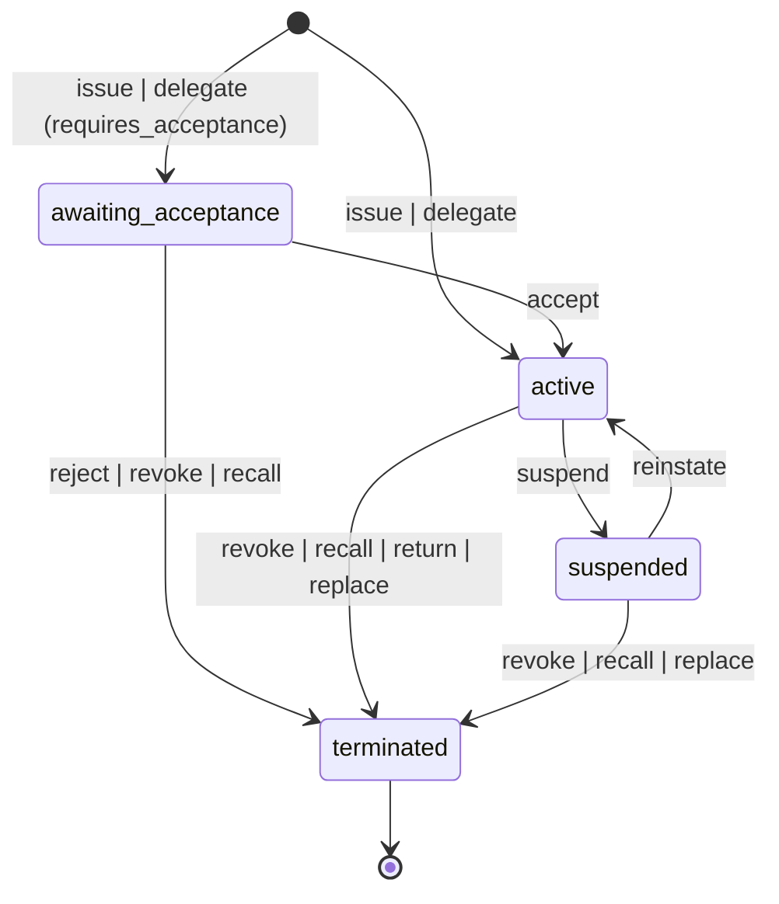
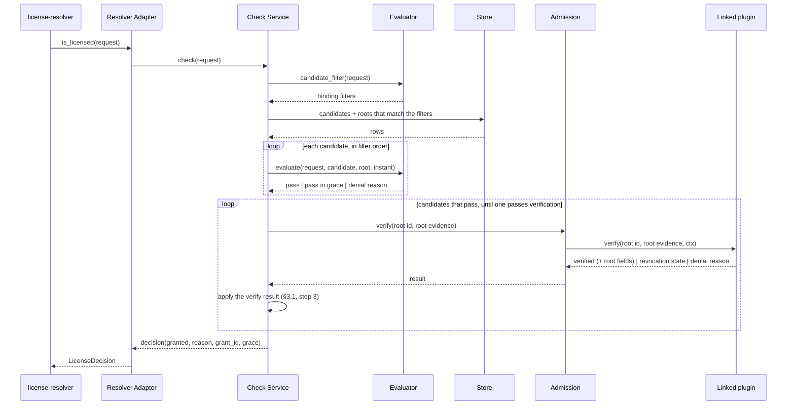
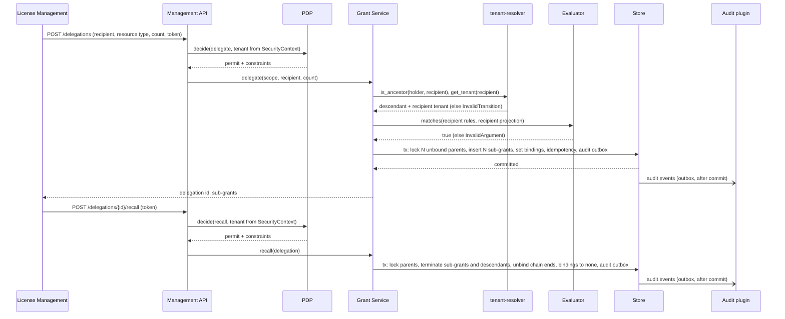
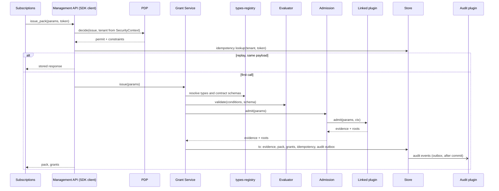
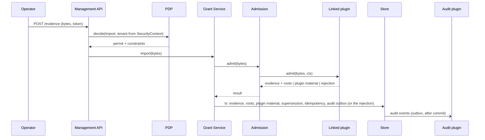

<!-- cpt:
version: 0.1.0
status: draft
module: license-enforcement
system: cf
-->

# Technical Design — License Enforcement

<!-- toc -->

- [1. Architecture Overview](#1-architecture-overview)
  - [1.1 Architectural Vision](#11-architectural-vision)
  - [1.2 Architecture Drivers](#12-architecture-drivers)
  - [1.3 Architecture Layers](#13-architecture-layers)
- [2. Principles & Constraints](#2-principles--constraints)
  - [2.1 Design Principles](#21-design-principles)
  - [2.2 Constraints](#22-constraints)
- [3. Technical Architecture](#3-technical-architecture)
  - [3.1 Domain Model](#31-domain-model)
  - [3.2 Component Model](#32-component-model)
  - [3.3 API Contracts](#33-api-contracts)
  - [3.4 Internal Dependencies](#34-internal-dependencies)
  - [3.5 External Dependencies](#35-external-dependencies)
  - [3.6 Interactions & Sequences](#36-interactions--sequences)
  - [3.7 Database schemas & tables](#37-database-schemas--tables)
- [4. Additional context](#4-additional-context)
- [5. Traceability](#5-traceability)

<!-- /toc -->

## 1. Architecture Overview

### 1.1 Architectural Vision

License Enforcement has two interfaces over one grant store.

For `license-resolver`, the gear is a backend plugin. `is_licensed` looks for a tenant grant that covers the requested
resource and subject, and returns a decision. A denial carries a typed reason.

For management modules and administrators, the gear stores grants and packs and gives the operations on them. A REST
API and an SDK client issue, accept, bind, delegate, recall, suspend, revoke, renew, and replace grants and packs. The
gear holds the invariants of these operations. The decision when to call an operation is business logic of the
management modules. The PDP authorizes every mutation. Every mutation is idempotent and versioned, and the gear emits
an audit event for it.

The admission plugin that the build links into the binary creates root grants. The module has no other create path. A
plugin can accept grant parameters from authorized callers, or evidence that it verifies, for example a vendor-signed
artifact. The domain model, lifecycle, check logic, and management API are the same code under every plugin.
Delegation of an existing grant to a descendant tenant creates sub-grants.

A grant stores one of four lifecycle states: awaiting acceptance, active, suspended, or terminated. A check decides
from these inputs:

- the stored state of the grant, and of the issued grant from which it was delegated
- the validity window of the grant at the time of the check
- the answer of the linked plugin about the evidence of the issued grant

Expiry and grace follow from time. A suspension or revocation of an issued grant denies every grant delegated from it. A
check does not depend on their stored states. Revocation also terminates every grant delegated from it in the same
transaction. Only a verb terminates a grant. An expired grant keeps its stored state, and `renew` or new evidence can
extend it at any time.

A subject grant has one binding: none, a subject, or the sub-grant that delegation created from it. Delegation moves
the binding down the tenant tree. Recall, return, reject, and revocation move it back. The number of licensed subjects
under a root is the number of chains that end in a subject binding. A partial unique index in storage enforces at most
one live child per grant.

The check path reads only the store and process memory. It compares type ids by their GTS derivation chain. The write
path validates the conditions. At delegation, it also validates the tenant hierarchy and that each sub-grant is a subset
of its parent. 

### 1.2 Architecture Drivers

#### Functional Drivers

| Requirement | Design Response |
|-------------|-----------------|
| `cpt-cf-license-enforcement-fr-backend-check` | The resolver adapter (`cpt-cf-license-enforcement-component-resolver-adapter`) implements the check of the license-resolver plugin contract. The check follows the evaluation order of §3.1. Delegation validates the chain of sub-grants at write time (I4, I5 in §3.1). The check path reads the store and changes no grant (`cpt-cf-license-enforcement-constraint-local-check-path`). |
| `cpt-cf-license-enforcement-fr-subject-scope` | The subject of a grant is a Subject contract type, and the binding of the grant names the subject (§3.1). The evaluator decides which bindings match the request. The default evaluator matches the request subject, or the tenant of the request for a grant on the tenant Subject type. It matches by GTS type patterns, so a new Subject type needs no new build (`cpt-cf-license-enforcement-adr-compile-time-evaluator`). |
| `cpt-cf-license-enforcement-fr-reason-codes` | Denial reasons are a closed enum in the SDK (`cpt-cf-license-enforcement-component-sdk`), listed in §3.1. The reason comes from the step at which the evaluation order stops. Check-explain is a management operation that returns the decision of a check with its diagnostics. The check and check-explain share this order. Consumers tolerate reasons that they do not know (`cpt-cf-license-enforcement-constraint-closed-vocabularies`). |
| `cpt-cf-license-enforcement-fr-grant-conditions` | Conditions are constraints over the subject and resource `metadata` of the check. The evaluator defines their form (`cpt-cf-license-enforcement-adr-compile-time-evaluator`). Grant management validates them through the evaluator against the registered contract schema. A check evaluates them through the evaluator at a bounded cost. An absent attribute denies. |
| `cpt-cf-license-enforcement-fr-type-references` | Write paths resolve every type id through types-registry: existence, derivation from the licensing base types, and admission by the resource contract. The check path compares the stored ids by their GTS derivation chain and never calls the registry (§3.1). |
| `cpt-cf-license-enforcement-fr-grant-model` | One grant entity (§3.1) serves roots and sub-grants, so the check, the lifecycle, and delegation work on one shape. Each grant has one binding and at most one live child, and this keeps the count of licensed subjects a count of rows (I2, I3 in §3.1). |
| `cpt-cf-license-enforcement-fr-admission-plugin` | Root grants come only from the admission boundary (`cpt-cf-license-enforcement-component-admission`), which hosts the one plugin that the binary links (`cpt-cf-license-enforcement-adr-compile-time-admission`). Evidence is the input from which the plugin admits root grants. An intake is a way for evidence to reach the plugin: `issue` takes grant parameters from an authorized caller, and `import` takes evidence bytes that the plugin parses. The boundary stores the evidence and the roots that it names in one transaction. It rejects evidence that is already admitted. The plugin rejects evidence that is older than the evidence that it replaces. The management API offers a create operation only for an intake that the plugin declares (§3.3). |
| `cpt-cf-license-enforcement-fr-grant-lifecycle` | A grant stores one of four states and changes it only through explicit operations of the grant service (`cpt-cf-license-enforcement-component-grant-service`, §3.1). Expiry, grace, and the end of grace are derived at evaluation from time. A descendant denies through the state of its root (`cpt-cf-license-enforcement-principle-derived-usability`). |
| `cpt-cf-license-enforcement-fr-subject-binding` | A grant holds one binding: none, a subject, or a delegated sub-grant (§3.1). The bind and unbind operations of the grant service change it. A binding fixed at admission never changes (I8 in §3.1). |
| `cpt-cf-license-enforcement-fr-delegation` | Delegation in the grant service creates one sub-grant per parent in one transaction, groups them as one delegation, and binds each parent to its child (§3.1, §3.6). The recipient must be a descendant as tenant-resolver reports it, and each sub-grant is a subset of its parent (I4 in §3.1). Return and recall reverse it. |
| `cpt-cf-license-enforcement-fr-recipient-rules` | Recipient rules are conditions over a recipient projection, a GTS type that this module registers. The evaluator validates them when they are written and evaluates them at delegation (§3.1). |
| `cpt-cf-license-enforcement-fr-precedence` | Replacement in the grant service terminates the replaced grants and moves each binding, with its sub-grant chain, to a successor in one transaction. It fails as a whole if a binding has no successor (§3.1). |
| `cpt-cf-license-enforcement-fr-pack` | A pack (§3.1) groups grants, and no operation changes its members. Pack operations of the grant service apply to all members in one transaction. |
| `cpt-cf-license-enforcement-fr-management-api` | The management API (`cpt-cf-license-enforcement-component-management-api`) exposes the same operations over REST in api-gateway and over the in-process SDK client. Lifecycle operations are explicit sub-operations, and check-explain runs the same evaluation as the check (§3.3). |
| `cpt-cf-license-enforcement-fr-idempotent-mutations` | Every mutating request carries an idempotency token. The management API stores the result per tenant and token and returns it on replay (§3.7). It keeps the result for the idempotency window, a configuration parameter of the gear. For the `issue` intake, the tenant and the idempotency token are the replay key of the evidence. Thus a repeated `issue` after the window is rejected as a replay (§3.1). A replay with a different payload is rejected as a conflict. Grants and packs carry a version, and a request can set it as a precondition (§3.3). |
| `cpt-cf-license-enforcement-fr-pdp-gated-management` | The management API gets a PDP decision before each operation, with the tenant from the security context. The PDP constraints scope the mutating transaction. |
| `cpt-cf-license-enforcement-fr-audit-ledger` | Each change writes its audit events to the transactional outbox of `toolkit-db` in its own transaction. After commit, the outbox delivers them to the audit plugin (`cpt-cf-license-enforcement-component-audit`). The plugin delivers them to an audit target outside this module. The target stores the audit ledger, gives tenant-scoped read access, and owns retention. |
| `cpt-cf-license-enforcement-fr-verification-fixed` | Verification follows only from the plugin crate that the binary links (`cpt-cf-license-enforcement-adr-compile-time-admission`). A binary without a verifying plugin contains no verification code. A plugin can verify evidence at admission and at each evaluation. Root fields are the fields of a root grant that the plugin reads from its verified evidence. When the plugin returns them, the check uses them instead of the stored fields. It also checks that a sub-grant is a subset of these fields. It also checks that each link of its chain is the only live child of its parent (`cpt-cf-license-enforcement-adr-payload-authority`). |
| `cpt-cf-license-enforcement-fr-signed-artifact` | The plugin model lets a plugin own its evidence format and admit only evidence that it verifies (§3.3). Evidence keeps the exact bytes that the plugin admitted. A plugin that admits signed artifacts verifies them at admission and at each evaluation. |
| `cpt-cf-license-enforcement-fr-freshness-revocation` | At each evaluation, the plugin can deny a root and can return a revocation state for it (§3.3). The state is suspended or terminated, from the revocation material that the plugin keeps. Revocation lists arrive as evidence through the `import` intake. The plugin keeps what it needs as its material in the gear store. A plugin that verifies evidence realizes freshness and revocation this way. |
| `cpt-cf-license-enforcement-fr-clock-defense` | At each evaluation, the plugin can deny a root, and it keeps its own material in the gear store (§3.3). A plugin that verifies evidence realizes the clock defence this way. |
| `cpt-cf-license-enforcement-fr-telemetry` | The gear emits counters, histograms, and gauges with bounded labels. It also emits the id of the linked plugin and the version of the trust material that the plugin reports. It logs each fail-closed event (§4). |

#### NFR Allocation

| NFR ID | NFR Summary | Allocated To | Design Response | Verification Approach |
|--------|-------------|--------------|-----------------|-----------------------|
| `cpt-cf-license-enforcement-nfr-fail-closed` | No fault gives `granted: true`. The module refuses issuance without the PDP. | Check service, grant service, admission, linked plugin | Infrastructure faults are errors (`ServiceUnavailable`), never decisions. The resolver fails closed on errors. Management paths refuse when the PDP, registry, or tenant-resolver cannot answer. A verification failure is a typed denial. | Fault injection on store, registry, PDP, and the linked plugin. Expected: 0 grants, 0 unverified imports. |
| `cpt-cf-license-enforcement-nfr-tenant-isolation` | A management operation is scoped to the tenant of `SecurityContext`. A check is scoped to the tenant of `request.context`. | Store, management API | Check queries filter on `holder_tenant_id = request.context.tenant`. Management queries run under the PDP `AccessScope` in `SecureConn`. The module takes a holder or a recipient from a payload only after the hierarchy check (`cpt-cf-license-enforcement-constraint-tenant-scope-from-context`). Two named queries cross tenants. A grantor reads the sub-grants that it delegated, for renew and recall. A check reads the chain of the selected candidate when the plugin returns root fields. | Isolation tests: 0 cross-tenant rows or matches. |
| `cpt-cf-license-enforcement-nfr-conservation` | At most one binding and one live (not terminated) child per grant under concurrency | Store | Partial unique index on `parent_grant_id` where state is not terminated (I3 in the database). Every mutation locks the row of each grant whose binding changes and reads it again in the same transaction (I2). `version` rejects stale writers. | 100 concurrent mutations per grant. Expected: 0 violations in committed state. |
| `cpt-cf-license-enforcement-nfr-check-latency` | 40ms p95 at 1 000 checks/s per node, 50 000 grants per tenant | Check service, evaluator, store, linked plugin | Budget below. Indexed reads get the candidates and their roots. `verify` of the linked plugin runs for the selected candidate only and has its own budget line. The only network call is to the store. | Benchmark at 1 000/s against a 50 000-grant tenant, with each shipped plugin. One subject holds 100 terminated or expired grants on the checked resource. Its checks, granted and denied, meet the same p95. |
| `cpt-cf-license-enforcement-nfr-signature-strength` | Asymmetric, ≥128-bit, strict, closed allow-list that includes at least one FIPS 140-3 approved algorithm | Plugin that verifies signed evidence | Realized by that plugin. | Algorithm-confusion and Wycheproof vectors in that plugin. |
| `cpt-cf-license-enforcement-nfr-determinism` | Same inputs and same instant give the same decision and reason. Condition cost is bounded. | Evaluator | One evaluation instant per check. Candidates have a total order. The evaluator is a pure function. It counts its cost in evaluation steps and denies with `condition_budget_exceeded` past the per-check budget. A wall-clock guard (default 5ms) returns an error on overrun, and the resolver fails closed. The guard gives no decision. | Replay of recorded checks across nodes: 100% agreement. |
| `cpt-cf-license-enforcement-nfr-offline` | Checks with a plugin that verifies evidence depend on nothing outside the deployment | Check service, linked plugin, store | The check reads only the store and process memory. The gear gives `verify` only its `PluginMaterial`, the data that the plugin keeps in the gear store. The check path calls nothing outside the deployment. | Checks pass with egress blocked. |

**Check latency budget** (the PRD defers this calibration to DESIGN. The 40ms target does not change):

| Step | Mechanism | Bound |
|------|-----------|-------|
| Candidate and root lookup | Candidates are read by tenant, resource type, and binding through indexes (§3.7). Each candidate references its root. | ≤ 10ms p95 for an in-deployment PostgreSQL |
| Plugin check of the selected root | A plugin with a trusted store does no work. A plugin that verifies evidence states in its own documentation how it stays within this bound. | ≤ 1ms p95 |
| Candidate evaluation | In-memory comparisons on the candidate and its root | negligible |
| Conditions | Bounded by the evaluator in evaluation steps. Wall-clock guard 5ms | ≤ 5ms |

The grant count per tenant sets the index size, not the work per check. Terminated grants and grants whose window ended
add no work per check, because the indexes of the candidates exclude them (§3.7). The check path of the gear changes no
grant.

#### Key ADRs

| ADR ID | Decision Summary |
|--------|------------------|
| `cpt-cf-license-enforcement-adr-compile-time-admission` | The binary links exactly one admission plugin crate, and the plugin registers itself at link time. The gear does not start with zero plugins or more than one. Verification code and trust anchors are only in the plugin crate that needs them. |
| `cpt-cf-license-enforcement-adr-compile-time-evaluator` | The binary links exactly one evaluator crate behind a trait, as the admission plugin. The evaluator gives the store a candidate filter of GTS type patterns and binding ids, and evaluates the candidates. How it expresses its logic is the decision of the crate. |
| `cpt-cf-license-enforcement-adr-payload-authority` | When `verify` returns root fields, the evaluator uses them, the check service checks a sub-grant candidate against them, and the store only finds candidates. When `verify` returns verified without root fields, the stored fields apply. |

### 1.3 Architecture Layers

```text
 license-resolver ──is_licensed──▶ ┌──────────────────────────────────────────────┐ ◀──REST/SDK── License Management,
                                   │ api: resolver adapter │ management API (PDP) │               Subscriptions
                                   ├──────────────────────────────────────────────┤
                                   │ domain: check service · evaluator ·          │◀── linked evaluator crate
                                   │         grant service ·                      │◀── linked admission plugin
                                   │         admission boundary                   │
                                   ├──────────────────────────────────────────────┤
                                   │ infra: store (SecureORM) ·                   │
                                   │        idempotency · registry, tenant, PDP   │
                                   └──────────────────────────────────────────────┘
```

- [ ] `p3` - **ID**: `cpt-cf-license-enforcement-tech-layers`

| Layer | Responsibility | Technology |
|-------|----------------|------------|
| API | Resolver plugin adapter, REST operations and SDK client, PDP enforcement point, Problem mapping | ToolKit `OperationBuilder`, `PolicyEnforcer`, `toolkit-canonical-errors` |
| Domain | Grant model and invariants, lifecycle verbs, check service, evaluator trait and reasons, admission boundary | Rust |
| Infrastructure | Repositories, idempotency records, and plugin material. Audit outbox and adapter. Registry, tenant-resolver, and PDP clients. Telemetry. | SecureORM over PostgreSQL, `types-registry-sdk`, `tenant-resolver-sdk`, `authz-resolver-sdk`, OTel |
| Plugins | Admission plugins and the evaluator as separate crates | Rust crates under `plugins/`. The binary links one admission plugin and one evaluator. |

## 2. Principles & Constraints

### 2.1 Design Principles

#### Roots Come Only from Admitted Evidence

- [ ] `p1` - **ID**: `cpt-cf-license-enforcement-principle-evidence-only-roots`

The module has no code path that creates a root grant from its own judgement. Every root references the evidence that
a plugin admitted. The evidence fixes the set of roots that exist because of it. Sub-grants derive from roots under
subset rules. The same domain code runs under every plugin. Only two things differ: the evidence that a plugin accepts
and the intake that it declares.

**ADRs**: `cpt-cf-license-enforcement-adr-compile-time-admission`

#### Usability Is Derived at Evaluation

- [ ] `p1` - **ID**: `cpt-cf-license-enforcement-principle-derived-usability`

A grant stores one of four lifecycle states. Evaluation computes whether the grant satisfies a check from these
inputs:

- the state of the grant and of its root
- the clock against the validity window of the grant
- the answer of `verify` of the linked plugin

A check needs no stored transition for expiry, grace, or the end of grace. These situations follow from time. A
suspended or revoked root denies every descendant, and a check does not depend on their stored states. Only a verb
terminates a grant. An expired grant keeps its stored state.

**ADRs**: `cpt-cf-license-enforcement-adr-payload-authority`

#### Conservation by Exclusive Binding

- [ ] `p1` - **ID**: `cpt-cf-license-enforcement-principle-conservation-by-binding`

A subject grant has one binding slot. The slot holds none, a subject, or the one live sub-grant that delegation
created from it. Delegation moves the slot down a tenant chain. Recall, return, reject, and revocation move it back.
"N seats" is N grants. The count of licensed subjects is a count of rows with a live binding. A partial unique index
enforces this count, not arithmetic that a concurrent writer could get wrong.

#### The Store Finds Candidates, the Plugin Decides

- [ ] `p2` - **ID**: `cpt-cf-license-enforcement-principle-index-not-authority`

Root grant rows locate candidates. A check takes the compared fields of a root from `verify` of the linked plugin. A
plugin that verifies its evidence returns them from that evidence. A plugin with a trusted store adds no fields, and
the check uses the stored fields.

Delegation stores a sub-grant only if it is a subset of its parent. When `verify` returns fields, the check also
checks that a sub-grant candidate is a subset of these fields. It reads the chain of the candidate and checks that
each link is the only live child of its parent, and that the binding of the parent names it.

Thus, when `verify` returns fields, an edited or copied row can make the answer narrower or make it fail. It cannot
make the answer wider.

**ADRs**: `cpt-cf-license-enforcement-adr-payload-authority`

#### Fail Closed, Deny Typed

- [ ] `p1` - **ID**: `cpt-cf-license-enforcement-principle-fail-closed-typed-denial`

A denial always names its reason from the closed vocabulary. A fault never becomes a decision. Storage, registry, PDP,
and plugin faults become errors. The resolver and the management API treat these errors as refusal.
The module logs each such event with its cause.

### 2.2 Constraints

#### ToolKit Gear Triad

- [ ] `p1` - **ID**: `cpt-cf-license-enforcement-constraint-toolkit-triad`

The gear is built on the ToolKit framework and follows the SDK / main gear / plugin triad. Inter-gear calls go through
SDK clients and ClientHub.

#### Admission and Evaluator Fixed at Build Time

- [ ] `p1` - **ID**: `cpt-cf-license-enforcement-constraint-compile-time-admission`

Each binary links exactly one admission plugin crate. The plugin registers itself at link time, as gears and plugins
do. At init, the gear does not start if it finds zero plugins or more than one. Verification code and trust anchors are only
in the plugin crate that needs them. A binary without such a plugin contains no verification code. No configuration key, 
environment variable, request, artifact field, or registry entry changes any of this. The same rules apply to the
evaluator crate (`cpt-cf-license-enforcement-adr-compile-time-evaluator`).

**ADRs**: `cpt-cf-license-enforcement-adr-compile-time-admission`,
`cpt-cf-license-enforcement-adr-compile-time-evaluator`

#### Local Check Path

- [ ] `p1` - **ID**: `cpt-cf-license-enforcement-constraint-local-check-path`

`is_licensed` and check-explain read the store and process memory. They change no grant, binding, or lifecycle
state. They call none of these:

- `types-registry`, because type ids carry their derivation chain
- `tenant-resolver`, because the write path checked the hierarchy at delegation
- the PDP, because the resolver is the only check caller, and the management API authorizes check-explain before it
  runs
- any vendor service

**ADRs**: `cpt-cf-license-enforcement-adr-payload-authority`

#### Tenant Scope from Context

- [ ] `p1` - **ID**: `cpt-cf-license-enforcement-constraint-tenant-scope-from-context`

The tenant of a check is `request.context`. The tenant of a management operation is `SecurityContext`. A payload
carries a tenant id only as a delegation recipient or as the holder of a root. The admission plugin returns the holder
of each root: for `issue` from the request parameters, for `import` from the evidence. The module accepts a holder only
when `tenant-resolver` reports it as the tenant of `SecurityContext` or its descendant, and a recipient only as a
descendant of the holder. PDP constraints become the `AccessScope` of the transaction that mutates.

#### Closed Denial Reasons

- [ ] `p2` - **ID**: `cpt-cf-license-enforcement-constraint-closed-vocabularies`

Denial reasons are a closed enum in the SDK crate. The enum grows only by addition. Consumers tolerate reasons that
they do not know.

## 3. Technical Architecture

### 3.1 Domain Model

**Technology**: Rust structs in the SDK crate, persisted through SecureORM (§3.7). Type references are GTS type ids
of derived licensing contracts. Consuming gears register them from the base types of `license-resolver`. Instance
ids are UUIDs or well-known names.

`license-resolver` defines the base GTS types of the Subject and Resource contracts
([DESIGN §3.1](../../license-resolver/docs/DESIGN.md#31-domain-model)). It also defines the plugin spec that this
module implements ([ADR-0002](../../license-resolver/docs/ADR/0002-cpt-cf-license-resolver-adr-plugin-delegation.md)).

The domain has five entities: grant, pack, evidence, audit event, and plugin material. The field lists below name
what the design needs. They are not complete.

**Grant.** A grant is the licensed fact. It is a root or a sub-grant, and both have the same shape.

- The id of a root comes from the plugin at admission. A plugin can carry it in its evidence, so that later evidence
  names the same grant. The gear assigns the id of a sub-grant.
- The holder tenant holds the grant and distributes it.
- The resource is a Resource contract type and an optional instance id. The type id includes the version. A grant
  without an instance id covers every instance of the type.
- The subject type is a Subject contract type. The grant covers the subject that its binding names. The type of a
  bound subject is the subject type of the grant or derives from it.
- The binding is none, a subject (type and id), or a delegated sub-grant. A binding that admission fixes never changes.
- The validity is an own window (not before, expires at, optional grace until) or, for a sub-grant, inherited.
- The conditions are optional typed constraints over the subject and resource metadata of the check.
- The permissions are: may bind, maximum depth (0 means not delegable), and requires acceptance.
- The recipient rules are optional typed constraints over the recipient projection. Delegation evaluates them.
- Delegation is stored as a chain. A sub-grant references its parent, and a root has no parent. The sub-grants that
  one delegation created carry the same delegation id, so that delegation verbs address them together.
- The pack is optional.
- The evidence is the evidence of the root. A sub-grant has the evidence of its root.
- The state is awaiting acceptance, active, suspended, or terminated.
- A terminated grant has a termination reason: revoked, recalled, returned, rejected, or replaced.
- The version increases at every change. A request can set it as a precondition.

The grantor of a sub-grant is the holder of its parent. A grant on the tenant Subject type gives the tenant-wide scope
of the PRD. It is not a separate kind of grant and follows the same rules as any subject grant. 

These fields come from `cpt-cf-license-enforcement-fr-grant-model`, `cpt-cf-license-enforcement-fr-subject-scope`, 
`cpt-cf-license-enforcement-fr-subject-binding`, `cpt-cf-license-enforcement-fr-delegation`,
`cpt-cf-license-enforcement-fr-recipient-rules`, `cpt-cf-license-enforcement-fr-grant-conditions`, 
`cpt-cf-license-enforcement-fr-grant-lifecycle`, `cpt-cf-license-enforcement-fr-pack`,
`cpt-cf-license-enforcement-fr-admission-plugin`, and `cpt-cf-license-enforcement-fr-idempotent-mutations`.

**Pack.** A pack is a set of grants that were issued together. Pack operations and replacement address it as one
unit. A pack has an id, a holder tenant, and a version. Its members are the grants that name it, and no operation
changes them after issuance. The members share one evidence. These fields come from `cpt-cf-license-enforcement-fr-pack`
and `cpt-cf-license-enforcement-fr-precedence`.

**Evidence.** Evidence is input that the plugin admits. The gear stores evidence that names root grants, with the
exact bytes that the plugin admitted. From other evidence, for example a revocation list, the plugin keeps only its
own material. For the `issue` intake, the bytes are the canonical form of the request and the identity
of the caller who sent it. Evidence also has an id, the id of the plugin that admitted it, the intake that it came
through, an optional replay key, and the evidence that it replaces. The plugin sets the replay key, and the gear
rejects a second evidence with the same key. For the `issue` intake, the replay key is the tenant and the idempotency
token of the request. These fields come from `cpt-cf-license-enforcement-fr-admission-plugin` and
`cpt-cf-license-enforcement-fr-signed-artifact`.

**Audit event.** An audit event records one lifecycle transition, binding, delegation, import, or rejection at
import. It has an id, a tenant, an actor, a time, an operation, a target, an optional denial reason, the state before
and after, and an optional idempotency token. The actor comes from the security context, or is the plugin id for an
import. These fields come from `cpt-cf-license-enforcement-fr-audit-ledger`.

**Plugin material.** Plugin material is data that the linked plugin keeps through the gear store, as a key and a
value for each plugin. The gear gives it to the plugin and does not interpret it. These fields come from
`cpt-cf-license-enforcement-fr-freshness-revocation` and `cpt-cf-license-enforcement-fr-clock-defense`.

**Relationships**:

- A sub-grant has one parent grant. A root has no parent.
- A grant belongs to at most one pack.
- Every grant descends from one evidence. All members of a pack descend from the same evidence.
- An audit event targets one grant, pack, delegation, or evidence.
- Only the linked plugin reads plugin material. Nothing references it.

**Invariants**:

- I1. Every grant has exactly one `holder_tenant_id`. The holder of a sub-grant is a descendant of the holder of its
  parent, as reported at `delegate`.
- I2. The binding of a grant that is not terminated and its live child agree. If the binding names a delegated
  sub-grant, that sub-grant exists, is not terminated, and has this grant as its parent. If a grant has a live child,
  the binding of the grant names that child.
- I3. A grant has at most one live (not terminated) child. Can be covered by a partial unique index in the database.
- I4. A sub-grant is a subset of its parent:
  - same `resource_type`, `resource_id`, `subject_type`, `evidence_id`
  - `validity` is inherited, or is inside the effective window of the parent
  - `conditions` include the conditions of the parent
  - `permissions` are not wider, and `max_depth` is exactly one less
- I5. Chain depth never exceeds the `max_depth` of the root.
- I6. Every root references evidence. The evidence names the roots that exist because of it, with one row per named
  grant.
- I7. A terminated grant stays terminated. No operation returns it to another state.
- I8. A grant with a vendor-fixed subject id keeps that binding for life. `delegate` never accepts it.
- I9. No verb changes `pack_id`, `resource_type`, `resource_id`, `subject_type`, `parent_grant_id`, or `evidence_id`
  after creation. There are two exceptions: `replace` and evidence supersession. They re-parent carried-over
  sub-grants and repoint the `evidence_id` of a chain together, so I4 stays true.

**Lifecycle**:



| Verb                   | Actor                                                           | Precondition                                                                                                                                                                                       | Effect beyond the state change                                                                                                                                       |
|------------------------|-----------------------------------------------------------------|----------------------------------------------------------------------------------------------------------------------------------------------------------------------------------------------------|----------------------------------------------------------------------------------------------------------------------------------------------------------------------|
| `issue`                | Vendor, through admission                                       | The plugin admitted the evidence.                                                                                                                                                                  | Creates the roots that the evidence names. Each root starts as awaiting acceptance or active, as its permissions require.                                            |
| `accept`               | Holder                                                          | The grant awaits acceptance.                                                                                                                                                                       | The grant becomes active.                                                                                                                                            |
| `reject`               | Holder                                                          | The grant awaits acceptance.                                                                                                                                                                       | Terminates the grant with the reason rejected. For a sub-grant, the binding of the parent becomes none.                                                              |
| `suspend`, `reinstate` | Vendor                                                          | The grant is a root. It is active for suspend, or suspended for reinstate.                                                                                                                         | Descendants deny through their root. Their stored states do not change.                                                                                              |
| `revoke`               | Vendor                                                          | The grant is a root and is not terminated.                                                                                                                                                         | Terminates the root and every descendant with the reason revoked. Their bindings stay for audit.                                                                             |
| `renew`                | Vendor for roots. Grantor for the sub-grants that it delegated. | The grant is not terminated. Without the `issue` intake, only sub-grants can be renewed. A grantor renews only within its own window.                                                         | Extends the validity in place, with the same id and no new evidence. The descendants that inherit the validity get the new window in the same transaction.           |
| `bind`, `unbind`       | Holder with permission to bind                                  | The grant and its root are not terminated, and admission did not fix the binding. For bind, the binding is none or names a sub-grant whose window ended, and the type of the subject is the subject type of the grant or derives from it. For unbind, the binding is a subject. | Bind recalls a sub-grant whose window ended and sets the binding to the subject. Unbind sets it to none.                                                             |
| `delegate`             | Holder of a grant with a maximum depth above 0                  | The grant and its root are active. The binding of the grant is none or names a sub-grant whose window ended. The recipient is a descendant tenant now and passes the recipient rules.              | Recalls a sub-grant whose window ended. Creates one sub-grant per grant, all in one delegation. The binding of each parent names its sub-grant.                      |
| `return`               | Holder of a sub-grant                                           | The binding of the sub-grant is none.                                                                                                                                                              | Terminates the sub-grant with the reason returned. The binding of the parent becomes none.                                                                           |
| `recall`               | Grantor                                                         | The sub-grant is not terminated.                                                                                                                                                                   | Terminates the sub-grant and every descendant with the reason recalled. The subject at the end of the chain becomes unbound. The binding of the parent becomes none. |
| `replace`              | Vendor                                                          | The plugin admitted the successors.                                                                                                                                                                | See below.                                                                                                                                                           |

A verb addressed to a pack or a delegation applies to every member in one transaction, or to none.

**Derived situations** at evaluation:

- `usable`: the grant and its root are `active`. The window of the grant satisfies
  `not_before ≤ now < expires_at`, or `expires_at ≤ now < grace_until`. The second case is grace, and diagnostics
  report it.
- `not_yet_valid`, `expired`, `grace_expired`: from time.
- `awaiting_acceptance`, `suspended`, `terminated`: from the state of the root, then of the grant, or from the
  revocation state that `verify` returns for the root.

A sub-grant with `inherited` validity gets the window of its parent at delegation, and renew keeps it equal.
Delegation requires an active parent, and recall terminates every descendant. Thus a live sub-grant has no
intermediate grant that denies, and the state of the root is enough.

**Replacement and evidence supersession**:

- Replacement terminates the replaced grants with the reason replaced. In the same transaction, it moves each binding
  that they carried to a grant of the replacement, the successor. The binding must stay usable on the successor. Thus
  a plan change does not deny a bound subject at any moment.
- A successor is an unbound `active` grant of the replacement on the same resource that admits the subject or the
  delegation. A grant that awaits acceptance is not a successor, because a check denies it until the holder accepts it.
  A vendor that replaces bound grants issues the replacement without the acceptance requirement. Consent to a plan
  change belongs to the management module before it calls `replace`.
- To move a `delegated` binding, replacement re-parents the sub-grant and its descendants onto the successor. They take
  the evidence of the successor. The sub-grant must satisfy I4 against the successor without change: `max_depth`,
  `conditions`, `permissions`, and an own window inside the window of the successor.
- If any binding has no successor, the whole operation fails and lists these bindings.

The module applies new evidence that replaces earlier evidence in the same way:

- A root whose id is in both payloads gets an in-place update from the new payload. The module repoints the root and
  its descendants to the new evidence. The descendants that inherit the validity get the new window, as with `renew`.
  Each descendant must satisfy I4 against its updated parent without change. If one does not, the module rejects the
  whole evidence and lists the delegations that block it.
- The module creates a root that is only in the new payload.
- The module terminates a root that is only in the old payload, with the reason replaced, and carries over its binding.
- The module rejects the whole evidence when it cannot carry a binding.

A terminated root stays terminated when new evidence names it again.

**Evaluation order** — the check service runs this order for every check and check-explain. When no candidate passes,
the reported reason comes from the candidate that reached the latest step. Candidate order breaks ties.

1. Candidates: the evaluator gives a candidate filter for the request (§3.3). The check service reads the grants that
   are not terminated and whose window has not ended in `request.context.tenant` on the requested `resource_type` that
   match the filter, with their roots. A grant covers the resource when its `resource_id` is null or equals the
   requested id. A whole-type check matches only grants without an id. If there is no candidate, the check service
   selects the reason in this order: `subject_not_bound` if the tenant holds a grant on the resource that is not
   terminated and whose window has not ended. Else the reason of the grant that matches the filter and ended last:
   `expired` or `grace_expired` when its window ended, `terminated` with the termination reason when a decision ended
   it. Else `no_grant_for_resource`. Candidate order: by the first filter that matches, then by `id`.
2. Evaluation: on the stored fields, the evaluator checks the state of the root and of the candidate, the validity
   window of the candidate, and the conditions of the candidate against the `metadata` of the request. Delegation
   already made the candidate a subset of every grant above it. The first failed check denies the candidate with its
   reason. A candidate in its grace period passes and marks the decision with grace.
3. Verification: for the first candidate that passes evaluation, the check service calls `verify` of the linked plugin
   with the id and the evidence of its root. A denial reason denies the candidate. A revocation state denies it as
   `suspended` or `terminated`. If `verify` returns root fields and the candidate is the root, the check service checks
   that their resource covers the request, that their holder is `request.context.tenant`, and that the type of the
   stored binding is their subject type or derives from it → `chain_invalid`. The evaluator evaluates it again on these
   fields. If the root binds a subject, these fields must fix this binding or permit bind → `chain_invalid`. 
   If the candidate is a sub-grant, the check service checks that it is a subset of these fields, that
   these fields do not fix the binding of the root, and that the depth of its chain does not exceed the `max_depth` in
   these fields → `chain_invalid`. It also checks that each link of its chain is the only live child of its parent,
   and that the binding of the parent names it → `duplicated`
   (`cpt-cf-license-enforcement-principle-index-not-authority`). When `verify` returns root fields, for any
   candidate, the check service checks that the store holds exactly one row that is not terminated with the id of the
   root → `duplicated`. It does not check that each link is a subset of its parent. In an untrusted build, the operator
   owns these rows and can edit all links together. Thus the root is the only limit that the check can prove. When the
   candidate fails, the check service takes the next candidate that passes evaluation.
4. Decision: the candidate that passes verification gives `granted: true` with `grant_id` in diagnostics when applicable.

Stored fields can only make a candidate fail earlier. The `verify` is called only for the candidate that the evaluator 
selects, and the answer of `verify` decides.

**Default evaluator** (`cpt-cf-license-enforcement-adr-compile-time-evaluator`): its candidate filter matches a
binding in this order:

1. The binding names the request subject. Its type is the type of the request subject or one of its base types.
2. The type of the binding is the tenant Subject type or derives from it. Its id is `request.context.tenant`.

A GTS id of a derived type contains the ids of its base types. Thus the filter needs no registry call at check time.
At init, the gear checks that each type that the evaluator names is registered. A missing type stops init.

**Type comparison**: the check compares GTS type ids by the derived-type coverage rule of the GTS specification,
without minor versions. Thus a grant still covers a request after an additive minor revision of a contract. A subject
type covers itself and every type that derives from it. A resource type covers only itself. The comparison uses only
the ids and does not need the registry.

**Denial reasons** (`DenialReason`, SDK enum, serialized as `diagnostics.reason`, additive):

| Reason                                           | Situation                                                                                                                                                                                                   |
|--------------------------------------------------|-------------------------------------------------------------------------------------------------------------------------------------------------------------------------------------------------------------|
| `no_grant_for_resource`                          | No grant in the tenant covers the resource                                                                                                                                                                  |
| `subject_not_bound`                              | Grants cover the resource. None covers this subject.                                                                                                                                                        |
| `signature_invalid`                              | From the plugin: the signature of the evidence is missing, malformed, or fails                                                                                                                              |
| `key_untrusted`                                  | From the plugin: the signing key is not trusted                                                                                                                                                             |
| `stale`                                          | From the plugin: the evidence is past its freshness                                                                                                                                                         |
| `clock_rollback`                                 | From the plugin: the clock is behind a mark that the plugin keeps                                                                                                                                           |
| `duplicated`                                     | From the plugin: the evidence does not name the root. From the check service, when `verify` returned fields: a link is not the only live child of its parent, or the parent binding does not name the link, or the store holds more than one live row with the id of the root. |
| `awaiting_acceptance`, `suspended`, `terminated` | The root or the candidate is in that state, stored or by the revocation state from `verify`. Diagnostics carry the termination reason.                                                                      |
| `not_yet_valid`, `expired`, `grace_expired`      | The effective window fails at the evaluation instant                                                                                                                                                        |
| `chain_invalid`                                  | From the check service, when `verify` returned fields: the sub-grant is not a subset of the root fields, the root fields do not match the request or the type of the stored binding, or the stored binding is not one that the root fields permit. Or a parent link of its chain is broken. |
| `condition_unmet`                                | A condition is false, or its attribute is absent                                                                                                                                                            |
| `condition_budget_exceeded`                      | Condition evaluation exceeded the per-check budget in evaluation steps                                                                                                                                      |

The recipient projection is a GTS type that this module registers
(`gts.cf.core.license_enforcement.recipient.v1~`). At `delegate`, the module builds it from the
candidate tenant as `tenant-resolver` returns it.

### 3.2 Component Model

```text
 license-resolver ──▶ [resolver adapter] ──▶ [check service] ──────▶ [evaluator] ◀── linked evaluator crate
                                               ▲    │    │                ▲
 REST / SDK ──▶ [management API] ──────────────┘    │    │ verify         │
    (PDP)            │                              │    │                │
                     ▼                              │    │                │
              [grant service] ──────────────────────┼────┼────────────────┘
                │      │                            │    │
                │      └────────────────────────────┼────┼────┐
                │                                   │    ▼    ▼
                │                                   │ [admission] ◀── linked admission plugin
                │                                   │     │
                ▼                                   ▼     ▼
              [store]  grants · packs · evidence · idempotency · plugin material

 grant service ──▶ [audit trait] ◀── audit plugin
```

#### SDK

- [ ] `p1` - **ID**: `cpt-cf-license-enforcement-component-sdk`

- **Why**: One transport-agnostic contract for callers, plugins, and the gear.
- **Scope**: `LicenseEnforcementClient` trait (§3.3), DTOs, `Grant` and related models, `DenialReason`,
  `LicenseEnforcementError`, the `GrantAdmissionPluginV1` trait with its evidence and intake types, and the
  `GrantEvaluatorV1` trait.
- **Boundaries**: No logic, no state, no persistence, no verification code.
- **Related**: Implemented by `cpt-cf-license-enforcement-component-management-api`, by the admission plugins, and by
  `cpt-cf-license-enforcement-component-evaluator`.

#### Resolver Adapter

- [ ] `p1` - **ID**: `cpt-cf-license-enforcement-component-resolver-adapter`

- **Why**: The interface of the module to `license-resolver`.
- **Scope**: Implements `LicenseResolverPluginClient::is_licensed`. At gear init, registers the
  `LicenseResolverPluginSpecV1` instance (vendor, priority) and the scoped client. Maps check service errors to
  `LicenseResolverError`.
- **Boundaries**: No evaluation logic. No PDP call (the resolver is the only caller). No writes.
- **Related**: Calls `cpt-cf-license-enforcement-component-check-service`.

#### Check Service

- [ ] `p1` - **ID**: `cpt-cf-license-enforcement-component-check-service`

- **Why**: One implementation of the evaluation order serves the check and check-explain.
- **Scope**: Takes the evaluation instant once. Candidate and root lookup with the filter from the evaluator, the call
  to `verify` of the linked plugin for the selected candidate, the check of a sub-grant against the root fields from
  `verify` and of its chain, reason selection, and diagnostics.
- **Boundaries**: Changes no grant. No registry, tenant-resolver, PDP, or network call. Receives only requests that conform
  to their contracts: the `license-resolver` gateway validates a check, and the management API validates a
  check-explain.
- **Related**: Reads `cpt-cf-license-enforcement-component-store`. Calls
  `cpt-cf-license-enforcement-component-evaluator`. Calls the linked plugin through
  `cpt-cf-license-enforcement-component-admission`.

#### Evaluator

- [ ] `p1` - **ID**: `cpt-cf-license-enforcement-component-evaluator`

- **Why**: One place decides which grants satisfy a check.
- **Scope**: A crate that the binary links at build time, behind the evaluator trait (§3.3). Gives the candidate
  filter for a request. For each candidate and its root: state, validity window, grace, and conditions at the
  evaluation instant. For a root candidate, uses the root fields from `verify` when the check service gives them.
  Defines the form of conditions and recipient rules. Validates them against a schema, and evaluates recipient rules
  at delegation.
- **Boundaries**: A pure function of its inputs with a bounded cost. No reads, no calls, no writes. Conditions
  express no counting.
- **Related**: Called by `cpt-cf-license-enforcement-component-check-service` and
  `cpt-cf-license-enforcement-component-grant-service`.

#### Grant Service

- [ ] `p1` - **ID**: `cpt-cf-license-enforcement-component-grant-service`

- **Why**: Every mutation of grants, packs, bindings, and delegations goes through one place that holds the
  invariants.
- **Scope**: Lifecycle verbs, `bind`/`unbind`, `delegate` (hierarchy check through `tenant-resolver`, recipient rules,
  subset construction), `return`/`recall`, `replace` and evidence supersession, pack fan-out. Stores what admission
  returns. Each operation is one transaction. The transaction holds the row lock of every grant whose binding changes
  and records the idempotency result. Writes the audit events to the outbox in the same transaction. A rejection at
  import writes its event in a transaction of its own.
- **Boundaries**: Creates no root itself. Roots go through the admission boundary inside the same transaction. The API
  layer calls the PDP before the service runs. The service never calls the PDP.
- **Related**: Calls `cpt-cf-license-enforcement-component-admission` for roots. Calls
  `cpt-cf-license-enforcement-component-evaluator` to validate conditions and to evaluate recipient rules. Writes
  `cpt-cf-license-enforcement-component-store`.

#### Admission Boundary

- [ ] `p1` - **ID**: `cpt-cf-license-enforcement-component-admission`

- **Why**: The single entry through which root grants come to exist.
- **Scope**: At init, finds the one `GrantAdmissionPluginV1` that the binary links, and does not start with zero or
  more. Exposes the intakes that the plugin declares. Gives the plugin access to its `PluginMaterial` through
  `ctx`. On admission, it:
  - rejects evidence that is already admitted. The plugin rejects evidence that is older than the evidence that it
    replaces.
  - rejects a root whose holder is not the tenant of `SecurityContext` or its descendant.
  - returns to the grant service the evidence, the roots that it names, and the plugin material, or the rejection
- **Boundaries**: Decides nothing about the sufficiency of evidence. No runtime plugin selection.
- **Related**: Called by `cpt-cf-license-enforcement-component-grant-service`. Hosts the linked admission plugin. Reads
  `cpt-cf-license-enforcement-component-store` for replay keys and plugin material.

#### Management API

- [ ] `p1` - **ID**: `cpt-cf-license-enforcement-component-management-api`

- **Why**: The REST and SDK surface, with one authorization and one semantics.
- **Scope**: `OperationBuilder` routes and the in-process `LicenseEnforcementClient`. A `PolicyEnforcer` decision per
  operation, with the tenant from `SecurityContext`. Passes the PDP constraints as the `AccessScope` of the
  transaction. Idempotency token handling. `Problem` mapping. Validates a check-explain request against the registered
  contracts and `admitted_subjects`, as the `license-resolver` gateway does for a check.
- **Boundaries**: No domain rules. Registers create routes only for the intakes that the linked plugin declares.
- **Related**: Calls `cpt-cf-license-enforcement-component-grant-service` and
  `cpt-cf-license-enforcement-component-check-service` (check-explain).

#### Audit

- [ ] `p1` - **ID**: `cpt-cf-license-enforcement-component-audit`

- **Why**: Every change must be auditable. The gear does not own the audit storage.
- **Scope**: An audit plugin trait in the domain. The grant service writes an `AuditEvent` for each change to the
  transactional outbox of `toolkit-db`, in the transaction of the change. After commit, the outbox delivers the event
  to the plugin at least once. The plugin delivers the events to an audit target outside this module.
- **Boundaries**: The domain knows only the trait. A crash after commit does not lose an event. The plugin must accept
  a repeated event, and it uses the id of the event for this. The audit target stores the audit ledger, gives
  tenant-scoped read access, and owns retention.
- **Related**: Called by `cpt-cf-license-enforcement-component-grant-service`.

#### Store

- [ ] `p1` - **ID**: `cpt-cf-license-enforcement-component-store`

- **Why**: One SecureORM persistence layer for grants, packs, evidence, idempotency, and plugin material.
- **Scope**: Repositories over §3.7 with `AccessScope`-scoped queries. The candidate-and-root query. The chain read of
  the check service. The partial unique index that holds I3. The retention sweeper for terminated grants. It deletes a
  terminated grant only with its whole subtree, and only when every grant in the subtree is terminated.
- **Boundaries**: No business rules beyond constraints. No cross-tenant query except the named grantor query and the
  chain read of the check service.
- **Related**: Written by `cpt-cf-license-enforcement-component-grant-service`. Read by
  `cpt-cf-license-enforcement-component-check-service` and `cpt-cf-license-enforcement-component-admission`.

### 3.3 API Contracts

- **Public interfaces (PRD)**: `cpt-cf-license-enforcement-interface-resolver-plugin`,
  `cpt-cf-license-enforcement-interface-management-api`
- **Integration contract (PRD)**: `cpt-cf-license-enforcement-contract-admission-plugin`
- **Technology**: Rust traits over ClientHub in process. REST through `OperationBuilder` in `api-gateway`,
  path-versioned, RFC-9457 problems.

**Resolver plugin** — `LicenseResolverPluginClient::is_licensed(LicenseCheckRequest) -> LicenseDecision`, exactly the
contract of the resolver. `diagnostics` carries `reason`, `grant_id`, and `grace`. Errors are `LicenseResolverError`
variants, and the resolver treats them as fail-closed. A denial is a decision, never an error.

**Admission plugin** — `GrantAdmissionPluginV1`:

- `intakes()` declares which of `issue` and `import` the plugin serves. `issue` takes grant and pack parameters from
  an authorized caller. `import` takes evidence bytes that the plugin parses.
- `admit(input, ctx)` returns the evidence and the root grants that it names, with the holder tenant of each, its own
  material to keep, or a typed rejection. A plugin can verify the input before it admits it.
- `verify(root_id, evidence, ctx)` runs at each evaluation for the root of the selected candidate. The plugin finds
  the root with this id in the evidence. If the evidence does not name this id exactly once, the plugin denies with
  `duplicated`. The form of the arguments is a decision of the implementation. `verify` returns one of these:
  - verified. A plugin that verifies its evidence adds the root fields from that evidence. A plugin with a trusted
    store adds no fields, and the check uses the stored fields.
  - a revocation state of the root: suspended or terminated.
  - a denial reason.
- `ctx` gives the plugin access to its own `PluginMaterial`. During `verify`, the plugin can write only its own
  material, for example the clock high-water mark (`cpt-cf-license-enforcement-fr-clock-defense`). The plugin decides
  how it stores this material. The check path changes no grant.
- `health()`.

The plugin is a separate crate that depends only on the SDK. It registers itself at link time. The trait version is
`V1`. A new evidence format is a new plugin crate. Each plugin has its own documentation.

**Evaluator** — `GrantEvaluatorV1` (`cpt-cf-license-enforcement-adr-compile-time-evaluator`):

- `candidate_filter(request)` returns an ordered list of binding filters. Each filter is a GTS type pattern and a
  binding id.
- `evaluate(request, candidate, root, instant)` returns pass, pass in grace, or a denial reason.
- `validate(conditions, schema)` returns the violations of conditions or recipient rules against a contract or
  projection schema.
- `matches(conditions, object)` evaluates conditions or recipient rules against an object, for example the recipient
  projection at delegation.

The evaluator is a separate crate that depends only on the SDK. It registers itself at link time.

**Management** — REST under `/license-enforcement/v1`, and the same operations on `LicenseEnforcementClient`:

| Method | Path                                                                                            | Description                                                                                                                                                                                               | Stability |
|--------|-------------------------------------------------------------------------------------------------|-----------------------------------------------------------------------------------------------------------------------------------------------------------------------------------------------------------|-----------|
| `POST` | `/packs`, `/grants`                                                                             | Issue through the `issue` intake. Absent without that intake.                                                                                                                                             | unstable  |
| `POST` | `/evidence`                                                                                     | Submit evidence to the linked plugin through the `import` intake. Absent without that intake.                                                                                                             | unstable  |
| `GET`  | `/packs`, `/packs/{id}`, `/grants`, `/grants/{id}`                                              | Read and list, tenant-scoped, with filters on resource type, state, and subject. Lists carry unbound, bound, and delegated counts per pack and resource type.                                             | unstable  |
| `POST` | `/packs/{id}/{suspend,reinstate,revoke,renew,replace}`                                          | Pack verbs, atomic over members. Absent without the `issue` intake.                                                                                                                                       | unstable  |
| `POST` | `/grants/{id}/{accept,reject,suspend,reinstate,revoke,renew,bind,unbind,return,recall,replace}` | Grant verbs. `replace` takes successors through the `issue` intake. Without the `issue` intake, replacement is evidence supersession, and the API rejects root `suspend`, `reinstate`, `revoke`, `renew`. | unstable  |
| `POST` | `/delegations`                                                                                  | Delegate N unbound grants (by ids, or by resource type and count) to a recipient tenant in one transaction                                                                                                | unstable  |
| `POST` | `/delegations/{id}/{accept,reject,return,recall}`                                               | Delegation verbs, atomic over its sub-grants                                                                                                                                                              | unstable  |
| `POST` | `/check-explain`                                                                                | Decision, reason, matched grant, and diagnostics that the check would produce                                                                                                                             | unstable  |

Reads return the stored state. Check-explain returns the state that a check derives. Every mutating request carries an
idempotency token and may carry `expected_version`. Verb availability per actor follows PRD
`cpt-cf-license-enforcement-fr-pdp-gated-management`. The PDP decides. This table only names routes.

**Error model** — domain errors map to canonical errors before the wire:

| Domain error                     | Canonical error       | When                                                                                                                                                                                                                                       |
|----------------------------------|-----------------------|--------------------------------------------------------------------------------------------------------------------------------------------------------------------------------------------------------------------------------------------|
| `NotFound`                       | `not_found`           | grant, pack, delegation, or evidence not visible in the scope of the caller                                                                                                                                                                |
| `PermissionDenied`               | `permission_denied`   | PDP denies the verb                                                                                                                                                                                                                        |
| `InvalidArgument(violations)`    | `invalid_argument`    | unknown or non-derived type id, subject type not admitted, condition or recipient rule fails schema validation, sub-grant not a subset, recipient fails rules, malformed evidence, check-explain request does not conform to its contracts |
| `InvalidTransition`              | `failed_precondition` | verb not allowed from the current state, `return` or `delegate` of a bound grant, recipient not a descendant                                                                                                                               |
| `BindingsWithoutSuccessor(list)` | `failed_precondition` | replacement or supersession cannot carry every binding, or a delegation does not fit its updated root                                                                                                                                      |
| `VersionMismatch`                | `aborted`             | `expected_version` differs                                                                                                                                                                                                                 |
| `IdempotencyConflict`            | `already_exists`      | same token, different payload                                                                                                                                                                                                              |
| `EvidenceRejected(reason)`       | `invalid_argument`    | plugin rejects: verification failure, replay, version regression                                                                                                                                                                           |
| `EvaluationTimeout`              | `deadline_exceeded`   | the wall-clock guard of condition evaluation expires during a check or check-explain. The resolver fails closed. It is not a decision.                                                                                                     |
| `DependencyUnavailable`          | `service_unavailable` | PDP, registry, tenant-resolver, or store cannot answer. The module refuses the operation.                                                                                                                                                  |

### 3.4 Internal Dependencies

| Dependency Gear    | Interface Used                                                                     | Purpose                                                                                                                                                                               |
|--------------------|------------------------------------------------------------------------------------|---------------------------------------------------------------------------------------------------------------------------------------------------------------------------------------|
| `license-resolver` | `LicenseResolverPluginClient`, `LicenseResolverPluginSpecV1`, licensing base types | The check contract that this module implements, and the type ids that it stores                                                                                                       |
| `types-registry`   | `TypesRegistryClient`                                                              | Write-time resolution of resource and subject types, `admitted_subjects`, and metadata schemas. Registration of the plugin instance and the recipient projection type of this module. |
| `authz-resolver`   | `PolicyEnforcer`                                                                   | PDP decision and constraints for every management operation                                                                                                                           |
| `tenant-resolver`  | `TenantResolverClient::is_ancestor`, `get_tenant`                                  | Recipient validation and the recipient projection at `delegate`                                                                                                                       |
| `api-gateway`      | `RestApiCapability`                                                                | Hosts the management REST API                                                                                                                                                         |
| ToolKit            | `ClientHub`, `SecureConn`, `OperationBuilder`, `toolkit-canonical-errors`          | Client registration, scoped persistence, routes, problems                                                                                                                             |

Every management call propagates `SecurityContext`. The check path carries `LicenseCheckContext` instead and calls no
gear.

### 3.5 External Dependencies

The only external party is the issuer of evidence for a plugin that verifies evidence. The module makes no call to it.
Its evidence arrives through the `import` intake, and its contract belongs to that plugin.

### 3.6 Interactions & Sequences

#### Named-User Check

**ID**: `cpt-cf-license-enforcement-seq-check`

**Use cases**: `cpt-cf-license-enforcement-usecase-named-user-check`

**Actors**: `cpt-cf-license-enforcement-actor-license-resolver`



**Description**: The check service takes the evaluation instant once. The evaluator gives the candidate filter, and
the check service reads the grants that match it, with their roots. No candidate gives `subject_not_bound` or
`no_grant_for_resource` (§3.1). The evaluator evaluates each candidate on the stored fields. For the first candidate
that passes, the check service calls `verify` of the linked plugin through the admission boundary. A denial reason or
a revocation state denies the candidate. When `verify` returns fields, the evaluator evaluates a root candidate again
on them, and the check service checks a sub-grant candidate against them. When the candidate fails, the check service
takes the next candidate that passes. A store fault returns an error, and the resolver fails closed on it. The check
changes no grant.

#### Delegate and Recall

**ID**: `cpt-cf-license-enforcement-seq-delegate-recall`

**Use cases**: `cpt-cf-license-enforcement-usecase-delegate`

**Actors**: `cpt-cf-license-enforcement-actor-tenant-admin`, `cpt-cf-license-enforcement-actor-license-management`



**Description**: The PDP decision and its constraints come before the transaction. The grant service checks the
hierarchy and the recipient rules before the transaction. If two delegations race on the same parent, the partial unique index rejects the
second live child. Recall changes only rows in this store, so it works whether or not the recipient tenant still
exists.

#### Issue a Pack on Purchase

**ID**: `cpt-cf-license-enforcement-seq-issue-pack`

**Use cases**: `cpt-cf-license-enforcement-usecase-purchase-issue`

**Actors**: `cpt-cf-license-enforcement-actor-subscriptions`



**Description**: A replay returns the stored response and stops. A different payload under the same token is an
`already_exists` conflict. Renewal is `renew` on the pack. A plan change is `replace`, which moves the bindings to the successors.
Cancellation is `revoke`.

#### Import Evidence

**ID**: `cpt-cf-license-enforcement-seq-import-artifact`

**Use cases**: `cpt-cf-license-enforcement-usecase-signed-onprem`

**Actors**: `cpt-cf-license-enforcement-actor-platform-vendor`



**Description**: The module stores nothing that the plugin did not admit. Evidence that replaces earlier evidence
updates the roots that both name, creates the new roots, and terminates the roots that it no longer names. Their
bindings move to successors (§3.1). If a binding has no successor, the import fails as a whole. Later statements of the
vendor arrive as evidence in the same way, and `verify` applies them at the next check.

### 3.7 Database schemas & tables

- [ ] `p2` - **ID**: `cpt-cf-license-enforcement-db-schema`

PostgreSQL through SecureORM. The gear owns the migrations, and the runtime owns the privileges. The list below names
the stored models and the fields that the design needs. It is not a complete schema.

- **Grants.** One row per grant (§3.1): id, holder tenant, resource type and instance id, subject type, binding and
  whether it is fixed, validity, conditions, recipient rules, permissions, parent, delegation, pack, evidence, state,
  version.
  - A partial unique index on the parent of live grants holds at most one live child (I3).
  - The check reads candidates through two indexes: by tenant and resource type, and by tenant and bound subject.
    Both indexes cover only grants that are not terminated, and include the end of the window.
- **Packs.** Id, holder tenant, version.
- **Evidence.** Id, plugin id, intake, the exact bytes that the plugin admitted, replay key, replaced evidence. The
  replay key is unique per plugin.
- **Idempotency records.** Tenant and token as key, payload hash, stored response, expiry at the end of the
  idempotency window.
- **Plugin material.** Plugin id and key as key, and a value that only the plugin interprets. The retention sweeper
  does not touch it.
- **Audit outbox.** The outbox tables of `toolkit-db`. A row lives until the outbox delivers it to the audit plugin.

## 4. Additional context

**Open questions that the PRD assigns to DESIGN.**

- A pack is not delegable as a unit. Delegation operates on member grants. The sub-grants of one delegation share a
  delegation id, so a holder can already accept, reject, return, or recall them together in one transaction.
- Re-parenting or deletion of a recipient tenant changes nothing in this store. The hierarchy is a precondition of
  `delegate`, checked once. Existing sub-grants stay valid until the grantor recalls them. Recall needs nothing from
  the recipient.
- Retention default: 400 days for terminated grants. The operator can configure it.

**Management without the `issue` intake.** The build registers no issue route. Vendor statements about a root
(suspend, reinstate, revoke, renew) arrive only through the `import` intake. The management API rejects
these verbs on roots and packs. Thus a stored root state can make the answer narrower (the holder rejects or returns)
but never wider.

**Telemetry.**

- Counters: checks by outcome and reason, management operations by verb and outcome, verification failures by
  reason, fail-closed events by cause.
- Histograms: check latency at the plugin boundary, condition evaluation time.
- Gauges: subject-grant inventory (unbound, bound, delegated) per resource type.
- Resource attributes: the id of the linked plugin, whether it verifies evidence, and the version of the trust material
  that the plugin reports.

Labels are bounded: never a grant id, subject id, or `metadata` value. Logs and metrics contain no signature bytes and
no key material other than the public key id.

**Deviation from platform baseline.** The platform discovers plugins at runtime through GTS plugin specs. This module
links its admission plugin at build time (`cpt-cf-license-enforcement-adr-compile-time-admission`). Rationale: the
operator of an untrusted deployment controls the registry.

**Stated limits.** A plugin that verifies evidence documents the limits of its clock defence and of evidence without a
freshness TTL.

## 5. Traceability

- **PRD**: [PRD.md](./PRD.md)
- **ADRs**: [ADR/](./ADR/)

§1.2 maps every functional and non-functional requirement. §3.6 maps the use cases.
