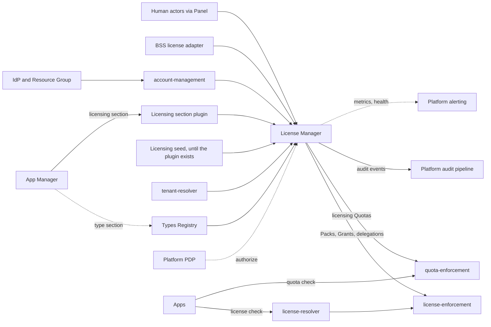

# PRD — License Manager

<!-- toc -->

- [1. Overview](#1-overview)
  - [1.1 Purpose](#11-purpose)
  - [1.2 Background / Problem Statement](#12-background--problem-statement)
  - [1.3 Goals (Business Outcomes)](#13-goals-business-outcomes)
  - [1.4 Glossary](#14-glossary)
- [2. Actors](#2-actors)
  - [2.1 Human Actors](#21-human-actors)
  - [2.2 System Actors](#22-system-actors)
- [3. Operational Concept & Environment](#3-operational-concept--environment)
  - [3.1 Gear-Specific Environment Constraints](#31-gear-specific-environment-constraints)
  - [3.2 Pack states and transitions](#32-pack-states-and-transitions)
- [4. Scope](#4-scope)
  - [4.1 In Scope](#41-in-scope)
  - [4.2 Out of Scope](#42-out-of-scope)
- [5. Functional Requirements](#5-functional-requirements)
  - [5.1 Tenant License Pack lifecycle](#51-tenant-license-pack-lifecycle)
  - [5.2 Materialization](#52-materialization)
  - [5.3 Named seats](#53-named-seats)
  - [5.4 Shared-resource distribution](#54-shared-resource-distribution)
  - [5.5 Child Delegation](#55-child-delegation)
  - [5.6 Authorization, visibility and audit](#56-authorization-visibility-and-audit)
  - [5.7 BSS machine caller](#57-bss-machine-caller)
- [6. Non-Functional Requirements](#6-non-functional-requirements)
  - [6.1 Gear-Specific NFRs](#61-gear-specific-nfrs)
  - [6.2 NFR Exclusions](#62-nfr-exclusions)
- [7. Public Library Interfaces](#7-public-library-interfaces)
  - [7.1 Public API Surface](#71-public-api-surface)
  - [7.2 External Integration Contracts](#72-external-integration-contracts)
- [8. Use Cases](#8-use-cases)
  - [Issue pack](#issue-pack)
  - [Replace pack](#replace-pack)
  - [Apply desired grants from BSS](#apply-desired-grants-from-bss)
  - [Assign seat](#assign-seat)
  - [Adjust user share](#adjust-user-share)
  - [Delegate to a direct child](#delegate-to-a-direct-child)
  - [Recall or preserve on child disable](#recall-or-preserve-on-child-disable)
  - [Revoke pack](#revoke-pack)
  - [Resolve a stuck termination step](#resolve-a-stuck-termination-step)
  - [Review pack state](#review-pack-state)
  - [Bulk seat change](#bulk-seat-change)
  - [User lifecycle cascade](#user-lifecycle-cascade)
  - [Scheduled replacement](#scheduled-replacement)
- [9. Acceptance Criteria](#9-acceptance-criteria)
- [10. Dependencies](#10-dependencies)
  - [10.1 Dependencies](#101-dependencies)
  - [10.2 Sibling capability gaps and open questions](#102-sibling-capability-gaps-and-open-questions)
- [11. Assumptions](#11-assumptions)
- [12. Risks](#12-risks)
- [13. Open Questions](#13-open-questions)
- [14. Traceability](#14-traceability)

<!-- /toc -->

## 1. Overview

### 1.1 Purpose

License Manager owns Tenant License Packs, their Entitlements, and the distribution of that capacity: seats to named users, capacity shares to users, and Child Delegations to direct child tenants. It turns an Entitlement into the Grants and Quotas that other gears enforce, and keeps no enforcement state itself. It owns the licensing catalog, which the App Manager licensing section plugin writes, and needs no runtime call to App Manager (`cpt-cf-license-manager-fr-mapping-capacity-rule`).

| Gear                                                        | Owns                                                                            |
| ----------------------------------------------------------- | ------------------------------------------------------------------------------- |
| License Manager                                             | Tenant License Packs, Entitlements, seat assignments, shares, Child Delegations |
| [license-enforcement](../../license-enforcement/docs/PRD.md) | Grants, Packs, bindings, delegation chains, license checks                      |
| [license-resolver](../../license-resolver/docs/PRD.md)       | The license check contract and the licensing base types                         |
| [quota-enforcement](../../quota-enforcement/docs/PRD.md)     | Quotas, usage counters, admission decisions                                     |
| App Manager        | Platform-wide app registration through section plugins; no tenant rights        |

**Precedence.**

- Where this PRD departs from a LIC epic, this PRD applies until the epic is updated (OQ-24). Sibling PRDs decide their own gears' behavior; a "target state" item binds a sibling only once its open question closes (§10.2).
- The enforcement gears' state decides runtime checks, and License Manager's records decide administration. They differ only during a reported partial state (`cpt-cf-license-manager-nfr-correlated-outcome`) or drift (`cpt-cf-license-manager-fr-reconciliation`).

The LIC epic departures record, kept outside this repository, lists each departure from and addition to the LIC epics.

### 1.2 Background / Problem Statement

No gear owns what a tenant is entitled to, in which version, or how an administrator hands that capacity on. license-enforcement stores Grants and quota-enforcement stores Quotas, but packs are issued ad hoc, seat and share changes can exceed what was purchased, and parent-to-child handover has no safe reduction rule.

The licensing epics define the need in four steps: Tenant License Pack issuance (LIC-1), named seats (LIC-2), shared-resource distribution (LIC-3) and direct-child delegation (LIC-4). All four need one authoritative record per pack version, one correlated outcome across gears, and no reduction below what is already in use.

### 1.3 Goals (Business Outcomes)

The goals cover changes made through License Manager, and only the packs, Grants and Quotas it issued; foreign state is outside them (OQ-28). The gaps that limit them are named.

- 100% of Tenant License Pack, share and Child Delegation changes, and from Phase 2a every seat change, go through License Manager. In Phase 1 the Tenant Administrator binds seats directly in license-enforcement, and License Manager adopts those bindings at Phase 2a (`cpt-cf-license-manager-fr-seat-assign`). Until G11 closes (OQ-33), a tenant administrator can bypass it in license-enforcement; reconciliation reports each such change (`cpt-cf-license-manager-fr-reconciliation`).
- 0 changes made through License Manager that exceed an Entitlement or change its semantics. For user shares this holds only once G5 closes (OQ-27).
- 0 reductions below the protected minimum, except an administrator-confirmed breaking Quota change while G4 is open (OQ-26).
- 0 cross-tenant user exposure in License Manager reads. The license-enforcement grantor read (G10) is outside this gear and is flagged.
- 100% audit completeness: every accepted change made through License Manager commits its audit event together with the change (`cpt-cf-license-manager-fr-audit-store`). A change made directly in a gear has no License Manager audit event; reconciliation reports it as drift (G11).

Success metrics carried from the epics:

- Routine provisioning takes under 15 minutes from opening the Panel workflow to a fully materialized pack (LIC-1). Panel owns the workflow time; License Manager owns the system part (`cpt-cf-license-manager-nfr-pack-latency`).
- A suspended or deactivated user keeps no seat beyond the cascade target in `cpt-cf-license-manager-nfr-change-latency` (LIC-2). This depends on G7 (OQ-32).
- Baseline: today packs are created through Engineering tickets or direct data changes, with no audit trail (LIC-1).

### 1.4 Glossary

| Term                                             | Definition                                                                                                                                                                                                                                                                                                                                                                                                                                                                                                                                 |
| ------------------------------------------------ | ------------------------------------------------------------------------------------------------------------------------------------------------------------------------------------------------------------------------------------------------------------------------------------------------------------------------------------------------------------------------------------------------------------------------------------------------------------------------------------------------------------------------------------------ |
| Entitlement                                      | A paid right or capacity inside a pack. Kinds: capability, seat, capacity.                                                                                                                                                                                                                                                                                                                                                                                                                                                                 |
| Tenant License Pack                              | The versioned set of Entitlements issued to one tenant, with provenance, an effective window and a derived status. Lowercase "pack" means a Tenant License Pack.                                                                                                                                                                                                                                                                                                                                                                           |
| Pack                                             | license-enforcement's set of Grants that share a pack id. License Manager issues one per pack version issued directly to a tenant (target state, OQ-3), and none for a child pack version. Where both meanings appear, the full name is used.                                                                                                                                                                                                                                                                                              |
| Pack version                                     | One version of a Tenant License Pack. A replace creates a new version; the replaced version becomes Superseded when the replacement is applied.                                                                                                                                                                                                                                                                                                                                                                                            |
| Lineage                                          | All versions of one pack, linked by replaces. Its head is the last applied version, and only the head can be replaced (`cpt-cf-license-manager-fr-versioning-status`).                                                                                                                                                                                                                                                                                                                                                                   |
| Live lineage                                     | A pack lineage that is not terminated and has an Effective, Scheduled or not-applied version, active or suspended. It includes a child pack lineage from a Child Delegation. A tenant has at most one (`cpt-cf-license-manager-fr-pack-issue`).                                                                                                                                                                                                                                                                                          |
| Not applied                                      | The record state of every new pack version until its change is applied. Such a version counts as live, is not in force and is never the lineage head. Its exits are listed in `cpt-cf-license-manager-fr-versioning-status`.                                                                                                                                                                                                                                                                                                             |
| Record state, status, admin state, in force      | The three kinds of pack state and the in-force rule (§3.2).                                                                                                                                                                                                                                                                                                                                                                                                                                                                               |
| Change end state                                 | How a change to Grants and Quotas ends: applied, failed or preempted (`cpt-cf-license-manager-nfr-correlated-outcome`).                                                                                                                                                                                                                                                                                                                                                                                                                  |
| Stuck step                                       | A termination step (revoke, expiry, tenant deletion, user cascade or child deletion) that the gears keep rejecting. `cpt-cf-license-manager-fr-stuck-steps` sets its escalation and exits.                                                                                                                                                                                                                                                                                                                                               |
| Settle                                           | The platform operator's internal action that ends a failed change whose effects partly stayed applied. It hands those effects to reconciliation as drift and does not change a BSS result (`cpt-cf-license-manager-fr-desired-grant-apply`).                                                                                                                                                                                                                                                                                             |
| Tenant recorded as deleted                       | A tenant whose status License Manager has read from account-management as `deleted`. Only this status starts the tenant-deletion cascade (`cpt-cf-license-manager-fr-data-lifecycle`).                                                                                                                                                                                                                                                                                                                                                 |
| System cascade                                   | Work License Manager starts itself from a trusted event or its own records: the user lifecycle cascade, the tenant deletion cascade and the parent cascade (`cpt-cf-license-manager-fr-authorization`).                                                                                                                                                                                                                                                                                                                                  |
| Free capacity                                    | What an Entitlement can still give out: its amount minus the tenant's own use, its Child Delegations, its user shares with residuals, and its assigned seats. Accepted changes not yet applied already count (`cpt-cf-license-manager-nfr-concurrency-safety`). For a seat Entitlement it is the free seats.                                                                                                                                                                                                                             |
| Reduction                                        | A decrease of an allocation that stays live: a lower Entitlement amount, cap, user share or delegated quantity. A lower delegated quantity for a child is a decrease (`cpt-cf-license-manager-fr-split-cap`). A termination, such as a revoke or a deletion, is not a reduction.                                                                                                                                                                                                                                                         |
| Protected minimum                                | For a user: the amount the user has consumed or holds in leases. For an Entitlement: the amount handed out to users, including residuals, and to child tenants, plus what the tenant itself consumes or holds in leases. For a Child Delegation: the child tenant's own protected minimum for that Entitlement. For a seat Entitlement: the active bindings and other protected Grant state (LIC-4 AC 11). No reduction goes below it (`cpt-cf-license-manager-nfr-reduction-safety`). Counting without double counting is open (OQ-22). |
| Reclaim                                          | Take back only the part above the protected minimum: of a user share (LIC-3), or of a Child Delegation when the child is disabled (LIC-4). The protected part stays. On child disable, the other choice is Preserve, which leaves the Child Delegation unchanged.                                                                                                                                                                                                                                                                          |
| Recall                                           | The license-enforcement verb that removes delegated sub-grants. License Manager uses it for a seat decrease or a Reclaim.                                                                                                                                                                                                                                                                                                                                                                                                                  |
| End an unapplied first delegate                  | The parent's revoke of a child pack lineage whose version 1 is not applied (`cpt-cf-license-manager-fr-child-delegation`). It is not a Reclaim.                                                                                                                                                                                                                                                                                                                                                                                          |
| Child Delegation                                 | The versioned License Manager record of capacity handed to one direct child tenant; one per parent pack lineage and child. For seats it is backed by a license-enforcement delegation.                                                                                                                                                                                                                                                                                                                                                     |
| Contribution                                     | One source of a user's share, kept with its source (`cpt-cf-license-manager-fr-contribution-model`).                                                                                                                                                                                                                                                                                                                                                                                                                                     |
| Residual                                         | The part of a user's cap above the sum of active contributions. It is left when a contribution's source is removed while the user's protected minimum exceeds the remaining sum (`cpt-cf-license-manager-fr-contribution-model`).                                                                                                                                                                                                                                                                                                        |
| Grant                                            | license-enforcement's record of a right held by a tenant or subject (`cpt-cf-license-manager-fr-grant-materialization`).                                                                                                                                                                                                                                                                                                                                                                                                                 |
| Holder                                           | The tenant that holds a Grant in license-enforcement. Only the holder binds or delegates it.                                                                                                                                                                                                                                                                                                                                                                                                                                               |
| Quota                                            | quota-enforcement's cap on one metric for one tenant or user. License Manager writes Quotas with `source=licensing`.                                                                                                                                                                                                                                                                                                                                                                                                                     |
| Staged replacement                               | A Phase 2 replacement whose changes both enforcement gears hold for a later start (`cpt-cf-license-manager-fr-scheduled-replace`).                                                                                                                                                                                                                                                                                                                                                                                                       |
| Source key                                       | The identity of one external source (namespace, resource tenant and assignment) that a machine caller binds to one pack lineage. Never a subscription id.                                                                                                                                                                                                                                                                                                                                                                                  |
| License Manager platform operator                | The person who runs License Manager in a deployment (`cpt-cf-license-manager-actor-platform-operator`); "operator" means only this person. "Gear owner" means the team that runs a sibling gear. "Operator Quotas" and "operator-level scope" are quota-enforcement terms.                                                                                                                                                                                                                                                               |
| Licensing catalog                                | License Manager's versioned record of each application's licensable features, their dependencies, and their Resource, Subject and Metric mappings. The App Manager licensing section plugin writes it; until that plugin exists, the licensing seed loads it (`cpt-cf-license-manager-fr-mapping-capacity-rule`).                                                                                                                                                                                                                        |
| License Management                               | The team that owns the content of the licensing seed (APS-5786). Not this gear, and not the license-enforcement actor of the same name (OQ-3).                                                                                                                                                                                                                                                                                                                                                                                             |
| PDP                                              | The platform policy decision point that authorizes callers and gives tenant scope.                                                                                                                                                                                                                                                                                                                                                                                                                                                         |
| LIC-1 to LIC-4                                   | The four licensing epics this PRD starts from: Tenant License Pack issuance, named seats, shared-resource distribution and direct-child delegation. "LIC-n AC / UC / Inv" names an acceptance criterion, use case or invariant of an epic. §14 links them.                                                                                                                                                                                                                                                                                |
| Multi-Tenant Administrator, Tenant Administrator | Dictionary terms: Portfolio Administrator and Organization Administrator (§2.1).                                                                                                                                                                                                                                                                                                                                                                                                                                                          |
| Other abbreviations                              | GTS: the platform type system for type ids. CEL: the expression language of quota-enforcement policies. QE-P1, QE-P2: quota-enforcement's own release phases. E-U0n, ENT-D-n: open items and decisions in the BSS Entitlements PRD. Proctor: a Constructor app used as the epics' example.                                                                                                                                                                                                                                                 |

#### Shared terms

Only the concepts whose words differ between gears are listed. License Manager uses the term in the second column.

| Concept                        | Term used here                                    | license-enforcement         | quota-enforcement                           | BSS Entitlements                                                                                                                                               |
| ------------------------------ | ------------------------------------------------- | --------------------------- | ------------------------------------------- | -------------------------------------------------------------------------------------------------------------------------------------------------------------- |
| A paid right inside a pack     | Entitlement                                       | Grant (materialized)        | Quota (materialized)                        | Capability or seat: grant in a `DesiredGrantSet`. Capacity: `DesiredQuotaSet` on the BSS quota path; whether License Manager is its target is open (OQ-12) |
| A tenant's set of rights       | Tenant License Pack                               | Pack (one per pack version) | —                                          | —                                                                                                                                                             |
| Seat to a user (LIC-2)         | assign, unassign                                  | bind, unbind                | —                                          | —                                                                                                                                                             |
| User share (LIC-3)             | adjust, reclaim                                   | —                          | Quota update                                | —                                                                                                                                                             |
| Parent to direct child (LIC-4) | delegate, recall, preserve                        | delegate, recall            | Quota create and update                     | —                                                                                                                                                             |
| Pack lifecycle                 | issue, replace, revoke, renew, suspend, reinstate | same verbs on root Grants   | Quota create, update, deactivate            | posture Granted, Restricted, Revoked                                                                                                                           |
| Source of one pack lineage     | source key                                        | —                          | —                                          | assignment, one per logical right; the mapping is open (OQ-44)                                                                                                 |
| Writer of licensing Quotas     | License Manager                                   | —                          | Quota Manager (`source=licensing`, OQ-12) | quota adapter path (OQ-12)                                                                                                                                     |

## 2. Actors

> **Note**: Stakeholder needs are managed at project/task level by steering committee. Document **actors** (users, systems) that interact with this gear.

### 2.1 Human Actors

#### Multi-Tenant Administrator

**ID**: `cpt-cf-license-manager-actor-multi-tenant-admin`

- **Role**: Acts over other tenants in two capacities, each with its own permissions (`cpt-cf-license-manager-fr-authorization`). As issuer, from the System or Management tenant, it issues and manages packs for other tenants (LIC-1). As a parent-tenant administrator, it delegates capacity to the parent's direct children and sees only per-child aggregates (LIC-4).
- **Needs**: Packs that cannot exceed what was sold, an immediate stop, and safe handover to child tenants.

#### Tenant Administrator

**ID**: `cpt-cf-license-manager-actor-tenant-admin`

- **Role**: Assigns seats (LIC-2) and adjusts user shares (LIC-3) inside one tenant. A child tenant's administrator is a Tenant Administrator of the child and works only inside the child pack (LIC-4 AC 14).
- **Needs**: See own capacity, hand it to users, and get a warning before seats run out.

#### Support / Auditor

**ID**: `cpt-cf-license-manager-actor-support-auditor`

- **Role**: Reads packs, history, materialization health and audit entries.
- **Needs**: Explain why a tenant or user has or lacks a right.

#### License Manager platform operator

**ID**: `cpt-cf-license-manager-actor-platform-operator`

- **Role**: Runs License Manager in a deployment and receives its operator signals through platform alerting. Reads materialization health and stuck steps, with no user id. Confirms or releases a stuck step (`cpt-cf-license-manager-fr-stuck-steps`), and settles a partial change as an internal action (`cpt-cf-license-manager-fr-desired-grant-apply`). Each action names its object, carries a reason and is audited.
- **Needs**: A safe, audited exit for a termination step that the gears keep rejecting.

#### End User

**ID**: `cpt-cf-license-manager-actor-end-user`

- **Role**: Reads their own seat assignments and their own share state inside their tenant (LIC-2 AC 16, LIC-3 AC 17). Has no mutation access.
- **Needs**: See their own rights and remaining capacity before a check is denied.

### 2.2 System Actors

Panel, the BSS license adapter and the licensing section plugin call License Manager, and account-management is its event source. The other system actors are dependencies; their contracts are in §7.2.

#### Panel

**ID**: `cpt-cf-license-manager-actor-panel`

- **Role**: Administration UI for the human actors.

#### BSS license adapter

**ID**: `cpt-cf-license-manager-actor-bss-license-adapter`

- **Role**: Machine caller for BSS Entitlements, which derives desired grants from committed subscriptions.

#### license-enforcement

**ID**: `cpt-cf-license-manager-actor-license-enforcement`

- **Role**: Receives Packs, Grants, binds and delegations, and returns their state, including binding counts.

#### quota-enforcement

**ID**: `cpt-cf-license-manager-actor-quota-enforcement`

- **Role**: Receives licensing Quotas, and returns snapshots and previews.

#### tenant-resolver

**ID**: `cpt-cf-license-manager-actor-tenant-resolver`

- **Role**: Confirms that a delegation target is a direct child. Answers the tenant reads of the tenant-deletion cascade (`cpt-cf-license-manager-fr-data-lifecycle`).

#### Types Registry

**ID**: `cpt-cf-license-manager-actor-types-registry`

- **Role**: Holds the Resource, Subject and Metric types that License Manager validates, and their availability per tenant. The licensing base types come from license-resolver.

#### Licensing section plugin

**ID**: `cpt-cf-license-manager-actor-mapping-store`

- **Role**: The App Manager section plugin for the licensing section of an application manifest. On seed it writes the application's features, dependencies and mappings into the licensing catalog; on uninstall it marks them inactive. It is planned for the next quarter; until then the licensing seed (APS-5786) loads the catalog at deploy (G21).

#### Platform PDP

**ID**: `cpt-cf-license-manager-actor-pdp`

- **Role**: Authorizes every caller and gives its tenant scope, including the scope of License Manager's service identity in other tenants (OQ-14). System work takes its scope from its trigger (`cpt-cf-license-manager-fr-authorization`).

#### account-management

**ID**: `cpt-cf-license-manager-actor-account-management`

- **Role**: Owns tenants and tenant status; status `deleted` starts the tenant-deletion cascade (`cpt-cf-license-manager-fr-data-lifecycle`). Coordinates user operations over the platform IdP, the system of record for users in a tenant. Resource Group holds group membership. It has no user status or user lifecycle events (G7), and no hook before a tenant is suspended (G8).

## 3. Operational Concept & Environment

License Manager is not on the check path. A License Manager outage stops administration; a failure in the middle of a change can leave a partial state that checks see until recovery completes (`cpt-cf-license-manager-nfr-correlated-outcome`). Runtime, lifecycle and integration patterns are inherited from [docs/ARCHITECTURE_MANIFEST.md](../../../../docs/ARCHITECTURE_MANIFEST.md) and [guidelines/](../../../../guidelines/).

### 3.1 Gear-Specific Environment Constraints

- Issuing runs only in trusted deployments. An untrusted installation has no issue or widen path.
- In an untrusted installation, no operation admits unsigned state, duplicates a Grant or widens signed holder permissions; an untrusted installation activates only through a valid License Certificate. Flagged (§10.2, G17): this guarantee covers Grant-backed rights only.

### 3.2 Pack states and transitions

A pack version has three kinds of state, and each changes for a different reason. This summary is not normative: `cpt-cf-license-manager-fr-versioning-status` owns the rules, and DESIGN holds the full transition table.

| Kind         | Values                                    | What changes it                                                                                                                    |
| ------------ | ----------------------------------------- | ---------------------------------------------------------------------------------------------------------------------------------- |
| Record state | not applied                               | Every new version has it from acceptance until its change is applied. It then has only a status and an admin state.                |
| Status       | Scheduled, Effective, Expired, Superseded | Dates alone for Scheduled, Effective and Expired; nothing is stored when a date passes. Superseded follows an applied replacement. |
| Admin state  | active, suspended, terminated             | Verbs and cascades only. It belongs to the lineage, so a replacement inherits it. BSS calls terminated the posture Revoked.        |

A pack is in force only when its version is Effective and its admin state is active.

## 4. Scope

### 4.1 In Scope

Priority `p1` covers Phases 1 and 1b; `p2` covers Phases 2a, 2b, 2c and 2. A bare "Phase 2" means the scheduled-replacement phase, not 2a–2c. Each requirement heading names its phase.

The "Needs" column lists the open questions that block each phase, as the "Blocks" column of the register marks them (§10.2, §13). Open questions that a phase needs but that do not block it are listed separately.

| Phase | Content                                                                                                                                                                | Needs                                                                                                                                                                                                                                                                                      |
| ----- | ---------------------------------------------------------------------------------------------------------------------------------------------------------------------- | ------------------------------------------------------------------------------------------------------------------------------------------------------------------------------------------------------------------------------------------------------------------------------------------ |
| 1     | Issue, replace, revoke, read, derived status, materialization into Grants and Quotas, reconciliation and the tenant-deletion cascade; replacements take effect at once | Tenant status read from account-management. Blocking: OQ-1, OQ-2, OQ-3, OQ-9 (revoke), OQ-12 (writer role), OQ-14. Needed, does not block: OQ-5 (Quotas from other sources), OQ-42 (deployed tenant-resolver plugin and License Manager's scope), OQ-45 (license-enforcement barrier mode) |
| 1b    | BSS license adapter as machine caller: source fencing, desired-grant apply, preparation readiness                                                                      | Phase 1; timing set by OQ-13. Blocking: OQ-11, OQ-12 (BSS quota path), OQ-13, OQ-17, OQ-21, OQ-40, OQ-44. Needed, does not block: OQ-39, OQ-43                                                                                                                                             |
| 2a    | Named seats; renew, suspend and reinstate                                                                                                                              | Phase 1. Blocking: OQ-16, OQ-30, OQ-32 (G7), OQ-33 (G10)                                                                                                                                                                                                                                   |
| 2b    | Shared-resource distribution and the per-seat default                                                                                                                  | 2a. Blocking: OQ-5, OQ-22, OQ-27, OQ-32 (G7)                                                                                                                                                                                                                                               |
| 2c    | Child Delegation                                                                                                                                                       | 2a and the 2b aggregate reads. Blocking: OQ-6, OQ-22, OQ-27, OQ-30, OQ-31, OQ-33 (G10)                                                                                                                                                                                                     |
| 2     | Scheduled replacement that both enforcement gears apply at one instant                                                                                                 | Phase 1 and sibling staging. Blocking: OQ-15. Independent of 2a–2c                                                                                                                                                                                                                        |

Revoke, renew, suspend and reinstate are not in the LIC epics. They are proposed additions (OQ-9): revoke in Phase 1 because LIC-1 leaves no other way to end a pack, the others in Phase 2a.

In every phase, License Manager sends its audit events through the platform audit pipeline, and exposes each operator condition as a metric or health signal.

### 4.2 Out of Scope

- License Certificate issue or import, and BSS v2 fulfillment outputs.
- Subscriptions, Depot or Orders as direct callers.
- Multi-hop delegation, recipient rules, and an acceptance step for delegations.
- Per-user Proctor budgets.
- Commerce, pricing and billing.
- App registration through App Manager, and the licensing section plugin itself. License Manager defines the catalog contract that the plugin writes to.
- The content of the licensing seed, which License Management delivers in APS-5786. License Manager defines the catalog format and loads the seed (G21).
- Usage metering, debit or credit of Quotas, and operator Quotas.
- Runtime license and quota checks.
- Import or adoption of Grants and `source=licensing` Quotas that License Manager did not issue (OQ-28).
- Audit storage, tamper evidence and retention. The platform audit target owns them (`cpt-cf-license-manager-fr-audit-store`).
- Alert delivery and alert state. Platform alerting routes License Manager's metrics and health signals.
- A PDP health probe. A gear's `ServiceUnavailable` answer is the outage signal.
- Deciding that a tenant is deleted. account-management owns tenant status (`cpt-cf-license-manager-fr-data-lifecycle`).
- How License Manager stores its records: the data model, the schema and the storage technology. DESIGN decides them; this PRD sets only durability (`cpt-cf-license-manager-nfr-recovery`) and retention (`cpt-cf-license-manager-fr-data-lifecycle`).

## 5. Functional Requirements

> **Testing strategy**: All requirements verified via automated tests (unit, integration, e2e) targeting 90%+ code coverage unless otherwise specified.

### 5.1 Tenant License Pack lifecycle

#### Issue Tenant License Pack (Phase 1)

- [ ] `p1` - **ID**: `cpt-cf-license-manager-fr-pack-issue`

The system **MUST** issue a Tenant License Pack to one tenant whose status in account-management is active, with one or more Entitlements. A suspended or deleted tenant, or one whose status cannot be read, is rejected. The request names the target tenant, `effective_from`, `effective_until`, provenance, a reason and an idempotency key. The first accepted create is version 1, which is "not applied" until its issue is applied (`cpt-cf-license-manager-fr-versioning-status`). Replaying the same key and payload returns the same result; reusing the key with different content is rejected.

- **One live lineage.** An issue to a tenant that has a live lineage (§1.4) is rejected with a typed reason; changes go through replace. A terminated or Expired lineage is not live, so a new pack can be issued, also inside the old window.
- **Outstanding revoke.** An issue is rejected with a typed reason while any step of an earlier revoke for the tenant is outstanding (`cpt-cf-license-manager-fr-stuck-steps`).
- **Foreign state.** An issue or replace is rejected with a typed reason while the tenant holds foreign state that overlaps the pack. Foreign state is a `source=licensing` Quota on the metric of one of its capacity Entitlements, or a Grant on the Resource of one of its capability or seat Entitlements. Grants and Quotas that License Manager issued for any lineage are never foreign state. An active Quota from another `source` on a licensed metric of the tenant is not foreign state: it is reported in materialization health, never adopted, and does not block an issue (OQ-5). The gear owner that holds the foreign state removes it; License Manager never adopts or removes it (OQ-28). Flagged (§10.2, G23): until it closes, this check covers foreign licensing Quotas only.
- **Failed first issue.** It ends only in the ways that `cpt-cf-license-manager-fr-versioning-status` lists, such as a revoke. Which revoke leaves a BSS source key open is set in `cpt-cf-license-manager-fr-source-fencing`.

Flagged (§10.2, G33): license-enforcement accepts a holder only in the caller's tenant or a descendant; until OQ-45 closes, an issue to a self-managed tenant is rejected with a typed reason.

Several source-bound lineages per tenant are open (OQ-11). The one-live-lineage rule is stricter than LIC-1 UC-1, which forbids only an overlapping effective version, and LIC-4 assumes one pack source per tenant.

- **Rationale**: The one-live-lineage and foreign-state rules are License Manager additions (listed in the LIC epic departures record). Source: LIC-1 AC 1-2, 5, 16, LIC-1 UC-1 preconditions.
- **Actors**: `cpt-cf-license-manager-actor-multi-tenant-admin`, `cpt-cf-license-manager-actor-bss-license-adapter`, `cpt-cf-license-manager-actor-account-management`

#### Validate Entitlement references (Phase 1)

- [ ] `p1` - **ID**: `cpt-cf-license-manager-fr-reference-validation`

The system **MUST** resolve every Resource, Subject and Metric reference in Types Registry on issue and replace, and reject the whole request if any reference is missing, inactive, not available to the tenant (as Types Registry reports it) or of the wrong base type, or if a Subject is incompatible with its Resource or Metric. Resource and Subject references **MUST** be licensing types (`gts.cf.core.lic.*`). A Metric reference **MUST** be a metric that quota-enforcement accepts (`gts.cf.core.qe.metric_type.v1~`), with a subject projection quota-enforcement admits. An Entitlement pins the contract version it was issued against. A capacity Entitlement keeps metric, unit, quota type and period exactly as registered, and only for metrics that quota-enforcement gates. Its quantity is a non-negative integer in the registered metric unit. A `consumption` Entitlement needs a registered period, and an `allocation` Entitlement carries none. A new app needs no code change. Flagged (§10.2, G18): until it closes, the unit is taken from the mapping.

- **Rationale**: Prevents packs that can never be enforced. Source: LIC-1 AC 3-4, LIC-1 Invariants 5-6, LIC-3 AC 3-4, APS-5786 scope 2-3, `cpt-cf-license-enforcement-fr-type-references`, `cpt-cf-quota-enforcement-fr-metric-identity-validation`.
- **Actors**: `cpt-cf-license-manager-actor-types-registry`

#### Licensing catalog and mapping reference (Phase 1)

- [ ] `p1` - **ID**: `cpt-cf-license-manager-fr-mapping-capacity-rule`

The system **MUST** keep a licensing catalog: for each application, its licensable features, their dependencies, and their Resource, Subject and Metric mappings. Each catalog version has an id, version and checksum. The catalog **MUST** accept writes from the App Manager licensing section plugin and, until that plugin exists, from the licensing seed, through one write contract. On every issue and replace, the system **MUST** resolve the active catalog version and record its id, version and checksum on the pack version. A missing, inactive, incompatible or ambiguous mapping rejects the request. The system resolves feature dependencies server-side: for example, selecting `proctor.advanced` resolves `proctor.foundation` plus one `proctor-sessions` capacity mapping, and the administrator still supplies the integer quantity and period. The system **MUST** let Panel read the licensable contracts and the active catalog before submitting. Flagged (§10.2, G21): the seed and the licensing section must follow the catalog contract, which blocks Phase 1.

- **Rationale**: App Manager knows only an opaque application id and version, and each section plugin owns the data of its section. Source: LIC-1 AC 18-19, LIC-1 UC-1 step 2; App Manager PRD (section plugins).
- **Actors**: `cpt-cf-license-manager-actor-mapping-store`, `cpt-cf-license-manager-actor-multi-tenant-admin`

#### One capacity Entitlement per metric and period (Phase 1)

- [ ] `p1` - **ID**: `cpt-cf-license-manager-fr-one-capacity-rule`

The system **MUST** reject an issue or replace that would give a tenant two capacity Entitlements for the same metric and period with overlapping effective windows, including across source-bound lineages if OQ-11 allows several. Superseded, Expired and terminated versions, and the version being replaced, do not count. Two requests never both pass this check, also when both are accepted before either applies (`cpt-cf-license-manager-nfr-concurrency-safety`).

- **Rationale**: Source: LIC-1 AC 19; extends LIC-1 AC 20 from Quotas to capacity Entitlements.
- **Actors**: `cpt-cf-license-manager-actor-multi-tenant-admin`, `cpt-cf-license-manager-actor-bss-license-adapter`

#### Pinned contracts survive app uninstall and re-seed (Phase 1)

- [ ] `p1` - **ID**: `cpt-cf-license-manager-fr-pinned-contracts`

The system **MUST** keep an Entitlement working on its pinned contract and catalog versions after App Manager uninstalls or re-seeds the app, reject new issue and replace requests against an inactive contract or catalog entry, and show affected packs in materialization health. An uninstall or re-seed marks catalog entries inactive and never deletes a version that a pack still references.

- **Rationale**: App Manager uninstall asks every section plugin to remove the app, so a live pack must not depend on the current registration. Source: LIC-1 AC 3, 18, LIC-1 risks (mapping evidence retained for pack history).
- **Actors**: `cpt-cf-license-manager-actor-types-registry`, `cpt-cf-license-manager-actor-support-auditor`

#### Version immutability and derived status (Phase 1)

- [ ] `p1` - **ID**: `cpt-cf-license-manager-fr-versioning-status`

The system **MUST** keep the Entitlements and amounts of every pack version unchanged and allow at most one effective version per pack lineage at any instant. It **MUST** derive Scheduled, Effective and Expired from dates alone, separately from admin state. The only time rule is `effective_from ≤ now < effective_until`, and no timer changes stored state. Superseded follows an applied replace. A pack is in force only when it is Effective and active.

- **Not applied.** Every new version, version 1 included, has the record state "not applied" until its change is applied. For a child pack, that change is its delegate. A not-applied version is neither Scheduled nor Effective; a not-applied version 1 keeps its lineage live (§1.4).
- **Lineage head.** A not-applied version is never the lineage head. The head is the last applied version, and a replace names it (`cpt-cf-license-manager-fr-pack-replace`).
- **Supersede on apply.** The base becomes Superseded only when its replacement is applied. In License Manager's records a failed or preempted replacement is recorded as such, never comes into force, and the base stays authoritative. In license-enforcement a replace step that applied cannot be undone: its Pack stays in force, the partial state is reported (`cpt-cf-license-manager-nfr-correlated-outcome`), and the next replace or revoke targets that Pack.
- **Exits.** A not-applied version **MUST** leave that state only in these ways: its change is applied; a replacement version ends failed or preempted; or a revoke, the end of an unapplied first delegate, a parent revoke cascade, or a child or tenant deletion terminates its lineage. A failed first issue therefore keeps version 1 not applied until one of those terminations.
- **Phase 1 activation model.** A version may start in the future only when nothing of its lineage is in force: the first version, or a replacement of a version that has not started. Both enforcement gears apply it from that start by clock. A replacement of an Effective version takes effect when it is applied (`cpt-cf-license-manager-fr-pack-replace`). Scheduled replacement comes in Phase 2 (`cpt-cf-license-manager-fr-scheduled-replace`). This departs from LIC-1 AC 7 and UC-2 step 5 (OQ-24).

Admin state **MUST** belong to the lineage: a replacement inherits it, so a replace never un-suspends a pack. Superseded and terminated **MUST** be final, and an Expired lineage is not renewed. A request that would change a final state, or renew an Expired lineage, is rejected with a typed reason. Extending the end date in place by renew is proposed (OQ-9). §3.2 summarizes these states; DESIGN holds the full transition table.

- **Rationale**: A stable audit trail and one answer to "what is in force". Source: LIC-1 AC 6, 11-12, LIC-1 Invariants 3-4.
- **Actors**: `cpt-cf-license-manager-actor-multi-tenant-admin`, `cpt-cf-license-manager-actor-support-auditor`

#### Expiry cutoff (Phase 1)

- [ ] `p1` - **ID**: `cpt-cf-license-manager-fr-expiry-cutoff`

The system **MUST** give both enforcement gears the same exclusive cutoff for new use: `effective_until`.

- license-enforcement already ends a Grant's validity at an exclusive `expires_at`. License Manager **MUST** issue Grants without a grace window (`grace_until` unset), so no Grant authorizes after `effective_until`.
- Target state, pending OQ-2: quota-enforcement evaluates the cutoff at each request. At or after that instant the pack admits no new debit or lease, even if its Quota record is still active, under every supported quota policy. Expiry alone allows a still-valid lease acquired before the cutoff to be released or committed afterward, up to the reserved amount.

Flagged (§10.2, G15): a quota window includes its end instant, and `cel` policies may ignore windows.

- **Rationale**: Source: LIC-1 AC 11, LIC-1 Invariant 3.
- **Actors**: `cpt-cf-license-manager-actor-license-enforcement`, `cpt-cf-license-manager-actor-quota-enforcement`

#### Replace Tenant License Pack (Phase 1)

- [ ] `p1` - **ID**: `cpt-cf-license-manager-fr-pack-replace`

The system **MUST** replace a pack by creating a new version against the lineage head, the last applied version (`cpt-cf-license-manager-fr-versioning-status`). It carries over everything or rejects as a whole. A replace that names any other version is rejected as a stale base. A lineage whose version 1 is not applied has no head, so a replace of it is rejected with a typed reason; the rejection does not affect its first issue. A terminated or Expired lineage cannot be replaced; a new pack is issued instead. An added or changed Entitlement that overlaps foreign state is rejected (`cpt-cf-license-manager-fr-pack-issue`).

- **Phase 1 immediate replace.** A replacement of an Effective version takes effect at once. It is validated, its Grant and Quota changes are applied, and it is Effective from the instant the last change is applied. Until then the base stays authoritative in License Manager's records and reads. Such a replace cannot set a later start; it is rejected with a typed reason until Phase 2 (`cpt-cf-license-manager-fr-scheduled-replace`).
- **Not started.** A version that has not started may be replaced with a start of now or later, because nothing of the lineage is in force yet.
- **Running change.** A replace accepted while a change of the lineage is running supersedes it: that change ends as preempted, naming the replace. The replace is validated on state read from the gears. A rejected replace leaves the running change untouched. No effect of the preempted change remains once the replace is applied; reconciliation reports any residue (`cpt-cf-license-manager-fr-reconciliation`).
- **Seats, shares and delegations.** Seats follow `cpt-cf-license-enforcement-fr-precedence`: each binding moves to a compatible successor Grant in the same operation, or the whole replace is rejected. Shares and Child Delegations carry over only if the new capacity covers them; otherwise the system names the shortfall.
- **Reductions.** A new cap below the current protected minimum is rejected, naming the shortfall; License Manager never issues credits to make room. Removing a capacity Entitlement is a reduction to zero under the same rule (LIC-1 AC 10, Invariant 9), so it is allowed once usage and leases are zero. A replace never debits or credits usage; Quota effects follow `cpt-cf-license-manager-fr-quota-materialization`.

Flagged (§10.2, G2, G4): Phase 1 replacements take effect at once, and a breaking Quota change ends leases and restarts usage.

- **Rationale**: Neither enforcement gear can stage a change for a later instant, so Phase 1 replacements take effect at once (OQ-15, OQ-24). Source: LIC-1 AC 6-12, LIC-1 UC-2, `cpt-cf-license-enforcement-fr-precedence` (no denial window).
- **Actors**: `cpt-cf-license-manager-actor-multi-tenant-admin`

#### Revoke Tenant License Pack (Phase 1)

- [ ] `p1` - **ID**: `cpt-cf-license-manager-fr-pack-revoke`

The system **MUST** revoke a pack as an emergency stop: the whole lineage becomes terminated, whether or not its version has started or been applied. Its Grants are revoked and its Quotas are deactivated, and active leases under those Quotas end with the deactivation. From Phase 2, a revoke also cancels a staged replacement.

- **Revoke first.** A revoke is accepted without waiting for a running change or a validation in progress. It preempts any change in flight on the lineage, including one that a restart resumes. That change applies no further step and ends as preempted. Revoke latency counts from the request (`cpt-cf-license-manager-nfr-pack-latency`).
- **Roll forward.** Once a revoke is accepted, License Manager's records show the lineage terminated and reads show no pack in force. Remaining steps are retried until done, and no applied step is undone. A revoke ends only as applied (`cpt-cf-license-manager-nfr-correlated-outcome`); a step the gears keep rejecting follows `cpt-cf-license-manager-fr-stuck-steps`.
- **Late effects.** A revoke owns every effect of its terminated lineage, including effects of a change it preempted and late ones, such as from a gear call in flight or a lost reply. When reconciliation finds such an effect, the revoke resumes and removes it (`cpt-cf-license-manager-fr-reconciliation`). A revoke is complete when no such effect is known.
- **Outstanding steps.** Until every step of the revoke is done or confirmed by the operator (`cpt-cf-license-manager-fr-stuck-steps`), a new issue to the tenant is rejected (`cpt-cf-license-manager-fr-pack-issue`).
- **Rationale**: Proposed addition (OQ-9). LIC-1 has no revoke, and LIC-1 AC 2 (at least one Entitlement) and AC 11-12 leave no other way to end a pack. Source: LIC-1 AC 2, 11-12.
- **Actors**: `cpt-cf-license-manager-actor-multi-tenant-admin`

#### Renew Tenant License Pack (Phase 2a)

- [ ] `p2` - **ID**: `cpt-cf-license-manager-fr-pack-renew`

The system **MUST** renew a pack by extending the end date of its Effective version, with nothing else changed, and log each extension. An Expired or terminated pack is not renewed; a new pack is issued instead.

- **Rationale**: Proposed addition (OQ-9). BSS Entitlements also keeps one assignment on continuation. Source: LIC-1 AC 11, BSS Entitlements PRD (quota projection, renewal).
- **Actors**: `cpt-cf-license-manager-actor-multi-tenant-admin`

#### Suspend and reinstate Tenant License Pack (Phase 2a)

- [ ] `p2` - **ID**: `cpt-cf-license-manager-fr-pack-suspend-reinstate`

The system **MUST** suspend a whole pack so its capacity is not usable, and reinstate it to the prior capacity and usage from its Entitlements and shares. quota-enforcement has no suspend or reactivate operation and rejects a cap below current usage, so keeping usage and leases across suspend and reinstate is target state, pending OQ-16. From Phase 2c, reinstate also applies any parent Quota raise deferred while the pack was suspended (`cpt-cf-license-manager-fr-child-disable`).

- **Rationale**: Proposed addition (OQ-9). Source: BSS Entitlements PRD (posture Restricted), `cpt-cf-license-enforcement-fr-grant-lifecycle`.
- **Actors**: `cpt-cf-license-manager-actor-multi-tenant-admin`

#### Scheduled replacement (Phase 2)

- [ ] `p2` - **ID**: `cpt-cf-license-manager-fr-scheduled-replace`

The system **MUST** accept a replacement of an Effective version with a later start. The new version **MUST** take effect in both enforcement gears at that instant by clock, with no License Manager action at the start. Target state, pending OQ-15; it needs time-gated staging in both gears:

- **Sibling staging.** license-enforcement accepts a replace with an `effective_at` time and moves each binding to its successor Grant at that instant. quota-enforcement accepts a change scheduled on an existing Quota, so the Quota keeps its id, counter and leases.
- **Staging.** Before it confirms the replace, the system checks the protected minimum and stages every Grant and Quota change. If staging fails, nothing staged remains, the current version stays in force, and the failure is visible.
- **Start.** The start falls after now and no later than the current version's `effective_until`, so no instant is left without a version in force.
- **One staged replacement.** A lineage has at most one; replacing the staged version replaces its staging, and a revoke cancels it. Meanwhile seats, shares and Child Delegations grow only within the lower of the current and staged amounts.
- **After staging exists.** An immediate replace uses staging with a start a moment ahead, so every pack change takes effect at one instant. What a gear does when usage passes a lowered cap before the start is agreed under OQ-15.
- **Rationale**: Plan changes at a renewal date and BSS continuations need a later start. This restores LIC-1 AC 7 and UC-2 step 5 in full. Source: LIC-1 AC 7-8, 11, LIC-1 UC-2.
- **Actors**: `cpt-cf-license-manager-actor-multi-tenant-admin`, `cpt-cf-license-manager-actor-bss-license-adapter`, `cpt-cf-license-manager-actor-license-enforcement`, `cpt-cf-license-manager-actor-quota-enforcement`

### 5.2 Materialization

#### Materialize Grants (Phase 1)

- [ ] `p1` - **ID**: `cpt-cf-license-manager-fr-grant-materialization`

The system **MUST** issue one license-enforcement Pack per pack version issued directly to a tenant, with a tenant-wide Grant per capability Entitlement and one unbound subject Grant per seat. Every root Grant and sub-grant **MUST** be issued with no acceptance requirement, and seat Grants with bind permission for the holder (OQ-30). Phase 1 seat Grants **MUST** be issued as non-delegable. From Phase 2c, a replace re-issues them as delegable one level (`cpt-cf-license-manager-fr-child-delegation`); which Entitlement authorizes this is open (OQ-6), and so are the holder permissions (OQ-30). Each Grant carries the version's window, with no grace window (`cpt-cf-license-manager-fr-expiry-cutoff`), so a version that starts later becomes usable at its start with no further call. Every Grant and Quota is traceable to `(pack_id, pack_version, entitlement_id)`, and replaying a request never duplicates either. Child pack versions follow `cpt-cf-license-manager-fr-child-delegation`.

- **Rationale**: Grants are what license-enforcement checks. Source: LIC-1 AC 7, LIC-1 Invariant 7, LIC-2 AC 4-5, LIC-4 AC 6, `cpt-cf-license-enforcement-fr-pack`, `cpt-cf-license-enforcement-fr-grant-lifecycle`.
- **Actors**: `cpt-cf-license-manager-actor-license-enforcement`

#### Materialize Quotas (Phase 1)

- [ ] `p1` - **ID**: `cpt-cf-license-manager-fr-quota-materialization`

The system **MUST** keep one active tenant Quota with `source=licensing` per capacity Entitlement, carrying the version's effective window. Each pack event **MUST** have the outcome below in quota-enforcement. DESIGN sets the quota-enforcement calls.

| Pack event                                                                       | Outcome in quota-enforcement                                                              | Usage and leases                                                                                    |
| -------------------------------------------------------------------------------- | ----------------------------------------------------------------------------------------- | --------------------------------------------------------------------------------------------------- |
| Issue                                                                            | A Quota with the version's window                                                         | —                                                                                                  |
| Replace that keeps an Entitlement's metric, unit, quota type, period and subject | The same Quota, with the new cap and window                                               | Kept                                                                                                |
| Replace that adds an Entitlement                                                 | A new Quota                                                                               | —                                                                                                  |
| Replace that removes an Entitlement                                              | Rejected while usage or leases remain; otherwise the Quota is inactive, with no successor | None left to end                                                                                    |
| Replace that changes metric, unit, quota type, period or subject                 | A new Quota replaces the old one                                                          | Usage restarts at zero; old usage stays readable and is not carried over; active leases end (OQ-26) |
| Revoke                                                                           | The tenant Quota and every user Quota of the pack are inactive                            | Active leases end                                                                                   |
| Expiry                                                                           | None; the window ends at `effective_until`                                              | Settlement follows OQ-2                                                                             |
| Renew (Phase 2a)                                                                 | The same Quota, with the new window                                                       | Kept                                                                                                |
| Suspend, reinstate (Phase 2a)                                                    | Open (OQ-16)                                                                              | Kept                                                                                                |
| Scheduled replace (Phase 2)                                                      | As for replace, from the new version's start (OQ-15)                                      | As for replace                                                                                      |

Before it applies a replace, the system **MUST** recheck the protected minimum (`cpt-cf-license-manager-nfr-reduction-safety`): usage against each new cap, and the amount handed out to users and child tenants against each new Entitlement amount. quota-enforcement's own cap check stays the final check. A breaking change that restarts usage or ends leases is shown to the administrator before confirmation and recorded in its audit entry. During such a change the tenant **MUST** never hold two active licensing Quotas for one metric. Checks in between fail closed when no other Quota applies to that tenant and metric (OQ-5).

Flagged (§10.2, G4): a breaking Quota change ends active leases and restarts usage at zero.

- **Rationale**: Usage stays with quota-enforcement. Source: LIC-1 AC 4, 7, 20, LIC-3 AC 5, `cpt-cf-quota-enforcement-fr-quota-lifecycle`, `cpt-cf-quota-enforcement-fr-bulk-quota-crud`.
- **Actors**: `cpt-cf-license-manager-actor-quota-enforcement`

#### Pack read view and aggregate reads (Phase 1)

- [ ] `p1` - **ID**: `cpt-cf-license-manager-fr-read-views`

The system **MUST** return a pack read view with versions, history, derived status and materialization health, and no pricing. When no pack is effective, the view says so and infers no rights from commerce or catalog data. When audit or materialization data is unavailable, the view marks the data as partial.

- **Materialization health** lists, for each Grant and Quota, the value License Manager expects, the value read from the gear, how long they have differed and the time of the last reconciliation. It also lists partial states, drift and the tenant's foreign state, also for a tenant with no pack (`cpt-cf-license-manager-fr-reconciliation`).
- **Stuck steps.** It lists each stuck termination step with its tenant, lineage, step, rejections, first rejection and escalation time (`cpt-cf-license-manager-fr-stuck-steps`).
- **Platform operator.** The operator reads materialization health, drift and stuck steps across the deployment (`cpt-cf-license-manager-fr-authorization`). Its audit read covers only entries about stuck steps. Every operator read carries step state and amounts only, with no user id, and is audited.
- **Support / Auditor** keeps its user-level read inside one tenant.
- **Aggregate reads.** The system **MUST** define the aggregate reads for seats, shares and Child Delegations from Phase 1; they return zero until Phase 2.

Flagged (§10.2, G25): the operator reads only in tenants the PDP grants it.

- **Rationale**: Support and later phases need stable reads from Phase 1, and the operator needs to see what it acts on. Source: LIC-1 AC 13, LIC-1 UC-3, LIC-2 AC 18, LIC-3 AC 20.
- **Actors**: `cpt-cf-license-manager-actor-support-auditor`, `cpt-cf-license-manager-actor-tenant-admin`, `cpt-cf-license-manager-actor-platform-operator`

#### Reconciliation and drift (Phase 1)

- [ ] `p1` - **ID**: `cpt-cf-license-manager-fr-reconciliation`

The system **MUST** compare its records with license-enforcement and quota-enforcement state on a regular interval and after any recovery or restore. It **MUST** show every difference in materialization health within 15 minutes (proposed, configurable) at the tenant volume set in `cpt-cf-license-manager-nfr-recovery`. Each kind of difference is also a health signal that platform alerting routes to the platform operator (`cpt-cf-license-manager-nfr-correlated-outcome`). Reported differences include:

- a Grant or binding changed directly in license-enforcement (G11). Phase 1 seat binds and unbinds by the Tenant Administrator are shown but are not drift and raise no operator signal (`cpt-cf-license-manager-fr-seat-assign`);
- a duplicate or unexpected `source=licensing` Quota (G3);
- a partial state left by a failed or interrupted change;
- foreign state: `source=licensing` Quotas and, once G23 closes, Grants that License Manager did not issue (OQ-28); and any active Quota from another source on a licensed tenant and metric (OQ-5);
- residue: an effect of a terminated lineage, or of a change preempted by an applied replace (`cpt-cf-license-manager-fr-pack-replace`). For a terminated lineage, the revoke resumes and removes it (`cpt-cf-license-manager-fr-pack-revoke`).

Each run also reads the status of every tenant that has a lineage that is not terminated or a change still running; `cpt-cf-license-manager-fr-data-lifecycle` sets what a `deleted` or not-found answer starts. In a tenant recorded as `deleted`, a gear read that is refused is reported as unverifiable, not as drift and not as a match.

The enforced fact is the gear's state. License Manager never silently overwrites a gear change. It reports the change, and an administrator resolves it on a live lineage with a replace, a revoke or a seat change. Foreign state is removed by the gear owner that holds it. Flagged (§10.2, G23): foreign Grants are not reported. Flagged (§10.2, G24): the gears may refuse reads in a deleted tenant.

- **Rationale**: The goals in §1.3 can only be measured if drift is visible. Source: LIC-1 AC 13, LIC-1 UC-3.
- **Actors**: `cpt-cf-license-manager-actor-support-auditor`, `cpt-cf-license-manager-actor-platform-operator`, `cpt-cf-license-manager-actor-license-enforcement`, `cpt-cf-license-manager-actor-quota-enforcement`

### 5.3 Named seats

#### Assign and unassign seats (Phase 2a)

- [ ] `p2` - **ID**: `cpt-cf-license-manager-fr-seat-assign`

The system **MUST** assign a seat only to an active user and only under an in-force Entitlement, by binding a usable, unbound subject Grant that the issuer did not fix to a subject. A missing, future, expired or superseded pack rejects the assignment with a typed reason. A user holds at most one active assignment per Resource and tenant. The administrator picks a user and an app; the server resolves the Subject, Resource and Grant ids. Unassign removes only the binding and never releases a delegated Grant.

Available seats are the usable unbound subject Grants. Assigns never give out more than the free capacity (§1.4), so of concurrent assigns for the last seat at most one succeeds (`cpt-cf-license-manager-nfr-concurrency-safety`). A successful assign is visible to license-enforcement before success is reported. When an approved per-seat default exists (Phase 2b), the seat and the user Quota it needs succeed or fail as one outcome under one correlation id, and an unassign removes only the contribution sourced by that seat.

In Phase 1, before assign exists, the Tenant Administrator binds and unbinds seat Grants directly in license-enforcement. At Phase 2a, the system **MUST** adopt each existing binding of a License Manager seat Grant as a seat assignment, once and with an audit entry. A binding that breaks a rule above, such as a second assignment per Resource, is reported and not adopted.

Flagged (§10.2, G1, G7, G11, G16): a seat and its Quota are applied in order, and "active" means the user exists in the tenant. Direct binds and unbinds are only reported, and usability is derived from pack status.

- **Rationale**: Prevents double seats and over-assignment. Source: LIC-2 AC 1-7, 9-12, 20, `cpt-cf-license-enforcement-fr-grant-lifecycle`.
- **Actors**: `cpt-cf-license-manager-actor-tenant-admin`, `cpt-cf-license-manager-actor-license-enforcement`

#### Seat views (Phase 2a)

- [ ] `p2` - **ID**: `cpt-cf-license-manager-fr-seat-views`

The system **MUST** show the Tenant Administrator a seat dashboard (licensed, assigned, available and delegated counts, Entitlement validity and source pack version, with no prices) and a per-user view of each user's assignments inside the tenant. An End User sees only their own assignments.

- **Rationale**: Administrators and users can see seat state without support. Source: LIC-2 AC 15-16, LIC-2 UC-5.
- **Actors**: `cpt-cf-license-manager-actor-tenant-admin`, `cpt-cf-license-manager-actor-end-user`

#### Bulk seat changes (Phase 2a)

- [ ] `p2` - **ID**: `cpt-cf-license-manager-fr-seat-bulk`

The system **MUST** preview a bulk assign or unassign for a cohort before the administrator confirms it. The preview shows the users it will change, the users it excludes with a reason (already assigned, suspended or deactivated, not found) and the free seats it needs. A user outside the tenant and an unknown id get the same reason, so the preview reveals nothing about other tenants. An empty eligible cohort is rejected with the exclusion reasons.

- **Bulk assign**: on confirmation the system revalidates the cohort, reports users dropped since the preview, and binds every remaining eligible user or none. Too few free seats rejects the change before any binding.
- **Bulk unassign**: affects only users still bound, reports the others per row, and never releases a delegated Grant.

Each affected user gets one audit outcome under one bulk correlation id.

Flagged (§10.2, G6, G7, G19): the change cannot yet be applied all-or-nothing, "suspended or deactivated" cannot be checked, and cohorts have no role filter. Until G6 closes, the system **MUST** meet this minimum: the whole cohort is validated before any change; each user ends either with the requested change or unchanged, never with a change the preview excluded; the result lists each user's outcome; and a partly applied cohort is reported as a failure with the users still to change.

- **Rationale**: Source: LIC-2 AC 8-9, LIC-2 UC-3.
- **Actors**: `cpt-cf-license-manager-actor-tenant-admin`, `cpt-cf-license-manager-actor-account-management`

#### User suspension and deactivation cascade (Phase 2a seats, Phase 2b shares)

- [ ] `p2` - **ID**: `cpt-cf-license-manager-fr-user-lifecycle-cascade`

On user suspension or deactivation the system **MUST** unassign the user's seats and reclaim the user's shares to the protected minimum under one correlation id, block new distribution to that user, and record one audit outcome per affected assignment. The cascade is never undone and never ends as failed. Each unassign and reclaim is idempotent, is decided on state read again from the gears, and is retried until it succeeds. A step the gears keep rejecting follows `cpt-cf-license-manager-fr-stuck-steps`. Reactivation restores nothing.

Flagged (§10.2, G7): nothing can trigger this cascade today.

- **Rationale**: Frees capacity of users who can no longer use it. Source: LIC-2 AC 13, LIC-2 UC-4, LIC-3 AC 15, LIC-3 UC-4.
- **Actors**: `cpt-cf-license-manager-actor-account-management`

#### Low-seat warning (Phase 2a)

- [ ] `p2` - **ID**: `cpt-cf-license-manager-fr-low-seat-warning`

The system **MUST** warn the Tenant Administrator in Panel when free seats fall to a configurable threshold, 10% by default.

- **Rationale**: Time to buy or free seats. Source: LIC-2 scope (proposed v1 default 10%).
- **Actors**: `cpt-cf-license-manager-actor-tenant-admin`

### 5.4 Shared-resource distribution

#### Adjust and reclaim user shares (Phase 2b)

- [ ] `p2` - **ID**: `cpt-cf-license-manager-fr-share-adjust-reclaim`

The system **MUST** let a Tenant Administrator set a user's share and reclaim it. The administrator picks a user, a resource and an integer amount; the server resolves the Entitlement, Subject, Metric, quota type, period and Quota. A share is a non-negative integer in the registered unit, keeps the Entitlement's metric, unit, quota type and period, and is allowed only while Types Registry still classifies the metric `QuotaGated` and the tenant Quota is healthy. A user who is not active gets no new share (flagged: no user status exists, G7). A share change never gives out more than the free capacity (§1.4, `cpt-cf-license-manager-nfr-concurrency-safety`). Every user licensing Quota carries the version's window, and revoke and expiry treat it as they treat the tenant Quota. Setting a share below the user's protected minimum is rejected. A reclaim takes back only the part above the user's protected minimum. Both fail if current state cannot be read.

The Tenant Administrator's view, and the End User's view of their own shares, show the source Entitlement, metric, unit and period, the configured cap, and consumed and remaining amounts per Quota with the snapshot boundary. Neither shows a single balance as authoritative when several Quotas apply.

Flagged (§10.2, G5): a user share is not a hard limit, and tenant plus user Quotas can admit more than the Entitlement.

- **Rationale**: Share changes must not strand used capacity. Source: LIC-3 AC 1, 3-9, 15, 17, 22, LIC-3 Invariant 3.
- **Actors**: `cpt-cf-license-manager-actor-tenant-admin`, `cpt-cf-license-manager-actor-end-user`, `cpt-cf-license-manager-actor-quota-enforcement`

#### Bulk share changes (Phase 2b)

- [ ] `p2` - **ID**: `cpt-cf-license-manager-fr-share-bulk`

The system **MUST** let a Tenant Administrator set or reclaim shares for a cohort in one change, with the same preview as bulk seat changes. A total above the Entitlement, or one share set below that user's protected minimum, rejects the whole change and names the users concerned. A bulk reclaim takes back only the part above each user's protected minimum. The total handed out never exceeds the Entitlement at any point during the change (`cpt-cf-license-manager-nfr-concurrency-safety`). Flagged (§10.2, G6): until it closes, the minimum guarantee of `cpt-cf-license-manager-fr-seat-bulk` applies.

- **Rationale**: Source: LIC-3 UC-2, LIC-3 AC 8-9.
- **Actors**: `cpt-cf-license-manager-actor-tenant-admin`, `cpt-cf-license-manager-actor-quota-enforcement`

#### Contributions (Phase 2b)

- [ ] `p2` - **ID**: `cpt-cf-license-manager-fr-contribution-model`

The system **MUST** keep each contribution with its source, including the per-seat default, and set the user's licensing cap to the sum of active contributions plus the user's residual, without duplicate Quotas. Contributions are tenant-scoped.

When a contribution's source is removed (seat unassigned, user cascade), the contribution is removed at once and is never rejected for that reason. The residual becomes the user's protected minimum minus the remaining sum, if positive. The system **MUST** record the residual, show it separately, count it as handed out from the Entitlement, and keep the protected cap until the user's counter allows cleanup, for example at the period reset. Retrying the removal changes nothing further. Manual shares and contributions from other seats stay unchanged.

- **Rationale**: Source: LIC-3 AC 12-15, LIC-3 UC-3.
- **Actors**: `cpt-cf-license-manager-actor-quota-enforcement`

### 5.5 Child Delegation

#### Delegate and decrease (Phase 2c)

- [ ] `p2` - **ID**: `cpt-cf-license-manager-fr-child-delegation`

The system **MUST** let a Multi-Tenant Administrator acting for a parent tenant (`cpt-cf-license-manager-fr-authorization`) delegate part of an Entitlement to a direct child tenant, and decrease it safely. Before every delegate it **MUST** confirm through tenant-resolver that the target is a direct child of the parent; license-enforcement `delegate` itself accepts any descendant. For seats it uses license-enforcement delegation on the parent's free seat Grants, which must be delegable (`cpt-cf-license-manager-fr-grant-materialization`), as the holder, with sub-grants usable at once. Each change issues a new Child Delegation version and a new child pack version. Every child Entitlement records the parent tenant, parent pack id and version, parent Entitlement id, and Child Delegation id and version. A delegate, a decrease and a Reclaim never give out more than the parent's free capacity, also when they race other changes (`cpt-cf-license-manager-nfr-concurrency-safety`).

- A self-managed direct child is not a valid target until OQ-31 closes. The delegate is rejected with its own typed reason, not as "not a direct child".
- Each delegated quantity is a non-negative integer in the source unit. A child Entitlement keeps the parent's Resource, Subject scope, metric, unit, quota type and period, and its window lies inside the parent's. Each delegated seat exists exactly once across parent and child, and a recall removes the recalled seats from the next child pack version.
- A delegate is rejected with a typed reason when the child has a live lineage from another source. It is also rejected while the child holds foreign state that overlaps the delegated Entitlements, checked as for issue (`cpt-cf-license-manager-fr-pack-issue`) before the parent is lowered.
- Version 1 of a child pack is "not applied" until its first delegate is applied (`cpt-cf-license-manager-fr-versioning-status`). Meanwhile a further delegate or a decrease for that child is rejected with a typed reason.
- End an unapplied first delegate is the parent's revoke of the child pack lineage, allowed only while its version 1 is not applied. It preempts a running first delegate (`cpt-cf-license-manager-fr-pack-revoke`), recalls the delegated seats and sub-grants, and closes the child records of that lineage. It terminates the Child Delegation and the child pack lineage. It skips the child's protected minimum only when the child has no bound seat and no sub-grant from that delegate. Otherwise a minimum above zero rejects it with aggregate blocking counts only. The parent Quota raise and any stuck step follow `cpt-cf-license-manager-fr-child-disable`. Reclaim never ends a child pack lineage.

Flagged (§10.2, G11, G13): Phase 2c delegates seat and capacity Entitlements only. Direct changes to these Grants by parent or child administrators are only reported.

- **Rationale**: license-enforcement delegation conserves seats; skipping the protected minimum when the child holds no delegated seat departs from LIC-4 AC 11-12 and Invariant 9 (listed in the LIC epic departures record). Source: LIC-4 AC 1, 3-8, LIC-4 Invariants 3-5, LIC-4 UC-1, `cpt-cf-license-enforcement-fr-delegation`.
- **Actors**: `cpt-cf-license-manager-actor-multi-tenant-admin`, `cpt-cf-license-manager-actor-tenant-resolver`, `cpt-cf-license-manager-actor-license-enforcement`

#### Child disable and deletion (Phase 2c)

- [ ] `p2` - **ID**: `cpt-cf-license-manager-fr-child-disable`

When a child with a Child Delegation is disabled, the system **MUST** take the administrator's choice: Preserve leaves the Child Delegation unchanged; Reclaim takes back only the safe part above the child's protected minimum and keeps the rest (`cpt-cf-license-manager-fr-split-cap`). When state cannot be read, Preserve is allowed and Reclaim is rejected. Re-enable never recreates reclaimed capacity.

When a child with a Child Delegation is deleted (`cpt-cf-license-manager-fr-data-lifecycle`), the system **MUST** terminate the Child Delegation and the child pack, recall the delegated seats, end the child's leases and seat bindings, and then raise the parent Quota. The parent's audit entries record the termination with no user id from the child.

- Child deletion is a termination, not a decrease. It rolls forward like a revoke, does not check the child's protected minimum, and a stale base does not stop it.
- A child-side step that the gears keep rejecting follows `cpt-cf-license-manager-fr-stuck-steps`. While it is outstanding, the delegated amount still counts as used by the parent, and the parent raise waits.
- If that step is still outstanding 72 hours after its escalation (proposed, configurable), the parent raise goes ahead with an operator signal. The delegated amount then stops counting as used (`cpt-cf-license-manager-fr-split-cap`).
- The parent raise is skipped, and recorded as skipped, when the parent pack is terminated. When the parent pack is suspended, the raise is recorded as deferred, and reinstate applies it (`cpt-cf-license-manager-fr-pack-suspend-reinstate`). The parent's capacity is restored exactly once (`cpt-cf-license-manager-nfr-correlated-outcome`).
- A parent Quota raise step is done when the parent Quota is at or above its target amount.

Flagged (§10.2, G24): the gears may refuse child-deletion steps and reads in a deleted child, so such steps can become stuck.

Flagged (§10.2, G8): a disable is neither gated nor enforced, so one made directly in account-management leaves the Child Delegation unchanged, as Preserve does.

- **Rationale**: Child deletion is part of the tenant deletion cascade, a License Manager addition. Source: LIC-4 AC 17-19, LIC-4 UC-5.
- **Actors**: `cpt-cf-license-manager-actor-multi-tenant-admin`, `cpt-cf-license-manager-actor-account-management`

#### Split-cap conservation (Phase 2c)

- [ ] `p2` - **ID**: `cpt-cf-license-manager-fr-split-cap`

The system **MUST** keep the parent's own use plus all Child Delegations within the Entitlement amount at every instant, and cap each child's use at its delegated amount. The one exception is a child recorded as `deleted`: it has no use, so after the 72-hour rule in `cpt-cf-license-manager-fr-child-disable` its delegated amount stops counting toward that total. Phase 2c does this with a child Quota sized to the delegated amount and a parent Quota lowered by the same amount. The giving side is reduced first, so reclaimed capacity reaches the parent only after the child side confirms. A quota-enforcement hierarchy lookup could replace this later (OQ-7). A decrease below the child's protected minimum is rejected with aggregate blocking counts only, and fails on unavailable or stale state. Only Reclaim on child disable takes back the safe part and keeps the rest. Child deletion is a termination, not a decrease (`cpt-cf-license-manager-fr-child-disable`).

Flagged (§10.2, G5, G12): seats are recalled one at a time with a version check. The parent's tenant Quota does not also limit its users' Quotas.

- **Rationale**: Source: LIC-4 AC 7, 11-13, 19, LIC-4 Invariants 6-9.
- **Actors**: `cpt-cf-license-manager-actor-quota-enforcement`

#### Parent event cascade (Phase 2c)

- [ ] `p2` - **ID**: `cpt-cf-license-manager-fr-parent-cascade`

The system **MUST** apply parent pack events to children: renew, suspend and reinstate follow the parent, revoke terminates child packs and Child Delegations, and replace carries each Child Delegation over or rejects as a whole. A parent replace issues a new Child Delegation version and a new child pack version for each child. A change against an old parent version is rejected as a stale base. A delegate needs an Effective parent pack and Entitlement, and the child window lies inside the parent's, so a child pack expires no later than its parent. Steps of the revoke cascade that the gears keep rejecting follow `cpt-cf-license-manager-fr-stuck-steps`.

- **Rationale**: Source: LIC-4 AC 2, 5, 10, LIC-4 Invariants 2 and 5, LIC-4 UC-2 (stale parent base). Cascading renew, suspend, reinstate and revoke to children is a License Manager addition (OQ-9).
- **Actors**: `cpt-cf-license-manager-actor-multi-tenant-admin`

### 5.6 Authorization, visibility and audit

#### Per-actor authorization (Phase 1, extended in later phases)

- [ ] `p1` - **ID**: `cpt-cf-license-manager-fr-authorization`

The system **MUST** allow each operation only to the actors below, with tenant scope taken from trusted server context through the platform PDP, never from the request payload. A caller operation that the PDP rejects fails closed.

| Actor                                                      | Operations                                                                                                                                                                                                                        | Tenant scope                                                                                                                                                                                                                           |
| ---------------------------------------------------------- | --------------------------------------------------------------------------------------------------------------------------------------------------------------------------------------------------------------------------------- | -------------------------------------------------------------------------------------------------------------------------------------------------------------------------------------------------------------------------------------- |
| Multi-Tenant Administrator, as issuer                      | pack verbs; read                                                                                                                                                                                                                  | target tenants granted by the PDP, acting from the System or Management tenant                                                                                                                                                         |
| Multi-Tenant Administrator, for a parent tenant (Phase 2c) | delegate, decrease, Preserve, Reclaim and end an unapplied first delegate, for direct children only; read                                                                                                                         | a parent tenant granted by the PDP. In a child, only per-child aggregates, the Child Delegation and child pack versions, and the audit entries that `cpt-cf-license-manager-fr-visibility` allows; no user id outside its own tenant |
| Tenant Administrator                                       | assign, unassign, adjust, reclaim; read                                                                                                                                                                                           | own tenant                                                                                                                                                                                                                             |
| End User                                                   | read own assignments and own share state                                                                                                                                                                                          | own tenant, own records only                                                                                                                                                                                                           |
| Support / Auditor                                          | read packs, history, health and audit                                                                                                                                                                                             | tenants granted by the PDP; user-level data inside one tenant only                                                                                                                                                                     |
| BSS license adapter                                        | pack verbs for its own source keys (Phase 1b)                                                                                                                                                                                     | one resource tenant per call; seller or payer authority never counts                                                                                                                                                                   |
| License Manager platform operator                          | read materialization health, drift and stuck steps, and the audit entries about stuck steps, all with no user id; confirm a stuck step as done or release it (`cpt-cf-license-manager-fr-stuck-steps`); settle a partial change | every tenant of the deployment, including barrier and deleted tenants; this scope is requested from the platform authorization owner (OQ-37, G25)                                                                                      |
| System (License Manager itself)                            | system cascades, retries of accepted changes, revoke roll-forward and reconciliation                                                                                                                                              | taken from the triggering operation, event or record without a PDP call: the tenants it already covers; for reconciliation, the tenants License Manager holds records for. Each gear still applies its own scope rules (G9, OQ-14)     |

- Tenant Administrators and End Users cannot invoke pack verbs (LIC-1 AC 15). A parent-tenant administrator issues, replaces and revokes no pack in a child; ending an unapplied first delegate is its only revoke there.
- On a source-bound lineage, administrators may only revoke. Every other change comes from its source (`cpt-cf-license-manager-fr-source-fencing`).
- The BSS license adapter is a service principal. Its source keys are bound to that principal, and no other caller can use them.
- The operator role is separate from the roles that grant pack verbs, and a confirm by the principal that sent the revoke is rejected. A settle is accepted only for a failed change whose effects partly stayed applied. It ends the change in License Manager and hands those effects to reconciliation as drift (`cpt-cf-license-manager-fr-reconciliation`). It does not change a BSS result (`cpt-cf-license-manager-fr-desired-grant-apply`).
- A lifecycle event that triggers a cascade is accepted only from an authenticated, trusted platform source. Reads of operation results and replays of idempotency keys are scoped to the authenticated caller and the target tenant.

Flagged (§10.2, G9): License Manager's cross-tenant scope and vendor role are not agreed, which blocks Phase 1.

Flagged (§10.2, G25): the operator reads and acts only in tenants the PDP grants it, and its verbs work without step-up until the platform offers it.

- **Rationale**: Roles follow the epics and the dictionary, with one addition: the License Manager platform operator and stuck-step resolution (listed in the LIC epic departures record). Source: LIC-1 AC 15-16, LIC-2 AC 1, 17, LIC-3 AC 1, LIC-4 AC 1, 20.
- **Actors**: `cpt-cf-license-manager-actor-multi-tenant-admin`, `cpt-cf-license-manager-actor-tenant-admin`, `cpt-cf-license-manager-actor-end-user`, `cpt-cf-license-manager-actor-support-auditor`, `cpt-cf-license-manager-actor-bss-license-adapter`, `cpt-cf-license-manager-actor-platform-operator`, `cpt-cf-license-manager-actor-pdp`

#### Visibility limits (Phase 1)

- [ ] `p1` - **ID**: `cpt-cf-license-manager-fr-visibility`

The system **MUST** show a parent tenant only per-child aggregates, show a machine caller only its own source keys, and expose no commerce data beyond a source reference. A parent reads its Child Delegation and child pack versions, and the audit entries of those Child Delegation and child-pack version changes. Those entries carry no user id. The parent reads no other audit entry from the child, such as seat, share or user actions. If a child becomes self-managed after a delegation, the parent's reads beyond its Child Delegation record fail closed until OQ-31 closes. Flagged (§10.2, G10): a parent can still read child subject ids in license-enforcement.

- **Rationale**: Prevents cross-tenant exposure. Source: LIC-1 AC 13, LIC-2 AC 18, LIC-3 AC 20, LIC-4 AC 15, 20.
- **Actors**: `cpt-cf-license-manager-actor-multi-tenant-admin`, `cpt-cf-license-manager-actor-tenant-admin`

#### Idempotency, version check and audit (Phase 1)

- [ ] `p1` - **ID**: `cpt-cf-license-manager-fr-idempotency-audit`

The system **MUST** make every change idempotent and version-checked and record an audit entry for every accepted or rejected attempt, with actor (a user or a system event), tenant, request id, correlation id, base version, new version, reason and outcome. Seat, share and Child Delegation entries also carry the Entitlement id, the pack version, the action, and the old and new quantities, plus the opaque subject id and the assignment where a user is affected. Child Delegation entries also carry the parent and child pack ids and versions and the Child Delegation id and version. The entry of an accepted change is recorded with the change itself (`cpt-cf-license-manager-fr-audit-store`). A rejected attempt is audited through the same outbox. If its audit write fails, the request fails with a retryable error, so no attempt is answered without its audit entry.

A platform operator action (confirm, release or settle) is a change too. It **MUST** name the step or change it acts on and carry a reason; an action without them is rejected. It is audited, with no user id. Every read by the operator is audited too. Support / Auditor sees operator actions and reads through the audit read.

Flagged (§10.2, G3): Quota writes are not yet idempotent or version-checked. Until then a retried write **MUST** never leave two licensing Quotas for one Entitlement: License Manager reads before it creates, and reconciliation reports any duplicate.

- **Rationale**: Source: LIC-1 AC 5, 14, LIC-2 AC 17 and key metric 5, LIC-3 AC 10, 12, 19, LIC-4 AC 20.
- **Actors**: `cpt-cf-license-manager-actor-support-auditor`, `cpt-cf-license-manager-actor-platform-operator`

#### Stuck termination steps (Phase 1, extended in Phases 2a and 2c)

- [ ] `p1` - **ID**: `cpt-cf-license-manager-fr-stuck-steps`

A revoke, expiry, tenant-deletion, user-cascade or child-deletion step that the gears keep rejecting **MUST** never end as failed. It **MUST** be escalated to the License Manager platform operator within 24 hours of its first rejection (proposed, configurable). From then on it is stuck and no longer retried automatically. It stays outstanding until it succeeds or the operator's confirm of it is accepted.

- A gear's `ServiceUnavailable` answer is transient and retried; it is not a rejection. An authorization rejection of the step is a rejection.
- A stuck step blocks a new issue to the tenant (`cpt-cf-license-manager-fr-pack-issue`) and shows in materialization health (`cpt-cf-license-manager-fr-read-views`).
- A confirm is verified: License Manager reads the step's Grant or Quota from the gear and accepts the confirm only if the read shows the step done. Without such a read the confirm is accepted only for a tenant that is gone for good: a tenant-resolver `TenantNotFound` for a tenant already recorded as deleted (`cpt-cf-license-manager-fr-data-lifecycle`). A refused or failed read in a tenant that is only recorded as deleted keeps the step stuck. A rejected confirm leaves the step stuck.
- The operator may release a stuck step, which returns it to retry. It stays outstanding.
- Every operator action names the step, carries a reason and is audited, with no user id (`cpt-cf-license-manager-fr-idempotency-audit`).

Flagged (§10.2, G24, G25): the gears may refuse steps and reads in a deleted tenant, and the operator acts only in tenants the PDP grants it. Such a step stays stuck until a confirm is accepted.

- **Rationale**: A termination that fails silently leaves access or capacity in place; this escalation is a License Manager addition (listed in the LIC epic departures record).
- **Actors**: `cpt-cf-license-manager-actor-platform-operator`, `cpt-cf-license-manager-actor-license-enforcement`, `cpt-cf-license-manager-actor-quota-enforcement`, `cpt-cf-license-manager-actor-account-management`

#### Audit store (Phase 1)

- [ ] `p1` - **ID**: `cpt-cf-license-manager-fr-audit-store`

The system **MUST** emit every audit entry through the platform audit pipeline, writing the event to a transactional outbox in the same transaction as the change it records. The audit target owns storage, tamper evidence and retention; License Manager keeps no audit store of its own. Entry content follows `cpt-cf-license-manager-fr-idempotency-audit`. Support / Auditor reads entries within PDP scope, a parent reads only the child entries that `cpt-cf-license-manager-fr-visibility` allows, and the operator reads only the entries about stuck steps. User ids in audit entries **MUST** be erasable without breaking tamper evidence. Retention is set by the platform compliance owner (OQ-29).

Flagged (§10.2, G20): the audit target must support the parent visibility filter.

- **Rationale**: Audit completeness is a goal, and the platform audit pattern already serves license-enforcement. Source: LIC-1 AC 14, LIC-2 AC 17, LIC-4 AC 20.
- **Actors**: `cpt-cf-license-manager-actor-support-auditor`

#### Data lifecycle (Phase 1, extended in Phases 2a and 2c)

- [ ] `p1` - **ID**: `cpt-cf-license-manager-fr-data-lifecycle`

The system **MUST** treat its records as these data classes, all keyed by opaque ids:

- pack versions, Child Delegation versions and source-key results: tenant licensing records, kept for the life of the lineage plus the audit retention;
- seat assignments, contributions and residuals: user-linked records (opaque user ids), kept while active and then for the audit retention;
- audit entries: kept per `cpt-cf-license-manager-fr-audit-store`.

Revoke, expiry and tenant deletion **MUST** close a lineage's seat assignments, contributions and residuals when the lineage ends. Their audit retention starts at that instant. For expiry, the records count as closed from `effective_until`, derived from dates as status is; no timer changes stored state. A replace carries them over to the new version.

On tenant deletion, the system **MUST** revoke the tenant's packs, terminate its lineages, close its source keys and preempt any change still running for the tenant. For a deleted child, it also runs child deletion (`cpt-cf-license-manager-fr-child-disable`, Phase 2c). A cascade step that the gears keep rejecting follows `cpt-cf-license-manager-fr-stuck-steps`.

The tenant deletion cascade **MUST** start only when account-management reports the tenant's status as `deleted`. License Manager then records the tenant as deleted. It needs the tenant-resolver behaviour of the account-management plugin (`cpt-cf-tr-plugin-fr-get-tenant`): deleted tenants return with their status, and `TenantNotFound` means absent or provisioning. A `TenantNotFound` counts as gone only for a tenant already recorded as deleted, for example after hard deletion. Any other not-found, denied or failed read starts nothing. For a tenant License Manager holds records for, it only raises an operator health signal.

Until account-management publishes a tenant-deleted event (G22), each reconciliation run reads the status of every tenant that has a lineage that is not terminated or a change still running (`cpt-cf-license-manager-fr-reconciliation`), and starts the cascade for a deleted tenant. On user deletion (Phase 2a), the system **MUST** run the user cascade (`cpt-cf-license-manager-fr-user-lifecycle-cascade`). Audit entries keep the opaque user id, which stays erasable (`cpt-cf-license-manager-fr-audit-store`).

Flagged (§10.2, G7, G22): a tenant deletion is found only by status reads, and a user deletion has no trigger. Flagged (§10.2, G24): the gears may refuse deletion-cascade steps and reads in a deleted tenant. Flagged (§10.2, G30): the deployed tenant-resolver plugin and the scope of License Manager's identity are unconfirmed (OQ-42).

- **Rationale**: Orphaned Grants or Quotas must not remain. The deletion cascades are a License Manager addition (listed in the LIC epic departures record). They extend LIC-2 AC 13 and LIC-3 AC 15, which cover suspension and deactivation.
- **Actors**: `cpt-cf-license-manager-actor-account-management`, `cpt-cf-license-manager-actor-support-auditor`

### 5.7 BSS machine caller

#### Source binding and fencing (Phase 1b)

- [ ] `p1` - **ID**: `cpt-cf-license-manager-fr-source-fencing`

The system **MUST** bind each pack lineage issued by a machine caller to one source key. For each source it **MUST** refuse an older revision without effect, return the saved result for a repeat, reject conflicting content under the same revision, let the caller read the result of any of its own operations, and keep what it accepted separate from what is applied. A revision refused because its validation could not finish is not used up, so a resend of it is processed again. A source key **MUST** never accept a revision older than one it has accepted, even after any purge of records. On a source-bound lineage, administrators may only revoke (`cpt-cf-license-manager-fr-authorization`).

Revoke closes the source for good, with one exception. A revoke may end a not-applied version 1, whether its first issue failed or is still running. Such a revoke leaves the source open when it comes from BSS itself. An administrator's revoke closes it. A tenant deletion closes its source keys in any case (`cpt-cf-license-manager-fr-data-lifecycle`). While the source is open, BSS may retry with a new revision under the same source key. That retry issues a new lineage bound to that key (`cpt-cf-license-manager-fr-pack-issue`). Flagged (§10.2, G28): in BSS, a terminal revoke closes the source, so BSS cannot yet send that retry. What a newer revision does for a source whose pack expired without a revoke is open (OQ-21). Several source-bound lineages per tenant are open (OQ-11). Until OQ-11 closes, a new source key for a tenant that has a live lineage is rejected with a typed reason. If several are allowed and source-bound packs carry capacity (OQ-12), the one-capacity rule applies across them.

Flagged (§10.2, G31, G32): BSS resends a refused operation only at a higher revision, and fences each logical right by its own source key.

- **Rationale**: A delayed or replayed request must never restore access after a revoke or create a second pack. Source: LIC-1 AC 5, 16; BSS Entitlements PRD stale-action fencing and grant-apply contract, E-U02.
- **Actors**: `cpt-cf-license-manager-actor-bss-license-adapter`

#### Apply desired grants (Phase 1b)

- [ ] `p1` - **ID**: `cpt-cf-license-manager-fr-desired-grant-apply`

The system **MUST** accept a complete desired grant set for one source and apply it with the pack verbs: issue for a new source, replace for changed content, revoke for Revoked. Restricted maps to suspend, a return to Granted to reinstate, and a continuation to renew; until Phase 2a these are refused with a typed reason (OQ-13). Each Entitlement records the Pricing grant definition it came from; who maps those definitions to licensing features is open (OQ-17).

A changed desired set other than Revoked, for a source whose version 1 is not applied, is refused with no effect (`cpt-cf-license-manager-fr-pack-replace`). The refusal is retryable while the first issue runs, and definitive after it failed. To recover, BSS sends Revoked for the source and then a new revision under the same source key; that revoke leaves the source open (`cpt-cf-license-manager-fr-source-fencing`).

Proposed Phase 1b scope, to be confirmed with BSS under OQ-12: a source-bound pack holds capability and seat Entitlements only. BSS derives capacity as a separate `DesiredQuotaSet` for its quota adapter, whose delivery is open (E-U01). Until OQ-12 closes, a desired grant set that names a capacity right is refused with a typed reason. If BSS makes License Manager its quota target, capacity Entitlements join the source-bound pack instead.

The result **MUST** be `pending`, `applied`, `refused` or `unknown`. `applied` means the pack matches the requested posture: for Granted, every required Grant is effective; for Revoked, every Grant is revoked; for Restricted, the pack is suspended. `applied` is returned only once the effective time has passed; before that, the result is `pending` with the effective time. A desired set for a new source with a future start is materialized at once and reads `applied` at its effective time with no further call. In Phase 1, a changed desired set with a future start for a started pack is refused (`cpt-cf-license-manager-fr-pack-replace`). While a change is running, known partial work stays `pending` and uncertain effects stay `unknown`. Once the change ends, its end state (`cpt-cf-license-manager-nfr-correlated-outcome`) maps to the result as follows, with no new BSS value:

| Change end state                    | Result                                                                                                                                                                                                                       |
| ----------------------------------- | ---------------------------------------------------------------------------------------------------------------------------------------------------------------------------------------------------------------------------- |
| applied                             | `applied` once the effective time has passed; before that, `pending` with the effective time. If a revoke, expiry, tenant deletion or replace ends the lineage or the version first, `refused` as preempted, naming it |
| failed, no effect remains           | `refused`                                                                                                                                                                                                                  |
| failed, some effects stayed applied | `pending` as partial, listing every addition, increase, removal and reduction that stayed applied. It stays `pending` until a corrective revision arrives or BSS's own reconcile closes it; it never becomes `refused` |
| preempted                           | `refused` as preempted, naming the change that took over                                                                                                                                                                   |

- `refused` means that no effect of the change remains. For a preempted change, the preempting revoke or replace owns any effect that stayed applied and removes it (`cpt-cf-license-manager-fr-pack-revoke`, `cpt-cf-license-manager-fr-pack-replace`).
- An operator settle of a partial change (`cpt-cf-license-manager-fr-authorization`) does not change the BSS result.
- A validation that cannot finish is a retryable refusal, and its revision is not used up (`cpt-cf-license-manager-fr-source-fencing`).
- A stuck step (`cpt-cf-license-manager-fr-stuck-steps`) is not an end state. While one is outstanding, the result is `pending`. It reads `applied` only after the step is done or its confirm is accepted, and once the effective time has passed.

Flagged (§10.2, G27, G28, G31, G32).

- **Rationale**: BSS sends declarative state; License Manager keeps one set of verbs and rules for every caller. Source: LIC-1 AC 16; `cpt-cf-bss-entitlements-fr-license-grants`, `cpt-cf-bss-entitlements-contract-grant-apply`, ENT-D-13, E-U02.
- **Actors**: `cpt-cf-license-manager-actor-bss-license-adapter`

#### Preparation packs and readiness (Phase 1b)

- [ ] `p1` - **ID**: `cpt-cf-license-manager-fr-preparation-readiness`

The system **MUST** issue a pack with `effective_from` set to the time of the request when the caller marks it as preparation for an activation, so it is in force at once under the date-only rule; the requested service period is kept as provenance. The system **MUST** keep the pack until the caller sends the resolution, continue the same lineage on activation, and accept a revoke as cleanup otherwise. A readiness read per operation **MUST** report `pending`, `ready`, `failed` or `withdrawn`: `ready` only when every Grant of the preparation pack is effective, `failed` when the issue of the preparation pack ends failed (`cpt-cf-license-manager-nfr-correlated-outcome`), and `withdrawn` after a cleanup revoke. Readiness is separate from the apply result.

- **Rationale**: BSS confirms usable access before the service period starts and holds it until Subscriptions decides. Source: LIC-1 AC 7, 13; BSS Entitlements PRD initial readiness, ENT-D-02.
- **Actors**: `cpt-cf-license-manager-actor-bss-license-adapter`, `cpt-cf-license-manager-actor-support-auditor`

## 6. Non-Functional Requirements

> **Global baselines**: Project-wide NFRs are defined in [docs/ARCHITECTURE_MANIFEST.md](../../../../docs/ARCHITECTURE_MANIFEST.md) and [guidelines/](../../../../guidelines/). Only gear-specific NFRs are listed here.

These NFRs state outcome guarantees. The mechanisms that DESIGN may use to meet them are collected in [design-inputs.md](./design-inputs.md), which is input only and adds no requirement.

### 6.1 Gear-Specific NFRs

#### Single correlated outcome (Phase 1)

- [ ] `p1` - **ID**: `cpt-cf-license-manager-nfr-correlated-outcome`

Each request **MUST** have one correlation id and exactly one end state: applied, failed or preempted. A preempted change names the change that took over. Revokes and system cascades **MUST** end only as applied. A retry **MUST** return the recorded end state and apply the change at most once. Each Grant and Quota **MUST** hold its prior or its new value at every instant, so no check admits a right or amount that neither version allows. Every accepted change and cascade **MUST** reach its end state, and cascades **MUST NOT** block each other. A parent's capacity **MUST** be restored exactly once, and never after a parent revoke.

- Until a change ends, its result and materialization health name every Grant and Quota that differs from the record (`cpt-cf-license-manager-fr-read-views`). A failed first issue or first delegate leaves version 1 not applied (`cpt-cf-license-manager-fr-versioning-status`).
- From Phase 2a, these rules cover every operation that writes more than one Grant, binding or Quota; bulk changes follow `cpt-cf-license-manager-fr-seat-bulk`. At-most-once Quota writes are target state (OQ-25); until then `cpt-cf-license-manager-fr-idempotency-audit` applies.
- Flagged (§10.2, G1): Phase 1 applies a change in order across the two gears, which departs from LIC-1 AC 7 (OQ-24). From Phase 2, staging makes it take effect at one instant (`cpt-cf-license-manager-fr-scheduled-replace`, OQ-15).
- Each condition below **MUST** be exposed as a metric or health signal that platform alerting routes to the License Manager platform operator:

| Operator signal                                                                                                                                                           | Raised when                                          |
| ------------------------------------------------------------------------------------------------------------------------------------------------------------------------- | ---------------------------------------------------- |
| A partial state of a change                                                                                                                                               | It is older than 15 minutes (proposed, configurable) |
| A stuck termination step (`cpt-cf-license-manager-fr-stuck-steps`)                                                                                                      | The step is escalated                                |
| A tenant-resolver not-found answer for a tenant that License Manager holds records for and has not recorded as `deleted` (`cpt-cf-license-manager-fr-data-lifecycle`) | The first such answer                                |
| A parent Quota raise that went ahead past an outstanding child-deletion step (`cpt-cf-license-manager-fr-child-disable`)                                                | The raise goes ahead                                 |
| Drift, including residue of a preempted change (`cpt-cf-license-manager-fr-reconciliation`)                                                                             | Reconciliation reports it                            |

- **Threshold**: Phase 1: 0 requests with more than one end state, or applied twice on retry; 0 checks that admit a right or amount that neither version allows; 0 partial states missing from the result or materialization health; 0 listed conditions without a signal at their threshold. Phase 2a–2c: the same for every operation that writes more than one Grant, binding or Quota. Phase 2: 0 partially effective packs (target state, OQ-15).
- **Rationale**: One change spans two gears that cannot yet apply it together. Source: LIC-1 AC 7, LIC-1 UC-2 (materialization fails), LIC-2 AC 11, LIC-4 AC 9.
- **Architecture Allocation**: DESIGN.md § NFR Allocation (planned)

#### No over-allocation under concurrency (Phase 1)

- [ ] `p1` - **ID**: `cpt-cf-license-manager-nfr-concurrency-safety`

The system **MUST** keep parent use, Child Delegations, user shares and seat assignments together within each Entitlement at every instant. Accepted changes that are not yet applied already count. Nothing is counted twice across parent and child. A change that ends failed or preempted stops counting when it ends, except for its effects that stayed applied.

- This holds for concurrent requests, and for a request that arrives after another is accepted but before it is applied. Two such requests never both pass the one-lineage rule, the outstanding-revoke rule (`cpt-cf-license-manager-fr-pack-issue`), the one-capacity rule (`cpt-cf-license-manager-fr-one-capacity-rule`) or a free-capacity check.
- It covers every write and cascade, including renew, suspend, reinstate, unassign, bulk changes and the user cascade. No write that races a revoke puts the lineage back in force in License Manager's records; a Quota create that lands late follows G3.
- A revoke comes first: it is accepted without waiting and preempts every other change, including a validation in progress (`cpt-cf-license-manager-fr-pack-revoke`).
- A validation that cannot finish changes nothing and ends with a retryable result. A validation preempted by a revoke also changes nothing, and ends as preempted, naming the revoke. Neither uses up the idempotency key or the BSS revision.
- Flagged (§10.2, G31): BSS does not resend a refused revision, so it retries at a higher revision.
- **Threshold**: 0 instants at which capacity given out exceeds an Entitlement, under any mix of concurrent changes and changes accepted but not yet applied; 0 unfinished validations that changed anything or used up a key or revision.
- **Rationale**: Administrators, BSS and system cascades can act on one Entitlement at once. Source: LIC-1 AC 19-20, LIC-3 Invariant 3, LIC-4 Invariants 6-9.
- **Architecture Allocation**: DESIGN.md § NFR Allocation (planned)

#### Pack change latency (Phase 1)

- [ ] `p1` - **ID**: `cpt-cf-license-manager-nfr-pack-latency`

Issue and replace **MUST** reach the end state applied within the threshold below. Time runs from the accepted request to the last gear step applied; reporting a partial state does not meet it. Within the revoke bound, counted from the revoke request, the system **MUST** ensure that no license check and no new debit or lease succeeds under the pack. "Healthy" means each enforcement gear answers within its own published latency budget and accepts the steps. A step that a gear rejects is covered by `cpt-cf-license-manager-fr-stuck-steps`, not by this bound.

- **Threshold**: with healthy gears, for a pack of up to 50 Entitlements and 1,000 Grants and Quotas in total: issue and replace applied within p95 1 minute; after a revoke request, no check or new debit succeeds past p99 1 minute, and never past 5 minutes (proposed, OQ-4). The revoke bound covers License Manager's own Grants and Quotas, from Phase 2b user Quotas, and from Phase 2c the child Quotas of a parent revoke. A Quota create still in flight when the revoke reads is removed within one reconciliation interval instead (G3). A Quota from another source on the same metric is outside the bound (OQ-5).
- **Rationale**: LIC-1 targets routine provisioning in under 15 minutes end to end, and a revoke is an emergency stop. Source: LIC-1 success metrics.
- **Architecture Allocation**: DESIGN.md § NFR Allocation (planned)

#### Seat and distribution latency (Phase 2)

- [ ] `p2` - **ID**: `cpt-cf-license-manager-nfr-change-latency`

Seat, share, Child Delegation, renew, suspend and reinstate changes, and the user cascade, **MUST** reach the end state applied within these limits. Time runs from the accepted request or the received event to the last gear step applied.

- **Threshold** (proposed):
  - one seat or share change: p95 under 1 minute;
  - a bulk change of up to 1,000 users: p95 under 5 minutes once OQ-19 closes as proposed, and under 15 minutes under the interim guarantee;
  - a Child Delegation change of up to 1,000 seats: p95 under 5 minutes;
  - renew, suspend and reinstate: as for a pack change (`cpt-cf-license-manager-nfr-pack-latency`);
  - the user cascade: within 5 minutes of the lifecycle event (depends on G7).
- **Rationale**: Administrators expect near-immediate effect. Source: LIC-2 success metrics, LIC-4 success metrics.
- **Architecture Allocation**: DESIGN.md § NFR Allocation (planned)

#### Reduction safety (Phase 1)

- [ ] `p1` - **ID**: `cpt-cf-license-manager-nfr-reduction-safety`

Every reduction **MUST** be decided on fresh gear state. The system reads license-enforcement and quota-enforcement when it decides and again when it applies, and the reduction fails if a read fails. Every reduction **MUST** also be written conditionally on the version it read, or rely on a named gear guard. A termination is not a reduction (§1.4).

- Quota caps: quota-enforcement rejects a cap below consumption.
- Seat recalls: license-enforcement's version check on a recall.
- Shares and Child Delegation totals (from Phase 2b and 2c): License Manager's version check on its own record, with the Quota guard as the final check.

Flagged (§10.2, G3, G11, G14): a race between the second read and the write is caught only by the guards above.

- **Threshold**: 0 reductions below the protected minimum, except an administrator-confirmed breaking Quota change while G4 is open (OQ-26).
- **Rationale**: Cached data could allow a cut below real use. Source: LIC-1 AC 9-10, LIC-3 AC 8-9, LIC-4 AC 11-12.
- **Architecture Allocation**: DESIGN.md § NFR Allocation (planned)

#### Aggregate freshness (Phase 2)

- [ ] `p2` - **ID**: `cpt-cf-license-manager-nfr-aggregate-freshness`

Every cached aggregate total **MUST** carry its evaluation timestamp and a freshness label.

- **Threshold**: 100% labelled; a total older than 5 minutes is labelled stale (proposed).
- **Rationale**: Source: LIC-2 AC 18, LIC-3 AC 20, LIC-4 AC 15.
- **Architecture Allocation**: DESIGN.md § NFR Allocation (planned)

#### Recovery (Phase 1)

- [ ] `p1` - **ID**: `cpt-cf-license-manager-nfr-recovery`

The system **MUST NOT** lose an accepted change or a source fence (RPO 0). A restore to an earlier point is outside RPO 0. After any restore, the system **MUST** reconcile its records with both enforcement gears and report every difference (`cpt-cf-license-manager-fr-reconciliation`). Until that reconciliation ends, it accepts no new change other than a revoke. A new revoke, revoke roll-forward and system cascades are not held back.

- **Threshold**: RPO 0 for accepted changes and source fences; RTO per the platform baseline. Reconciliation after a restore reports every difference within 15 minutes (proposed), at the tenant and record volume DESIGN sizes for, stated in [design-inputs.md](./design-inputs.md).
- **Rationale**: License Manager's records hold versions and source fences that the gears do not hold. A restore would otherwise diverge silently from the gears.
- **Architecture Allocation**: DESIGN.md § NFR Allocation (planned)

#### Dependency outage behavior (Phase 1)

- [ ] `p1` - **ID**: `cpt-cf-license-manager-nfr-dependency-outage`

When a dependency is unavailable, the system **MUST** behave as follows and say so in the operation result:

| Dependency down                          | Effect                                                                                                                                                                                                                                                                                                                                                                                                                                                                                                                                     |
| ---------------------------------------- | ------------------------------------------------------------------------------------------------------------------------------------------------------------------------------------------------------------------------------------------------------------------------------------------------------------------------------------------------------------------------------------------------------------------------------------------------------------------------------------------------------------------------------------------ |
| Platform PDP                             | A caller operation that the PDP cannot authorize is rejected (fail closed), a new revoke included. Accepted work continues: revoke roll-forward, retries of accepted changes and system cascades. A gear's `ServiceUnavailable` answer is transient: the step is retried, never undone, and never ends a change as failed. A gear's authorization rejection ends a caller's change as failed (fail closed). On a revoke, deletion or cascade step, it escalates as a stuck termination step (`cpt-cf-license-manager-fr-stuck-steps`). |
| license-enforcement or quota-enforcement | New changes are rejected. A revoke records the lineage as terminated, applies what it can and retries the rest. Reads show the last known gear state, marked partial.                                                                                                                                                                                                                                                                                                                                                                      |
| Types Registry                           | Issue and replace are rejected. Revoke and reads are unaffected.                                                                                                                                                                                                                                                                                                                                                                                                                                                                           |
| Licensing section plugin                 | Catalog updates wait until it is back. Packs and existing catalog versions are unaffected.                                                                                                                                                                                                                                                                                                                                                                                                                                                 |
| account-management                       | Issue is rejected, because tenant status cannot be read. A tenant deletion is detected at the next successful status read.                                                                                                                                                                                                                                                                                                                                                                                                                 |
| tenant-resolver                          | Delegate is rejected (Phase 2c). No cascade starts or waits on it (`cpt-cf-license-manager-fr-data-lifecycle`).                                                                                                                                                                                                                                                                                                                                                                                                                          |
| Platform audit target                    | Changes proceed. Their audit events wait in the transactional outbox and reach the target once it is back (`cpt-cf-license-manager-fr-audit-store`). Audit reads mark the data as partial.                                                                                                                                                                                                                                                                                                                                               |

- **Threshold**: 100% of operations during an outage end with the stated effect.
- **Rationale**: An accepted revoke must complete during an incident. All other changes fail closed, as the LIC-1 UC-1 alternative flows require for issue.
- **Architecture Allocation**: DESIGN.md § NFR Allocation (planned)

### 6.2 NFR Exclusions

- Runtime check latency and throughput: License Manager is not on the check path.
- Safety: not applicable; no physical interaction.
- Privacy and compliance: covered by `cpt-cf-license-manager-fr-data-lifecycle`. License Manager holds no payment, health or financial data; user ids are opaque IdP-issued ids, and erasure follows the platform privacy baseline.
- Availability: platform baseline for License Manager itself. A License Manager outage stops administration, not checks. A failure in the middle of a change is covered by `cpt-cf-license-manager-nfr-correlated-outcome` and `cpt-cf-license-manager-nfr-dependency-outage`.
- Scalability and volumes: sized by the thresholds above; no further gear-specific target.
- Accessibility, localization and devices: owned by Panel.

## 7. Public Library Interfaces

### 7.1 Public API Surface

#### Management contract

- [ ] `p1` - **ID**: `cpt-cf-license-manager-interface-management`

- **Type**: REST API
- **Stability**: unstable
- **Description**: One contract for pack, seat, share and Child Delegation operations, shared by REST callers, Panel and the BSS license adapter. It also carries the platform operator's reads of materialization health, drift and stuck termination steps, with no user id. It carries the operator's actions too: confirm or release a stuck step, and settle a partial change. Each action names its object and carries a reason (`cpt-cf-license-manager-fr-authorization`, `cpt-cf-license-manager-fr-stuck-steps`).
- **Breaking Change Policy**: Major version bump; unstable until Phase 1 closes.

#### Licensing types

- [ ] `p1` - **ID**: `cpt-cf-license-manager-interface-types`

- **Type**: Data format
- **Stability**: unstable
- **Description**: The licensing types that License Manager publishes as GTS types. Subject types are reused from license-resolver's licensing base types. DESIGN sets the type list and the namespace, which follows OQ-8.
- **Breaking Change Policy**: New version suffix for any breaking change.

#### Aggregate read contract

- [ ] `p1` - **ID**: `cpt-cf-license-manager-interface-aggregate-read`

- **Type**: Data format
- **Stability**: unstable
- **Description**: Aggregates only, zero until Phase 2: seat, share and Child Delegation totals per Entitlement, and per child for Child Delegations. No row carries user-level data: no user ids, names, emails, binding rows, individual Quotas, per-user consumption or audit entries. Every row carries its evaluation timestamp and a freshness label (`cpt-cf-license-manager-nfr-aggregate-freshness`). DESIGN sets the fields, which depend on OQ-22. A parent's audit reads follow `cpt-cf-license-manager-fr-visibility`.
- **Breaking Change Policy**: Additive fields only within a version.
- **Flagged** (§10.2, G16): License Manager derives seat usability from pack status.

### 7.2 External Integration Contracts

#### license-enforcement contract

- [ ] `p1` - **ID**: `cpt-cf-license-manager-contract-license-enforcement`

- **Direction**: required from license-enforcement
- **Protocol/Format**:
  - Phase 1: Pack and root-Grant issue, replace and revoke in the vendor role (OQ-3). Grants carry the version's window and no grace window. Reads of Grant, Pack and binding state for readiness, health and the protected minimum.
  - Phase 2a: renew, suspend and reinstate; single bind and unbind of a seat Grant for a user. License Manager acts for the holder tenant; the role it acts under is open (OQ-30).
  - Phase 2c: delegate and recall as holder, per sub-grant or per delegation, under the role in OQ-30; reads of delegation and child binding counts.
  - Target state: atomic bind and unbind of many seat Grants (OQ-19); for Phase 2, a replace with an effective time (OQ-15).
- **Compatibility**: license-enforcement management contract; identity and scope open (OQ-14).

#### quota-enforcement contract

- [ ] `p1` - **ID**: `cpt-cf-license-manager-contract-quota-enforcement`

- **Direction**: required from quota-enforcement
- **Protocol/Format**: Quota create, update and deactivate with validity windows (single-Quota calls in QE-P1; bulk calls from QE-P2); snapshot and preview reads. Target state: the pack cutoff (OQ-2), idempotent and version-checked Quota writes (OQ-25), a counter carried to a new Quota (OQ-26), suspend and reinstate that keep usage (OQ-16), and bulk Quota updates for up to 1,000 users (OQ-19); for Phase 2, a change scheduled on an existing Quota (OQ-15).
- **Compatibility**: Quota Manager contract for `source=licensing` (OQ-12); cross-tenant reads and writes open (OQ-14).

#### tenant-resolver contract

- [ ] `p1` - **ID**: `cpt-cf-license-manager-contract-tenant-resolver`

- **Direction**: required from tenant-resolver
- **Protocol/Format**:
  - Phase 1: a tenant read by License Manager's service identity, with the semantics of the account-management tenant-resolver plugin (`cpt-cf-tr-plugin-fr-get-tenant`). It returns deleted tenants with their status, and a not-found answer only for absent or provisioning tenants.
  - A not-found answer counts as deleted only for a tenant that License Manager has already recorded as `deleted`. Otherwise it raises an operator signal and starts nothing (`cpt-cf-license-manager-fr-data-lifecycle`, `cpt-cf-license-manager-nfr-correlated-outcome`).
  - Which plugin a deployment runs, and the scope of License Manager's service identity, are open (OQ-42, G30).
  - Phase 2c: direct-child check. The target tenant's record names the delegating tenant as its parent and says whether the target is self-managed. A descendants lookup is not used, because by default it leaves out self-managed (barrier) tenants. A self-managed target is rejected until OQ-31 closes.
- **Compatibility**: tenant-resolver contract; when unavailable, see `cpt-cf-license-manager-nfr-dependency-outage`.

#### Types Registry contract

- [ ] `p1` - **ID**: `cpt-cf-license-manager-contract-types-registry`

- **Direction**: required from [Types Registry](../../types-registry/docs/PRD.md)
- **Protocol/Format**: Resource, Subject and Metric types at a pinned version, and whether a type is available to a tenant. The licensing base types are owned by [license-resolver](../../license-resolver/docs/PRD.md).
- **Compatibility**: GTS versioning; referenced versions stay readable.

#### Licensing catalog seeding contract

- [ ] `p1` - **ID**: `cpt-cf-license-manager-contract-mapping-store`

- **Direction**: provided to the App Manager licensing section plugin and to the licensing seed loader
- **Protocol/Format**: Write and deactivate an application's catalog entries: features, dependencies, and Resource, Subject and Metric mappings. Each write creates a catalog version with an id, version and checksum. The licensing section schema is registered with App Manager as a section type. The format is open (G21, OQ-1).
- **Compatibility**: Versioned. A deactivation never removes a version that a pack still references (`cpt-cf-license-manager-fr-pinned-contracts`).

#### Platform PDP contract

- [ ] `p1` - **ID**: `cpt-cf-license-manager-contract-pdp`

- **Direction**: required from the platform PDP ([authz-resolver](../../authz-resolver/README.md))
- **Protocol/Format**: Authorization and tenant scope for every caller. Each gear authorizes License Manager's calls by its own rules. quota-enforcement lets the Quota Manager role act only in the original caller's tenant, with the caller's SecurityContext forwarded, and requires operator-level scope for cross-tenant operations. Issue from the System or Management tenant, a parent writing its child's Quota, reconciliation, materialization health, read before create (G3) and the protected-minimum reads are cross-tenant; system cascades and revoke roll-forward have no original caller. Which scope License Manager uses for each is open (G9, OQ-14). System work takes its tenants from its trigger, not from a License Manager PDP call (`cpt-cf-license-manager-fr-authorization`). The platform operator's scope across every tenant, and step-up for its actions, are requested under OQ-37 (G25).
- **Compatibility**: Platform authorization contract. When a gear cannot reach the PDP, it answers service unavailable; that answer is transient and retried. A caller operation that cannot be authorized fails closed. An authorization rejection of a termination step escalates (`cpt-cf-license-manager-fr-stuck-steps`, `cpt-cf-license-manager-nfr-dependency-outage`).

#### account-management contract

- [ ] `p1` - **ID**: `cpt-cf-license-manager-contract-account-management`

- **Direction**: required from [account-management](../../account-management/docs/PRD.md)
- **Protocol/Format**:
  - Phase 1: tenant existence and status (active, suspended, deleted), read on issue and on each reconciliation run. The tenant-deletion cascade starts only from status `deleted` (`cpt-cf-license-manager-fr-data-lifecycle`).
  - Phase 2a: user existence in a tenant and user listing, which account-management answers over the platform IdP (the system of record); group-based cohorts come from [Resource Group](../../resource-group/docs/PRD.md).
  - Target state: user status and user suspended, deactivated and deleted events (G7); a tenant-deleted event (G22); a hook or event before a tenant is suspended (G8). All are open (OQ-32).
- **Compatibility**: account-management contract; its lifecycle events are deferred until the platform event bus exists.

#### BSS license adapter contract

- [ ] `p1` - **ID**: `cpt-cf-license-manager-contract-bss-license-adapter`

- **Direction**: provided to the BSS license adapter
- **Protocol/Format**: The management contract plus source-keyed apply and reads by source key and operation. Each result carries its class: retryable or definitive. A preempted result names the change that took over, and a partial result lists the effects still applied (`cpt-cf-license-manager-fr-desired-grant-apply`). Reason codes and field names are agreed with BSS in DESIGN (OQ-39). How BSS per-right assignment source keys map to the lineage-level source key is open (OQ-44, G32).
- **Compatibility**: Versioned with BSS E-U02; unstable until Phase 1b closes.

## 8. Use Cases

### Issue pack

- [ ] `p1` - **ID**: `cpt-cf-license-manager-usecase-issue-pack`

**Actor**: `cpt-cf-license-manager-actor-multi-tenant-admin`

- **Rationale**: Phase 1. Source: LIC-1 UC-1.

**Preconditions**:

- The caller holds the issue permission in a trusted deployment. The tenant is active in account-management and has no live lineage (§1.4) and no outstanding step of an earlier revoke.

**Main Flow**:

1. The administrator submits Entitlements and dates for the tenant.
2. The system validates references and the mapping, and checks for foreign state.
3. The system creates version 1 and, under one correlation id, its Grants and Quotas with the version's window, so both gears apply them from the start date.

**Postconditions**:

- Once every Grant and Quota is applied, the pack is in force from its start date, with no further call at that date.

**Alternative Flows**:

- **The first issue fails**: Version 1 stays "not applied", and no pack is in force. The administrator revokes the lineage and then issues again (`cpt-cf-license-manager-fr-versioning-status`).

### Replace pack

- [ ] `p1` - **ID**: `cpt-cf-license-manager-usecase-replace-pack`

**Actor**: `cpt-cf-license-manager-actor-multi-tenant-admin`

- **Rationale**: Phase 1. Source: LIC-1 UC-2.

**Preconditions**:

- The lineage is not terminated or Expired, its version 1 is applied, and its last applied version is Effective or has not started.

**Main Flow**:

1. The administrator submits new Entitlements against the last applied version, with a start date only when that version has not started.
2. The system checks with fresh reads that seats, shares and Child Delegations carry over and that no new cap is below the protected minimum. It shows any Quota whose usage would restart.
3. The system applies the Grant and Quota changes under one correlation id. Until they are applied, the new version is "not applied" and its base stays authoritative.
4. When the last change is applied, the system records the base as Superseded. The new version's status follows from its dates.

**Postconditions**:

- At most one version of the lineage is effective at any instant, and License Manager's records name one authoritative version.

**Alternative Flows**:

- **A change is still running on the lineage**: An accepted replace supersedes it, and the running change ends as preempted. A rejected replace leaves it untouched (`cpt-cf-license-manager-fr-pack-replace`).
- **A step fails after a change was applied**: In License Manager's records the replacement is recorded as failed and the base stays authoritative. A license-enforcement replace step that applied stays in force, the partial state is visible, and the next replace or revoke targets that Pack (`cpt-cf-license-manager-fr-versioning-status`).

### Apply desired grants from BSS

- [ ] `p1` - **ID**: `cpt-cf-license-manager-usecase-bss-apply`

**Actor**: `cpt-cf-license-manager-actor-bss-license-adapter`

- **Rationale**: Phase 1b. Source: LIC-1 AC 16, BSS Entitlements PRD (posture change after activation).

**Preconditions**:

- The adapter is authorized for one resource tenant, and the source key is bound to the adapter's principal.

**Main Flow**:

1. The adapter sends a complete desired grant set for a source key and revision.
2. The system checks the source fence and picks the pack verb: issue, replace or revoke.
3. The system materializes the Grants and returns `pending`, `applied`, `refused` or `unknown`.

**Postconditions**:

- `applied` means the pack matches the requested posture, including a revoke that has withdrawn access.

**Alternative Flows**:

- **Future start for a new source**: The result is `pending` with the effective time, then `applied` once that time passes, with no further call.
- **Version 1 is not applied**: A changed set is refused, as retryable while the first issue runs and as definitive after it failed. To recover, BSS sends Revoked and then a new revision under the same source key (`cpt-cf-license-manager-fr-source-fencing`).
- **A change ends with effects still applied**: The result stays `pending`, marked partial and listing those effects. It ends when a corrective revision arrives or BSS's own reconcile closes it, and it never becomes `refused` (`cpt-cf-license-manager-fr-desired-grant-apply`).
- **A revoke step is stuck**: The result stays `pending` until the step succeeds or the operator's confirm of it is accepted (`cpt-cf-license-manager-fr-stuck-steps`).
- **Lost reply**: The adapter reads the result by operation; no second pack is issued.

### Assign seat

- [ ] `p2` - **ID**: `cpt-cf-license-manager-usecase-assign-seat`

**Actor**: `cpt-cf-license-manager-actor-tenant-admin`

- **Rationale**: Phase 2a. Source: LIC-2 UC-1.

**Preconditions**:

- An in-force seat Entitlement has a free seat Grant, and the user is active in the tenant.

**Main Flow**:

1. The administrator picks a user and an app.
2. The system checks that the user has no other assignment for that Resource.
3. The system binds a free seat Grant to the user. With an approved per-seat default (Phase 2b), it also raises the user's Quota under the same correlation id.

**Postconditions**:

- The user holds the seat, and the low-seat warning is evaluated.

### Adjust user share

- [ ] `p2` - **ID**: `cpt-cf-license-manager-usecase-adjust-share`

**Actor**: `cpt-cf-license-manager-actor-tenant-admin`

- **Rationale**: Phase 2b. Source: LIC-3 UC-1.

**Preconditions**:

- An in-force capacity Entitlement exists, and the user is active in the tenant.

**Main Flow**:

1. The administrator sets a target share for a user.
2. The system checks the Entitlement total and, for a decrease, the user's protected minimum, with fresh reads.
3. The system updates the contribution and the user's Quota.

**Postconditions**:

- The user's cap equals the sum of active contributions plus any residual.

**Alternative Flows**:

- **Reclaim**: The administrator reclaims the share instead. The system takes back only the part above the user's protected minimum.

### Delegate to a direct child

- [ ] `p2` - **ID**: `cpt-cf-license-manager-usecase-delegate-child`

**Actor**: `cpt-cf-license-manager-actor-multi-tenant-admin`

- **Rationale**: Phase 2c. Source: LIC-4 UC-1.

**Preconditions**:

- The administrator acts for the parent tenant. The parent pack and Entitlement are Effective, the parent's seat Grants are delegable (`cpt-cf-license-manager-fr-grant-materialization`, OQ-6), and the parent has free capacity (§1.4).

**Main Flow**:

1. The administrator selects a child and amounts.
2. The system confirms through tenant-resolver that the target is a direct child and is not self-managed.
3. The system delegates seat Grants, lowers the parent Quota, creates the child Quota, and issues the Child Delegation and child pack versions.

**Postconditions**:

- Parent and child caps add up to the Entitlement amount, and each delegated seat is one usable Grant.

**Alternative Flows**:

- **The first delegate fails or is still running**: The child pack's version 1 stays "not applied". The parent may end the unapplied first delegate. That preempts a running delegate, recalls the delegated seats and sub-grants, and restores the parent Quota (`cpt-cf-license-manager-fr-child-delegation`).

### Recall or preserve on child disable

- [ ] `p2` - **ID**: `cpt-cf-license-manager-usecase-recall-preserve`

**Actor**: `cpt-cf-license-manager-actor-multi-tenant-admin`

- **Rationale**: Phase 2c. Source: LIC-4 AC 11-13, 17-19, LIC-4 UC-2, UC-5.

**Preconditions**:

- A Child Delegation exists, and the administrator, acting for the parent tenant, reduces it or disables the child.

**Main Flow**:

1. The administrator lowers the delegated quantity or, on disable, chooses Preserve or Reclaim.
2. For a decrease, the system reads the child's protected minimum and rejects a quantity below it. For Reclaim, it takes back only the safe part. Flagged (§10.2, G12): seats are recalled one at a time.
3. The system issues new Child Delegation and child pack versions.

**Postconditions**:

- Recalled capacity is free for the parent only after the child side confirms.

**Alternative Flows**:

- **The child pack's version 1 is not applied**: To end the child pack, the parent ends the unapplied first delegate, not a Reclaim (`cpt-cf-license-manager-fr-child-delegation`).
- **Disable made directly in account-management**: The Child Delegation stays unchanged, as with Preserve. Flagged (§10.2, G8).

### Revoke pack

- [ ] `p1` - **ID**: `cpt-cf-license-manager-usecase-revoke-pack`

**Actor**: `cpt-cf-license-manager-actor-multi-tenant-admin`

- **Rationale**: Phase 1 emergency stop (proposed, OQ-9).

**Preconditions**:

- The lineage is not terminated.

**Main Flow**:

1. The administrator revokes the pack with a reason.
2. The system accepts the revoke without waiting and records the lineage as terminated, so reads show no pack in force. It preempts any change or validation on the lineage.
3. The system revokes the Grants, deactivates the Quotas and removes every effect of the lineage, including late effects of preempted changes. It retries each step until it is done.

**Postconditions**:

- No license check or new debit succeeds under the pack, within the bound of `cpt-cf-license-manager-nfr-pack-latency`. No applied revoke step is undone.
- The revoke is complete when no effect of its lineage is known.

**Alternative Flows**:

- **A gear keeps rejecting a step**: The lineage stays terminated, and the step is escalated as stuck. A new issue to the tenant stays rejected until the step is done or its confirm is accepted (`cpt-cf-license-manager-fr-stuck-steps`).
- **Reconciliation finds a late effect of the lineage**: The revoke resumes and removes it (`cpt-cf-license-manager-fr-pack-revoke`).
- **The PDP rejects the caller**: The new revoke is rejected; a revoke accepted earlier continues (`cpt-cf-license-manager-nfr-dependency-outage`).

### Resolve a stuck termination step

- [ ] `p1` - **ID**: `cpt-cf-license-manager-usecase-resolve-parked-step`

**Actor**: `cpt-cf-license-manager-actor-platform-operator`

- **Rationale**: Phase 1, extended in Phases 2a and 2c. The exit for a termination step that the gears keep rejecting (`cpt-cf-license-manager-fr-stuck-steps`).

**Preconditions**:

- A revoke, expiry, tenant-deletion, user-cascade or child-deletion step is escalated as stuck. The caller holds the operator role, and its scope covers the step's tenant. Once the platform offers step-up authentication, the caller has passed it (G25).

**Main Flow**:

1. The operator reads the stuck step in materialization health: tenant, lineage, step and rejections.
2. The operator confirms the step as done, naming the step and giving a reason, for example after the gear owner removed the state.
3. The system reads the step's Grant or Quota from the gear and checks that the read shows the step done. A confirm without a successful read is accepted only for a tenant that is gone for good (`cpt-cf-license-manager-fr-stuck-steps`).
4. The system records the step as done. It audits the action with the reason and the read result, with no user id.

**Postconditions**:

- The step is no longer outstanding. Once no step of a revoke is outstanding, a new issue to the tenant can be accepted (`cpt-cf-license-manager-fr-pack-issue`).

**Alternative Flows**:

- **The read does not show the step done, or cannot verify it**: The confirm is rejected with the read result, and the step stays outstanding.
- **Release**: The operator releases the step with a reason. It returns to retry and stays outstanding.

### Review pack state

- [ ] `p1` - **ID**: `cpt-cf-license-manager-usecase-review-pack`

**Actor**: `cpt-cf-license-manager-actor-support-auditor`

- **Rationale**: Phase 1. Source: LIC-1 UC-3.

**Preconditions**:

- The tenant is in the actor's PDP scope.

**Main Flow**:

1. The actor opens the tenant's packs.
2. The system shows the effective version, history, provenance, materialization health and audit entries.

**Postconditions**:

- The actor can explain why the tenant has or lacks a right.

### Bulk seat change

- [ ] `p2` - **ID**: `cpt-cf-license-manager-usecase-bulk-seats`

**Actor**: `cpt-cf-license-manager-actor-tenant-admin`

- **Rationale**: Phase 2a. Source: LIC-2 UC-3.

**Preconditions**:

- An in-force seat Entitlement exists.

**Main Flow**:

1. The administrator selects a cohort and assign or unassign.
2. The system previews the users it will change and the excluded users with reasons.
3. The administrator confirms; the system revalidates the cohort and applies the change.

**Postconditions**:

- Each user has one audit outcome under one bulk correlation id.

### User lifecycle cascade

- [ ] `p2` - **ID**: `cpt-cf-license-manager-usecase-user-cascade`

**Actor**: `cpt-cf-license-manager-actor-account-management`

- **Rationale**: Phase 2a and 2b. Source: LIC-2 UC-4, LIC-3 UC-4. Flagged (§10.2, G7): no event source exists yet.

**Preconditions**:

- A trusted lifecycle event reports a user suspended, deactivated or deleted.

**Main Flow**:

1. The system unassigns the user's seats.
2. The system reclaims the user's shares to the protected minimum and blocks new distribution to the user.
3. The system records one audit outcome per affected assignment.

**Postconditions**:

- The user holds no seat; reactivation restores nothing.

**Alternative Flows**:

- **The gears keep rejecting a step**: The step re-reads state and is retried. It never ends as failed and is escalated as stuck (`cpt-cf-license-manager-fr-stuck-steps`).

### Scheduled replacement

- [ ] `p2` - **ID**: `cpt-cf-license-manager-usecase-scheduled-replace`

**Actor**: `cpt-cf-license-manager-actor-multi-tenant-admin`

- **Rationale**: Phase 2, target state pending OQ-15. Source: LIC-1 UC-2.

**Preconditions**:

- The last applied version is Effective, and both gears support staging.

**Main Flow**:

1. The administrator submits a replacement with a later start.
2. The system checks the protected minimum and stages every Grant and Quota change.
3. At the start, both gears switch to the new version by clock.

**Postconditions**:

- No instant has one change applied and not the other.

## 9. Acceptance Criteria

Per-requirement acceptance checks are in [acceptance-test-plan.md](acceptance-test-plan.md).

Each criterion below is checked at the exit of the phase it names. The goal criteria (§1.3) apply from Phase 1 and widen with each phase.

- [ ] **Goal: one path, visible divergence.** Every pack change made through Panel or BSS goes through License Manager. Partial states, drift, foreign state and residue, including direct changes in license-enforcement (G11), appear in materialization health within 15 minutes at the stated tenant volume. Each one reaches the operator through platform alerting (`cpt-cf-license-manager-fr-reconciliation`).
- [ ] **Goal: no over-allocation.** Concurrent issue, replace, seat, share and delegation requests on one Entitlement never give out more than it holds, also before they are applied. Checked at each phase exit; for user shares, once G5 closes (`cpt-cf-license-manager-nfr-concurrency-safety`).
- [ ] **Goal: no reduction below the protected minimum.** No replace, share decrease or delegation decrease ends below usage that grew after the decision read. The only exception is an administrator-confirmed breaking Quota change while G4 is open (`cpt-cf-license-manager-nfr-reduction-safety`).
- [ ] **Goal: no cross-tenant user exposure.** No read by a parent tenant or a machine caller returns a user id from another tenant, and no operator read returns any user id (`cpt-cf-license-manager-fr-visibility`).
- [ ] **Goal: complete audit.** Over a test run of accepted and rejected changes, including revokes and cascades, the audit target holds one entry per attempt, with none missing (`cpt-cf-license-manager-fr-idempotency-audit`).
- [ ] **Phase 1 exit: provisioning.** A Multi-Tenant Administrator issues, replaces and revokes a pack, and both gears enforce it from its start date with no further call. At `effective_until`, both gears refuse new use with no License Manager action, where no Quota from another source applies (OQ-5). With healthy gears, a pack of 50 Entitlements reaches applied within p95 1 minute (`cpt-cf-license-manager-fr-pack-issue`, `cpt-cf-license-manager-fr-expiry-cutoff`, `cpt-cf-license-manager-nfr-pack-latency`).
- [ ] **Phase 1 exit: emergency stop.** With healthy gears that accept the revoke steps, within 1 minute p99 and 5 minutes at most of a revoke request, no license check or new debit succeeds under the pack. A Quota create still in flight at the revoke is removed within one reconciliation interval (G3). Once the revoke completes, no effect of its lineage remains, including a late one (`cpt-cf-license-manager-fr-pack-revoke`).
- [ ] **Phase 1 exit: terminations never fail silently.** A revoke or deletion step that the gears keep rejecting reaches the platform operator within 24 hours. It stays outstanding until it succeeds or a verified confirm is accepted (`cpt-cf-license-manager-fr-stuck-steps`).
- [ ] **Phase 1 exit: one outcome per request.** Under gear failures and License Manager restarts, each change ends applied, failed or preempted, and a retry applies it at most once. No Grant or Quota holds a third value, and no accepted change is lost (`cpt-cf-license-manager-nfr-correlated-outcome`, `cpt-cf-license-manager-nfr-recovery`).
- [ ] **Phase 1 exit: tenant deletion.** A tenant that account-management reports as `deleted` has its packs revoked and its source keys closed within one reconciliation interval. A tenant-resolver `TenantNotFound` alone starts nothing (`cpt-cf-license-manager-fr-data-lifecycle`).
- [ ] **Phase 1b exit: BSS as a machine caller.** For each desired grant set, BSS reads `pending`, `applied`, `refused` or `unknown`. A repeat or an older revision has no effect. `refused` is returned only when no effect of the change remains (`cpt-cf-license-manager-fr-source-fencing`, `cpt-cf-license-manager-fr-desired-grant-apply`).
- [ ] **Phase 2a exit: named seats.** Tenant Administrators assign and unassign seats, and the last free seat goes to at most one user. Once G7 closes, a suspended or deactivated user keeps no seat beyond the cascade target. Renew, suspend and reinstate work on a pack (`cpt-cf-license-manager-fr-seat-assign`, `cpt-cf-license-manager-nfr-change-latency`).
- [ ] **Phase 2b exit: user shares.** The total handed out to users never exceeds the Entitlement, and a reclaim keeps each user's protected part. Removing a seat's contribution never cuts below consumption (`cpt-cf-license-manager-fr-share-adjust-reclaim`, `cpt-cf-license-manager-fr-contribution-model`).
- [ ] **Phase 2c exit: Child Delegation.** Parent use plus all Child Delegations stays within the Entitlement at every instant, and each delegated seat exists once. A parent sees per-child aggregates only. After a child deletion, the parent's capacity is restored exactly once, and never after a parent revoke (`cpt-cf-license-manager-fr-split-cap`, `cpt-cf-license-manager-fr-child-disable`).
- [ ] **Phase 2 exit: scheduled replacement.** A replacement with a later start takes effect in both gears at that instant with no License Manager action. No instant has one change applied and not the other (`cpt-cf-license-manager-fr-scheduled-replace`).

## 10. Dependencies

### 10.1 Dependencies

| Dependency                                                                                                                                  | Description                                                                                                                                                                                                                   | Criticality                               |
| ------------------------------------------------------------------------------------------------------------------------------------------- | ----------------------------------------------------------------------------------------------------------------------------------------------------------------------------------------------------------------------------- | ----------------------------------------- |
| [license-enforcement](../../license-enforcement/docs/PRD.md)                                                                                 | Packs, Grants, binds and delegation; vendor role (OQ-3); holder role for bind, delegate and recall (OQ-30)                                                                                                                    | p1                                        |
| [quota-enforcement](../../quota-enforcement/docs/PRD.md)                                                                                     | Licensing Quotas: single-Quota calls in QE-P1, bulk calls from QE-P2; licensing writer role (OQ-12); idempotent writes (G3); exclusive pack cutoff for debits and leases (G15)                                                | p1                                        |
| [license-enforcement](../../license-enforcement/docs/PRD.md) and [quota-enforcement](../../quota-enforcement/docs/PRD.md), later capabilities | A pack change staged for a later instant (G1, G2); Quota suspend and reinstate that keep usage and leases (OQ-16); atomic bulk changes for up to 1,000 users (G6)                                                             | p2                                        |
| [Types Registry](../../types-registry/docs/PRD.md)                                                                                           | Resource, Subject and Metric types; tenant availability                                                                                                                                                                       | p1                                        |
| [license-resolver](../../license-resolver/docs/PRD.md)                                                                                       | Licensing base types (`gts.cf.core.lic.*`)                                                                                                                                                                                  | p1                                        |
| Licensing seed for the [licensing catalog](#licensing-catalog-and-mapping-reference-phase-1)                                                 | The Q4 seed content that the License Management team delivers in APS-5786; it must follow the catalog contract (G21)                                                             | p1                                        |
| Platform PDP ([authz-resolver](../../authz-resolver/README.md))                                                                              | Caller authorization and tenant scope; License Manager's cross-tenant scope (G9)                                                                                                                                              | p1                                        |
| [account-management](../../account-management/docs/PRD.md)                                                                                   | Tenant status, whose value `deleted` is the only trigger of the tenant-deletion cascade (Phase 1); user existence over the IdP (Phase 2a); lifecycle events and a tenant suspend hook (G7, G8, G22)                         | p1 (tenant status), p2 (users)            |
| Platform IdP and [Resource Group](../../resource-group/docs/PRD.md)                                                                          | System of record for users in a tenant; group membership for cohorts                                                                                                                                                          | p2                                        |
| [tenant-resolver](../../tenant-resolver/README.md)                                                                                           | Tenant reads with the semantics of the [account-management plugin](../../account-management/docs/tr-plugin/PRD.md) (`cpt-cf-tr-plugin-fr-get-tenant`, G30); direct-child check for delegation; self-managed children (OQ-31) | p1 (tenant read), p2 (direct-child check) |
| Platform audit pipeline                                                                                                                     | Audit events go to a transactional outbox in the same transaction as the change. The audit target owns storage, tamper evidence and retention; parent visibility filter (G20)                                                 | p1                                        |
| Platform alerting                                                                                                                           | Routes License Manager's metrics and health signals to the License Manager platform operator                                                                                                                                  | p1                                        |
| [BSS Entitlements](../../../bss/entitlements/docs/PRD.md) license adapter                                                                    | Machine caller (E-U02); vendor-role decision [ENT-D-17](../../../bss/entitlements/docs/DECISIONS.md); result and source-key alignment (G27, G28, G31, G32)                                                                     | p1 (Phase 1b)                             |
| App Manager                                                                                        | Seeding through application manifests, with no runtime call. The licensing section plugin that writes the licensing catalog is planned for the next quarter; until then the licensing seed covers Phase 1 (G21)               | p2                                        |

### 10.2 Sibling capability gaps and open questions

Each row is a sibling change that a LIC-1 to LIC-4 requirement, or a License Manager addition, needs. The row's OQ asks the named owner for it, and "Flagged" notes in §5 to §7 cite only the G number.
"Blocks / interim" says what ships meanwhile. "None; blocks Phase X" means Phase X cannot ship until the row's OQ closes; a gap with an interim does not block its phase.

| Gap                                                                                                                                                                                                                                                                                                                                                                                                                                                                                                                                                                                                                                                                                                                                                                                                                                                                                                                                                                                                                                                                                          | Sibling change needed                                                                                                                                                                                                                                                                                                                                                                                                                                                                                                                                                                                                                                                                                                                                                                                                                       | Owner                                                                                                                                                                                                                                                                                                       | OQ                                                                                          | Phase                         | Blocks / interim                                                                                                                                                                                                                                                                                                                                                                                                                                                                                           |
| -------------------------------------------------------------------------------------------------------------------------------------------------------------------------------------------------------------------------------------------------------------------------------------------------------------------------------------------------------------------------------------------------------------------------------------------------------------------------------------------------------------------------------------------------------------------------------------------------------------------------------------------------------------------------------------------------------------------------------------------------------------------------------------------------------------------------------------------------------------------------------------------------------------------------------------------------------------------------------------------------------------------------------------------------------------------------------------------- | ------------------------------------------------------------------------------------------------------------------------------------------------------------------------------------------------------------------------------------------------------------------------------------------------------------------------------------------------------------------------------------------------------------------------------------------------------------------------------------------------------------------------------------------------------------------------------------------------------------------------------------------------------------------------------------------------------------------------------------------------------------------------------------------------------------------------------------------- | ----------------------------------------------------------------------------------------------------------------------------------------------------------------------------------------------------------------------------------------------------------------------------------------------------------- | ------------------------------------------------------------------------------------------- | ----------------------------- | ---------------------------------------------------------------------------------------------------------------------------------------------------------------------------------------------------------------------------------------------------------------------------------------------------------------------------------------------------------------------------------------------------------------------------------------------------------------------------------------------------------- |
| **G1, G2.** G1: license-enforcement and quota-enforcement cannot make a set of changes take effect together. G2: a replacement cannot take effect at a later instant by time alone                                                                                                                                                                                                                                                                                                                                                                                                                                                                                                                                                                                                                                                                                                                                                                                                                                                                                                     | Time-gated staging: license-enforcement accepts a replace with an effective time, and quota-enforcement a scheduled change on an existing Quota that keeps its counter and leases. License Manager could cancel it before then. What happens at the start if usage exceeds a lowered cap?                                                                                                                                                                                                                                                                                                                                                                                                                                                                                                                                                   | [License Enforcement](../../license-enforcement/docs/PRD.md), [Quota Enforcement](../../quota-enforcement/docs/PRD.md)                                                                                                                                                                                        | OQ-15; before Phase 2 DESIGN                                                                | 1–2c                         | Phases 1 to 2c ship with the interim. G1: each Grant and Quota holds its prior or new value, and partial states are visible (`cpt-cf-license-manager-nfr-correlated-outcome`). G2: Phase 1 replacements take effect at once (`cpt-cf-license-manager-fr-pack-replace`). Blocks Phase 2 scheduled replacement (`cpt-cf-license-manager-fr-scheduled-replace`)                                                                                                                                         |
| **G3.** Quota writes have no idempotency key or version check, and duplicate Quotas add up for debits. QE-P2 bulk calls take a key but no version check                                                                                                                                                                                                                                                                                                                                                                                                                                                                                                                                                                                                                                                                                                                                                                                                                                                                                                                                | An idempotency key or unique external reference on Quota writes, so that License Manager can attribute a Quota to its own write, and a version check as quota-enforcement Policies already have. Until then, how does License Manager keep a retried write from creating a duplicate?                                                                                                                                                                                                                                                                                                                                                                                                                                                                                                                                                       | [Quota Enforcement](../../quota-enforcement/docs/PRD.md)                                                                                                                                                                                                                                                     | OQ-25; before Phase 1 DESIGN                                                                | 1–2c                         | Read before create, matching tenant, subject, metric, quota type, period, window and creation after the recorded intent; an ambiguous match is reported and never adopted. Reconciliation reports duplicates. A Quota create that lands after a revoke is removed within one reconciliation interval                                                                                                                                                                                                       |
| **G4.** A breaking Quota change (metric, unit, quota type, period or subject) ends active leases and restarts usage                                                                                                                                                                                                                                                                                                                                                                                                                                                                                                                                                                                                                                                                                                                                                                                                                                                                                                                                                                    | A new Quota that carries over its predecessor's counter and leases. Until then, is a breaking change allowed only when the old Quota has no active leases?                                                                                                                                                                                                                                                                                                                                                                                                                                                                                                                                                                                                                                                                                  | [Quota Enforcement](../../quota-enforcement/docs/PRD.md), LIC-1 owners                                                                                                                                                                                                                                       | OQ-26; before Phase 1 DESIGN                                                                | 1                             | Shown before confirmation and audited; excepted from the reduction threshold. Removing an Entitlement is rejected while it is in use                                                                                                                                                                                                                                                                                                                                                                       |
| **G5.** Under the default most-restrictive-wins policy, an exhausted user Quota falls through to the tenant Quota. A user share is then no hard limit, and tenant plus user Quotas can admit more than the Entitlement                                                                                                                                                                                                                                                                                                                                                                                                                                                                                                                                                                                                                                                                                                                                                                                                                                                                 | A metric-scoped `cel` policy that charges every applicable Quota, with validity window and time in the CEL environment. The policy also denies when the tenant has no licensing Quota in its window. Such a policy applies to every tenant on that metric. What does an undistributed user get?                                                                                                                                                                                                                                                                                                                                                                                                                                                                                                                                           | LIC-3 owners, [Quota Enforcement](../../quota-enforcement/docs/PRD.md)                                                                                                                                                                                                                                       | OQ-27; before Phase 2b DESIGN                                                               | 2b, 2c                        | None; blocks Phase 2b and 2c                                                                                                                                                                                                                                                                                                                                                                                                                                                                               |
| **G6.** Bulk seat and share changes cannot be all-or-nothing                                                                                                                                                                                                                                                                                                                                                                                                                                                                                                                                                                                                                                                                                                                                                                                                                                                                                                                                                                                                                           | Bind-many and unbind-many in license-enforcement, and a bulk Quota update above the default batch of 50 (bulk is QE-P2), so a change for up to 1,000 users applies all-or-nothing                                                                                                                                                                                                                                                                                                                                                                                                                                                                                                                                                                                                                                                           | [License Enforcement](../../license-enforcement/docs/PRD.md), [Quota Enforcement](../../quota-enforcement/docs/PRD.md)                                                                                                                                                                                        | OQ-19; before Phase 2a DESIGN                                                               | 2a, 2b                        | The minimum guarantee in `cpt-cf-license-manager-fr-seat-bulk`                                                                                                                                                                                                                                                                                                                                                                                                                                           |
| **G7, G8, G22.** G7: no user status and no user lifecycle events. G8: a child disable can be neither gated nor enforced. G22 (License Manager addition): no tenant-deleted event; account-management defers tenant lifecycle events until the Events and Audit Bus exists, and removes a deleted tenant for good after a retention of 90 days by default                                                                                                                                                                                                                                                                                                                                                                                                                                                                                                                                                                                                                                                                                                                               | User status plus user suspended, deactivated and deleted events (G7). A hook or event before a tenant is suspended, and one enforcement point that denies a non-active tenant (G8). A tenant-deleted event (G22); [event-broker](../../event-broker/docs/PRD.md) may be the bus account-management waits for (to confirm)                                                                                                                                                                                                                                                                                                                                                                                                                                                                                                                    | [account-management](../../account-management/docs/PRD.md)                                                                                                                                                                                                                                                   | OQ-32; G22: before Phase 1 release; G7: before Phase 2a DESIGN; G8: before Phase 2c DESIGN  | 1 (G22), 2a, 2b (G7), 2c (G8) | G7: none; blocks Phase 2a and 2b, and "active" means "exists in the tenant" until then. G8: a disable made directly in account-management leaves the Child Delegation unchanged. G22: each reconciliation run reads the status of every tenant with a lineage not terminated or a change still running; only `deleted` starts the cascade (`cpt-cf-license-manager-fr-data-lifecycle`)                                                                                                                 |
| **G9, G24, G25, G30.** G9: quota-enforcement lets the Quota Manager role act only in the original caller's tenant and requires operator-level scope for cross-tenant operations, while License Manager's issue, delegate, reconciliation, cascades and revoke roll-forward are cross-tenant or have no original caller; account-management returns tenant status only to an authorized caller. G24 (addition): no gear or the PDP confirms that it may revoke, recall, deactivate and read in a tenant recorded as `deleted` until hard deletion; license-enforcement leaves open the fate of sub-grants of a deleted recipient tenant. G25 (addition): the platform operator needs to read and act in every tenant, including barrier tenants and tenants recorded as `deleted`, with step-up for its verbs; the PDP grants no such scope and the platform has no step-up. G30 (addition): License Manager needs tenant-resolver to return deleted tenants with their status, and `TenantNotFound` only for absent or provisioning tenants (`cpt-cf-tr-plugin-fr-get-tenant`) | OQ-14: for each License Manager flow (issue, delegate, reconciliation and health reads, read before create, protected-minimum reads, cascades, revoke roll-forward), which quota-enforcement scope applies: the forwarded caller's SecurityContext, operator-level scope, or a new scope for work with no original caller? Which scope lets License Manager read tenant status in account-management? OQ-36: may the service identity revoke Grants, recall sub-grants and deactivate Quotas in a tenant recorded as `deleted` until hard deletion, and read Grants and Quotas there for the drift check? OQ-37: may the operator read and act in every tenant, and how will the platform enforce step-up for operator verbs? OQ-42: which tenant-resolver plugin is deployed, and what scope does License Manager's identity have in it? | [Quota Enforcement](../../quota-enforcement/docs/PRD.md), [License Enforcement](../../license-enforcement/docs/PRD.md), [account-management](../../account-management/docs/PRD.md), [tenant-resolver](../../tenant-resolver/README.md), [authz-resolver](../../authz-resolver/README.md), platform authorization | OQ-14, OQ-36, OQ-37, OQ-42; before Phase 1 DESIGN                                           | 1–2c                         | G9: none; blocks Phase 1. G24: a rejected cascade step is a stuck termination step (`cpt-cf-license-manager-fr-stuck-steps`). G25: the operator acts only in tenants the PDP grants it, without step-up, and each action is audited; a stuck step elsewhere stays escalated. G30: the tenant-deletion cascade starts only from account-management `deleted` (`cpt-cf-license-manager-fr-data-lifecycle`); `TenantNotFound` for a tenant not recorded as `deleted` only raises an operator signal |
| **G10, G11, G16, G23.** G10: a grantor can read child subject ids through license-enforcement. G11: tenant administrators can bind, unbind, return, delegate or recall License Manager Grants, and renew their sub-grants, directly in license-enforcement. G16: license-enforcement counts unbound Grants, not usable ones. G23 (addition): License Manager cannot read another tenant's Grants by Resource, including Grants it did not issue                                                                                                                                                                                                                                                                                                                                                                                                                                                                                                                                                                                                                                        | License Manager reads another tenant's Grants by Resource (G23). Child subject ids are redacted for other grantors, or that read is confined to License Manager through the PDP (G10). The PDP limits holder verbs on License Manager Packs to License Manager, if it can express this per Pack (G11; holder role: OQ-30). Binding counts report usable and unusable seats (G16)                                                                                                                                                                                                                                                                                                                                                                                                                                                            | [License Enforcement](../../license-enforcement/docs/PRD.md), platform authorization                                                                                                                                                                                                                         | OQ-33; G23: before Phase 1 DESIGN; others: before Phase 2a DESIGN                           | 1 (G11, G23), 2a, 2c          | G10: none; blocks Phase 2a and 2c. G11: reconciliation reports each direct change; Phase 1 seat binds by the Tenant Administrator are expected and adopted at Phase 2a. G16: License Manager derives usability from pack status. G23: the foreign-state check and reconciliation cover licensing Quotas only                                                                                                                                                                                               |
| **G12.** No atomic recall of several seats that refuses a bound one; the whole-delegation recall is atomic but unbinds bound seats                                                                                                                                                                                                                                                                                                                                                                                                                                                                                                                                                                                                                                                                                                                                                                                                                                                                                                                                                     | A guarded recall of N sub-grants, or a refuse-if-bound option on the delegation recall. Or do per-seat recalls suffice, with recalled seats re-delegated if one becomes bound mid-run?                                                                                                                                                                                                                                                                                                                                                                                                                                                                                                                                                                                                                                                      | LIC-4 owners, [License Enforcement](../../license-enforcement/docs/PRD.md)                                                                                                                                                                                                                                   | OQ-20; before Phase 2c DESIGN                                                               | 2c                            | Seats are recalled one at a time with a version check                                                                                                                                                                                                                                                                                                                                                                                                                                                      |
| **G13.** Capability Grants cannot be delegated                                                                                                                                                                                                                                                                                                                                                                                                                                                                                                                                                                                                                                                                                                                                                                                                                                                                                                                                                                                                                                         | Copy-to-child delegation in license-enforcement. OQ-6 also holds the other LIC-4 open decisions: authorizing Entitlement, narrower child window, pack-source transition and Proctor rules                                                                                                                                                                                                                                                                                                                                                                                                                                                                                                                                                                                                                                                   | LIC-4 owners, [License Enforcement](../../license-enforcement/docs/PRD.md)                                                                                                                                                                                                                                   | OQ-6; before Phase 2c                                                                       | 2c                            | Phase 2c delegates seat and capacity Entitlements only. OQ-6 still blocks Phase 2c for its other LIC-4 decisions                                                                                                                                                                                                                                                                                                                                                                                           |
| **G14, G17.** G14: neither gear validates a write without applying it; quota-enforcement preview covers debits only. G17: quota-enforcement has no signed admission path, and license-enforcement bind does not verify evidence                                                                                                                                                                                                                                                                                                                                                                                                                                                                                                                                                                                                                                                                                                                                                                                                                                                        | A validate-only option on license-enforcement issue, replace and delegate and on quota-enforcement create and update (G14). Signed admission in quota-enforcement (G17)                                                                                                                                                                                                                                                                                                                                                                                                                                                                                                                                                                                                                                                                     | [License Enforcement](../../license-enforcement/docs/PRD.md), [Quota Enforcement](../../quota-enforcement/docs/PRD.md)                                                                                                                                                                                        | OQ-34; G14: before Phase 2a DESIGN; G17: before untrusted installations are supported       | 1–2c                         | G14: preflight validates against current state, and the gears' commit-time guards are the final check. G17: the untrusted guarantee covers Grant-backed rights only (§3.1)                                                                                                                                                                                                                                                                                                                                |
| **G15.** A quota window includes its end instant, and `cel` policies may ignore windows                                                                                                                                                                                                                                                                                                                                                                                                                                                                                                                                                                                                                                                                                                                                                                                                                                                                                                                                                                                              | An exclusive window end for licensing Quotas, and window exclusion that no policy overrides. How will every supported policy stop new debits and leases at the cutoff, while still-valid earlier leases settle?                                                                                                                                                                                                                                                                                                                                                                                                                                                                                                                                                                                                                             | [Quota Enforcement](../../quota-enforcement/docs/PRD.md)                                                                                                                                                                                                                                                     | OQ-2; before Phase 1 DESIGN                                                                 | 1, 2b                         | None; blocks Phase 1                                                                                                                                                                                                                                                                                                                                                                                                                                                                                       |
| **G18, G19, G20.** G18: no Quota unit field, and whether Types Registry exposes a metric unit is unverified; the [usage-collector](../../usage-collector/docs/PRD.md) canonical metering unit may close it (to confirm). G19: no role filter for user cohorts. G20: the audit target must support the parent visibility filter of `cpt-cf-license-manager-fr-visibility`                                                                                                                                                                                                                                                                                                                                                                                                                                                                                                                                                                                                                                                                                                              | A unit on the registered metric (G18). A role filter in Resource Group (G19). The parent visibility filter in the platform audit target (G20)                                                                                                                                                                                                                                                                                                                                                                                                                                                                                                                                                                                                                                                                                               | Types Registry owners, [Resource Group](../../resource-group/docs/PRD.md), platform architecture                                                                                                                                                                                                             | OQ-35; G18: before Phase 1 DESIGN; G19: before Phase 2a DESIGN; G20: before Phase 2c DESIGN | 1, 2a, 2c                     | G18: the unit is taken from the mapping. G19: cohorts use explicit selection or group membership. G20: a parent reads its Child Delegation and child-pack versions, but no child audit entry                                                                                                                                                                                                                                                                                                               |
| **G21.** The licensing seed and the licensing section have no agreed format                                                                                                                                                                                                                                                                                                                                                                                                                                                                                                                                                                                                                                                                                                                                                                                                                                                                                                                                                                                                            | The APS-5786 seed and the App Manager licensing section schema (features, dependencies, feature-to-Resource/Metric mappings, allowed Subject types) follow License Manager's catalog contract. Is the catalog seeded in every deployment, or only for installed applications?                                                                                                                                                                                                                                                                                                                                                                                                                                                                                                                                                               | License Management, App Manager                                                                                                                                                                                                                                    | OQ-1; before Phase 1 DESIGN                                                                 | 1                             | None; blocks Phase 1                                                                                                                                                                                                                                                                                                                                                                                                                                                                                       |
| **G27, G28, G31, G32.** BSS alignment. G27: BSS registers each result reason with a retryable or definitive class; License Manager's reasons (first version running or failed, preempted, stuck, partial, validation incomplete) are not registered. G28: a BSS terminal revoke closes the source, so the recovery after a failed first issue (Revoked, then a new revision under the same key) is not possible. G31: BSS ENT-D-13 makes an adapter refusal final, but License Manager lets BSS resend the same revision after a validation-incomplete refusal. G32: BSS fences each right by its own assignment source key (E-U02), while License Manager binds one source key to one pack lineage                                                                                                                                                                                                                                                                                                                                                                                    | OQ-39: will BSS register these reasons, and which class do preempted, stuck and partial take? OQ-40: will BSS support a revoke of a failed first issue that leaves the source key open? OQ-43: will BSS treat a validation-incomplete refusal as resendable under the same revision? OQ-44 with OQ-11: how do per-right source keys map to the lineage-level key: one pack lineage per source key, or one merged tenant pack, as LIC-4 assumes one pack source per tenant?                                                                                                                                                                                                                                                                                                                                                                  | [BSS Entitlements](../../../bss/entitlements/docs/PRD.md), LIC-1 and LIC-4 owners                                                                                                                                                                                                                            | OQ-11, OQ-39, OQ-40, OQ-43, OQ-44; before Phase 1b DESIGN                                   | 1b                            | G27: BSS treats an unknown reason as retryable and raises a finding; a partial change stays pending (`cpt-cf-license-manager-fr-desired-grant-apply`). G31: BSS sends a new attempt at a higher revision with a new operation id. G28, G32: none; block Phase 1b                                                                                                                                                                                                                                         |
| **G33.** license-enforcement accepts a holder or a delegation recipient only when tenant-resolver reports it as the caller's tenant or a descendant, and its barrier mode is not stated. A self-managed (barrier) tenant, or a target outside the caller's subtree, may be rejected                                                                                                                                                                                                                                                                                                                                                                                                                                                                                                                                                                                                                                                                                                                                                                                                    | OQ-45: which barrier mode does license-enforcement use for the holder and recipient checks, and must License Manager's identity act from an ancestor of every target tenant?                                                                                                                                                                                                                                                                                                                                                                                                                                                                                                                                                                                                                                                                | [License Enforcement](../../license-enforcement/docs/PRD.md), [tenant-resolver](../../tenant-resolver/README.md)                                                                                                                                                                                              | OQ-45; before Phase 1 DESIGN                                                                | 1, 2c                         | An issue to a self-managed tenant is rejected with a typed reason; Phase 2c delegation follows OQ-31                                                                                                                                                                                                                                                                                                                                                                                                       |

## 11. Assumptions

- No other caller writes `source=licensing` Quotas for tenants that License Manager manages. quota-enforcement does not enforce this, its QE-P2 Source Registry promises no such limit, and `licensing` is its default `source`. An upgraded installation may already hold such Quotas (OQ-12). Reconciliation reports any such Quota.
- A platform audit target receives License Manager's audit events through the outbox and owns storage, tamper evidence and retention (OQ-29).
- Platform alerting routes License Manager's metrics and health signals to the License Manager platform operator.

## 12. Risks

| Risk                                                                                                             | Impact                                                                                                       | Mitigation                                                                                                                                                                                  |
| ---------------------------------------------------------------------------------------------------------------- | ------------------------------------------------------------------------------------------------------------ | ------------------------------------------------------------------------------------------------------------------------------------------------------------------------------------------- |
| Sibling PRDs keep other owners for Packs or licensing Quotas (OQ-3, OQ-12)                                       | Two issuers for one right                                                                                    | Align license-enforcement and quota-enforcement before Phase 1 DESIGN                                                                                                                       |
| Phase 1 applies a pack change step by step across two gears (G1)                                                 | Between steps, or after a failed step, checks see some Grants or Quotas at their new values                  | Each Grant and Quota holds its prior or new value, and partial states are visible (`cpt-cf-license-manager-nfr-correlated-outcome`); Phase 2 staging removes the window                   |
| A breaking replace or a revoke deactivates a Quota                                                               | Active leases end; after a breaking replace, usage restarts at zero (G4)                                     | Removal is rejected while in use; a breaking change is shown before confirmation and audited, and its ended leases are reported                                                             |
| The BSS quota path and License Manager both create Quotas for one tenant and metric (OQ-12)                      | Double capacity                                                                                              | One owner per tenant and metric before Phase 1b                                                                                                                                             |
| An app uninstall or re-seed deactivates catalog entries that a pack still uses                                   | Live packs lose their reference                                                                              | `cpt-cf-license-manager-fr-pinned-contracts`                                                                                                                                              |
| account-management restores a tenant after reporting it `deleted`; whether it can is unverified                | The cascade has already terminated the tenant's lineages and closed its source keys, and it cannot be undone | The cascade starts only from account-management `deleted` (`cpt-cf-license-manager-fr-data-lifecycle`). Confirm with account-management before Phase 1 DESIGN that `deleted` is final |
| No platform audit target is available for Phase 1; account-management v1 still writes its audit records to a log | Audit completeness, a Phase 1 goal, cannot be met                                                            | Confirm the audit target with platform architecture before Phase 1 DESIGN                                                                                                                   |

## 13. Open Questions

These questions have no gap row; the gap questions are in §10.2. OQ-3, OQ-12 and OQ-30 still ask the license-enforcement and quota-enforcement owners for a role or a rule. "Blocks" naming a phase means that phase cannot ship until the question closes. "DESIGN" means DESIGN settles it, for the phases named.

| #     | Question                                                                                                                                                                                                                                                                                                                                                                                                                                                                                                                                                       | Owner                                                                                                                                                                                                                   | Resolve by                                                                            | Blocks                       |
| ----- | -------------------------------------------------------------------------------------------------------------------------------------------------------------------------------------------------------------------------------------------------------------------------------------------------------------------------------------------------------------------------------------------------------------------------------------------------------------------------------------------------------------------------------------------------------------- | ----------------------------------------------------------------------------------------------------------------------------------------------------------------------------------------------------------------------- | ------------------------------------------------------------------------------------- | ---------------------------- |
| OQ-3  | Will the license-enforcement PRD let License Manager issue Packs and root Grants in the vendor role instead of Subscriptions (BSS ENT-D-17), with its "License Management" actor becoming Panel over License Manager?                                                                                                                                                                                                                                                                                                                                          | [License Enforcement](../../license-enforcement/docs/PRD.md)                                                                                                                                                             | Before Phase 1 DESIGN                                                                 | Phase 1                      |
| OQ-4  | Confirm the pack latency target                                                                                                                                                                                                                                                                                                                                                                                                                                                                                                                                | LIC-1 owners                                                                                                                                                                                                            | Phase 1 DESIGN                                                                        | DESIGN                       |
| OQ-5  | quota-enforcement allows Quotas from any source on one metric, and most-restrictive-wins admits through them. May operator Quotas exist on a licensed metric? Is reporting them enough, or must License Manager's revoke and expiry cover them?                                                                                                                                                                                                                                                                                                                | [Quota Enforcement](../../quota-enforcement/docs/PRD.md)                                                                                                                                                                 | Before Phase 1 DESIGN                                                                 | Phase 2b; needed for Phase 1 |
| OQ-7  | Should quota-enforcement offer a hierarchy lookup instead of split caps?                                                                                                                                                                                                                                                                                                                                                                                                                                                                                       | [Quota Enforcement](../../quota-enforcement/docs/PRD.md)                                                                                                                                                                 | After production feedback                                                             | DESIGN                       |
| OQ-8  | How are the inconsistent type prefixes across gears aligned, including the `gts.cf.core.license_management.*` namespace?                                                                                                                                                                                                                                                                                                                                                                                                                                     | GTS / Types Registry owners                                                                                                                                                                                             | Any time                                                                              | DESIGN                       |
| OQ-9  | Add revoke, renew, suspend and reinstate to the LIC epics, and reword LIC-1 AC 6 so renew may extend the end date in place                                                                                                                                                                                                                                                                                                                                                                                                                                     | LIC-1 owners                                                                                                                                                                                                            | Revoke: before Phase 1 DESIGN; others: before Phase 2a                                | Phase 1 (revoke)             |
| OQ-12 | In QE-P1 every source has the same rules and `licensing` is the default; the QE-P2 Source Registry adds new sources but promises no limit on `licensing`. Will quota-enforcement limit `source=licensing` writes to License Manager, as License Manager asks? Who else may write licensing Quotas until then? Which of License Manager and the BSS quota path owns each tenant and metric? What is the upgrade path for an installation whose existing Quotas already carry the default `source=licensing`, which shows them as foreign state (OQ-28)? | [Quota Enforcement](../../quota-enforcement/docs/PRD.md), BSS Entitlements (E-U01)                                                                                                                                       | Writer role and upgrade path: before Phase 1 DESIGN; BSS path: before Phase 1b DESIGN | Phase 1, Phase 1b            |
| OQ-13 | Does BSS v1 (Q1) use License Manager as its license target, which pulls Phase 1b and the Phase 2a verbs forward?                                                                                                                                                                                                                                                                                                                                                                                                                                               | Product, BSS Entitlements (E-U02)                                                                                                                                                                                       | Before Phase 1 DESIGN                                                                 | Phase 1b, Phase 2a timing    |
| OQ-16 | Which quota-enforcement operation suspends a licensing Quota without ending its usage and leases, and reinstates it later? quota-enforcement has no suspend or reactivate and rejects a cap below current usage.                                                                                                                                                                                                                                                                                                                                               | [Quota Enforcement](../../quota-enforcement/docs/PRD.md)                                                                                                                                                                 | Before Phase 2a DESIGN                                                                | Phase 2a                     |
| OQ-17 | Who maps BSS Pricing grant definitions to licensing features?                                                                                                                                                                                                                                                                                                                                                                                                                                                                                                  | License Management, BSS Entitlements                                                                                                                                                                                    | Before Phase 1b DESIGN                                                                | Phase 1b                     |
| OQ-21 | When BSS sends a newer revision for a source whose pack expired without a revoke, does License Manager issue a new lineage under the same source key, or refuse it with a definitive result?                                                                                                                                                                                                                                                                                                                                                                   | BSS Entitlements, LIC-1 owners                                                                                                                                                                                          | Before Phase 1b DESIGN                                                                | Phase 1b                     |
| OQ-22 | How is the protected minimum of a capacity Entitlement counted, so that user consumption inside tenant consumption is not counted twice? For seats, LIC-4 AC 11 settles it: active bindings and other protected Grant state.                                                                                                                                                                                                                                                                                                                                   | LIC-3 and LIC-4 owners, [Quota Enforcement](../../quota-enforcement/docs/PRD.md)                                                                                                                                         | Before Phase 2b DESIGN                                                                | DESIGN (Phase 2b, Phase 2c)  |
| OQ-24 | Update the LIC epics to match the departures and additions in the LIC epic departures record                                                                                                                                                                                                                                                                                                                                                                                                                                                | LIC-1 to LIC-4 owners                                                                                                                                                                                                   | Before Phase 1 DESIGN                                                                 | No                           |
| OQ-28 | License Manager adopts no Grants or licensing Quotas it did not issue (foreign state, `cpt-cf-license-manager-fr-pack-issue`), and tenants move to it by a fresh issue. Is an import path needed?                                                                                                                                                                                                                                                                                                                                                            | LIC-1 owners, [License Enforcement](../../license-enforcement/docs/PRD.md), [Quota Enforcement](../../quota-enforcement/docs/PRD.md)                                                                                      | Before Phase 1 DESIGN                                                                 | No                           |
| OQ-29 | What retention applies to License Manager's licensing records and to its audit entries in the audit target, and who sets it? How are user ids in audit entries erased without breaking tamper evidence? Until retention is set, no licensing record is purged.                                                                                                                                                                                                                                                                                                 | Platform compliance owner                                                                                                                                                                                               | Before Phase 1 release                                                                | No                           |
| OQ-30 | Under which role does License Manager act as holder in license-enforcement for bind, unbind, delegate, recall, return and sub-grant renew, which belong to the holder tenant? With which holder permissions and delegation depth are seat Grants issued, so that they are delegated one level and only through License Manager? Root Grants and sub-grants carry no acceptance requirement.                                                                                                                                                                    | [License Enforcement](../../license-enforcement/docs/PRD.md), platform authorization                                                                                                                                     | Before Phase 2a DESIGN                                                                | Phase 2a, Phase 2c           |
| OQ-31 | May a parent delegate to a self-managed (barrier) direct child? tenant-resolver leaves such a tenant and its subtree out of descendant lookups by default, and a parent's reads of its Child Delegation would cross the barrier. What applies when a child with a Child Delegation later becomes self-managed? Until decided, such a delegate is rejected, and parent reads beyond the Child Delegation record fail closed.                                                                                                                                    | LIC-4 owners, [tenant-resolver](../../tenant-resolver/README.md), [account-management](../../account-management/docs/PRD.md), [License Enforcement](../../license-enforcement/docs/PRD.md) (barrier mode of delegate, G33) | Before Phase 2c DESIGN                                                                | Phase 2c                     |

## 14. Traceability

- **Design**: DESIGN.md (planned); design inputs gathered so far: [design-inputs.md](./design-inputs.md)
- **ADRs**: ADR/ (planned)
- **Features**: features/ (planned)
- **Acceptance test plan**: [acceptance-test-plan.md](./acceptance-test-plan.md), one line per FR and NFR
- **Upstream PRDs**: [license-enforcement](../../license-enforcement/docs/PRD.md), [quota-enforcement](../../quota-enforcement/docs/PRD.md), [license-resolver](../../license-resolver/docs/PRD.md), [account-management](../../account-management/docs/PRD.md), [Types Registry](../../types-registry/docs/PRD.md), [Resource Group](../../resource-group/docs/PRD.md), Application Manager (PRD of 2026-11-10, not yet in this repository), [BSS Entitlements](../../../bss/entitlements/docs/PRD.md) and its [decisions](../../../bss/entitlements/docs/DECISIONS.md)
- **Other sources**: [tenant-resolver](../../tenant-resolver/README.md), [authz-resolver](../../authz-resolver/README.md)
- **Departures from the LIC epics**: kept outside this repository
- **Sources**: Constructor internal wiki, as of 23 November 2026: licensing dictionary; LIC-1; LIC-2; LIC-3; LIC-4
