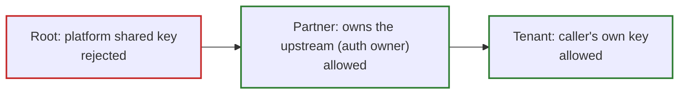

# Per-Request Secret References

<!-- toc -->

- [Context and Problem Statement](#context-and-problem-statement)
- [Decision Drivers](#decision-drivers)
- [Considered Options](#considered-options)
- [Decision Outcome](#decision-outcome)
  - [Upstream configuration](#upstream-configuration)
  - [Request and resolution](#request-and-resolution)
  - [SDK](#sdk)
  - [Guards](#guards)
  - [Errors and observability](#errors-and-observability)
  - [Request limits](#request-limits)
  - [Consumer integration](#consumer-integration)
  - [Consequences](#consequences)
  - [Confirmation](#confirmation)
- [Pros and Cons of the Options](#pros-and-cons-of-the-options)
  - [A. Consumer supplies the key](#a-consumer-supplies-the-key)
  - [B. Fixed reference resolved per tenant](#b-fixed-reference-resolved-per-tenant)
  - [C. Per-request secret reference with guards](#c-per-request-secret-reference-with-guards)
  - [D. Allowlisted secret reference](#d-allowlisted-secret-reference)
  - [E. Named upstream credential](#e-named-upstream-credential)
  - [F. Signed grant from the consumer's system of record](#f-signed-grant-from-the-consumers-system-of-record)
- [Open Questions](#open-questions)
- [Traceability](#traceability)

<!-- /toc -->

**ID**: `cpt-cf-oagw-adr-request-secret-refs`

## Context and Problem Statement

A consumer serves many tenants through one upstream alias and route. Some tenants bring their own provider key; others use a key their partner or the platform shares. The consumer already stores, per tenant and per resource, which CredStore secret reference to use. For example, [Model Registry](../../../../model-registry/docs/ADR/0002-cpt-cf-model-registry-adr-credential-binding.md) binds each tenant's model to a `secret_ref` that the writing tenant owns. The consumer needs OAGW to send the request with the key behind that reference, without receiving the key value itself and without registering every key with OAGW first.

Today the [API-key plugin](../../oagw/src/infra/plugin/apikey_auth.rs) injects one configured `secret_ref` per upstream. It reads the secret under the invoking caller's security context, so CredStore's [hierarchical resolution](../../../../credstore/docs/PRD.md#hierarchical-secret-resolution) can already return a tenant's own secret for that name and an ancestor's shared secret otherwise. That gives each tenant at most one key per upstream, under one fixed name.

So consumers that need per-resource keys fetch the key themselves and set the auth header. LLM Gateway's [Credential Broker](../../../../llm-gateway/docs/DESIGN.md#credential-broker) does this and records it as a [deviation](../../../../llm-gateway/docs/DESIGN.md#49-platform-baseline-deviations) from "OAGW centralizes credential injection". The goal is to bring injection back into OAGW for these consumers without adding an OAGW resource per key.

## Decision Drivers

- Keep provider key values out of consumers.
- Require no per-key OAGW provisioning; the consumer's system of record keeps owning which reference to use.
- Preserve tenant boundaries, destination approvals and enforced ancestor auth.
- Leave credential injection unchanged for upstreams that do not opt in. (The write-time check of API-key configs, described under [Consequences](#consequences), applies to every upstream.)
- Fail explicitly; never send a request under a reference name other than the one the caller asked for. Which record that name resolves to is CredStore's decision at request time, as [Consequences](#consequences) describes.

## Considered Options

1. The consumer reads the key and injects it (today).
2. A fixed reference name per upstream, resolved per tenant by CredStore.
3. A secret reference per request, accepted under rule-based guards.
4. A secret reference per request, accepted from an upstream allowlist.
5. A named credential provisioned under the upstream.
6. A signed grant issued by the consumer's system of record.

## Decision Outcome

We propose **C, per-request secret references with guards**. The upstream owner opts in on the upstream's auth configuration. The caller sends a CredStore reference in a request header. OAGW reads the secret as the caller, checks it against the guards, injects it with the upstream's header and prefix, and strips the reference before forwarding. Routes keep their guards and transforms. The decision is proposed; an implementation with the tests below exists for review.

### Upstream configuration

The built-in API-key plugin gains a `credential_mode` key. Plugin config values are strings, so every key is a flat string.

```jsonc
"auth": {
  "plugin_ref": "<built-in API-key plugin>",
  "sharing": "inherit",                 // or "enforce" to fix the mode for descendants
  "config": {
    "header": "authorization",
    "prefix": "Bearer ",
    "credential_mode": "request_ref",   // "config" (default) | "request_ref"
    "secret_ref": "cred://platform-openai",  // optional in request_ref mode: the default key
    "request_secret_types": "<GTS type id>,<GTS type id>"  // optional
  }
}
```

| `credential_mode` | Key source | `secret_ref` |
|---|---|---|
| `config` (default) | The configured `secret_ref`, as today | Required |
| `request_ref` | The request's reference, else the configured default | Optional |

Absent `credential_mode` means `config`, so existing upstreams keep their stored config and injection behavior. Management accepts `credential_mode` in any auth plugin's config, but only the API-key plugin acts on it; on another plugin the upstream behaves as `config` mode. Management validation rejects an unknown mode, a malformed `request_secret_types` entry, and `request_secret_types` outside `request_ref` mode. For the API-key plugin, in both modes, it also rejects a missing or invalid `header`, a header the gateway sets or strips itself (`Host`, `Content-Length`, the hop-by-hop headers, the forwarding headers such as `Forwarded` and `X-Forwarded-*`, and `X-OAGW-*`; see guard 6), and a `prefix` that is not a valid header value or is longer than 64 bytes. The write check and the proxy's strip steps read one list of these names, so they cannot drift. In `config` mode it rejects a missing `secret_ref`; in `request_ref` mode `secret_ref` is optional and, when set, is the default, which goes through the existing write-time accessibility check. Before this change a `config` mode upstream without `header` or `secret_ref` was accepted and failed every request with 401 `AUTH_PLUGIN_INTERNAL`; such writes are now refused, so both modes fail the same way at the same point. Rows stored before the change keep failing at request time until they are rewritten.

The mode is part of the auth block and follows the existing [hierarchical merge](../features/0005-cpt-cf-oagw-feature-tenant-hierarchy.md#hierarchical-config-merge) and bind rules. An ancestor that sets `sharing: enforce` fixes the mode, default and type allowlist for every descendant. Under `inherit`, a descendant that overrides auth needs the existing `override_auth` grant. A `private` auth applies only to its own upstream: a descendant upstream with no auth of its own does not inherit it, as with CORS. This corrects the merge for every upstream; see [Consequences](#consequences). No new management permission is added.

### Request and resolution

```http
POST /oagw/v1/proxy/api.openai.com/v1/chat/completions HTTP/1.1
Content-Type: application/json
X-OAGW-Secret-Ref: cred://tenant-a-openai

{"model":"gpt-4o","messages":[]}
```

The header takes exactly one reference, with or without the `cred://` prefix, in [CredStore's reference syntax](../../../../credstore/credstore-sdk/src/models.rs). OAGW rejects empty, malformed, repeated or comma-separated values. The URI and query carry no reference. OAGW reads the header before outbound header preparation, which already [strips `x-oagw-*`](../../oagw/src/infra/proxy/headers.rs), and the header never reaches the provider.

| Upstream mode | Header present | Header absent |
|---|---|---|
| `config` | 400, `SECRET_REF_NOT_ALLOWED` | Configured secret (unchanged) |
| `request_ref`, default set | Requested secret | Default secret |
| `request_ref`, no default | Requested secret | 400, `SECRET_REF_REQUIRED` |

An upstream whose effective auth uses another plugin, or that has no auth, treats the header as `config` mode does.

```mermaid
sequenceDiagram
    participant C as Consumer
    participant P as OAGW proxy
    participant A as Policy enforcer
    participant K as Routing config
    participant S as CredStore
    participant U as Provider
    C->>P: Alias, route, X-OAGW-Secret-Ref
    P->>A: Check invoke
    P->>K: Resolve upstream, route, hierarchy (auth owner)
    P->>P: Parse reference; check credential_mode
    P->>P: CORS and input checks
    P->>P: Debit upstream and route limits
    P->>P: Guard plugins (inbound headers only)
    P->>S: get(reference) under caller context
    S-->>P: Value, secret type (v1 also: record ID, owner tenant)
    P->>P: Owner-chain and type guards; strip auth header
    P->>P: Header rules, transforms (no key)
    P->>P: Auth header still unset; select endpoint, set Host
    P->>P: Inject key into auth header
    P->>U: Forward with requested key
    U-->>C: Response through OAGW
```

A CORS preflight never reaches this sequence: the REST handler answers it before the invoke check and routing, so it reads nothing and takes no capacity. The in-process SDK path has no preflight.

OAGW resolves the reference on every request and does not cache the value or record ID. Rotation and deletion in CredStore apply to the next request. There is no pin: the consumer's system of record decides which reference is current, and CredStore decides which record it names.

### SDK

The reference uses the same header in the SDK; there is no new method, trait or client capability. [`ServiceGatewayClientV1::proxy_request`](../../oagw-sdk/src/api.rs) takes a whole `http::Request<Body>`, so a consumer sets the header on the request it already builds:

```rust
let req = http::Request::post("/api.openai.com/v1/chat/completions")
    .header(oagw_sdk::SECRET_REF_HEADER, secret_ref) // e.g. "cred://tenant-a-openai"
    .header(http::header::CONTENT_TYPE, "application/json")
    .body(oagw_sdk::Body::from(body))?;
let resp = gateway.proxy_request(ctx, req).await?;
```

The [REST handler](../../oagw/src/api/rest/handlers/proxy.rs) keeps the inbound headers and calls `proxy_request_granted`; the [in-process client](../../oagw/src/domain/services/client.rs) calls `proxy_request`. Both reach the same function in the [proxy service](../../oagw/src/infra/proxy/service.rs), so parsing, guards, stripping and errors are identical over HTTP and in process. The `X-OAGW-Target-Host` endpoint selector already works this way: the proxy service reads it from the request headers on both paths.

The SDK adds:

- `SECRET_REF_HEADER = "x-oagw-secret-ref"`. The SDK exports no header-name constant today; this is the first.
- The wire reasons as constants, which the impl crate also uses to build its errors, so the SDK and the wire cannot drift: `field::INVALID_SECRET_REF`, `field::SECRET_REF_NOT_ALLOWED`, `field::SECRET_REF_REQUIRED`, `reason::permission::SECRET_REF_NOT_ACCESSIBLE` and `reason::permission::SECRET_REF_POLICY_DENIED`.
- `ServiceGatewayError::InvalidSecretRef { code: SecretRefCode, detail }` for the three 400 reasons, with `SecretRefCode::{Invalid, NotAllowed, Required}` and `from_wire`, following `InvalidTargetHost` and `TargetHostCode`.
- `DenialReason::{SecretRefNotAccessible, SecretRefPolicyDenied}` for the two 403 reasons, carried by the existing `ServiceGatewayError::PermissionDenied`, following the CORS denial reasons.

A CredStore outage stays `ServiceGatewayError::Unavailable`: the canonical service-unavailable context carries only a retry hint, so there is no reason to type.

`ServiceGatewayError` and `DenialReason` are not `#[non_exhaustive]`, so matches on them need the new variants. In this repository, mini-chat maps `ServiceGatewayError` with a catch-all and needs no change; construct matches it exhaustively and needs one arm for `InvalidSecretRef`. `DenialReason` has no users outside the SDK.

### Guards

1. **Opt-in.** Only an effective auth config in `request_ref` mode accepts the header. The mode comes from the merged hierarchy, so an enforced ancestor decides for its descendants.
2. **Caller-context read.** OAGW calls CredStore `get` under the invoking caller's security context. CredStore applies its private/tenant/shared visibility and upward resolution. OAGW never reads with elevated authority.
3. **Owner chain.** The secret's `owner_tenant_id` must be the auth owner's tenant or a descendant of it on the caller's tenant chain. The auth owner is the upstream layer whose auth config is in effect, as already tracked by the merge (`inst-merge-3a0`). CredStore resolves only upward from the caller, so the owner is always the caller or an ancestor; this guard rejects owners above the auth owner. A customer that binds its own upstream to its own host can then use only its own keys there, not a partner's or the platform's shared key. OAGW compares positions in the tenant chain it already builds for alias resolution; no extra call is needed.

   **CredStore v2.** The v2 secret no longer carries `owner_tenant_id` ([CredStore ADR-0009](../../../../credstore/docs/ADR/0009-cpt-cf-credstore-adr-no-ancestor-disclosure.md)): CredStore found the ancestor by reading past a barrier the caller cannot cross, so it must not hand the ancestor's identity on. On v2, CredStore runs this guard in the same read: OAGW calls `get_secret_within(ctx, reference, bound)` ([#5943](https://github.com/constructorfabric/gears-rust/pull/5943)) with `bound` set to the auth owner's tenant, which OAGW already has from the merge and which is on the caller's own chain. The value is served only when its row belongs to `bound` or a tenant below it, and the answer never names a tenant. OAGW maps the results:

   | `get_secret_within` result | OAGW |
   |---|---|
   | `Ok(None)`, or `PermissionDenied` | 403 `SECRET_REF_NOT_ACCESSIBLE` |
   | `FailedPrecondition` `OWNER_ABOVE_BOUND` | 403 `SECRET_REF_POLICY_DENIED` |
   | `FailedPrecondition` `SECRET_EXPIRED` | 403 `SECRET_REF_NOT_ACCESSIBLE` (its own arm, not the 503 fallback) |
   | `InvalidArgument` `BOUND_NOT_ON_CHAIN` (the hierarchy changed between the two lookups; arrives as `CredStoreError::Invalid`, matched on the reason) | 403 `SECRET_REF_POLICY_DENIED`, with a warning |

   OAGW switches to this call when #5943 lands. Until then it runs the guard on the v1 `owner_tenant_id`.
4. **Secret type.** When `request_secret_types` is set, the response's `secret_type` must be in the list. This keeps, for example, a database password from being sent as a provider key.
5. **No fallback.** When a requested reference fails any check, OAGW returns an error. It never substitutes the default secret or another reference. CredStore's upward resolution of the same name is not a fallback OAGW chooses; see [Consequences](#consequences).
6. **Late injection.** Header rules and transforms never see the key. After the CredStore read, OAGW removes every value of the configured auth header, a client-supplied one included, then runs header rules and transforms. Guard plugins run before the read and see only the client's inbound headers. If one of them set the auth header, the request stops before forwarding with 500 internal. That is a gateway misconfiguration the caller cannot fix, so it does not use `SECRET_REF_POLICY_DENIED`, which stays for the caller-side guards 3 and 4; the warn names the upstream and route to fix. OAGW injects the key only after the final header setup, once the endpoint is selected and `Host` is set. A transform therefore cannot copy the key into the query, the path or another header. Because the key goes in last, the auth header cannot be one the gateway sets or strips itself; management validation rejects those names.

Guards 3 to 6 also apply to the default secret in `request_ref` mode, so the mode behaves the same whichever key is used. `config` mode keeps its current behavior.



### Errors and observability

Errors use the canonical categories OAGW already returns, with the reason codes the [SDK](#sdk) exports. Checks run in this order: invoke permission, routing, reference syntax, mode, rate admission, guard plugins, CredStore read, then guards. Guard plugins check only the inbound headers and need no secret, so a request they reject makes no CredStore read. Every failure produces zero provider calls.

| Condition | Status and canonical category | Reason | SDK variant | Retry guidance |
|---|---|---|---|---|
| Empty, malformed or repeated header | 400, invalid argument on `x-oagw-secret-ref` | `INVALID_SECRET_REF` | `InvalidSecretRef`, `Invalid` | Correct the request |
| Header on an upstream not in `request_ref` mode | 400, invalid argument on `x-oagw-secret-ref` | `SECRET_REF_NOT_ALLOWED` | `InvalidSecretRef`, `NotAllowed` | Fix the request or upstream |
| No header and no default | 400, invalid argument on `x-oagw-secret-ref` | `SECRET_REF_REQUIRED` | `InvalidSecretRef`, `Required` | Send a reference |
| Secret missing or not visible to the caller | 403, permission denied | `SECRET_REF_NOT_ACCESSIBLE` | `PermissionDenied`, `SecretRefNotAccessible` | Fix provisioning or sharing |
| Owner outside the chain, or type not allowed | 403, permission denied | `SECRET_REF_POLICY_DENIED` | `PermissionDenied`, `SecretRefPolicyDenied` | Fix the reference, or the upstream's owner or type settings |
| Auth header set by a header rule or transform (guard 6) | 500, internal | None | `Internal` | Operator fixes the upstream's header rules or transforms; do not retry |
| CredStore outage or timeout | 503, service unavailable | `CREDENTIAL_STORE_UNAVAILABLE` (since #4985) | `Unavailable`, `CredentialStoreUnavailable` | May retry; `retry_after_seconds` carries CredStore's own hint when it gives one |
| CredStore answers a read with an error only a write can cause (conflict, type violation, unsupported transition) | 500, internal | None | `Internal` | Do not retry |
| Gateway request limit exhausted | 429, existing quota details | Existing | `RateLimited` | Respect `Retry-After` |

A CredStore outage carries reason `CREDENTIAL_STORE_UNAVAILABLE` (added by #4985, when the canonical service-unavailable context gained an optional `reason`); the server log names CredStore. `config` mode uses the one credential-failure mapping of all auth plugins (#4985, see the OAGW DESIGN "Credential Failures"): a missing or inaccessible secret is 401 `AUTH_CREDENTIAL_NOT_FOUND`, a CredStore outage 503 `CREDENTIAL_STORE_UNAVAILABLE`, a plugin misconfiguration 500. Before #4985 a CredStore error from the API-key plugin surfaced as 401 with `AUTH_PLUGIN_INTERNAL` and a missing secret as 500. A config stored without a usable `header` or `secret_ref` before writes refused one is a misconfiguration in both modes: 500 internal (401 `AUTH_PLUGIN_INTERNAL` before #4985). A secret value that is not valid UTF-8 or not a valid header value keeps the API-key plugin's mapping in both modes: 401 `AUTH_PLUGIN_INTERNAL`. A CredStore read that does not answer within the gateway's request timeout counts as an outage. In `request_ref` mode the timeout starts at the read, so the read, endpoint selection and the upstream exchange share one timeout; `config` mode timing is unchanged.

Missing and invisible secrets return the same response. Error bodies, logs and metric labels never contain secret values, references or auth headers. Every denial and failure on the read is logged with the caller tenant and the upstream, route and request IDs: a missing or refused secret (info), the owner-chain and type guards, a stored value the header cannot carry, and a CredStore failure or timeout (warn). A value the header cannot carry is also logged with its record ID, so an operator can find it. After a successful read, OAGW logs the upstream, route and request IDs with the secret type. On CredStore v1 it also logs the record ID and owner tenant, so a request can be traced to the record used. The v2 secret carries neither, so on v2 the log stops there and provenance comes from CredStore's own audit; the request ID is the inbound `X-Request-Id` when the client sends one. Metrics add the label `credential_mode=config|request_ref` to the request and error counters; like `host` and `http.route`, it reads `unknown` on an error counted before the upstream resolves. Lifecycle audit for secrets stays in CredStore.

### Request limits

The existing upstream and route limits apply, checked before the CredStore read so an exhausted limit does not load CredStore. Only `request_ref` mode moves admission ahead of the read; `config` mode keeps its order (auth plugin, then limits). In `request_ref` mode a failure after admission keeps the upstream and route debits: a guard plugin rejection (which comes before the read), a CredStore outage, the owner-chain or type guard, an auth header set by a header rule or transform, and endpoint selection. This proposal adds no per-key limit.

### Consumer integration

For LLM Gateway, the provider upstream is configured in `request_ref` mode, typically by the platform root with `sharing: enforce`. The Credential Broker passes the model's `secret_ref` in the header and never reads key values; the provider plugin does not set the auth header, and OAGW injects it. The Broker takes the reference only from the model record it has already authorized for the request, and discards any reference the client supplies, so an LLM Gateway client never chooses the key. Credential injection stays in OAGW, as the platform baseline requires. Updating LLM Gateway's documents, which record the current deviation, is a separate change.

A customer can still bind its own upstream for the provider alias where the hierarchy allows it. The owner-chain guard then keeps platform and partner keys off that customer's endpoints.

A caller that invokes OAGW directly can name any reference it can read in CredStore, as long as it passes the mode, owner-chain and type guards. This is intended: such a caller can already read the value itself, so naming it grants no new access; OAGW only keeps the value out of the caller. An upstream owner that wants to limit direct callers narrows `request_secret_types`, grants invoke on the alias only to the consumer's service identity, or uses an allowlist ([option D](#d-allowlisted-secret-reference)).

### Consequences

- Consumers send a reference they already hold and never handle key values.
- OAGW adds one CredStore read per request in `request_ref` mode, the same read the API-key plugin does today.
- No new OAGW resource, table, management API or SDK method. The change is a plugin config key, one request header, the guards, new reason codes and SDK constants and error variants.
- References are visible to consumers. They are names, not secrets; access still depends on CredStore visibility and the guards.
- Keys have no OAGW-level limit, suspension or pin. A consumer that needs those must manage them itself or use a different mechanism.
- OAGW guarantees the reference name, not the record. After a tenant deletes its own secret, the same name can resolve on the next request to an ancestor's shared secret of that name, and the request then goes out under the ancestor's key: the ancestor's provider account pays. OAGW does not detect the switch. This is the residual [Model Registry ADR-0002](../../../../model-registry/docs/ADR/0002-cpt-cf-model-registry-adr-credential-binding.md) accepts; the owner-chain guard bounds it to the auth owner's subtree, and the open question below proposes a stricter mode.
- Direct callers choose their reference within the guards; consumers such as LLM Gateway choose it from their own authorized record (see [Consumer integration](#consumer-integration)).
- This proposal can coexist with [ADR-0021](0021-upstream-credentials.md) if both are adopted: a named credential applies only to `config` mode, and a request that carries both `X-OAGW-Credential` and `X-OAGW-Secret-Ref` is refused with 400.
- **The owner-chain guard relies on private auth staying with its owner.** Resolution strips another tenant's `private` auth before the merge ([feature 0005](../features/0005-cpt-cf-oagw-feature-tenant-hierarchy.md#hierarchical-config-merge), `inst-merge-1`), so the auth owner the guard bounds a secret by is always the layer whose auth actually applies.
- **Stricter writes for all API-key upstreams.** Management now refuses an API-key auth config the plugin cannot run, in both modes: a missing, invalid or gateway-owned `header`, and, in `config` mode, a missing `secret_ref`. Such writes used to be accepted and fail every request with 401 `AUTH_PLUGIN_INTERNAL`. A registry upstream with such a config is now skipped by the reconcile (`reason=validation`) instead of stored. Rows already stored are not touched and keep failing at request time until rewritten.

### Confirmation

Each behavior below has an ID. The test, or tests, that prove it name the ID in their doc comment, so `grep -rn SREF-GUARD-003` finds them. Unless a case says otherwise, tests use the OAGW `AppHarness` with its mock upstream as the provider, a CredStore spy that records every `get` and the context it ran under, and the tenant tree Root → Partner → Tenant, with a sibling tenant Other under Partner. "No forward" means the mock provider received no request. The implementation on the review branch includes these tests.

The spy lives in OAGW's own test support, not in `credstore-sdk`: the shared [`MockCredStoreClient`](../../../../credstore/credstore-sdk/src/test_util.rs) returns a nil owner tenant, the generic secret type and `is_inherited=false` for every secret, and records no calls. The OAGW spy accepts a per-secret owner tenant, sharing mode, inheritance flag, secret type and visibility, and records each `get` with its security context.

**Configuration**

* `SREF-CFG-001`: an auth config without `credential_mode` behaves as `config` and is stored unchanged; existing API-key upstreams need no migration.
* `SREF-CFG-002`: management rejects an unknown `credential_mode` with 400.
* `SREF-CFG-003`: management rejects a malformed `request_secret_types` entry, and `request_secret_types` outside `request_ref` mode, with 400.
* `SREF-CFG-004`: management rejects an API-key auth in `config` mode without `secret_ref`, with or without an explicit `credential_mode: config`, with 400 on `auth.config.secret_ref`; `request_ref` mode without `secret_ref` is accepted.
* `SREF-CFG-005`: a configured default in `request_ref` mode goes through the existing write-time accessibility check.
* `SREF-CFG-006`: `credential_mode` is accepted on another plugin's auth config but means nothing there: the header on an upstream whose auth uses another plugin, even with `credential_mode: request_ref`, or that has no auth, returns 400 `SECRET_REF_NOT_ALLOWED` with no forward.
* `SREF-CFG-007`: in both modes, management rejects an API-key auth with a missing or invalid `header`, or a header the gateway sets or strips itself (`Host`, `Content-Length`, hop-by-hop, forwarding headers, `X-OAGW-*`), with 400 on `auth.config.header`.
* `SREF-CFG-008`: in both modes, management rejects an API-key `prefix` that is not a valid header value or is longer than 64 bytes, with 400 on `auth.config.prefix`; a usual prefix such as `Bearer ` is accepted.

**Hierarchy**

* `SREF-HIER-001`: an ancestor auth in `request_ref` mode with `sharing: inherit` applies to a descendant that does not override auth.
* `SREF-HIER-002`: an ancestor that enforces `config` mode rejects a descendant request carrying the header with `SECRET_REF_NOT_ALLOWED`, even when the descendant's own layer sets `request_ref`.
* `SREF-HIER-003`: an ancestor that enforces `request_ref` mode applies its default and type allowlist to every descendant.
* `SREF-HIER-004`: a descendant override that switches the mode needs the existing `override_auth` grant.

**Request header**

* `SREF-REQ-001`: each row of the mode table gives the stated result, with and without the header.
* `SREF-REQ-002`: a reference with and without the `cred://` prefix resolves to the same secret.
* `SREF-REQ-003`: an empty, malformed, repeated or comma-separated header returns 400 `INVALID_SECRET_REF`, including two identical values.
* `SREF-REQ-004`: the header name is case-insensitive. Tested end to end over a real connection (the e2e request sends mixed-case names); in process, `http` lowercases names before any gateway code reads them, so a harness test could not fail.
* `SREF-REQ-005`: a reference in the URI or query is not read, and is forwarded or rejected exactly as without this feature.
* `SREF-REQ-006`: the provider never receives `X-OAGW-Secret-Ref`, on success, under every passthrough mode, and on WebSocket and SSE handshakes.

**Resolution**

* `SREF-RES-001`: CredStore `get` runs with the invoking caller's security context, never a system or upstream-owner context.
* `SREF-RES-002`: the provider receives the configured header and prefix followed by the secret value from that same response.
* `SREF-RES-003`: a rotated value is used on the next request with no OAGW write; no value or record ID is cached between requests.
* `SREF-RES-004`: a reference resolved to the caller's own secret and the same reference resolved to an ancestor's shared secret both reach the provider when the owner passes the owner-chain guard.
* `SREF-RES-005`: a secret that is missing, private to another subject, or owned by the sibling Other returns 403 `SECRET_REF_NOT_ACCESSIBLE` with identical bodies and no forward.

**Guards**

* `SREF-GUARD-001`: with the upstream owned by Partner, a secret owned by Partner or Tenant is injected and a secret owned by Root is rejected with 403 `SECRET_REF_POLICY_DENIED`.
* `SREF-GUARD-002`: with an upstream owned by Tenant on Tenant's own host, a shared reference owned by Partner or Root is rejected, and Tenant's own secret is injected.
* `SREF-GUARD-003`: the owner-chain guard compares against the auth owner from the merge, not the upstream that won alias resolution: when Tenant's winning upstream has no auth of its own and inherits Partner's, a Partner-owned secret is accepted and a Root-owned one is rejected.
* `SREF-GUARD-004`: with `request_secret_types` set, a secret of a listed type is injected and one of another type is rejected with `SECRET_REF_POLICY_DENIED`.
* `SREF-GUARD-005`: a requested reference that fails any check never falls back to the default secret; the CredStore spy shows no read of the default.
* `SREF-GUARD-006`: the owner-chain and type guards also apply to the default secret in `request_ref` mode.
* `SREF-GUARD-007`: the owner-chain guard needs no tenant resolver call beyond the one alias resolution already makes.

**Late injection**

* `SREF-HDR-001`: a header rule or transform that removes the auth header changes nothing; the key is injected after it.
* `SREF-HDR-002`: a header rule or transform that sets the auth header returns 500 internal (not `SECRET_REF_POLICY_DENIED`) with no forward.
* `SREF-HDR-003`: a header rule or transform that adds an auth header value is rejected the same way.
* `SREF-HDR-004`: a client-supplied auth header is stripped and replaced by the injected value, never sent alongside it.
* `SREF-HDR-005`: header rules and transforms that leave the auth header alone still apply, and the request is forwarded.
* `SREF-HDR-006`: a transform that copies the auth header into the query never sees the key; the query carries no key and the auth header carries exactly the injected value.

**Ordering and errors**

* `SREF-ERR-001`: a caller without invoke permission gets the existing 403 before the header is parsed; a bad header on an unknown alias gets the existing not-found.
* `SREF-ERR-002`: syntax and mode errors return before rate admission, debit nothing, and make no CredStore read.
* `SREF-ERR-003`: an exhausted upstream or route limit returns 429 with no CredStore read.
* `SREF-ERR-004`: a CredStore outage or timeout returns 503 service unavailable, with no reason code, and keeps the limit debits already taken. CredStore's own retry hint reaches `retry_after_seconds`, rounded up; without one the gateway default applies. An error only a write can cause returns 500 with no retry hint.
* `SREF-ERR-005`: every error in the table has its stated status, canonical category and reason; the 400s name the field `x-oagw-secret-ref`.
* `SREF-ERR-006`: a CORS preflight neither reads CredStore nor consumes capacity.
* `SREF-ERR-007`: every failure in the table makes zero provider calls.
* `SREF-ERR-008`: a request a guard plugin rejects makes no CredStore read and keeps its limit debit.

**SDK usage**

These run through `AppHarness::facade()`, the in-process `ServiceGatewayClientV1` that the harness registers next to the REST router, against the same gateway and mock upstream. The tests build requests the way a consumer does, with `oagw_sdk::SECRET_REF_HEADER`, and assert on what the mock upstream recorded.

* `SREF-SDK-001`: a `proxy_request` with `SECRET_REF_HEADER` set reaches the mock upstream with the configured header and prefix followed by the referenced secret, and without `x-oagw-secret-ref`.
* `SREF-SDK-002`: the CredStore read runs under the `SecurityContext` passed to `proxy_request`: two calls with the same reference under two tenants' contexts send each tenant's own key.
* `SREF-SDK-003`: a table-driven test runs every row of the mode table and every error in the error table through both `facade().proxy_request` and the REST router, and gets the same status, canonical category, reason and upstream call count.
* `SREF-SDK-004`: an SSE request and a WebSocket handshake through `proxy_request` with the header inject the key and strip the header, and the stream is delivered.
* `SREF-SDK-005`: errors returned by `facade().proxy_request`, converted with `ServiceGatewayError::from`, give `InvalidSecretRef` with each `SecretRefCode`, `PermissionDenied` with each new `DenialReason`, and `Unavailable` for a failing CredStore.
* `SREF-SDK-006`: unit tests: each 400 and 403 reason projects to its typed variant; `from_wire` and `as_wire` round-trip every code; other field reasons still project to `Validation`.
* `SREF-SDK-007`: `SECRET_REF_HEADER` is the header the proxy reads, and the impl crate builds its errors from the SDK constants, so the SDK and the wire cannot drift.
* `SREF-SDK-008`: construct maps `InvalidSecretRef` to a refusal, and mini-chat maps it through its existing catch-all.

**Observability**

* `SREF-OBS-001`: error bodies, logs and metric labels never contain the secret value, the reference or the auth header, including on guard failures and CredStore errors.
* `SREF-OBS-002`: a successful request logs the upstream, route and request IDs with the secret type, and on CredStore v1 also the record ID and owner tenant.
* `SREF-OBS-003`: request metrics carry `credential_mode=config|request_ref` and no reference or record ID label.
* `SREF-OBS-004`: every denial and failure on the read (missing or refused secret, owner-chain and type guards, a value the header cannot carry, a CredStore failure) logs the caller tenant and the upstream, route and request IDs, and never the reference.

**Unchanged behavior**

* `SREF-REG-001`: the existing API-key, OAuth2 and no-auth proxy tests pass unchanged for upstreams in `config` mode.
* `SREF-REG-002`: an end-to-end test provisions a `request_ref` upstream and a tenant secret, sends a request with the header and sees the provider receive that tenant's key.

## Pros and Cons of the Options

### A. Consumer supplies the key

Works today with no OAGW change. Each consumer handles key values, and credential injection moves out of OAGW, which is why LLM Gateway records it as a deviation.

### B. Fixed reference resolved per tenant

The upstream configures one name, such as `cred://openai`, and each tenant creates its own secret under that name; CredStore resolution picks it. No header and low complexity. It allows only one own key per tenant per upstream and ties the secret name to OAGW configuration rather than to the consumer's record.

### C. Per-request secret reference with guards

Small change: one config key, one header, guards that reuse the merge's auth owner and the existing tenant chain. Works for keys created after the upstream. Exposes reference names to consumers and adds no per-key limits or suspension.

### D. Allowlisted secret reference

Restricts references to a list on the upstream. That list must change for every new customer key, so it brings back per-key OAGW writes. A prefix or pattern list would avoid that but ties secret naming to OAGW configuration.

### E. Named upstream credential

Proposed separately in [ADR-0021](0021-upstream-credentials.md). A first-class credential gives pinning, suspension, endpoint approval, per-key limits and audit, and the caller selects it by name. It costs a provisioned resource per key, often a local upstream per tenant, and a live credential read. For this need it duplicates the consumer's record, which already owns the reference.

### F. Signed grant from the consumer's system of record

The consumer's system of record signs a short-lived grant naming the reference, tenant and destination; OAGW verifies it. Strong binding, but it needs key management, a new trust relationship and changes in every issuer. Out of proportion to the gap the guards leave.

## Open Questions

- Guard 3 on CredStore v2 uses CredStore's `get_secret_within` (see guard 3), which is pending in [#5943](https://github.com/constructorfabric/gears-rust/pull/5943). OAGW switches once it lands.
- Should the platform root enforce `request_ref` mode on provider upstreams, or leave the mode to each tenant?
- In `config` mode, the write-time check confirms only that the configured secret is readable, not who owns it. Should the owner-chain guard also apply there? That is a separate change.
- Should `request_ref` mode offer a stricter option that accepts only the caller's own secret (rejecting inherited ones), for deployments that do not accept the residual where a deleted own key silently switches the request to an ancestor's key and account?

## Traceability

- `cpt-cf-oagw-fr-request-secret-refs` in [PRD](../PRD.md)
- [Credential resolution](../features/0004-cpt-cf-oagw-feature-proxy-engine.md#credential-resolution)
- [Hierarchical config merge](../features/0005-cpt-cf-oagw-feature-tenant-hierarchy.md#hierarchical-config-merge)
- [System design](../DESIGN.md)
- [Scenarios](../../scenarios/request-secret-refs/README.md)
