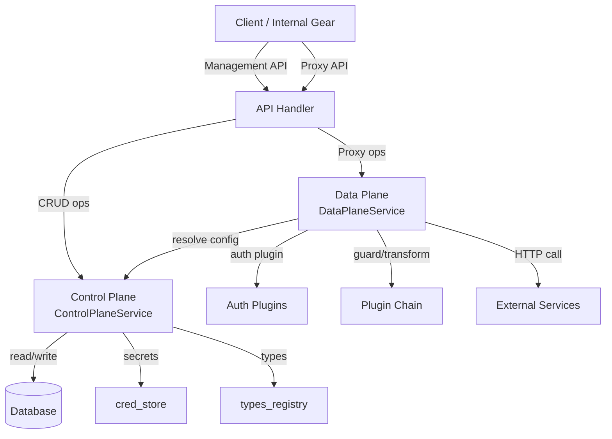
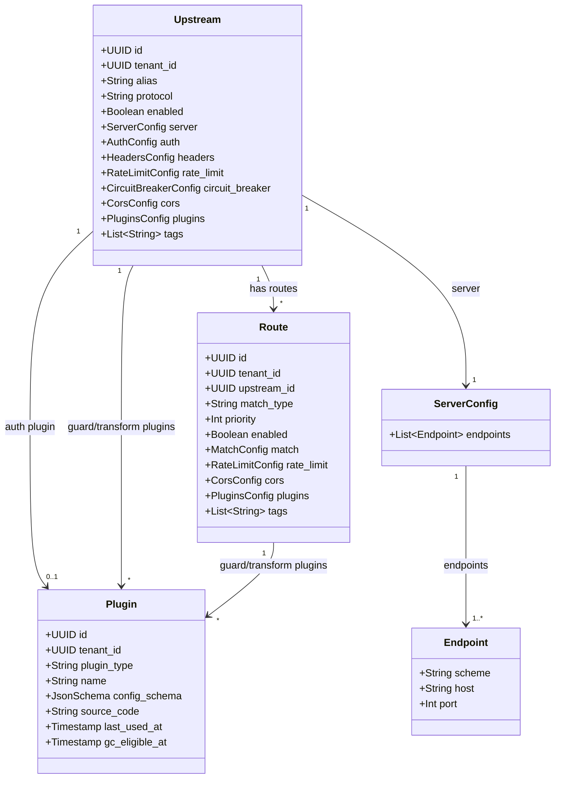
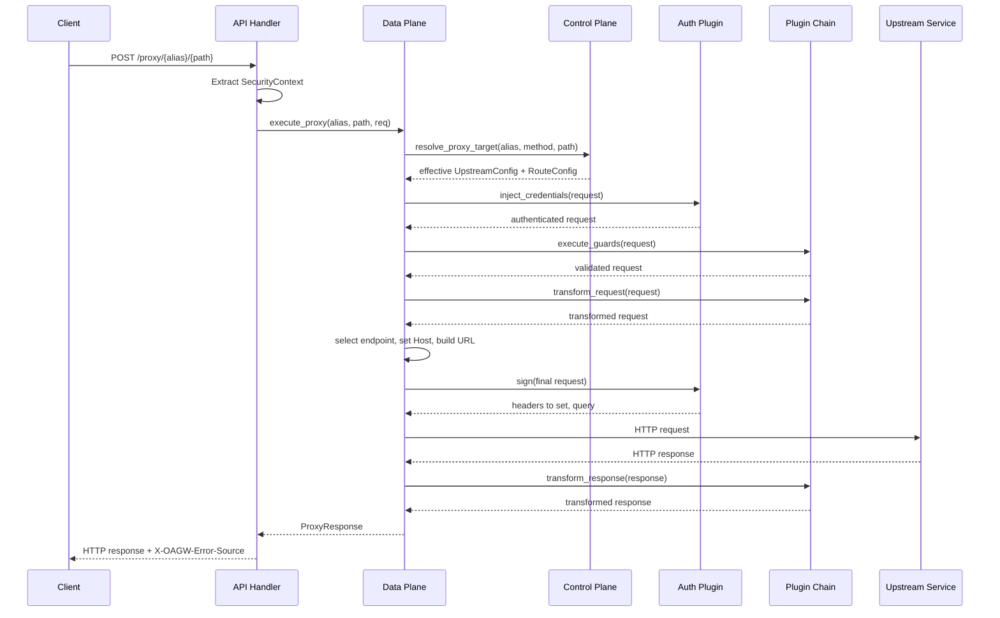

# Technical Design — Outbound API Gateway (OAGW)


<!-- toc -->

- [1. Architecture Overview](#1-architecture-overview)
  - [1.1 Architectural Vision](#11-architectural-vision)
  - [1.2 Architecture Drivers](#12-architecture-drivers)
  - [1.3 Architecture Layers](#13-architecture-layers)
  - [1.4 High-Level Architecture Diagram](#14-high-level-architecture-diagram)
- [2. Principles & Constraints](#2-principles--constraints)
  - [2.1 Design Principles](#21-design-principles)
  - [2.2 Constraints](#22-constraints)
- [3. Technical Architecture](#3-technical-architecture)
  - [3.1 Domain Model](#31-domain-model)
  - [3.2 Component Model](#32-component-model)
  - [3.3 API Contracts](#33-api-contracts)
  - [3.4 Internal & External Dependencies](#34-internal--external-dependencies)
  - [3.5 Interactions & Sequences](#35-interactions--sequences)
  - [3.6 Database Schemas & Tables](#36-database-schemas--tables)
- [4. Additional Context](#4-additional-context)
  - [4.1 Caching Strategy](#41-caching-strategy)
  - [4.2 Metrics and Observability](#42-metrics-and-observability)
  - [4.3 Audit Logging](#43-audit-logging)
  - [4.4 Security Considerations](#44-security-considerations)
  - [4.5 Out of Scope](#45-out-of-scope)
  - [4.6 Review](#46-review)
  - [4.7 Future Developments](#47-future-developments)
- [5. Traceability](#5-traceability)
  - [5.1 PRD Coverage](#51-prd-coverage)
  - [5.2 ADR Coverage](#52-adr-coverage)

<!-- /toc -->

## 1. Architecture Overview

### 1.1 Architectural Vision

OAGW is a centralized outbound API gateway that manages all outbound API requests from Gears to external services. It provides routing, authentication, rate limiting, and monitoring through a unified proxy layer that enforces security and observability policies.

The architecture follows a **Control Plane / Data Plane** separation within a single gear, where the Control Plane manages configuration data (upstreams, routes, plugins) and the Data Plane orchestrates proxy requests to external services. Both services are implemented as domain traits within a single `oagw` crate, using DDD-Light layering (`domain/infra/api`).

This design satisfies the requirements for centralized outbound traffic management, multi-tenant hierarchical configuration, and extensible plugin-based request processing while remaining practical to implement within Gears' modular monolith architecture.

### 1.2 Architecture Drivers

**ID**: `cpt-cf-oagw-design-drivers`

| Driver | Source | Influence |
|---|---|---|
| Centralized outbound traffic management | `cpt-cf-oagw-fr-request-proxy` | Single proxy endpoint for all external API calls |
| Multi-tenant hierarchy | `cpt-cf-oagw-fr-hierarchical-config` | Configuration sharing/inheritance across tenant tree |
| Plugin extensibility | `cpt-cf-oagw-fr-plugin-system` | Three plugin types (Auth/Guard/Transform) with trait-based isolation |
| Low-latency proxy path | `cpt-cf-oagw-nfr-low-latency` | In-memory rate limiters |
| Configuration layering | `cpt-cf-oagw-fr-config-layering` | Upstream < Route < Tenant merge priority |
| Alias resolution | `cpt-cf-oagw-fr-alias-resolution` | Path-based routing with alias shadowing |
| Credential isolation | `cpt-cf-oagw-nfr-credential-isolation` | Auth via `cred_store` references, no direct secret storage |
| Named upstream credentials (proposed) | `cpt-cf-oagw-fr-upstream-credentials` | Authorize and limit the requested key under the destination's existing policies |
| Per-request secret references (proposed) | `cpt-cf-oagw-fr-request-secret-refs` | Read the requested secret as the caller and inject it only when its owner and type pass the upstream's guards |
| Optional persistence | `cpt-cf-oagw-fr-config-persistence` | Database repositories when configured, in-memory otherwise; fail-fast on an unusable database |
| ToolKit integration | Gears middleware | Single-executable deployment, trait-based DI, secure ORM |

**Architecture Decision Records**:

- `cpt-cf-oagw-adr-component-architecture` — Single gear with internal trait-based service isolation
- `cpt-cf-oagw-adr-request-routing` — Path-based routing with alias resolution
- `cpt-cf-oagw-adr-plugin-system` — Three plugin types with deterministic execution order
- `cpt-cf-oagw-adr-rate-limiting` — Token bucket algorithm with hierarchical merge
- `cpt-cf-oagw-adr-circuit-breaker` — Per-upstream state machine with configurable thresholds, kept in memory on each replica (fallback strategies planned)
- `cpt-cf-oagw-adr-cors` — Built-in CORS handler with per-upstream/route config
- `cpt-cf-oagw-adr-data-plane-caching` — Control plane caching strategies (superseded by `cpt-cf-oagw-adr-proxy-config-cache`)
- `cpt-cf-oagw-adr-state-management` — CP/DP state structures; its Data Plane L1 cache is replaced by `cpt-cf-oagw-adr-proxy-config-cache`, its rate-limiter ownership stays
- `cpt-cf-oagw-adr-storage-schema` — Cross-database relational schema with JSON config blobs
- `cpt-cf-oagw-adr-resource-identification` — Layered resource model with alias resolution
- `cpt-cf-oagw-adr-concurrency-control` — Per-scope in-flight request limits
- `cpt-cf-oagw-adr-backpressure-queueing` — Bounded queueing with degradation strategies
- `cpt-cf-oagw-adr-error-source-distinction` — Response header for gateway vs upstream errors
- `cpt-cf-oagw-adr-grpc-support` — HTTP/2 multiplexing with protocol detection
- `cpt-cf-oagw-adr-rust-abi-client-library` — Rust ABI client for internal gear routing
- `cpt-cf-oagw-adr-oauth2-client-credentials-auth-plugin` — OAuth2 Client Credentials auth plugin with internal token cache
- `cpt-cf-oagw-adr-required-headers-guard-plugin` — Stateless builtin `GuardPlugin` enforcing required request/response headers, fail-open when unconfigured
- `cpt-cf-oagw-adr-optional-persistence` — Opt-in database persistence with in-memory fallback, using the storage schema from the start
- `cpt-cf-oagw-adr-upstream-proxy-engine` — Upstream forwarding through the in-house `toolkit-http-proxy` engine instead of the Pingora bridge
- `cpt-cf-oagw-adr-proxy-config-cache` — Per-replica cache of the proxy lookup with a database; each write evicts only the entries it affects, on every replica through a cluster change log, with a TTL backstop (proposed until its benchmark)
- `cpt-cf-oagw-adr-upstream-credentials` — [Proposed tenant-local named API keys](ADR/0021-upstream-credentials.md)
- `cpt-cf-oagw-adr-request-secret-refs` — [Proposed per-request CredStore references with guards](ADR/0022-request-secret-refs.md)
- `cpt-cf-oagw-adr-request-signing` — [Proposed optional signing phase of auth plugins, run on the final outbound request](ADR/0023-request-signing.md)

### 1.3 Architecture Layers

**ID**: `cpt-cf-oagw-design-layers`

| Layer | Responsibility | Key Components |
|---|---|---|
| **Transport** (`api/rest/`) | HTTP handling, request parsing, response serialization | Axum handlers, DTOs, extractors, OperationBuilder route registration |
| **Domain** (`domain/`) | Business logic, service traits, repository contracts | `ControlPlaneService`, `DataPlaneService`, `AuthPlugin` trait, domain models |
| **Infrastructure** (`infra/`) | External integrations, persistence, proxy engine | SeaORM repositories, upstream proxy engine adapter, plugin registry, type provisioning |
| **SDK** (`oagw-sdk/`) | Public API for inter-gear communication | `ServiceGatewayClientV1` trait, SDK models, error types |

The gear follows DDD-Light layering: domain layer has no infrastructure dependencies; infrastructure implements domain traits; transport layer maps between HTTP and domain types.

**ID**: `cpt-cf-oagw-tech-dependencies`

| Technology | Purpose |
|---|---|
| Rust / Axum | HTTP transport, async runtime |
| SeaORM + `toolkit-db` | Database persistence (PostgreSQL, MySQL, SQLite) |
| `toolkit-http-proxy` | Upstream proxy engine (connection pooling, HTTP/1.1 + HTTP/2 with ALPN, FIPS-hardened TLS, load balancing, health checks) |
| Starlark | Custom plugin sandboxed execution |
| `toolkit-auth` | Bearer token authentication & authorization |
| `cred_store` | Secret material retrieval by URI reference |
| `types_registry` | GTS schema/instance registration |
| `cluster-sdk` | With a database: the cluster change log that keeps each replica's proxy configuration cache fresh ([ADR: Proxy Configuration Cache](./ADR/0020-proxy-config-cache.md)) |

### 1.4 High-Level Architecture Diagram

**ID**: `cpt-cf-oagw-design-overview`



## 2. Principles & Constraints

### 2.1 Design Principles

**ID**: `cpt-cf-oagw-principle-no-retry`

**No automatic retries**: OAGW never retries failed upstream requests; a failure is returned to the client, which owns retry logic. The only resend is the upstream proxy engine's, at most once per request and only at the connection level: a request that never left, a request the upstream refused over HTTP/2 (`REFUSED_STREAM`, `HTTP_1_1_REQUIRED`), and an idempotent request whose connection closed before the answer ([ADR-0019](./ADR/0019-upstream-proxy-engine.md)).

**ID**: `cpt-cf-oagw-principle-no-cache`

**No response caching**: OAGW does not cache upstream responses. Caching is client/upstream responsibility.

**ID**: `cpt-cf-oagw-principle-cred-isolation`

**Credential isolation**: OAGW references secrets via `cred_store` URIs (`cred://...`); never stores or logs secret material.

**ID**: `cpt-cf-oagw-principle-tenant-scope`

**Tenant scoping**: All database reads/writes use secure ORM with tenant scoping, except the registry reconcile's listing of registry rows, which reads across tenants, and the installation-wide `oagw_registry_state` row (ADR-0018). No raw SQL in gear code, except constant SQL fragments: the database-clock expressions of the registry lease and the seed insert of its migration.

**ID**: `cpt-cf-oagw-principle-plugin-immutable`

**Plugin immutability**: Custom plugins are immutable after creation. Updates create new versions.

**ID**: `cpt-cf-oagw-principle-error-source`

**Error source distinction**: All error responses include `X-OAGW-Error-Source: gateway|upstream` header.

**ID**: `cpt-cf-oagw-principle-rfc9457`

**RFC 9457 Problem Details**: All gateway errors use `application/problem+json` format with GTS type identifiers.

### 2.2 Constraints

**ID**: `cpt-cf-oagw-constraint-toolkit-deploy`

Single-executable deployment via ToolKit (Gears middleware requirement).

**ID**: `cpt-cf-oagw-constraint-no-direct-internet`

No direct internet access from internal gears. Security policy: all outbound traffic routes through OAGW.

**ID**: `cpt-cf-oagw-constraint-multi-sql`

Multi-SQL backend portability: PostgreSQL, MySQL, SQLite. The OAGW build compiles SQLite and PostgreSQL; MySQL is supported when built with the `mysql` feature. `toolkit-db` requirement; avoid backend-specific features for correctness. Persistence is opt-in: without a configured database, OAGW uses in-memory storage ([ADR: Optional Persistence](./ADR/0018-optional-persistence.md)).

**ID**: `cpt-cf-oagw-constraint-body-limit`

Body size hard limit: 100MB. Prevent resource exhaustion; reject before buffering.

**ID**: `cpt-cf-oagw-constraint-https-only`

HTTPS-only for upstream connections in MVP. SSRF prevention; plaintext upstreams explicitly blocked. An `http` endpoint is rejected on create and update with 400 `invalid_argument` (field `server.endpoints.scheme`, reason `HTTP_UPSTREAM_FORBIDDEN`) unless the gear option `allow_http_upstream` is on. The proxy checks it again, before auth runs, for upstreams stored earlier, with the same field; the proxy's `UNSUPPORTED_SCHEME` violation names `server.endpoints.scheme` too.

## 3. Technical Architecture

### 3.1 Domain Model

**ID**: `cpt-cf-oagw-design-domain-model`



**Key Domain Entities**:

- **Upstream** (`gts.cf.core.oagw.upstream.v1~`): Tenant-scoped root configuration object representing an external service. Unique per `(tenant_id, alias)`. Contains server endpoints, auth config, rate limits, circuit breaker, CORS, headers, and plugin bindings.
- **Route** (`gts.cf.core.oagw.route.v1~`): Belongs to an upstream. Defines match rules (HTTP path/method; gRPC service/method matching is planned for Phase 3 — no gRPC proxy code path is currently implemented or reachable), priority, and route-level overrides for rate limits, CORS, and plugins.
- **Upstream credential** (proposed, `gts.cf.core.oagw.credential.v1~`): A tenant-owned child of one local upstream. Its UUID identifies a named API-key reference and its optional per-replica request limit. The upstream supplies the auth plugin and injection policy. See [ADR-0021](ADR/0021-upstream-credentials.md) and the [schema](schemas/credential.v1.schema.json).
- **Plugin** (`gts.cf.core.oagw.{type}_plugin.v1~`): Custom tenant-defined Starlark plugins stored in `oagw_plugin`. Named (built-in) plugins are resolved via in-process registry and not persisted.

#### Upstream Schema

**Base type**: `gts.cf.core.oagw.upstream.v1~`

Full schema: [schemas/upstream.v1.schema.json](./schemas/upstream.v1.schema.json)

Sharing fields fragment: [schemas/oagw_upstream_sharing_fields.fragment.json](./schemas/oagw_upstream_sharing_fields.fragment.json)

#### Route Schema

**Base type**: `gts.cf.core.oagw.route.v1~`

Full schema: [schemas/route.v1.schema.json](./schemas/route.v1.schema.json)

#### Plugin Schemas

**Auth Plugin** — Base type: `gts.cf.core.oagw.auth_plugin.v1~` — [schemas/auth_plugin.v1.schema.json](./schemas/auth_plugin.v1.schema.json)

One per upstream. Named auth plugins resolved via in-process registries, not stored in `oagw_plugin`. UUID-backed auth plugins stored in `oagw_plugin`.

Built-in auth plugins:
- `gts.cf.core.oagw.auth_plugin.v1~cf.core.oagw.noop.v1`
- `gts.cf.core.oagw.auth_plugin.v1~cf.core.oagw.apikey.v1`
- `gts.cf.core.oagw.auth_plugin.v1~cf.core.oagw.oauth2_client_cred.v1`
- `gts.cf.core.oagw.auth_plugin.v1~cf.core.oagw.oauth2_client_cred_basic.v1`

`basic.v1` and `bearer.v1` are reserved GTS identifiers cataloged in the types-registry with no backing `AuthPlugin` implementation in `AuthPluginRegistry`: setting either as `auth.type` is rejected on write with 400 `invalid_argument` (reason `NOT_IMPLEMENTED`).

**Guard Plugin** — Base type: `gts.cf.core.oagw.guard_plugin.v1~` — [schemas/guard_plugin.v1.schema.json](./schemas/guard_plugin.v1.schema.json)

Multiple per upstream/route. Can reject requests before they reach upstream.

| Plugin ID | Description |
|---|---|
| `gts.cf.core.oagw.guard_plugin.v1~cf.core.oagw.required_headers.v1` | Required header enforcement (request/response) — see [ADR: Required Headers Guard Plugin](./ADR/0017-required-headers-guard-plugin.md) |

`required_headers.v1` is the only guard identifier resolvable via `GuardPluginRegistry` and bindable through `plugins.items[].plugin_ref`. Timeout and CORS are core Data Plane functionality, not `GuardPlugin` trait implementations: request timeout is gear-level configuration, and CORS is configured via the dedicated `cors` field on `Upstream`/`Route` (see [ADR: CORS](./ADR/0006-cors.md)). Their `gts.cf.core.oagw.guard_plugin.v1~cf.core.oagw.timeout.v1` / `...cors.v1` identifiers exist only for types-registry cataloging and cannot be bound via `plugins.items[].plugin_ref` (400 `NOT_IMPLEMENTED` on write). Circuit breaker is likewise **core functionality** (not a plugin). See [ADR: Circuit Breaker](./ADR/0005-circuit-breaker.md).

**Transform Plugin** — Base type: `gts.cf.core.oagw.transform_plugin.v1~` — [schemas/transform_plugin.v1.schema.json](./schemas/transform_plugin.v1.schema.json)

Multiple per upstream/route, executed in order. Each plugin declares supported phases: `on_request`, `on_response`, `on_error`.

| Plugin ID | Phase | Description |
|---|---|---|
| `gts.cf.core.oagw.transform_plugin.v1~cf.core.oagw.request_id.v1` | request, response | X-Request-ID injection/propagation |

`logging.v1` and `metrics.v1` are core Data Plane instrumentation (`infra/metrics.rs`, `tracing`), not `TransformPlugin` trait implementations. Their GTS identifiers exist for types-registry cataloging only, are not resolvable via `TransformPluginRegistry`, and are rejected on write (400 `NOT_IMPLEMENTED`).

#### Plugin Identification Model

All plugins are identified using **GTS identifiers** in the API layer.

The database stores:
- `plugin_ref` (VARCHAR(256)): the canonical plugin identifier string (full GTS identifier).
- `plugin_uuid` (UUID, nullable): extracted UUID when `plugin_ref` is UUID-backed.

**Named plugins** (built-in or provided by deployed gears):
- API: `gts.cf.core.oagw.{type}_plugin.v1~cf.core.oagw.{name}.v1`
- Resolved via an in-process plugin registry.
- Not stored in `oagw_plugin` and not subject to GC.

**Custom plugins** (tenant-defined Starlark):
- API: `gts.cf.core.oagw.{type}_plugin.v1~{uuid}`
- Stored in `oagw_plugin` keyed by `id = {uuid}`.

**Bindings**:
- `oagw_upstream_plugin` / `oagw_route_plugin` store `(position, plugin_ref, plugin_uuid, config)`.
- No FK from binding rows to `oagw_plugin` because named plugins do not have DB rows.
- Application validates that `plugin_uuid` matches `plugin_ref` when present.

**Auth plugin storage**: Upstreams store auth plugin identity in scalar columns (`auth_plugin_ref`, `auth_plugin_uuid`) so "plugin in use" checks do not depend on JSON scanning.

**Resolution Algorithm**:
1. Parse GTS identifier from API request to extract instance part (after `~`)
2. If instance parses as UUID → resolve via `oagw_plugin` (must exist and must match the plugin schema type)
3. Otherwise → resolve via in-process registry (named plugins)
4. When persisting bindings, store `plugin_ref` always; store `plugin_uuid` only for UUID-backed plugins

### 3.2 Component Model

**ID**: `cpt-cf-oagw-component-model`

#### Gear Structure

```text
gears/system/oagw/
├── oagw-sdk/              # Public API: ServiceGatewayClientV1 trait, models, errors
│   └── src/
│       ├── lib.rs         # Re-exports
│       ├── api.rs         # ServiceGatewayClientV1 trait definition
│       ├── models.rs      # SDK types (Upstream, Route, CreateUpstreamRequest, etc.)
│       └── error.rs       # ServiceGatewayError
│
└── oagw/                  # Single gear crate with internal service isolation
    └── src/
        ├── lib.rs         # Public exports
        ├── gear.rs      # ToolKit gear wiring
        ├── config.rs      # OagwConfig
        ├── api/rest/      # Transport layer
        │   ├── handlers/  # Axum HTTP handlers (management + proxy)
        │   ├── routes/    # OperationBuilder route registration
        │   ├── dto.rs     # REST DTOs (serde + utoipa)
        │   ├── error.rs   # Error response mapping
        │   └── extractors.rs
        ├── domain/        # Business logic (no infra dependencies)
        │   ├── services/  # ControlPlaneService + DataPlaneService traits & impls;
        │   │              # registry_reconcile.rs: types-registry reconcile (phases 1-5)
        │   │              # registry_state.rs: gate (generation, content hash, lease)
        │   │              # registry_job.rs: one run, and the background task
        │   ├── plugin/    # AuthPlugin trait definition
        │   ├── dto.rs     # Internal domain types (ProxyContext, ProxyResponse, etc.)
        │   ├── repo.rs    # Repository traits (UpstreamRepository, RouteRepository,
        │   │              # RegistryRowRepository: the registry reconcile's rows only)
        │   └── error.rs   # DomainError
        └── infra/         # Infrastructure implementations
            ├── proxy/     # DataPlaneServiceImpl, engine adapter, endpoint selector, WebSocket relay
            ├── storage/   # Repository impls: in-memory (no database) and SeaORM (database configured)
            ├── plugin/    # AuthPluginRegistry + built-in plugins (ApiKey, NoOp)
            └── type_provisioning.rs  # GTS type registration
```

#### Internal Services

- **ControlPlaneService** (`domain/services/management/mod.rs`): Manages configuration data. Handles CRUD operations for upstreams/routes, alias resolution, and repository access.
- **DataPlaneService** (`infra/proxy/service.rs`): Orchestrates proxy requests. Resolves config via Control Plane, executes auth plugins, builds outbound HTTP requests, and forwards to upstream services.

**Crate Naming**: Directory names hyphenated (`oagw-sdk`), package names `cf-` prefixed (`cf-gears-oagw-sdk`), library names underscored (`oagw_sdk`).

#### Request Routing

| Path Pattern | Routed To | Purpose |
|---|---|---|
| `/api/oagw/v1/upstreams/*` | Control Plane | Upstream CRUD |
| `/api/oagw/v1/routes/*` | Control Plane | Route CRUD |
| `/api/oagw/v1/plugins/*` | Control Plane | Plugin CRUD |
| `/api/oagw/v1/proxy/*` | Data Plane | Proxy requests |

#### Plugin System

Three plugin types with separate traits, deterministic execution order:

1. **AuthPlugin** (`gts.cf.core.oagw.auth_plugin.v1~*`): Credential injection. One per upstream.
2. **GuardPlugin** (`gts.cf.core.oagw.guard_plugin.v1~*`): Validation/policy enforcement (can reject). Multiple per upstream/route.
3. **TransformPlugin** (`gts.cf.core.oagw.transform_plugin.v1~*`): Request/response mutation. Multiple per upstream/route.

Execution order: Auth → Guards → Transform(on_request) → Auth signing → Upstream call → Transform(on_response/on_error). The auth plugin's optional signing phase ([ADR-0023](ADR/0023-request-signing.md)) runs last, after header rules, transforms, endpoint selection, the `Host` header, rate limits and the URL build, on the HTTP and WebSocket paths. It sees the method, URL, every header line as sent and the body (buffered bytes, a streamed marker, or empty for a WebSocket handshake), and may set headers and keep, remove or replace the query, a replacement sent as returned. A signing failure stops the request before anything is sent. Only plugins whose `signs` flag is `true` have the phase; the built-in plugins do not. `on_response` runs for every upstream response, 4xx/5xx included; `on_error` runs only for gateway-originated errors of the upstream exchange (connection failure, timeout, protocol error, body limit, response guard rejection). A WebSocket upgrade does not run it: a failed upgrade returns its gateway error without `on_error`.

Plugin chain composition: upstream plugins execute before route plugins (`[U1, U2] + [R1, R2] => [U1, U2, R1, R2]`).

**Built-in Plugins** (registered and resolvable via their plugin registry):
- Auth: `noop`, `apikey`, `oauth2_client_cred`, `oauth2_client_cred_basic`
- Guard: `required_headers`
- Transform: `request_id`

**Catalog-only identifiers** (reserved GTS ids, not resolvable via a plugin registry — `basic`/`bearer` have no backing implementation; `timeout`/`cors`/`logging`/`metrics` are core Data Plane logic instead):
- Auth: `basic`, `bearer`
- Guard: `timeout`, `cors`
- Transform: `logging`, `metrics`

**Write-time check**: on create and update (Management API, SDK and types-registry provisioning), `auth.type` must be an implemented auth plugin and every `plugins.items[].plugin_ref` an implemented guard or transform plugin. Catalog-only ids, custom (UUID) ids, which are not implemented yet, and unknown ids are rejected with 400 `invalid_argument`, field violation reason `NOT_IMPLEMENTED`. A plugin of the wrong kind (an auth plugin in `plugins.items`, a guard or transform plugin in `auth.type`) is rejected with reason `VALIDATION`. Bindings stored before this check are not rewritten; the proxy still has to handle an unresolvable one.

#### Circuit Breaker

`circuit_breaker` on an upstream (optional; absent = no breaker) per [ADR: Circuit Breaker](./ADR/0005-circuit-breaker.md):

| Field | Default | Meaning |
|---|---|---|
| `sharing` | `private` | Sharing mode, as for the other upstream fields |
| `enabled` | `true` | `false` keeps the config and sends every request through |
| `failure_threshold` | `5` | Failures in a row that open the circuit; 1 to 1000 |
| `timeout_seconds` | `30` | Seconds the circuit stays open before probes go through; 1 to 86400 (a day, as `proxy_timeout_secs`) |
| `success_threshold` | `3` | Probes let through at once after the timeout; all must succeed to close the circuit, one failure opens it again; 1 to 100 |

Each value is checked whether or not `enabled`: below 1 is a 400 `invalid_argument` `circuit_breaker.<field> must be at least 1`, above the maximum `circuit_breaker.<field> must be at most N`. An unknown field is refused like any body that does not deserialize (422); the REST API and types-registry provisioning apply the defaults above to omitted fields (`oagw_sdk::CircuitBreakerConfig::default()`). Routes have no circuit breaker.

The breaker is shared by every tenant that resolves to the upstream: it describes the upstream's health, as Envoy's outlier detection and resilience4j's per-dependency breakers do (ADR-0005, *Breaker Scope and Failure Classification*). Isolation between tenants is the rate limits' job. So that no caller can open it with its own errors, only failures the upstream caused count. A caller can still make the upstream fail with what it asks for (a path that answers `503`, a request slower than the timeout); ADR-0005 lists the mitigations.

| Outcome | Breaker |
|---|---|
| Upstream `502`, `503`, `504` | failure |
| Any other upstream status (`500`, `4xx`, `101` included) | success |
| DNS failure or no address where the engine resolves the host (a single-endpoint upstream; a multi-endpoint upstream resolves in endpoint selection, whose errors are not counted), connection refused, no route, connect error or timeout, TLS handshake or certificate error, peer closed, invalid response, HTTP/2 or stream error before the response head, the engine's read or write timeout | failure |
| Request deadline hit during target resolution or the exchange, which started with at least 90 % of the request timeout left | failure |
| The same, when the gateway's own steps before them (the `request_ref` CredStore read, endpoint selection) used more than 10 % | not counted |
| A timeout or a broken exchange while the client is still sending a streamed request body (a failure to connect still counts) | not counted |
| Any outcome of a request pinned with `X-OAGW-Target-Host` to one endpoint of an upstream with several (still rejected while open) | not counted |
| The SSRF policy refuses every resolved address | not counted |
| Any gateway error before the upstream (validation, CORS, auth plugin, guards, rate limit, CredStore, body limit, internal) | not counted |
| The client cancels before the response head | not counted |
| Anything after the response head (SSE or long body, WebSocket tunnel) | not counted |

While the circuit is open, a check before the auth plugin, the rate limits and the CredStore read answers `503` (`service_unavailable`, `X-OAGW-Error-Source: gateway`) with `Retry-After` = the time left until a probe, without calling the upstream; that check keeps no half-open probe slot. The permit that counts the outcome (and holds a probe slot) is taken just before target resolution, so a slow auth plugin or CredStore read does not keep a probe slot. The cost is at the open → half-open edge: requests that pass the check before the first probe takes its slot do the gateway's steps and get `503` at the permit; this lasts at most the time between the check and the permit of the first request after `timeout_seconds`, once per open period, and once a probe holds the slot the check rejects. The outcome is taken at the response head (for a WebSocket upgrade, at the handshake).

State is kept in memory on each replica (`toolkit-resilience`), one breaker per resolved upstream and the upstream whose config is in effect; nothing is shared between replicas. A breaker is rebuilt closed on the next request, on every replica, when the effective config, the alias or the endpoints differ from those it was built for; disabling it removes it. A request that resolves no config leaves the breaker alone (under a `private` config a descendant sees none while the owner sees it). A write that changes or removes the stored `circuit_breaker`, and a delete, drop the upstream's breakers on the replica that handles the write; the idle sweep that evicts rate-limit buckets (every 60 s) evicts breakers unused for 10 minutes past their `timeout_seconds`, e.g. those of upstreams another replica deleted. Another replica does not see a removal, so an identical config re-added there before the sweep continues the old state, open for at most `timeout_seconds`. While two snapshots of one upstream are both in use (proxy config cache lag), each switch rebuilds the breaker closed, so it may not open until they converge.

**Custom Plugins**: Starlark scripts with sandboxed execution (no network/file I/O, timeout/memory limits enforced). Immutable after creation; GC for unlinked plugins after configurable TTL.

#### Hierarchical Configuration

Multi-tenant hierarchy with sharing modes (`private`/`inherit`/`enforce`) per configuration field:

| Field | Merge Strategy |
|---|---|
| Auth | Override if `inherit`; forced if `enforce`; never sent to endpoints its owner did not configure |
| Rate Limits | `min(ancestor, descendant)` — stricter always wins; an enforced limit stays `enforce` down the chain, whichever level's value wins, so a `private` level below cannot replace it |
| Circuit Breaker | Closest level's config wins (no `min()`: thresholds and timeout have no one stricter order); forced if `enforce` on any ancestor, down the chain |
| Plugins | Concatenate: `ancestor.plugins + descendant.plugins`; a `private` level (upstream or route) keeps only the enforced items and appends its own; an enforced item is never dropped, and a level or route naming the same `plugin_ref` does not replace it |
| CORS | Union origins if `inherit`; forced if `enforce` |

`private` means the field stays with its owner: an upstream or route of another tenant takes part in a descendant's resolution only with its shared fields. Any shared field makes the ancestor's upstream visible to descendants, a circuit breaker with `sharing: inherit` or `enforce` included: a descendant without an upstream of its own can then proxy through it, without the `private` fields. Its `private` auth, rate limit, circuit breaker, plugins and CORS are neither merged nor returned, also when the descendant has no upstream of its own and the alias resolves to the ancestor's. Headers have no sharing mode and follow the endpoint rule below.

A descendant cannot override auth, circuit breaker or CORS that any ancestor upstream with the alias enforces, not only the closest one (`400`); a circuit breaker override needs no permission of its own. A rate limit is refused only when the closest ancestor enforces it: a farther enforcing ancestor's limit stays the floor in the merge, so the descendant's limit cannot exceed it, and a child of an `inherit` parent with an allocated budget must set a limit to allocate. The override permissions are checked on the closest ancestor.

Tags do not have a sharing mode — they always use add-only union semantics: `effective_tags = union(ancestor_tags, descendant_tags)`. Descendants cannot remove inherited tags.

Alias resolution walks tenant hierarchy from descendant to root; closest match wins (shadowing). Enforced ancestor constraints are never bypassed by shadowing.

An ancestor's auth and headers are sent only to endpoints their owner configured, the upstream that set them. A descendant that shadows the alias keeps them only if each of its endpoints is one of the owner's (same host, port and scheme; a subset is fine, an extra endpoint is not). Otherwise it uses its own auth and headers, or none. If the auth in effect is `enforce`, binding the alias to endpoints its owner does not list is rejected, and a proxy request through such a binding fails with `PermissionDenied` (reason `ENFORCED_AUTH_OTHER_SERVER`).

Changes on the owner's side are checked at proxy time, not at write time, so they affect existing descendant bindings: removing an endpoint a descendant uses, changing its port, moving it from `http` to `https` (the key does not follow a binding left on plaintext), or switching the auth to `enforce` makes those descendants send without the owner's auth and headers, or get 403. Adding an endpoint affects no one. Every withheld credential on the proxy path is counted in `{prefix}_credentials_withheld_total` (`outcome`: `dropped_auth`, `dropped_headers`, `enforced_refused`) and logged as a warning with the owner's and the descendant's upstream ids, at most once a minute per binding.

#### Alias Resolution

Upstreams are identified by alias in proxy requests: `{METHOD} /api/oagw/v1/proxy/{alias}/{path}`.

**Alias Enforcement Rules**:

Alias behavior is determined entirely by endpoint type. The system enforces strict rules — aliases are not arbitrary labels.

| Endpoint Type | Alias Rule | Example |
|---|---|---|
| Hostname, standard port | Auto-derived (hostname) | `api.openai.com:443` → `api.openai.com` |
| Hostname, non-standard port | Auto-derived (hostname:port) | `api.openai.com:8443` → `api.openai.com:8443` |
| Multiple hostnames, registrable common suffix (PSL-validated) | Auto-derived via `common_domain_suffix()` — shared suffix must be a registrable domain (≥2 labels, not a bare public suffix) | `us.vendor.com`, `eu.vendor.com` → `vendor.com` |
| Multiple hostnames, common suffix is a bare public suffix | Explicit alias **required** (derivation rejected) | `foo.co.uk`, `bar.co.uk` → **not** derivable (`co.uk` is a public suffix) |
| Multiple hostnames, no registrable common suffix | Explicit alias **required** | `us.foo.com`, `eu.bar.com` → user must provide alias |
| IP addresses | Explicit alias **required** | `10.0.1.1`, `10.0.1.2` → user provides `my-service` |

**Hostname-based endpoints**: alias is always auto-derived. User-provided alias that differs from the auto-derived value is **rejected** (400 Validation); providing the exact derived value is tolerated silently for idempotency.

**IP-based or non-derivable endpoints**: explicit alias is **required** from the user. Omitting the alias field returns 400 Validation.

**Standard ports** (omitted from derived alias): HTTP: 80, HTTPS/WSS/WebTransport/gRPC: 443.

**Alias Normalization**: All aliases are normalized to ASCII lowercase with trailing dots stripped. Resolution is case-insensitive (e.g., `Api.OpenAI.COM` resolves to an upstream with alias `api.openai.com`).

**Hostname Validation**: Endpoint hostnames are validated per RFC 1123: max 253 characters total, each label 1–63 characters, labels contain only ASCII alphanumeric and hyphen, labels cannot start or end with hyphen. A trailing dot (FQDN notation) is tolerated and stripped.

**Alias Update Behavior**: The alias is **immutable once set** — it is the routing key in `/v1/proxy/{alias}/...`, so any endpoint change that would alter the derived alias is rejected (400 Validation); the operator must delete and re-create the upstream instead. An upstream provisioned from the types registry is the exception: it takes the alias its registry instance gives, by the create rules, at each reconcile ([ADR: Optional Persistence](./ADR/0018-optional-persistence.md#provisioning-from-the-types-registry)); two registry upstreams cannot swap aliases in one release.

| Transition | Alias unchanged | Alias would change |
|---|---|---|
| Derivable → Derivable (endpoints change) | Allowed — recomputed alias equals existing | **Rejected** — delete and re-create |
| Derivable → Non-derivable (hostname → IP) | — | **Rejected** always, even when an explicit alias is provided |
| Non-derivable → Non-derivable (IP → IP) | Existing alias retained | **Rejected** — a differing user-provided alias is not accepted |
| Non-derivable → Derivable (IP → hostname) | Allowed — derived alias equals existing | **Rejected** — delete and re-create |
| No endpoint change (derivable or non-derivable) | Exact-match alias tolerated (no-op) | **Rejected** — alias override not allowed |

"Derivable" means `compute_derived_alias()` returns a value (single hostname, or multiple hostnames with a registrable common suffix). "Non-derivable" means derivation fails — this includes IP-based endpoints, heterogeneous hostnames with no common suffix, and hostname pools whose only common suffix is a bare public suffix (e.g., `co.uk`). See `enforce_alias_update_with()` / `enforce_alias_update_derived()` for the full branching logic.

For multi-host endpoints with non-standard ports, the common suffix derivation preserves `:port` in the alias (e.g., `us.vendor.com:8443` + `eu.vendor.com:8443` → `vendor.com:8443`). This avoids collisions between pools sharing the same domain suffix on different ports — operators should reference the `suffix:port` form when routing to these upstreams.

**Alias Uniqueness**: Alias is unique **per tenant**, not globally. Database constraint: `UNIQUE (tenant_id, alias)`. Tenants can independently manage upstreams without namespace collisions. Descendants can shadow ancestor aliases for controlled customization.

**Shadowing Behavior**: When resolving alias, OAGW walks tenant hierarchy from descendant to root. Closest match wins. Shadowing selects the routing target only — ancestor constraints configured with `sharing: enforce` remain active. Effective limits are computed with enforced ancestors included (e.g., `effective_rate = min(selected_rate, route_rate, all_ancestor_enforced_rates)`).

**Multi-Endpoint Load Balancing**: Multiple endpoints in the same upstream form a pool. Requests are distributed across endpoints (round-robin). All endpoints must have the same `protocol`, `scheme`, and `port`.

#### Headers Transformation

OAGW processes headers in three categories:

1. **Routing Headers**: Consumed by OAGW during request routing and NOT forwarded to upstream services.
2. **Hop-by-Hop Headers**: Stripped by default according to HTTP specifications.
3. **Passthrough Headers**: Forwarded to upstream according to configuration rules.

| Inbound Header | Rule |
|---|---|
| `X-OAGW-Target-Host` | Read during routing, then stripped |
| `Host` | Replaced by upstream host, with `:port` unless the port is the scheme's default (`http` 80, others 443) |
| `Connection` | Stripped, with every header any `Connection` field line names |
| `Keep-Alive` | Stripped |
| `Proxy-Authenticate` | Stripped |
| `Proxy-Authorization` | Stripped |
| `TE` | Stripped |
| `Trailer` | Stripped |
| `Transfer-Encoding` | Stripped |
| `Upgrade` | Stripped |
| `Forwarded`, `Via`, `X-Forwarded*`, `X-Envoy-*`, `*Client-IP`, `X-Real-IP`, `X-Originating-IP`, `X-Remote-IP`, `X-Remote-Addr`, `X-ProxyUser-Ip`, `CF-Connecting-IP`, `X-Original-Forwarded-For`, `X-Original-URL`, `X-Original-URI`, `X-Rewrite-URL`, `X-Original-Host`, `X-Host`, `X-HTTP-Method-Override`, `X-HTTP-Method`, `X-Method-Override` | Not forwarded under `passthrough: all`; forwarded only when the upstream's `passthrough_allowlist` names the header. The list cannot name every framework-specific header: an upstream that trusts client-identity or override headers should use `allowlist` |

A forwarded header keeps every line the client sent, in order, under `passthrough: all` and `allowlist` alike.

Request-phase guard plugins check the inbound headers as the client sent them, before passthrough filtering and auth injection ([ADR: Required Headers Guard Plugin](./ADR/0017-required-headers-guard-plugin.md)).

Simple header transformations are defined in the upstream `headers` configuration. Complex header transformations can be defined in corresponding upstream/route plugins. Well-known headers (e.g., `Content-Length`, `Content-Type`) must be validated, set or adjusted; invalid headers should result in `400 Bad Request`.

**HTTP/2 `:authority` Pseudo-Header and X-OAGW-Target-Host**:

In HTTP/2, the `:authority` pseudo-header replaces the HTTP/1.1 `Host` header. OAGW's `X-OAGW-Target-Host` header behavior applies consistently across both protocols:
- **HTTP/1.1**: `X-OAGW-Target-Host` is used for routing; standard `Host` header is replaced with upstream host
- **HTTP/2**: `X-OAGW-Target-Host` is used for routing; `:authority` pseudo-header is replaced with upstream authority
- The `:authority` pseudo-header does NOT replace `X-OAGW-Target-Host` for routing purposes. Both headers serve different functions.

#### Guard Rules

Validation rules that can reject requests:

| Inbound | Rule |
|---|---|
| Method | Must be in `match.http.methods`; reject if not allowed |
| Query params | Validate against `match.http.query_allowlist`; reject if unknown |
| Path suffix | Reject if `path_suffix_mode`: `disabled` and suffix provided |
| Body | See body validation rules below |
| CORS origin | Reject if origin is not in upstream's `allowed_origins` (actual cross-origin requests only; preflight returns permissive 204 at handler level — see [ADR: CORS](./ADR/0006-cors.md)) |
| CORS method | Reject if method is not in upstream's `allowed_methods` (actual cross-origin requests only) |

#### Body Validation Rules

Default validation checks (no configuration required):

| Check | Rule | Error |
|---|---|---|
| Content-Length | Must be valid integer if present; must match actual size | `400 ValidationError` |
| Max size | `max_body_size_bytes`; a larger `Content-Length` is rejected before buffering, a body without one while buffering | `413 PayloadTooLarge` |
| Body read | Reading the body fails for another reason (for example the client aborts the upload) | `400 BODY_READ_FAILED` |
| Transfer-Encoding | Reject unsupported encodings (only `chunked` supported) | `400 ValidationError` |

These checks run after the `proxy:invoke` permission check, so a caller without it gets `403` before any body is read.

Additional validation (JSON Schema, content-type checks, custom rules) implemented via guard plugins.

#### Transformation Rules

Rules that mutate inbound → outbound:

| Inbound | Outbound | Rule |
|---|---|---|
| Method | Method | Passthrough |
| Path suffix | Path | Append to `match.http.path` if `path_suffix_mode`: `append`; plugin mutable |
| Query params | Query | Passthrough allowed params; plugin mutable |
| Headers | Headers | Apply `upstream.headers` transformation rules; plugin mutable |
| Body | Body | Passthrough by default; plugin mutable |

#### Plugin Lifecycle Management

**Custom Plugins** (Starlark):
- **Immutable**: Plugins cannot be updated after creation
- **Versioning**: Create new plugin for changes, update upstream/route references
- **Deletion**: Only unlinked plugins can be deleted
- **Garbage Collection**: Unlinked plugins are automatically deleted after TTL (default: 30 days). A periodic GC job marks plugins eligible by setting `gc_eligible_at` when they become unlinked, and deletes plugin rows once `gc_eligible_at` is in the past.

**Named plugins**: Not stored in `oagw_plugin`. Resolved via in-process registry. Not subject to GC.

#### Secret Access Control

Auth configuration references secrets via `secret_ref` (e.g., `cred://partner-openai-key`). OAGW does not manage secret sharing — this is handled by `cred_store`.

**Resolution flow**:
1. OAGW resolves `secret_ref` via `cred_store` API
2. `cred_store` checks if secret is accessible to current tenant (own or shared by ancestor)
3. If accessible → return secret material
4. If not → return error, OAGW returns 401 Unauthorized (500 `SecretNotFound` when the secret does not exist); the error and the logs name the auth config key, never the `secret_ref`

Ancestor can share a secret with descendants via `cred_store` policies. Descendant can also use own secret with different `secret_ref`.

#### Permissions and Access Control

Descendant's ability to override configurations depends on permissions granted by ancestors:

| Permission | Allows Descendant To |
|---|---|
| `oagw:upstream:bind` | Create binding to ancestor's upstream |
| `oagw:upstream:override_auth` | Override auth config (if sharing: inherit) |
| `oagw:upstream:override_rate` | Specify own rate limits (subject to min()) |
| `oagw:upstream:add_plugins` | Append own plugins to inherited chain |

Without appropriate permissions, descendant must use ancestor's configuration as-is (even with `sharing: inherit`).

#### Security Considerations

**Server-Side Request Forgery (SSRF)**:
- Endpoints: an endpoint IP address in a denied range, or a denied hostname, is rejected on create, update and registry reconcile with 400 naming the reason. The hostname check runs again on every alias resolution.
- DNS: every address an endpoint host resolves to is checked on every resolution (DNS rebinding); a refused address is never connected to. With every address refused the request fails with 503 (single endpoint) or 502 (pool).
- Headers: Well-known headers stripping and validation.
- Request Validation: Path, query parameters validation against route configuration.

The gear option `ssrf_policy` configures it (on by default):

| Field | Effect |
|---|---|
| `enabled` | `false` skips every SSRF check. |
| `extra_deny_cidrs` | Denies these ranges in addition to the built-in list. |
| `allow_cidrs` | Exempts these ranges from both deny lists, for IP endpoints and resolved addresses alike. |
| `extra_deny_hostnames` | Denies these hostnames in addition to `localhost` and `localhost.localdomain`; an entry starting with `.` also matches subdomains. |
| `allow_hostnames` | Exempts these hostnames from both hostname deny lists, and their resolved addresses from the range deny lists, except loopback, unspecified, link-local, multicast, broadcast and cloud metadata addresses (only `allow_cidrs` admits those). |

An IPv6 CIDR matches only IPv6 addresses, by their bits: `::/3` does not cover public IPv4, and `::/0` does not allow it. An IPv4-mapped address (`::ffff:a.b.c.d`) is matched as its IPv4 address, and an IPv6 CIDR inside `::ffff:0:0/96` (prefix 96 or longer) as the IPv4 CIDR it maps. An IPv4 CIDR in `extra_deny_cidrs` also denies the IPv6 addresses that carry an IPv4 address it covers (the forms listed below; IPv4-compatible ones the built-in list denies anyway): `8.8.8.0/24` denies `64:ff9b::808:808` and `2002:808:808::1`. An IPv4 CIDR in `allow_cidrs` exempts only the IPv4 address and its mapped form, so allowing `10.0.0.0/8` does not admit `64:ff9b::a00:1`; such an address needs an IPv6 entry.

An IPv6 entry that contains `::ffff:0:0/96` (`::/0`, `::/80`) covers no IPv4 address. Earlier releases matched every IPv4 address with it, so the gear logs a warning at startup for each such entry in either list; covering IPv4 takes an IPv4 CIDR (`0.0.0.0/0`).

Built-in denied ranges:
- IPv4: `0.0.0.0/8`, `10.0.0.0/8`, `100.64.0.0/10`, `127.0.0.0/8`, `169.254.0.0/16`, `172.16.0.0/12`, `192.0.0.0/24` (except `192.0.0.9` and `192.0.0.10`), `192.0.2.0/24`, `192.88.99.0/24`, `192.168.0.0/16`, `198.18.0.0/15`, `198.51.100.0/24`, `203.0.113.0/24`, `224.0.0.0/4`, `240.0.0.0/4` (with `255.255.255.255`).
- IPv6: every block of the IANA IPv6 Special-Purpose Address Registry (2025-10-09) that is not globally reachable: `::1/128`, `::/128`, `64:ff9b:1::/48`, `100::/64`, `100:0:0:1::/64`, `2001::/23` except its globally reachable entries (`2001:1::1`, `2001:1::2`, `2001:1::3`, `2001:3::/32`, `2001:4:112::/48`, `2001:20::/28`, `2001:30::/28`), so with `2001:2::/48` and `2001:10::/28`, Teredo `2001::/32`, `2001:db8::/32`, `3fff::/20`, `5f00::/16`, `fc00::/7`, `fe80::/10`; plus the deprecated site-local `fec0::/10`, the deprecated IPv4-compatible `::/96` whatever IPv4 address it carries (a Linux host with `sit0` up tunnels it to that IPv4 address, other stacks send it as IPv6 outside `2000::/3`), multicast `ff00::/8`, and every other address outside `2000::/3`, the only space allocated for global unicast. A block IANA assigns outside `2000::/3` later is therefore denied already.
- IPv6 addresses that carry an IPv4 address are judged by it: IPv4-mapped `::ffff:0:0/96`, IPv4-translated `::ffff:0:0:0/96`, NAT64 `64:ff9b::/96` and 6to4 `2002::/16`.

**Cross-Origin Resource Sharing (CORS)**: Built-in, configured per upstream/route. Preflight OPTIONS requests return a permissive 204 at the handler level (no upstream resolution or tenant context required). Origin validation happens on actual requests after upstream resolution, before forwarding. See [ADR: CORS](./ADR/0006-cors.md).

**HTTP Version Negotiation**: OAGW uses adaptive per-host HTTP version detection:
1. **First request**: Attempt HTTP/2 via ALPN during TLS handshake
2. **Success**: Cache "HTTP/2 supported" for this host/IP
3. **Failure**: Fallback to HTTP/1.1, cache "HTTP/1.1 only" for this host/IP
4. **Subsequent requests**: Use cached protocol version

Cache entry TTL: 1 hour. HTTP/3 (QUIC) support is future work.

**Inbound Authentication & Authorization**: All OAGW API requests require Bearer token authentication.

**Management API** permissions:

| Permission Required | Description |
|---|---|
| `gts.cf.core.oagw.upstream.v1~:{create;override;read;delete}` | Create/Override, read, delete upstream |
| `gts.cf.core.oagw.route.v1~:{create;override;read;delete}` | Create/Override, read, delete route |
| `gts.cf.core.oagw.auth_plugin.v1~:{create;read;delete}` | Create, read, delete auth plugin |
| `gts.cf.core.oagw.guard_plugin.v1~:{create;read;delete}` | Create, read, delete guard plugin |
| `gts.cf.core.oagw.transform_plugin.v1~:{create;read;delete}` | Create, read, delete transform plugin |

**Proxy API** permissions:

| Permission Required | Description |
|---|---|
| `gts.cf.core.oagw.proxy.v1~:invoke` | Proxy requests to upstreams |

Authorization checks:
1. Token must have `gts.cf.core.oagw.proxy.v1~:invoke` permission
2. Upstream must be owned by token's tenant or shared by ancestor
3. Route must match request method and path

**Outbound Authentication** (OAGW → Upstream): Handled by auth plugins. Token refresh/caching may occur as part of credential preparation, but OAGW does not re-issue failed upstream requests.

**Retry Policy**: OAGW does not retry failed requests. Clients responsible for retry logic. Auth plugins handle token refresh on 401, but do not retry the original request.

### 3.3 API Contracts

**ID**: `cpt-cf-oagw-interface-api`

#### Management API

| Method | Path | Description |
|---|---|---|
| `POST` | `/api/oagw/v1/upstreams` | Create upstream |
| `GET` | `/api/oagw/v1/upstreams` | List upstreams |
| `GET` | `/api/oagw/v1/upstreams/{id}` | Get upstream by ID |
| `PUT` | `/api/oagw/v1/upstreams/{id}` | Replace upstream |
| `DELETE` | `/api/oagw/v1/upstreams/{id}` | Delete upstream |
| `POST` | `/api/oagw/v1/routes` | Create route |
| `GET` | `/api/oagw/v1/routes` | List routes |
| `GET` | `/api/oagw/v1/routes/{id}` | Get route by ID |
| `PUT` | `/api/oagw/v1/routes/{id}` | Replace route |
| `DELETE` | `/api/oagw/v1/routes/{id}` | Delete route |
| `POST` | `/api/oagw/v1/plugins` | Create plugin |
| `GET` | `/api/oagw/v1/plugins` | List plugins |
| `GET` | `/api/oagw/v1/plugins/{id}` | Get plugin by ID |
| `DELETE` | `/api/oagw/v1/plugins/{id}` | Delete plugin |
| `GET` | `/api/oagw/v1/plugins/{id}/source` | Get Starlark source |

IDs use anonymous GTS identifiers: `gts.cf.core.oagw.{type}.v1~{uuid}`. Plugins are immutable (no PUT). DELETE returns `409 PluginInUse` when referenced.

#### CRUD Semantics

**POST (Create)**:

- Server-generated UUID for all resources.
- **Upstream**: Alias auto-derived from hostname endpoints; explicit alias required for IP-based. Unique per `(tenant_id, alias)` — returns 409 on conflict. If alias matches an ancestor upstream, the operation is a "bind" requiring `oagw:upstream:bind` permission and respecting sharing mode constraints (`enforce` blocks overrides, `private` blocks visibility).
- **Route**: `upstream_id` must belong to the calling tenant — ancestor upstreams are not directly addressable. Validates match rule uniqueness within the upstream (same path + priority + method → 409); the route repository checks it atomically with the write, under a lock on the upstream row, so concurrent writes on any replica cannot both pass.

**PUT (Replace)**:

- Full replacement — all fields are overwritten; omitted optional fields are cleared.
- **Upstream**: Alias is recomputed when hostname endpoints change; only IP-based upstreams allow explicit alias updates. Re-validates ancestor bind constraints if overrides, endpoints, or alias changed.
- **Route**: `upstream_id` is immutable (not present in the update DTO). Re-validates match rule uniqueness.

**Immutable fields**: `id`, `tenant_id` on all resources. Route `upstream_id` is also immutable.

**Registry-managed resources**: upstreams and routes provisioned from the types registry (`managed_by = registry`) are read-only through the Management API and the SDK. PUT and DELETE return 400 `failed_precondition` with violation type `REGISTRY_MANAGED` and subject `managed_by` (SDK constants `oagw_sdk::precondition::REGISTRY_MANAGED` and `MANAGED_BY`); they change only with their registry instance, which the registry reconcile applies (in a background task that re-checks every few minutes; in memory also once at startup) ([ADR: Optional Persistence](./ADR/0018-optional-persistence.md#provisioning-from-the-types-registry)). Routes created through the API may attach to a registry-managed upstream, and keep it alive: when the registry drops that upstream, its registry routes are removed but the upstream stays, registry-managed with its last configuration, until the API routes are deleted. A registry route the reconcile skipped (invalid content) keeps its dropped upstream alive the same way, until its content is fixed. A registry route must name a registry-managed upstream; only the reconcile can move a route to another upstream.

#### Tenant Scoping

All CRUD operations are strictly scoped to the calling tenant. Ancestor resources are invisible (404) to descendants via the management API.

| Operation | Own resources | Ancestor resources |
|---|---|---|
| POST (create) | Yes | N/A (bind via alias match) |
| PUT (replace) | Yes | 404 |
| DELETE | Yes | 404 |
| GET / List | Yes | 404 |
| Proxy (data plane) | Yes | Inherited via tenant chain walk |

At proxy time, `resolve_alias` walks the tenant chain (descendant → root) to find the closest enabled upstream by alias, then searches the chain for matching routes. Descendant routes take priority. Ancestor routes are inherited but cannot be viewed or modified through the management API.

#### List Query Parameters

Implemented today: upstream lists accept `limit` (default 50, capped at 100) and `offset`, route lists also `upstream_id`. Lists are ordered by resource id (UUID). Any other parameter, OData `$…` parameters included, is rejected with 400 `invalid_argument` instead of being ignored: one field violation per parameter, named by the parameter, with reason `UNSUPPORTED_QUERY_PARAM` (as the platform `OData` extractor reports them). At most 16 parameters are named, each cut to 64 bytes.

Planned: OData query parameters `$filter`, `$select`, `$orderby`, `$top`, `$skip`, as below.

**Upstream**:

| Parameter | Type | Description |
|---|---|---|
| `$filter` | string | OData filter expression (e.g., `alias eq 'api.openai.com'`) |
| `$select` | string | Fields to return (e.g., `id,alias,server`) |
| `$orderby` | string | Sort order (e.g., `created_at desc`) |
| `$top` | integer | Max results (default: 50, max: 100) |
| `$skip` | integer | Offset for pagination |

**Route**:

| Parameter | Type | Description |
|---|---|---|
| `$filter` | string | OData filter (e.g., `upstream_id eq '{uuid}'`) |
| `$select` | string | Fields to return |
| `$orderby` | string | Sort order |
| `$top` | integer | Max results (default: 50, max: 100) |
| `$skip` | integer | Offset for pagination |

**Plugin**:

| Parameter | Type | Description |
|---|---|---|
| `$filter` | string | OData filter (e.g., `type eq 'guard'`) |
| `$select` | string | Fields to return |
| `$top` | integer | Max results |
| `$skip` | integer | Offset for pagination |

#### Proxy API

`{METHOD} /api/oagw/v1/proxy/{alias}[/{path_suffix}][?{query_parameters}]`

Request classification uses `upstream.protocol` to determine match strategy:
- HTTP: method allowlist + longest path prefix match, ending on a segment boundary (`/v1/chat` covers `/v1/chat/x` and `/v1/chat.json`, not `/v1/chatty`; route `/` covers the bare alias). Matching runs on the normalized path: percent-encoded unreserved characters decoded (`/v1/ch%61t` is `/v1/chat`), other escapes uppercased, `.` and `..` resolved; a segment that is a dot-segment once decoded (also through `;` parameters or double encoding) is rejected with 400. An encoded `/` or `\` (`%2F`, `%5C`) ends a segment without starting a new one (`/v1%2Fadmin` is under `/v1`); the candidates are also ranked with `%2F`, `%5C`, `\` and the fullwidth and small solidi `%EF%BC%8F`, `%EF%BC%BC` and `%EF%B9%A8`, which NFKC folds to `/` and `\` read as `/`, and a request for which that picks another route (routes `/v1` and `/v1/admin`, request `/v1%2Fadmin`) is rejected with 400 `INVALID_PROXY_PATH`, so an upstream that decodes them cannot be reached past the narrower route's policy
- gRPC (planned/Phase 3): `(service, method)` match from gRPC request path (no gRPC proxy code path is currently implemented or reachable)

#### Error Response Format

All gateway errors follow RFC 9457 Problem Details (`application/problem+json`) with GTS `type` identifiers.

| Error Type | HTTP | GTS Instance ID | Retriable | Description |
|---|---|---|---|---|
| RouteError | 400 | `gts.cf.core.errors.err.v1~cf.oagw.validation.error.v1` | No | General route validation error |
| ValidationError | 400 | `gts.cf.core.errors.err.v1~cf.oagw.validation.error.v1` | No | Request validation failed |
| MissingTargetHost | 400 | `gts.cf.core.errors.err.v1~cf.oagw.routing.missing_target_host.v1` | No | X-OAGW-Target-Host header required for multi-endpoint upstream with common suffix alias |
| InvalidTargetHost | 400 | `gts.cf.core.errors.err.v1~cf.oagw.routing.invalid_target_host.v1` | No | X-OAGW-Target-Host header format is invalid (must be hostname or IP, no port/path/special chars) |
| UnknownTargetHost | 400 | `gts.cf.core.errors.err.v1~cf.oagw.routing.unknown_target_host.v1` | No | X-OAGW-Target-Host value does not match any configured endpoint |
| AuthenticationFailed | 401 | `gts.cf.core.errors.err.v1~cf.oagw.auth.failed.v1` | No | Authentication to upstream failed |
| RouteNotFound | 404 | `gts.cf.core.errors.err.v1~cf.oagw.route.not_found.v1` | No | No matching route found |
| PluginInUse | 409 | `gts.cf.core.errors.err.v1~cf.oagw.plugin.in_use.v1` | No | Plugin in use |
| PayloadTooLarge | 413 | `gts.cf.core.errors.err.v1~cf.oagw.payload.too_large.v1` | No | Request payload exceeds limit |
| RateLimitExceeded | 429 | `gts.cf.core.errors.err.v1~cf.oagw.rate_limit.exceeded.v1` | Yes | Rate limit exceeded |
| SecretNotFound | 500 | `gts.cf.core.errors.err.v1~cf.oagw.secret.not_found.v1` | No | Referenced secret not found |
| ProtocolError | 502 | `gts.cf.core.errors.err.v1~cf.oagw.protocol.error.v1` | No | Protocol-level error |
| DownstreamError | 502 | `gts.cf.core.errors.err.v1~cf.oagw.downstream.error.v1` | Depends | Upstream service error |
| StreamAborted | 502 | `gts.cf.core.errors.err.v1~cf.oagw.stream.aborted.v1` | No | Stream connection aborted |
| LinkUnavailable | 503 | `gts.cf.core.errors.err.v1~cf.oagw.link.unavailable.v1` | Yes | Upstream link unavailable |
| CircuitBreakerOpen | 503 | `gts.cf.core.errors.err.v1~cf.oagw.circuit_breaker.open.v1` | Yes | The upstream's circuit breaker is open (or half-open with every probe slot taken); `Retry-After` is the time left until a probe |
| PluginNotFound | 503 | `gts.cf.core.errors.err.v1~cf.oagw.plugin.not_found.v1` | No | Plugin not found |
| ConnectionTimeout | 504 | `gts.cf.core.errors.err.v1~cf.oagw.timeout.connection.v1` | Yes | Connection timeout |
| RequestTimeout | 504 | `gts.cf.core.errors.err.v1~cf.oagw.timeout.request.v1` | Yes | Request timeout |
| IdleTimeout | 504 | `gts.cf.core.errors.err.v1~cf.oagw.timeout.idle.v1` | Yes | Idle timeout |

**Standard Fields** (RFC 9457):
- `type`: GTS identifier for the error type (used for programmatic error handling)
- `title`: Human-readable summary
- `status`: HTTP status code
- `detail`: Human-readable explanation specific to this occurrence
- `instance`: URI reference identifying the specific occurrence

**Extension Fields** (OAGW-specific):
- `upstream_id`, `host`, `path`: Request context
- `retry_after_seconds`: Retry guidance
- `trace_id`: For distributed tracing correlation

#### Error Source Distinction

OAGW distinguishes between **gateway errors** (originated by OAGW) and **upstream errors** (passthrough from upstream service) using the `X-OAGW-Error-Source` header. See [ADR: Error Source Distinction](./ADR/0013-error-source-distinction.md).

- **Gateway error**: `X-OAGW-Error-Source: gateway` — response body is `application/problem+json`
- **Upstream error**: `X-OAGW-Error-Source: upstream` — response body is passthrough from upstream as-is

Header may be stripped by intermediaries. For critical error handling, clients should combine header check with error response structure inspection.

#### Authentication & Authorization

**Inbound** (Client → OAGW): Bearer token authentication via `toolkit-auth`.

| Permission | Description |
|---|---|
| `gts.cf.core.oagw.upstream.v1~:{create;override;read;delete}` | Upstream CRUD |
| `gts.cf.core.oagw.route.v1~:{create;override;read;delete}` | Route CRUD |
| `gts.cf.core.oagw.proxy.v1~:invoke` | Proxy requests |

**Outbound** (OAGW → Upstream): Handled by auth plugins. Credentials resolved from `cred_store` via `secret_ref`.

### 3.4 Internal & External Dependencies

**ID**: `cpt-cf-oagw-design-dependencies`

| Dependency | Type | Purpose |
|---|---|---|
| `types_registry` | Internal | GTS schema/instance registration |
| `cred_store` | Internal | Secret material retrieval by URI reference |
| `api_ingress` | Internal | REST API hosting |
| `toolkit-db` | Internal | Optional database persistence (SeaORM, multi-backend); absent configuration selects in-memory storage |
| `toolkit-auth` | Internal | Authentication & authorization |
| `toolkit-http-proxy` | Internal | Upstream proxy engine (connection pooling, ALPN, FIPS-hardened TLS, load balancing, health checks) |

### 3.5 Interactions & Sequences

**ID**: `cpt-cf-oagw-seq-proxy-flow`

#### Proxy Request Flow

When a caller names a credential, the proxy checks invoke permission and resolves the alias, route and parent policies through the ADR-0020 cache. It reads the tenant-local credential from the primary store, checks use permission, state and destination eligibility, and debits upstream, credential and route limits before fetching the secret. Parent-policy freshness follows the cache; credential state does not use stale fallback. [ADR-0021](ADR/0021-upstream-credentials.md#request-sequence-and-sdk) describes this proposed path. The diagram below shows how requests work today.



With a database, `resolve_proxy_target` reads the upstream candidates and routes through the per-replica proxy configuration cache; a hit runs no query (§4.1).

**Rate limits** (after endpoint selection, before the request is sent; [ADR-0004](./ADR/0004-rate-limiting.md)): buckets are checked narrowest first: the route's own limit on the route's bucket, then the enforced limit of each ancestor's route the matched route shadows on that route's own bucket (closest ancestor first), then the upstream's tenant-merged limit on the upstream's bucket, then a shared budget's pool bucket when the limit draws on one. A bucket that admitted the request stays charged when a later one rejects it, so a request a route limit rejects is not charged to the upstream bucket or to the pool other tenants draw on. Route limits are not merged into the upstream's, so whichever route matches the upstream bucket keeps one config. A rejection reports the rejecting bucket's numbers and `Retry-After`. `scope: ip` keys on the client address the API gateway resolved and passes as the `toolkit::http::ClientIp` request extension: the connection's peer address, or with the gateway's `trusted_proxy_hops` ≥ 1 the `X-Forwarded-For` entry the outermost trusted proxy wrote. OAGW does not read `X-Forwarded-For` or `X-Real-IP` itself; a request without the extension (an in-process SDK call, or a gear behind the edge's reverse proxy, which strips both headers) uses the shared `unknown` bucket.

#### Management Operation Flow

```text
Client → API Handler (auth, validate DTO) → ControlPlaneService (validate, write DB) → Response
```

With a database, each write also evicts the proxy configuration cache entries it affects and appends the change to the cluster change log, so every replica evicts them too (§4.1).

### 3.6 Database Schemas & Tables

**ID**: `cpt-cf-oagw-db-schema`

Schema follows portable relational baseline with JSON blobs for evolving configuration. See [ADR: Storage Schema](./ADR/0009-storage-schema.md) for the schema and [ADR: Optional Persistence](./ADR/0018-optional-persistence.md) for backend selection and implementation scope.

#### Storage Backends

Upstream and route storage sits behind the domain repository traits (`UpstreamRepository`, `RouteRepository`). The gear selects one implementation at startup:

| Gear database configuration | Repositories | Durability |
|---|---|---|
| Absent | In-memory (`DashMap`) | Lost on restart; warning logged at startup |
| Present and usable | SeaORM via `toolkit-db` secure ORM; migrations run by the ToolKit runtime | Persisted |
| Present but unusable | None — gear startup fails | — |

`database: null` counts as absent. OAGW compiles the SQLite and PostgreSQL backends; MySQL is supported when built with the `mysql` feature (see [ADR: Optional Persistence](./ADR/0018-optional-persistence.md)).

With a database and the proxy configuration cache enabled (the default), OAGW also needs the cluster gear and an `oagw` cluster profile whose cache supports watches, through which the proxy configuration cache tells the other replicas about each write ([ADR: Proxy Configuration Cache](./ADR/0020-proxy-config-cache.md#cluster-setup)). With `proxy_cache.enabled: false` neither is needed and every request reads the database. Without a database neither is needed, and OAGW supports one replica only, since each replica's in-memory configuration is its own; the same holds for the cluster's standalone backend.

Both implementations satisfy one repository contract and pass one conformance test suite, so Management API and proxy behavior do not depend on the backend.

#### Core Tables

The exact PostgreSQL DDL, with the queries each index serves, is in [`migration.sql`](./migration.sql). All tables carry `tenant_id`, including child tables. Child foreign keys are composite (`(tenant_id, parent_id)` → parent `(tenant_id, id)`, cascade), so a child row always belongs to its parent's tenant.

| Table | Purpose | Key Constraints | Implemented |
|---|---|---|---|
| `oagw_upstream` | Tenant-scoped root config | PK: `id`, UNIQUE: `(tenant_id, alias)`, UNIQUE: `(tenant_id, id)` | Yes |
| `oagw_route` | Route definitions | PK: `id`, UNIQUE: `(tenant_id, id)`, FK: `(tenant_id, upstream_id)` (cascade) | Yes |
| `oagw_route_http_match` | HTTP match keys | PK: `route_id`, FK: cascade | Yes |
| `oagw_route_grpc_match` | gRPC match keys | PK: `route_id`, FK: cascade | Yes |
| `oagw_route_method` | HTTP method allowlists | PK: `(route_id, method)`, FK: cascade | Yes |
| `oagw_upstream_tag` / `oagw_route_tag` | Discovery tags | PK: `(parent_id, tag)`, FK: cascade | Yes |
| `oagw_upstream_plugin` / `oagw_route_plugin` | Ordered plugin bindings | PK: `(parent_id, position)`, FK: cascade | Yes |
| `oagw_plugin` | Custom plugins (UUID-backed) | PK: `id`, UNIQUE: `(tenant_id, name)` | With custom plugin support; additive, since bindings have no FK to it |

The database repositories load each upstream or route with its child rows, batch-loading each child table once per call. Proxy-time alias resolution and route matching each query the whole tenant chain at once and join the children they need into that query; route matching matches in application code, identically for both backends. Indexed SQL matching is a later query-only change.

#### Key Invariants

- All reads/writes tenant-scoped through secure ORM (no raw SQL beyond the registry lease's constant database-clock expressions), except the registry reconcile's listing of registry rows and the installation-wide `oagw_registry_state` row; every configuration table, including child tables, has a `tenant_id` tenant column, and a joined child is confined by the composite join key
- Multi-table updates are atomic: each create and update runs in one transaction (an enabled HTTP route's also locks its upstream row and checks route overlaps inside it); each delete is one statement, and upstream delete is one `DELETE` whose foreign-key cascade removes the upstream's tags and plugin bindings, its routes, and the routes' child rows
- Management get and list read one snapshot (read-only REPEATABLE READ transaction); proxy reads use no transaction and may combine rows from before and after a concurrent write (ADR-0018 *Transactions*)
- Route match determinism: no two enabled routes under same upstream may share `(path_prefix, priority)` for same method
- Plugin binding positions contiguous from 0, assigned from list order on write
- Named plugins referenced via `plugin_ref` with `plugin_uuid = NULL`; custom plugins have both

#### Resource Identification Pattern

All resources use anonymous GTS identifiers in API path parameters:
- Upstreams: `gts.cf.core.oagw.upstream.v1~{uuid}`
- Routes: `gts.cf.core.oagw.route.v1~{uuid}`
- Plugins: `gts.cf.core.oagw.{type}_plugin.v1~{uuid}`

See [ADR: Resource Identification](./ADR/0010-resource-identification.md) for the layered resource model.

#### Common Queries

| Query | Description |
|---|---|
| Find Upstream by Alias | One query for the alias across the tenant chain (`alias = ? AND tenant_id IN (chain)`); the closest enabled, visible upstream wins in application code |
| List Upstreams for Tenant | The tenant's own upstreams, ordered by id, offset-paginated |
| Find Matching Route for Request | Match by `(upstream_ids, method, longest whole-segment path prefix, priority, lowest route ID)` for HTTP, where `upstream_ids` is the selected upstream followed by its ancestor upstreams closest-first (see ADR-0018); `(upstream_id, service, method)` for gRPC (planned/Phase 3 — no gRPC proxy code path is currently implemented or reachable) |
| Resolve Effective Configuration | Walk hierarchy, collect bindings, merge from root to child per sharing modes |
| List Routes by Upstream | Filter by `upstream_id` with tenant scoping |
| Track Plugin Usage | Scan `oagw_upstream_plugin`, `oagw_route_plugin`, and `auth_plugin_uuid` columns for references |
| Delete Garbage-Collected Plugins | Delete plugin rows where `gc_eligible_at` is in the past |

## 4. Additional Context

### 4.1 Caching Strategy

OAGW does not cache upstream responses. Caching is client/upstream responsibility.

With a database, OAGW caches the configuration the proxy reads ([ADR: Proxy Configuration Cache](./ADR/0020-proxy-config-cache.md), proposed until its benchmark). Each replica keeps two in-memory sections: the upstreams with an alias across a tenant chain (key: alias and chain; disabled ones included; empty for "not found"), and the enabled HTTP routes of each upstream, in full (key: the upstream's tenant and ID). Both hold raw repository answers, so upstream selection, the SSRF check, `select_route` and the merge still run on every request. A hit runs no query; a miss runs one query per section that missed. Errors are not cached; concurrent misses on one key share one load. Entries are fresh for `proxy_cache.ttl` (default 60 s); each section holds at most `proxy_cache.max_entries` (default 10,000) and evicts the least recently used entry when full. An entry past its TTL is kept for `proxy_cache.max_stale` more (default 15 min) and reloaded on use; when the reload fails, or has not answered 2 s after it started, the stale entry is answered; after a failed reload, that key is not reloaded again for 5 s. So proxying keeps working through a database outage for what a replica has cached ([Serving Stale](./ADR/0020-proxy-config-cache.md#serving-stale)).

Every write evicts only the entries it can affect (those holding the written upstream or route, those for an upstream's alias whose chain holds its tenant, and the route entry of a route's upstream), and detaches the loads in flight in the sections it touches, so a load that read pre-write rows is not stored. The cache wraps the repositories, so every write path evicts: the Management API, the SDK and the registry reconcile. The writer then appends the change to a short change log in the cluster gear (key `oagw/proxy-config-changes`, the last 128 changes and 32 KiB) and waits at most 2 s for the append (a registry reconcile run waits once, at its end); every other replica watches the log and evicts the same entries. A write whose future is dropped mid-call publishes its change once more 30 s later, in case its statement commits late. A replica that cannot know what it missed (a gap, a new or unreadable log, a watch that fell behind or reconnected) empties its whole cache: it marks every entry stale, so each is reloaded on its next use and answered only if that reload fails or is slow (with `max_stale: 0s` it removes them); the TTL corrects a lost change. Cache loads (30 s), change log appends (1 s per attempt, 5 attempts) and log reads (5 s) are bounded, so a hung database or cluster call cannot stall the cache. During a rolling upgrade an older build skips its appends to a newer-format log. A cluster outage leaves OAGW `Degraded`, not unready; proxying continues and the TTL bounds staleness.

With the cache off (`proxy_cache.enabled: false`), and for the SDK's `resolve_proxy_target`, each lookup issues three queries regardless of tenant hierarchy depth: the upstreams with the alias across the tenant chain joined with their plugin rows; the enabled HTTP routes of the selected and ancestor upstreams that allow the request method, with only the columns matching reads; and the winning route in full with its path, method and plugin rows (re-checked against the request; a request that raced a configuration write selects once more, two more queries). The proxy never loads tags; `resolve_proxy_target` does, with two more queries. With the cache off there is no change log: writes append nothing, and no cluster is needed.

The endpoint selector (`PoolEndpointSelector`) caches each upstream's endpoint pool and rebuilds it whenever the upstream's configured endpoints differ from the cached list. This keeps every replica current when several replicas share one database, without cross-instance invalidation.

### 4.2 Metrics and Observability

Prometheus metrics at `/metrics` (admin-only):

- `oagw_requests_total{host, http.request.method, http.route, http.response.status_code, credential_mode}` — counter, one per request with a response: the upstream's status, or for a gateway error the status the client gets (a denied `proxy:invoke` check, and a granted request the REST handler rejects before the Data Plane runs, under `host` and `http.route` `unknown`); a request the client dropped before its response head is only in `oagw_errors_total` as `Cancelled` (label keys follow OTel HTTP semantic conventions; numeric status; method normalized to a standard verb or `_OTHER`; aligned with the inbound API Gateway; `credential_mode` is `config` or `request_ref`, see [ADR-0022](ADR/0022-request-secret-refs.md), and `unknown` before the upstream resolves)
- `oagw_request_duration_seconds{host, http.route, phase}` — histogram (`phase`: `total` from request start to the response head or the gateway error, the body not included; `resolve` for the upstream and route lookup; `auth` for the auth plugin; `sign` for its signing phase ([ADR-0023](ADR/0023-request-signing.md)), only for a plugin that signs; a request that does not resolve records `resolve` with `host` and `http.route` set to `unknown`)
- `oagw_stream_duration_seconds{host, http.route, outcome}` — histogram, request start to the end of the response body (`outcome`: `completed` at the end of the body or once its `Content-Length` went through, `error` for an upstream failure or idle timeout, `shutdown` for a gateway stop, `cancelled` when the client went away); every upstream body, SSE or not; none for a response without a body
- `oagw_requests_in_flight{host}` — gauge, from the start of the Data Plane pipeline until the response body ends, fails or is dropped (`host` `unknown` until the upstream is resolved)
- `oagw_errors_total{host, http.route, error_type, credential_mode}` — counter (gateway errors, and `Cancelled`; upstream error responses are not errors here; `credential_mode` is `unknown` before the upstream resolves)
- `oagw_rate_limit_exceeded_total{host, http.route, bucket}` — counter (`bucket`: `route`, `shadowed_route`, `upstream`, `pool`)
- `oagw_active_websocket_sessions{host}` — gauge; `oagw_websocket_session_duration_seconds{host, outcome}` — histogram, recorded at session teardown (`completed` when the tunnel closed, from either side; `error` on an idle timeout or an IO error; `shutdown` for a gateway stop; `cancelled` when the bridge task was dropped or panicked)

**Circuit Breaker Metrics** (the shared `toolkit-resilience` names, without `metrics.prefix`; `resilience.name` is `{alias}/{upstream_id}`, or `{alias}/{upstream_id}/{owner_id}` when the effective config is another upstream's; aliases alone repeat across tenants). Unlike `host`, this label is per upstream: one set of series for each upstream (and config owner) with an enabled breaker that served a request, which tenants create. The series of an evicted breaker stay in the exporter until restart; a deployment with many tenant upstreams should drop or aggregate `resilience.name` in the collector:
- `resilience.circuit_breaker.calls{resilience.name, resilience.outcome}` — counter (`success`, `failure`, `ignored`, `rejected`)
- `resilience.circuit_breaker.state{resilience.name, resilience.state}` — up-down counter, breakers in each state (`closed`, `open`, `half_open`)
- `resilience.circuit_breaker.transitions{resilience.name, resilience.previous_state, resilience.state}` — counter

**Rate Limit Metrics**:
- `oagw_rate_limit_usage_ratio{host, http.route, bucket}` — gauge (0.0 to 1.0), one series per bucket checked (`route`, `shadowed_route`, `upstream`, `pool`); the shadowed ancestor routes of one route share the `shadowed_route` series, written once per request with the highest ratio among them
- `oagw_rate_limit_buckets_evicted_total` — counter (idle buckets evicted by the periodic sweep)
- `oagw_rate_limit_buckets` — gauge (buckets held in memory after the last sweep)

**Routing Metrics**:
- `oagw_routing_target_host_used{upstream_id, endpoint_host}` — counter (tracks X-OAGW-Target-Host usage)
- `oagw_routing_endpoint_selected{upstream_id, endpoint_host, selection_method}` — counter (selection_method: `explicit_header`, `round_robin`, `default`)

**Registry Provisioning Metrics** ([ADR: Optional Persistence](./ADR/0018-optional-persistence.md#provisioning-from-the-types-registry)):
- `oagw_registry_provisioning_failures_total{kind, reason}` — counter (a registry instance the reconcile skipped, or a dropped upstream it kept; `kind`: `upstream`, `route`; `reason`: `invalid_instance`, `invalid_request`, `duplicate_alias`, `unknown_upstream`, `overlapping_registry_routes`, `id_held_by_api`, `conflict`, `validation`, `not_found`, `forbidden`, `secret_not_accessible`, `registry_managed`, `plugin`, `unexpected`, `alias_cycle`, `path_cycle`, `kept_in_use`)
- `oagw_registry_provisioning_runs_total{outcome}` — counter (`up_to_date`, `stale`, `clean`, `not_clean`, `failed`; a run stopped by shutdown, or cancelled while waiting for the lease, counts as `not_clean`)
- `oagw_credentials_withheld_total{host, outcome}` — counter (`dropped_auth`, `dropped_headers`, `enforced_refused`): an ancestor's auth or headers not sent because the resolved upstream serves the alias on endpoints their owner did not configure (proxy path only)

**Upstream Health Metrics**:
- `oagw_upstream_available{host, endpoint}` — gauge (0=down, 1=up)
- `oagw_upstream_connections{host, state}` — gauge (state: `idle`, `active`, `max`)

**Proxy Configuration Cache Metrics** ([ADR: Proxy Configuration Cache](./ADR/0020-proxy-config-cache.md#health-and-metrics); with a database):
- `oagw_proxy_cache_lookups_total{map, result}` — counter (`map`: `alias`, `route`; `result`: `hit`, `miss`, `joined`, `stale`)
- `oagw_proxy_cache_entries{map}` — gauge
- `oagw_proxy_cache_evictions_total{map, reason}` — counter (`reason`: `change`, `ttl` (older than the TTL and `max_stale`), `capacity`)
- `oagw_proxy_cache_changes_total{source}` — counter (`source`: `local`, `remote`)
- `oagw_proxy_cache_flushes_total{cause}` — counter (the whole cache emptied; `cause`: `watch_reset`, `log_gap`, `log_reset`, `log_unreadable`, `watch_closed`)
- `oagw_proxy_cache_loads_discarded_total{map}` — counter (loads not stored because a change detached them)
- `oagw_proxy_cache_stale_served_total{map, cause}` — counter (keys answered with a stale entry; `cause`: `error`, `slow`, `retry_window`)
- `oagw_proxy_cache_publish_failures_total{reason}` — counter (each change not appended to the cluster change log, once; `reason`: `append_failed`, `newer_log`, `publisher_stopped`; a write's 2 s wait timing out is not counted)

The gear's health check reports `Degraded` with `proxy_cache_serving_stale` for 30 s after the cache answered a stale entry, with `proxy_cache_watch_connecting` while the change log watch connects or reconnects, `proxy_cache_watch_down` once it is closed for good or stopped, and `proxy_cache_newer_log` while appends skip a newer-format log. It includes the cluster SDK's readiness: `cluster-starting` and `cluster-profile-degraded` report `Degraded`, `cluster-misconfigured` `Unhealthy`; a check that does not answer within 250 ms leaves the last result for up to 10 s, then `Degraded` with `cluster_readiness_slow`. On a tie the cache's code shows before registry provisioning's.

Cardinality management: no tenant labels; `http.route` is the normalized route match pattern, not the raw request path; `http.request.method` is normalized to a standard verb or `_OTHER`; `http.response.status_code` is the numeric upstream status (OTel HTTP semconv). Status-class queries (`5xx` rate, etc.) are expressed at query time via regex on the numeric code. Label-key vocabulary matches the inbound API Gateway so both gateways share dashboards. `host` remains as an OAGW-specific label carrying the upstream alias.

**Histogram Buckets** (request duration, seconds): `[0.001, 0.005, 0.01, 0.025, 0.05, 0.1, 0.25, 0.5, 1.0, 2.5, 5.0, 10.0]`

### 4.3 Audit Logging

Structured JSON logs to stdout, ingested by centralized logging system (e.g., ELK, Loki). Fields: `timestamp`, `level`, `event`, `request_id`, `tenant_id`, `principal_id`, `host`, `path`, `method`, `status`, `duration_ms`, `request_size`, `response_size`, `error_type`.

**No PII**: Never log request/response bodies, query parameters, or headers (except allowlisted). **No secrets**: Never log API keys, tokens, or credentials. High-frequency sampling: rate-limited to prevent excessive log volume (e.g., sample 1/100 for high-volume routes).

**What is Logged**:
- **Success requests**: Request ID, tenant, host, path, method, status, duration, sizes
- **Failed requests**: All above + error_type, error_message
- **Config changes**: Upstream/route create/update/delete operations
- **Auth failures**: Failed authentication attempts (rate limited to prevent log flooding)
- **Circuit breaker events**: State transitions (CLOSED→OPEN, OPEN→HALF_OPEN, etc.)

**Log Levels**:
- `INFO`: Successful requests, normal operations
- `WARN`: Rate limit exceeded, circuit breaker opened (once per transition; a rejected request logs at `DEBUG`), retry guidance emitted (`Retry-After`)
- `ERROR`: Upstream failures, timeouts, auth failures
- `DEBUG`: Detailed plugin execution (disabled in production)

### 4.4 Security Considerations

- **SSRF**: endpoint IP and hostname deny lists checked on write, resolved addresses checked on connect, scheme allowlist (HTTPS-only unless `allow_http_upstream`); see [Security Considerations](#security-considerations)
- **CORS**: Built-in handler per upstream/route, secure defaults (disabled unless configured)
- **HTTP smuggling**: Strict header parsing, reject CR/LF, validate CL/TE combinations
- **HTTP/2**: Adaptive per-host version detection with cached capability (1h TTL)

### 4.5 Out of Scope

- DNS resolution / IP pinning rules (separate concern)
- Plugin versioning and lifecycle management (separate concern)
- Response caching (client/upstream responsibility)
- Automatic retries (client responsibility)
- HTTP/3 (QUIC) support (future)

### 4.6 Review

1. Database schema, indexing and queries
2. [ADR: Rust ABI / Client Libraries](./ADR/0015-rust-abi-client-library.md) — HTTP client abstractions, streaming support, plugin development APIs

### 4.7 Future Developments

1. [Core] Circuit breaker: config and fallback strategies — [ADR: Circuit Breaker](./ADR/0005-circuit-breaker.md)
2. [Core] Concurrency control — [ADR: Concurrency Control](./ADR/0011-concurrency-control.md)
3. [Core] Backpressure queueing — [ADR: Backpressure](./ADR/0012-backpressure-queueing.md) — In-flight limits, queueing strategies, graceful degradation under load
4. [Plugin] Starlark standard library extensions (e.g., HTTP client, caching), with security considerations. Auth plugins may need network I/O.
5. [Security] TLS certificate pinning — Pin specific certificates/public keys for critical upstreams to prevent MITM attacks
6. [Security] mTLS support — Mutual TLS for client certificate authentication with upstream services
7. [Protocol] gRPC support — HTTP/2 multiplexing with content-type detection — [ADR: gRPC Support](./ADR/0014-grpc-support.md) — **Requires prototype**
8. [Deployment] Registry-only mode — All upstreams, routes, and plugin configs sourced exclusively from type registry (no management API CRUD). The registry reconcile already materializes registry entities through the full domain validation pipeline, reconciles them with the registry (in a background task, and in memory also once at startup), keeps them read-only through the Management API, and soft-fails invalid or conflicting entities: each is skipped with an error log and counted in `oagw_registry_provisioning_failures_total{kind,reason}` instead of blocking startup ([ADR: Optional Persistence](./ADR/0018-optional-persistence.md#provisioning-from-the-types-registry)). A registry-only mode would still require: (a) config flag to disable CRUD for API-managed upstreams and routes, (b) a validation feedback mechanism so config authors can discover rejected entities — e.g., status writeback on GTS entities or a dedicated provisioning status endpoint. This is a platform-level concern: any gear consuming GTS entities for configuration faces the same write-time validation gap.

## 5. Traceability

### 5.1 PRD Coverage

| PRD Requirement | Design Element |
|---|---|
| `cpt-cf-oagw-fr-upstream-mgmt` | `cpt-cf-oagw-component-model` — Control Plane handles upstream CRUD |
| `cpt-cf-oagw-fr-route-mgmt` | `cpt-cf-oagw-component-model` — Control Plane handles route CRUD |
| `cpt-cf-oagw-fr-request-proxy` | `cpt-cf-oagw-seq-proxy-flow` — Data Plane proxy request flow |
| `cpt-cf-oagw-fr-plugin-system` | `cpt-cf-oagw-component-model` — Three plugin types with trait-based extensibility |
| `cpt-cf-oagw-fr-rate-limiting` | `cpt-cf-oagw-component-model` — Token bucket with dual-rate config |
| `cpt-cf-oagw-fr-hierarchical-config` | `cpt-cf-oagw-component-model` — Sharing modes and merge strategies |
| `cpt-cf-oagw-fr-alias-resolution` | `cpt-cf-oagw-component-model` — Alias resolution with shadowing |
| `cpt-cf-oagw-fr-streaming` | `cpt-cf-oagw-interface-api` — SSE, WebSocket, gRPC streaming |
| `cpt-cf-oagw-nfr-low-latency` | `cpt-cf-oagw-tech-dependencies` — In-memory rate limiters |
| `cpt-cf-oagw-nfr-multi-tenancy` | `cpt-cf-oagw-db-schema` — All tables tenant-scoped via secure ORM |
| `cpt-cf-oagw-fr-config-persistence` | `cpt-cf-oagw-db-schema` — Opt-in database repositories with in-memory fallback |
| `cpt-cf-oagw-nfr-observability` | `cpt-cf-oagw-interface-api` — Prometheus metrics, structured logging |
| `cpt-cf-oagw-nfr-credential-isolation` | `cpt-cf-oagw-principle-cred-isolation` — `cred_store` secret references |

### 5.2 ADR Coverage

| ADR | Design Element |
|---|---|
| [0001 Component Architecture](./ADR/0001-component-architecture.md) | `cpt-cf-oagw-component-model` |
| [0002 Request Routing](./ADR/0002-request-routing.md) | `cpt-cf-oagw-component-model`, `cpt-cf-oagw-seq-proxy-flow` |
| [0003 Plugin System](./ADR/0003-plugin-system.md) | `cpt-cf-oagw-component-model` |
| [0004 Rate Limiting](./ADR/0004-rate-limiting.md) | `cpt-cf-oagw-component-model` |
| [0005 Circuit Breaker](./ADR/0005-circuit-breaker.md) | `cpt-cf-oagw-interface-api` |
| [0006 CORS](./ADR/0006-cors.md) | `cpt-cf-oagw-component-model` |
| [0007 Control Plane Caching](./ADR/0007-data-plane-caching.md) (superseded by 0019) | `cpt-cf-oagw-tech-dependencies` |
| [0008 State Management](./ADR/0008-state-management.md) | `cpt-cf-oagw-component-model` |
| [0009 Storage Schema](./ADR/0009-storage-schema.md) | `cpt-cf-oagw-db-schema` |
| [0010 Resource Identification](./ADR/0010-resource-identification.md) | `cpt-cf-oagw-design-domain-model` |
| [0011 Concurrency Control](./ADR/0011-concurrency-control.md) | `cpt-cf-oagw-component-model` |
| [0012 Backpressure and Queueing](./ADR/0012-backpressure-queueing.md) | `cpt-cf-oagw-component-model` |
| [0013 Error Source Distinction](./ADR/0013-error-source-distinction.md) | `cpt-cf-oagw-interface-api` |
| [0014 gRPC Support](./ADR/0014-grpc-support.md) | `cpt-cf-oagw-interface-api` |
| [0015 Rust ABI Client Library](./ADR/0015-rust-abi-client-library.md) | `cpt-cf-oagw-tech-dependencies` |
| [0018 Optional Persistence](./ADR/0018-optional-persistence.md) | `cpt-cf-oagw-db-schema` |
| [0019 Upstream Proxy Engine](./ADR/0019-upstream-proxy-engine.md) | `cpt-cf-oagw-tech-dependencies`, `cpt-cf-oagw-seq-proxy-flow` |
| [0020 Proxy Configuration Cache](./ADR/0020-proxy-config-cache.md) | `cpt-cf-oagw-tech-dependencies`, `cpt-cf-oagw-seq-proxy-flow` |
| [0021 Named Upstream Credentials](./ADR/0021-upstream-credentials.md) (proposed) | `cpt-cf-oagw-fr-upstream-credentials`, `cpt-cf-oagw-seq-proxy-flow` |
| [0022 Per-Request Secret References](./ADR/0022-request-secret-refs.md) (proposed) | `cpt-cf-oagw-fr-request-secret-refs`, `cpt-cf-oagw-seq-proxy-flow` |
| [0023 Late Request Signing for Auth Plugins](./ADR/0023-request-signing.md) (proposed) | `cpt-cf-oagw-component-model`, `cpt-cf-oagw-seq-proxy-flow` |
