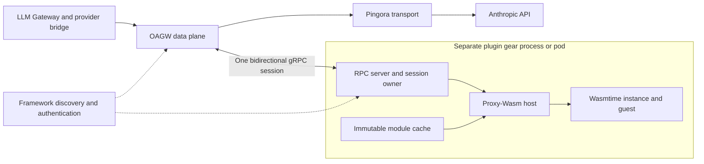
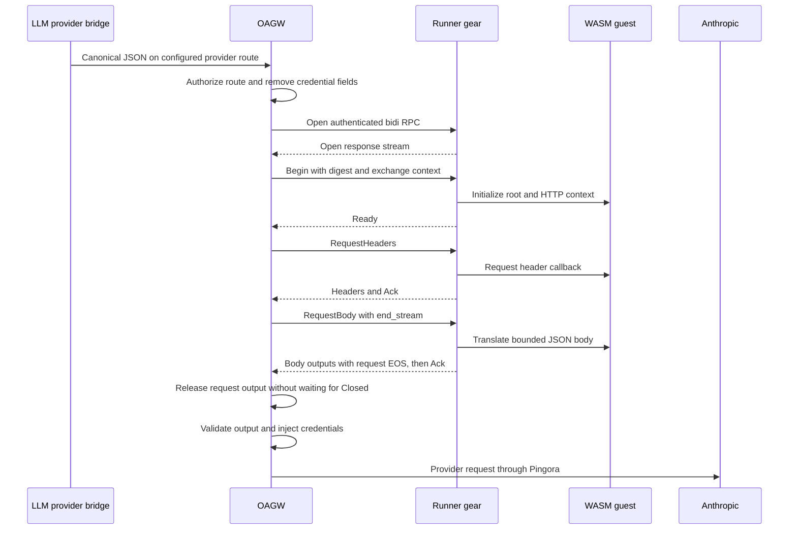
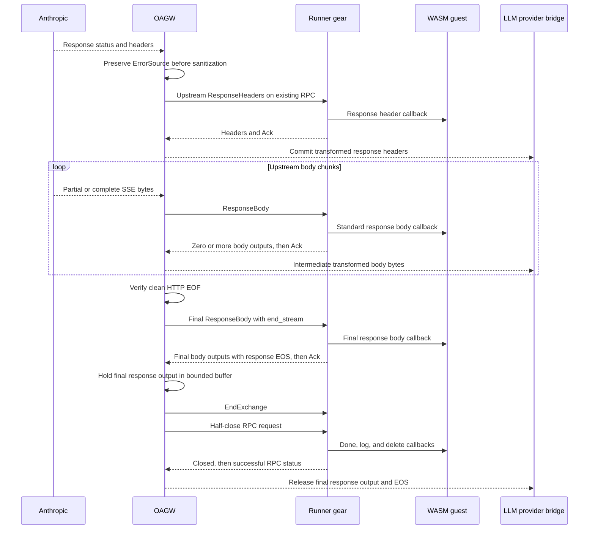
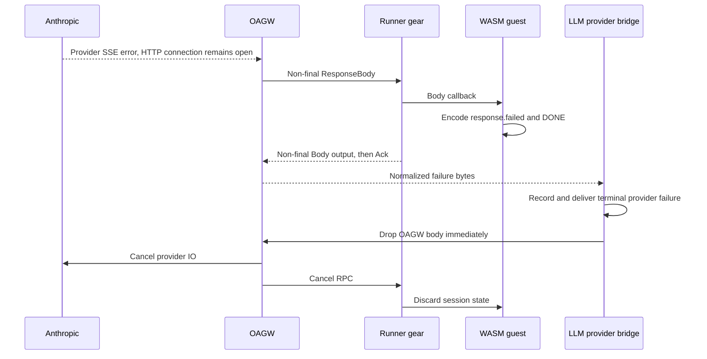

# WASM Stream Transformers for OAGW

This document proposes an OAGW extension.
It does not describe an implemented feature.

The first adapter converts Anthropic Messages responses to Open Responses.
It also converts the corresponding request.
The adapter supports text and function calls over SSE.

The [ADR](./0017-wasm-plugins.md) records the architecture choice.
The main [OAGW design](../../DESIGN.md) remains the platform reference.

## Terms

- **Host:** the code that calls a WASM module.
- **Guest:** the WASM module that contains adapter code.
- **Runner:** the plugin gear that contains Wasmtime and the Proxy-Wasm host.
- **Session:** one transformer RPC for one HTTP request and its response.
- **Frame:** one message on the transformer RPC.
- **Chunk:** a finite sequence of body bytes. A chunk is not an SSE event.
- **Commit:** the point after which OAGW cannot change response headers.
- **Backpressure:** a limit that stops a producer until a consumer can accept more data.
- **Half-close:** the end of one RPC direction. The other direction can remain open.
- **ABI:** the binary interface between the host and the guest.
- **OoP:** a gear that runs in a separate process.
- **Required transformer:** an adapter that OAGW cannot bypass after an error.
- **Clean EOF:** the end of a body after valid HTTP framing completes.
- **Normalized failure:** an application error that the adapter represents in the public response format.

## Current Implementation and Extension Boundary

The baseline contains these capabilities:

- Pingora provides the provider connection and HTTP transport.
- The proxy bridge returns headers and an `oagw_sdk::body::BodyStream`.
- `finalize_response` applies response plugins before it returns the body stream.
- The SSE body wrapper applies an idle timeout and observes shutdown.
- That wrapper currently returns ordinary EOF for idle timeout and shutdown.
- The SDK contains an SSE parser and typed event streams.
- Framework OoP support provides gear startup, discovery, authentication, and shutdown.

The baseline has these limits:

- Native plugin registries contain local Rust objects.
- Transform contexts contain metadata and headers. They do not contain body streams.
- Transform errors use log-and-continue behavior.
- OAGW has no public remote transformer contract.
- OAGW has no WASM runtime dependency.
- Contract generation supports unary and server-streaming methods.
- The gRPC IR has a client-streaming flag. Current code generation does not use that flag for request streams.
- Current consumer wiring selects a REST resolving client by default.
- Its directory resolver and readiness probe resolve REST endpoints.

The main design describes some planned features.
Those descriptions do not prove that the baseline implements them.
In particular, the current native registries do not provide remote plugin discovery.

The extension adds a required stream-transform stage.
It does not convert native Auth, Guard, or Transform plugins to WASM.

LLM Gateway retains these responsibilities:

- Model resolution and capability checks.
- Quota checks and credit conversion.
- Usage delivery and audit events.
- Provider fallback and generation deadlines.
- Pre-call hooks and post-response hooks.

OAGW retains provider routing, credentials, transport limits, and outbound policy.
The guest does not select a network destination or get a provider credential.

The first adapter supports only the documented text and function-call subset.
It rejects unsupported inputs before the provider call.
Image, audio, batch, realtime, and reasoning conversion are outside the first adapter.

## Components and Process Boundaries



The proposed gear name is `oagw-wasm-runner`.
The proposed backend interface name is `OagwTransformBackend`.
The interface belongs to `oagw-sdk`.
The RPC server belongs to the runner implementation.

The runner is an OAGW plugin gear.
Other gears call OAGW. They do not call the runner directly.

OAGW resolves a runner backend through framework discovery.
The generic contract extension adds a generated gRPC resolving client and transport-aware consumer wiring.
Those parts do not exist in the baseline.
A scoped ClientHub entry holds the configured resolving client.

ClientHub stores objects in one process.
Registration in a runner process does not register an object in the OAGW process.
The OAGW process must construct or resolve its own remote client.

Use the existing SDK, transport, and OoP lifecycle patterns.
Do not add a second process supervisor or a separate service-discovery system.
A Kubernetes deployment owns pod start and restart.
A local OoP deployment uses the framework process backend.

Each RPC selects one runner instance.
The channel and stream remain on that instance until the RPC ends.
Discovery can select another instance for a new session.
It must not move an active guest context.

The [gRPC discovery path](#grpc-discovery-and-readiness) defines endpoint selection and readiness.
It uses registered gRPC service endpoints, not REST endpoints.

### Failure Boundaries

A guest trap ends its session and discards its instance.
A loop reaches an execution limit and has the same result.
Other guest instances can continue.

A runner process crash ends every session in that process.
A pod restart has the same effect.
OAGW remains available if its own process and dependencies remain healthy.

Process isolation does not remove shared node limits.
Set process or container resource limits.
Do not promise that a WASM sandbox prevents every runtime defect.

The first release creates one Wasmtime Store and instance for each session.
It does not share mutable guest memory between sessions.
This choice limits state leaks and avoids guest re-entry.

Compiled modules can remain in a bounded cache.
Cache keys include the artifact digest, runtime build, target, and compiler options.
A cache entry does not contain a live Store or request data.

## OAGW Request and Response Stages

### Request Stage

Requests without a WASM binding keep the existing path.

For a bound request, use this order:

1. Authenticate the caller and resolve the effective upstream and route.
2. Apply existing authorization, CORS, and request-size gates.
3. Resolve the required transformer binding and its runner.
4. Open the RPC and get session admission.
5. Send a credential-free request view to the runner.
6. Accept transformed headers, body output, and explicit request EOS.
7. Validate the final method, path, query, headers, and body limits.
8. Apply native authentication and the existing native plugin sequence.
9. Apply final target and protected-header checks.
10. Select the endpoint, apply rate limits, and dispatch through Pingora.

Release final request callback output before provider dispatch.
Do not wait for `Closed` or response completion to release request output.
The first adapter dispatches only after request output EOS and its acknowledgement.

A request-scoped session owner handles every early return after admission.
It cancels the runner on native auth, guard, target, or rate-limit failure.
It transfers ownership to the response body only after response setup succeeds.

The new stage runs before native credential injection.
Do not move the existing native plugins relative to each other.
Native guards still inspect the native outbound view.

For this release, the route already names the provider path.
The provider bridge calls the configured Anthropic route.
The guest changes the body format and permitted headers.
It cannot change the method, path, authority, scheme, port, or upstream.

Compare protected fields with the resolved route after the guest returns.
Reject a changed protected field.
Do not rematch a guest-selected route or attach credentials to a different target.

Reapply header rules for hop-by-hop fields and internal headers.
The guest cannot set `Authorization`, `Proxy-Authorization`, `Cookie`, or configured credential headers.
The guest cannot set `Host`, `Content-Length`, or `Transfer-Encoding`.
OAGW owns those fields.

The runner receives an allowlisted header view.
Remove caller credentials, provider credentials, and framework transport credentials.
Do not copy the authenticated `SecurityContext` into guest memory.

Keep the original route identity for authorization and metrics.
Do not accept route identity from guest output.

### Response Stage

At `finalize_response`, extract `ErrorSource` from the original bridge headers before any sanitization.
Keep that value in OAGW-owned response metadata.
Do not derive it from the guest's returned header list.

Pingora can return a gateway Problem through the ordinary HTTP bridge.
A connection failure does not always produce a body-stream error.
If the source is gateway, abort the transformer session.
Return the original canonical gateway response through the existing error policy.
Do not send that Problem body to the provider adapter.

For an upstream response, keep raw upstream guard checks before transformation.
A raw guard can reject a missing provider header.

Send the sanitized upstream status and headers to the same session.
Use an explicit response-header allowlist for the guest view.
Remove cookies, credentials, and internal headers before that view leaves OAGW.
The guest cannot read or change the preserved `ErrorSource`.

Start the session body pump before waiting for transformed headers.
That pump owns the upstream stream while headers remain paused.
After header output arrives, apply native response transforms, CORS, configured headers, and final sanitization.

Wrap the returned body with the session output adapter.
Transfer session ownership to that wrapper.
The wrapper yields transformed output and propagates terminal errors.

A guest can pause response headers until it receives body data.
Continue the body pump during that pause.
Bound all data that arrives before header commit.
The first Anthropic adapter does not pause headers on successful SSE responses.
For a non-2xx response, it can pause headers and convert a bounded JSON error.
It preserves the provider failure status and emits a normalized JSON error body.
A successful response with a non-SSE content type fails before commit.
The first SSE adapter also rejects a successful bodyless response before commit.
That response has no provider terminal event.

Remove upstream `Content-Length` when a body transformer is active.
Recompute request length only when OAGW has the complete transformed request.
Otherwise, let the transport select valid framing.
Do not copy chunked transfer framing into the guest or the RPC.
Apply framing checks after native response rules as well.
Preserve the OAGW-owned error source when constructing the final response.

Do not decompress data implicitly.
The first adapter sends `Accept-Encoding: identity`.
Reject a successful provider response with an unsupported content encoding.
Ordinary unbound traffic keeps its existing content-encoding behavior.

The first release supports one WASM transformer per effective route.
Count bindings after the existing upstream and route merge.
Reject multiple effective WASM bindings before dispatch.
Preserve existing ordering among native plugins.
A future release can define an ordered WASM chain.

### Body End Causes

The bound path needs a lifecycle adapter that preserves the reason for body completion.
It cannot reuse the baseline SSE wrapper unchanged.
That wrapper returns `None` for both idle timeout and shutdown.

Classify these causes before the transformer:

- `CleanEof`: HTTP framing completed without a read error.
- `IdleTimeout`: an active upstream read exceeded its idle deadline.
- `Shutdown`: the proxy stopped the exchange.
- `TransportError`: upstream IO or HTTP framing failed.

Only `CleanEof` becomes a final response input frame with `end_stream = true`.
Map other causes to a typed stream error and cancel or abort the RPC.
Do not invoke guest success finalization for those causes.
A decoded provider terminal event cannot turn a timeout into clean EOF.

Keep upstream idle detection before the guest.
A guest that removes heartbeat events must not cause a false upstream idle timeout.
Measure upstream idle time only while OAGW can accept upstream data.
Suspend that clock during downstream backpressure.
On resume, start a fresh upstream read interval.
Do not let an expired suspended timer discard available data.

The absolute exchange deadline remains active.
Transformer progress deadlines remain separate from upstream idle detection.
Keep existing lifecycle behavior for requests without the new binding.

### Request Sequence



### Response Sequence



The OAGW input pump and output drain run concurrently.
Neither waits for the entire HTTP response before it starts.
Header pause does not prevent input body callbacks.
The provider bridge can decode intermediate events before the provider completes.

### Early Provider Failure Sequence



This path does not wait for provider EOF or `Closed`.
The application failure event does not mean transport success.
The [early failure rule](#early-normalized-failure) defines the required consumer behavior.

## Remote Transformer Contract

All names in this section are proposed SDK names.
They are not existing types.

### Contract Shape

The contract macro extension appears later in this document.
The declaration uses that proposed syntax.

```rust
#[toolkit_contract::contract(gear = "oagw-wasm-runner", version = "v1")]
pub trait OagwTransformBackend: Send + Sync {
    #[client_streaming]
    #[streaming(open = fallible)]
    async fn transform(
        &self,
        ctx: &SecurityContext,
        frames: TransformInput,
    ) -> Result<TransformOutput, CanonicalError>;
}
```

The emitted method accepts a fallible input stream.
It returns a fallible output stream after the RPC opens.
The error type remains the framework canonical error type.

Use protobuf messages with a `oneof` for frame bodies.
Represent headers as repeated name and byte-value pairs.
Preserve duplicate headers and their order.
Do not use a map for HTTP headers.

### Input Frames

Every input frame has a sequence number.
Numbers start at zero and increase by one.

- `Begin`: protocol version, module digest, ABI profile, adapter configuration, request ID, and application context.
- `RequestHeaders`: method, path, query, headers, and `end_stream`.
- `RequestBody`: raw bytes and `end_stream`.
- `ResponseHeaders`: upstream status, sanitized headers, and `end_stream`.
- `ResponseBody`: raw bytes and `end_stream`.
- `EndExchange`: both input directions and both output directions ended, and their final acknowledgements arrived.
- `Abort`: a bounded gateway error code and the last accepted sequence number.

`Begin` must be the first frame.
Adapter configuration cannot contain secrets.
Application context contains only approved fields.

For the first adapter, application context contains the response ID and creation time.
The LLM provider bridge supplies those values.
OAGW reads them from explicitly configured application headers.
OAGW removes those headers before provider dispatch.
These values do not grant authorization.

The protocol version is `oagw-transform.v1`.
The ABI profile is `proxy-wasm-http-v0.2.1-oagw-v1`.
The runner rejects an unknown protocol version or profile.

A gateway-origin Problem does not become `ResponseHeaders` or `ResponseBody`.
OAGW preserves that failure locally and aborts the session.

### Output Frames

Each output frame has its own sequence number.
It also names the input sequence that caused the output.

- `Ready`: accepted digest, runner instance ID, and effective limits. It acknowledges `Begin`.
- `Headers`: direction, final status or request fields, transformed headers, and `end_stream`.
- `Body`: direction, raw output bytes, and `end_stream`.
- `Ack`: input accepted, phase pause state, and retained byte count.
- `Failed`: terminal canonical error, safe detail, phase, and last accepted input sequence.
- `Closed`: successful transformer exchange completion.

The runner sends at most one terminal `Closed` or `Failed` output.
No output frame can follow that terminal frame.
An RPC cancellation can end the session without either terminal frame.

The runner sends exactly one `Headers` result for each normally completed direction.
It sends headers before body output in that direction.
An intermediate body input can produce zero, one, or multiple body frames.

`Begin`, `EndExchange`, and `Abort` use `Ready`, `Closed`, or `Failed` instead of `Ack`.
Other input frames require one acknowledgement.
The runner sends `Ack` after output for that input enters the bounded output path.
Output order places that acknowledgement after all output frames for the same input.

An acknowledgement does not mean that the client received the bytes.
It is not an output EOS signal.
It does not mean that paused HTTP data has reached the provider.

### HTTP Phase Completion

Track input EOS and output EOS separately for each direction.
An ordinary direction has exactly one output EOS.

For bodyless input, the header input has `end_stream = true`.
The runner returns `Headers(end_stream = true)` and then `Ack`.
It sends no body frame and invokes no body callback for that direction.

For input with a body, output headers have `end_stream = false`.
The final body input has `end_stream = true`.
Its output ends with exactly one `Body(end_stream = true)`.
If conversion produces no bytes, send an empty final body frame.
If conversion produces several frames, set EOS only on the last frame.

Do not send output EOS before input EOS.
An early application failure uses the cancellation path described below.
It does not create an early transport EOS.

A header pause can delay output headers until a later input body callback.
Output headers must still precede body output.
A final callback that leaves its phase paused fails the session.

Reject missing EOS before a final acknowledgement.
Reject duplicate EOS, output after EOS, and body output after bodyless headers.
Do not infer output EOS from `Ack` or an empty queue.

Release final request callback output when its callback succeeds.
OAGW can dispatch after request output EOS and the final request acknowledgement.
It must not wait for response completion or `Closed`.

### Response Finalization

Only final response callback output waits for RPC completion.
For bodyless responses, this means the final response header callback output.
For responses with a body, this means output from the body callback for clean EOF.

OAGW drains that output into its bounded finalization buffer.
It still reads the final acknowledgement.
The hold applies to downstream delivery, not RPC draining.

Once both HTTP directions have input EOS and output EOS, OAGW sends `EndExchange`.
Their final acknowledgements must already have arrived.
OAGW then half-closes the RPC request direction.

The runner performs bounded cleanup and sends `Closed`.
It closes the RPC response with successful status.
OAGW then releases the final response output and downstream EOS.
A successful RPC close without `Closed` is an incomplete exchange.

A structured `Failed` ends the application protocol.
A gRPC error can end transport before that frame arrives.
OAGW discards held response output on either failure.
It preserves a structured error when one arrived.
Otherwise, it maps the transport failure to a gateway error.

Earlier response output can reach the consumer before finalization.
A success snapshot must occur only in final response callback output.
A normalized failure can occur earlier under the next rule.

### Early Normalized Failure

The guest can recognize a provider error before HTTP EOF.
It writes a valid normalized failure and the application sentinel into the current response buffer.
It returns CONTINUE.
It does not call `proxy_close_stream` to flush those bytes.

If the input callback is non-final, OAGW forwards that output immediately.
If the input callback represents clean EOF, normal response finalization applies.

The LLM provider bridge must recognize the terminal failure event.
It records the provider error and delivers that terminal failure.
It then drops the OAGW body without waiting for HTTP EOF, RPC completion, or another event.
It does not wait for the sentinel before cancellation if the complete failure event already arrived.

OAGW cancels provider IO and the RPC when that body owner drops.
The runner discards session state.
No `EndExchange` or `Closed` is required on this cancellation path.
A later cancellation error must not replace an already accepted application failure.
Do not create a second terminal event.

This rule needs no private WASM export, host property, or SSE callback.
The guest uses the standard body buffer and CONTINUE action.
The application consumer owns interpretation of the failure event.

A direct OAGW SSE consumer must apply the same terminal-event rule.
A raw byte consumer cannot request automatic application-error detection from generic OAGW.
Without that consumer behavior, only transport deadlines bound the exchange.
This limitation must appear in the adapter usage instructions.

### States and Order

The session has these states:

1. `AwaitBegin`: only `Begin` is valid.
2. `Request`: request headers, followed by zero or more request body inputs.
3. `AwaitResponse`: request input EOS, output EOS, and the final request acknowledgement arrived.
4. `Response`: response headers, followed by zero or more response body inputs.
5. `Finishing`: response input EOS, output EOS, and the final response acknowledgement arrived.
6. `Closed`, `Failed`, or `Cancelled`: no more input is valid.

In `Finishing`, accept only `EndExchange` or `Abort`.
An RPC cancellation can end any active state without another application frame.
`Abort` can end any state after `Begin`.
Duplicate headers, skipped sequence numbers, and data after EOS are protocol errors.

The first release does not support an early provider response during an unfinished request.
OAGW cancels that exchange.
The first provider adapter buffers its small JSON request before dispatch.
OAGW waits for request output EOS before it sends any provider headers.
It bounds both original and transformed JSON request data.
It does not need concurrent request upload and provider response.

HTTP request EOS is not an RPC half-close.
OAGW still needs the RPC request direction for provider response frames.
Only the ordinary completion path half-closes after `EndExchange`.

The first release does not expose HTTP trailers to guests.
Reject a binding that requires trailer callbacks.
Do not advertise complete HTTP filter support.

### Backpressure and Progress

Allow one unacknowledged input frame per session.
This rule is independent of the HTTP pause state.
The output drain remains active while the input pump waits for an acknowledgement.

After an intermediate body callback returns PAUSE, the runner can acknowledge the input.
OAGW can then send the next body input.
The host retains paused bytes within its limit.
This rule prevents a pause from blocking the bytes needed to complete an SSE event.

The guest SSE helper normally consumes incomplete event bytes into its own bounded state.
It clears the forwarded body buffer and returns CONTINUE.
It does not need host-level PAUSE for every partial event.

The runner splits a changed body buffer into bounded output frames.
The RPC queue never holds an entire generation.
The current callback buffer has a separate finite memory allowance.

Stop upstream polling when response output cannot drain.
Also bound gRPC message size and HTTP/2 flow-control windows.
Application queue limits alone do not bound transport buffers.

OAGW starts a callback progress timer when it submits an input.
Intentional HTTP PAUSE does not suspend that timer.
The runner acknowledges each callback even when the HTTP phase stays paused.

Suspend the RPC progress timer while OAGW stops its output drain for downstream backpressure.
Suspend the upstream idle clock during the same pause.
The absolute exchange deadline remains active.
Do not report a slow consumer as excessive guest CPU time.

### Cancellation and Deadlines

Use a session cancellation token linked to the RPC and the OAGW request or body owner.
Cancellation discards guest state and closes provider IO.
The runner must observe cancellation between callbacks.

A guest loop requires fuel or epoch interruption.
A Tokio timeout alone cannot stop synchronous guest execution.
Apply a separate wall-clock bound to host functions.

If the caller drops the OAGW body, OAGW cancels the session.
The early normalized failure rule also uses that operation.
LLM Gateway can retain its stream owner when ordinary post-response processing needs it.
It must release that owner promptly after a terminal provider failure.

After provider dispatch, do not replay input frames or reopen the exchange.
A failed or cancelled session cannot move to another runner.
A new HTTP request is a new session.

## Proxy-Wasm HTTP Profile

The profile uses the [Proxy-Wasm v0.2.1 ABI](https://github.com/proxy-wasm/spec/blob/main/abi-versions/v0.2.1/README.md).
It is a restricted host profile, not full specification conformance.
The specification requires the complete host-function surface.

The following names define the proposed capability surface.
Names are ABI identifiers, not new OAGW functions.

### Guest Exports

Require `proxy_abi_version_0_2_1` and a valid linear memory.
Support module initialization through `_initialize` or `_start`.
Follow the ABI rules when a module also exports `main`.

Support `proxy_on_memory_allocate`, with `malloc` as the ABI fallback.
Apply memory limits before allocation.

A false setup result rejects admission.
Invoke these optional exports when the module provides them:

- `proxy_on_context_create`.
- `proxy_on_vm_start` and `proxy_on_configure`.
- `proxy_on_request_headers` and `proxy_on_request_body`.
- `proxy_on_response_headers` and `proxy_on_response_body`.
- `proxy_on_done`, `proxy_on_log`, and `proxy_on_delete`.

Create one root context and one HTTP context for each session instance.
Keep the HTTP context across request and response callbacks.
Serialize callbacks for that instance.

Configuration includes the approved adapter settings and exchange context.
Use the plugin-configuration buffer.
Do not expose deployment environment variables.

### Host Functions

Support these imports in the `env` namespace:

- `proxy_log` and `proxy_get_log_level`.
- `proxy_get_current_time_nanoseconds`.
- `proxy_get_buffer_bytes` and `proxy_set_buffer_bytes`.
- `proxy_get_header_map_size`.
- `proxy_get_header_map_pairs` and `proxy_set_header_map_pairs`.
- `proxy_get_header_map_value`, `proxy_replace_header_map_value`, `proxy_add_header_map_value`, and `proxy_remove_header_map_value`.
- `proxy_continue_stream` and `proxy_close_stream`.
- `proxy_set_effective_context` and `proxy_done`.

Restrict buffer access to the active callback and its permitted phase.
Permit configuration buffers during setup.
Reject cross-context access.

Header views contain approved fields and standard HTTP pseudo-headers.
Request pseudo-headers are read-only in this profile.
Response `:status` can change before response header commit.
Preserve repeated header values.

PAUSE retains the current phase buffer.
Later body callbacks see all retained bytes for that phase.
CONTINUE releases the resulting buffer in order.
Never forward the same retained bytes twice.

`proxy_continue_stream` resumes the active HTTP request or response phase.
The first profile permits it only during a serialized callback.
It has no external asynchronous callback source.

`proxy_close_stream` stops the exchange.
It cannot bypass required adapter failure handling.

Apply bounded cleanup when `proxy_on_done` delays completion.
Support `proxy_done` during that cleanup.
Discard the instance after the cleanup deadline.

### Unsupported Capabilities

Do not provide HTTP or gRPC callouts, shared data, queues, timers, foreign functions, or mutable host properties.
Do not provide L4, metrics, background-service, trailer, or local-response capabilities.

Do not provide filesystem, socket, process, or general WASI access.
The first guest target is `wasm32-unknown-unknown`.
A later profile can define a small WASI surface.

Inspect all imports before a module becomes ready.
Reject an import outside the supported list.
Do not bind an unsupported import to a successful no-op.
Use the ABI's defined error statuses for invalid calls to supported functions.

Pin the Rust SDK version and toolchain in the guest fixture.
Check the actual import table.
A source-level callback subset does not prove that the binary has only supported imports.

Do not claim that every Envoy module can run here.
Test the same guest binary in this runner and Envoy.
Compare output events, not network chunk boundaries.
Envoy-specific properties and capabilities remain outside the portability claim.

## Guest SSE Helper

The helper is guest code above standard HTTP body callbacks.
It does not add an SSE callback to Proxy-Wasm.
Rust is the first supported helper language.
Other languages can implement the same helper behavior with their own Proxy-Wasm SDK.

Expose these proposed helper operations:

- `push(bytes)` accepts a body fragment and returns complete SSE frames.
- `finish()` validates the remaining bytes at HTTP end-of-stream.
- `encode(frame)` writes a complete SSE frame.
- `map_event(event)` can return zero, one, or multiple events.
- A terminal provider failure produces its normalized error event immediately.
- After that failure, the helper ignores later content while the application consumer cancels the stream.

The parser retains incomplete UTF-8 sequences across callbacks.
It strips one initial byte-order mark.
It handles LF, CRLF, and CR line endings.
It retains a trailing CR until it can determine the next line boundary.

A blank line ends an event.
Join repeated data fields with a newline.
Ignore unknown SSE fields.
Ignore an ID field that contains a null character.
Validate retry values without integer overflow.

Keep comments as comment frames.
Do not turn a comment into a data event.
The first adapter converts provider ping events to SSE comments.
Comments preserve connection activity without adding Open Responses sequence numbers.

Do not assume that one callback contains one event.
One callback can end several events and start another.
One UTF-8 character can span callbacks.

The generic parser discards an unfinished event at EOF.
The provider adapter uses strict finalization for normal completion.
It requires a provider terminal event and no unfinished data event.
Only verified clean HTTP EOF invokes that finalization.
Invalid UTF-8, invalid JSON, or incomplete required data causes adapter failure.
If a valid failure event can be encoded, emit it immediately.
Otherwise, reset the HTTP response phase and stop the session.

The existing SDK parser is useful source material.
Do not reuse it without conformance tests.
Its current implementation normalizes each text fragment separately.
That approach needs checks for CRLF split across chunks and split byte-order marks.
Its buffer also needs an explicit event-size limit for this use case.

### Rust Guest Example

This example shows the proposed helper API.
The helper crate and adapter types do not exist yet.
The example is a design sketch, not a tested build.

```rust
use proxy_wasm::traits::{Context, HttpContext};
use proxy_wasm::types::Action;
use oagw_wasm_guest::{AnthropicAdapter, SseDecoder};

struct AdapterContext {
    sse: SseDecoder,
    adapter: AnthropicAdapter,
}

impl Context for AdapterContext {}

impl HttpContext for AdapterContext {
    fn on_http_response_body(&mut self, size: usize, end: bool) -> Action {
        let input = self.get_http_response_body(0, size)
            .unwrap_or_default();

        let converted = (|| {
            let events = self.sse.push(&input)?;
            let mut output = self.adapter.encode_events(events)?;
            if end {
                let tail = self.sse.finish()?;
                output.extend(self.adapter.finish(tail)?);
            }
            Ok::<Vec<u8>, oagw_wasm_guest::AdapterError>(output)
        })();

        match converted {
            Ok(output) => {
                self.set_http_response_body(0, size, &output);
                Action::Continue
            }
            Err(_) => {
                self.set_http_response_body(0, size, &[]);
                self.reset_http_response();
                Action::Pause
            }
        }
    }
}
```

The error branch shows the required stop behavior when normal conversion cannot produce safe output.
Provider errors that the adapter can normalize use its ordinary event path.
That path emits `response.failed` and the sentinel in the current callback.
The helper records that failure to prevent duplicate terminal output.
The LLM provider bridge then cancels the source stream.
The guest does not use response reset to flush a normalized failure.

The real guest also needs SDK entry-point registration and context construction.
Its request callback buffers only the approved JSON limit.
The helper must check output limits before it creates a large vector.

No event output does not mean EOF.
Only the HTTP end-of-stream flag ends the body.
A guest error must not release the original input buffer.

## First Provider Adapter

### Request Conversion

The provider bridge sends a bounded canonical request through the selected OAGW route.
The guest converts that request to Anthropic Messages JSON.

The first request subset contains text, system instructions, function definitions, function results, and generation limits.
A configured binding supplies the provider model ID.
The guest cannot query Model Registry.

Convert canonical function-call records to provider tool-use records.
Convert function results to provider tool-result records.
Preserve call IDs.
Do not execute tools.

Reject unsupported media or parameters before provider dispatch.
Do not silently remove a required feature.

### Response Conversion

The following mapping defines the first adapter behavior.
It uses the [Anthropic event format](https://platform.claude.com/docs/en/build-with-claude/streaming) as input.

- `message_start`: start the normalized response and capture initial usage.
- Text block start: open a message item and an output-text content part.
- Text delta: emit `response.output_text.delta`.
- Text block stop: emit text-done and content-part-done events.
- Tool block start: open a function-call item with its name and call ID.
- Input JSON delta: emit `response.function_call_arguments.delta`.
- Tool block stop: validate the complete JSON arguments and close the function-call item.
- `message_delta`: update stop reason and cumulative usage.
- `message_stop`: close remaining valid items and mark the provider result as terminal.
- `ping`: emit a comment.
- Provider error: emit a normalized terminal failure immediately. The provider bridge then cancels the source stream.

Keep a provider block-index to output-item mapping.
Several text blocks can belong to one message item.
A tool block has its own function-call item.
Use stable item IDs and content indexes.

Start `sequence_number` at zero and increase it for each normalized data event.
The SSE event name and JSON type must agree.
Preserve the response ID supplied by the provider bridge.

Treat partial tool arguments as text fragments.
Do not parse each fragment as complete JSON.
Validate only the assembled arguments at block completion.

Replace cumulative token values.
Do not sum repeated cumulative updates.
Keep usage accounting and credit delivery in LLM Gateway.
Never invent missing usage after a transport failure.

Hold a completed or incomplete response snapshot until clean HTTP end-of-stream.
The helper checks all remaining bytes before it creates that snapshot.
OAGW holds only final response callback output until RPC finalization succeeds.
It releases final request output before provider dispatch.

For normal stop and tool-use stop, emit a completed response.
For a generation-length stop, emit an incomplete response.
Treat a provider error as a failed response.
Treat an unsupported stop reason as an adapter failure.

For a provider error, encode `response.failed` and the sentinel in the current callback.
Do not wait for provider EOF.
The callback returns CONTINUE so its output can reach the consumer.
If the callback is non-final, its output bypasses the response finalization hold.
The provider bridge accepts the complete failure event and immediately drops the OAGW body.
OAGW then cancels upstream IO and the RPC.

For malformed data, use the same early failure path when a valid snapshot can be encoded.
Otherwise, reset the response phase and report an incomplete stream.
The bridge creates the public failure when the guest cannot encode one.
Do not emit a second failure after the bridge accepted a normalized failure.

The application failure outcome does not require a clean transport close.
A normal completed or incomplete outcome requires clean HTTP EOF and successful RPC finalization.
Do not emit a success snapshot after a failure.

Unknown events do not automatically become text.
Ignore documented control-only additions when they cannot change output meaning.
For an unsupported content block, use the adapter failure path.

### Wire Schema Gate

The target event types live in the existing LLM Gateway SDK.
The [published Open Responses reference](https://www.openresponses.org/reference) is an additional conformance target.

The baseline SDK has a known field mismatch:

- `OutputTextEvent` uses `text` for both delta and done events.
- `FunctionCallArgumentsEvent` uses `arguments` for both delta and done events.
- The published delta events use the field name `delta`.

Resolve that mismatch in a separate SDK change before adapter acceptance.
Split delta and done payloads, or apply event-specific serialization.
The accepted wire fixtures must use `delta` for delta events.
The done fixtures retain `text` or `arguments`.

Do not hide this mismatch with a private guest wire format.
The WASM infrastructure can proceed before that SDK change.
The Anthropic adapter cannot claim Open Responses conformance before the wire tests pass.

The baseline SDK expects `data: [DONE]` after a terminal event.
Keep that behavior for the first adapter.
The sentinel has no sequence number.

### Error Ownership

Keep response origin in OAGW-owned metadata from the original bridge response.
Extract it before header sanitization.
The guest cannot overwrite it.

Before commit, a gateway-origin Problem bypasses provider conversion.
Abort the runner and preserve that canonical gateway failure.
An upstream status failure remains upstream-origin after valid conversion.
LLM Gateway maps either result to its public error contract.

After commit, OAGW cannot replace status or headers.
A live adapter can emit a normalized failure immediately.
The provider bridge preserves that application failure and cancels the OAGW body.
A later RPC cancellation cannot replace that accepted failure.

If the guest traps or the runner crashes, OAGW ends the body with an error.
The bridge detects the incomplete normalized stream.
LLM Gateway creates the public terminal failure unless one already arrived.

A direct OAGW caller must distinguish an application failure from successful transport completion.
An SSE-aware caller cancels after a terminal failure.
A raw byte caller receives only transport behavior and must enforce its own cancellation policy.

An upstream idle timeout, shutdown, or framing error is not clean EOF.
OAGW sends a best-effort abort and cancels the RPC.
The first profile has no guest callback for those transport errors.
The bridge owns terminal synthesis when the guest cannot run.

## Resource Limits and Safe Defaults

These values are proposed prototype defaults.
They are finite limits, not measured capacity claims.
Route or runner configuration can reduce them.
An administrator must approve increases.

- Module artifact: 8 MiB.
- Guest linear memory: 64 MiB per session.
- Active sessions: 8 per runner.
- Compiled-module cache: 128 MiB per runner.
- Body frame payload: 32 KiB.
- RPC message: 128 KiB, including metadata fields.
- Header view: 64 KiB per direction.
- Configuration and exchange context: 64 KiB together.
- Pending RPC output queue: 256 KiB per session.
- Host-retained paused body: 512 KiB per direction.
- Changed callback body buffer: 4 MiB.
- OAGW final response body buffer: 4 MiB per session.
- Final response headers: the separate 64 KiB header limit.
- JSON request: 1 MiB.
- SSE event: 256 KiB before conversion.
- Assembled normalized response: 1 MiB.
- Total transformed response bytes: 32 MiB.
- Guest fuel: 10 million units per callback.
- Guest wall-clock deadline: 100 ms per callback.
- RPC admission and module setup: 2 seconds.
- Per-input RPC progress deadline: 2 seconds.
- Upstream idle deadline: 30 seconds.
- Total exchange deadline: 300 seconds.
- Guest cleanup deadline: 100 ms.
- Process or container memory limit: 2 GiB.

Apply the smaller applicable limit when OAGW already has a stricter setting.
A body-transform binding must not increase the base OAGW request-size limit.

Reset callback fuel before each callback.
Track total exchange time independently.
Startup and cleanup callbacks also have limits.

Run guest callbacks on a bounded execution pool.
Do not block a Tokio IO worker with synchronous guest execution.
Do not hold shared registry locks during a callback.

Fuel does not limit native host-function work.
Each host function validates lengths before allocation.
Bound logging, header conversion, memory copies, and output expansion.

The completed snapshot requires finite assembly.
Stop with an adapter error when the normalized response exceeds its size limit.
Do not buffer an unlimited generation to produce a final snapshot.

Admission reserves capacity before instance creation.
Reject excess sessions without an unbounded wait queue.
Choose resource pools by trust boundary and module workload.
A failed module must not cause unlimited instance restarts.

Never return a trapped instance to a pool.
Run cleanup once where possible.
After a trap, discard state without depending on guest cleanup callbacks.

## Generic Toolkit Contract Extension

This work is a separate framework change.
It has no OAGW, WASM, or provider dependency.

### Proposed Source Syntax

Keep the current `#[streaming]` behavior.
Add the method marker `#[client_streaming]`.

For a request-stream method, require one wire parameter.
Its source type denotes the input item.
A separate security-context parameter remains off the wire.

```rust
#[toolkit_contract::contract(gear = "stream-demo", version = "v1")]
pub trait StreamDemoBackend: Send + Sync {
    #[client_streaming]
    async fn upload(
        &self,
        ctx: &SecurityContext,
        frames: UploadFrame,
    ) -> Result<UploadResult, CanonicalError>;

    #[client_streaming]
    #[streaming(open = fallible)]
    async fn exchange(
        &self,
        ctx: &SecurityContext,
        frames: InputFrame,
    ) -> Result<OutputFrame, CanonicalError>;
}
```

The same direction markers appear on the gRPC projection.
The new marker does not contain transport framing settings.

The emitted exchange signature has this shape:

```rust
type ContractStream<T, E> =
    Pin<Box<dyn Stream<Item = Result<T, E>> + Send + 'static>>;

async fn exchange(
    &self,
    ctx: &SecurityContext,
    frames: ContractStream<InputFrame, CanonicalError>,
) -> Result<ContractStream<OutputFrame, CanonicalError>, CanonicalError>;
```

The emitted upload method accepts the same input-stream wrapper.
It returns one `UploadResult`.

Require `async fn` for the new request-stream methods.
Require `open = fallible` when the method also returns a stream.
Do not introduce an immediate-open request-stream variant in the first extension.

### IR and Generation

Add client-streaming and bidirectional variants to the contract method kind.
Preserve the existing variant names and serialized forms.

Keep the request item as the sole wire input field.
The method kind identifies that field as a sequence of items.
Do not add required public fields to IR structs.

Update both direction checks in gRPC binding validation.
Reject a direction mismatch between the base contract and projection.
Retain the existing off-wire security-context role.

Update protobuf generation to emit a streamed request.
Keep the existing protobuf input-mapping rules for every method kind.
For one named wire parameter, stream that named message directly.
Do not add a wrapper around each named input item.
A primitive input still uses the established synthesized request message.
Security context remains outside those messages.

For the exchange example, the generated shape is:

```proto
service StreamDemoBackend {
  rpc Upload(stream UploadFrame) returns (UploadResult);
  rpc Exchange(stream InputFrame) returns (stream OutputFrame);
}
```

This fragment omits imported message definitions.
Keep established message and field-number allocation rules.
Keep input DTO-to-protobuf conversions consistent with those direct request types.
Do not expect an `UploadRequest` or `ExchangeRequest` wrapper for these named inputs.

Update generated clients, server adapters, delegation, descriptors, and feature gates.
Use the existing framework gRPC connection utilities.
Do not implement a second channel pool.
The next section adds the missing gRPC discovery and readiness path.

### gRPC Discovery and Readiness

Current `consumes` wiring selects a REST resolving client.
Current `DirectoryEndpointResolver` resolves REST endpoints.
Selecting a generated gRPC client alone does not change either behavior.

Add these generic framework parts in the same separate prerequisite change:

- A generated gRPC resolving wrapper for each gRPC contract.
- An explicit `transport = grpc` selector on consumer wiring.
- A gRPC consumer registration beside the existing REST registration.
- A gRPC directory adapter and matching readiness probe.

Keep REST as the default for existing consumer declarations.
Keep existing REST registration types and call signatures compatible.
Use a separate gRPC registration type instead of adding required fields to existing public registration structs.

The gRPC registration selects its gRPC resolver for both client calls and readiness.
It must not pass through a REST-only resolver.
A REST endpoint does not make a gRPC-only dependency ready.
The new gRPC registration declares whether the dependency gates host readiness.
Existing declarations remain required by default.
OAGW selects optional host readiness for its runner dependency.
Each bound request still requires successful runner admission.
WASM bindings use the remote client only.
A local ClientHub implementation cannot satisfy the WASM process-isolation requirement.

The OAGW SDK exports the proposed `OagwTransformBackendGrpcResolvingClient`.
Its runtime uses the existing directory SDK and gRPC connection utilities.
The consumer wiring supplies trusted backend selection settings.
It does not supply a request-controlled network address.

A backend key identifies a registered gear, gRPC service name, and optional deployment labels.
OAGW deployment configuration owns that mapping.
For the first runner, the gear identity is `oagw-wasm-runner`.
The proposed service name is `oagw.transform.v1.OagwTransformBackend`.
Separate pools use trusted labels under that gear identity.

The toolkit directory adapter lists registered instances for the selected gear.
It filters by trusted labels and serving state.
It then selects the matching entry from each instance's `grpc_services`.
Do not use the instance's REST endpoint or its unqualified primary endpoint.

Select serving instances by round-robin over stable instance-ID order.
Exclude draining and quarantined instances.
If none remain, report an unresolved dependency.
A directory failure remains distinct from a successful empty lookup.

Cache selection data for at most the existing 1500 ms discovery interval.
Key caches by backend, service, selector, and transport.
Invalidate a failed endpoint for later sessions.
Reuse framework transport channels where possible.

Resolve and select once before each RPC.
Keep the selected endpoint and channel handle for the entire session.
An updated cache affects new sessions only.
Do not reopen a started RPC after endpoint failure.

Before any RPC starts, connection setup can use the existing connection retry policy.
Bound that setup by the admission deadline.
After RPC start, neither discovery nor generated stream code retries the logical exchange.

Register the same gRPC selection query with framework dependency readiness.
Keep route-specific module admission in `Ready`.
Do not make unbound OAGW routes depend on runner availability.
The implementation must distinguish optional transformer capacity from mandatory host startup dependencies.

Test discovery with two runner instances that expose no REST endpoint.
Readiness and client selection must use their gRPC endpoints.
After one instance disappears, an existing RPC fails without replay.
A later session can select the remaining instance.

A fixed endpoint is useful for development tests.
It does not satisfy the discovery acceptance scenario.

### Input Errors and RPC Setup

A local input stream can produce `Err(E)`.
That error is terminal.
It is not a normal request half-close.

The generated client must stop the RPC and preserve that error.
It must not report a later server success as the method result.
For bidi methods, emit one terminal output error if output already started.

Tonic input messages do not carry Rust `Result` values.
The client adapter therefore needs explicit producer-error state and cancellation.
Closing an input channel alone is insufficient.

Before publishing each result, the adapter checks the terminal error state.
A producer error observed before publication takes precedence over an apparent successful EOF.
Already published output cannot be withdrawn.

The generated server maps an incoming gRPC stream failure to the contract error.
It cancels service execution and output production.
A clean request half-close remains valid.
The server can continue to produce response messages after that half-close.

Authentication and authorization precede service processing.
Do not derive identity from an input message.
Use the existing tenant or platform security-context rules for the selected contract.

Fallible open reports transport setup and authentication failures.
It does not promise application admission from the first request item.
The OAGW protocol uses `Ready` for that separate admission decision.

Separate setup timeout, stream idle timeout, and application deadline.
Do not apply the unary timeout as an implicit total generation limit.
Cancellation must stop producer tasks, response drains, and concurrency permits.

### Compatibility and Diagnostics

Existing unary and server-streaming methods keep their public signatures.
Their generated protobuf, field numbers, and error behavior remain unchanged.

Reject these new declarations at compile time:

- More than one wire parameter on a request-stream method.
- A non-async request-stream method.
- A duplicate `client_streaming` marker.
- A retry marker on a request-stream method.
- An immediate-open bidi method.
- A direction mismatch in a projection.
- A REST projection for a request-stream method.

Do not generate a partial REST route silently.
The diagnostic must identify the unsupported method and transport.
Local dispatch remains available.

Do not retry client-streaming or bidi calls automatically.
Connection establishment can retry before it starts the logical RPC.
Discovery retries must not recreate a started RPC with consumed input.

## Configuration and Artifact Delivery

Use the existing plugin binding mechanism.
Add a distinct named transformer type for the runner-backed stage.
Do not overload the current native TransformPlugin trait.

A proposed binding contains these values:

```json
{
  "plugin_ref": "gts.cf.core.oagw.transform_plugin.v1~cf.core.oagw.wasm_stream.v1",
  "config": {
    "runner_backend": "oagw-wasm-runner",
    "module_digest": "sha256:<64 lowercase hexadecimal characters>",
    "abi_profile": "proxy-wasm-http-v0.2.1-oagw-v1",
    "adapter_config": "{\"provider_model\":\"configured-provider-model\"}",
    "response_id_header": "x-llm-response-id",
    "response_created_at_header": "x-llm-response-created-at"
  }
}
```

This is a proposed binding example.
The digest and model values are placeholders.
The existing flat string configuration shape remains usable.
Parse `adapter_config` as bounded JSON once during binding validation.

The named WASM transformer type always means required execution.
Do not add a fail-open switch in the first release.
Unknown modules and invalid configuration reject the bound request.

The runner deployment supplies a read-only artifact directory and an allowed digest list.
Verify each digest before module compilation.
Do not download a module from a request-supplied URL.

The runner registers its gear identity, gRPC service, instance state, and pool labels through framework discovery.
OAGW selects a runner pool from trusted deployment configuration.
The gRPC resolving client and readiness probe use that same selection.
A tenant cannot provide an arbitrary runner network address.

For the first release, one backend identity represents one homogeneous module set.
Separate incompatible module sets into different backend identities or deployments.
A selected runner that lacks the pinned digest returns an admission failure.
It does not fetch another artifact or redirect the active RPC.

Authorize tenant access to bindings before session admission.
Keep the runner transport identity separate from provider credentials.
Apply existing framework authentication to the RPC.

The first release needs no new database table.
Existing route plugin bindings store the digest and settings.
Deployment artifacts remain outside the OAGW database.

### Version Change and Rollback

Publish a new artifact with a new digest.
Validate its imports, configuration, and fixtures before enabling its binding.
Deploy runner capacity that supports both old and new digests.

Change the route binding for new requests.
Existing sessions retain their original digest and configuration snapshot.
Do not replace a module inside a live session.

During rollback, restore the prior binding.
Keep the prior artifact available until its sessions finish.
Do not replay failed sessions.

A draining runner stops new admission.
It continues active sessions until the drain deadline.
It then cancels the remaining sessions and deregisters.
Readiness, discovery removal, and RPC admission must agree during that period.

## Errors and Observability

Use bounded canonical error details.
Do not include prompts, provider payloads, secrets, or WASM memory in default logs.
Disable raw guest text logs by default.
Use static event codes for ordinary diagnostics.
Any debug mode needs restricted access and an explicit data-retention policy.

Before response commit, use these categories:

- Admission capacity exhausted: resource-exhausted.
- Runner unavailable: unavailable.
- Setup or callback deadline exceeded: deadline-exceeded.
- Invalid configured module or profile: failed-precondition.
- Guest trap or invalid runner output: internal.

Map those categories through the existing canonical HTTP error policy.
Do not invent a second HTTP error format.

Provider status failures remain upstream failures unless conversion itself fails.
A runner failure is a gateway failure.
After commit, record a transport or runtime failure and terminate the body with an error.
For a normalized provider failure, preserve its public event and let the bridge cancel the body.
Do not replace that application failure with the resulting cancellation error.
An HTTP error-source header cannot change after commit.

Record these metrics:

- Session admission, active sessions, and capacity rejection.
- RPC setup duration and callback duration.
- Input bytes, output bytes, and output expansion.
- Time until the first normalized event.
- Queue occupancy and retained bytes.
- Guest traps, fuel exhaustion, memory-limit failures, and RPC failures.
- Session cancellation, clean completion, and incomplete completion.

Use bounded labels for backend, adapter version, phase, and result.
Keep request IDs and tenant identifiers in protected traces, not metric labels.
Link OAGW and runner spans with the request ID and transport trace context.

Measure end-to-end adapter overhead with a streaming fixture.
Report process-local and separate-pod results independently.
Do not infer latency from unary RPC benchmarks.
The PRD overhead target is not a proven property of this proposal.

## Delivery and Acceptance

### Stage 1: Generic Contract Extension

Keep this stage in a separate future commit.
Update contract runtime, macros, protogen, discovery wiring, readiness, tests, and documentation together.

Acceptance requires these checks:

- Generated client-streaming and bidi client/server pairs compile.
- Existing unary and server-streaming fixtures keep their public signatures.
- Existing protobuf fixtures keep their bytes and field numbers.
- Named request items use their message directly. Primitive items keep their existing envelope mapping.
- Compile-fail fixtures cover all new invalid declarations.
- A real loopback gRPC exchange returns output before input completes.
- A clean half-close permits later server output.
- An input producer error cannot become successful EOF.
- Authentication and security-context tests pass over the actual transport.
- Drop, deadline, and disconnect release tasks and permits.
- Slow-reader tests prove finite queues and bounded input polling.
- Two gRPC-only runner instances resolve through discovery without a REST endpoint.
- Readiness probes use the same gRPC query as client selection.
- Endpoint changes affect new calls without moving or replaying active streams.

### Stage 2: OAGW Transformer Interface

Add the public backend contract and the required stream stage.
Use a remote native fixture backend before adding Wasmtime.

Verify intermediate output with zero, one, and multiple chunks.
Verify explicit output EOS after a zero-byte final conversion.
Verify bodyless headers, duplicate EOS, missing EOS, and output after EOS.
Verify final request output reaches dispatch without waiting for `Closed`.
Verify final response output remains held until `Closed` and successful RPC status.
Verify header pause does not stop input body callbacks.
Verify response header commit behavior and framing headers.
Verify sequence validation and module admission.

Inject idle timeout and shutdown after a provider terminal event but before HTTP EOF.
Neither cause can produce successful finalization.
Pause downstream longer than the upstream idle interval.
Resume with available upstream data and verify that no false EOF occurs.

Return a real Pingora connection-failure Problem through the bridge.
Verify that its gateway origin survives header sanitization.
The runner must not receive its body as an Anthropic response.
Also verify that a provider-origin error status remains upstream-origin.

Use canary credentials to check the runner input.
The runner and guest must never receive those credentials.
Test protected-field mutation and route escape attempts.

Requests without the new binding must keep their existing behavior.
Existing native plugin ordering must remain unchanged.
A failed required transformer must never release original provider bytes.

### Stage 3: Remote WASM Runner

Add the plugin gear, artifact loading, host profile, and execution limits.

Run real guest modules for a trap, loop, memory growth, and output expansion.
Check that OAGW continues to proxy unrelated requests.
Check that one guest failure does not affect another guest instance.

Kill the runner process during an active stream.
Check that affected sessions fail without replay.
A new request can use another healthy instance.

Repeat the test with separate pods before claiming deployment support.
Check discovery, authentication, resource limits, draining, and restart behavior.

### Stage 4: SSE Helper and Provider Adapter

First resolve the LLM SDK wire-schema mismatch.
Then add the guest helper, adapter, and pinned wire fixtures.

Test each byte split of short UTF-8 and SSE boundary fixtures.
Include split CRLF, split byte-order marks, comments, empty data, and multiple events per chunk.
Test event-size limits and incomplete EOF.

Use a local provider fixture with real HTTP and gRPC.
Do not substitute a fake in-process transformer for this test.
Cover text, fragmented tool arguments, cumulative usage, provider errors, and malformed events.

Send a provider SSE error and leave its HTTP connection open.
The guest must emit a normalized failure before HTTP EOF.
The bridge must deliver that failure and cancel OAGW without waiting for an idle deadline.
Verify cancellation of upstream IO, the RPC, and the runner session.
Verify one public terminal failure and no replacement by the cancellation error.
Repeat with a provider error in the final HTTP callback.

Validate normalized events against the accepted SDK and published wire schemas.
Test the same supported guest binary in Envoy.
Do not claim general Envoy compatibility from that fixture.

A paid provider call is not required for this documentation task.
A later live smoke test needs its own credentials and authorization.

## Source References

Repository links describe the baseline implementation:

- [OAGW native plugin contracts](../../../oagw/src/domain/plugin/mod.rs).
- [OAGW native registries](../../../oagw/src/infra/plugin/registry.rs).
- [OAGW proxy service and finalize_response](../../../oagw/src/infra/proxy/service.rs).
- [OAGW bridge and stream lifecycle](../../../oagw/src/infra/proxy/session_bridge.rs).
- [OAGW SDK SSE parser](../../../oagw-sdk/src/sse/parse.rs).
- [Framework plugin pattern](../../../../../../docs/toolkit_unified_system/03_clienthub_and_plugins.md).
- [Framework OoP pattern](../../../../../../docs/toolkit_unified_system/09_oop_grpc_sdk_pattern.md).
- [Contract method IR](../../../../../../libs/toolkit-contract/src/ir/contract.rs).
- [gRPC binding IR](../../../../../../libs/toolkit-contract/src/ir/grpc.rs).
- [Contract gRPC generation](../../../../../../libs/toolkit-contract-macros/src/grpc_contract.rs).
- [Current consumer wiring](../../../../../../libs/toolkit-contract-macros/src/consumes.rs).
- [Current directory adapter](../../../../../../libs/toolkit/src/discovery.rs).
- [Directory SDK](../../../../../../libs/system-sdks/sdks/directory/src/api.rs).
- [OAGW error-source extraction](../../../oagw/src/infra/proxy/headers.rs).
- [Protobuf generation](../../../../../../libs/toolkit-contract-protogen/src/lib.rs).
- [LLM Gateway provider API](../../../../../llm-gateway/llm-gateway-sdk/src/plugin_api.rs).
- [LLM Gateway event types](../../../../../llm-gateway/llm-gateway-sdk/src/models/streaming.rs).

External references:

- [Proxy-Wasm specification](https://github.com/proxy-wasm/spec).
- [Rust Proxy-Wasm SDK](https://github.com/proxy-wasm/proxy-wasm-rust-sdk).
- [Wasmtime security](https://docs.wasmtime.dev/security.html).
- [Wasmtime execution interruption](https://docs.wasmtime.dev/examples-interrupting-wasm.html).
- [Envoy WASM extensions](https://www.envoyproxy.io/docs/envoy/latest/intro/arch_overview/advanced/wasm).
- [Envoy AI Gateway data plane](https://theagentrouter.ai/docs/concepts/architecture/data-plane/).
- [LLM Gateway PRD](https://github.com/constructorfabric/gears-rust/blob/main/gears/llm-gateway/docs/PRD.md).
- [ASD-STE100 guidance](https://www.asd-ste100.org/about_STE.html).

The text uses short sentences and consistent technical terms.
Technical API names retain their specified spelling.
This review does not provide automated ASD-STE100 certification.
