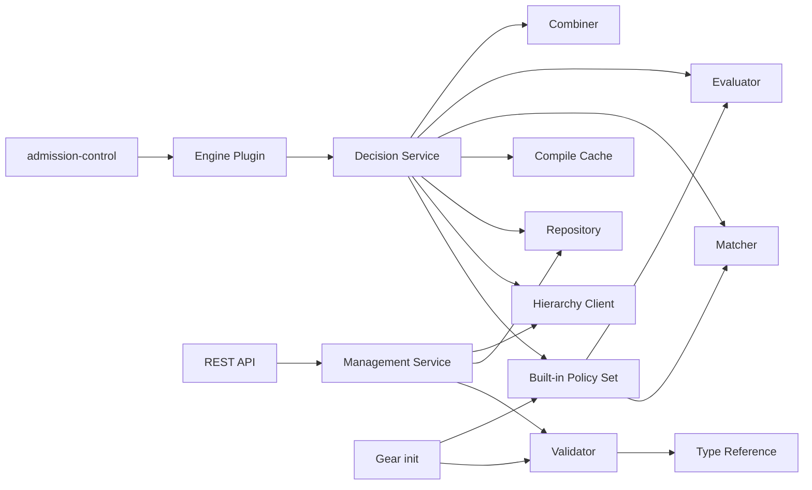
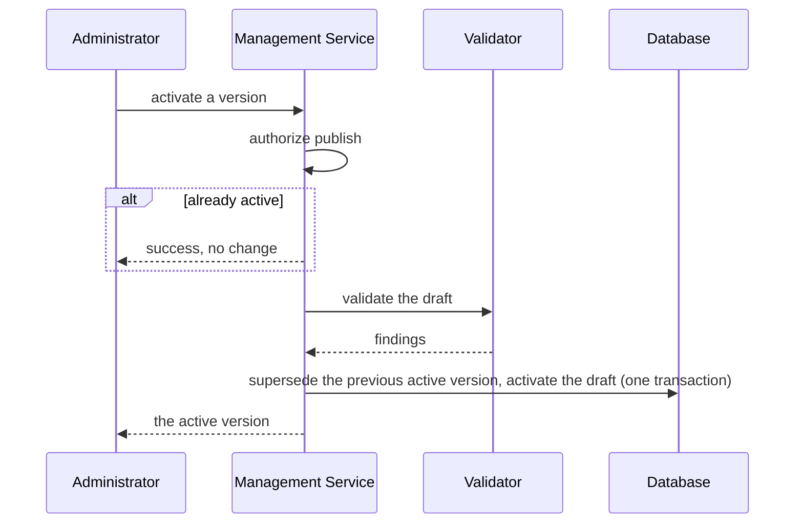

<!-- cpt:
version: 1.0.0
status: draft
module: policy-engine
system: cf
-->

# Technical Design — Policy Engine

<!-- toc -->

- [1. Architecture Overview](#1-architecture-overview)
  - [1.1 Architectural Vision](#11-architectural-vision)
  - [1.2 Architecture Drivers](#12-architecture-drivers)
  - [1.3 Architecture Layers](#13-architecture-layers)
- [2. Principles & Constraints](#2-principles--constraints)
  - [2.1 Design Principles](#21-design-principles)
  - [2.2 Constraints](#22-constraints)
- [3. Technical Architecture](#3-technical-architecture)
  - [3.1 Domain Model](#31-domain-model)
  - [3.2 Component Model](#32-component-model)
  - [3.3 API Contracts](#33-api-contracts)
  - [3.4 Internal Dependencies](#34-internal-dependencies)
  - [3.5 External Dependencies](#35-external-dependencies)
  - [3.6 Interactions & Sequences](#36-interactions--sequences)
  - [3.7 Database schemas & tables](#37-database-schemas--tables)
  - [3.8 Deployment Topology](#38-deployment-topology)
  - [3.9 Expected Sizes](#39-expected-sizes)
  - [3.10 Retention and Deletion](#310-retention-and-deletion)
- [4. Additional context](#4-additional-context)
- [5. Traceability](#5-traceability)

<!-- /toc -->

- [ ] `p1` - **ID**: `cpt-cf-policy-engine-design-policy-engine`

## 1. Architecture Overview

### 1.1 Architectural Vision

Policy Engine is a stateless evaluator over a small relational store. Policy content (bundles, versions, documents,
assignments) is written through a management service and read back on every decision; nothing about a decision is
stored. The gear has two surfaces that share only the content: the management API (a Rust client and REST) and the
`admission-control` engine plugin, which is the only decision surface. It is the gate's default engine.

Built-in policies come from the configuration, are validated like a version's documents and compiled once at startup,
and are never stored. A decision first evaluates the built-ins matching the request, for every tenant; the first denial
ends it. Otherwise it resolves the tenant chain through `tenant-resolver` (barriers always respected; the only resolver call),
checks the caller against that chain, reads the active bindings (assignments with their active version ids, no document
content) along it, keeps the applying assignments and the documents that match the request's resource type and action,
evaluates all of them on the shared Rego facility under one evaluation budget, and returns a permit or a denial. Every error path is
a failure, never a permit.

### 1.2 Architecture Drivers

#### Functional Drivers

| Requirement | Design Response |
|-------------|-----------------|
| `cpt-cf-policy-engine-fr-lifecycle-states` | The store enforces at most one draft and one active version per bundle; `cpt-cf-policy-engine-component-management` allows writes to drafts only. |
| `cpt-cf-policy-engine-fr-bundle-composition` | `cpt-cf-policy-engine-entity-document`; the store enforces unique document names per version. |
| `cpt-cf-policy-engine-fr-content-validation` | `cpt-cf-policy-engine-component-validator`, shared by validate and activate, using `cpt-cf-policy-engine-component-type-reference`. |
| `cpt-cf-policy-engine-fr-builtin-policies` | `cpt-cf-policy-engine-component-builtin-set`, evaluated by `cpt-cf-policy-engine-component-decision` before reachability; first denial wins. |
| `cpt-cf-policy-engine-fr-builtin-validation` | Gear init runs `cpt-cf-policy-engine-component-validator` over the built-ins as one version, except the known-type check, which `post_init` runs once the types registry is ready; any finding fails startup. |
| `cpt-cf-policy-engine-fr-tenant-assignment` | `cpt-cf-policy-engine-entity-assignment`; the store enforces one assignment per bundle and tenant; the decision path reads assignments with their active version ids along the chain and ignores any whose owner tenant is not in the chain at or above its target. |
| `cpt-cf-policy-engine-fr-inheritance-barriers` | `cpt-cf-policy-engine-component-hierarchy-client` always asks for barriers to be respected; no setting changes it. The decision path applies an assignment only while its owner tenant is in the resource tenant's barrier-respecting chain at or above the assignment's target (see 3.6). |
| `cpt-cf-policy-engine-fr-non-enforcing-assignment` | The assignment's enforce flag, the only mutable part of an assignment. |
| `cpt-cf-policy-engine-fr-admission-engine` | `cpt-cf-policy-engine-component-engine-plugin` registers a GTS plugin instance; no other decision client exists. |
| `cpt-cf-policy-engine-fr-cross-tenant` | `cpt-cf-policy-engine-component-decision` checks that the caller's tenant is in the resource tenant's barrier-respecting chain, the same chain that selects policies, before reading any tenant policy. |
| `cpt-cf-policy-engine-fr-applicable-set` | `cpt-cf-policy-engine-component-matcher` over the loaded documents. |
| `cpt-cf-policy-engine-fr-active-content-loading` | `cpt-cf-policy-engine-component-repository` reads active bindings per request; `cpt-cf-policy-engine-component-compile-cache` keyed by version holds compiled content. |
| `cpt-cf-policy-engine-fr-evaluation-input` | `cpt-cf-policy-engine-entity-evaluation-input` built from the request and the caller's security context. |
| `cpt-cf-policy-engine-fr-denial-precedence` | `cpt-cf-policy-engine-component-combiner`: denials of enforcing assignments decide; no ordering. |
| `cpt-cf-policy-engine-fr-denial-reason` | `cpt-cf-policy-engine-entity-decision`. |
| `cpt-cf-policy-engine-fr-shadow-denials` | `cpt-cf-policy-engine-component-combiner` keeps shadow denials beside either outcome. |
| `cpt-cf-policy-engine-fr-evaluation-isolation` | `cpt-cf-policy-engine-component-evaluator` on a blocking task under the request's evaluation budget; the shared library's guards and denylists; hierarchy and registry calls bounded. |
| `cpt-cf-policy-engine-fr-denial-versus-failure` | `cpt-cf-policy-engine-seq-fail-closed`. |
| `cpt-cf-policy-engine-fr-admin-authorization` | `cpt-cf-policy-engine-component-management` asks the platform enforcer for one of three permissions per call. |
| `cpt-cf-policy-engine-fr-publish-dry-run` | `cpt-cf-policy-engine-component-management` splits each publish operation into a plan that only reads and a write; the dry run is the plan without the write. |
| `cpt-cf-policy-engine-fr-retry-safe-management` | Store uniqueness turns retries into conflicts; activate and unassign are no-ops when already done; unassign reports success only for a row it deleted, that does not exist, or that is invisible to the caller; a row the caller sees but may not remove is refused. |
| `cpt-cf-policy-engine-fr-administration-audit` (p2) | Deferred; a full trail depends on the future platform Audit gear. Meanwhile assignments store `created_by`/`updated_by`, versions `activated_by`, and assign, update-assignment and unassign log the actor (see 4). |
| `cpt-cf-policy-engine-fr-idempotent-management` (p2), `cpt-cf-policy-engine-fr-deprecation` (p2), `cpt-cf-policy-engine-fr-barrier-guardrail-reach` (p2) | Deferred; no design in this release. Platform-wide guardrails are built-in policies. |

#### NFR Allocation

| NFR | Allocated To | Design Response |
|-----|--------------|-----------------|
| `cpt-cf-policy-engine-nfr-fail-closed` | Decision service, plugin | Every failure is an engine failure, which the gate refuses; no permissive setting exists. |
| `cpt-cf-policy-engine-nfr-tenant-isolation` | Decision service, management | Caller checked against the barrier-respecting chain before evaluation; chain limited by barriers; assignments whose owner no longer reaches the target are ignored; management scoped by the enforcer's constraints. |
| `cpt-cf-policy-engine-nfr-decision-latency` | Decision service | Built-ins precompiled and skipped when none matches; one tenant-resolver call and one indexed read of bindings per request, plus a read of document content only for active versions missing from the compile cache (one store read on a warm cache, two on a miss); process-wide compile cache; evaluation and hierarchy calls each bounded. See 3.9. |
| `cpt-cf-policy-engine-nfr-availability` | Evaluator | Blocking task with a bound and panic containment; no background tasks. |

#### Key ADRs

None recorded; decisions live in this document.

### 1.3 Architecture Layers

| Layer | Responsibility | Technology |
|-------|----------------|------------|
| API | REST operations, DTOs, error mapping | Platform REST conventions |
| Domain | Management service, decision service, built-in policy set, matching, validation, compile cache | Rust |
| Infrastructure | Store, tenant-resolver and types-registry adapters, metrics | `toolkit-db`, OpenTelemetry |
| SDK | Management client, models, typed management errors, GTS ids and permissions | `policy-engine-sdk` |

- [ ] `p2` - **ID**: `cpt-cf-policy-engine-tech-stack`

Policy language, compilation with its guards and denylist screen, and the per-request evaluation budget come from
`toolkit-policy-evaluation`, whose Rego engine version is pinned exactly.

## 2. Principles & Constraints

### 2.1 Design Principles

#### Content Is Immutable Once Active

- [ ] `p1` - **ID**: `cpt-cf-policy-engine-principle-immutable-content`

Only drafts change, so a compiled version can be cached by id forever.

#### The Caller Supplies the Facts

- [ ] `p1` - **ID**: `cpt-cf-policy-engine-principle-caller-supplied-context`

Policy sees the request's properties and the security context's subject; the gear fetches nothing else.

#### Semantics in the Gear, Language in the Library

- [ ] `p1` - **ID**: `cpt-cf-policy-engine-principle-semantics-in-gear`

The shared library compiles and runs Rego; assignment, matching and enforcement belong to this gear, and combining
denials into a result belongs to the gate's SDK.

#### Management and Decision Do Not Share a Path

- [ ] `p2` - **ID**: `cpt-cf-policy-engine-principle-surface-separation`

Management is authorized by permissions and transactional; decisions are authorized by the gateway's trust and read only.

#### Built-ins Are Configuration, Checked at Startup

- [ ] `p1` - **ID**: `cpt-cf-policy-engine-principle-builtins-at-startup`

Built-in policies are validated and compiled once at startup, with the checks a version gets at activation; a bad
built-in fails startup, never a request. Every check except whether concrete resource types are known runs at init;
the types registry answers type lookups only once it is ready, after every init, so that check runs in the gear's
`post_init` (a system-capability hook that runs after the registry's own, before anything is served).

#### Fail Closed

- [ ] `p1` - **ID**: `cpt-cf-policy-engine-principle-fail-closed`

No well-founded answer means a failure, which the gate turns into a refusal.

### 2.2 Constraints

#### The Expression Library Is a Hard Dependency

- [ ] `p1` - **ID**: `cpt-cf-policy-engine-constraint-expression-library`

All compilation and evaluation go through `toolkit-policy-evaluation`.

#### No Management API for Built-in Policies

- [ ] `p1` - **ID**: `cpt-cf-policy-engine-constraint-no-builtin-api`

Built-in policies exist only in the gear's configuration; no runtime API reads or changes them.

#### Tenant Hierarchy Is Owned Elsewhere

- [ ] `p1` - **ID**: `cpt-cf-policy-engine-constraint-hierarchy-external`

The ancestor chain comes from `tenant-resolver` on every decision (one call), and reachability and the caller's subtree on management calls; there is no hierarchy cache.

#### Evaluation Is In-Process and Capability-Free

- [ ] `p1` - **ID**: `cpt-cf-policy-engine-constraint-in-process-evaluation`

Rego sees its input and a timestamp only: no network, file, environment or randomness builtins.

#### Database Objects Carry the Gear Namespace

- [ ] `p2` - **ID**: `cpt-cf-policy-engine-constraint-db-namespace`

Tables and indexes carry the gear's namespace prefix; Postgres and SQLite are supported, MySQL is refused.

## 3. Technical Architecture

### 3.1 Domain Model

**Technology**: Rust structs; the public shapes are the SDK models.

**Location**: [management models](../policy-engine-sdk/src/management/models.rs),
[domain model](../policy-engine/src/domain/model/content.rs)

**Core Entities**:

- [ ] `p1` - **ID**: `cpt-cf-policy-engine-entity-bundle`
- [ ] `p1` - **ID**: `cpt-cf-policy-engine-entity-bundle-version`
- [ ] `p1` - **ID**: `cpt-cf-policy-engine-entity-document`
- [ ] `p1` - **ID**: `cpt-cf-policy-engine-entity-assignment`
- [ ] `p1` - **ID**: `cpt-cf-policy-engine-entity-builtin-policy`
- [ ] `p1` - **ID**: `cpt-cf-policy-engine-entity-evaluation-input`
- [ ] `p1` - **ID**: `cpt-cf-policy-engine-entity-decision`

| Entity | Description |
|--------|-------------|
| Bundle | A named, tenant-owned container of versions; its active version, if any, is derived from the versions. |
| Version | A numbered snapshot of documents in state draft, active or superseded; immutable once active. |
| Document | Named Rego source defining `deny`, scoped by resource type patterns and actions. |
| Assignment | A bundle assigned to a tenant, enforcing or in shadow mode; records `created_by` and `updated_by` beside its timestamps. Applies only while its owner tenant reaches the target with barriers respected. |
| Built-in policy | A document-shaped rule from the configuration; never stored. |
| Evaluation input | The input every rule sees, defined by `cpt-cf-policy-engine-fr-evaluation-input`. |
| Decision | A permit or a denial, each with shadow denials. |

**Relationships**:

- Bundle → Version: one to many; at most one open draft and one active version.
- Bundle → Assignment: one to many; at most one assignment per tenant.
- Version → Document: one to many; names unique within a version.
- A bundle's owner tenant defaults to the caller's tenant, and its versions and documents share it. An assignment is
  owned by the tenant of the administrator who made it, who must be able to read the bundle and reach the target
  tenant. It stays dormant, not deleted, when a barrier later separates its owner from the target (see 3.6).

A denial carries the reason `POLICY_DENIED` and references the denying documents, or carries `BUILTIN_POLICY_DENIED`
or `TENANT_BOUNDARY` and references none. A built-in or boundary denial carries no shadow denials, because tenant policy
is not evaluated.

### 3.2 Component Model



#### Engine Plugin

- [ ] `p1` - **ID**: `cpt-cf-policy-engine-component-engine-plugin`

Implements the `admission-control` engine plugin contract and registers the gear's plugin instance, with the vendor
and priority from configuration. It only forwards: the decision service already answers in the gate's vocabulary.

#### Decision Service

- [ ] `p1` - **ID**: `cpt-cf-policy-engine-component-decision`

Runs the decision path of 3.6. Holds no state beyond the built-in policy set and the compile cache; reports
evaluations, latency and cache hits as metrics.

#### Built-in Policy Set

- [ ] `p1` - **ID**: `cpt-cf-policy-engine-component-builtin-set`

The compiled built-in policies, immutable and in configuration order. Evaluated in order up to the first denial,
under the request's evaluation budget; tenant policy gets what the built-ins left.

#### Matcher

- [ ] `p1` - **ID**: `cpt-cf-policy-engine-component-matcher`

Decides whether a document applies: one of its resource type patterns matches the request's type, and its actions are
empty or contain the request's action.

#### Evaluator

- [ ] `p1` - **ID**: `cpt-cf-policy-engine-component-evaluator`

Evaluates documents on a blocking task under one evaluation budget per request, charged for evaluation time only, not
for hierarchy or store calls. Any error fails the whole request; running out of budget is a timeout.

#### Combiner

- [ ] `p1` - **ID**: `cpt-cf-policy-engine-component-combiner`

Provided by the `admission-control` SDK rather than this gear, so every engine builds results the same way: denials of
enforcing assignments deny, denials of non-enforcing ones are shadow denials, and the result stays within the gate's
bound on references, shadow denials dropped first. The decision service logs any drop.

#### Compile Cache

- [ ] `p2` - **ID**: `cpt-cf-policy-engine-component-compile-cache`

Process-wide LRU cache of compiled versions keyed by version id, sized by `compile_cache_capacity` (default 256). Entries
are never invalidated, because active versions are immutable. Each version missing from the cache is compiled once:
concurrent misses for the same version wait for a single compilation (single-flight). Compilation time on a miss is not
charged to the evaluation budget, since it happens once per version per process.

#### Validator

- [ ] `p1` - **ID**: `cpt-cf-policy-engine-component-validator`

Shared by validate, activate and the startup check of built-in policies: content limits, unique names, compilation with
the library's guards and denylist screen, pattern syntax and known concrete types. Every finding names its document;
no check stops the others.

#### Type Reference Resolver

- [ ] `p2` - **ID**: `cpt-cf-policy-engine-component-type-reference`

Answers which concrete type ids exist in `types-registry`, within a bound; an outage fails the call and is never read
as absence.

#### Management Service

- [ ] `p1` - **ID**: `cpt-cf-policy-engine-component-management`

Bundle, version and assignment operations, each authorized for one of three permissions, run in a transaction. Each
publish operation first runs a plan - every check, reading only - then writes what it decided; its dry run is the plan
alone.
Enforces draft-only writes, limits, and the barrier-respecting reachability of an assignment's target tenant. Records
the acting subject on assignments (`created_by`, `updated_by`) and emits an info-level structured log line for assign,
update-assignment and unassign with the actor, assignment id, bundle id and target tenant. A dormant assignment (its
owner no longer in the target's barrier-respecting chain) may also be withdrawn by an administrator holding `publish`
on the target tenant, reachable from the caller with barriers respected, so an assignment orphaned by a new barrier
can be removed; its owner above the barrier gets `TENANT_BOUNDARY`. Listing and reading assignments show a caller the
assignments of bundles it may read at its tenants (barriers ignored) made from its side of every barrier, and the
dormant assignments it may withdraw, each with a `dormant` flag. Both are decided from one barrier-ignoring subtree read
(with each tenant's barrier flag) and one ancestor-chain read of the caller's tenant, and two collection
authorizations (read, publish), never per row: every tenant the caller reaches shares its chain above it, so "the owner
is on the far side of a barrier" is one SQL condition. Unassign reports success only for a row it deleted
or that is absent (or invisible to the caller); a row the caller sees but whose grant does not cover it is refused
with `CAPABILITY_DENIED`. A version's documents are read and written only through a version row the caller's scope
admitted, so a grant constrained to a version's identity covers that version's whole content.
Creating a draft may seed its documents from an existing version of the same bundle.

#### Content Repository

- [ ] `p1` - **ID**: `cpt-cf-policy-engine-component-repository`

Tenant-scoped access to the store through the platform's secure database layer. Also serves the decision path's two
reads, each within its own bound: the active bindings along the tenant chain (assignments and active version ids, no
document content), once per request, and the document content of active versions missing from the compile cache.

#### Hierarchy Client

- [ ] `p1` - **ID**: `cpt-cf-policy-engine-component-hierarchy-client`

Adapter over `tenant-resolver`: the barrier-respecting ancestor chain for decisions (the only call per request), and for
management calls reachability (barriers respected, or ignored to tell a tenant behind a barrier from one outside) and the
caller's subtree (barriers ignored, each tenant with its barrier flag, so barrier-respecting reachability within it is
derived in memory); each call bounded - by `hierarchy_timeout` on the decision path and by `management_hierarchy_timeout` on the management surface.

#### REST API

- [ ] `p1` - **ID**: `cpt-cf-policy-engine-component-rest`

Follows the platform REST conventions: registered, authenticated operations, RFC 9457 problems, DTOs kept apart from
SDK models.

### 3.3 API Contracts

- **Contracts**: `cpt-cf-policy-engine-contract-admission-engine`, `cpt-cf-policy-engine-contract-gts`,
  `cpt-cf-policy-engine-contract-hierarchy-read`
- **Technology**: Rust client in ClientHub; REST with the OpenAPI document the gear registers
- **Location**: [management client](../policy-engine-sdk/src/management/client.rs),
  [REST operations](../policy-engine/src/api/rest/routes.rs)

The management client (`cpt-cf-policy-engine-interface-management-client`) and the REST API
(`cpt-cf-policy-engine-interface-rest-api`) offer the same operations:

| Resource | Operations | Permission | Stability |
|----------|------------|------------|-----------|
| Bundle | create, update | `author` | unstable |
| Bundle | get, list | `read` | unstable |
| Version | create, replace and delete a draft; validate a draft | `author` | unstable |
| Version | get, list | `read` | unstable |
| Version | activate, and its dry run | `publish` | unstable |
| Assignment | assign, update the enforce flag, unassign, and their dry runs | `publish` | unstable |
| Assignment | get, list | `read`; `publish` for dormant assignments at the caller's tenants | unstable |

Lists are paged with the platform's OData conventions: bundles, versions and assignments are cursor-paged (`$top` and cursor, default page 25, maximum 100), bundles filterable by `name` (`eq`, `ne`, `in`, `contains`, `startswith`, `endswith`) and `owner_tenant_id` (`eq`, `ne`, `in`), versions newest ordinal first, assignments by identity and filterable by `bundle_id` and `tenant_id` (`eq`, `ne`, `in`). A listing's visibility is applied in the query, so pages come back full; it binds the caller's subtree and chain as `IN` lists, within the backend's bind budget (`max_bind_params_for`, less a reserve for the filter and cursor). It binds up to five values per tenant of the caller's subtree, depending on its grants; a caller beyond the budget (in the worst case roughly 5,800 tenants on SQLite and 11,800 on PostgreSQL) is refused with `SUBTREE_TOO_LARGE`, never answered partially. Reading one assignment decides the same rule by point checks on its owner and target and reads no subtree, so it is not limited. The management surface's hierarchy calls are bounded by `management_hierarchy_timeout` (default 1 s), apart from the decision path's `hierarchy_timeout`, so a slow subtree read never loosens the decision path. A local tenant-closure projection, or a paged descendants read from the tenant resolver, would lift the limit; neither exists yet. No decision operation exists outside the engine plugin.

A dry run (`check_publish`; `dry_run=true` on the operation's route) answers `204` when the operation would succeed
and the operation's own problem otherwise. Validation answers the same way: `204` for valid content, otherwise the
`VALIDATION_FAILED` problem activation would return, with every finding.

Errors are the SDK's [typed management error](../policy-engine-sdk/src/management/error.rs), a contract error: on
the wire it is an RFC 9457 problem carrying the management error domain and the variant's stable `error_code`, with
the variant's fields as its data. Clients match on the code or rebuild the typed error, never on messages. The same
SDK module holds the fixed content bounds.

The three resource types (id-only type schemas) and the three permission instances are declared in the SDK's
[GTS catalog](../policy-engine-sdk/src/gts.rs) and reach `types-registry` through the `toolkit-gts` inventory. The
engine plugin instance carries the configured vendor and priority, so the gear builds it and registers it at init.

### 3.4 Internal Dependencies

| Dependency | Use |
|------------|-----|
| `admission-control-sdk` | Engine plugin contract and result building |
| `toolkit-policy-evaluation` | Rego compilation with guards and denylist screen; evaluation budget |
| `policy-engine-sdk` | Management client, models, typed management errors, GTS types and ids |

### 3.5 External Dependencies

| Dependency | Use |
|------------|-----|
| `tenant-resolver` | Ancestor chain (decisions, barriers respected), reachability and subtree (management) |
| `types-registry` | Concrete type id existence at startup, validate and activate; registration of the engine plugin instance |
| `authz-resolver` | Management permission decisions |
| `toolkit-db` | Postgres or SQLite |

### 3.6 Interactions & Sequences

#### Evaluate a Request

**ID**: `cpt-cf-policy-engine-seq-admit-operation`

**Use cases**: `cpt-cf-policy-engine-usecase-admit-operation`

**Actors**: `cpt-cf-policy-engine-actor-admission-gateway`, `cpt-cf-policy-engine-actor-hierarchy-provider`

```mermaid
sequenceDiagram
    participant G as admission-control
    participant P as Decision Service
    participant H as tenant-resolver
    participant D as Database
    G ->> P: evaluate operation
    P ->> P: anonymous context: invalid request
    P ->> P: evaluate matching built-ins in order
    alt a built-in denies
        P -->> G: deny, BUILTIN_POLICY_DENIED
    end
    P ->> H: ancestor chain of the resource tenant (barriers respected)
    alt caller's tenant not in the chain
        P -->> G: deny, TENANT_BOUNDARY
    end
    P ->> D: active bindings along the chain
    P ->> P: keep applying assignments, match documents
    opt active versions missing from the compile cache
        P ->> D: document content of those versions
        P ->> P: compile once per version (single-flight)
    end
    P ->> P: evaluate all
    P -->> G: permit, or deny with POLICY_DENIED; shadow denials either way
```

**Description**: Built-in policies matching the type and action run first, for every tenant; the first denial ends the
request without reading the hierarchy or the store, and its policy id is logged with the correlation id. Then one
tenant-resolver call returns the chain: the resource tenant and its ancestors up to the first barrier, all tenant
statuses included. The caller's tenant must be in that chain, the same chain that selects policies, so a concurrent
barrier change cannot yield an inconsistent answer; otherwise the request is denied with `TENANT_BOUNDARY`. The decision
then reads the active bindings along the chain (assignments with their active version ids, no document content) and
ignores any assignment whose owner tenant is not in the chain at or above the assignment's target tenant. When a tenant
becomes self-managed, assignments made by ancestors above the new barrier therefore stop applying immediately; they are
dormant and apply again if the barrier is removed. Document content is read only for active versions missing from the
compile cache, and each is compiled once. Documents of the active versions of the remaining bundles that match the
type and action are evaluated on a blocking task. A denial of an enforcing assignment denies; a denial of a
non-enforcing one is a shadow denial. Any evaluation error is a failure.

#### Activate a Bundle Version

**ID**: `cpt-cf-policy-engine-seq-activate-bundle`

**Use cases**: `cpt-cf-policy-engine-usecase-activate-bundle`

**Actors**: `cpt-cf-policy-engine-actor-policy-author`, `cpt-cf-policy-engine-actor-tenant-policy-admin`



**Description**: Activation re-runs validation; any finding refuses it as a validation failure listing every finding.
The swap is one transaction, so a bundle never has two active versions.

#### Fail-Closed Handling

**ID**: `cpt-cf-policy-engine-seq-fail-closed`

**Actors**: `cpt-cf-policy-engine-actor-admission-gateway`

**Description**: Every failure is reported to the gate in one of its failure categories, never as a permit or a
denial. Hierarchy or store unavailability is unavailable; a hierarchy or store timeout or an exhausted evaluation
budget is a timeout; active content that does not compile, a failing rule or a rule value that is not boolean is internal; an
anonymous context is an invalid request. The gate refuses on all of them.

### 3.7 Database schemas & tables

- [ ] `p1` - **ID**: `cpt-cf-policy-engine-db-policy-engine`

Four tables in the gear's namespace, created by the gear's migrations. Columns, types and indexes are defined by the
[storage entities](../policy-engine/src/infra/storage/entity/) and
[migrations](../policy-engine/src/infra/storage/migrations/); this section records only what the design relies on.
Every row carries its owner tenant, which scopes all access.

#### Table: bundle

**ID**: `cpt-cf-policy-engine-dbtable-bundle`

Bundles, with their audit timestamps and creator. A bundle name is unique within its owner tenant.

#### Table: bundle_version

**ID**: `cpt-cf-policy-engine-dbtable-bundle-version`

Versions of a bundle, numbered in creation order, with their state and activation record. The store itself guarantees
at most one draft and at most one active version per bundle, so concurrent writers cannot break the lifecycle.

#### Table: document

**ID**: `cpt-cf-policy-engine-dbtable-document`

Documents of a version, deleted with it. A document name is unique within its version.

#### Table: assignment

**ID**: `cpt-cf-policy-engine-dbtable-assignment`

Assignments of bundles to tenants with their enforce flag, timestamps and the acting subjects (`created_by`,
`updated_by`). Rows are hard-deleted on unassign. A bundle is assigned to a tenant at most once; the
decision path reads assignments by tenant, the listing by bundle or tenant (both indexed).

### 3.8 Deployment Topology

- [ ] `p2` - **ID**: `cpt-cf-policy-engine-topology-in-process`

In-process with `admission-control`, sharing one runtime and calling through ClientHub. It is the gate's default
engine: the example server builds it with the gate, and the quickstart configuration selects it.

### 3.9 Expected Sizes

Working assumptions, to be revisited with production data; the limits are enforced, the typical figures are not.

- Tenants in a chain (depth): typically 10 or fewer.
- Active bindings per chain: typically 50 or fewer.
- Documents per version: at most 256 (limit), each at most 64 KiB (limit).
- Active versions per process: expected to fit the 256-entry compile cache.
- Per-request cost on a warm cache: one tenant-resolver call and one indexed read of assignments and active version
  headers. A miss adds one read of document content and one compilation per missing version.

### 3.10 Retention and Deletion

- Bundles are never deleted in this release; only drafts can be deleted.
- Active and superseded versions are retained indefinitely; there is no pruning yet.
- Assignments are hard-deleted on unassign.
- Data of a deleted tenant is not cleaned up automatically in this release; this is a follow-up that depends on a
  tenant-deletion lifecycle hook.

## 4. Additional context

Operators configure the built-in policies, the plugin's vendor and priority, the evaluation budget, the bounds on
hierarchy calls (decision and management apart), store reads and registry calls, the compile cache size, the content limits and the database; the
keys, defaults and accepted maxima are defined in the [gear configuration](../policy-engine/src/config.rs). Unknown
keys, a zero or oversized bound or limit, and any validation finding on a built-in policy fail startup. Every log line
of a decision carries the request's correlation id; a dependency failure is logged with its cause.

Audit is attribution only in this release: assignments record `created_by` and `updated_by` (actor subject ids) beside
`created_at` and `updated_at`, version activation records `activated_by`, and assign, update-assignment and unassign
each emit an info-level structured log line with the actor, assignment id, bundle id and target tenant. A full
administration audit trail (`cpt-cf-policy-engine-fr-administration-audit`) depends on the future platform Audit gear.

Metrics cover evaluations by outcome, evaluation latency and compile-cache hits. `compile_cache_capacity` (default 256) sizes the compile cache. The gear is ready once initialised and
runs no background tasks. Denial, failure and invalid request stay distinct at the plugin boundary; refusal events are
published by `admission-control`, not here.

## 5. Traceability

- **PRD**: [PRD.md](./PRD.md)
