<!-- Created: 2026-05-07 by Constructor Tech -->

# Technical Design — Quota Enforcement

<!-- toc -->

- [1. Architecture Overview](#1-architecture-overview)
  - [1.1 Architectural Vision](#11-architectural-vision)
  - [1.2 Architecture Drivers](#12-architecture-drivers)
  - [1.3 Architecture Layers](#13-architecture-layers)
- [2. Principles & Constraints](#2-principles--constraints)
  - [2.1 Design Principles](#21-design-principles)
  - [2.2 Constraints](#22-constraints)
- [3. Technical Architecture](#3-technical-architecture)
  - [3.1 Domain Model](#31-domain-model)
  - [3.2 Component Model](#32-component-model)
  - [3.3 API Contracts](#33-api-contracts)
  - [3.4 Internal Dependencies](#34-internal-dependencies)
  - [3.5 External Dependencies](#35-external-dependencies)
  - [3.6 Interactions & Sequences](#36-interactions--sequences)
  - [3.7 Database schemas & tables](#37-database-schemas--tables)
  - [3.8 Deployment Topology](#38-deployment-topology)
- [4. Additional context](#4-additional-context)
  - [4.1 Telemetry surface](#41-telemetry-surface)
  - [4.2 Capacity envelope](#42-capacity-envelope)
  - [4.3 Future considerations](#43-future-considerations)
  - [4.4 Risks and mitigations](#44-risks-and-mitigations)
- [5. Traceability](#5-traceability)

<!-- /toc -->

- [ ] `p1` - **ID**: `cpt-cf-quota-enforcement-design-main`

## 1. Architecture Overview

### 1.1 Architectural Vision

Quota Enforcement (QE) is the platform's authoritative budget-arbitration service: every consuming service evaluates its
operations against quota caps through QE rather than maintaining ad-hoc counters. The design realises that contract as a
stateless gateway over a pluggable storage backend, with multi-Quota arbitration logic delegated to pluggable evaluation
engines and event emission delegated to pluggable notification sinks. This factoring keeps the core minimal — identity
resolution, contract enforcement, trust boundary — while letting workload-specific arbitration (cascade, attribute-gated
selection, custom CEL policies) and deployment-specific event routing extend without core changes. QE is also the
backend of the quota resolver (QR, the platform's entry point for charging and reading quotas): a resolver plugin in
the QE process serves QR's debit, lease, return, and quota state calls (§3.2).

A **metric** is what a Quota counts. It is a **metric type**: a GTS type derived from QR's metric base
`gts.cf.core.quota.metric.v1~`, which the module that owns the metric registers in `types-registry` (ADR-0013). A
metric type has three traits: `kind` (`counter` or `gauge`), `admitted_subjects` (the subject types its Quotas may
count), and `enforcement` (`quota_gated` or `direct`). A request names its metric as a **metric object**
`{type, id?, metadata}`: the metric type, an optional id of the one thing the amount is counted for, and the
attributes of the operation that policies read. The schema of the metric type refines `metadata`. QE reads a metric
type from the registry by its id and keeps the resolved schema and the traits in `MetricCatalog`, a process-local
catalogue with one **catalogue entry** per metric type that QE has read; an entry is served or unavailable (ADR-0012).
QE owns no GTS type for subjects or metrics. The period type `gts.cf.core.qe.period_type.v1~` and the quota type
`gts.cf.core.qe.quota_type.v1~`, with their instances, stay QE's own.

The stateless gateway plus pluggable storage shape gives QE identical operational characteristics across deployments:
horizontal scale, sweeper singletons elected through the platform `cluster` gear, fail-closed authorization,
two-phase PDP integration. The Storage plugin contract is the thin waist — a single Rust trait with a closed error enum
and fifteen invariants (I1–I15) — under which each backend is free to choose its locking discipline, indexing strategy, and
partitioning approach. The P1 implementation is based on `toolkit-db` backend
(`cpt-cf-quota-enforcement-adr-storage-backend`).

The two-phase lease primitive — capacity hold with bounded TTL, finalised by `commit` / `release` / TTL auto-release —
is QE's load-bearing correctness obligation. Lease semantics (lazy expiry, atomic multi-Quota acquisition, period
attribution at acquisition time, sweeper-independent correctness) are spelled out as explicit invariants on the storage
contract; the gateway never has to reason about the absence of zombie holds because the contract guarantees their
absence regardless of sweeper liveness. Two-phase admission, period attribution, and idempotent replay together
constitute the design's three correctness pillars; everything else is supporting machinery.

### 1.2 Architecture Drivers

Requirements that significantly influence architecture decisions.

#### Functional Drivers

| Requirement                                                      | Design Response                                                                                                                                                                                                                                                                                                                                                                                                                                                                |
|------------------------------------------------------------------|--------------------------------------------------------------------------------------------------------------------------------------------------------------------------------------------------------------------------------------------------------------------------------------------------------------------------------------------------------------------------------------------------------------------------------------------------------------------------------|
| `cpt-cf-quota-enforcement-fr-debit`                              | Engine-mediated multi-Quota evaluation (§3.6); transactional `apply_debit_plan` storage primitive (§3.3); idempotency-key replay-safety (I2).                                                                                                                                                                                                                                                                                                                                  |
| `cpt-cf-quota-enforcement-fr-credit`                             | Single-Quota counter increment via `apply_credit`; emits `quota-counter-adjusted` via outbox same-tx (I11).                                                                                                                                                                                                                                                                                                                                                                    |
| `cpt-cf-quota-enforcement-fr-rollback`                           | Return of everything that remains of the **charge** (the returnable record that an allowed debit or lease commit writes into the charge ledger), named by `(tenant, operation, key)`, with no amount and no idempotency key of its own (ADR-0011); on a charge with nothing left it succeeds and changes nothing. On QE's API a rollback also carries the attribution of the charged operation; the PDP authorizes that attribution for the action `rollback` as it authorizes a debit's, and it must match the charge's attribution digest. Emits `quota-rollback-applied` via outbox same-tx (I11). |
| `cpt-cf-quota-enforcement-fr-return`                             | `apply_return` unwinds the amount over the charge's entries (ADR-0010) and applies each by its Quota's type, all or nothing; a return record keeps the key, the charge, and the amount of every applied return, unique per tenant and key. A charge lives for its **return window** (the **replay window**, the time QE keeps idempotency records, 24 h by default, counted from the charge's creation), for the replay window after the last return or rollback applied to it, and for as long as an allocation entry of it holds an amount on an active Quota (ADR-0011). Reachable through the resolver plugin. |
| `cpt-cf-quota-enforcement-fr-resolver-plugin`                    | Resolver plugin (§3.2) implements `QuotaResolverPluginClient` over operations built on trusted admission, an admission mode that calls no PDP and confines the operation to the request's tenant (ADR-0009); converts QR requests and results. |
| `cpt-cf-quota-enforcement-fr-lease-acquire`                      | `acquire_lease` storage primitive: atomically inserts lease + per-Quota holds under the active-lease cap, captures `acquisition_period_id` (I7, I5).                                                                                                                                                                                                                                                                                                                     |
| `cpt-cf-quota-enforcement-fr-lease-commit`                       | `commit_lease` attributes to acquisition period regardless of wall-clock period (I5); a commit below the held amount unwinds the unused part from the holds (takes it back from the plan's entries in reverse order; ADR-0010) and writes a charge; rejects over-commit (StorageError::OverCommitNotAuthorized). |
| `cpt-cf-quota-enforcement-fr-lease-release`                      | Symmetric inverse of acquire, idempotent under replay; returns held capacity to acquisition period.                                                                                                                                                                                                                                                                                                                                                                            |
| `cpt-cf-quota-enforcement-fr-lease-timeout`                      | Two-tier model: lazy semantic release (gateway and storage treat expired-by-timestamp leases as released, I4) + physical reclamation by `LeaseSweeper` background task; sweeper singleton via the `lease-sweeper` cluster election.                                                                                                                                                                                                                                                          |
| `cpt-cf-quota-enforcement-fr-multi-quota-evaluation`             | `EvaluationOrchestrator` resolves applicable Quotas, calls Engine, validates Debit-Plan invariants, applies via `apply_debit_plan` atomically across N Quotas.                                                                                                                                                                                                                                                                                                                 |
| `cpt-cf-quota-enforcement-fr-batch-debit`                        | Dedicated `apply_batch_debit` primitive with envelope idempotency key; per-item evaluation, all-or-nothing on the envelope. An item is a debit: it has a required idempotency key and writes a `debit` charge under it.                                                                                                                                                                                                                                                                                                                                                    |
| `cpt-cf-quota-enforcement-fr-evaluate-preview`                   | Reuses `read_quota_snapshot` + Engine call; no idempotency record, no row mutation (I3).                                                                                                                                                                                                                                                                                                                                                                                       |
| `cpt-cf-quota-enforcement-fr-quota-resolution-engine`            | `EngineRegistry` (in-process static registry with `most-restrictive-wins` and `cel` built-ins); `QuotaResolutionEngineV1` trait (§3.3); Debit-Plan invariants enforced at boundary by `EvaluationOrchestrator`.                                                                                                                                                                                                                                                                |
| `cpt-cf-quota-enforcement-fr-quota-resolution-policy`            | `PolicyService` with scope precedence (per-metric > global); seeded `global` Policy at bootstrap.                                                                                                                                                                                                                                                                                                                                                                              |
| `cpt-cf-quota-enforcement-fr-quota-resolution-policy-versioning` | Two-table layout (`policies` + `policy_versions`, audited in `policy_operation_log`); the `active_version` pointer and `high_water` counter updated atomically with new version row insert (single tx).                                                                                                                                                                                                                                                                        |
| `cpt-cf-quota-enforcement-fr-quota-lifecycle`                    | `QuotaManagementService` over `create_quota` / `update_quota` / `deactivate_quota` / `read_quotas`; deactivation cascades to active leases via `DeactivateOutcome { resolved_leases }`. Use cases: `cpt-cf-quota-enforcement-usecase-create-quota` (create / validate path), `cpt-cf-quota-enforcement-seq-quota-deactivate-cascade` (deactivate path).                                                                                                                        |
| `cpt-cf-quota-enforcement-fr-projection-contracts`               | A metric is one metric type in `types-registry`: its schema refines the `metadata` of the metric object, and its traits are `kind`, `admitted_subjects`, and `enforcement` (ADR-0013); the subject type of a Quota is a QR subject type (ADR-0008); no QE table or registration endpoint. |
| `cpt-cf-quota-enforcement-fr-contract-validation`                | Gateway validates the whole metric object of every subject-based evaluation request against the resolved schema of its metric type; `QuotaManagementService` checks the size of Quota metadata and its conditions against the metric type on create and on a metadata change; `PolicyService` gives the Engine the metric type's schema when a Policy is written; `EvaluationOrchestrator` has no registry dependency. |
| `cpt-cf-quota-enforcement-fr-subject-resolution`                 | Gateway rejects malformed public request shape, sends the complete structurally valid untrusted tuple of `tenant_id`, subjects, and metric (its type and optional id) to PDP, then checks that the metric type admits every subject type (ADR-0008); no subject resolver or `SecurityContext` identity derivation exists. |
| `cpt-cf-quota-enforcement-fr-subject-type-registry`              | Subject types are QR subject types registered in `types-registry` by the operator or the charging module. `MetricCatalog` holds one entry per metric type that QE has read; a metric whose type is not a valid metric type is unavailable: its requests fail with `FailedPrecondition`, and bootstrap does not fail; an entry is built from the registry content only, so a stored Quota or Policy never makes a metric unavailable (ADR-0012). No QE-internal registry table or operator-facing registration API. |
| `cpt-cf-quota-enforcement-fr-pluggable-storage`                  | `QuotaEnforcementStoragePluginV1` trait + closed `StorageError` enum + I1–I15 invariants block (§3.3).                                                                                                                                                                                                                                                                                                                                                                         |
| `cpt-cf-quota-enforcement-fr-notification-plugin`                | In-process plugin trait + outbox same-tx invariant (I11) for durable emit; notification dispatcher drains outbox at-least-once.                                                                                                                                                                                                                                                                                                                                                |
| `cpt-cf-quota-enforcement-fr-idempotency`                        | A key is unique per `(tenant_id, operation_type, key)`; the admitted subject set is part of the request fingerprint, so neither the order of the subjects nor naming the tenant changes it. Single-tx upsert inside every mutating storage primitive (I1, I2). The charge is the idempotency record of its allowed debit or lease commit for as long as it lives; other records live for the replay window. A return is recorded in its charge; a rollback has no key (ADR-0011).                                                                                                                                                                                                                                                                                                                                             |
| `cpt-cf-quota-enforcement-fr-authorization`                      | Two-phase PDP integration: PDP call before transaction (admission); constraint filters applied inside transaction. Fail-closed on PDP unavailability. A rollback is authorized, for the action `rollback`, for the full attribution of the charged operation (tenant, subjects, and metric), as a debit is. The resolver plugin path alone uses trusted admission without a PDP call (ADR-0009). |
| `cpt-cf-quota-enforcement-fr-tenant-isolation`                   | Defense-in-depth: gateway-level filter (PDP scope, or the tenant-only scope of trusted admission) + storage-plugin-level filter (every query bound by tenant). |
| `cpt-cf-quota-enforcement-fr-period-rollover`                    | Lazy period-row creation by the first mutating operation in a new period; `period-rollover` event emitted via outbox.                                                                                                                                                                                                                                                                                                                                                          |
| `cpt-cf-quota-enforcement-fr-quota-snapshot-read`                | Realised by the unified `POST /quota-enforcement/v1/snapshot` endpoint with `subjects.len() == 1` in the request body; cursor-paginated; read-only (I3).                                                                                                                                                                                                                                                                                                                       |
| `cpt-cf-quota-enforcement-fr-bulk-quota-snapshot-read`           | Same `POST /quota-enforcement/v1/snapshot` endpoint with `subjects.len() >= 1`; cursor-paginated (default 100 entries / page); single and bulk are degenerate cases of one request shape.                                                                                                                                                                                                                                                                                      |
| `cpt-cf-quota-enforcement-fr-end-user-quota-snapshot-read`       | A consuming product exposes any end-user view through its backend; the backend invokes the S2S snapshot endpoint with explicit attribution authorized for its service principal. QR's tenant plane (calls that carry an end user's own `SecurityContext`; quota state only) reaches the same read through the resolver plugin, which leaves out the fields only operators see (enforcement mode, validity window). End users never call QE directly. |
| `cpt-cf-quota-enforcement-fr-quota-type-allocation`              | Distinct counter shape `quota_allocation_counters(quota_id, in_flight_amount, version)`; debit/lease-acquire increment, credit/lease-commit/release/return decrement; no period field accepted on creation. |
| `cpt-cf-quota-enforcement-fr-quota-type-consumption`             | Distinct counter shape `quota_consumption_counters(quota_id, period_id, …)`; debit/lease-commit increase consumed, credit/lease-release/rollback/return decrease — all attributed to the acquisition or charge period (I5). |
| `cpt-cf-quota-enforcement-fr-period-semantics`                   | UTC calendar alignment realised at `quota_consumption_counters` row creation; `(period_start, period_end)` half-open interval persisted on the counter row; `period_id` is the rollover anchor.                                                                                                                                                                                                                                                                                |
| `cpt-cf-quota-enforcement-fr-enforcement-mode`                   | `enforcement_mode` reserves the `hard` GTS instance (`gts.cf.core.qe.enforcement_type.v1~cf.core.qe.hard.v1`) — the only value accepted in P1. Future modes (`hard_with_clamp`) are added as new GTS instances per `cpt-cf-quota-enforcement-fr-enforcement-mode` + PRD §13 «Cap-clamp for batch-style admission (P3)» OQ.                                                                                                                                            |
| `cpt-cf-quota-enforcement-fr-hard-quota-reject`                  | `most-restrictive-wins` Engine returns `Decision::Denied { violated_quota_ids, reason }` when no applicable Quota is satisfiable (every bounded Quota in every tier has `remaining < amount` and no applicable unbounded Quota exists); `EvaluationOrchestrator` aborts mutation, no counter touched. See PRD §5.9 for binding-Quota selection and the cascade/Denial rules.                                                                                                   |
| `cpt-cf-quota-enforcement-fr-quota-type-rate-rejection`          | `quota_type` reserves the `rate` GTS instance (`gts.cf.core.qe.quota_type.v1~cf.core.qe.rate.v1`) but rejects Quota create/update referencing it with the canonical `Unimplemented` error; `rate_spec` JSON field migration deferred to P3 (zero-cost reservation in P1 per PRD §5.3).                                                                                                                                                                                             |
| `cpt-cf-quota-enforcement-fr-metric-identity-validation`         | `QuotaManagementService` validates the metric of a Quota at create/update through the metric's `MetricCatalog` entry; a metric type the catalogue does not hold is read from `types-registry` by its id, once and with a time limit (ADR-0012); a read that fails is `ServiceUnavailable`; unknown metric → actionable creation-time error. |
| `cpt-cf-quota-enforcement-fr-quota-metadata`                     | Quota metadata are conditions over the `metadata` of the request's metric (ADR-0013). On create and on a metadata change QE core checks them against the metric type's `metadata` schema from `MetricCatalog` (`QUOTA_METADATA_REJECTED`). An evaluation does not check them again; the lifecycle gauge refresh re-checks the conditions of active Quotas and only reports those that no longer fit. |
| `cpt-cf-quota-enforcement-fr-attribute-based-quota-selection`    | The storage plugin keeps in the applicable set only the Quotas whose conditions hold on the request's metadata, judged on the locked rows with the SDK's `conditions_hold` (I15); the Engine receives only those Quotas and does not check their conditions. |
| `cpt-cf-quota-enforcement-fr-quota-cascade`                      | Two P1 cascade capabilities: (a) **default tier cascade** in the built-in `most-restrictive-wins` Engine — one chain with one entry, `Subject` tier (every subject type but the tenant's) before `Tenant` tier; (b) **customizable multi-entry cascade** via `cel` Policies that return chains (cascade, split, AND, or a mix; ADR-0010). Worked example: PRD use case `cpt-cf-quota-enforcement-usecase-cascade-via-cel`. |
| `cpt-cf-quota-enforcement-fr-telemetry`                          | Components emit counters, histograms, gauges, and spans inline via the `tracing` crate (and OpenTelemetry export when `toolkit`'s `otel` feature is enabled); bounded label cardinality (`cpt-cf-quota-enforcement-constraint-bounded-cardinality`) is a coding-discipline invariant, not a wrapper. Gear-specific metrics enumerated per PRD §5.16.                                                                                                                          |

#### NFR Allocation

This table maps non-functional requirements from PRD §6 to specific design responses.

| NFR ID                                                    | NFR Summary                              | Allocated To                               | Design Response                                                                                                                                                                                                                                                     | Verification Approach                                                                                          |
| --------------------------------------------------------- | ---------------------------------------- | ------------------------------------------ | ------------------------------------------------------------------------------------------------------------------------------------------------------------------------------------------------------------------------------------------------------------------- | -------------------------------------------------------------------------------------------------------------- |
| `cpt-cf-quota-enforcement-nfr-evaluation-latency`         | p95 ≤ 100 ms admission                   | Gateway + Storage Plugin + Engine          | Storage-plugin hot-path indexing on `(subject_type, subject_id, metric)`; no registry access except the first use of a subject type and a request for a metric that `MetricCatalog` does not hold; single-tx counter mutation, with the charge of an allowed debit or commit written in that transaction; per-Policy Engine timeout 5 ms; deterministic acquisition ordering (ADR-0002). | Load test with synthetic mixed debit/lease traffic; histogram `lease_acquisition_wait_seconds` ≤ p95 ≤ 100 ms. |
| `cpt-cf-quota-enforcement-nfr-throughput`                 | ≥ 10 K ops/s                             | Stateless gateway, storage plugin tuning   | Horizontal scale (multi-replica gateway behind LB); storage-plugin connection pooling; bulk-read applicable Quotas; one charge write per allowed debit or commit, in place of its idempotency record; sharded counters as a P2 hook. Plugin-side tuning is plugin-internal.                                                                           | Load test sustained 10K ops/s with no SLO breach.                                                              |
| `cpt-cf-quota-enforcement-nfr-subject-scale`              | ≥ 100 M subjects                         | Storage plugin schema + indexes            | Plugin-side hot-path indexing on `(subject_type, subject_id, metric)`; partitioning strategy plugin-internal; cap of 4 KB on `metadata` keeps row width bounded.                                                                                                 | Synthetic dataset benchmark; query-plan inspection at 100 M subjects.                                          |
| `cpt-cf-quota-enforcement-nfr-quota-density`              | ≥ 10 Quotas/subject; ≥ 1 B Quotas total  | Storage plugin schema                      | Single `Quota` entity; per-period counter rows; plugin-side hot-path indexing keyed on active Quotas.                                                                                                                                                               | Capacity model in §4 + bench.                                                                                  |
| `cpt-cf-quota-enforcement-nfr-availability`               | 99.95 %                                  | Stateless gateway, K8s                     | Multi-replica gateway with rolling updates; sweeper singletons hold cluster leader elections; the notification dispatcher rides the `toolkit-db` Outbox lease. | SRE error-budget burn-down and chaos-test gateway pod kills.                                                   |
| `cpt-cf-quota-enforcement-nfr-authentication`             | Authenticated requests only              | api-gateway / ToolKit pipeline              | Unauthenticated requests are rejected by the platform `api-gateway` before they reach a QE handler.                                                                                                                                                                 | Integration test: anonymous request → 401.                                                                     |
| `cpt-cf-quota-enforcement-nfr-authorization`              | PDP-gated, fail-closed                   | Gateway + EvaluationOrchestrator           | Two-phase PDP integration — admission decision before transaction (Gateway calls `PolicyEnforcer`, fail-closed, no QE-side decision cache), returned `AccessScope` consumed by `SecureConn` inside the transaction (EvaluationOrchestrator); PDP unavailability → fail-closed deny. The resolver plugin path makes no PDP call (ADR-0009).                         | Chaos: PDP down → all API writes denied; plugin-path test makes no PDP call.                                                                           |
| `cpt-cf-quota-enforcement-nfr-tenant-isolation-integrity` | No cross-tenant leakage                  | Gateway + Storage Plugin                   | Defense-in-depth: PDP authorizes the complete caller-supplied attribution tuple; storage plugin binds the authorized tenant id on every query, on the resolver plugin path the request's tenant.                                                                                                                        | Adversarial integration test: service supplies an unauthorized tenant id → PDP denies before storage.         |
| `cpt-cf-quota-enforcement-nfr-idempotency-guarantee`      | Replay-safe under at-least-once delivery | `IdempotencyCache` + transactional storage | Single-tx upsert on `(tenant_id, operation_type, key)` (I2); mismatched payload, other subjects included, returns `IdempotencyPayloadMismatch`.                                                                                                                           | Replay test: duplicate request → identical Decision, no double mutation.                                       |
| `cpt-cf-quota-enforcement-nfr-fault-tolerance`            | RPO = 0                                  | Storage plugin                             | Storage plugin guarantees durable commit before acknowledgement (RPO = 0). Concrete realization (synchronous replication, consensus quorum apply, multi-AZ durability ack, …) is plugin-internal.                                                                   | DR drill: kill primary, verify zero data loss.                                                                 |
| `cpt-cf-quota-enforcement-nfr-recovery`                   | RTO ≤ 15 min                             | Gateway + sweeper                          | Auto-reconnect; lease re-claim is automatic (lazy expiry, I4); sweeper rejoins its cluster election after restart.                                                                                                                                   | DR drill: full restart, verify ops resume within 15 min.                                                       |

#### Key ADRs

| ADR ID                                                  | Decision Summary                                                                                                                                                                                                                                                                                                                                                                                                                                                                                                                                                                                                                                                                                           |
| ------------------------------------------------------- | ---------------------------------------------------------------------------------------------------------------------------------------------------------------------------------------------------------------------------------------------------------------------------------------------------------------------------------------------------------------------------------------------------------------------------------------------------------------------------------------------------------------------------------------------------------------------------------------------------------------------------------------------------------------------------------------------------------- |
| `cpt-cf-quota-enforcement-adr-storage-backend`          | Storage is the `QuotaEnforcementStoragePluginV1` plugin trait — capability-based contract (§3.5 + I1–I15), no specific backend mandated by QE-core. Required capabilities: multi-statement ACID transactions, deterministic serialization of concurrent counter mutations (per ADR-0002), filterable metadata, durable RPO = 0 commit, hot-path access patterns, schema-versioned migrations. Concrete realization (mechanism, isolation level, replication strategy, metadata storage shape, storage class) is plugin-internal; backend choice is operator territory. P1 reference impl is `toolkit-db`-based (PostgreSQL recommended default), shipped for default-deployment ergonomics — non-normative. |
| `cpt-cf-quota-enforcement-adr-coordination-plugin`      | Sweeper singletons run under the platform `cluster` gear's leader election (one election per `SingletonScope`) behind a thin QE port and adapter. QE requires a linearizable election at resolve time; the operator selects the backend in the cluster profile YAML, independently of the storage backend. No QE-owned coordination contract or plugin crate (revised 2026-09-03).                                                                                                                                                                                                                                                                                                       |
| `cpt-cf-quota-enforcement-adr-acquisition-ordering`     | Multi-Quota acquisition ordering = lexicographic by `quota_id` UUID. Deterministic, transaction-stable, deadlock-free; alternatives (compound key, queue-based serialisation) rejected.                                                                                                                                                                                                                                                                                                                                                                                                                                                                                                                    |
| `cpt-cf-quota-enforcement-adr-metadata-snapshot-timing` | EvaluationContext metadata snapshot taken at applicable-Quotas resolution. Resolves the Quota Metadata mutation-visibility decision — deterministic + replay-safe + simpler than evaluation-start snapshot.                                                                                                                                                                                                                                                                                                                                                                                                                                                                                                |
| `cpt-cf-quota-enforcement-adr-settlement-window-emit`   | Emit nothing during settlement window; closing-period state surfaced via `period-rollover` payload alone. Eliminates need for new event variants for cross-period commits/releases.                                                                                                                                                                                                                                                                                                                                                                                                                                                                                                                        |
| `cpt-cf-quota-enforcement-adr-evaluation-engine`        | Engines are pluggable via `QuotaResolutionEngineV1` — capability-based contract (DESIGN §3.3 + PRD §5.9), no specific engine technology mandated by QE-core. P1 reference impls (non-normative): `most-restrictive-wins` (hardcoded) and `cel` (sandboxed CEL: the `cel-core` parser with a QE-owned metered evaluator, per ADR-0005). Operators may ship additional engines (Starlark / Lua / Wasm / custom DSL); trust boundary enforces Debit-Plan invariants regardless of engine choice.                                                                                                                                                                                                                                                         |
| `cpt-cf-quota-enforcement-adr-projection-contracts`     | Two of its rules stay: QE validates a whole document against the resolved schema of its type, and evaluation reads the process-local catalogue, not the registry. ADR-0008, ADR-0012, and ADR-0013 supersede the rest. |
| `cpt-cf-quota-enforcement-adr-quota-resolver-subjects` | A Quota and a request name subjects as QR subjects `{type, id}`; a metric type admits subject types through its `admitted_subjects` trait; engine tiers `Tenant` and `Subject`; QR owns the subject base, the tenant subject type, and the metric base. |
| `cpt-cf-quota-enforcement-adr-resolver-plugin-path`    | The resolver plugin runs QE operations through a trusted admission mode without a PDP call, bound to the request's tenant; QE's own API keeps PDP admission. |
| `cpt-cf-quota-enforcement-adr-debit-plan-chains`       | A Debit Plan is a list of chains: ordered entries that add up to the requested amount, several chains counting the whole operation each; taking back part of a charge or a lease unwinds each chain in reverse order. |
| `cpt-cf-quota-enforcement-adr-charge-ledger`           | Every allowed debit and lease commit writes a returnable charge; a return or rollback finds it by `(tenant, operation, key)`; the charge is the idempotency record of its debit or commit and is deleted when the replay window has passed since its creation and since the last return or rollback applied to it, and no allocation entry of it holds an amount on an active Quota. |
| `cpt-cf-quota-enforcement-adr-contract-catalogue`      | `MetricCatalog` holds one entry per metric type that QE has read from the registry by its id, and is filled while QE runs; a wrong metric type makes only its metric unavailable and does not fail bootstrap. |
| `cpt-cf-quota-enforcement-adr-metric-types`            | A metric is a GTS type derived from QR's metric base, with the traits `kind`, `admitted_subjects`, and `enforcement` and a schema for `metadata`; a request names its metric as `{type, id?, metadata}`; Quota metadata are conditions over that `metadata`, checked against the metric type when a Quota is written. |

### 1.3 Architecture Layers

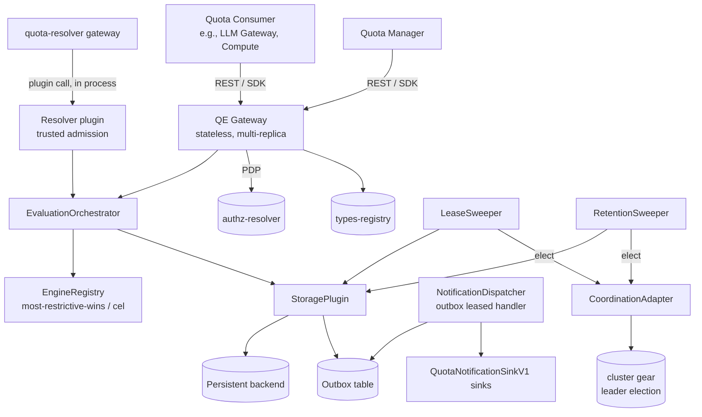

> The diagram preserves the I11 outbox-same-tx invariant: every component that emits a `NotificationOutboxEvent`
> (`EvaluationOrchestrator`, `LeaseSweeper`, `RetentionSweeper`, `QuotaManagementService`, `PolicyService`) writes it
> through `StoragePlugin` into the `notification_outbox` table in the same transaction as its state mutation.
> `NotificationDispatcher` is the **sole** caller of `QuotaNotificationSinkV1` sinks; no other component talks to the
> sinks directly. Refer to §3.2 component model for the full DAG including in-gateway services.

- [ ] `p1` - **ID**: `cpt-cf-quota-enforcement-tech-stack`

| Layer                               | Responsibility                                                                                                                                                                                                                                                                                                                                                                                                                                                                 | Technology                                                                                                                          |
| ----------------------------------- | ------------------------------------------------------------------------------------------------------------------------------------------------------------------------------------------------------------------------------------------------------------------------------------------------------------------------------------------------------------------------------------------------------------------------------------------------------------------------------ | ----------------------------------------------------------------------------------------------------------------------------------- |
| SDK (`quota-enforcement-sdk` crate) | Rust traits for Quota Consumer, Quota Manager, plugin contracts (`QuotaEnforcementStoragePluginV1`, `QuotaResolutionEngineV1`, `QuotaNotificationSinkV1`); domain types (`Quota`, `Lease`, `LeaseHold`, `DebitPlan`, `Decision`); closed error enums. Depends on the `quota-resolver-sdk` crate for the quota subject types and the metric base (ADR-0008, ADR-0013).                                                                                                                                                                                                                          | Rust structs + traits; `cargo` workspace member.                                                                                    |
| Gateway (`quota-enforcement` crate) | REST handler layer mounted into the platform `api-gateway` gear via ToolKit `RestApiCapability::register_rest`; QE does not run its own HTTP server. Owns DTO validation; phase-1 PDP integration (`PolicyEnforcer` admission, fail-closed, `AccessScope` pass-through); tenant-isolation filter; delegates to `QuotaManagementService` / `QuotaEnforcementService`. The same crate hosts the resolver plugin (`QuotaResolverPluginClient`, ADR-0009).                                                                                                                                          | Axum handlers + ToolKit `OperationBuilder` (typed-operation registration auto-generates the OpenAPI fragment via `utoipa`); tracing. |
| Plugins (separate crates)           | `quota-enforcement-storage-plugin` (transactional persistence via `toolkit-db` per `cpt-cf-quota-enforcement-adr-storage-backend`); `quota-enforcement-engine-most-restrictive`, `quota-enforcement-engine-cel` (built-ins, in-process linkage); `quota-enforcement-notification-plugin` trait (sink implementations operator-supplied). | Rust crates; static linkage at build time per `cpt-cf-quota-enforcement-constraint-in-process-engine-registration`.                 |
| Background tasks                    | `LeaseSweeper` (physical reclamation tier of `cpt-cf-quota-enforcement-fr-lease-timeout`); `RetentionSweeper` (idempotency / operation log / charge ledger retention); `NotificationDispatcher` (drains outbox to registered sinks).                                                                                                                                                                                                                                                           | Same binary as gateway when bundled, or separate binary in split deployments; sweeper singletons via cluster leader election per `cpt-cf-quota-enforcement-adr-coordination-plugin`; the dispatcher is fenced by the `toolkit-db` Outbox lease.    |
| External                            | Persistent backend reached via the storage plugin (P1 backend choice in `cpt-cf-quota-enforcement-adr-storage-backend`); platform `cluster` gear (leader election for the sweeper singletons per `cpt-cf-quota-enforcement-adr-coordination-plugin`); `authz-resolver` (PDP); `types-registry` (metric types, quota subject types); platform observability stack — `tracing` plus OpenTelemetry export via `toolkit`'s `otel` feature.                                                                                                                                 | Existing platform components.                                                                                                       |

## 2. Principles & Constraints

### 2.1 Design Principles

#### Declarative metric types

- [ ] `p1` - **ID**: `cpt-cf-quota-enforcement-principle-declarative-projection-contracts`

Every evaluation names its subjects as QR subjects `{type, id}`, `type` a registered type derived from
`gts.cf.core.quota.subj.v1~`. The subject type is the type half of Quota identity and is shared by all callers. The
owner of a metric declares everything about it in one metric type: the `admitted_subjects` trait lists the subject
types the metric's Quotas may count, and the schema refines the `metadata` of the metric object. QE validates the
metric object of a request at ingress, and checks the conditions of Quota metadata against the same schema when the
Quota is written. Registry reads are confined to the reads that fill `MetricCatalog` and the cache of registered
subject types.

**ADRs**: `cpt-cf-quota-enforcement-adr-projection-contracts`, `cpt-cf-quota-enforcement-adr-quota-resolver-subjects`,
`cpt-cf-quota-enforcement-adr-contract-catalogue`, `cpt-cf-quota-enforcement-adr-metric-types`.

#### PDP-authorized attribution

- [ ] `p1` - **ID**: `cpt-cf-quota-enforcement-principle-pdp-authorized-attribution`

Consumer operations are S2S and supply their target `tenant_id`, subject refs, and metric. QE sends the complete
structurally valid tuple (the tenant, the subjects, and the metric with its type and optional id) to PDP, which
authorizes it against the authenticated service principal before admission checks or evaluation. Public request-shape
checks run before PDP; subject-type admission and the check of the metric object against its metric type run only
after PDP. Management operations (Quota CRUD, Policy admin, manager/operator reads and previews) also accept an
explicit target under PDP scope. End users never call QE directly. The one exception is the resolver plugin path:
trusted admission calls no PDP and binds storage to the request's tenant; QR calls the plugin in process only.

**ADRs**: implicit in PRD §3.4 trust-boundary model; `cpt-cf-quota-enforcement-adr-resolver-plugin-path` for the
plugin path.

#### Engine-pluggable arbitration

- [ ] `p1` - **ID**: `cpt-cf-quota-enforcement-principle-engine-pluggable`

Multi-Quota arbitration is not a property of QE-core — it is a `QuotaResolutionEngineV1` plugin. QE-core enforces only
the boundary contract (Debit-Plan invariants per `cpt-cf-quota-enforcement-fr-quota-resolution-engine`); how the Engine
produces the Decision is opaque. This lets workload-specific arbitration (cascade, attribute-gated selection, custom CEL
policies) plug in without core changes and lets future engines (Starlark, Lua, WASM-loaded) land additively.

**ADRs**: `cpt-cf-quota-enforcement-adr-evaluation-engine`.

#### Storage-pluggable backend

- [ ] `p1` - **ID**: `cpt-cf-quota-enforcement-principle-storage-pluggable`

Persistence is mediated by `QuotaEnforcementStoragePluginV1` — a single Rust trait with a closed `StorageError` enum and
fifteen invariants (I1–I15, §3.3). The trait surface is the contractual boundary of QE-core; how the backend achieves
the invariants (locking discipline, indexing strategy, partitioning, isolation level) is plugin-internal. P1 ships a
single storage-plugin implementation (backend choice per `cpt-cf-quota-enforcement-adr-storage-backend`); alternative
backends plug in unchanged.

**ADRs**: `cpt-cf-quota-enforcement-adr-storage-backend`.

#### Lazy expiry

- [ ] `p1` - **ID**: `cpt-cf-quota-enforcement-principle-lazy-expiry`

Lease correctness MUST NOT depend on background-process liveness. Every reader and every writer treats a lease with
`expiry_at <= now()` as released — regardless of physical row presence. Sweeper outage delays reclamation but never
produces zombie holds that block new operations or admit double-counted capacity. This is encoded as I4 on the storage
contract; the gateway never has to defensively check sweeper state.

**ADRs**: implicit in `cpt-cf-quota-enforcement-fr-lease-timeout`; no dedicated ADR.

#### Fail-closed

- [ ] `p1` - **ID**: `cpt-cf-quota-enforcement-principle-fail-closed`

Internal errors, unreachable PDP, unreachable storage, malformed Engine Decisions, and any other condition under which
QE cannot determine an authoritative admission outcome MUST result in operation denial, never silent allowance.
Consuming services choose their own behaviour when QE itself is unavailable (per the contract at PRD §3.4); QE itself
never emits a permissive bypass.

**ADRs**: implicit in PRD §3.4; no dedicated ADR.

#### Strict engine boundary

- [ ] `p1` - **ID**: `cpt-cf-quota-enforcement-principle-strict-engine-boundary`

Decisions returned by Engine plugins are not trusted blindly. The `EvaluationOrchestrator` validates every Decision
against the closed Debit-Plan invariant set
(`{quota_id_outside_applicable_set, negative_amount, chain_sum_mismatch, duplicate_quota, result_plan_inconsistency}`:
the chain rules of ADR-0010 are `chain_sum_mismatch` and `duplicate_quota`) before
applying any counter mutation; violations surface as the canonical `Internal` error with `reason = "INVARIANT_VIOLATION"`
(per §3.3 mapping table) and are counted in `debit_plan_invariant_violations_total`. This is the trust-boundary that
lets third-party Engines integrate without compromising counter integrity.

**ADRs**: implicit in `cpt-cf-quota-enforcement-fr-quota-resolution-engine`;
`cpt-cf-quota-enforcement-adr-debit-plan-chains` for the chain rules.

### 2.2 Constraints

#### ToolKit framework

- [ ] `p1` - **ID**: `cpt-cf-quota-enforcement-constraint-toolkit`

QE is a ToolKit-conformant gear: it uses `SecureConn` for all DB access, `ClientHub` for cross-gear calls, and the
standard ToolKit lifecycle hooks (`init`, `bootstrap`, `shutdown`). It does not bypass `toolkit-db` for raw connections,
does not invent its own RPC framing, and does not perform cross-gear calls outside `ClientHub`.

**ADRs**: none.

#### SecurityContext propagation

- [ ] `p1` - **ID**: `cpt-cf-quota-enforcement-constraint-security-context`

`SecurityContext` is mandatory on every entry-point operation of QE's own API, and it ends at admission. Admission
authorizes the caller and returns two values: the `AccessScope` and the **actor** of the operation, which is the
identity that the operation log and the events name as the cause of the operation. Every in-process call below
admission takes these two values and no `SecurityContext`: the services and Storage take the actor and the
`AccessScope`, a notification sink gets the actor inside the event, and the Engine takes neither. So each operation
has one implementation for every path that reaches it (ADR-0009).

An actor is one of three:

- the caller: the authenticated principal of the `SecurityContext`, on QE's own API;
- the platform identity of the resolver's caller, on the resolver plugin path: the plugin request carries it, trusted
  admission returns it as the actor, and QE does not authorize by it. It names the calling service only when that
  caller runs in another process; for a caller in the same process it names no module (ADR-0009);
- a background task, for work with no caller: `lease-sweeper`, `retention-sweeper`, `dispatcher`, and `bootstrap`.

QE never builds a `SecurityContext`: only authentication produces one. The resolver plugin receives none, and work
with no caller has none. A storage operation that serves a request takes an actor and an `AccessScope` when it changes
data, and an `AccessScope` when it only reads. The storage operations of the background tasks are not bound to one
tenant: they take the task as the actor and no `AccessScope`, and §3.3 lists them apart. The constraint prevents code
paths that run without an identity or without a tenant scope — a precondition for tenant-isolation integrity.

**ADRs**: none.

#### Type registry delegation

- [ ] `p1` - **ID**: `cpt-cf-quota-enforcement-constraint-types-registry-delegation`

`types-registry` is the authority for metric types and subject types. QE persists no copy of them and owns no GTS
type for subjects or metrics. It reads a metric type by its id into `MetricCatalog` (§3.1): at start, when a request
or a Quota or Policy write names a metric type the catalogue does not hold, and on a bounded schedule (ADR-0012). The evaluation path does
not call the registry for a metric that `MetricCatalog` holds. The metric base `gts.cf.core.quota.metric.v1~`, the
quota subject base, and the tenant subject type belong to the QR SDK (ADR-0008, ADR-0013).

> **Notation.** Subject type names (`tenant`, `user`) and metric names are shortened in prose. API requests and
> storage use full GTS ids, including the trailing `~` for types.

**ADRs**: none.

#### Single storage plugin per deployment

- [ ] `p1` - **ID**: `cpt-cf-quota-enforcement-constraint-single-storage-plugin`

Exactly one storage plugin is active at any time per deployment. Switching backends is an operator action that involves
data migration; the gateway does not federate over multiple backends, does not shard across plugins, and does not
present a multi-backend facade. P1 ships a single storage plugin (backend per
`cpt-cf-quota-enforcement-adr-storage-backend`); alternative backends are P2+ items that follow the same
one-active-at-a-time discipline.

**ADRs**: `cpt-cf-quota-enforcement-adr-storage-backend`.

#### Bounded label cardinality

- [ ] `p1` - **ID**: `cpt-cf-quota-enforcement-constraint-bounded-cardinality`

Telemetry labels are restricted to deployment-bounded values — canonical registered `metric` only on instruments that
declare it in PRD §5.16, `engine_id` from the registered Engine set, `operation` from `{debit, credit, rollback,
return, reserve, commit, release, batch_debit, preview}`, `transition_kind`, `surface`, `invariant`, closed `reason`
enums, `sink_id`, `event_kind`, and `queue`. High/unbounded-cardinality identifiers (`tenant_id`, `subject_id`,
`quota_id`, `policy_id`, `idempotency_key`, `lease_token`), subject type, caller attribution, and raw/unregistered
metric input MUST NOT appear as labels. A `metric` label is populated only after registry/catalogue validation and
uses the canonical registered identity. This prevents per-tenant time-series explosion at 100 M-subject scale per
`cpt-cf-quota-enforcement-nfr-subject-scale` while retaining bounded per-metric operational visibility.

**ADRs**: none.

#### In-process Engine registration

- [ ] `p1` - **ID**: `cpt-cf-quota-enforcement-constraint-in-process-engine-registration`

Engine plugins are registered in-process at gear bootstrap from the Engines linked into the binary. P1 ships
`most-restrictive-wins` and `cel`; an additional Engine, from this repository or outside it, registers by being linked
into the server binary at build time, with no QE change. Runtime registration of new Engines (dynamic loading, RPC
engines) is out of P1 scope per PRD §5.9. Configuration of an Engine is done via the Quota Resolution Policy
(`engine_config` field) — the registration set is fixed at deploy time.

**ADRs**: none.

#### No business logic in gateway

- [ ] `p1` - **ID**: `cpt-cf-quota-enforcement-constraint-no-business-logic`

The gateway does no pricing, no billing, no plan-template materialisation, no SLA negotiation. Business logic that
translates licensing or commercial intent into Quota records lives in Quota Manager (a separate platform component). QE
itself only mutates counters according to declarative Quota records and pluggable arbitration policies.

**ADRs**: none.

## 3. Technical Architecture

### 3.1 Domain Model

**Technology**: Native Rust structs in `quota-enforcement-sdk` crate (per `cpt-cf-quota-enforcement-constraint-toolkit`).
Plugins are registered in-process at gear bootstrap via ClientHub. Domain data shape is Rust-native.

**Planned location**: `quota-enforcement-sdk/src/` (the crate has not been scaffolded yet).

**Core Entities**:

| Entity                         | Description                                                                                                                                                                                                                                                                                                                                                                                                                                                                                                                                                    | Persistence                                                          |
| ------------------------------ | -------------------------------------------------------------------------------------------------------------------------------------------------------------------------------------------------------------------------------------------------------------------------------------------------------------------------------------------------------------------------------------------------------------------------------------------------------------------------------------------------------------------------------------------------------------- | -------------------------------------------------------------------- |
| `Quota`                        | Declarative cap assigned to a single subject for a single metric. Carries `quota_id` (server-assigned **UUIDv7** per `cpt-cf-quota-enforcement-adr-acquisition-ordering`), `tenant_id`, subject (`subject_type`, `subject_id`), metric (a metric type id), type, period spec (consumption only), enforcement mode, cap (`0..=i64::MAX`, or `null` for unbounded), notification thresholds, validity window, source, status, metadata (a JSON object of at most 4 KB: conditions over the `metadata` of a request, ADR-0013), and record version. The counter key is `(subject_type, subject_id, metric)`; the `id` of a request's metric object is not part of it in P1. First-class stored entity — no separate template/binding concept.                                                                                              | `quotas` table                                                       |
| `Counter` (allocation)         | Per-Quota in-flight counter for allocation Quotas. Mutated on debit / lease acquire (increment) and credit / lease commit/release (decrement).                                                                                                                                                                                                                                                                                                                                                                                                                 | `quota_allocation_counters` table                                    |
| `Counter` (consumption)        | Per-(Quota, period) consumed counter. New row materialised lazily by the first mutating operation in a new period; reads never create one (I3). Carries `highest_crossed_threshold_pct`.                                                                                                                                                                                                                                                                                                                                                                       | `quota_consumption_counters` table                                   |
| `Lease`                        | Two-phase capacity hold (PRD `cpt-cf-quota-enforcement-fr-lease-acquire`). Carries token (UUID), tenant, idempotency key, acquisition timestamp, expiry timestamp, state, `acquisition_period_id`, and the attribution digest of its acquisition, which the charge of its commit takes (defined under `Charge`). State machine: `Active` → `Committed` / `Released` / `AutoReleased` / `ResolvedByDeactivation` (closed enum, terminal states). | `leases` table |
| `LeaseHold`                    | Per-Quota hold record attached to a lease. One row per Quota in the lease's Debit Plan. Carries `lease_id`, `quota_id`, `held_amount`, `period_id` (consumption Quotas), and the chain and position of its plan entry (ADR-0010). Separate rows enable atomic multi-Quota acquisition without nested-array semantics.                                                                                                                                                                                                                                                                                                   | `lease_holds` table                                                  |
| `LeaseCapacityCounter`         | Per-`(tenant, metric)` lock row. Acquisitions lock it and count live leases under it to enforce the active-lease cap (PRD `cpt-cf-quota-enforcement-fr-lease-timeout`, default 1000); settlement never takes it.                                                                                                                                                                                                                                                                                                                                               | `lease_capacity_counters` table                                      |
| `QuotaResolutionPolicy`        | Operator-managed binding of an Engine + config to a scope (P1: `global` or per-metric). Stable identifier; `active_version` pointer (cleared on delete) and `high_water` version counter updated atomically with new version row insert.                                                                                                                                                                                                                                                                                                                       | `policies` table                                                     |
| `QuotaResolutionPolicyVersion` | Immutable per-version record. Carries `policy_id`, `policy_version`, `engine_id`, `engine_config` (JSON), `timeout_ms`, `version_state` (`active` / `superseded` / `rolled_back` (terminal) / `deleted` (terminal — set on the previously-active version when the entire `policy_id` is soft-deleted via `delete_policy` per PRD §5.9)), `comment` (optional operator note), the schema snapshot resolved at write time (the resolved schema of each metric type the config reads, keyed by the metric type id; empty for `most-restrictive-wins`), audit fields. Bootstrap rebuilds every active version from its stored config and snapshot. When a later change of the metric type and an active Policy do not fit, the Engine reports an error at evaluation and the request is rejected with no counter change; the metric stays served in `MetricCatalog` (ADR-0012).                                                                                                                                                                     | `policy_versions` table                                              |
| `IdempotencyRecord`            | Replay-safety record keyed by typed `IdempotencyScope { tenant_id, operation_type, idem_key }`; the subjects are part of the request fingerprint, not of the scope. Serves replay only. Carries canonical `payload_hash` (the request fingerprint), schema-versioned `decision_blob`, and `expires_at`, the end of the replay window. An allowed debit or lease commit writes no record here: its charge is its record. A return is recorded in its charge, and a rollback has no key. | `idempotency_records` table |
| `Charge`                       | Returnable record of an allowed debit or lease commit (ADR-0011), written in the same transaction as its counters: tenant, operation, idempotency key, request fingerprint, attribution digest, first result, metric, amount, per Debit Plan entry its chain, position, Quota, period, charged amount, and returned amount. The **attribution digest** is a digest of the attribution that admission accepted for the charged operation (the tenant, the subjects, and the metric with its type and optional id); a rollback on QE's API must present the same attribution. Unique per `(tenant, operation, key)`; keeps no subject identifier. It is the idempotency record of its debit or commit for as long as it lives. The key of a return is unique per `(tenant, return, key)`: each applied return has one **return record** with its key, its charge, and its amount, which is deleted with the charge. The charge is deleted when the replay window has passed since its creation and since the last return or rollback applied to it, and no allocation entry of it holds an amount on an active Quota; from that moment it is unknown to every operation, whether or not the sweeper has removed it, and a debit or commit under its key replaces it. | `charges` + `charge_entries` + `charge_returns` tables |
| `OperationLog`                 | Operation ledger of every successful mutating operation (P1 scope; audit-grade attribution awaits platform audit infra per PRD §4.2 / §6.2, see §4.3). Carries operation kind, actor (§2.2: the caller's authenticated principal, the platform identity of the resolver's caller, or the name of the background task), target Quota IDs, request fingerprint, Decision outcome, timestamp. Partitioned by date for retention and cold-tier migration.                                                                                                                                                                                                                           | `operation_log` table                                                |
| `NotificationOutboxEvent`      | Same-tx event row enqueued by mutating storage primitives. Carries `event_id`, `event_kind`, `tenant_id`, target reference, payload, emission timestamp. Drained by `NotificationDispatcher` and dispatched at-least-once.                                                                                                                                                                                                                                                                                                                                     | `notification_outbox` table (toolkit-db Outbox queue)                 |
| `SubjectRef`                   | A quota subject `{type, id}` (ADR-0008): `type` a QR subject type, a registered GTS type derived from `gts.cf.core.quota.subj.v1~` (registered by the operator or by the module that charges that kind of subject); `id` an opaque non-empty string. The tenant subject type `gts.cf.core.quota.subj.v1~cf.core.quota.tenant.v1~` names the tenant's Quota; its id is the tenant id. It is the subject half of Quota identity. | Quota row `(subject_type, subject_id)`; types in `types-registry` |
| `MetricRef`                    | The metric object of a request, `{type, id?, metadata}` (ADR-0013): `type` a metric type id; `id` an optional non-empty string that names the one thing the amount is counted for, for example a model or a virtual machine; `metadata` the attributes of the operation that policies read, required and refined by the schema of the metric type. QE validates the whole object against the resolved schema of the type. Only `type` is part of Quota identity. | Quota row `metric` (the type id only); types in `types-registry` |

**In-memory entities** (passed across in-process calls; never persisted as the source of truth):

| Entity              | Description                                                                                                                                                                                                                                                                  |
| ------------------- | ---------------------------------------------------------------------------------------------------------------------------------------------------------------------------------------------------------------------------------------------------------------------------- |
| `EvaluationContext` | Engine input: the metric of the request (its type, its optional `id`, and its validated metadata), the amount, the snapshots of the Quotas that apply (their conditions hold on the request), current usage, the schema snapshot of the active Policy, time, and the effective `EvaluationBudget`. A Quota snapshot includes the Quota's subject and metadata; the conditions in the metadata are already applied. CEL receives only `{request, amount, metric_id, quotas}`: `request` is the `metadata` of the request's metric, `amount` is the requested amount, `metric_id` is the `id` of the request's metric (an empty string when it has none), and each element of `quotas` is an applicable Quota with its subject type and tier; subject ids and principal data are excluded. Materialised at the locked-read step (`cpt-cf-quota-enforcement-adr-metadata-snapshot-timing`). |
| `EvaluationBudget` | Validated Engine budget carrying the per-Policy wall-time limit (default 5 ms) and any bounded engine-specific cost limit. Constructed at Policy selection; the Engine enforces it internally and reports `Timeout` or `CostExceeded`. |
| `MetricCatalog`     | Process-local catalogue with one entry per metric type that QE has read from `types-registry` by its id: the resolved schema and the traits `kind`, `admitted_subjects`, and `enforcement` (ADR-0012). An entry is **served** or **unavailable**. It is unavailable when the type is not a valid metric type (it is abstract, it does not derive from the metric base, its own version is major 0, or a trait is wrong). A stored Quota or Policy never makes an entry unavailable: `admitted_subjects` is checked when a Quota is created and when a request names a subject, and a Policy is checked against the schema when the Policy is written. At start QE reads the metric types of the active Quotas and Policies. It reads any other metric type once, with a time limit, when a request or a Quota or Policy write names it: a type the registry does not know is `InvalidArgument`, and QE remembers that answer for a short time; a read that fails or reaches its time limit is `ServiceUnavailable`. A scheduled read asks the registry, with a conditional read, whether each held metric type and each cached subject type changed: it builds an entry again when its type changed, removes the entry of a deleted metric type, and drops a deleted subject type. An entry is built from the current registry content only; a catalogue read reads nothing from storage after it has the metric types to read at start. Used by Gateway validation, subject-type admission, and Quota and Policy writes; a request for a metric the catalogue holds makes no registry call for it. |
| `Decision`          | Engine output: closed `result` enum (`Allowed` / `Denied { violated_quota_ids, reason }`), `debit_plan: Vec<DebitChain>`, `diagnostics: BTreeMap<String, JsonValue>`; the plan is ordered and the diagnostics key-ordered, so a Decision serializes canonically and repeated evaluation is byte-comparable. Engine failures do not produce a Decision — they surface as `CanonicalError` per §3.3. |
| `DebitChain`        | Ordered list of `QuotaDebitPlan` entries, primary pool first, whose amounts add up to exactly the requested amount (ADR-0010). A cascade or a split is one chain; several chains are an AND, each counting the whole operation; a Quota appears at most once in a plan. The default engine returns one chain with one entry. **Unwinding** takes back an amount from a charge or a lease: in every chain, from the last entry back, each entry at most what it still holds. |
| `QuotaDebitPlan`    | One chain entry: `quota_id` and `amount` (≥ 0). Extension-ready (P3 may add `clamped` marker). Validated against the closed Debit-Plan invariant set at the QE-core boundary. |
| `BatchItem`         | One element of an envelope batch (`apply_batch_debit`): `(actor, request_payload, idem_key)`, with the actor that admission returned (§2.2). The key is required: the item is a debit under it, in the key space of single debits.                                                                                                                                                    |
| `MutationResult`    | Storage primitive return: post-mutation snapshot for caller telemetry, including new counter values, threshold crossings, and emitted event IDs.                                                                                                                             |

**Relationships**:

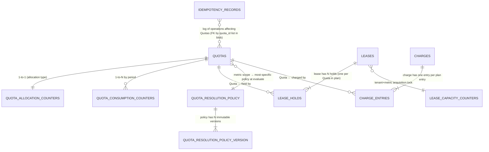

**Type-stability invariants** (`cpt-cf-quota-enforcement-constraint-toolkit`):

- All enums (`QuotaType`, `EnforcementMode`, `QuotaSource`, `LeaseState`, `DecisionResult`, `NotificationEventKind`,
`PolicyVersionState`) are closed at SDK boundary. They serialize as their snake_case names on the wire and in storage
  (a CHECK-constrained column), a reader rejects an unrecognized value as `Internal`, the names are stable, and adding,
  renaming, or removing a variant is an SDK major-version change.
- Input deserialization uses `serde(deny_unknown_fields)`, with one exception: the top-level request bodies of the
  consumption, lease, and batch-debit operations (and each batch item) tolerate unknown fields, so a Decision-shaped
  field a caller echoes back (`result`, `debit_plan`, `diagnostics`) is silently ignored per PRD §3.4; the subject
  and metric DTOs nested inside them stay strict. Output deserialization tolerates forward-compat additions for SDK
  consumers.
- `IdempotencyRecord.decision_blob` is JSON-typed and schema-versioned (top-level `__version`); additive shape changes
  do not require migration.
- `EvaluationContext` and `Decision` shapes are stable across Engines (the core boundary).

### 3.2 Component Model

QE is decomposed into a Gateway, a resolver plugin, an in-process Orchestrator and Manager set, three plugin families
(Storage, Engine, Notification), a coordination adapter over the platform `cluster` gear, background tasks (sweeper,
dispatcher), and adapters to platform infrastructure.
Every component carries a stable `cpt-cf-quota-enforcement-component-{slug}` ID for traceability.

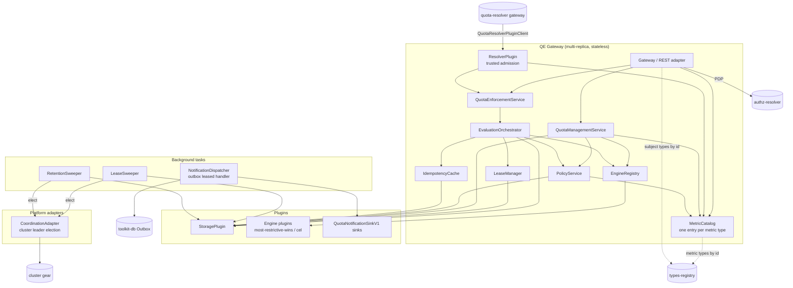

#### Gateway

- [ ] `p1` - **ID**: `cpt-cf-quota-enforcement-component-gateway`

##### Why this component exists

REST handler layer of the `quota-enforcement` crate; mounted into the platform `api-gateway` gear via ToolKit. QE does
not run its own HTTP server — the platform `api-gateway` gear owns the Axum router and the aggregated OpenAPI
document. This is the only QE-side entry point for every external caller (Quota Consumer, Quota Manager, Quota Reader,
Monitoring System); SDK clients flow through the same operation surface for end-to-end uniformity. QR reaches QE
through the resolver plugin instead (`cpt-cf-quota-enforcement-component-resolver-plugin`).

##### Responsibility scope

REST handlers (Axum), request DTO validation, and fail-closed attribution and metric validation at ingress of every
subject-based consumer evaluation operation (including batch items), before Engine dispatch. Gateway first
deserializes the DTO and rejects malformed public request shape: missing required fields (the `metadata` of the
metric object included), wrong public container types, empty ids, an empty subject list, two subjects of one type, or
a tenant-type subject whose id is not the request's tenant. It then sends the complete structurally valid untrusted
attribution tuple to PDP: the tenant, the subjects, and the metric with its type and optional id. After
authorization, it takes the `MetricCatalog` entry of the request's metric type, validates the whole metric object
against the entry's resolved schema, checks that the metric type admits every subject type (ADR-0008), and adds the
implicit tenant subject. These checks use the process-local catalogue. A subject type is also checked against a
process-local cache of registered subject types: a type the cache does not hold is looked up in `types-registry`
once; a registered type stays cached until a scheduled catalogue read finds it deleted (ADR-0012); an unknown type is
cached for a short time; a failed lookup fails the request with `ServiceUnavailable`. A request for a metric whose
catalogue entry is unavailable fails with `FailedPrecondition` and changes nothing; it is never an `Allowed` or a
`Denied` Decision. This stops debit, lease acquisition, batch debit, preview, and the snapshot read; a snapshot read
that names several metrics fails when one of them is unavailable. Credit, lease commit, lease release, return, and
rollback name an existing Quota, lease, or charge: they run while the entry is unavailable, and they never make the
`MetricNotQuotaGated` check (the rejection of a debit or a lease acquisition for a `direct` metric), for a served entry included, so held capacity can always be given back (ADR-0012). For a metric type the
catalogue does not hold, the catalogue reads the type from `types-registry` by its id, once and with a time limit. If
the catalogue then holds the metric, the request goes on with its entry. A type the registry does not know is
`InvalidArgument` (`MetricNotRegistered`), and the catalogue remembers that answer for a short time, so repeated
requests for an unknown metric do not call the registry each time. A read that fails or reaches its time limit fails
the request with `ServiceUnavailable`, which a caller may repeat. Gateway makes no other `types-registry` call from a
request path.
Also owns typed-operation registration into the
platform `api-gateway` (auto-generates the OpenAPI fragment via `utoipa`), tenant-isolation filter (defense-in-depth),
correlation of trace context. Phase-1 PDP integration (admission decision before transaction): calls
`authz-resolver-sdk::PolicyEnforcer` (obtained from ClientHub) per operation and fails closed on PDP unavailability.
QE keeps no PDP decision cache of its own — a safe decision cache needs tenant context and token scopes in its key and
token-expiry-bounded TTLs, which are the platform PEP's concern, not QE's. The returned `AccessScope` is carried
unmodified for `SecureConn` consumption inside the evaluation transaction. The in-process SDK client enters at the
same admission step, so REST and in-process transports share one authorization boundary. Stateless across replicas.

Admission has two modes (ADR-0009). **PDP mode**, above, serves the REST and in-process API. **Trusted mode** serves
only the resolver plugin: it runs the same shape and admission checks, calls no PDP, and returns an `AccessScope`
that names the request's tenant only; policy management in trusted mode is always refused. The gear builds the
operations once over each mode, over the same storage, engines, and caches. The trusted operations are reachable
only through the plugin client. The trust boundary of that path is the process: any module in the process can get the
plugin client from ClientHub and is trusted like a caller of QR's platform plane (calls authenticated as a platform
service, which QR trusts to name the tenant and the subjects). One request never spans tenants; the caller names the
tenant.

##### Responsibility boundaries

Does not interpret the meaning of metric metadata (`cpt-cf-quota-enforcement-constraint-no-business-logic`).
Does not call Engine or
Storage directly — delegates to `QuotaManagementService` / `QuotaEnforcementService`, passing the `PolicyEnforcer`-
returned `AccessScope` for in-transaction consumption (phase-2 propagation is owned by `EvaluationOrchestrator`).
Does not own any persistent state. Does not implement the PDP itself — the actual policy decision lives in the external
`authz-resolver` gear.

##### Related components (by ID)

- `cpt-cf-quota-enforcement-component-quota-management-service` — delegates Quota CRUD.
- `cpt-cf-quota-enforcement-component-quota-enforcement-service` — delegates evaluations.
- `cpt-cf-quota-enforcement-component-evaluation-orchestrator` — receives the `AccessScope` for in-transaction
  `SecureConn` consumption (defense-in-depth, `cpt-cf-quota-enforcement-nfr-tenant-isolation-integrity`).

#### ResolverPlugin

- [ ] `p1` - **ID**: `cpt-cf-quota-enforcement-component-resolver-plugin`

##### Why this component exists

QE is the backend of QR (`cpt-cf-quota-enforcement-fr-resolver-plugin`). QR delegates debit, lease, return, and quota
state to a backend plugin in process; this component is QE's plugin.

##### Responsibility scope

Implements `QuotaResolverPluginClient` from the QR SDK and registers itself as a QR plugin instance: the instance in types-registry, by which QR selects a plugin, and its client in scoped ClientHub, through which QR calls it.
Converts each QR request to a QE request (a QR subject `{type, id}` is a QE `SubjectRef` as is) and each QE result to
a QR result, and calls the operations built over trusted admission (ADR-0009). It has no `SecurityContext`: trusted
admission returns the tenant-only `AccessScope` and, as the actor, the platform identity that the QR request carries
(§2.2). A quota state read is a QE snapshot of the request's tenant and subject; the plugin leaves out the
fields only operators see (enforcement mode, validity window), because QR's tenant plane shows the
state to any end user. It returns the Quota metadata: the conditions say which requests the Quota applies to. On this read a metric that does not admit the subject's type yields only the tenant's Quotas,
with no error, and Quotas outside their validity window are left out. A QR request carries its metrics as a list of
**metric items**: a metric item is a metric object `{type, id?, metadata}` and its amount
(`cpt-cf-quota-resolver-adr-metric-types`). A QE operation has one metric: the plugin passes the metric object of the
single item, unchanged, as the `metric` of the QE request and rejects a debit, lease acquisition, commit, or return
with several metric items (`InvalidArgument`). A commit and a return of QR name their amount by the id of the metric
type; the plugin passes that id with the amount, and QE rejects a commit that names a metric type other than the
lease's and a return that names a metric type other than the charge's (`METRIC_TYPE_MISMATCH`, `InvalidArgument`).

##### Responsibility boundaries

Runs no policy check; QR authenticates its callers. Keeps every other QE check: the metric type, subject-type
admission, the metric object, amounts, idempotency, and the tenant of a lease token. The operation log records the
platform identity of the resolver's caller, which the request carries; QE does not authorize by it.

##### Related components (by ID)

- `cpt-cf-quota-enforcement-component-quota-enforcement-service` — runs the trusted operations.
- `cpt-cf-quota-enforcement-actor-quota-resolver` (external) — calls the plugin in process.

#### QuotaManagementService

- [ ] `p1` - **ID**: `cpt-cf-quota-enforcement-component-quota-management-service`

##### Why this component exists

Owns Quota CRUD lifecycle (`cpt-cf-quota-enforcement-fr-quota-lifecycle`): create, update, deactivate, read. Coordinates
the deactivation cascade (mark Quota deactivated AND resolve active leases atomically). Used by Quota Manager and
platform operators.

##### Responsibility scope

Validation (cap non-negative and within `0..=i64::MAX`, thresholds-require-bounded-cap, the period rule: consumption
Quotas require an explicit valid period, `one_time` included, `PERIOD_REQUIRED` otherwise; allocation Quotas reject
any period field, `null` included, `PERIOD_NOT_ALLOWED`); the metric check through the `MetricCatalog` entry of the
Quota's metric type, which runs **outside** the storage transaction. A write for a metric type the catalogue does not
hold reads the type from `types-registry` as a request does (ADR-0012): a type the registry does not know is
`METRIC_NOT_REGISTERED`, a read that fails or reaches its time limit is `ServiceUnavailable`, and a create or an
update for a metric with no served entry is rejected with `PROJECTION_NOT_RESOLVABLE`. A deactivation makes no
catalogue check and always runs. «Flag-but-don't-auto-deactivate» applies on
later metric removal, per `cpt-cf-quota-enforcement-fr-metric-identity-validation`.
Transactional `create_quota` / `update_quota` / `deactivate_quota` / `read_quotas` calls on Storage plugin; event
emission for `quota-changed`. Updates preserve `metric`, `quota_type`, `period`, `enforcement_mode`, and `subject`: a
patch that names any
of them, with an explicit `null` included, is rejected (`IMMUTABLE_FIELD`) after the `rate` check
(`Unimplemented`, checked first even alongside other immutable fields); an empty patch is `PATCH_EMPTY`.

**Metric classification.** The catalogue entry gives the two traits that classify a metric: `kind ∈ {counter, gauge}`,
parsed into the closed enum `Counter`/`Gauge`, and `enforcement ∈ {quota_gated, direct}`, parsed into
`QuotaGated`/`Direct` (`quota_gated` when the trait is absent). QE reads them from the entry and from nowhere else. A
metric type with a wrong trait has an unavailable entry, never a default (ADR-0012). Creation checks that the Quota
type fits the metric's `kind`, that the Quota's subject type is registered and derives from the subject base, and that
the metric type admits it (`InvalidArgument` otherwise).

**Quota metadata.** `quota.metadata` is a JSON object of at most 4 KB that holds the Quota's conditions over the
`metadata` of the request's metric (ADR-0013). On create, and on an update that changes `metadata`, the service
checks each condition against the metric type's `metadata` schema from the `MetricCatalog` entry it already holds:
the property is declared, its type is a string, an integer, or a boolean, and the value, or each value of an array,
has that type. The check runs outside the storage transaction. On a violation nothing is written, and
the answer is `InvalidArgument` with the token `QUOTA_METADATA_REJECTED` and one field violation per item, each with
the place in the metadata and the reason. A Policy does not read Quota metadata.

The owner of a metric type can revise it after a Quota is written. The lifecycle gauge refresh therefore reads the
distinct conditions of the active Quotas of each metric (at most 1000 sets), runs the same check against the current
catalogue entry, and publishes the number of Quotas that fail it as `quota_conditions_unfit_total`, with a warning
that names the metric and the first reason. Evaluation does not run the check.

**Request metadata.** Ingress brings the `metadata` of a request's metric object to its canonical form after the
schema check: a number with no fractional part becomes an integer. JSON Schema accepts `5.0` for an integer
property, but the stored condition `5` and a `cel` comparison would not equal it. The canonical value is what
storage matches against conditions, what the Engine reads as `request`, and what the request fingerprint covers.

##### Responsibility boundaries

Does not evaluate quota usage (that is `QuotaEnforcementService`'s role). Does not perform authorization — the PDP
admission call is owned by `Gateway` (phase-1, before tx) and the in-transaction constraint application is propagated
through `EvaluationOrchestrator` into the storage plugin (phase-2). Does not own metric definitions — the
`types-registry` is authoritative; QE only consumes identity and the registry-reported classifications.

##### Related components (by ID)

- `cpt-cf-quota-enforcement-component-storage-plugin` — calls CRUD primitives.
- `cpt-cf-quota-enforcement-actor-types-registry` (external) — read through `MetricCatalog` for the Quota's metric
  type.

#### QuotaEnforcementService

- [ ] `p1` - **ID**: `cpt-cf-quota-enforcement-component-quota-enforcement-service`

##### Why this component exists

Public S2S surface for eight consumer operations: `debit`, `rollback`, `reserve`, `commit`, `release`, `batch_debit`,
`evaluate_preview`, and `snapshot`, plus the management-plane `credit`, which is served on the same surface but
authorized as its own action and exposed in the SDK on `QuotaManagerApi` only. A ninth operation, `return`, is
reachable only through the resolver plugin.

##### Responsibility scope

Per-operation entry point; accepts the explicit PDP-authorized target; delegates evaluations to
`EvaluationOrchestrator` and snapshots to the storage read path; returns the corresponding typed DTO.

##### Responsibility boundaries

Does not contain orchestration logic (delegated to `EvaluationOrchestrator`). Does not own storage or engine state.

##### Related components (by ID)

- `cpt-cf-quota-enforcement-component-evaluation-orchestrator` — delegates pipeline.
- `cpt-cf-quota-enforcement-component-lease-manager` — delegates lease 3-phase ops.

#### EvaluationOrchestrator

- [ ] `p1` - **ID**: `cpt-cf-quota-enforcement-component-evaluation-orchestrator`

##### Why this component exists

Implements the canonical evaluation pipeline: subject resolution → idempotency lookup → applicable-Quotas locked read →
Policy lookup → Engine evaluate → Debit-Plan invariant check → mutation → idempotency persist → outbox enqueue → COMMIT.
Encapsulates the strict-engine-boundary (`cpt-cf-quota-enforcement-principle-strict-engine-boundary`) — every Decision
is validated against the closed Debit-Plan invariant set before mutation.

##### Responsibility scope

Pipeline ordering, transaction lifecycle, EvaluationContext materialisation timing
(`cpt-cf-quota-enforcement-adr-metadata-snapshot-timing`), invariant enforcement, telemetry emission for invariant
violations. It receives the already-authorized and admitted subject set from Gateway and uses the complete set
for applicable-Quota lookup; it performs no identity derivation or live registry lookup.
Phase-2 PDP integration: receives the `AccessScope` from `Gateway` (as returned by `PolicyEnforcer`) and forwards it
unmodified into Storage-plugin reads/writes, where `SecureConn` compiles it into query filters
(`cpt-cf-quota-enforcement-nfr-tenant-isolation-integrity` defense-in-depth). EO does not call the PDP itself and does
not interpret scope semantics — compilation is `SecureConn`'s responsibility.

##### Responsibility boundaries

Does not own arbitration logic (delegated to Engines). Does not own counter mutation mechanics (delegated to Storage
plugin). Does not pre-eval on idempotency replay — replay returns the stored `decision_blob` verbatim (satisfies the
idempotency-replay rule of `cpt-cf-quota-enforcement-fr-idempotency` by never re-invoking the Engine on replay).
It has no `types-registry` client, performs no schema resolution, and does not revalidate stored Quota metadata. Registry
latency or availability therefore cannot enter the evaluation transaction.

Synchronization between concurrent EO instances (every gateway replica runs an EO) is delegated entirely to the storage
plugin's serialization of concurrent row mutations — the deterministic acquisition ordering of
`cpt-cf-quota-enforcement-adr-acquisition-ordering` plus the storage-capability list in §3.5. EO instances are not
singletons and join no cluster election; only the sweeper singletons do (the notification dispatcher is fenced by the
`toolkit-db` Outbox lease).

##### Related components (by ID)

- `cpt-cf-quota-enforcement-component-engine-registry`, `-policy-service`, `-storage-plugin`, `-idempotency-cache`,
  `-notification-dispatcher`.

#### PolicyService

- [ ] `p1` - **ID**: `cpt-cf-quota-enforcement-component-policy-service`

##### Why this component exists

Owns the Quota Resolution Policy lifecycle (`cpt-cf-quota-enforcement-fr-quota-resolution-policy`,
`cpt-cf-quota-enforcement-fr-quota-resolution-policy-versioning`): create, update (creates new immutable version),
rollback to a prior version, soft-delete (narrow-scope only), read latest, list versions. Resolves the most-specific
Policy at evaluation time (`global` ← per-metric).

##### Responsibility scope

CRUD on `policies` and `policy_versions` tables via Storage plugin; the latest-version
pointer is read authoritatively from storage on every evaluation (`read_policy` inside the evaluation transaction,
§3.6), so every replica always evaluates the active version; only immutable version-keyed `ValidatedConfig`
artifacts are cached; the schema snapshot of a Policy version, taken from the `MetricCatalog` entries of the metric
types the config reads; `engine_config` validation delegated to the named Engine's `validate_config` with that
snapshot. The Engine gets the metric type's schema for `request`. What the `cel` validator checks in the environment `{request, amount, metric_id, quotas}` is defined with
that Engine; it returns line/column diagnostics. A Policy write for a metric type the catalogue does not hold reads
the type as a request does (ADR-0012). A create or a change for a metric with no served entry is rejected with
`ProjectionNotResolvable`; a rollback and a delete make no catalogue check and always run. When a later change of
the metric type and an active Policy do not fit, the Engine reports an error at evaluation, the request is rejected
with `POLICY_EVALUATION_FAILED` (`FailedPrecondition`), and no counter changes; the metric stays served (ADR-0012).
`PolicyService` does not check existing Quotas when a Policy is created, changed, or
replaced (ADR-0013).

##### Responsibility boundaries

Does not execute Engine evaluation. Does not own `engine_config` interpretation — only forwards to Engine.

##### Related components (by ID)

- `cpt-cf-quota-enforcement-component-engine-registry` — calls `validate_config`.
- `cpt-cf-quota-enforcement-component-storage-plugin` — Policy persistence.

#### EngineRegistry

- [ ] `p1` - **ID**: `cpt-cf-quota-enforcement-component-engine-registry`

##### Why this component exists

Static, in-process registry of `QuotaResolutionEngineV1` plugin implementations. P1 ships two built-ins:
`most-restrictive-wins` (hardcoded; the fastest path) and `cel` (sandboxed CEL evaluator with sandbox + cost-cap
support). Realises `cpt-cf-quota-enforcement-constraint-in-process-engine-registration`.

##### Responsibility scope

Collecting every Engine linked into the binary; bootstrap-time fail-fast registration (`engine_bootstrap_failures_total`
increments on failure); ID → Engine resolution at evaluation time.

##### Responsibility boundaries

No runtime registration of new Engines (PRD §5.9). No Engine deprecation lifecycle in P1 (deferred to P2; revisit when
additional Engine plugins — Wasm / Starlark / Lua — land in the deployment binary). Does not interpret Engine
configurations.

##### Related components (by ID)

- `cpt-cf-quota-enforcement-component-evaluation-orchestrator` — Engine consumer.
- `cpt-cf-quota-enforcement-component-policy-service` — `validate_config` consumer.

#### LeaseManager

- [ ] `p1` - **ID**: `cpt-cf-quota-enforcement-component-lease-manager`

##### Why this component exists

Implements the lease 3-phase protocol (`cpt-cf-quota-enforcement-fr-lease-acquire`,
`cpt-cf-quota-enforcement-fr-lease-commit`, `cpt-cf-quota-enforcement-fr-lease-release`) and enforces the lazy-expiry
semantic (`cpt-cf-quota-enforcement-principle-lazy-expiry`) on every read/write path. Encapsulates the
per-`(tenant, metric)` active-lease cap check (`lease_capacity_counters`) and the period-attribution invariant
(commit/release attribute to acquisition period, not wall- clock period).

##### Responsibility scope

Lease state machine (`Active` → terminal); cap enforcement; period attribution; storage- plugin invocation for
`acquire_lease` / `commit_lease` / `release_lease`.

##### Responsibility boundaries

Does not own physical reclamation of expired lease rows — that is the `LeaseSweeper`'s responsibility, and lease
correctness MUST NOT depend on sweeper liveness (I4 invariant). Does not enforce contention timeout itself — that is a
plugin-internal concern (I8 specifies the contract; the realisation is plugin-internal).

##### Related components (by ID)

- `cpt-cf-quota-enforcement-component-storage-plugin`, `cpt-cf-quota-enforcement-component-lease-sweeper`.

#### IdempotencyCache

- [ ] `p1` - **ID**: `cpt-cf-quota-enforcement-component-idempotency-cache`

##### Why this component exists

Pre-evaluation lookup point (`cpt-cf-quota-enforcement-fr-idempotency`). On replay, returns the stored `decision_blob`
verbatim — never re-invokes Engine. Persistence is implicit-in-storage-primitives (every mutating storage call upserts
the idempotency record same-tx with the mutation, I1+I2 invariants). For a debit or a lease commit the lookup also
answers from the charge, which outlives the replay window (ADR-0011).

The lookup runs after the request is admitted: its fingerprint covers the admitted subjects and the canonical
metadata, and the PDP must authorize the caller before a stored decision is returned. So a repeat is answered with
the admission error, not with the stored decision, when the request is no longer admitted: the owner made the metric
`direct`, removed the subject type from `admitted_subjects`, or removed the metric type, or the catalogue cannot be
read (`ServiceUnavailable`, and a later repeat gets the stored decision). The charge of the first attempt stays and
can be returned by its key.

##### Responsibility scope

`lookup_idempotency` call lifecycle, payload-hash comparison (canonical SHA-256 of sorted JSON, canonical SHA-256 hash),
`IdempotencyPayloadMismatch` mapping for hash divergence, in-process LRU cache of recent records (TTL operator-tunable;
P1 reference default: 5 s) for the most contended idempotency keys.

##### Responsibility boundaries

Does not own retention policy execution (`RetentionSweeper` reclaims expired records). Does not persist new records
directly — that is owned by Storage plugin's mutating primitives.

##### Related components (by ID)

- `cpt-cf-quota-enforcement-component-storage-plugin`.

#### NotificationDispatcher

- [ ] `p1` - **ID**: `cpt-cf-quota-enforcement-component-notification-dispatcher`

##### Why this component exists

Drains the `notification_outbox` (toolkit-db Outbox queue) and fans events out to all registered
`QuotaNotificationSinkV1` plugins (`cpt-cf-quota-enforcement-fr-notification-plugin`). Realises the same-tx outbox
invariant (I11): events enqueued atomically with their producing mutation are guaranteed at-least-once delivery
regardless of dispatcher liveness.

##### Responsibility scope

Implemented as a `toolkit-db` Outbox **leased handler** registered on the QE notification queue: the outbox framework
owns claiming (DB lease per batch), redelivery after lease expiry (at-least-once), cancellation fencing (the handler
future is dropped at `lease_duration − ack_headroom`, so an expired holder cannot keep dispatching while a new one
runs), and the message dead-letter store (`dead_letter_*` APIs). The handler takes no `SecurityContext` and fans each
event out to all registered sinks via `tokio::join_all` with a per-sink per-call timeout (2 s reference default) and
per-sink failure isolation. On `Timeout`/`Transient` outcomes below the operator-configured `OutboxMessage.attempts`
maximum the handler returns `Retry` — the framework re-delivers the event to **all** sinks later, so sinks MUST
tolerate duplicate delivery. Any `Permanent` outcome, or reaching the attempts maximum, returns `Reject(reason)`,
which dead-letters the event (ToolKit retries indefinitely on its own; the attempts guard is QE's explicit give-up per
the `OutboxMessage.attempts` contract). Ack only when every sink succeeded; with zero registered sinks the handler
acks unprocessed per the PRD §11 drop assumption. Telemetry: `notification_dispatch_failures_total`,
`outbox_pending_rows` (requires a `toolkit-db` pending-count API — tracked upstream prerequisite),
`outbox_rejections_total` (handler-incremented on the `Reject` path; the `dead_letter_count` API returns a current row
count and cannot back a monotonic counter).

##### Responsibility boundaries

Does not enqueue events itself — events are enqueued by the Storage plugin's mutating primitives same-tx with the
mutation. Does not join a cluster election; outbox lease fencing replaces the singleton election for this
component. Does not implement EventBus routing (deferred to P2 per PRD §13 EventBus OQ).

##### Related components (by ID)

- `cpt-cf-quota-enforcement-component-storage-plugin`.

#### LeaseSweeper

- [ ] `p1` - **ID**: `cpt-cf-quota-enforcement-component-lease-sweeper`

##### Why this component exists

Physical reclamation tier of `cpt-cf-quota-enforcement-fr-lease-timeout`. Periodic background task
(operator-configurable interval, default 60 s) that picks up expired-by-TTL leases, transitions them to `AutoReleased`
state in the same tx, and enqueues the `lease-auto-released` event via
outbox. Optionally deletes lease rows after a grace period.

##### Responsibility scope

Single-leader execution under the `lease-sweeper` election (`SingletonScope::LeaseSweeper`) through the
`CoordinationAdapter`: the sweep loop starts when this replica is elected and receives a child cancellation token, the
resolved cluster backend renews the claim, and the loop stops when leadership is lost; re-election is automatic. Each tick reclaims expired leases in batches of an operator-configurable size (P1 reference default 1000 per transaction) and repeats until a batch comes back short, so the whole backlog drains every tick. A batch holds the locks of its rows for one transaction; a request that needs one of them is refused at once and retries within its contention timeout (I8), so the batch size bounds how long the sweeper can hold such a request off. Surface `lease_unreclaimed_expired` gauge
by canonical registered `metric`.

##### Responsibility boundaries

Sweeper outage MUST NOT break correctness — lazy semantic release (I4) holds unconditionally. Does not own retention of
operation log or idempotency records (that is `RetentionSweeper`'s responsibility).

##### Related components (by ID)

- `cpt-cf-quota-enforcement-component-storage-plugin`.
- `cpt-cf-quota-enforcement-component-coordination-plugin`.

#### RetentionSweeper

- [ ] `p1` - **ID**: `cpt-cf-quota-enforcement-component-retention-sweeper`

##### Why this component exists

Reclaims expired `idempotency_records` (default 24 h, configurable per-`(tenant, metric)` in
`idempotency_retention_config` table), `operation_log` rows (default 30 days, per PRD §6.2), and deleted charges,
in batches (ADR-0011). Counter-partition retention is handled by storage-plugin partition reclamation operations on
consumption-counter tables — a separate concern of the Storage plugin's reclamation primitives.

##### Responsibility scope

Single-leader execution under the `retention-sweeper` election (`SingletonScope::RetentionSweeper`) through the
`CoordinationAdapter`, with the same run-while-leader semantics as `LeaseSweeper`.
`reclaim_expired_idempotency`, `reclaim_operation_log`, and `reclaim_expired_charges` invocations on the Storage
plugin; batch-size and frequency
configuration. In the P1 reference plugin a charge entry is a **holding entry** while it keeps its charge alive: it is
on an allocation Quota, part of its amount is not returned, and the sweeper has not released the holds of its Quota. A
charge stores `expires_at`, the time it is deleted, or none while it has a holding entry. One `reclaim_expired_charges`
call works from two sources, neither of which reads a charge that a holding entry keeps. First it releases the holds of
deactivated Quotas: for Quotas marked `holds_pending` at deactivation, up to one batch of holding entries, one
transaction per Quota, which stops those entries from holding and sets their charges' `expires_at` again; a Quota with
no holding entry left loses the mark. Then it removes up to one batch of charges whose `expires_at` has passed, the
earliest first, in one transaction and one delete, skipping a charge that a concurrent operation on the same
idempotency key is writing, and only while the charge is still deleted by the rule of ADR-0011. A charge released in the first step
whose replay windows have passed is removed in the second step of the same call or the next one. The returned count is
the number of charges removed. After each run the leader reads `read_held_allocation_charge_stats` and publishes the
gauges `allocation_charges_past_replay_window` and `allocation_charge_max_age_seconds`; followers publish nothing.

##### Responsibility boundaries

Does not reclaim leases (that is `LeaseSweeper`). Does not impose retention policy at the business level — only enforces
operator-configured expiry.

##### Related components (by ID)

- `cpt-cf-quota-enforcement-component-storage-plugin`.
- `cpt-cf-quota-enforcement-component-coordination-plugin`.

#### StoragePlugin

- [ ] `p1` - **ID**: `cpt-cf-quota-enforcement-component-storage-plugin`

##### Why this component exists

Pluggable persistence layer (`cpt-cf-quota-enforcement-fr-pluggable-storage`). Defines the
`QuotaEnforcementStoragePluginV1` Rust trait with closed `StorageError` enum and fifteen invariants (I1–I15). Realises
`cpt-cf-quota-enforcement-principle-storage-pluggable`.

##### Responsibility scope

Quota CRUD; multi-Quota counter mutation atomicity (apply_debit_plan, apply_batch_debit, apply_credit, apply_rollback,
apply_return); charge ledger; lease 3-phase primitives; read-only snapshot reads (I3); Policy versioning; idempotency
lookup; sweeper hooks (lease, idempotency, op log, charges); outbox dispatch (pull / mark delivered / mark failed);
bootstrap; health. Same-tx outbox (I11) lives **inside** this contract — events enqueued atomically with their
producing mutation.

##### Responsibility boundaries

Locking discipline, indexing strategy, isolation level, partitioning, lock-timeout mechanics, and concrete table layouts
are **plugin-internal**. The trait surface here is the contractual boundary of QE-core. Leader election for the
sweeper singletons is **out of scope**; it lives in `cpt-cf-quota-enforcement-component-coordination-plugin`, which
consumes the platform `cluster` gear.

##### Related components (by ID)

- Every Service / Manager / Sweeper component above is a consumer.
- Actor: `cpt-cf-quota-enforcement-actor-storage-backend` (the persistent backend the plugin mediates; the trait IS the
  QE-side façade for this actor).

#### CoordinationAdapter

- [ ] `p1` - **ID**: `cpt-cf-quota-enforcement-component-coordination-plugin`

##### Why this component exists

Singleton coordination for the sweepers comes from the platform `cluster` gear's leader election per
`cpt-cf-quota-enforcement-adr-coordination-plugin`. This component is the QE-side adapter: it resolves the cluster
leader-election facade for the `quota-enforcement` profile, requires a linearizable election, scopes every name under
the `qe` prefix, and implements the domain port `SingletonCoordinator` that the sweepers consume. The port exists for
the domain-layer dependency rule; it is not a plugin extension point, and QE ships no coordination plugin of its own.

##### Responsibility scope

Maps the closed `SingletonScope` enum (`LeaseSweeper`, `RetentionSweeper`, `LifecycleGauges`) to the election names
`lease-sweeper`, `retention-sweeper`, and `lifecycle-gauges`. Runs a unit of work while this replica leads a scope: the work starts on election with a child
cancellation token, the resolved cluster backend renews the claim on its own cadence, the token is cancelled on
leadership loss,
the work is aborted after the configured stop timeout, and the work restarts on re-election. The adapter drives the
election watch itself, with the same reactive pattern the SDK's `run_while_leader` implements, and keeps ownership of
the watch: the SDK combinator consumes the watch, and a dropped watch performs no resign I/O. A `Lagged` or `Reset`
watch event is a gap in the observed transitions: the adapter cancels the work, then restarts it only when the
backend's lossless status snapshot still reads leader, so a missed loss can never leave a second sweeper running. On
graceful shutdown the adapter cancels the work and then resigns every held election so a successor is elected without
waiting for the TTL.
Exposes the election TTL and the missed-renewal budget as operator configuration with the cluster defaults.

##### Responsibility boundaries

Does not own counter / lease / outbox state (storage plugin). Does not own evaluation pipeline serialization (storage
plugin row locking). Does not implement the election: transport, quorum, lease storage, and backend selection belong
to the cluster gear and the operator. Does not use the cluster distributed lock: a sweep cycle is storage I/O from
start to end, which the cluster lock's critical-section rule forbids (cluster PRD §5.3).

##### Related components (by ID)

- `cpt-cf-quota-enforcement-component-lease-sweeper`, `cpt-cf-quota-enforcement-component-retention-sweeper`, and
  the lifecycle gauge refresh of `cpt-cf-quota-enforcement-component-quota-management-service` — the three consumers
  of `SingletonScope::*`. The `NotificationDispatcher` is fenced by the `toolkit-db` Outbox lease and
  does not consume this component.

### 3.3 API Contracts

QE exposes three contractual surfaces and implements a fourth:

1. **SDK Rust traits** — in `quota-enforcement-sdk` for in-process callers and SDK consumers
   (`cpt-cf-quota-enforcement-interface-sdk-client` per PRD §7.1).
1. **Plugin traits** — Storage, Engine, Notification — defined in the same SDK crate so plugin authors
   implement against a single dependency.
1. **Public REST API** — for cross-language callers and external consumers
   (`cpt-cf-quota-enforcement-interface-rest-api` per PRD §7.1).
1. **QR plugin contract** — `QuotaResolverPluginClient`, defined and versioned by the QR SDK, implemented by the
   resolver plugin (§3.2).

**Versioning** (per PRD §7.1 / §7.2):

- The REST API is served under the `/quota-enforcement/v1/...` path prefix.
- The SDK trait ships in the `quota-enforcement-sdk` Cargo crate; semver applies.
- Plugin contracts (`cpt-cf-quota-enforcement-contract-storage-plugin`,
  `cpt-cf-quota-enforcement-contract-notification-plugin`,
  `cpt-cf-quota-enforcement-contract-quota-resolution-engine-plugin`) are versioned with the gear's major version;
  backwards-compatible additive changes are allowed within a major, field removals and semantic changes are
  major-version breaks. All three plugin traits carry a matching `V<major>` suffix — `QuotaEnforcementStoragePluginV1`,
  `QuotaResolutionEngineV1`, `QuotaNotificationSinkV1`.
- Cluster coordination (`cpt-cf-quota-enforcement-contract-cluster-coordination`) is consumed, not defined, by QE;
  the cluster gear versions the leader-election primitive, and QE tracks the `cluster-sdk` major version.

#### Public REST API

- [ ] `p1` - **ID**: `cpt-cf-quota-enforcement-interface-rest`

- **Technology**: REST / OpenAPI 3 (auto-generated via `utoipa` from Axum handlers).

**Endpoints Overview**:

| Method   | Path                                           | Description                                                                                                                                                                                                                                                                                                                                 |
| -------- | ---------------------------------------------- | ------------------------------------------------------------------------------------------------------------------------------------------------------------------------------------------------------------------------------------------------------------------------------------------------------------------------------------------- |
| `POST`   | `/quota-enforcement/v1/quotas`                 | Create Quota (`cpt-cf-quota-enforcement-fr-quota-lifecycle`)                                                                                                                                                                                                                                                                                |
| `GET`    | `/quota-enforcement/v1/quotas/{id}`            | Read single Quota                                                                                                                                                                                                                                                                                                                           |
| `PATCH`  | `/quota-enforcement/v1/quotas/{id}`            | Update Quota. The body may name the immutable fields `metric`, `quota_type`, `period`, `enforcement_mode`, `subject` only to be rejected: `quota_type = rate` → 501 `NOT_YET_IMPLEMENTED` first, any other present immutable field (explicit `null` included) → 400 `IMMUTABLE_FIELD`; an empty patch → 400 `PATCH_EMPTY`; unknown fields → 422.                    |
| `POST`   | `/quota-enforcement/v1/quotas/{id}/deactivate` | Deactivate Quota (cascades to active leases)                                                                                                                                                                                                                                                                                                |
| `GET`    | `/quota-enforcement/v1/quotas`                 | List/filter Quotas (paginated; PDP-scoped) with OData. `$filter` takes `eq` on `tenant_id`, `subject_type`, `subject_id`, `metric` and `status`, and `eq` or `in` on `id`, joined by `and`; each field once, `subject_type` and `subject_id` together (`LIST_SUBJECT_INCOMPLETE`), `id` bounded (`LIST_TOO_MANY_IDS`). Any other field, operator or connective is 400 `INVALID_FILTER`, never ignored, and so is any query key the list does not read (`UNSUPPORTED_QUERY_PARAM`). `$orderby` accepts only `id asc`; `$top` (alias `limit`) is bounded (`INVALID_LIMIT`); `$select` is refused. The `cursor` is a forward-only `CursorV1` wrapping the plugin's opaque one and bound to the effective filter, defaulted tenant included: another filter is 400 `FILTER_MISMATCH`, a backward or foreign cursor `INVALID_CURSOR`. Ordered by `quota_id` ascending (`UUIDv7`); tenant and PDP scope are re-applied on every page. Response `Page<QuotaView>`: `{ items, page_info: { next_cursor, prev_cursor: null, limit } }`. |
| `POST`   | `/quota-enforcement/v1/operations/debit`       | Debit (`cpt-cf-quota-enforcement-fr-debit`)                                                                                                                                                                                                                                                                                                 |
| `POST`   | `/quota-enforcement/v1/operations/credit`      | S2S Credit (`cpt-cf-quota-enforcement-fr-credit`)                                                                                                                                                                                                                                                                                            |
| `POST`   | `/quota-enforcement/v1/operations/rollback`    | Rollback (`cpt-cf-quota-enforcement-fr-rollback`). The body names the charge, `{tenant_id, operation, idem_key}` with the charge's operation and key, and carries the attribution of the charged operation: `subjects` and `metric`, the `type` and the optional `id` of the charged metric object, without `metadata`. No amount and no idempotency key of its own.                                                                                                                                                                                                                                                                                        |
| `POST`   | `/quota-enforcement/v1/operations/preview`     | Evaluate Preview (read-only; `cpt-cf-quota-enforcement-fr-evaluate-preview`)                                                                                                                                                                                                                                                                |
| `POST`   | `/quota-enforcement/v1/operations/batch-debit` | Batch Debit (`cpt-cf-quota-enforcement-fr-batch-debit`)                                                                                                                                                                                                                                                                                     |
| `POST`   | `/quota-enforcement/v1/leases`                 | Acquire Lease (`cpt-cf-quota-enforcement-fr-lease-acquire`)                                                                                                                                                                                                                                                                                 |
| `POST`   | `/quota-enforcement/v1/leases/{token}/commit`  | Commit Lease (`cpt-cf-quota-enforcement-fr-lease-commit`)                                                                                                                                                                                                                                                                                   |
| `POST`   | `/quota-enforcement/v1/leases/{token}/release` | Release Lease (`cpt-cf-quota-enforcement-fr-lease-release`)                                                                                                                                                                                                                                                                                 |
| `POST`   | `/quota-enforcement/v1/snapshot`               | S2S Quota Snapshot read for explicit caller-supplied tenant/subject/metric filters authorized by PDP; cursor-paginated. Product backends use this same surface for end-user views; end users never call QE. Not an OData list: the body names explicit targets the PDP authorizes as one set, which `$filter` could only express with `or`.                                                                                                                                                                                                      |
| `POST`   | `/quota-enforcement/v1/policies`               | Create Policy                                                                                                                                                                                                                                                                                                                               |
| `GET`    | `/quota-enforcement/v1/policies/{id}`          | Read latest active Policy                                                                                                                                                                                                                                                                                                                   |
| `GET`    | `/quota-enforcement/v1/policies/{id}/versions` | List Policy versions, oldest first. No `$filter`; `$orderby` accepts only `version asc`; `$top` (alias `limit`) is bounded; the forward-only `cursor` is bound to the policy id. Response `Page<PolicyVersionMeta>`                                                                                                                                                                                                                                                                                                            |
| `PATCH`  | `/quota-enforcement/v1/policies/{id}`          | Update Policy (creates new immutable version)                                                                                                                                                                                                                                                                                               |
| `POST`   | `/quota-enforcement/v1/policies/{id}/rollback` | Rollback to a prior version                                                                                                                                                                                                                                                                                                                 |
| `DELETE` | `/quota-enforcement/v1/policies/{id}`          | Soft-delete (narrow-scope only; cannot delete seeded global). Returns **204 No Content** on success. Idempotent on retry per PRD §5.9: repeated DELETE against an already-deleted `policy_id` returns 204 (no-op). 404 only when `policy_id` was never created.                                                                             |

There is no Quota/counter-migration endpoint in P1. Another major version of a metric type is another metric with its
own Quotas (ADR-0013).

**Subject-based evaluation request fields.** Debit, reserve, preview, and each batch item carry:

| Field | Rust type | Rule |
|-------|-----------|------|
| `tenant_id` | `TenantId` | Required caller-supplied target tenant. Untrusted until PDP authorizes it for the authenticated service principal. |
| `subjects` | `Vec<SubjectRef>` | At least one `{type, id}` subject: `type` a QR subject type, `id` an opaque non-empty string, both as text so a malformed value is a canonical `InvalidArgument`. Two subjects of one type are `InvalidArgument`, and so is a tenant-type subject whose `id` is not `tenant_id`. QE adds the tenant subject of `tenant_id` when the request does not name it; a request that charges only the tenant names it. Every type must be admitted by the metric type (`InvalidArgument` otherwise). |
| `metric` | `MetricRef` | The metric object `{type, id?, metadata}`. `type` is the metric type id. `id` is optional, a non-empty string of at most 256 characters when present, and names the one thing the amount is counted for, for example a model or a virtual machine; it is not part of the counter key in P1; the PDP and the Engine receive it, and the attribution of a charge includes it. `metadata` holds the attributes of the operation that policies read; it is required on the wire, including `{}` when empty. QE validates the whole object against the resolved schema of the metric type. |

No consumer DTO carries `caller_type`, a field that names the kind of the caller. `SecurityContext` supplies only the
authenticated service principal; PDP authorizes the explicit target. Management DTOs retain explicit target identity
under PDP scope. `metric.metadata` is never silently defaulted.

**Error Model.**

QE conforms to the platform error contract: Canonical error model implemented by
[`cf-toolkit-canonical-errors`](../../../../libs/toolkit-canonical-errors/), surfaced at the REST boundary as RFC 9457
`Problem`. QE does **not** invent a private HTTP-status table — the status code is a property of the canonical category.
Fine-grained discriminators ride as `errors[].reason` tokens inside the envelope (field violations on `InvalidArgument`,
precondition violations on `FailedPrecondition`, quota violations on `ResourceExhausted`), not as private sub-enum
variants.

Layered chain: `StorageError → DomainError → CanonicalError`. The SDK error type is `CanonicalError` re-exported as
`QuotaEnforcementError` (same convention as `account_management_sdk` re-exports it as `AccountManagementError`).

- **`StorageError`** — closed enum returned by every method on `QuotaEnforcementStoragePluginV1`; storage-primitive
  outcomes (lease state, version conflicts, lookup misses, transport unavailability). Defined in `quota-enforcement-sdk`
  so plugin authors implement against it.
- **`DomainError`** — closed `#[domain_model]` enum in `quota-enforcement/src/domain/error.rs`; authoritative
  business-error surface for `QuotaManagementService` / `QuotaEnforcementService` / `PolicyService`. Pre-storage
  validation errors (`InvalidAmount`, `BulkTooLarge`, …) have no `StorageError`
  counterpart by construction.
- **`From<StorageError> for DomainError`** — every `StorageError` variant has a 1:1 lift; defined alongside
  `DomainError` in `domain/error.rs` (no `sea_orm`/`toolkit_db` imports — same architecture lint discipline as AM).
- **`From<DomainError> for CanonicalError`** — boundary mapping in `quota-enforcement/src/infra/canonical_mapping.rs`
  (kept out of `domain/` because the lift may classify backend-specific failures via `cf-toolkit-db` helpers, which the
  `domain/` layer is not permitted to import). Handlers return `ApiResult<T> = Result<T, Problem>` and use `?` for
  propagation; `From<CanonicalError> for Problem` is provided by the crate.

Errors are surfaced per RFC 9457 via `toolkit-canonical-errors::Problem`. QE attaches resource URIs to its
resource-scoped errors via the `toolkit-canonical-errors::resource_error!` macro at the impl-crate boundary; the URI
propagates into `Problem.context.resource_type` on conversion. The QE resource URIs are 5-segment GTS Type
Identifiers under the `gts.cf.core.qe.*` package:

| GTS URI                              | Resource                                                                  |
| ------------------------------------ | ------------------------------------------------------------------------- |
| `gts.cf.core.qe.quota.v1~`       | Quota records (declarative caps)                                          |
| `gts.cf.core.qe.policy.v1~`      | Quota Resolution Policy records and their versions                        |
| `gts.cf.core.qe.lease.v1~`       | Two-phase capacity leases (acquire / commit / release / TTL auto-release) |
| `gts.cf.core.qe.operation.v1~`   | Operation-log records (debit / credit / rollback / return / batch_debit entries) |

**Mapping table** (`From<DomainError> for CanonicalError`):

| `DomainError` variant family                                                                                                                                                                                                                                                                            | `CanonicalError`     | HTTP | Reason / context                                                                                                                                   |
| ------------------------------------------------------------------------------------------------------------------------------------------------------------------------------------------------------------------------------------------------------------------------------------------------------- | -------------------- | ---- | -------------------------------------------------------------------------------------------------------------------------------------------------- |
| Field validation: `CapMustBeNonNegative`, `BulkTooLarge`, `InvalidAmount`, `TtlOutOfBounds`, `MetricTypeMismatch` (a commit or a return names a metric type other than the lease's or the charge's)                                                                                                                                                                                                             | `InvalidArgument`    | 400  | matching `UPPER_SNAKE` token (field violation)                                                                                                     |
| Request and write input validation: `MetricNotRegistered` (a metric type that `types-registry` does not know, on a request or on a Quota or Policy write), `ProjectionNotRegistered` (a subject type that is not registered), `ProjectionAbstract` (a subject type that is abstract), `ProjectionSchemaMismatch` (a metric object that does not fit the resolved schema of its metric type), `ProjectionMetadataMissing` (a metric object without `metadata`), `MetricNotAdmitted` (a subject type that the metric type does not admit), `CallerAttributionInvalid`, `AnonymousSubject` | `InvalidArgument`    | 400  | stable field-level reason; returned before Engine dispatch, never as `Decision::Denied`                                                            |
| `QuotaMetadataRejected` (a condition of the metadata of a Quota create or of a metadata update names a property the metric type does not declare or that is not a scalar, or has a value of another type) | `InvalidArgument`    | 400  | `QUOTA_METADATA_REJECTED`; one field violation per violation: its `path`, under `metadata`, is the field, and its `reason` is the description; nothing is written |
| Catalogue precondition: `ProjectionNotResolvable` (a Quota or Policy write for a metric with no served `MetricCatalog` entry)                                                                                                                                                                      | `FailedPrecondition` | 400  | `PROJECTION_NOT_RESOLVABLE`; Quota/Policy write rejected before persistence                                                                        |
| Debit, lease acquisition, batch debit, preview, or snapshot read for a metric whose `MetricCatalog` entry is unavailable (ADR-0012) | `FailedPrecondition` | 400  | `PROJECTION_NOT_RESOLVABLE`; rejected at ingress; nothing changes; never a Decision |
| First read of a metric type the catalogue does not hold, started by a request or by a Quota or Policy write, when `types-registry` cannot be read or the read reaches its time limit (ADR-0012) | `ServiceUnavailable` | 503  | a caller may repeat the request |
| Semantic precondition: `ThresholdsRequireBoundedCap`, `CapBelowConsumed`, `LeaseNotActive`, `OverCommitNotAuthorized`, `ReturnExceedsCharge`, `ReturnNotApplicable`, `PeriodClosed`, `MetricNotQuotaGated`, `QuotaDeactivated`, `UnknownEngine`, `CannotDeleteSeededGlobalPolicy`, `UnknownPolicyVersion`, `VersionRolledBack` | `FailedPrecondition` | 400  | matching `UPPER_SNAKE` token (precondition violation)                                                                                              |
| Policy evaluation: `PolicyEvaluationFailed` (the Engine returns `EngineError::TypeError`: the active Policy cannot read the request's metric object) | `FailedPrecondition` | 400  | `POLICY_EVALUATION_FAILED`; no counter changes; never a Decision. It is not an outage of QE: a retry does not pass until the operator changes the Policy; counted in `policy_evaluation_failures_total` |
| `PdpDenied`                                                                                                                                                                                                                                                                                             | `PermissionDenied`   | 403  | —                                                                                                                                                  |
| `NotFound { kind, id }`                                                                                                                                                                                                                                                                                 | `NotFound`           | 404  | `kind` selects `type`; a Quota or operation `detail` leads with its token (`UNKNOWN_QUOTA`, `UNKNOWN_OPERATION`); `id` populates `resource_name`    |
| Concurrency conflict: `VersionConflict`, `LeaseContentionTimeout` | `Aborted` | 409 | matching `UPPER_SNAKE` token; a retry can pass: `LeaseContentionTimeout` as is, with the same idempotency key; `VersionConflict` after the caller reads the current version |
| Key in use: `IdempotencyPayloadMismatch` (an operation with this key exists in the tenant with another payload) | `AlreadyExists` | 409 | `IDEMPOTENCY_PAYLOAD_MISMATCH`; a retry never passes: the caller reused a key and needs a new one. Not `Aborted`, because callers retry `Aborted` |
| `LeaseInflightLimitExceeded`, `EngineCostExceeded`                                                                                                                                                                                                                                                      | `ResourceExhausted`  | 429  | `LEASE_INFLIGHT_LIMIT_EXCEEDED` (`subject = "(tenant, metric)"`); `ENGINE_COST_EXCEEDED` (`subject = "engine"`)                                    |
| `NotYetImplemented`                                                                                                                                                                                                                                                                                     | `Unimplemented`      | 501  | —                                                                                                                                                  |
| `EngineTimeout`, `BatchTimeout` (per-Policy Engine timeout; envelope tokio timeout)                                                                                                                                                                                                                     | `DeadlineExceeded`   | 504  | `BATCH_TIMEOUT` for batch envelope; bare for per-Policy                                                                                            |
| `BackendUnavailable`, `PdpUnreachableMidEvaluate`, `StorageFailureMidEvaluate`                                                                                                                                                                                                                          | `ServiceUnavailable` | 503  | —                                                                                                                                                  |
| Engine contract violations: `MalformedDebitPlan`, `InvariantViolation` ({`quota_id_outside_applicable_set`, `negative_amount`, `chain_sum_mismatch`, `duplicate_quota`, `result_plan_inconsistency`}), `EngineInternal`, `Storage(_)`, `Internal(_)`                                                             | `Internal`           | 500  | `MALFORMED_DEBIT_PLAN`, `INVARIANT_VIOLATION` (sub-token in detail) for Engine-contract violations; bare `Internal` otherwise (last-resort opaque) |

**Decision body vs `Problem` envelope.** Per PRD §3.4 the `Decision.result` is two-arm (`Allowed` / `Denied`) and is
mutually exclusive with the failure surface: every evaluation operation (`debit` / `credit` / `rollback` / `return` /
`reserve` / `commit` / `release` / `batch_debit` / `evaluate_preview`) returns either a `Decision` (HTTP 200, body) or
a `Problem` (HTTP 4xx/5xx), never both. The reserve success case is the one shape exception: `acquire_lease` returns
`AcquireLeaseOutcome` (`Acquired { token, expires_at }` at HTTP 200 on success or `Denied { decision }` carrying the
Decision verdict at HTTP 200), while failures still use `Problem`; replay returns the stored outcome. Engine-contract
failures (timeout, cost-cap exhausted, internal failure, malformed Debit Plan, Debit-Plan invariant violation,
mid-flight PDP / storage failure) surface as a `CanonicalError` per the table above with no counter mutation. `Denied`
is a verdict, not an error: counters are also unchanged, but the response is successful and the calling service may
translate it into 429 at its own layer per PRD §3.4. Pure-CRUD endpoints (Quota CRUD, Policy CRUD, snapshot reads)
never produce a Decision shape — every error there is `Problem`.

**OpenAPI registration.** Each `OperationBuilder` chain registers expected `Problem` responses via
`.standard_errors(&registry)` (covers 400 / 401 / 403 / 404 / 409 / 422 / 429 / 500) or per-status
`.error_400 / 401 / 403 / 404 / 409 / 415 / 422 / 429 / 500`. ToolKit exposes only those status methods; 5xx outcomes
other than 500 (i.e. 501 / 503 / 504 in this gear) are registered under `error_500` for OpenAPI bookkeeping, and the
runtime HTTP status is the AIP-193 fixed status of the canonical category, surfaced via the `Problem` body's `status`
field.

#### SDK Rust Traits

- [ ] `p1` - **ID**: `cpt-cf-quota-enforcement-interface-sdk`

- **Technology**: Rust traits in `quota-enforcement-sdk` crate; async; tokio.

- **Planned location**: `quota-enforcement-sdk/src/client.rs` (the crate has not been scaffolded yet).

Three traits split by actor role; every method is async, takes a `SecurityContext` reference as the first argument after
`&self`, and returns `Result<_, QuotaEnforcementError>`. Every SDK-defined trait object (client, storage plugin,
engine, notification sink) is bound `Send + Sync + 'static` so it registers in ToolKit's
`ClientHub` (`ClientHub::register` requires those bounds), and async trait methods return `Send` futures.

**`QuotaEnforcementApi`** — Quota Consumer surface:

| Method                                    | Returns                     | Realises                                                                                                                                                                                                                                                      |
| ----------------------------------------- | --------------------------- | ------------------------------------------------------------------------------------------------------------------------------------------------------------------------------------------------------------------------------------------------------------- |
| `debit(req: DebitRequest)`                | `Decision`                  | `cpt-cf-quota-enforcement-fr-debit`                                                                                                                                                                                                                           |
| `rollback(req: RollbackRequest)`          | `Decision`                  | `cpt-cf-quota-enforcement-fr-rollback`                                                                                                                                                                                                                        |
| `evaluate_preview(req: PreviewRequest)`   | `DecisionPreview`           | `cpt-cf-quota-enforcement-fr-evaluate-preview`                                                                                                                                                                                                                |
| `batch_debit(req: BatchDebitRequest)`     | `BatchDecision`             | `cpt-cf-quota-enforcement-fr-batch-debit`                                                                                                                                                                                                                     |
| `acquire_lease(req: AcquireLeaseRequest)` | `AcquireLeaseOutcome`       | `cpt-cf-quota-enforcement-fr-lease-acquire`                                                                                                                                                                                                                   |
| `commit_lease(req: CommitLeaseRequest)`   | `Decision`                  | `cpt-cf-quota-enforcement-fr-lease-commit`                                                                                                                                                                                                                    |
| `release_lease(req: ReleaseLeaseRequest)` | `Decision`                  | `cpt-cf-quota-enforcement-fr-lease-release`                                                                                                                                                                                                                   |
| `snapshot(req: SnapshotRequest)`          | `PageResult<QuotaSnapshot>` | `cpt-cf-quota-enforcement-fr-quota-snapshot-read`, `cpt-cf-quota-enforcement-fr-bulk-quota-snapshot-read`, `cpt-cf-quota-enforcement-fr-end-user-quota-snapshot-read`; explicit targets are PDP-authorized against the S2S principal |

`AcquireLeaseOutcome` is a two-variant `#[must_use]` enum: `Acquired { token: LeaseToken, expires_at }` or
`Denied { decision: Decision }`. A bare `LeaseToken` return cannot represent a `Denied` reserve, which PRD §3.4
requires to surface as a Decision verdict at HTTP 200, never as an error.

**`QuotaManagerApi`** — Quota Manager surface:

| Method                                      | Returns                         | Realises                                                                                                                                          |
| ------------------------------------------- | ------------------------------- | ------------------------------------------------------------------------------------------------------------------------------------------------- |
| `create_quota(spec: QuotaSpec)`             | `QuotaId`                       | `cpt-cf-quota-enforcement-fr-quota-lifecycle`; `spec.metric` is a metric type id; QE core checks `spec.metadata` against the metric type           |
| `update_quota(req: UpdateQuotaRequest)`     | `()`                            | `cpt-cf-quota-enforcement-fr-quota-lifecycle`; a patch that changes `metadata` runs the check of Quota metadata again                        |
| `deactivate_quota(id)`                      | `DeactivateOutcome`             | `cpt-cf-quota-enforcement-fr-quota-lifecycle` (cascade resolved leases)                                                                           |
| `read_quotas(req: ReadQuotasRequest)`       | `PageResult<QuotaView>`         | `cpt-cf-quota-enforcement-fr-quota-lifecycle`; the public read shape is the stored `Quota` plus the server-computed `currently_within_window` (one clock reading per response) and the current `metric_kind` (`null` when the registry no longer knows the metric); storage `read_quotas` keeps returning `PageResult<Quota>` |
| `credit(req: CreditRequest)`                | `Decision`                      | `cpt-cf-quota-enforcement-fr-credit` (management-plane counter correction, authorized as its own action) |
| `evaluate_preview(req: ManagementPreviewRequest)` | `DecisionPreview`          | Explicit target under manager PDP scope; `cpt-cf-quota-enforcement-fr-evaluate-preview`                                                           |
| `snapshot(req: ManagementSnapshotRequest)`  | `PageResult<QuotaSnapshot>`      | Explicit target under manager PDP scope; snapshot read requirements                                                                                |

**`QuotaOperatorApi`** — Platform Operator surface. Quota Resolution Policy lifecycle methods are
operator-only per `cpt-cf-quota-enforcement-fr-authorization` and deliberately absent from
`QuotaManagerApi`; explicit-target reads and previews are available on both surfaces under different PDP grants:

| Method                                      | Returns                         | Realises                                                                                                                                          |
| ------------------------------------------- | ------------------------------- | ------------------------------------------------------------------------------------------------------------------------------------------------- |
| `create_policy(p: PolicyDraft)`             | `PolicyVersion`                 | `cpt-cf-quota-enforcement-fr-quota-resolution-policy-versioning`; an active Policy at the same scope is rejected with `PolicyScopeOccupied` (409 `POLICY_SCOPE_OCCUPIED`)                                                                                  |
| `update_policy(req: UpdatePolicyRequest)`   | `PolicyVersion`                 | same — creates new immutable version; `if_match_version` enforces lost-update protection (PRD §5.9), rejected with `VERSION_CONFLICT` on mismatch |
| `rollback_policy(req: RollbackPolicyRequest)` | `PolicyVersion`                 | same — rollback to prior version                                                                                                                  |
| `delete_policy(req: DeletePolicyRequest)`   | `()`                            | same — soft-delete, narrow-scope only                                                                                                             |
| `list_policy_versions(req: ListPolicyVersionsRequest)` | `PageResult<PolicyVersionMeta>` | same                                                                                                                                              |
| `evaluate_preview(req: ManagementPreviewRequest)` | `DecisionPreview`        | Explicit target under operator PDP scope                                                                                                          |
| `snapshot(req: ManagementSnapshotRequest)`  | `PageResult<QuotaSnapshot>`     | Explicit target under operator PDP scope                                                                                                          |

Each trait is a ToolKit `#[toolkit::contract]` (`version = "v1"`); a method with more than one argument takes one
request struct, so every method maps to one JSON body. The gear provides each contract with
`#[toolkit::provides(transports = [local, rest])]`: by default `ClientHub` holds the in-process implementation, and
`gears.quota-enforcement.clients.provides.<contract>` can wire a generated REST client instead. The SDK's
`#[toolkit::rest_contract]` projections (`rest` module; features `rest-client` and `rest-server`) generate those
clients and the server routes: `POST /quota-enforcement/v1/internal/...`, one route per method, internal (not exposed at the
edge) and authenticated. They run on the tenant plane: the client forwards the caller's bearer token, the route
rebuilds the `SecurityContext` from the re-validated token, so the PDP judges the original caller. The gear serves
these routes from its own domain service, never from the `ClientHub` client, and they sit beside the public REST API
above. OData is the public HTTP grammar only: these routes take the typed `QuotaFilter` and `PageRequest` bodies, so a
Rust caller keeps compile-time-checked filters, and the SDK exports `QuotaFilterField`, the field set the public
list's `$filter` publishes. Retries follow the idempotency key: reads, keyed writes, and rollback (idempotent by the
charge it names) are retryable, other unkeyed writes (Quota create, update and deactivate, and every policy write) are
not. Cross-gear callers MUST use the SDK and MUST NOT depend on the QE gateway's internal types
(`cpt-cf-quota-enforcement-constraint-toolkit`).

#### Storage Plugin Trait

- [ ] `p1` - **ID**: `cpt-cf-quota-enforcement-interface-storage-plugin`

- **Contracts**: `cpt-cf-quota-enforcement-contract-storage-plugin`

- **Technology**: Rust trait in `quota-enforcement-sdk`; async; tokio.

- **Versioning**: Major-version coupled with gear per PRD §7.2.

**`QuotaEnforcementStoragePluginV1`** is async (Tokio) and exposes the methods below grouped by concern. Every mutating
method that serves a request takes the actor and the `AccessScope` that admission returned (§2.2; the scope is
consumed by `SecureConn` scope compilation), and no `SecurityContext`, plus an
`events: &[Event]` slice that the plugin enqueues into the outbox same-tx with the mutation (I11). Every tenant-scoped
read likewise receives the `AccessScope` — no scoped operation executes without it. Every method returns
`Result<_, StorageError>`.

| Group                                  | Methods                                                                                                                                                                                                                                                                                                                                                                                                                                          |
| -------------------------------------- | ------------------------------------------------------------------------------------------------------------------------------------------------------------------------------------------------------------------------------------------------------------------------------------------------------------------------------------------------------------------------------------------------------------------------------------------------ |
| **Lifecycle**                          | `bootstrap(defaults: BootstrapBundle)` (idempotent: schema-version check, default Policy seed, default config-table rows, static built-in Engine registration).                                                                                                                                                                                                                                      |
| **Quota CRUD**                         | `create_quota(draft: QuotaDraft, events)` → `QuotaId` (the plugin fills `quota_id` on events passed without one); `update_quota(quota_id, patch: QuotaPatch, events)` → `Quota` (the committed row; I6 and I14 evaluated on the merged row in-tx under the row lock); `deactivate_quota(quota_id, events)` → `DeactivateOutcome { resolved_leases }` (atomic cascade resolves active leases per `cpt-cf-quota-enforcement-fr-quota-lifecycle`; the plugin constructs the per-lease events); `read_quotas(filter: QuotaFilter, page: PageRequest)` → `PageResult<Quota>` ordered by `quota_id` ascending with an opaque, position-only cursor; tenant and PDP scope are re-applied on every page. |
| **Platform-plane reads (caller-less)** | `read_active_quota_counts()` → `ActiveQuotaCounts { cap_zero, cap_unbounded, by_metric }` (lifecycle status `active` only, window-independent; read periodically by the elected replica's gauge refresh; the keys of `by_metric` are the distinct metric types of the active Quotas, which the first catalogue read takes); `read_active_policies()` → `Vec<PolicyVersion>` (every active Policy version; the first catalogue read takes their metric types, and bootstrap rebuilds them). None takes a `SecurityContext` or an `AccessScope`; all are read-only (I3) and fail only with `Unavailable`. |
| **Counter mutation (transactional)**   | `apply_debit_plan(mutation: EvaluatedMutation, events)` (the plugin selects the Policy and evaluates it through the caller's `TransactionEvaluator` callback, then applies the resulting Debit Plan atomically across N Quotas, writes the charge of an allowed debit with the request fingerprint and the decision (ADR-0011; the charge is that debit's idempotency record) or persists the idempotency record of a denied one (a `NO_APPLICABLE_QUOTA` denial persists no record, `cpt-cf-quota-enforcement-fr-idempotency`), enqueues events, writes op-log entry — all in a single backend transaction; a compiled artifact the transaction cannot find rolls it back with `PreparationRequired`, writing nothing); `apply_batch_debit(batch: EvaluatedBatch, events)` (envelope batch per `cpt-cf-quota-enforcement-fr-batch-debit`; every item writes a `debit` charge under its own key); `apply_credit(quota_id, amount, idem_write, events)`; `apply_return(charge: ChargeRef, amount, return_key, events)`, where `ChargeRef` is the charge's operation and idempotency key in the scope's tenant. It takes its locks in the lock rank (Rollback and Return): the Quota rows of the charge's entries in ascending `quota_id` order (ADR-0002), the key lock of the charge and the key lock of the return key, then the counters; it reads the charge again under these locks and reads whether a period is settled under the counter lock. It unwinds `amount` over the charge's entries (ADR-0010): each entry's returned amount grows, and the entry's Quota takes the amount by its type — allocation: the held amount decreases; consumption: the counter of the charge's period decreases inside the return window and while that period is not settled, otherwise the counter does not change; rate: the counter does not change. All or nothing: an unknown or deleted charge is `OperationNotFound`, an amount above what remains of the charge `ReturnExceedsCharge`, a return of which no entry can take a part `ReturnNotApplicable` (every entry the amount reaches is on a rate Quota, or on a consumption Quota outside the return window or in a settled period; the current value of a counter does not decide this, and an allocation entry always takes a return). Each applied return writes one return record with its key, charge, and amount, unique per `(tenant, return_key)`; a deactivated Quota takes the amount as an active one does, and no counter goes below zero; a return whose key is already recorded in the tenant changes nothing: with the same charge and amount it gets the first result, with another charge or amount `IdempotencyPayloadMismatch`; `apply_rollback(charge: ChargeRef, attribution_digest, events)` is `apply_return` of everything that remains of the charge, with no key; a charge whose attribution digest differs is `OperationNotFound`: on a charge with nothing left it succeeds and changes nothing. |
| **Lease (two-phase)**                  | `acquire_lease(mutation: EvaluatedMutation, ttl)` → `TransitionOutcome<EvaluatedLease>` under the same evaluation convention (atomic: lease + per-Quota holds, admit under the active-lease cap — I7, capture acquisition_period_id — I5; a denied acquisition holds nothing and carries no token); `commit_lease(token, actual_amount, idem_scope, events)` (rejects `OverCommitNotAuthorized` if `actual > reserved`; unwinds `reserved − actual` from the holds (ADR-0010) and writes the charge of the actual amount, which is the commit's idempotency record); `release_lease(token, idem_scope, events)`. |
| **Snapshot read**                      | `read_quota_snapshot(applicable, metric)` → `Vec<QuotaSnapshot>` (read-only, I3); `bulk_read_quota_snapshot(pairs, page)` → `PageResult<QuotaSnapshot>` (`cpt-cf-quota-enforcement-fr-bulk-quota-snapshot-read`), ordered by `quota_id` ascending; the opaque cursor carries only the last `quota_id` returned, so a walk to exhaustion yields each matching row once.                                                                                                                                                                                                                                |
| **Policy CRUD (immutable versioning)** | `create_policy / update_policy / rollback_policy / delete_policy` (all events-emitting); `read_policy(scope)` returns latest active version; `read_policy_version(policy_id, version)`; `list_policy_versions(scope, page)`.                                                                                                                    |
| **Idempotency**                        | `lookup_idempotency(scope: &IdempotencyScope)` → `Option<IdempotencyRecord>` (typed full-scope key; gateway entry-point check; persist is implicit-in-`apply_*`). For a debit or a lease commit it also answers from the charge under that scope, for as long as the charge lives.                                                                                                                                                                                                                                                                                                                      |
| **Sweeper / reclamation**              | `reclaim_expired_leases(batch_size, before)` → `Vec<ExpiredLease>` (physical reclamation tier of `cpt-cf-quota-enforcement-fr-lease-timeout`); `reclaim_expired_idempotency`; `reclaim_operation_log`; `reclaim_expired_charges(batch_size, before)` (removes deleted charges with the deletion rule in the delete itself, ADR-0011); `read_held_allocation_charge_stats(before)` → per metric, the count and the oldest creation time of the allocation charges created before `before` that hold an amount on an active Quota.                                                                                                                                                                                                                                           |
| **Outbox dispatch**                    | No plugin-level consumer primitives: mutating primitives enqueue via the `toolkit-db` Outbox inside their transaction (I11); consumption, retries, acks, and dead-letters are owned by the Outbox framework's leased-handler pipeline.                                                                                                                                                                                                                                                                               |

**`StorageError`** — closed enum returned by every plugin method. Variants grouped by concern: operations
(`OperationNotFound`: an unknown or deleted charge named by a rollback or a return; `ReturnExceedsCharge`; `ReturnNotApplicable`;
`LeaseNotFound`, `LeaseNotActive`, `LeaseInflightLimitExceeded`, `LeaseContentionTimeout`, `BatchTimeout`,
`OverCommitNotAuthorized`); idempotency / versioning (`IdempotencyPayloadMismatch`, `VersionConflict`,
`PolicyScopeOccupied`, `PolicyNotFound`, `PolicyDeleted`, `CannotDeleteSeededGlobalPolicy`, `UnknownPolicyVersion`,
`VersionRolledBack`); Quota lifecycle (`CapBelowConsumed`, `QuotaNotFound`, `QuotaDeactivated`,
`ThresholdsRequireBoundedCap` per I14, `PeriodClosed`); metric and subject types (`MetricNotRegistered`,
`MetricNotQuotaGated`, `ProjectionNotRegistered`; the plugin does not decide the metric mode: the service raises
`MetricNotQuotaGated` from the metric's `MetricCatalog` entry before it calls the plugin); post-PDP
defense-in-depth (`SubjectOutOfScope`); caller input
(`InvalidCursor`: a continuation cursor the plugin did not issue, lifted to `InvalidArgument` / 400 `CURSOR_INVALID`,
never to a 500); in-transaction evaluation (`PreparationRequired`: the compiled artifact the transaction needs is
missing and nothing was written; `EvaluationFailed`); operational (`Unavailable`, `SchemaVersionMismatch` per I12,
`Internal(String)`).

`From<StorageError> for DomainError` is a 1:1 lift for most variants (`LeaseNotActive`, `IdempotencyPayloadMismatch`,
`CapBelowConsumed`, etc.). Two special cases: `QuotaNotFound` → `NotFound { kind: "quota", id }`; `SubjectOutOfScope` →
`PdpDenied` (storage-layer defense-in-depth catches what PDP should have denied first). `SchemaVersionMismatch` is
detected at `bootstrap()` and aborts the gear fail-fast (I12 invariant); per the same invariant it MUST NOT surface at
runtime, so it has no `DomainError` lift target. The full `DomainError` enum lives in
`quota-enforcement/src/domain/error.rs` and is canonicalised at the REST boundary per the mapping table in §3.3 above.

**Invariants** (every implementation MUST uphold):

- **I1. Atomicity** — every mutating call (`apply_*`, `acquire_lease` / `commit_lease` / `release_lease`,
  `deactivate_quota`) mutates counters, writes or updates charges, persists idempotency, enqueues outbox events, and
  writes operation-log entry within a single backend transaction.
- **I2. Idempotency** — a key is scoped by `(tenant, operation, key)`. Replay returns the original outcome verbatim;
  a mismatched payload under the same key, other subjects included, returns `IdempotencyPayloadMismatch` before any
  change. A charge answers for its debit or commit for as long as it lives; other records live for the replay window.
- **I3. Read-only** — `read_*`, `list_*`, `lookup_idempotency` MUST NOT write persistent state, and the snapshot reads
  (`read_quota_snapshot`, `bulk_read_quota_snapshot`) MUST NOT take a row lock. A snapshot read reports a consumption
  Quota with no row for its current window as zero over that window; the next mutating operation creates the row.
- **I4. Lease lazy expiry** — read and write paths treat any lease with `expiry_at <= now()` as released regardless of
  physical row presence.
- **I5. Period attribution** — lease `commit` / `release` (and TTL auto-release) attribute counter mutation to the
  lease's `acquisition_period_id`, not the wall-clock current period.
- **I6. Cap-vs-consumed** — `update_quota` with reduced `cap` returns `CapBelowConsumed` if any active period's
  `consumed > new_cap`; check is in-tx with row-level lock.
- **I7. Active-lease cap** — `acquire_lease` returns `LeaseInflightLimitExceeded` when the count of live leases on the
  per-`(tenant, metric)` pair, taken under that pair's capacity-row lock, would exceed the operator-configured cap
  (default **1000** per PRD §5.6 / `cpt-cf-quota-enforcement-fr-lease-timeout`), atomically same-tx with the lease
  insert. The cap is sourced from `lease_capacity_config(tenant_id, metric, max_active_leases)` (sparse override table
  keyed by `(tenant_id, metric)`, where the key `*` means "any"; the most specific row wins, in the order
  `(tenant, metric)`, `(tenant, *)`, `(*, metric)`, `(*, *)`, and the seeded `(*, *)` row is the platform default),
  read from the reference plugin's configuration snapshot (see Configuration freshness).
- **I8. Acquisition contention timeout** — `apply_*` and `acquire_lease` respect the operator-configured **per-metric**
  contention timeout; on timeout, return `LeaseContentionTimeout`. The timeout bounds the total time that one
  operation waits for other transactions. The seeded default is 50 ms; 0 ms means that the operation does not wait.
  Sweeper operations have no contention timeout. Mechanism is plugin-internal.
- **I9. Isolation** — backend MUST provide isolation sufficient to serialize concurrent row mutations under the
  deterministic acquisition ordering of `cpt-cf-quota-enforcement-adr-acquisition-ordering`, with no dirty reads inside
  a transaction. Concrete isolation level and mutation-serialization mechanism (pessimistic row locks, optimistic CAS,
  hybrid) are plugin-internal.
- **I10. Strong consistency within tenant scope** — after a successful commit, subsequent reads in the same tenant scope
  observe the mutation.
- **I11. Outbox same-tx invariant** — events passed via `events: &[Event]` are enqueued in the same transaction as the
  mutation. Crash between mutation and outbox enqueue is impossible by construction.
- **I12. Schema version coupling** — `bootstrap()` rejects with `SchemaVersionMismatch` if installed schema is
  incompatible with the trait's major version.
- **I13. Threshold-marker reset on period rollover** — when lazy period detection materialises a new
  `quota_consumption_counters` row (on a mutating operation's path, the explicit step in
  `cpt-cf-quota-enforcement-seq-period-rollover`), `highest_crossed_threshold_pct` on the new row MUST
  be `NULL`. This is what allows `threshold-crossed` notifications to fire again in the new period per PRD §5.15 ("the
  marker resets at period rollover so thresholds can fire again in the new period") and the threshold-emission rule of
  `cpt-cf-quota-enforcement-fr-notification-plugin`. Carry-over of the closing-period marker into the new period would
  silently suppress legitimate transitions and is a contract violation.
- **I14. Thresholds require a bounded cap** — `update_quota` returns `ThresholdsRequireBoundedCap` when the merged
  row would carry non-empty `notification_thresholds` with `cap = NULL`; the check runs on the merged row inside the
  transaction under the same row lock as I6. The gear's pre-check against its last read is a fast, well-tokened
  failure only: two concurrent patches (one adding thresholds, one unbinding the cap) can each pass it against the
  same old row, and only the storage check decides which one commits.
- **I15. Quota conditions** — a call that evaluates a request (`apply_debit_plan`, each item of `apply_batch_debit`,
  `acquire_lease`) keeps in the applicable set only the Quotas whose conditions hold on the request's metadata
  (`EvaluatedMutation::request`), judged with the SDK's `conditions_hold` on the rows it has locked (ADR-0013). The
  storage snapshot read applies no conditions; the preview applies them to the snapshots it reads, and the gear
  applies them to a snapshot page for a target that carries `metadata`.

The P1 storage-plugin realisation of this contract — mutation-serialization mechanism (pessimistic row locks vs.
optimistic CAS vs. hybrid), isolation-level choice, lock-timeout mechanics, indexes, partitioning, replication strategy,
metadata-storage shape (JSON / document / columnar) — is plugin-internal and lives outside QE-core DESIGN. The
deterministic acquisition ordering of `cpt-cf-quota-enforcement-adr-acquisition-ordering` is a contract-level
requirement (lexicographic by `quota_id` UUID); how the impl enforces it is its own concern. Leader election for the
sweeper singletons is **not** in this contract; it comes from the platform `cluster` gear through the
`CoordinationAdapter` (see "Cluster Coordination" below). The notification dispatcher needs no election: the
`toolkit-db` Outbox lease fences it (§3.2).

#### Cluster Coordination

- [ ] `p1` - **ID**: `cpt-cf-quota-enforcement-interface-coordination-plugin`

- **Contracts**: `cpt-cf-quota-enforcement-contract-cluster-coordination`

- **Technology**: `cluster-sdk` leader-election facade (`LeaderElectionV1`) resolved through ClientHub; async; tokio.

- **Versioning**: owned by the cluster gear per primitive; QE tracks the `cluster-sdk` major version.

QE consumes this interface; it does not define it. The `CoordinationAdapter` (§3.2) resolves the facade once, in the
gear's lifecycle `start`, with the typed profile `QuotaEnforcementProfile` (name `quota-enforcement`) and the
`Linearizable` capability requirement, then scopes it under the `qe` prefix. `LeaseSweeper` and `RetentionSweeper`
consume the adapter through the domain port `SingletonCoordinator`; the notification dispatcher is fenced by the
`toolkit-db` Outbox lease instead.

QE depends on `cluster-sdk` only and declares no `deps = [cluster]` edge (cluster DESIGN §3.17.7): a deployed consumer
links no cluster gear, so the edge would fail the registry build. Start ordering comes from the cluster gear's `system`
tier, and readiness gating from the SDK-submitted consumer registration. The embedded binary links the `cluster` gear,
a provider plugin, and the mandatory `grpc-hub`; the remote image enables QE's forwarding Cargo feature and links none
of them. QE source is the same in both.

| Cluster operation           | QE use                                                                                                                                                                                                                                                             |
| --------------------------- | ------------------------------------------------------------------------------------------------------------------------------------------------------------------------------------------------------------------------------------------------------------------ |
| Resolve with `Linearizable` | Startup validation of the operator's backend binding for the `quota-enforcement` profile. A mismatch or an unbound profile fails startup (embedded profile) or readiness (deployed profile); the health check names `cluster` as the failed dependency.          |
| Elect with config           | One election per `SingletonScope`, named `lease-sweeper`, `retention-sweeper`, and `lifecycle-gauges`, with the configured election TTL and missed-renewal budget.                                                                                                |
| Observe the watch           | The adapter drives the watch's status events itself and keeps the watch: the sweep body starts on `Leader` with a child cancellation token and is cancelled on `Lost` or `Follower`. The resolved cluster backend renews the claim.                              |
| Resign                      | Graceful shutdown; a successor is elected without waiting for the TTL.                                                                                                                                                                                             |

**QE-side domain types**:

- `SingletonScope` — closed enum: `LeaseSweeper`, `RetentionSweeper`, `LifecycleGauges`. Each variant maps to exactly one
  election name.
  Free-form names never reach the cluster facade from QE code.
- `SingletonCoordinator` — domain port with one operation: run a cancellable unit of work while this replica leads a
  scope. Its only implementation is the `CoordinationAdapter`.

**Semantics QE relies on** (cluster PRD §5.2, cluster DESIGN §3.3):

- At most one participant observes itself as leader in steady state; the claim lapses within the election TTL when the
  holder dies, so a survivor is elected within the TTL plus observation lag. This bounds
  `cpt-cf-quota-enforcement-nfr-recovery` (RTO ≤ 15 min).
- The signal is advisory: two replicas can both run the sweep body for a bounded window after a partition. All three bodies tolerate it (lazy semantic release I4; retention deletes find nothing twice; the gauge refresh only
  publishes an absolute snapshot), so the window costs duplicate work, never incorrect state.
- The `Linearizable` requirement excludes eventually consistent backends, which can elect two leaders on every
  failover (cluster ADR-009).

The backend behind the election is the operator's choice in the cluster profile YAML (`standalone` for one process,
`postgres` for multi-instance, further backends as cluster plugins land). QE code does not change with the backend.

#### Engine Plugin Trait

- [ ] `p1` - **ID**: `cpt-cf-quota-enforcement-interface-engine-plugin`

- **Contracts**: `cpt-cf-quota-enforcement-contract-quota-resolution-engine-plugin`

- **Technology**: Rust trait in `quota-enforcement-sdk`; sync (no I/O on hot path).

- **Versioning**: Major-version coupled with gear.

**`QuotaResolutionEngineV1`** is a sync trait (no I/O on the hot path) with three methods:

| Method                                                                                                | Purpose                                                                                                                                                                         |
| ----------------------------------------------------------------------------------------------------- | ------------------------------------------------------------------------------------------------------------------------------------------------------------------------------- |
| `id() -> &'static str`                                                                                | Stable engine identifier (matches Policy `engine_id`).                                                                                                                          |
| `validate_config(input: EngineValidationInput) -> Result<Arc<dyn ValidatedConfig>, EngineConfigError>` | Validates `engine_config` (`input.raw`) against the Policy's schema snapshot at create / update. `input.schemas` holds only the resolved schema of each metric type the config reads, which describes `request`. Output is a parsed / compiled form cached by `(policy_id, policy_version)`. |
| `evaluate(ctx: &EvaluationContext, config: &dyn ValidatedConfig) -> Result<Decision, EngineError>`    | Hot-path evaluation. MUST be deterministic and MUST NOT perform I/O. Cost-bounding is the implementation's responsibility, enforced against the typed `EvaluationBudget` carried on `EvaluationContext`; on exhaustion the Engine returns `EngineError::Timeout` or `CostExceeded`.       |

`ValidatedConfig` (`Any + Send + Sync`) exposes `as_any()`, so each Engine downcasts to its own concrete config type,
and `inputs()`, the environment inputs the config reads, which narrows the schema snapshot a Policy keeps.

**Registration.** An Engine crate registers itself with `quota_enforcement_sdk::register_engine!`, passing a
constructor that returns `Arc<dyn QuotaResolutionEngineV1>`; the SDK collects the registrations at link time and
`linked_engines()` yields them in no particular order. At bootstrap the gear builds `EngineRegistry` from every linked
Engine, keyed and ordered by `id()`, and a second Engine under an existing id fails bootstrap (`DuplicateEngine`) instead
of replacing it. The gear lists no Engine by name: linking a crate into the server binary is the whole registration, so
an Engine maintained outside this repository needs only `quota-enforcement-sdk` and a `use <engine_crate> as _;` in the
binary that should carry it. A linked Engine evaluates and is measured exactly like a built-in: its telemetry label is
its own `id()`, which is fixed when the binary is built, so the `engine_id` label set stays bounded.

**`EngineError`** closed enum: `Timeout`, `CostExceeded`, `TypeError(String)`, `InvalidConfig(String)`,
`Internal(String)`. All variants are caught by the orchestrator and lifted into `DomainError` for canonicalisation per
the §3.3 mapping table (`Timeout` → `CanonicalError::DeadlineExceeded`; `CostExceeded` →
`CanonicalError::ResourceExhausted` with `subject = "engine"`; `TypeError` → `CanonicalError::FailedPrecondition` with the token `POLICY_EVALUATION_FAILED`; `Internal` → `CanonicalError::Internal`;
`InvalidConfig` is caught at Policy create/update and never reaches the evaluation hot path).

**Compiled-artifact cache contract.** Engines whose `evaluate` requires a non-trivial compiled artifact (CEL AST,
future Wasm module instantiation, etc.) rely on a `ValidatedConfig` cache keyed by `(policy_id, policy_version)` that
**MUST** be compiled as part of every Policy create / update and published to the cache after the transaction commits;
a rolled-back transaction publishes nothing, the cache is bounded at `artifact_cache_entries` (default 512, oldest evicted first), and a cache miss rebuilds from the persisted Engine-validated config.

P1 ships two implementations:

- `most-restrictive-wins` — hardcoded; computes `remaining = cap - consumed` for every applicable Quota, filters to
  the satisfiable set (remaining ≥ `request.amount`; unbounded trivially satisfiable), and selects the binding Quota by the
  §5.9 priority rules (`Subject` tier — every subject type but the tenant's — before `Tenant` tier, bounded >
  unbounded within tier, smallest remaining among bounded; ties by ascending `quota_id`). Debit Plan is one chain with
  one entry against the binding Quota at `amount = request.amount`, so an exhausted subject Quota spills into the
  tenant Quota. `Denied` when no Quota is satisfiable in any tier. Sub-millisecond hot path.
- `cel` — sandboxed, deterministic, cost-bounded CEL evaluator with pre-compiled AST cache keyed by
  `(policy_id, policy_version)`; per-Policy timeout drives the cost-cap. A Policy returns
  `{"debit_plan": [[{id, amount}, ...], ...]}`, one inner list per chain (ADR-0010). Its environment is
  `{request, amount, metric_id, quotas}` (§3.1 `EvaluationContext`). Its `validate_config` checks references to
  `request` against the schema of the metric type. Pluggable-engine rationale and
  capability contract in `cpt-cf-quota-enforcement-adr-evaluation-engine` (file
  `ADR/0005-cpt-cf-quota-enforcement-adr-evaluation-engine.md`).

The Engine sees `EvaluationContext` directly (in-process), serializes only when shipping to out-of-process Engines (P2
hook). Decision validation against the closed Debit-Plan invariant set is done by `EvaluationOrchestrator`, not the
Engine (`cpt-cf-quota-enforcement-principle-strict-engine-boundary`).

#### Notification Plugin Trait

- [ ] `p1` - **ID**: `cpt-cf-quota-enforcement-interface-notification-plugin`

- **Contracts**: `cpt-cf-quota-enforcement-contract-notification-plugin`

- **Technology**: Rust async trait; tokio.

- **Versioning**: Major-version coupled with gear; backwards-compatible additive changes permitted within a major
  version.

**`QuotaNotificationSinkV1`** is async (Tokio) with two methods: `id() -> &str` (stable sink identifier used in
telemetry labels) and `dispatch(event: QuotaEvent) -> Result<(), DispatchError>` (single-event delivery; the
dispatcher has no caller, so a sink gets no `SecurityContext`, and the event names its actor; multi-sink fan-out is
the dispatcher's concern).

**`DispatchError`** closed enum: `Timeout`, `Transient(String)`, `Permanent(String)`. On `Timeout` or `Transient` the
dispatcher retries per dead-letter policy; on `Permanent` the event is moved straight to the dead-letter store.

`QuotaEvent` carries the closed event-kind enum (`threshold-crossed`, `period-rollover`, `lease-auto-released`,
`lease-resolved-by-deactivation`, `quota-changed`, `quota-counter-adjusted`, `quota-rollback-applied`, `policy-changed`)
plus event-kind-specific payload, `event_id`, `tenant_id`, `quota_id` or `policy_id`, `subject` (when applicable),
`emission_timestamp`.

Discriminator fields per event kind (PRD §5.15 event catalogue):

- `quota-changed`: `change_kind: "created" | "updated" | "deactivated"`.
- `policy-changed`: `change_kind: "created" | "updated" | "deleted"`. `rollback_policy` emits `change_kind = "updated"`
  (rollback is a latest-pointer move and is reported to subscribers as a Policy update; the rolled-back-to version's
  content is reflected in the new active version row). The `rolled_back` value belongs to the `version_state` enum on
  `policy_versions` rows (PRD §5.9 four-state lifecycle) and is **not** a notification discriminator.

`quota-counter-adjusted` and `quota-rollback-applied` are distinct event kinds in the closed enum and require no
discriminator field — credits are always `quota-counter-adjusted`; a return and a rollback both emit
`quota-rollback-applied`, with no field that tells them apart (PRD §5.15 event catalogue). Its payload: the charge's
operation and key, the returned amount, what remains of the charge, the affected Quotas, and the actor — the caller
on QE's API, the platform identity of the resolver's caller on the resolver plugin path.

The `NotificationDispatcher` runs as a `toolkit-db` Outbox leased handler and fans every event out to all registered
sinks via `tokio::join_all` with operator-configurable per-sink timeout (P1 reference default: 2 s); Failed sinks are
logged and counted (`notification_dispatch_failures_total`) but do not affect counter mutation
(`cpt-cf-quota-enforcement-fr-notification-plugin` best-effort). Transient failures below the configured
`OutboxMessage.attempts` maximum make the handler return `Retry`, so the framework re-delivers to all sinks —
duplicate delivery is permitted and sinks MUST be idempotent on `event_id`. Any `Permanent` outcome, or the attempts
maximum, maps to `Reject`, which moves the event to the framework dead-letter store (PRD §5.15 best-effort delivery).

In P1, sinks are responsible for tenant-scope filtering on the tenant arm of `event.scope`; platform-scoped
`policy-changed` events carry no tenant and reach every sink. A QE-side subscription primitive is
deferred to P2 alongside the EventBus migration (PRD §13 EventBus OQ).

### 3.4 Internal Dependencies

QE depends on seven platform components for in-process / cross-gear integration. All inter-gear communication flows
through SDK clients, plugin traits, or `ClientHub` (`cpt-cf-quota-enforcement-constraint-toolkit`).

| Dependency Gear                                       | Interface Used                                                                                                                                                                 | Purpose                                                                                                                                                                                              |
| ---------------------------------------------------- | ------------------------------------------------------------------------------------------------------------------------------------------------------------------------------ | ---------------------------------------------------------------------------------------------------------------------------------------------------------------------------------------------------- |
| `toolkit-db`                                          | `SecureConn` (DB access), Outbox queue                                                                                                                                         | Storage-plugin connectivity per `cpt-cf-quota-enforcement-constraint-toolkit`; outbox queue for notification-event durability (I11). Backend-specific realisations are plugin-internal.               |
| `cluster` (platform gear)                            | `cluster-sdk` leader-election facade via ClientHub for the `quota-enforcement` profile                                                                                        | Sweeper singleton election per `cpt-cf-quota-enforcement-contract-cluster-coordination`. The operator selects the election backend in the cluster profile YAML, independently of the storage backend.     |
| `types-registry`                                     | `types-registry-sdk`: `PlatformTypesRegistryApi`                                                                                                                                    | Host of the metric types and the QR subject types. QE reads a type by its id: in the reads that fill `MetricCatalog` (at start, on the first request or Quota/Policy write that names a metric type, and on a bounded schedule) and in the lookup of a subject type; never from `EvaluationOrchestrator`. |
| `authz-resolver`                                     | `authz-resolver-sdk::PolicyEnforcer`                                                                                                                                           | PDP integration — admission decisions with constraint filters; admission decision before tx, constraint filters consumed inside tx. Realises `cpt-cf-quota-enforcement-fr-authorization`.            |
| `quota-resolver`                                     | `quota-resolver-sdk`: GTS types, `QuotaResolverPluginClient`                                                                                                                   | The quota subject base, the tenant subject type, and the metric base (ADR-0008, ADR-0013), which the QR SDK declares: the QR gear publishes them through the ToolKit GTS publication of its gear attribute (`gts_publication(crates = [quota_resolver_sdk])`), and the runtime publishes the declarations of every gear and waits for their admission before any application `init` runs, so QE registers none of them and needs no start order with QR; the resolver plugin implements the plugin contract and QR's gateway calls it in process (ADR-0009). QR depends on no QE crate. |
| `tracing` + `toolkit` `otel` feature                  | `tracing` macros (info/warn/error, instrument) and metric / span emission re-exported from `toolkit` core when the `otel` feature is enabled (OTLP exporter, span propagation). | Metric and trace emission per `cpt-cf-quota-enforcement-fr-telemetry`. Logs and spans are emitted with `tracing` from the owning component; metrics go through the `QeMetrics` domain port, whose `OpenTelemetry` adapter records on a scoped `Meter` from the ToolKit meter provider, and the gear runs no exporter of its own.                                                    |
| `ClientHub`                                          | RPC primitives                                                                                                                                                                 | Cross-gear SDK transport (when QE is consumed via REST from another gear's binary, the SDK layers on top of the platform RPC).                                                                   |

**Dependency Rules** (per project conventions):

- No circular dependencies — QE is a leaf gear from the consumer side, depending only on platform libraries, the QR
  SDK, and storage. Quota Manager depends on QE, not the reverse.
- All inter-gear communication via SDK or contract; no internal-type leakage.
- No cross-category sideways deps except through contracts.
- Only the Storage plugin talks to the persistent backend; gateway never opens its own connection.
- `SecurityContext` ends at admission: every in-process call below it takes the actor and the `AccessScope` that
  admission returned. The sweepers, the dispatcher, and the resolver plugin path (ADR-0009) have no `SecurityContext`
  and build none (§2.2 SecurityContext propagation).

**Subject Manager actor** (`cpt-cf-quota-enforcement-actor-subject-manager`) is **not a direct QE dependency in P1**.
Subject Managers (e.g., `account-management` for tenants/users) signal subject lifecycle events to **Quota Manager**,
which translates them into Quota Enforcement CRUD calls (`cpt-cf-quota-enforcement-contract-subject-manager`,
informational, P2). QE exposes no Subject-Manager-facing surface in P1.

### 3.5 External Dependencies

#### Persistent backend

- **Contract**: indirect — accessed exclusively through `toolkit-db` and the QE Storage plugin
  (`cpt-cf-quota-enforcement-contract-storage-plugin`). QE-core does not depend on any specific backend; the choice is a
  property of the deployed storage plugin. P1 ships a single backend (per
  `cpt-cf-quota-enforcement-adr-storage-backend`) under `cpt-cf-quota-enforcement-constraint-single-storage-plugin`.

| Aspect             | P1 Configuration                                                                                                                         |
| ------------------ | ---------------------------------------------------------------------------------------------------------------------------------------- |
| Connection pooling | Provided by storage plugin; sized for `cpt-cf-quota-enforcement-nfr-throughput` (≥ 10 K ops/s).                                          |
| Replication        | Synchronous; storage plugin commits only after durable replica acknowledgement. Realises `cpt-cf-quota-enforcement-nfr-fault-tolerance`. |
| Tuning             | Plugin-internal. QE-core invariant: hot-path admission stays within the SLO under expected load.                                         |
| Partitioning       | Plugin-internal retention mechanism. QE-core invariant: operator-configurable retention windows are enforced.                            |
| Schema migration   | Versioned with the storage-plugin contract; `bootstrap()` rejects mismatched schema versions (I12).                                      |

#### Required backend capabilities

The Storage plugin contract (`cpt-cf-quota-enforcement-contract-storage-plugin`) and its invariants I1–I15 are
implementable on any backend that satisfies the capabilities below. The list is the contract-level filter for what
counts as a viable backend; it does not name any product. The specific P1 backend choice — and the rationale for
preferring it over alternatives — lives in `cpt-cf-quota-enforcement-adr-storage-backend`.

| Capability (outcome)                                                                              | Why it's required                                                                                                                                                                                         | QE invariant / NFR                                                                                                 |
| ------------------------------------------------------------------------------------------------- | --------------------------------------------------------------------------------------------------------------------------------------------------------------------------------------------------------- | ------------------------------------------------------------------------------------------------------------------ |
| Multi-statement ACID transactions with isolation sufficient to serialize concurrent row mutations | Same-tx outbox, idempotency single-tx upsert, multi-row atomicity in debit / lease-acquire / commit / release / return                                                                                  | I1, I2, I7, I11                                                                                                    |
| Bounded-latency row mutation under contention with deterministic acquisition ordering             | Multi-Quota acquisition with predictable wait under contention. Realization options include pessimistic row locks, optimistic CAS with retry, or hybrid schemes — concrete choice is plugin-internal.     | I7, I8, I9, `cpt-cf-quota-enforcement-adr-acquisition-ordering`, `cpt-cf-quota-enforcement-nfr-evaluation-latency` |
| Durable commit with RPO = 0                                                                       | Every committed operation persisted before acknowledgement. Realization options include synchronous replication, consensus quorum apply, or multi-AZ durability ack — concrete choice is plugin-internal. | `cpt-cf-quota-enforcement-nfr-fault-tolerance`                                                                     |
| Durable JSON Quota metadata storage                                                               | The plugin matches the conditions of Quota metadata at the locked read; they must round-trip unchanged. Realization options are plugin-internal.                                    | `cpt-cf-quota-enforcement-fr-attribute-based-quota-selection`, `cpt-cf-quota-enforcement-fr-quota-metadata`        |
| Hot-path access by `(subject_type, subject_id, metric)` and `(quota_id, period_id)`               | p95 ≤ 100 ms admission at ≥ 100 M subjects. Concrete index / sharding / denormalization strategy is plugin-internal.                                                                                      | `cpt-cf-quota-enforcement-nfr-evaluation-latency`, `cpt-cf-quota-enforcement-nfr-subject-scale`                    |
| Efficient narrowing to active-status rows                                                         | Hot-path scan limited to active Quotas at ≥ 1 B Quotas total. Realization options include partial indexes, denormalization, or equivalent.                                                                | `cpt-cf-quota-enforcement-nfr-quota-density`                                                                       |
| Schema-versioned migrations validated at `bootstrap()`                                            | Fail-fast on schema / contract drift                                                                                                                                                                      | I12                                                                                                                |

A backend that satisfies every capability above can be plugged in without QE-core DESIGN changes. A backend that
violates any one of them — transactional atomicity, mutation serialization with bounded contention latency, durable RPO
= 0 commit, metadata filtering, hot-path access pattern, or schema-versioned migrations — cannot be adopted without
renegotiating the corresponding invariant or NFR, and that renegotiation is out of QE-core DESIGN scope.

#### Monitoring backend

- **Contract**: OpenTelemetry export via `toolkit`'s `otel` feature (OTLP collector); whether a Prometheus scrape
  endpoint is exposed at the deployment level is platform-infra-owned (not a QE contract).

| Aspect              | P1 Configuration                                                                                                                                                                                             |
| ------------------- | ------------------------------------------------------------------------------------------------------------------------------------------------------------------------------------------------------------ |
| Metrics emission    | The `QeMetrics` domain port, whose `OpenTelemetry` adapter records on a scoped `Meter` from the ToolKit meter provider (logs and spans use `tracing` macros); export pipeline (OTLP / Prometheus exporter) configured by the platform binary via `toolkit`'s `otel` feature.                                                     |
| Cardinality         | Bounded label sets per `cpt-cf-quota-enforcement-constraint-bounded-cardinality`. IDs, subject types, caller attribution, and raw/unregistered metric input MUST NOT appear as metric labels. Canonical registered `metric` is permitted only on catalogue-declared instruments. |
| Tracing             | OpenTelemetry; `quota_enforcement.*` spans nested under the platform's request span (`http_request` for REST).                                                                                               |
| Operator dashboards | Out of DESIGN scope; maintained in the infrastructure repository.                                                                                                                                            |

**Dependency Rules** (per project conventions):

- No circular dependencies.
- The persistent backend is reached only via the Storage plugin; no other QE component opens connections.
- Only integration / adapter components talk to external systems (`StoragePlugin` → persistent backend;
  `CoordinationAdapter` → platform `cluster` gear; `Gateway` → PDP via `authz-resolver-sdk::PolicyEnforcer`).
  Metrics leave QE only through the `QeMetrics` port, whose `OpenTelemetry` adapter is the one telemetry adapter; logs and spans use `tracing` directly.

### 3.6 Interactions & Sequences

The following sequences cover the load-bearing flows. Less critical flows (Quota read, Policy CRUD, snapshot read)
follow the same two-phase-PDP-and-transaction shape as the sequences below and are not separately diagrammed.

A common shorthand: every sequence implicitly enters the system through the Gateway (which performs the phase-1 PDP
admission call against `authz-resolver-sdk::PolicyEnforcer`, after the platform AuthN adapter has populated the
authenticated service principal in `SecurityContext`); a call through the resolver plugin enters through trusted
admission instead (§3.2 Gateway). Below admission the diagrams pass the `actor` and the `access_scope` that admission
returned, never the `SecurityContext` (§2.2). The diagrams elide that prefix when its specifics are not load-bearing for the
sequence in question, and render it explicitly when the timing of the PDP call vs the database transaction matters
(`cpt-cf-quota-enforcement-adr-metadata-snapshot-timing` → admission decision before tx, `AccessScope` consumed by `SecureConn` inside).

#### Debit (single- or multi-Quota)

**ID**: `cpt-cf-quota-enforcement-seq-debit`

**Use cases**: `cpt-cf-quota-enforcement-usecase-debit`

**Actors**: `cpt-cf-quota-enforcement-actor-quota-consumer`

```mermaid
sequenceDiagram
    autonumber
    participant Caller as Quota Consumer
    participant GW as Gateway
    participant PEP as PolicyEnforcer (in-process)
    participant PDP as authz-resolver
    participant EO as EvaluationOrchestrator
    participant SP as StoragePlugin
    participant ER as EngineRegistry

    Caller ->> GW: POST /operations/debit<br/>{tenant_id, subjects, metric {type, id?, metadata}}
    GW ->> GW: deserialize + check public request shape
    GW ->> PEP: access_scope(ctx, supplied attribution, debit)
    PEP ->> PDP: evaluate(request)
    PDP -->> PEP: decision + constraints
    PEP -->> GW: AccessScope (or EnforcerError ⇒ canonical error)
    GW ->> GW: read the catalogue entry of the metric type<br/>validate the metric object, check subject types admitted
    GW ->> EO: evaluate(actor, access_scope, admitted_req)
    EO ->> SP: lookup_idempotency(IdempotencyScope)
    alt replay
        SP -->> EO: Some(IdempotencyRecord)
        EO -->> Caller: stored Decision (verbatim)
    else fresh
        EO ->> SP: apply_debit_plan(actor, EvaluatedMutation { applicable, amount, metric, idem_key, evaluate }, events)
        Note over SP: BEGIN tx: Quota rows locked,<br/>Policy selected (metric ⇒ global)
        Note over SP: scope's idempotency stripe<br/>(the lock of the operation's idempotency key) locked and record re-read,<br/>a concurrent winner's stored outcome is replayed
        SP ->> EO: evaluate(EvaluationContext) (synchronous callback, no I/O)
        EO ->> EO: pin version-keyed ValidatedConfig<br/>(absent: PreparationRequired, tx rolls back,<br/>compile outside it and retry)
        EO ->> ER: evaluate(EvaluationContext, ValidatedConfig)
        ER -->> EO: Decision { result, debit_plan, diagnostics }
        EO ->> EO: validate Debit-Plan invariants
        alt invariant violated
            EO -->> SP: EvaluationFailure (tx rolls back)
            EO -->> Caller: 500 Problem (Internal, INVARIANT_VIOLATION)
        else valid
            EO -->> SP: EvaluationOutcome
            Note over SP: same-tx: counters mutated,<br/>Allowed: charge written with fingerprint and decision,<br/>Denied: idempotency record persisted (none for NO_APPLICABLE_QUOTA),<br/>outbox events enqueued (I1, I2, I11),<br/>operation log appended
            SP -->> EO: TransitionOutcome&lt;EvaluatedDebit&gt;
            EO -->> Caller: Decision (Allowed / Denied)
        end
    end
```

**Description.** The hot path. Public request-shape checks precede PDP authorization. After authorization Gateway
takes the `MetricCatalog` entry of the request's metric type, validates the metric object against the entry's
resolved schema, and checks subject-type admission. Applicable-Quota fetch, Policy lookup, Engine evaluation,
Debit-Plan invariant checking, and counter mutation then happen within a single backend transaction. The PDP call is the only
network I/O outside the transaction (two-phase PDP / transaction discipline). EvaluationContext metadata is captured
at the locked-read step (`cpt-cf-quota-enforcement-adr-metadata-snapshot-timing`) and is replay-safe because
subsequent operations on the same idempotency key short-circuit to the stored result (satisfies the
idempotency-replay rule of `cpt-cf-quota-enforcement-fr-idempotency` by never re-invoking the Engine on replay). The
charge of an allowed debit holds that result for as long as the charge lives, also after the replay window.

#### Credit

**ID**: `cpt-cf-quota-enforcement-seq-credit`

**FR**: `cpt-cf-quota-enforcement-fr-credit`

**Actors**: `cpt-cf-quota-enforcement-actor-quota-manager`, `cpt-cf-quota-enforcement-actor-platform-operator`

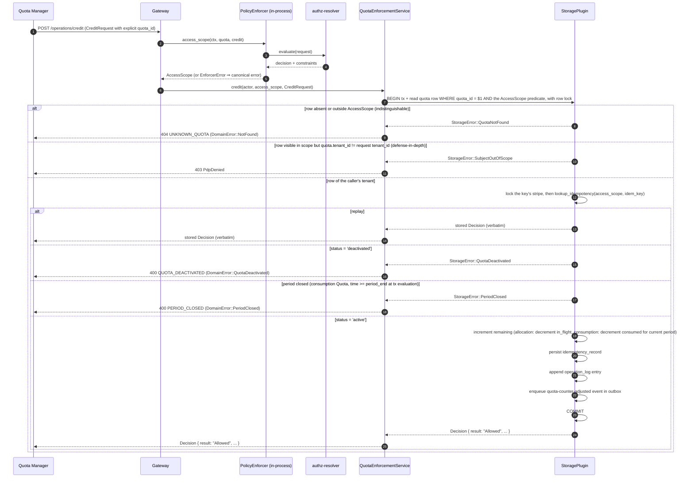

**Description.** Single-Quota counter increment scoped to the Quota Manager actor
(`cpt-cf-quota-enforcement-fr-credit`). Credit takes an **explicit `quota_id`** — there is no subject resolution and no
Engine invocation (per `cpt-cf-quota-enforcement-fr-credit`). Four rejection arms fire **before any mutation**, all
inside the transaction with a row-locked read so the check and the mutation share atomic semantics:

1. **Unknown or out-of-scope quota.** No row with this `quota_id` is visible under the caller's `AccessScope`, which the
   row-locked read applies in its predicate → `StorageError::QuotaNotFound` → `DomainError::NotFound { kind: "quota", id }`
   → 404. An absent row and a row outside the scope are one answer, so a guessed identifier reveals nothing.
1. **Another tenant's quota in scope.** The row is visible under the scope (for example a sibling tenant under a subtree
   grant) but `quota.tenant_id ≠` the request's authorized `tenant_id` (the PDP layer should already have caught
   this; storage check is defense-in-depth per `cpt-cf-quota-enforcement-nfr-tenant-isolation-integrity`) →
   `StorageError::SubjectOutOfScope` → `DomainError::PdpDenied` → 403.
1. **Deactivated quota.** Row exists, tenant scope matches, but `status = 'deactivated'` →
   `StorageError::QuotaDeactivated` → `DomainError::QuotaDeactivated { id }` → 400 (per the §3.3 mapping table:
   `FailedPrecondition`; PRD §5.5 deactivated Quotas accept no new mutation).
1. **Period closed (consumption Quotas only).** Row is active but the consumption Quota's calendar window has elapsed
   (`time >= period_end` at the moment the transaction is evaluated, per PRD §5.5 calendar-keyed credit closure) →
   `StorageError::PeriodClosed` → `DomainError::PeriodClosed` → 400 (`FailedPrecondition` per §3.3). Closure is keyed on
   calendar time, not on `period-rollover` event emission — credit is rejected immediately at the calendar boundary even
   while the settlement window is still draining cross-period lease commits into the closing period's counter (rollback
   closure is intentionally asymmetric, settlement-keyed per `cpt-cf-quota-enforcement-fr-rollback`). Allocation Quotas
   have no period and are unaffected by this arm.

The `quota-counter-adjusted` notification event is emitted exclusively for credits (PRD §5.15 event catalogue); a
return or a rollback emits the dedicated `quota-rollback-applied` event. Same-tx outbox enqueue (I11)
guarantees event delivery regardless of dispatcher liveness.

#### Rollback and Return

**ID**: `cpt-cf-quota-enforcement-seq-rollback`

**FR**: `cpt-cf-quota-enforcement-fr-rollback`, `cpt-cf-quota-enforcement-fr-return`

**Actors**: `cpt-cf-quota-enforcement-actor-quota-consumer`, `cpt-cf-quota-enforcement-actor-quota-resolver`

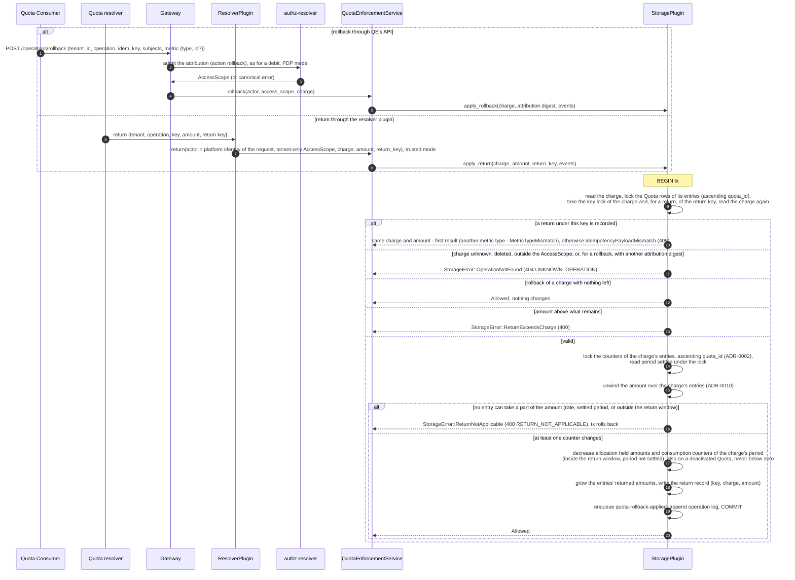

**Description.** A return gives back part of a charge (`cpt-cf-quota-enforcement-fr-return`); a rollback gives back
everything that remains of it (`cpt-cf-quota-enforcement-fr-rollback`, ADR-0011). Both name the charge by its tenant,
operation (debit or lease commit), and idempotency key. A return carries its own key. QE writes one return record per
applied return, with the key, the charge, and the amount, unique per tenant and key, so a repeated return never gives
an amount back twice and one key never applies to two charges. A rollback carries no amount and no key of its own: on
a charge with nothing left it succeeds and changes nothing.

**Lock rank.** Every transaction of the storage plugin takes its locks in one rank. It may skip a rank and never goes
back:

1. Quota rows, in ascending `quota_id` order (ADR-0002).
2. Key locks. A key lock is a lock on one idempotency scope `(tenant, operation, key)`. It is not a row of a record
   table: it can be taken when no record exists yet, and it covers every record of the scope, which is an idempotency
   record, a charge, or a return record. The diagrams call it the idempotency stripe. A transaction that needs several
   key locks takes them in one fixed order. The storage plugin does not keep one lock per scope: it hashes the scope
   to one of 65,536 lock rows that all tenants share. Two unrelated scopes, also of different tenants, can therefore
   hash to the same row; they then exclude each other as two operations on one scope do.
3. Lease rows, in ascending token order.
4. The lease capacity row of the tenant and metric (`lease_capacity_counters`).
5. Counter rows, in ascending `quota_id` order, each followed by the hold rows under it.
6. Rows that the transaction inserts.

What a transaction must know before it locks, it reads without a lock and reads again under the lock: the Quotas of a
lease's holds and of a charge's entries do not change after they are written.

Every transaction keeps the rank. What a transaction does at a lock that another transaction holds depends on its
kind:

- **An operation of a request** (debit, batch debit, credit, return, rollback, and the lease operations) does not
  wait in line. It takes a lock only when the lock is free. When one is held, the transaction rolls back, and the
  operation runs again after a short pause, in which it holds no lock. It does so until it succeeds or the contention
  timeout of its metric (I8) has passed in total over all attempts; then it changes nothing and fails with
  `LeaseContentionTimeout`. With a timeout of 0 ms the first held lock is the answer. One case waits: a return that
  reuses the key of a return of a charge the retention sweeper is deleting waits until that delete ends.
- **Quota management** (update, deactivation with its cascade over leases and counters, and the bulk operations)
  waits for its locks. One lock is an exception: a bulk operation takes the key lock of its envelope as an operation
  of a request does, only when it is free, and repeats within the contention budget.
- **The lease sweeper** takes the expired leases whose rows are free and skips the others for the next pass. It then
  waits for the counter rows of the leases it took.
- **The retention sweeper** takes the key locks of its batch that are free, skips the others, and deletes only
  what it holds the key lock for: charges in one statement, idempotency records in statements of at most 500 keys.
  Releasing the holds of a deactivated Quota works the same way. A pass holds the lock rows of its whole batch until
  its transaction ends, and a request whose scope hashes to one of them is refused and retries within its contention
  timeout. So the batch size bounds the share of requests a pass can hold off: about 1.5 % of the lock rows at the
  default of 1000 and about 15 % at the allowed maximum of 10000.

So only Quota management and the lease sweeper wait, and both keep the rank: no two transactions wait for each
other. The sweepers have no contention timeout.

A return or a rollback reads its charge first to learn the Quotas of its entries. It then locks those Quota rows,
takes the key lock of the charge and, for a return, the key lock of the return key, locks the counters, and reads the
charge again. When the second read finds another charge than the first one, because the first was deleted and a
debit or a commit replaced it under the same key, the operation fails with `UNKNOWN_OPERATION`: the charge that the
caller named is deleted. It reads whether a period is settled under the counter lock, so concurrent returns, rollbacks, and a
period rollover never give back more than the charge or lower a settled period. Of two returns with one return key,
the second gets the key lock after the first has ended and finds its return record. Each entry is applied to the
charge's own period, not the wall-clock current period. A rate entry, and a consumption entry outside the return
window or in a settled period, take no amount. The operation is all or nothing: it fails and changes nothing when the
charge is unknown, the amount exceeds what remains, or no entry can take a part of the amount. Whether an entry can
take an amount depends on the type of its Quota and on the window, never on the current value of its counter: an
allocation entry always takes a return, also when its counter is already at zero.

On QE's API a rollback carries the attribution of the charged operation: the subjects and the metric with its type
and optional id. The PDP admits it for the action rollback as it admits a debit, and the returned `AccessScope` is
applied when the charge is loaded in the transaction. QE then compares the digest of the admitted attribution with the
charge's attribution digest. A charge outside the caller's access, or with another digest, gets the same answer as an
unknown charge. So a caller can roll back only a charge for whose attribution it has a `rollback` grant; knowing the key is not
enough. Return reaches QE only through the resolver plugin, whose scope names the tenant only; it compares no digest
(ADR-0011).

#### Lease Acquisition

**ID**: `cpt-cf-quota-enforcement-seq-lease-acquire`

**Use cases**: `cpt-cf-quota-enforcement-usecase-reserve-and-commit`

**Actors**: `cpt-cf-quota-enforcement-actor-quota-consumer`

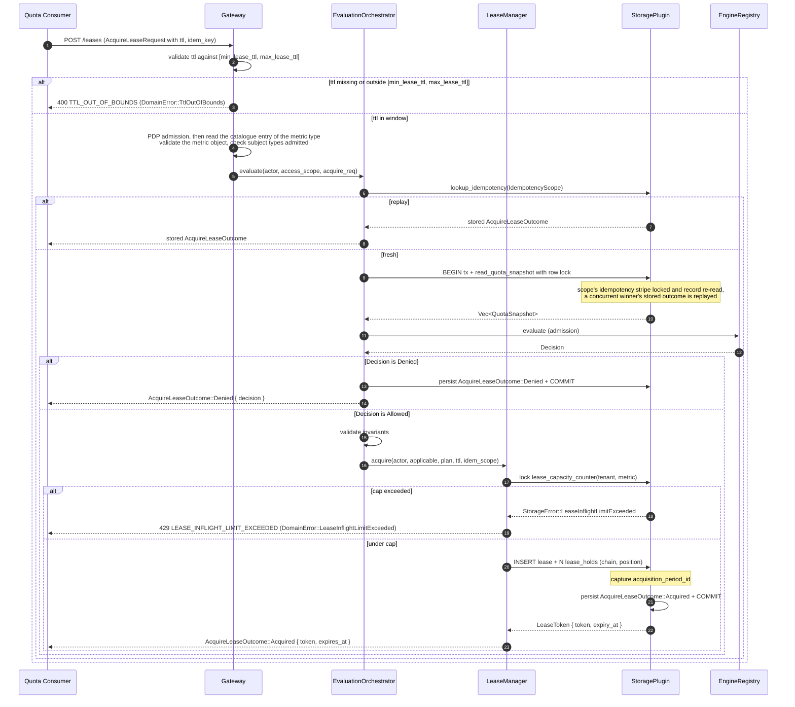

**Description.** Atomic multi-Quota acquisition (`cpt-cf-quota-enforcement-fr-lease-acquire`). TTL bounds are enforced
at the gateway before idempotency lookup: `ttl` is required, and a missing field or a value outside
`[min_lease_ttl, max_lease_ttl]` is rejected with `TTL_OUT_OF_BOUNDS` and never reaches the Engine, idempotency, or
capacity-hold paths (mirrors the `INVALID_AMOUNT` fail-fast). The active-lease cap (default 1000 per `(tenant, metric)`,
PRD §5.6) is enforced atomically same-tx with the lease insert (I7); over-cap requests are rejected without holding any
Quota. `acquisition_period_id` is captured at this step for every consumption Quota in the plan, locking in the period
attribution for the lease's lifetime regardless of when commit / release actually fires (I5).

#### Lease Commit (with cross-period boundary)

**ID**: `cpt-cf-quota-enforcement-seq-lease-commit`

**Use cases**: `cpt-cf-quota-enforcement-usecase-reserve-and-commit`

**Actors**: `cpt-cf-quota-enforcement-actor-quota-consumer`

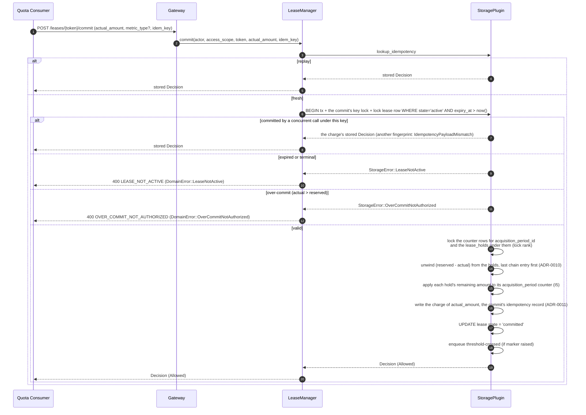

**Description.** Lease commit with the cross-period invariant front and centre: counter mutation lands on the
`acquisition_period_id`'s counter row even when wall-clock time is already in a subsequent period
(`cpt-cf-quota-enforcement-fr-lease-commit` cross-period section). The lazy-expiry guard (`expiry_at > now()` in the
WHERE clause, I4) means commit on an expired lease is rejected without depending on sweeper liveness. When the lease
is already committed, the transaction reads the charge under the commit's key again: the loser of two concurrent
commits with one key gets the winner's stored result, and only a commit under another key gets `LEASE_NOT_ACTIVE`.
Over-commit (`actual > reserved`) is rejected unconditionally (no clamping in P1 per `enforcement_mode = hard`). A
commit below the held amount unwinds the unused part from the holds, so each chain of the plan is charged exactly
`actual_amount`.

#### Lease Release

**ID**: `cpt-cf-quota-enforcement-seq-lease-release`

**Use cases**: `cpt-cf-quota-enforcement-usecase-reserve-and-commit`

**Actors**: `cpt-cf-quota-enforcement-actor-quota-consumer`

Symmetric inverse of commit: full `held_amount` returned to acquisition-period counters, lease state → `Released`,
idempotent under `idem_key`. Sequence shape identical to
`cpt-cf-quota-enforcement-seq-lease-commit` save for the counter direction; not separately diagrammed.

#### Lease TTL Auto-Release (sweeper)

**ID**: `cpt-cf-quota-enforcement-seq-lease-auto-release`

**Use cases**: `cpt-cf-quota-enforcement-usecase-reserve-and-commit` (alternative flow: TTL expired before commit)

**Actors**: implicit — `LeaseSweeper` background task, recorded as the actor `lease-sweeper`; it has no
`SecurityContext`.

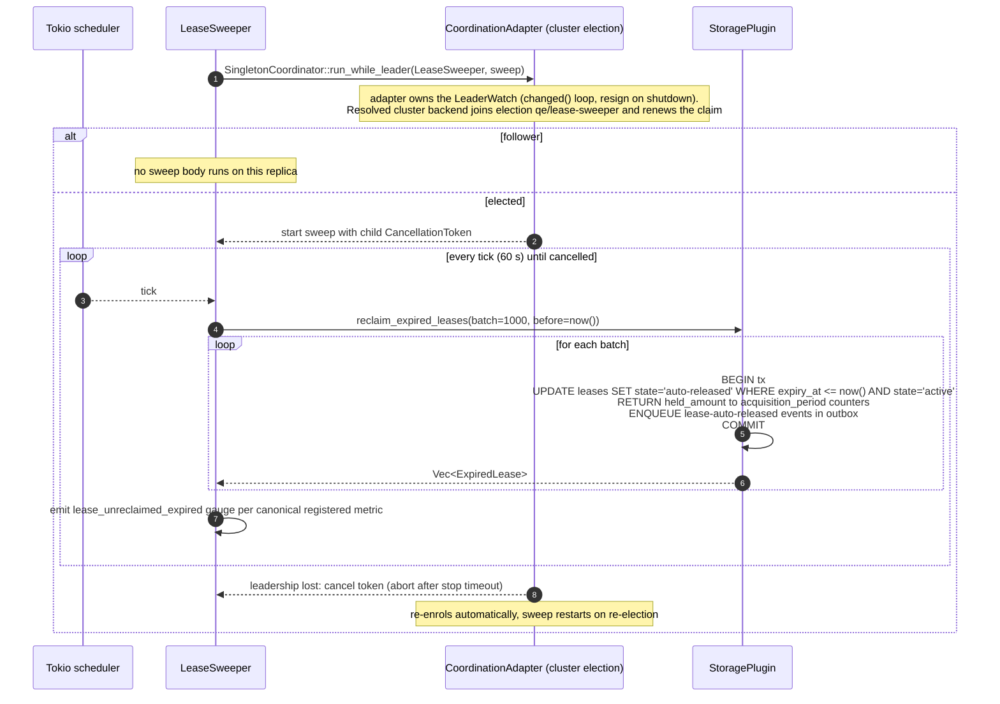

**Description.** The physical reclamation tier of `cpt-cf-quota-enforcement-fr-lease-timeout`. Lazy semantic release
(I4) means correctness does not depend on this sweeper running on schedule — even if the sweeper is paused for hours,
evaluation paths treat expired leases as released. The sweeper exists to (a) reclaim physical rows and (b) emit
`lease-auto-released` events as the canonical emission point. Single-leader execution under the
`lease-sweeper` cluster election through the `CoordinationAdapter`: the sweep runs only while this replica leads, the
resolved cluster backend renews the claim, and leadership loss cancels the sweep before its next batch. The election
backend is the operator's cluster profile binding.

#### Batch Debit

**ID**: `cpt-cf-quota-enforcement-seq-batch-debit`

**Use cases**: `cpt-cf-quota-enforcement-usecase-batch-debit`

**Actors**: `cpt-cf-quota-enforcement-actor-quota-consumer`

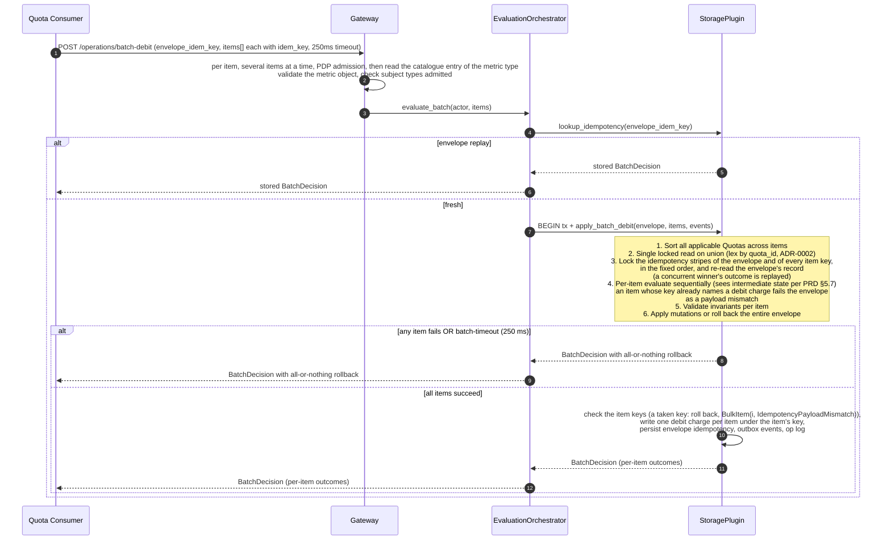

**Description.** Atomic envelope batch (`cpt-cf-quota-enforcement-fr-batch-debit`). The union of applicable Quotas
across all items is locked once up front in lexicographic `quota_id` order
(`cpt-cf-quota-enforcement-adr-acquisition-ordering`); per-item evaluation then proceeds sequentially within the held
lock set. Per-item outcomes are visible to later items (PRD §5.7 normative). Envelope failure (any item denied /
errored, or the 250 ms batch-level tokio timeout) rolls back the entire transaction. An item is a debit: its
idempotency key is required, it writes a `debit` charge under that key, and it shares the key space of single debits.
A batch is replayed only as a whole, by its envelope key: an item key that already names a record of a single debit,
which is a `debit` charge or the idempotency record of a denied debit, fails the envelope with
`IDEMPOTENCY_PAYLOAD_MISMATCH` naming the item (`items[i]`). The item keys are checked only inside the transaction,
under their key locks, when the charges are written; a conflict rolls the envelope back.

#### Evaluate Preview (read-only)

**ID**: `cpt-cf-quota-enforcement-seq-evaluate-preview`

**FR**: `cpt-cf-quota-enforcement-fr-evaluate-preview`

**Actors**: `cpt-cf-quota-enforcement-actor-quota-consumer`, `cpt-cf-quota-enforcement-actor-quota-manager`,
`cpt-cf-quota-enforcement-actor-quota-reader`

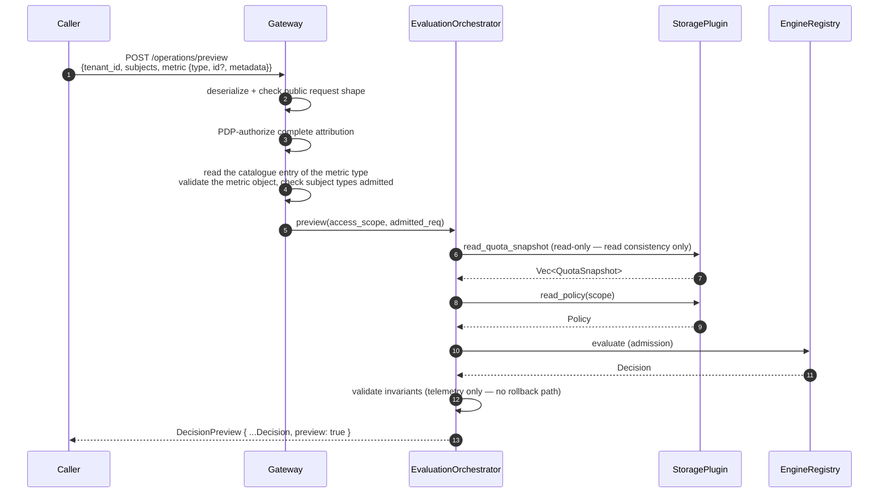

**Description.** Read-only counterpart of debit (`cpt-cf-quota-enforcement-fr-evaluate-preview`). No idempotency, no row
mutation, no outbox enqueue, no operation-log entry, no holding of capacity (I3). Verdict can be invalidated by
concurrent debits between the preview and a follow-up real debit; the response carries `preview: true` so callers cannot
conflate it with an admission. PDP scoping and tenant isolation apply identically to debit.

#### Consumer-Backed Self-Service Snapshot

**ID**: `cpt-cf-quota-enforcement-seq-end-user-snapshot`

**Use cases**: `cpt-cf-quota-enforcement-usecase-end-user-quota-snapshot-read`

**FR**: `cpt-cf-quota-enforcement-fr-end-user-quota-snapshot-read`

**Actors**: `cpt-cf-quota-enforcement-actor-quota-consumer` (the consuming product backend serves the end-user view).

The backend uses the same S2S `POST /quota-enforcement/v1/snapshot` endpoint as manager/operator reads; there is no
end-user QE route. It supplies explicit tenant/subject attribution under its authenticated service principal:

1. **Explicit target is authorized.** PDP checks the supplied tenant/subject/metric tuple against the service
   principal; QE checks that the metric admits each subject type. Unauthorized cross-subject or cross-tenant targets
   are rejected before storage. Every Quota applicable to the admitted set is returned.
1. **No Policy attribution in the response.** Unlike `evaluate_preview`, the response shape carries no `policy_id` /
   `policy_version` / Engine diagnostics. End-user surfaces consume per-Quota state (`cap`, `consumed`, `remaining`,
   period boundary, validity window, metadata) without exposing arbitration internals.

The gateway and storage pipeline are otherwise identical to the manager/operator call. End-user authentication,
presentation, and rate limiting belong to the consuming product — not QE.

**Through the Quota Resolver.** An end user reads their own quota state on QR's tenant plane. QR's sequence
`cpt-cf-quota-resolver-seq-own-quota-state` shows that call up to the backend plugin; QE's part starts there:

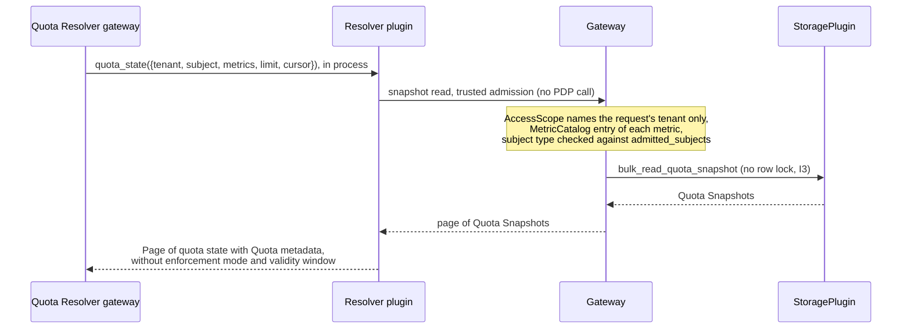

A metric that does not admit the subject's type yields only the tenant's Quotas, with no error. A metric whose
catalogue entry is unavailable fails the read with `FailedPrecondition` (§3.2, resolver plugin).

#### Quota Create

**ID**: `cpt-cf-quota-enforcement-seq-quota-create`

**Use cases**: `cpt-cf-quota-enforcement-usecase-create-quota`

**FR**: `cpt-cf-quota-enforcement-fr-quota-lifecycle`, `cpt-cf-quota-enforcement-fr-metric-identity-validation`

**Actors**: `cpt-cf-quota-enforcement-actor-platform-operator`, `cpt-cf-quota-enforcement-actor-quota-manager`

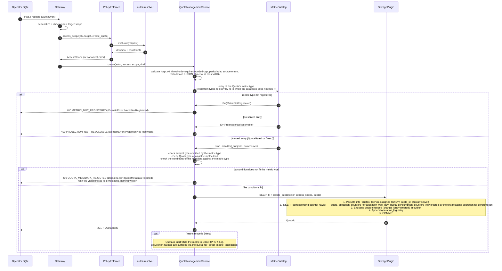

**Description.** Quota creation (`cpt-cf-quota-enforcement-fr-quota-lifecycle`). `QuotaManagementService` validates
the draft against PRD §5.2 rules (cap non-negative, thresholds-require-bounded-cap, the period rule — consumption
Quotas require an explicit valid period, `one_time` included, allocation Quotas reject any period field — and source
enum membership) and checks that the metadata is a JSON object of at most 4 KB. It then takes the `MetricCatalog`
entry of the Quota's metric type (`cpt-cf-quota-enforcement-fr-metric-identity-validation`); the catalogue reads a
type it does not hold from `types-registry` by its id (ADR-0012). Unknown metric → `MetricNotRegistered` (400). A
read that fails or reaches its time limit → `ServiceUnavailable`. A metric with no served entry →
`PROJECTION_NOT_RESOLVABLE` (400). A subject type that the metric type does not admit, or a Quota type that the
metric's kind does not take (a `counter` metric takes consumption and rate Quotas, a `gauge` metric allocation
Quotas) → canonical `InvalidArgument`. The service then checks the conditions of the metadata against the metric
type's `metadata` schema (§3.2 "Quota metadata"). When one does not fit, nothing is written and the answer is
`InvalidArgument` with `QUOTA_METADATA_REJECTED` and the violations as field violations. An update that changes
`metadata` runs the same check. Metric mode (`QuotaGated` /
`Direct`) is **not** a create-time rejection criterion — per PRD §3.2 a Quota MAY be created on a `Direct` metric;
such a Quota is inert while the metric is `Direct` and is surfaced through the `quota_for_direct_metric_total` gauge.
Admission-time rejection of operations against `Direct`-metric Quotas (`MetricNotQuotaGated`) happens on the
debit / reserve / batch-debit / evaluate-preview paths, not here; credit, rollback, return, commit, and release are
never rejected for this reason.
Validation runs **outside** the transaction so the database lock is held for the minimum window. The storage primitive
inserts the Quota row, materialises the allocation counter (consumption counter rows are created lazily by the first
mutating operation per `cpt-cf-quota-enforcement-fr-period-rollover`), and enqueues the `quota-changed (created)`
event same-tx (I11). Operator-side rejection of cap reduction below current consumed (`CAP_BELOW_CONSUMED`) is a
separate update path and is covered by I6.

#### Quota Deactivation Cascade

**ID**: `cpt-cf-quota-enforcement-seq-quota-deactivate-cascade`

**FR**: `cpt-cf-quota-enforcement-fr-quota-lifecycle`

**Actors**: `cpt-cf-quota-enforcement-actor-platform-operator`, `cpt-cf-quota-enforcement-actor-quota-manager`

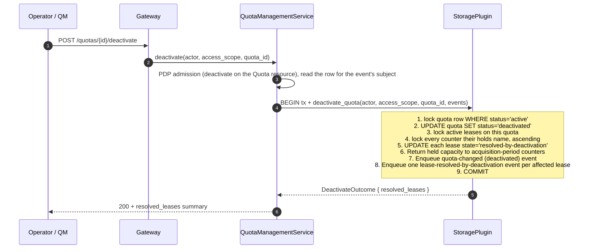

**Description.** Atomic deactivation cascade (per `cpt-cf-quota-enforcement-fr-quota-lifecycle` deactivation rule).
The quota-lifecycle feature delivers steps 1, 2, 7, and 9 (status flip under the row lock, `quota-changed` event,
operation-log entry); the lease steps 3–6 and 8 land with the lease-operations feature, and until then
`resolved_leases` is empty. Deactivation never partially completes — either every active lease for the Quota is resolved or none is. The storage
primitive returns the affected lease references so the gateway can attribute telemetry, and one outbox event is emitted
per affected lease (same-tx I11) for downstream sinks. Subsequent commits / releases against any of these resolved
leases return `LEASE_NOT_ACTIVE` (the deactivation timestamp serves as the implicit lease-resolve event).

#### Period Rollover (lazy detection)

**ID**: `cpt-cf-quota-enforcement-seq-period-rollover`

**Use cases**: implicit; triggered by debit / lease-commit / lease-release whose evaluate crosses a period boundary.

**Actors**: any `cpt-cf-quota-enforcement-actor-quota-consumer` triggers; sweeper as fallback.

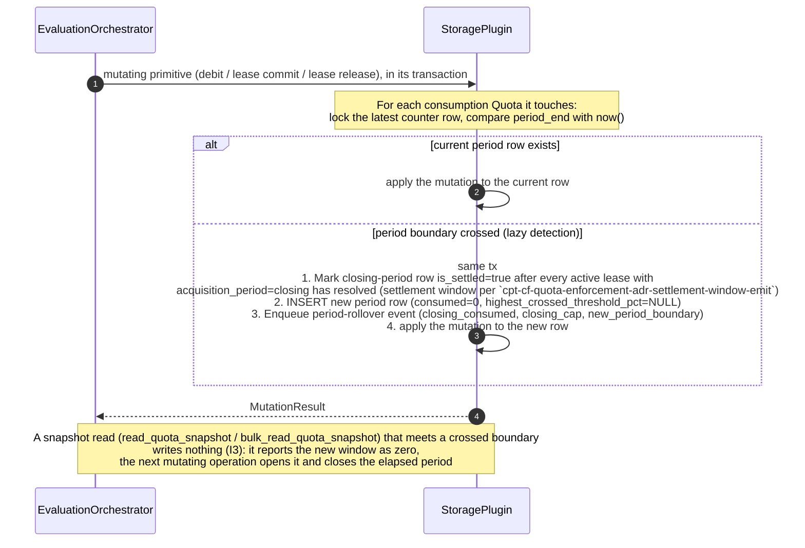

**Description.** Lazy period detection (`cpt-cf-quota-enforcement-fr-period-rollover`). On any mutating operation that
observes `now() >= period_end` for a consumption Quota, the storage plugin atomically settles the closing period,
materialises the new period row, emits the `period-rollover` event for the closing period, and resets the threshold
marker. A snapshot read that observes the same boundary writes nothing (I3): it reports the new window as zero, and
the new row, settlement and the event with the closing figures wait for the next mutating operation. The new `quota_consumption_counters`
row MUST carry `highest_crossed_threshold_pct = NULL` per storage-plugin invariant **I13** (PRD §5.15: "the marker
resets at period rollover so thresholds can fire again in the new period"; threshold-emission rule of
`cpt-cf-quota-enforcement-fr-notification-plugin`). During the settlement window (between `period_end` and the moment
all active leases acquired in the closing period have resolved), cross-period commits/releases mutate the closing-period
counter and emit no `quota-counter-adjusted` or `threshold-crossed` events
(`cpt-cf-quota-enforcement-adr-settlement-window-emit`). A return or a rollback reads `is_settled` under the same
counter lock (`cpt-cf-quota-enforcement-seq-rollback`), so it never lowers the counter of a settled period.

A known P1 limitation: for Quotas with no operations in the new period, the `period-rollover` event for the closing
period does not fire until the next operation arrives. P2 introduces an active rollover scheduler for batched event
emission and silent- Quota coverage.

#### Notification Outbox Dispatch

**ID**: `cpt-cf-quota-enforcement-seq-notification-dispatch`

**Use cases**: implicit; consumes events enqueued by every mutating sequence above.

**Actors**: `cpt-cf-quota-enforcement-actor-notification-sink` (consumer side); the dispatcher is a background task
with no `SecurityContext`.

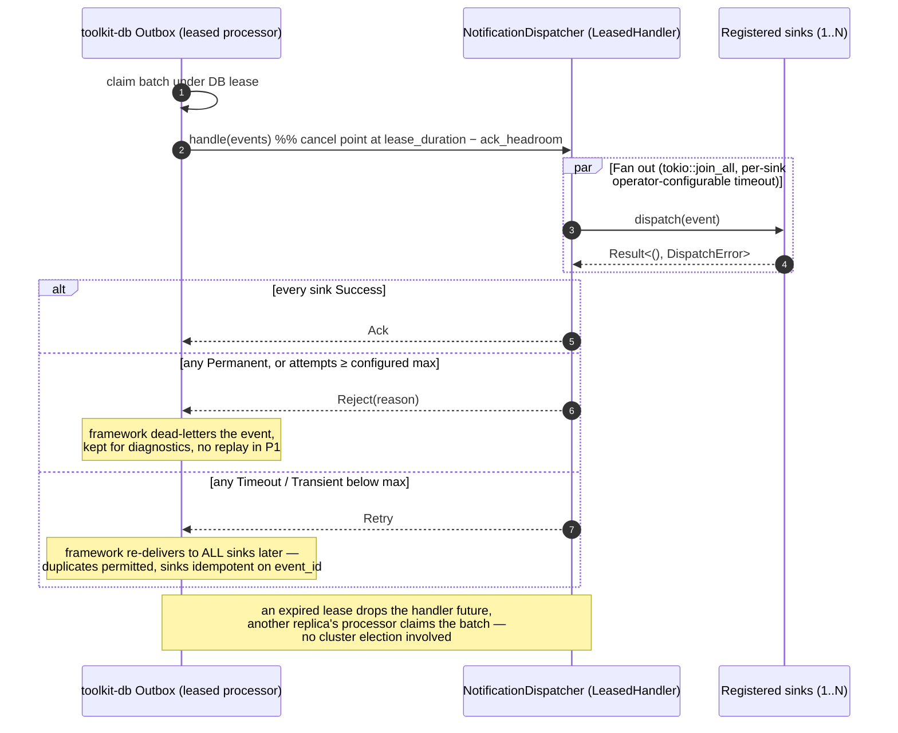

**Description.** The dispatcher is a `toolkit-db` Outbox leased handler: the framework claims batches under a DB
lease, drops the handler future at the cancel point so an expired holder cannot overlap its successor, re-delivers on
retry, and owns the dead-letter store. The handler fans every event out to all registered `QuotaNotificationSinkV1`
implementations with per-sink failure isolation. Sustained failures surface via `outbox_rejections_total` for
operator alerting;
counter mutation is unaffected (PRD §5.15 best-effort delivery normative).

#### Idempotency Replay (cross-cutting)

**ID**: `cpt-cf-quota-enforcement-seq-idempotency-replay`

Idempotency lookup is the first storage call in every mutating sequence above that carries a key of its own. A key
is unique per `(tenant, operation, key)`; the admitted subject set is part of the payload hash, in a fixed order with the tenant included. Behaviour:

- **Cache hit, payload hash match** → return stored `decision_blob` verbatim. Engine is **not** re-invoked (satisfies
  the idempotency-replay rule of `cpt-cf-quota-enforcement-fr-idempotency` for time-gated CEL — `time` binding stays
  captured, never re-bound on replay).
- **Cache hit, payload hash mismatch** → return `IdempotencyPayloadMismatch` (409).
- **Cache miss** → proceed with full evaluation pipeline; persist record same-tx with the mutation (I1, I2).

Records live for the replay window. The charge of an allowed debit or lease commit is its record and answers the same
way for as long as the charge lives. A return is answered from its charge; a rollback has no key
(`cpt-cf-quota-enforcement-seq-rollback`).

The `decision_blob` is JSON-typed and schema-versioned (top-level `__version`); additive shape changes in P2/P3 do not
require migration of existing blobs.

#### Policy Versioning Update

**ID**: `cpt-cf-quota-enforcement-seq-policy-version-update`

**Use cases**: `cpt-cf-quota-enforcement-usecase-configure-policy`

**Actors**: `cpt-cf-quota-enforcement-actor-platform-operator`

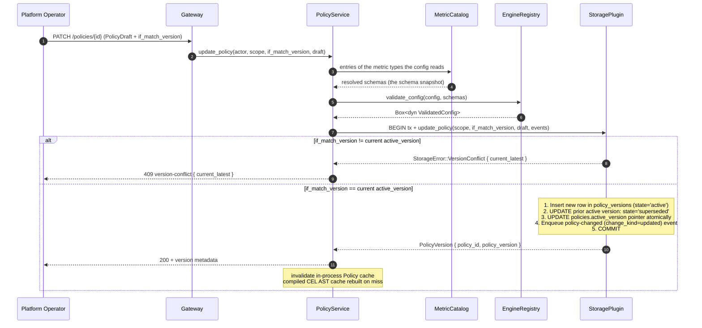

**Description.** Update creates a new immutable version row and atomically moves the `active_version` pointer
(`cpt-cf-quota-enforcement-fr-quota-resolution-policy-versioning`). Engine `validate_config` runs before the database
transaction, so invalid configs fail fast without holding a lock. The update does not check existing Quotas or their
metadata: a change of a Policy is the operator's responsibility (ADR-0013). On a successful update, the compiled
artifact is published to the Engine's `ValidatedConfig` cache after the transaction commits per the Engine Plugin Trait contract.

**Policy DELETE response shape.** `DELETE /quota-enforcement/v1/policies/{id}` returns **204 No Content** on success —
consistent with the platform DELETE convention (precedent: `resource-group` types-registry
`cpt-cf-resource-group-...delete-type`, `account-management` tenant-metadata DELETE). The operation is idempotent per
`cpt-cf-quota-enforcement-fr-quota-resolution-policy-versioning` ("A subsequent `delete_policy` against an
already-deleted `policy_id` is a no-op"): repeat DELETE against the same `policy_id` after a successful soft-delete also
returns 204; the second call performs no state change and emits no second `policy-changed (deleted)` event. **404** is
returned only when `policy_id` was never created — distinct from the deleted-then-replayed case to avoid masking
misconfigured clients. Attempting DELETE against the seeded `global` Policy surfaces a canonical `FailedPrecondition`
error (HTTP 400, `reason = "CANNOT_DELETE_SEEDED_GLOBAL_POLICY"`) per the §3.3 mapping table.

**Policy CREATE / UPDATE / ROLLBACK response shape.** `POST /policies` returns **201 Created** with the new
`PolicyVersion` body; `PATCH /policies/{id}` and `POST /policies/{id}/rollback` return **200 OK** with the new
`PolicyVersion` body (both produce a new immutable version row whose metadata the caller needs).

### 3.7 Database schemas & tables

- [ ] `p1` - **ID**: `cpt-cf-quota-enforcement-db-schema`

> **Scope discipline.** Concrete table layouts (column types, primary keys, indexes, constraints, partitioning rules,
> isolation level, lock-timeout configuration) are **plugin-internal** and live in the storage-plugin DESIGN document.
> The list below is the contract-level table inventory: which logical entities the storage plugin must persist, what
> foreign-key invariants hold across them, and the retention boundaries. The P1 storage-plugin realisation — schema DDL,
> migrations, indexes — is authored in the storage-plugin DESIGN doc once authored (precedent: a sibling gear
> pattern).

#### Table inventory

QE-core requires the storage plugin to persist the following entities. Names below are the canonical logical names; the
plugin chooses physical layout.

| Logical table                     | Purpose                                                                                                                                                                                               | Retention                                                                                                                                                  |
| --------------------------------- | ----------------------------------------------------------------------------------------------------------------------------------------------------------------------------------------------------- | ---------------------------------------------------------------------------------------------------------------------------------------------------------- |
| `quotas`                          | Quota records (declarative caps). P1 reference plugin: `qe_quotas`, `id` a `UUIDv7`, the subject as `subject_type` (a QR subject type) and `subject_id`, `cap BIGINT NULL CHECK (cap >= 0)`, the metric as a metric type id, enums as GTS instance ids, thresholds and metadata as canonical JSON text. `holds_pending` is true from the deactivation of an allocation Quota until `RetentionSweeper` has released its holding entries (see `charge_entries`). | Indefinite for active; deactivated retained until P2 audit-aware purge (`cpt-cf-quota-enforcement-fr-quota-lifecycle`)                                     |
| `quota_allocation_counters`       | Per-Quota in-flight counter (allocation type); created with the Quota and read under its row lock by the I6 cap guard (P1 reference plugin: `qe_quota_allocation_counters`)                            | Co-terminus with the Quota                                                                                                                                 |
| `quota_consumption_counters`      | Per-(Quota, period) consumed counter; carries `highest_crossed_threshold_pct`                                                                                                                         | Active period + operator-configurable historical window (default 13 months); reclaimed via partition drop                                                  |
| `leases`                          | Lease rows with state, expiry, acquisition_period_id, attribution digest                                                                                                                                               | Active until terminal; retained as ledger entries within operation-log retention                                                                           |
| `lease_holds`                     | Per-Quota lease hold rows with the chain and position of the plan entry (ADR-0010)                                                                                                                    | Co-terminus with the lease row                                                                                                                             |
| `lease_capacity_counters`         | Per-(tenant, metric) acquisition lock row                                                                                                                                                             | Co-terminus with QE deployment                                                                                                                             |
| `policies`                        | Policy entity + `active_version` pointer + `high_water` version counter                                                                                                                               | Indefinite (seeded `global` cannot be deleted)                                                                                                             |
| `policy_versions`                 | Immutable version rows (`active` / `superseded` / `rolled_back` / `deleted` per PRD §5.9 four-state enum)                                                                                             | Operator-configured retention (default 90 days for `superseded` / `rolled_back` / `deleted` terminals); seeded `global` Policy versions kept indefinitely. |
| `policy_operation_log`            | Policy audit trail: one row per create / update / rollback / delete, with actor and comment                                                                                                           | Indefinite (no sweeper reclaims it)                                                                                                                        |
| `idempotency_records`             | Replay-safety records keyed by `(tenant_id, operation_type, idem_key)` per `cpt-cf-quota-enforcement-fr-idempotency`; the subjects are part of `payload_hash`. No row for an allowed debit or lease commit: the charge is its record. | The replay window: operator-configurable per-`(tenant, metric)` (default 24 h); reclaimed by `RetentionSweeper` |
| `charges`                         | Charge ledger (ADR-0011): one row per allowed debit or lease commit, unique per `(tenant_id, operation, idem_key)`, with the request fingerprint, attribution digest, first result, metric, and amount. P1 reference plugin: `qe_charges` also stores `expires_at`, the time the charge is deleted, `NULL` while one of its entries is holding (see `charge_entries`) | Until the replay window has passed since the charge's creation and since the last return or rollback applied to it, and no allocation entry holds an amount on an active Quota; then deleted for every operation and removed by `RetentionSweeper` in batches |
| `charge_entries`                  | One row per Debit Plan entry of a charge: chain, position, `quota_id`, `period_id` (consumption), charged and returned amounts. P1 reference plugin: `qe_charge_entries.holding` is true for a **holding entry**, an entry that keeps its charge alive: an entry on an allocation Quota with `returned < charged` whose Quota's holds the sweeper has not released | Co-terminus with the charge |
| `charge_returns`                  | One row per applied return of a charge (the return record): unique per `(tenant_id, return_key)`, with the charge and the amount | Co-terminus with the charge |
| `operation_log`                   | Operation ledger (P1; audit-grade attribution deferred to P2). P1 reference plugin: `qe_operation_log`, one row per accepted mutation with the actor and content-free detail                          | Operator-configurable (default 30 days); partitioned by date for `DROP PARTITION` retention                                                                |
| `notification_outbox`             | Same-tx event queue (toolkit-db Outbox under the table prefix `qe_outbox`; queue `qe_notifications`, eight tenant-keyed partitions, the event kind as payload type). The plugin enqueues; the dispatcher of the notifications feature binds the handle and drains.  | Co-terminus with successful delivery; dead-letter rows retained per operator config                                                                        |
| `contention_timeout_config`       | Per-metric contention timeout configuration                                                                                                                                                           | Indefinite                                                                                                                                                 |
| `lease_capacity_config`           | Per-`(tenant, metric)` active-lease cap overrides; most specific row wins (`(t, m)`, `(t, *)`, `(*, m)`, `(*, *)`), the `(*, *)` row = platform default (1000 per PRD §5.6 / `cpt-cf-quota-enforcement-fr-lease-timeout`); enforced by I7. | Indefinite                                                                                                                                                 |
| `idempotency_retention_config`    | Per-`(tenant, metric)` idempotency retention overrides; same most-specific-row lookup as `lease_capacity_config`, `(*, *)` = platform default                                                                                                                                            | Indefinite                                                                                                                                                 |

**Configuration freshness.** The reference plugin resolves the three `*_config` tables from an in-memory snapshot,
not per operation. The first read after the refresh interval (`config_refresh_secs`, default 30 s) reloads it by
reading every row of the three tables (operator overrides, expected to be few), so an operator edit takes effect within
one interval on every replica. The caller that finds the snapshot stale waits for that reload; concurrent callers keep
reading the current snapshot and wait only for the very first load. A failed reload keeps serving the last good
snapshot, logs a warning with its age, and is retried after one more interval. Callers queued behind a failed first
load get an unavailable error instead of retrying it one after another.

**Operator edits apply per replica.** Replicas reload on their own schedules, so after an edit they can disagree for
up to one interval, and longer on a replica whose reloads fail (its warning shows the snapshot age). Lowering a lease
cap is the case to know: a replica that has not reloaded yet keeps admitting until the live leases of that
`(tenant, metric)` reach the old cap. The live count comes from the database, so the overshoot is bounded by the old
cap, not by the old cap times the number of replicas. The contention timeout and the idempotency retention lag the same
way. There is no config API yet: operators edit these tables in SQL. When one exists, it should invalidate the
snapshot on write, and the interval becomes a fallback.

**Cross-table invariants** (enforced by the storage plugin under I1):

- Every `lease_holds.lease_id` references an existing `leases.lease_id` (FK, ON DELETE CASCADE).
- Every `lease_holds.quota_id` references an existing `quotas.quota_id` (FK, ON DELETE RESTRICT — Quota cannot be
  hard-deleted while leases hold it).
- Every `lease_holds.period_id` (consumption Quotas) references the lease's `acquisition_period_id` on a
  `quota_consumption_counters` row.
- Every `charge_entries` row references an existing charge (ON DELETE CASCADE). Its `quota_id` names a Quota and is
  not a foreign key: a foreign-key check would lock the Quota row out of the lock rank. Its returned amount never
  exceeds its charged amount.
- Every `charge_returns` row references an existing charge (ON DELETE CASCADE); `(tenant_id, return_key)` is unique.
- P1 reference plugin: the stored lifetime of a charge follows its rows. A holding entry is on an allocation Quota
  and has `returned < charged`. A charge's `expires_at` is `NULL` if and only if one of its entries is holding;
  otherwise it is the later of the end of the return window and the time the last return or rollback keeps the
  charge until. The charge write, every return and rollback, and the sweeper keep this true in their own
  transactions. Deactivating a Quota touches no entry and no charge: it sets `holds_pending`, and until the sweeper
  releases the holds, a read checks the Quota of each holding entry, so the deletion rule stays exact. A charge with
  an `expires_at` is deleted once that time has passed; a charge without one is deleted once its windows have passed
  and none of its holding entries is on an active Quota. Partial indexes serve each reader: `expires_at` where it is
  set, the holding entries by `quota_id`, the Quotas with `holds_pending`, and the end of the return window of the
  charges without an `expires_at` (the held-charge gauge).
- `policies.active_version`, when set, always references an existing version row.
- Outbox events for a mutation are inserted in the same transaction as the mutation; no partial enqueue is observable.
- Idempotency record `payload_hash` is the canonical SHA-256 of the sorted-JSON payload; the plugin stores it as
  fixed-width binary for index efficiency.

#### Bootstrap seeded state

`bootstrap()` is responsible (idempotently) for:

1. Verifying schema is at the trait's major version (returns `SchemaVersionMismatch` otherwise).
1. Seeding the `global` Quota Resolution Policy with the `most-restrictive-wins` Engine if it does not exist (cannot be
   deleted thereafter per `cpt-cf-quota-enforcement-fr-quota-resolution-policy`).
1. Reading the metric types into `MetricCatalog` for the first time (ADR-0012). QE registers no GTS type for subjects
   or metrics and has no configured list of them: the QR SDK declares the quota subject base, the tenant subject type,
   and the metric base; the QR gear publishes them through the ToolKit GTS publication of its gear attribute, and the
   runtime waits for the admission of every gear's declarations before any application `init` runs, so these types
   exist before this step and QE needs no start order with QR. The read takes the distinct metric types of the active Quotas, from
   `read_active_quota_counts()`, and of the active Policies, from `read_active_policies()`: the metric of a
   per-metric scope and the metric types of a schema snapshot. It reads each type from `types-registry` by its id.
   For each type the read checks that it is concrete and derives from `gts.cf.core.quota.metric.v1~`; that its
   traits are valid, for example that `admitted_subjects` names `gts.cf.core.quota.subj.v1~` or types derived from
   it; and that its own version is major 1 or higher. The read makes no check against stored Quotas or Policies. A
   type that fails a check makes its metric's entry unavailable: QE writes a log entry with the metric and the
   reason and counts it in telemetry (§4.1), bootstrap does not fail, and readiness does not change. A metric type that the registry does not
   know gets no entry: it is flagged with a structured warning, and its Quotas are never deactivated. A read at
   start that fails or reaches its time limit fails the bootstrap attempt; the replica stays not ready and repeats
   bootstrap until the registry answers, so a replica never takes requests with an empty
   catalogue; after the start, readiness does not depend on `types-registry`. A metric type that QE does not hold is
   read when a request or a write names it: requests for the same type make one read, reads of different types do
   not wait for each other, and after a read that failed
   the next ones fail at once with `ServiceUnavailable` for a short time.
   Every read goes through `PlatformTypesRegistryApi` with the outbound platform marker (`PlatformSecurityContext::outbound_marker()`, which marks a gear's own call and is not an identity), asks the registry itself
   and not the client's cached copy; a type with the deleted status is a deleted type
   (ADR-0012).
   After start, a metric type the catalogue does not hold is read once, with a time limit, when a request or a Quota
   or Policy write names it. Before the read QE checks the form of the id: a metric type id that does not start with
   `gts.cf.core.quota.metric.v1~`, or a subject type id that does not start with `gts.cf.core.quota.subj.v1~`, is
   `InvalidArgument` with no registry call. The memory of unknown ids has a size limit and drops the entry that
   was used least recently; the catalogue and the cache of registered subject types hold only registered types and
   have no limit. A type the registry does not know is `InvalidArgument`, and QE remembers that answer for
   a short time. A read that fails or reaches its time limit is `ServiceUnavailable`.
   A request whose metric object does not fit a served entry reads that metric type again with a conditional read
   before it is rejected, at most once per metric in the time QE remembers an unknown id (ADR-0012).
   A scheduled read runs on a bounded schedule. For each entry and for each cached subject type it makes a
   conditional `batch_get_entities` read, with the validator that the registry returned when QE read the type, which
   returns a document only when it changed. The read builds an entry again when its type changed, removes the entry
   of a deleted metric type, and drops a deleted subject type; it reads nothing from storage. A scheduled read that fails or reaches its time
   limit changes no entry and is counted in `catalog_read_failures_total`; a read that succeeds sets
   `catalog_last_scheduled_read_timestamp_seconds`. An entry is built only
   from the current registry content, so a running and a restarted replica build the same entry.
   QE does not resolve a metric type itself: it asks the registry for the resolved schema and the effective traits
   of the type, and the resolved body
   keeps its Draft-07 dialect and entity-reference constraints for the compiled schema to assert at ingress.
1. Seeding default rows for `contention_timeout_config(metric='*', timeout_ms=50)`,
   `lease_capacity_config(tenant_id='*', metric='*', max_active_leases=1000)`, and
   `idempotency_retention_config(tenant='*', metric='*', retention_seconds=86400)` when missing (`*` is the "any" key;
   key columns are never NULL).

Separately, in the gear lifecycle `start` and not in the storage `bootstrap()`, QE resolves the cluster
leader-election facade for the `quota-enforcement` profile with the `Linearizable` requirement (§3.3 "Cluster
Coordination"). A capability mismatch or an unbound profile fails startup in the embedded profile and readiness in the
deployed profile. The cluster resolver validates the operator's binding; QE runs no probe of its own.

### 3.8 Deployment Topology

- [ ] `p1` - **ID**: `cpt-cf-quota-enforcement-topology`

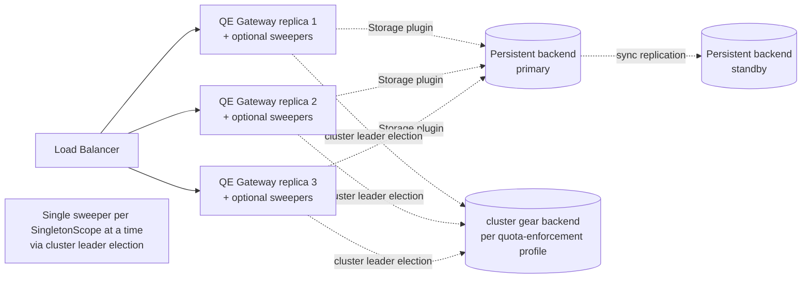

**P1 deployment shape.**

- **Single region.** Multi-region is out of P1 scope; the platform's standard region-pair active-passive pattern applies
  and `cpt-cf-quota-enforcement-nfr-fault-tolerance` (RPO=0) is delivered by the storage plugin's durable-commit
  guarantee (concrete realization is plugin-internal).
- **Stateless gateway.** Multi-replica behind a platform load balancer, and rolling-update safe: every replica builds
  the same catalogue entry from the registry content alone (ADR-0012).
- **Sweeper coordination.** `LeaseSweeper` and `RetentionSweeper` each join a distinct cluster election
  (`qe/lease-sweeper`, `qe/retention-sweeper`) through the `CoordinationAdapter` at startup. The elected replica runs
  the background loop; the others stay followers and serve only request traffic. The resolved cluster backend renews
  the claim; on leadership loss the adapter cancels the loop and the replica returns to follower mode, and re-election
  is automatic.
  RTO ≤ 15 min per `cpt-cf-quota-enforcement-nfr-recovery` is bounded by the election TTL plus observation lag. The
  operator selects the election backend in the cluster profile YAML, independently of the storage backend.
- **Bundling.** Sweepers + dispatcher run in the same binary as the gateway by default (single deployment artefact).
  Operators MAY split them into a dedicated binary by feature-flag if their workload warrants — e.g., a sweeper-only
  replica with reduced HTTP concurrency. For the two sweepers, the cluster election semantics work identically
  across both layouts; the dispatcher continues to use the Outbox lease.
- **QR co-location.** The QR plugin contract is in process only, so the QR gear runs in every QE process and calls
  the resolver plugin there; modules in other processes reach QR through its REST projection.
- **Connection pooling.** Provided by the storage plugin; sized to satisfy `cpt-cf-quota-enforcement-nfr-throughput` (≥
  10 K ops/s). Concrete pooler choice is plugin-internal.
- **Schema migration.** Operator-runnable; the storage plugin's `bootstrap()` rejects mismatched schema versions before
  serving traffic (I12). Migration tooling itself is plugin-internal.

## 4. Additional context

### 4.1 Telemetry surface

The complete QE-specific metric catalogue exposed alongside the framework baseline
(`cpt-cf-quota-enforcement-fr-telemetry`):

| Metric                                     | Type      | Labels                   | Notes                                                                                                                                                                                                                       |
| ------------------------------------------ | --------- | ------------------------ | --------------------------------------------------------------------------------------------------------------------------------------------------------------------------------------------------------------------------- |
| `denial_total`                             | Counter   | `reason`                 | Closed `reason` enum (`cpt-cf-quota-enforcement-constraint-bounded-cardinality`)                                                                                                                                            |
| `contention_rejected_total`                | Counter   | `operation`              | Increments on `LEASE_CONTENTION_TIMEOUT` (I8) of any operation; closed `operation` enum, a batch counts as a debit |
| `lease_contention_rejected_total`          | Counter   | `metric`                 | Increments on `LEASE_CONTENTION_TIMEOUT` (I8) of a debit or a lease acquisition; `metric` is the canonical registered identity                                                                                                                                 |
| `lease_acquisition_wait_seconds`           | Histogram | `metric`                 | Wait time during lease acquisition (successful or rejected); `metric` is the canonical registered identity; buckets sized for the SLO of `cpt-cf-quota-enforcement-nfr-evaluation-latency` (p95 ≤ 100 ms).                |
| `lease_inflight_limit_exceeded_total`      | Counter   | `metric`                 | Per-(tenant, metric) cap (I7); `metric` is the canonical registered identity                                                                                                                                                  |
| `lease_unreclaimed_expired`                | Gauge     | `metric`                 | Sweeper visibility by canonical registered metric                                                                                                                                                                            |
| `allocation_charges_past_replay_window`    | Gauge     | `metric`                 | Allocation charges that hold an amount on an active Quota and are older than the replay window (ADR-0011); a lost return shows as a charge that stays here. The read counts the charges that still hold, from one index, so a hold on a deactivated Quota is counted until the sweeper releases it. Published by the `RetentionSweeper` leader |
| `allocation_charge_max_age_seconds`        | Gauge     | `metric`                 | Age of the oldest such charge; published with the gauge above |
| `engine_bootstrap_failures_total`          | Counter   | `engine_id`              | Gear-bootstrap fail-fast                                                                                                                                                                                                  |
| `engine_evaluation_seconds`                | Histogram | `engine_id`              | Engine `evaluate()` latency; bucket sizing aligns with the per-Policy timeout (default 5 ms) — exact bucket configuration is operator-tunable.                                                                              |
| `policy_evaluation_failures_total`         | Counter   | `engine_id`, `metric`    | Increments on `POLICY_EVALUATION_FAILED`; `metric` is the canonical registered identity. QE also writes a log entry with the Policy id, the Policy version, and the metric |
| `debit_plan_invariant_violations_total`    | Counter   | `engine_id`, `invariant` | `invariant` ∈ closed set of 5 (PRD §5.16)                                                                                                                                                                                   |
| `quota_cap_zero_total`                     | Gauge     | —                        | Quotas with lifecycle status `active` and `cap = 0`, whatever their validity window (config drift surface)                                                                                                                  |
| `quota_cap_unbounded_total`                | Gauge     | —                        | Quotas with lifecycle status `active` and `cap = null`, whatever their validity window                                                                                                                                      |
| `quota_for_direct_metric_total`            | Gauge     | —                        | Quotas with lifecycle status `active` whose metric has a served `MetricCatalog` entry that is `Direct` (PRD §3.2 inertness signal); a deactivation takes effect at the next gauge refresh |
| `quota_conditions_unfit_total`             | Gauge     | —                        | Quotas with lifecycle status `active` whose conditions do not fit their metric type as it is now; refreshed with the other lifecycle gauges |
| `notification_dispatch_failures_total`     | Counter   | `sink_id`, `event_kind`  | Per-sink dispatch failures (PRD §5.15 best-effort delivery)                                                                                                                                                                 |
| `outbox_pending_rows`                      | Gauge     | `queue`                  | Outbox backlog visibility; requires a `toolkit-db` pending-count API (tracked upstream prerequisite)                                                                                                                                                                                                   |
| `outbox_rejections_total`                  | Counter   | `queue`                  | Handler `Reject` outcomes; this is not a durable dead-letter row count                                                                                                                                                       |
| `policy_version_transitions_total`         | Counter   | `transition_kind`        | `{create, update, rollback, delete}`                                                                                                                                                                                        |
| `policy_version_conflict_rejections_total` | Counter   | —                        | Policy versioning concurrency rejections                                                                                                                                                                                    |
| `contract_validation_failures_total`       | Counter   | `surface`, `reason`      | `surface` ∈ `{request_subject, request_metric, caller_attribution, quota_write, policy, bootstrap}`: a subject of a request, the metric object of a request, the caller attribution, a Quota write, a Policy write, and a read of `MetricCatalog`. `reason` ∈ `{shape_invalid, metadata_missing, schema_violation, schema_invalid, unregistered, abstract, not_derived, metric_unregistered, major_version_zero, trait_invalid, projection_not_resolvable}`. A metric type that makes its metric unavailable is counted under `bootstrap`, the surface of every read of `MetricCatalog`; a log entry names the metric and the reason |
| `catalog_read_failures_total`              | Counter   | `phase`                  | Reads of `types-registry` that fail or reach their time limit; `phase` ∈ `{start, first_use, scheduled}` |
| `catalog_last_scheduled_read_timestamp_seconds` | Gauge | —                 | Time of the last scheduled read of `MetricCatalog` that got an answer from the registry on this replica; a scheduled read with nothing to read does not set it; it stops growing when the registry does not answer and when the scheduled task stops |
| `catalog_unavailable_metrics`              | Gauge     | —                        | Unavailable `MetricCatalog` entries that this replica holds now; process-local, read with no I/O; a log entry names each metric and its reason |
| `admitted_metric_violations_total`         | Counter   | `surface`                | Subject type not admitted by the metric at request or Quota write; no metric label                                                                                                                              |

**Lifecycle gauges.** The `quota_*_total` gauges are storage-backed: the replica that holds the
`lifecycle-gauges` election refreshes them on a bounded schedule through `read_active_quota_counts()` and the
`enforcement` of each distinct metric's `MetricCatalog` entry, and publishes one sample that the
observable callbacks read without any I/O. A sample is published only after a refresh that succeeded in the current
leadership term; a failed refresh, a timed-out one keeps the last sample and warns, and after the configured staleness
bound the sample is withdrawn, so a failed read is never reported as zero. Leadership loss, a `Lagged` or `Reset`
watch event, or shutdown withdraw the sample and discard any late refresh result; followers publish nothing, not zero,
so in steady state identical global counts are never summed across replicas; during an advisory overlap two leaders
may briefly publish the same absolute value, so dashboards aggregate these gauges with max or last, never sum.
Telemetry backends must treat a former leader's series as stale once it stops updating, so a failover cannot
double-count.

Label cardinality is bounded at compile time (`cpt-cf-quota-enforcement-constraint-bounded-cardinality`).
High/unbounded-cardinality identifiers (`tenant_id`, `subject_id`, `quota_id`, `policy_id`, `idempotency_key`,
`lease_token`), subject type, caller attribution, and raw/unregistered metric input appear only on traces and
structured log fields, never on metric labels. Canonical registered `metric` labels are used only by instruments that
declare them in the catalogue above and are populated only after registry/catalogue validation.

Caller attribution is intentionally not a metric dimension: the number of calling services is not bounded across
deployments. It is available on sampled traces and structured diagnostics instead.

**Tracing.** Spans follow the platform `tracing` conventions and nest under the request span the platform opens
(`http_request` for REST); an in-process call has none above them. Each operation opens
`quota_enforcement.<area>.<op>`, for example `quota_enforcement.operations.debit`, `quota_enforcement.quotas.list` or
`quota_enforcement.policies.update`, with `tenant_id` and, where the request names them, `quota_id`, `metric`,
`policy_id`, and `item_count` for batch and bulk envelopes. Under it, as siblings:

- `quota_enforcement.admission`: the operation's whole admission phase, every PDP call it makes. A batch or bulk
  envelope admits each item with its own PDP call, so this one span covers all of them and records `item_count`; its
  duration is the aggregate admission time, not one call.
- `quota_enforcement.engine.evaluate`, for an evaluating operation: the storage attempts and any preparation retries
  (`preparations` records how many), with `quota_enforcement.engine.prepare` (`policy_id`, `version`) under it when a
  policy version is compiled.

Each storage plugin call that writes is `quota_enforcement.storage.<method>`, under the evaluation span when it
evaluates. Plain reads open no span: a bulk update or deactivate reads each target under its own item's scope, and its
replay checks are paged reads, so read spans would grow with the envelope. Their time stays inside the operation span.
No span is opened per item or per engine invocation: the engine runs inside the storage transaction, once per batch
item, and is measured by `engine_evaluation_seconds` instead. Identifiers are span attributes only, never metric labels; the
`SecurityContext`, lease tokens and metadata are never recorded.

**Structured logging.** Tracing crate. The system never logs metric values, metadata content, or subject identifiers
verbatim at INFO level.

### 4.2 Capacity envelope

Estimated steady-state at the P1 NFR floor (`cpt-cf-quota-enforcement-nfr-throughput` ≥ 10 K ops/s,
`cpt-cf-quota-enforcement-nfr-subject-scale` ≥ 100 M subjects, `cpt-cf-quota-enforcement-nfr-quota-density` ≥ 1 B
Quotas):

| Data class                        | Estimate                              | Notes                                                                                                                   |
| --------------------------------- | ------------------------------------- | ----------------------------------------------------------------------------------------------------------------------- |
| `quotas`                          | ≈ 250 GB at 1 B rows × ~250 B         | Hot index on `(subject_type, subject_id, metric)` partial-where-active sized to fit the storage-plugin in-memory cache. |
| `quota_consumption_counters`      | ≈ 1.5 GB / month / metric at peak     | 13-month retention via partition drop.                                                                                  |
| `leases` (active + ledger window) | ≤ 1 GB                                | Ledger entries kept within operation-log retention.                                                                     |
| `idempotency_records`             | ≈ 432 GB at 24 h × 10 K ops/s × 500 B | **Significant** — upper bound: an allowed debit or commit writes a charge instead. Operator may split to a dedicated storage tier. |
| `operation_log`                   | ≈ 1 TB at 30 days                     | **Significant** — partitioned by date; cold-tier migration to a longer-term store is a P2 candidate.                    |
| `notification_outbox`             | bounded by dispatch lag               | Operator alert on `outbox_pending_rows` > threshold.                                                                    |

**Charge ledger.** The ledger holds about one replay window of charges, plus the allocation charges that still hold an
amount on an active Quota (ADR-0011). At 10 000 charging operations per second and the default 24 h window that is up
to ≈ 864 M charges (10 000 × 86 400 s), about 520 GB at ~600 B per charge with one entry (what an idempotency record
holds, plus the entry): the same order as `idempotency_records`, which hold no row for these operations. Allocation
charges that still hold an amount grow with the resources that exist, not with the request rate. The charge of a lost
return stays until the module that made the charge returns it; the gauge `allocation_charges_past_replay_window` shows such charges. The
sweeper removes deleted charges in batches and has to keep up with the rate they are written, up to 10 000 per second
at that load. A sweeper that falls behind grows the table, not the set of known charges: a deleted charge is unknown
whether or not it is removed.

Capacity / cost budgets at the deployment level are managed by SRE, not at the QE gear level —
`cpt-cf-quota-enforcement-nfr-...` allocations identify the mechanism; absolute infrastructure sizing is governed in the
platform infrastructure repo. Capacity / cost budgets are managed at deployment level by SRE — `Not applicable` at QE
gear level.

**Storage-plugin tuning** is plugin-internal (connection pooling, buffer sizing, replication knobs, vacuum strategy,
partitioning). QE-core's contract over the storage plugin is: hot-path admission stays within the SLO of
`cpt-cf-quota-enforcement-nfr-evaluation-latency`, throughput sustains `cpt-cf-quota-enforcement-nfr-throughput`, and
durability satisfies `cpt-cf-quota-enforcement-nfr-fault-tolerance` (RPO = 0).

**Performance verification.** A Criterion benchmark suite in `quota-enforcement/benches/` covers single-Quota debit @ 10
K ops/s, 10-Quota cascade @ 5 K ops/s, lease 3-phase cycle, and 100 M-subject load. CI gates p95 ≤ 100 ms before merge
(`cpt-cf-quota-enforcement-nfr-evaluation-latency`).

### 4.3 Future considerations

The following deferred work has explicit hooks in the P1 design; each entry names the hook so future authors can extend
additively without breaking existing callers.

| Topic                                                                            | Phase | Hook in P1 design                                                                                                                                                                                                                                                                                                                                                                 |
|----------------------------------------------------------------------------------|-------|-----------------------------------------------------------------------------------------------------------------------------------------------------------------------------------------------------------------------------------------------------------------------------------------------------------------------------------------------------------------------------------|
| Sharded counters                                                                 | P2    | Counter tables additive `shard_id` column; acquisition ordering grows to `(quota_id, shard_id)`; queries aggregate via `SUM`.                                                                                                                                                                                                                                                     |
| Bulk Quota CRUD endpoints                                                        | P2    | REST surface adds `/quota-enforcement/v1/quotas/bulk-*`; Storage plugin already exposes transactional batch primitives via `apply_batch_debit` precedent. Quota Manager depends on this surface to create, at scale, the Quotas of another major version of a metric type; QE still gains no Quota/counter migration verb.                                                                                      |
| Derived or attested attribution (`cost-center` etc.)                              | P3    | Adds a wrapper that produces the same raw attribution tuple after its own latency/security design; QE core and Engine contracts remain unchanged.                                                                                                                                                                                                                                  |
| Rate Quota type (`rate`)                                                         | P3    | `quota_type` reserves the `rate` GTS instance (`gts.cf.core.qe.quota_type.v1~cf.core.qe.rate.v1`); runtime currently rejects Quota creation referencing it with the canonical `Unimplemented` error per `cpt-cf-quota-enforcement-fr-quota-type-rate-rejection`. Schema migration adds optional `rate_spec` JSON field at activation time per PRD §5.3 (zero-cost reservation in P1). |
| Cap-clamp admission (`hard-with-clamp`)                                          | P3    | `EnforcementMode` is the closed enum of `cpt-cf-quota-enforcement-fr-enforcement-mode` and admits additive variants in P3; `Decision::AllowedWithClamp` is an additive arm.                                                                                                                                                                                                       |
| EventBus integration replacing in-process notification dispatch                  | P2    | `QuotaNotificationSinkV1` trait remains; an `EventBus`-backed sink implementation plugs in alongside operator-supplied sinks (PRD §13 EventBus OQ).                                                                                                                                                                                                                               |
| QM tenant-scoped subscription primitive                                          | P2    | P1: subscriber-side filtering on the tenant arm of `event.scope`; platform-scoped policy events reach every sink. P2 introduces a QE-side primitive without breaking P1 sinks.                                                                                                                                                                                                                                                                  |
| Active period-rollover scheduler (silent-Quota coverage)                         | P2    | P1 lazy detection has the known limitation that Quotas with no operations after a period boundary do not emit `period-rollover` until the next op. P2 adds a scheduled scan keyed off `period_end`.                                                                                                                                                                               |
| Cold-tier migration of `operation_log` and `idempotency_records`                 | P2    | Both have partition-by-date layouts in the storage plugin; cold-tier migration is a standard data-platform extension point.                                                                                                                                                                                                                                                       |
| Composable Policy patterns / Shadow evaluation / CEL-based notification policies | P2    | All sit on top of the existing Engine and Notification plugin contracts; each is a new Engine or new Policy semantic, not a contract change.                                                                                                                                                                                                                                      |
| Counter axis per metric id                                                       | Open  | The metric object of a request already carries the optional `id`. If a concrete high-cardinality consumer emerges, add the metric id to the counter/applicable-set key so counters materialize per id; do not simulate this with metadata.                                                                                                                                         |
| Engine deprecation lifecycle                                                     | P2    | Kept open; relevant when additional Engine plugins (Wasm / Starlark / Lua) land in the deployment binary. P1 fail-fast on bootstrap-time registration failures (`cpt-cf-quota-enforcement-fr-quota-resolution-engine`) covers built-in Engine outages but not intentional removals — the latter await the P2 deprecation roadmap.                                                 |
| Audit-grade retention + audit infrastructure                                     | P2    | Operation-log retention covers the ledger; audit-grade attribution awaits the platform audit infra.                                                                                                                                                                                                                                                                               |

### 4.4 Risks and mitigations

| Risk                                                                               | Mitigation                                                                                                                                                                                                                                                                                                 |
| ---------------------------------------------------------------------------------- | ---------------------------------------------------------------------------------------------------------------------------------------------------------------------------------------------------------------------------------------------------------------------------------------------------------- |
| Hot-key contention on a popular metric (single-row write hotspot per PRD §12 risk) | Operations on one Quota run one after another; the per-metric acquisition contention timeout (`cpt-cf-quota-enforcement-fr-lease-acquire`, I8, default 50 ms) bounds the wait and is operator-tunable; `lease_contention_rejected_total` plus `lease_acquisition_wait_seconds` histogram drive operator action. Sharded counters are the P2 escape hatch. |
| Sweeper outage allowing lease rows to accumulate                                   | Lazy expiry (I4) preserves correctness regardless of sweeper liveness. The active-lease cap (I7) bounds row growth; `lease_unreclaimed_expired` gauge surfaces the backlog.                                                                                                                                |
| Notification delivery storms or sustained sink failure                             | Outbox-based delivery (I11) decouples mutation from dispatch. Per-sink failure isolation + dead-letter queue + `notification_dispatch_failures_total` per-`(sink_id, event_kind)` localise the operational impact.                                                                                         |
| Engine misconfiguration producing invalid Decision shapes                          | Strict-engine-boundary discipline at `EvaluationOrchestrator` (`cpt-cf-quota-enforcement-principle-strict-engine-boundary`) enforces the closed Debit-Plan invariant set; `debit_plan_invariant_violations_total` per-`(engine_id, invariant)` identifies the failing Engine.                              |
| PDP unavailability disabling all writes                                            | Fail-closed by design (`cpt-cf-quota-enforcement-principle-fail-closed`). Decision caching, if ever needed, is the platform PEP's concern — QE holds no PDP cache.                                                                                                                                                 |
| Idempotency storage size growth                                                    | Operator-configurable retention per `(tenant, metric)`; storage-plugin retention sweeper; partitioning; cold-tier P2 hook.                                                                                                                                                                                 |
| Cross-period commit / rollback ambiguity                                           | Period attribution at acquisition time (I5) is the load-bearing invariant; settlement-window emit policy (`cpt-cf-quota-enforcement-adr-settlement-window-emit`) closes the cross-period emit ambiguity.                                                                                                   |

## 5. Traceability

- **PRD**: [PRD.md](./PRD.md)
- **ADRs**: [ADR/](./ADR/) —
  [0001 Pluggable storage backend](./ADR/0001-cpt-cf-quota-enforcement-adr-storage-backend.md),
  [0002 Acquisition ordering](./ADR/0002-cpt-cf-quota-enforcement-adr-acquisition-ordering.md),
  [0003 Metadata snapshot timing](./ADR/0003-cpt-cf-quota-enforcement-adr-metadata-snapshot-timing.md),
  [0004 Settlement window emit](./ADR/0004-cpt-cf-quota-enforcement-adr-settlement-window-emit.md),
  [0005 Pluggable evaluation engine](./ADR/0005-cpt-cf-quota-enforcement-adr-evaluation-engine.md),
  [0006 Coordination via the cluster gear](./ADR/0006-cpt-cf-quota-enforcement-adr-coordination-plugin.md),
  [0007 Declarative projection contracts](./ADR/0007-cpt-cf-quota-enforcement-adr-projection-contracts.md),
  [0008 Quota resolver subjects](./ADR/0008-cpt-cf-quota-enforcement-adr-quota-resolver-subjects.md),
  [0009 Resolver plugin path](./ADR/0009-cpt-cf-quota-enforcement-adr-resolver-plugin-path.md),
  [0010 Debit plan chains](./ADR/0010-cpt-cf-quota-enforcement-adr-debit-plan-chains.md),
  [0011 Charge ledger](./ADR/0011-cpt-cf-quota-enforcement-adr-charge-ledger.md),
  [0012 Metric catalogue](./ADR/0012-cpt-cf-quota-enforcement-adr-contract-catalogue.md),
  [0013 Metric types](./ADR/0013-cpt-cf-quota-enforcement-adr-metric-types.md)
- **Storage plugin DESIGN**: authored separately by the plugin owner once the plugin crate is created
- **Features**: `features/` (twelve per-feature implementation guides, one per DECOMPOSITION entry)
