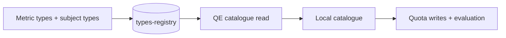
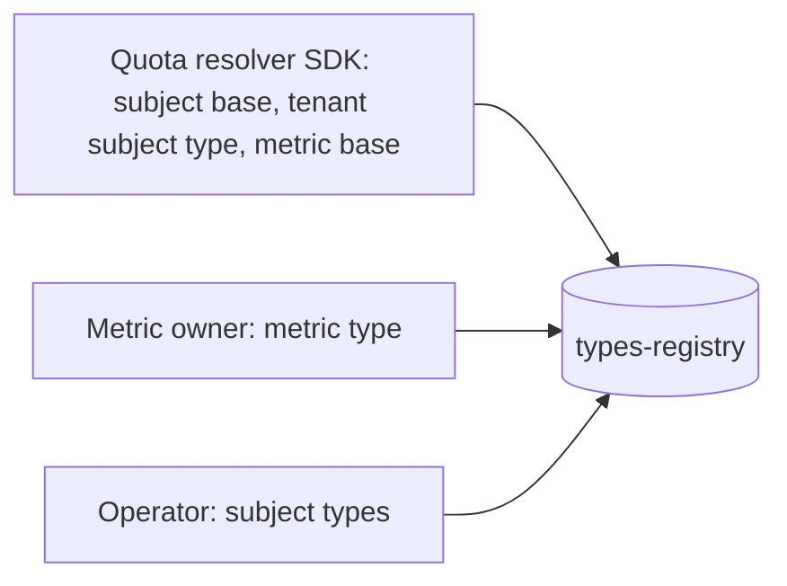
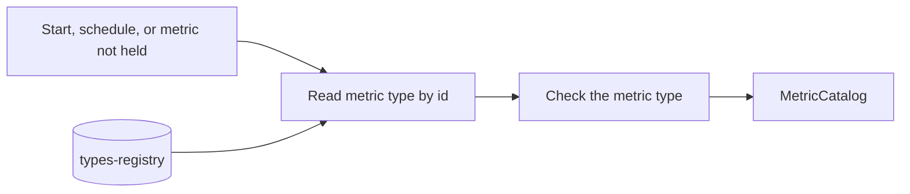
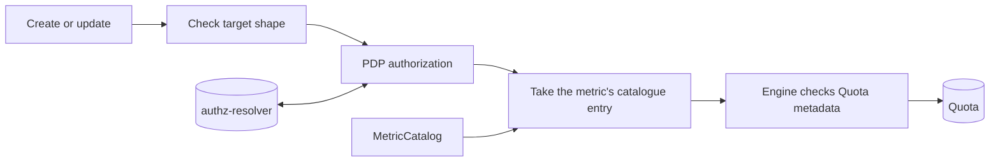
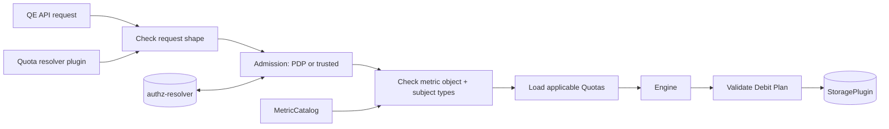

# Quota Enforcement: Metric Type and Subject Flows

Scope: the Quota Enforcement (QE) gear, its public request boundaries, the quota resolver that calls QE through a
plugin, and the two platform services QE consumes for these flows: `types-registry` and `authz-resolver`.

Source terminology and relationships come from [ADR
0013](./ADR/0013-cpt-cf-quota-enforcement-adr-metric-types.md) (metric types and Quota metadata), [ADR
0008](./ADR/0008-cpt-cf-quota-enforcement-adr-quota-resolver-subjects.md) (subjects and their admission), [ADR
0009](./ADR/0009-cpt-cf-quota-enforcement-adr-resolver-plugin-path.md) (plugin path), [ADR
0012](./ADR/0012-cpt-cf-quota-enforcement-adr-contract-catalogue.md) (metric catalogue), [PRD](./PRD.md), and
[DESIGN](./DESIGN.md).

## Tiny overview

## Flow 1 — Types and their owners

| Type                                                                        | Owner                           |
|-----------------------------------------------------------------------------|---------------------------------|
| Quota subject base `gts.cf.core.quota.subj.v1~`, tenant subject type, metric base `gts.cf.core.quota.metric.v1~` | Quota resolver SDK |
| A metric type                                                               | The module that owns the metric |
| A subject type of a principal                                               | The operator                    |

A quota subject is `{type, id}`. Its type derives from the subject base.

A **metric type** is a GTS type derived from the metric base. The module that owns the metric registers it. The type
has three traits:

- `kind`: `counter` or `gauge`.
- `admitted_subjects`: the subject types the metric's quotas may count. A type derived from an admitted type is
  admitted. The tenant subject type is always admitted, so the empty default admits tenant quotas only. An owner that
  does not know the subject types admits the subject base, which admits every subject type.
- `enforcement`: `quota_gated` (the default) or `direct`. It says whether QE checks the metric against quotas.

A request names its metric as a **metric object** `metric: {type, id?, metadata}`. `type` is the metric type. `id` is
optional and names the one thing the amount is counted for, for example a model. `metadata` holds the attributes of
the operation that policies read. The schema of the metric type refines `metadata`.

QE owns none of these types and registers none at bootstrap.

## Flow 2 — Catalogue read

`MetricCatalog` is QE's process-local catalogue. It holds one entry per metric type that QE has read: the resolved
schema and the traits. An entry is **served** or **unavailable** (ADR-0012).

QE reads a metric type from `types-registry` by its id:

- at start, for the metric types of the active Quotas and Policies;
- once, with a time limit, when a request or a Quota or Policy write names a metric type the catalogue does not hold.
  A type that the registry does not know is `InvalidArgument`, and QE remembers that answer for a short time. A read
  that fails or reaches its time limit is `ServiceUnavailable`;
- on a bounded schedule. A scheduled read asks the registry whether each held metric type and each cached subject
  type changed. It builds changed entries again, removes the entry of a deleted metric type,
  and drops a deleted subject type.

An entry is unavailable when the type is not a valid metric type (it is abstract, it does not derive from the metric
base, its own version is major 0, or a trait is wrong). An entry is built from the registry content only: a stored
Quota or Policy never makes a metric unavailable. Requests for an unavailable metric fail with `FailedPrecondition`.
Other metrics are served. QE reports the metric and the reason in a log entry and in telemetry.

Bootstrap fails only on QE's own state and configuration: storage, schema version, and engines. A wrong metric type
does not fail bootstrap.

## Flow 3 — Quota write

A caller sends a Quota create or update request. QE first checks the public target shape.

The Gateway asks PDP to authorize the complete target. QE reads no metric type for an unauthorized target.

`QuotaManagementService` takes the entry of the Quota's metric type from `MetricCatalog`. For a metric type the
catalogue does not hold, it runs the read of Flow 2 as a request does. A create or a change for a metric with no served entry is
rejected; a deactivation always runs. It
checks that the metric admits the Quota's subject type.

QE core checks only that the Quota metadata is a JSON object of at most 4 KB. On create and on a change of the
metadata, QE gives the metadata to the Engine of the Policy that is active for the Quota's metric
(`validate_quota_metadata`). The Engine accepts it, or rejects it with a list of what is wrong. On a rejection QE
writes nothing and answers `InvalidArgument` with the token `QUOTA_METADATA_REJECTED` and the Engine's list. The
`most-restrictive-wins` Engine accepts only an empty object.

A Policy write takes the catalogue entry of its metric in the same way. QE does not check existing Quotas when a
Policy changes.

## Flow 4 — Evaluation

A request carries `tenant_id`, at least one subject `{type, id}`, the metric object, and an amount.

QE rejects missing required fields, wrong public types, empty ids, two subjects of one type, and a tenant subject of
another tenant. These failures are `InvalidArgument`.

On QE's API, the Gateway asks PDP to authorize the request; a denial is `PermissionDenied`. On the plugin path,
trusted admission calls no PDP and confines storage to the request's tenant.

QE validates the whole metric object against the resolved schema of the metric type and checks each subject type
against `admitted_subjects`, both from the catalogue entry. It adds the tenant subject. A metric type that is not
registered is `InvalidArgument`. A metric whose entry is unavailable is `FailedPrecondition`. A served metric makes
no registry call.

`EvaluationOrchestrator` loads the applicable Quotas by subject and metric type. The metric `id` is not part of the
counter key; QE gives it to the Engine with the request. The Engine returns a Decision and a Debit Plan of chains. QE
validates the plan before `StoragePlugin` applies it.
