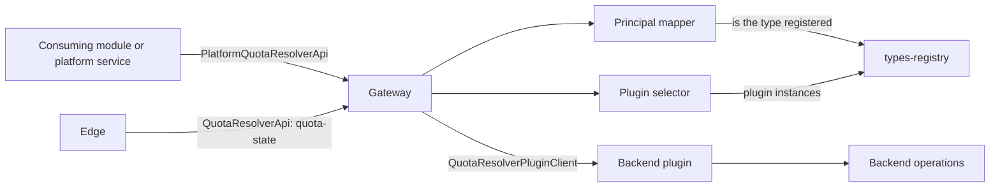
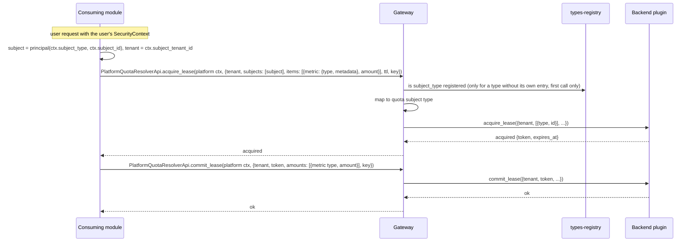
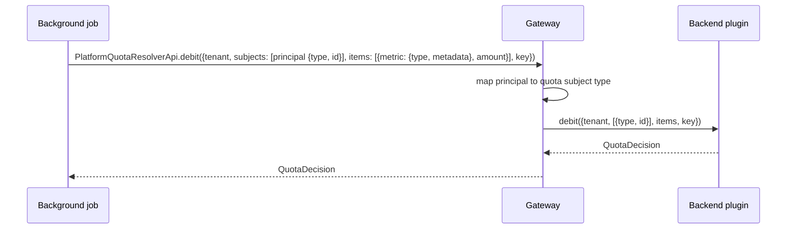
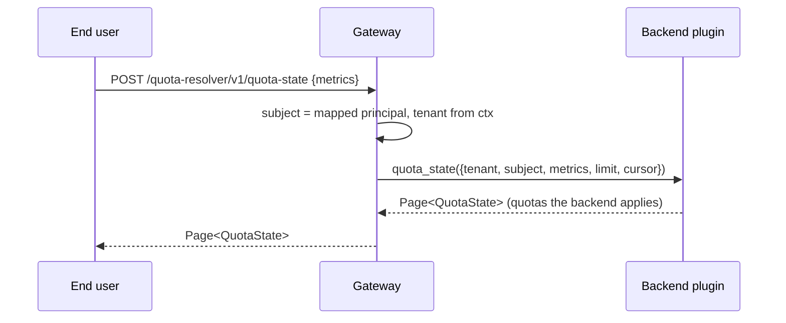

# Technical Design — Quota Resolver

<!-- toc -->

- [1. Architecture Overview](#1-architecture-overview)
  - [1.1 Architectural Vision](#11-architectural-vision)
  - [1.2 Architecture Drivers](#12-architecture-drivers)
  - [1.3 Architecture Layers](#13-architecture-layers)
- [2. Principles & Constraints](#2-principles--constraints)
  - [2.1 Design Principles](#21-design-principles)
  - [2.2 Constraints](#22-constraints)
- [3. Technical Architecture](#3-technical-architecture)
  - [3.1 Domain Model](#31-domain-model)
  - [3.2 Component Model](#32-component-model)
  - [3.3 API Contracts](#33-api-contracts)
  - [3.4 Internal Dependencies](#34-internal-dependencies)
  - [3.5 External Dependencies](#35-external-dependencies)
  - [3.6 Interactions & Sequences](#36-interactions--sequences)
  - [3.7 Database schemas & tables](#37-database-schemas--tables)
  - [3.8 Deployment Topology](#38-deployment-topology)
- [4. Additional context](#4-additional-context)
  - [4.1 Overhead Budget](#41-overhead-budget)
  - [4.2 Observability](#42-observability)
  - [4.3 Security](#43-security)
- [5. Traceability](#5-traceability)

<!-- /toc -->

- [ ] `p3` - **ID**: `cpt-cf-quota-resolver-design-main`

## 1. Architecture Overview

### 1.1 Architectural Vision

Quota Resolver is a stateless gateway with no store. It offers six operations (debit, lease acquisition, lease
commit, lease release, return, and quota state) on two planes, each its own contract, as types-registry does with
`PlatformTypesRegistryApi` and `TypesRegistryApi`:

* **platform plane**, `PlatformQuotaResolverApi`: all six operations. A trusted platform service names the tenant and
  the subjects. A module that charges the user of its request takes the user's principal and tenant from the incoming
  `SecurityContext` and passes them as request data; the user's context is neither forwarded nor synthesized;
* **tenant plane**, `QuotaResolverApi`: quota state only. The subject is the caller's principal and the tenant is the
  caller's tenant, both taken from `SecurityContext`.

The subject forms are defined in §3.1, the principal mapping in §3.2.

For each call the gateway:

1. turns every subject into a quota subject, mapping a principal type to a quota subject type from configuration;
2. fixes the tenant;
3. selects a backend plugin;
4. delegates.

The plugin owns quotas, counters, leases, idempotency, and evaluation. A quota backend provides the plugin in process,
over its own operations.

The design keeps the resolver thin:

* It validates only what it produces: the subject forms, the tenant of a tenant subject, and the mapping.
* The backend validates metric objects, subject types, amounts, and idempotency keys against its own catalogue, so the
  resolver does not keep a second copy of that catalogue. A metric object names what a request charges: a metric type,
  an optional id, and metadata (§3.1).
* The tenant-plane request type has no field for a subject or a tenant, so the caller cannot change them.

### 1.2 Architecture Drivers

#### Functional Drivers

| Requirement                                  | Design Response                                                                                              |
|----------------------------------------------|--------------------------------------------------------------------------------------------------------------|
| `cpt-cf-quota-resolver-fr-debit`             | `PlatformQuotaResolverApi.debit` delegates to the plugin and returns `QuotaDecision`.                        |
| `cpt-cf-quota-resolver-fr-lease`             | `acquire_lease`, `commit_lease`, `release_lease` on `PlatformQuotaResolverApi`; the plugin holds the lease and its expiry. |
| `cpt-cf-quota-resolver-fr-return`            | `PlatformQuotaResolverApi.return_amount` delegates to the plugin; the request names the charge by its operation and key; the backend keeps a charge returnable until all of it is returned (allocation) or for the return window it states (consumption), applies the return to each quota by its type, and rejects it above what remains of the charge or when no quota takes it. |
| `cpt-cf-quota-resolver-fr-lease-extension`   | Deferred: `extend_lease` on `PlatformQuotaResolverApi` once the backend supports it; the plugin receives the platform request. |
| `cpt-cf-quota-resolver-fr-multi-metric`      | The requests carry their metrics as a list of metric items (§3.1), so several metrics need no new shape; a request names a metric type at most once, because a commit and a return name their amounts by metric type id; the resolver passes the list to the plugin as one call. Until the backend supports it, a request with more than one item is `InvalidArgument`. |
| `cpt-cf-quota-resolver-fr-quota-state`       | `quota_state` on both contracts returns a page of `QuotaState`.                                              |
| `cpt-cf-quota-resolver-fr-idempotency`       | Every write request carries an idempotency key; the gateway passes it unchanged; the plugin replays inside its replay window. |
| `cpt-cf-quota-resolver-fr-subject-forms`     | `SubjectInput` is a quota subject or a principal (§3.1).                                                     |
| `cpt-cf-quota-resolver-fr-principal-mapping` | Principal mapper (§3.2): exact entry, then nearest ancestor from types-registry; not mapped ends before the plugin. |
| `cpt-cf-quota-resolver-fr-platform-plane`    | `PlatformQuotaResolverApi` has every operation and takes `PlatformSecurityContext`; its routes are internal (§3.3). The SDK helper builds the principal subject and tenant from a user's `SecurityContext` as request data. |
| `cpt-cf-quota-resolver-fr-tenant-plane`      | `QuotaResolverApi` has only `quota_state`, takes `SecurityContext`, has no subject or tenant field, and is exposed. |
| `cpt-cf-quota-resolver-fr-plugin-delegation` | Plugin selector: types-registry discovery, vendor and priority, scoped ClientHub lookup.                     |

#### NFR Allocation

| NFR ID                                     | NFR Summary                       | Allocated To               | Design Response                                                                                                                                       | Verification Approach                                         |
|--------------------------------------------|-----------------------------------|----------------------------|-------------------------------------------------------------------------------------------------------------------------------------------------------|---------------------------------------------------------------|
| `cpt-cf-quota-resolver-nfr-fail-closed`    | Never allow by default            | Gateway, error mapping     | No plugin and a registry failure are errors; a plugin error passes through as an error; not mapped is a denial. No code path builds an allowed result. | Tests for each condition: no allowed decision, no lease.      |
| `cpt-cf-quota-resolver-nfr-tenant-scoping` | One tenant per operation          | Gateway                    | Platform plane: the tenant from the request. Tenant plane: `subject_tenant_id` from the context. The plugin receives exactly one tenant.          | Tests on both planes: the plugin receives the request's tenant (platform) or the caller's tenant (tenant plane), never another. |
| `cpt-cf-quota-resolver-nfr-overhead`       | ≤ 5 ms p95 added at backend load  | Principal mapper, selector | Budget in §4.1: in-memory map lookups, memoized plugin and ancestor chains; no network call of its own once resolved.                                  | Boundary benchmark with a no-op plugin at the backend's throughput threshold. |
| `cpt-cf-quota-resolver-nfr-throughput`     | Backend's ops/s, its p95 + 5 ms   | Gateway                    | Once the plugin is selected, no lock is held across a call to another gear (the first selection is single-flight and holds its lock across the types-registry call); calls share only a read lock on the memo of resolved principal types, which is written once per type; co-located with the backend gear, so it scales with it; per-call cost bounded by the overhead budget.                    | Load test through the resolver at the backend's throughput threshold; p95 compared with the backend's p95 threshold plus 5 ms. |
| `cpt-cf-quota-resolver-nfr-availability`   | Backend's target, plugin only     | Principal mapper, selector | At start types-registry must admit the resolver's GTS types, or the process does not start; after start types-registry only for the plugin and, once, for a principal type without its own entry; memoized chains and plugin serve the rest. | Test with types-registry stopped after warm-up: calls with resolved principal types succeed; availability tracked against the backend's target. |

#### Key ADRs

| ADR ID                                                | Decision Summary                                                                                                  |
|-------------------------------------------------------|-------------------------------------------------------------------------------------------------------------------|
| `cpt-cf-quota-resolver-adr-plugin-delegation`         | No store; one plugin selected through types-registry; a quota backend implements it.                              |
| `cpt-cf-quota-resolver-adr-principal-subject-mapping` | Principal type → quota subject type from configuration; exact, then nearest ancestor; not mapped is denied.       |
| `cpt-cf-quota-resolver-adr-two-planes`                | Writes only on the trusted platform plane, principal as request data; read-only tenant plane at the edge. |
| `cpt-cf-quota-resolver-adr-metric-types`              | A metric is a GTS type with traits and a metadata schema; a request names it as a metric object.                  |

### 1.3 Architecture Layers

```text
 platform service, consuming module                      end user (edge)
   | PlatformQuotaResolverApi (all operations)              | QuotaResolverApi: POST /quota-resolver/v1/quota-state
   v                                                        v
+------------------------------------------------------------------+
| SDK: both contracts + REST, plugin contract, data types,          |
|      quota subject base, tenant type, metric base, plugin type    |
+------------------------------------------------------------------+
| Gateway: principal mapper, tenant, plugin selector                |
+--------------------------------+---------------------------------+
                                 | QuotaResolverPluginClient (in process)
                                 v
+------------------------------------------------------------------+
| Backend plugin -> backend operations and storage                  |
+------------------------------------------------------------------+
```

- [ ] `p3` - **ID**: `cpt-cf-quota-resolver-tech-layers`

| Layer       | Responsibility                                                          | Technology                       |
|-------------|-------------------------------------------------------------------------|----------------------------------|
| Contract    | Platform, tenant, and plugin traits, data types, GTS types              | Rust, ToolKit SDK, GTS           |
| Application | Principal mapping, tenant fixing, plugin selection, delegation, metrics | Rust, ToolKit, ClientHub         |
| Backend     | Quotas, counters, leases, idempotency, evaluation                       | Quota backend, behind the plugin |

## 2. Principles & Constraints

### 2.1 Design Principles

#### Delegate, Don't Store

- [ ] `p1` - **ID**: `cpt-cf-quota-resolver-principle-delegate`

The resolver keeps no quota state and no replay state. Every result comes from the plugin, except a denial for a
principal that is not mapped.

**ADRs**: `cpt-cf-quota-resolver-adr-plugin-delegation`

#### Validate Only What the Resolver Produces

- [ ] `p1` - **ID**: `cpt-cf-quota-resolver-principle-thin-validation`

The resolver checks the subject forms, the tenant of a tenant subject, and the mapping. The plugin checks metric
objects, subject types, amounts, TTLs, idempotency keys, and lease tokens, and its errors pass through unchanged.

#### Writes on the Platform Plane Only

- [ ] `p1` - **ID**: `cpt-cf-quota-resolver-principle-platform-writes`

Every charge is a platform-plane call, authenticated by the platform credential of the calling module, whoever the
subject is. The user of a request is passed as data: principal type, id, and tenant taken from the incoming
`SecurityContext`. The tenant plane is read-only, and its request type has no field for a subject or a tenant.

**ADRs**: `cpt-cf-quota-resolver-adr-two-planes`

### 2.2 Constraints

#### Co-Located Plugin

- [ ] `p1` - **ID**: `cpt-cf-quota-resolver-constraint-co-located-plugin`

The plugin contract is in process only, so the resolver runs in the same process as the gear that provides the plugin.
Callers in other processes use the REST projections of the two public contracts.

#### ToolKit Contracts

- [ ] `p1` - **ID**: `cpt-cf-quota-resolver-constraint-toolkit`

The two public contracts are `#[toolkit::contract]` traits; the plugin contract is a plain in-process trait. Each public
contract has a `#[toolkit::rest_contract]`
projection with its own base path (§3.3), as in types-registry. Errors are `CanonicalError`, rendered as RFC 9457
Problem responses.

## 3. Technical Architecture

### 3.1 Domain Model

**Technology**: transport-agnostic Rust value objects in the SDK, with serde and utoipa schemas.

**Location**: `quota-resolver-sdk/src/models.rs`.

- [ ] `p2` - **ID**: `cpt-cf-quota-resolver-entity-request-model`

The table states what each entity must carry. Exact field names and shapes are settled at implementation, except the
subject forms, whose wire shape is fixed below the table.

**Core Entities**:

| Entity                        | Description                                                                                                                                                                                         |
|-------------------------------|-----------------------------------------------------------------------------------------------------------------------------------------------------------------------------------------------------|
| `QuotaSubject`                | Whom a quota applies to: a quota subject type (a GTS type id derived from `gts.cf.core.quota.subj.v1~`) and an opaque, non-empty id. The only subject form the plugin receives.                    |
| `PrincipalSubject`            | A subject given as a principal: the principal type (`SecurityContext.subject_type`) and the principal UUID. Replaced by a `QuotaSubject` of the mapped type and the same id before delegation.     |
| `SubjectInput`                | A subject in a platform request: a `QuotaSubject` or a `PrincipalSubject`, told apart by the `kind` tag. Wire form below the table. |
| Metric item                   | One metric of a debit or a lease acquisition: a metric object and its amount. A **metric object** is `{type, id?, metadata}`: `type` is the metric type, a GTS type id derived from `gts.cf.core.quota.metric.v1~`; `id` is optional and names the one thing the amount is counted for, for example a model or a virtual machine; `metadata` holds the attributes of the operation that the backend's policies read (required, may be empty). All items of a request are applied or none. |
| `PlatformDebitRequest`        | The tenant, the subjects (at least one), the metric items (at least one), and an idempotency key. |
| `PlatformAcquireLeaseRequest` | What a debit carries, plus the requested lease duration.                                                                                                                                            |
| `PlatformCommitLeaseRequest`  | The tenant, the lease token, the actual amount of each metric of the lease, named by its metric type id (absent means the full held amounts; an empty list is refused), and an idempotency key.                                                                                       |
| `PlatformReleaseLeaseRequest` | The tenant, the lease token, and an idempotency key.                                                                                                                                               |
| `PlatformReturnRequest`       | The tenant, the charge (its operation, debit or lease commit, and its idempotency key), the amounts to return, each with the id of its metric type (at least one), and the return's own idempotency key.                                                                   |
| `PlatformQuotaStateRequest`   | The tenant, one subject, the metrics to read (1 to 100), and paging. Each metric is a `QuotaStateMetric`: the metric type id as `type` and, optionally, the `metadata` of a request's metric object; with it the backend returns only the quotas that apply to such a request.                                                                                                                                          |
| `QuotaStateRequest`           | The tenant-plane read: the metrics and paging only. It has no subject and no tenant, so the caller cannot name either.                                                                           |
| `QuotaDecision`               | The verdict of a debit or a lease acquisition: allowed or denied, the reason for a denial, and a map of non-authoritative diagnostics. The reason is one of a closed set that the SDK defines, so that a caller can branch on it: `quota_exceeded` (the quotas of the backend deny the request), `no_applicable_quota` (no quota applies to the request), and `principal_not_mapped` (set by the resolver, §3.2). A later SDK version can add a reason without a major version: the type is not exhaustive, and a caller treats a reason it does not know as a denial. A backend maps its own reasons to this set and puts its own text and identifiers, for example the ids of the quotas that deny, into the diagnostics.  |
| `LeaseOutcome`                | An acquired lease (its token and expiry) or a denial with its `QuotaDecision`. A caller treats an outcome it does not know as no lease.                                                                                                                     |
| `QuotaState`                  | The state of one quota: its id, its `QuotaSubject`, the metric type id, the cap or none, the consumed and remaining amounts, for a quota with a period the current period with its reset time, and, for a quota limited to some requests, `metadata`: the attributes of a request's metric `metadata` that the quota requires, each with a value or a list of values.                                  |
| Plugin requests               | `PluginDebitRequest`, `PluginAcquireLeaseRequest`, `PluginQuotaStateRequest`: the platform request with every subject a `QuotaSubject`. Commit, release, and return need no conversion; the plugin receives their platform requests. |

**Subject wire forms**: each subject of a platform request is one JSON object. Its `kind` selects the form, and the
fields of the form sit beside `kind` in the same object.

| Form          | `kind`      | Fields                                                                                  |
|---------------|-------------|-----------------------------------------------------------------------------------------|
| Quota subject | `quota`     | `type`: the quota subject type, a GTS type id; `id`: an opaque, non-empty string        |
| Principal     | `principal` | `type`: the principal type, as `SecurityContext.subject_type`; `id`: the principal UUID |

A `QuotaSubject` outside a platform request, in a plugin request or in `QuotaState`, is the object `{type, id}`
without `kind`. A subject without `kind` or with an unknown `kind`, without a field of its form, with a field of a
wrong type, with an empty quota subject `id`, or with a field its form does not have is `InvalidArgument` (§3.3,
Errors). So is a debit, lease acquisition, or quota state request with no subject, and a quota subject of the tenant
type whose `id` is not the request's tenant. A well-formed principal with a nil id or a type that is not mapped is not
an error: it is not mapped (§3.2, Gateway). The resolver does not check for two subjects of one quota subject type,
also after mapping; a backend may reject such a request, and the quota-enforcement backend does.

**GTS types of the SDK**. The SDK declares these types, and the resolver gear lists the SDK crate in the GTS
publication of its gear attribute (`gts_publication(crates = [quota_resolver_sdk])`), as other platform gears do.
The runtime publishes the declarations of every gear and waits for their admission before any application `init`
runs. So the types exist when a backend starts: the resolver writes no registration code, and a backend needs no
start order with the resolver. Linking the SDK does not publish the types, so a deployment of a backend includes the
resolver gear. The types derived from the two bases are registered by their owners, as each item
states:

* `gts.cf.core.quota.subj.v1~`: the abstract quota subject base, `{type, id}`. Every quota subject type derives from
  it. The operator registers the quota subject types for principals, for example a user type. A module registers a
  type only for a kind of subject that it charges and that is not a principal. The resolver maps a principal type to
  one quota subject type, so a quota under a second type for the same principals is never found for them.
* `gts.cf.core.quota.subj.v1~cf.core.quota.tenant.v1~`: the tenant subject type, final, so no type derives from it. It
  names a tenant quota in a request and in `QuotaState`; its id is the tenant id.
* `gts.cf.core.quota.metric.v1~`: the abstract metric base, `{type, id?, metadata}`. A metric is a type derived from
  it. The module that owns the metric registers the type, named under that module, for example
  `gts.cf.core.quota.metric.v1~cf.genai.llm_gateway.ai_tokens_input.v1~`. The type refines the schema of `metadata`
  and sets three traits that the base declares:
  * `kind`: `counter`, usage that adds up over time, or `gauge`, a level held at a moment. A `counter` metric takes
    consumption and rate-limiting quotas, a `gauge` metric allocation quotas;
  * `admitted_subjects`: the quota subject types that the metric's quotas may count. A type derived from an admitted
    type is admitted, and the tenant subject type is always admitted, so the empty default admits tenant quotas only.
    An owner that does not know the subject types admits the subject base, which admits every subject type;
  * `enforcement`: `quota_gated`, the default, or `direct`. A `direct` metric is not checked against quotas: the backend rejects the operations that take capacity on it (debit, lease acquisition), and commit, release, and return still run.

  Another major version of a metric type is another metric (`cpt-cf-quota-resolver-adr-metric-types`). The own
  version of a metric type is major 1 or higher: types-registry admits any revision of a type of major 0, a
  narrower schema included, so a backend may refuse such a type.

Their JSON Schemas are in [schemas/](schemas/), with examples in [schemas/examples/](schemas/examples/).

The resolver checks only the form of a metric item: a debit or lease acquisition request with no metric item, or with
a metric object that has no `type` or no `metadata`, is `InvalidArgument`. It passes the metric object to the plugin
as it is and reads no metric type. The backend reads the metric type and checks that it is registered, that the metric
object matches its schema, and that it admits each subject type, and applies `kind` and `enforcement`. The subject
types are GTS ids that the resolver passes as text; the backend checks that they are registered.

Operation context added later is a field of the requests themselves, so the tenant-plane request can carry it too;
`SecurityContext` fixes only the subject and the tenant.

**SDK helper**: from a `SecurityContext`, the SDK builds the `PrincipalSubject` (`subject_type`, `subject_id`) and the
tenant (`subject_tenant_id`) for a platform request. It reads the context; it does not forward it
(`cpt-cf-quota-resolver-fr-platform-plane`).

**Relationships**:

- A `QuotaStateRequest` plus `SecurityContext` becomes a `PlatformQuotaStateRequest` for the caller's principal, in
  the caller's tenant, with the same metrics.
- A platform request becomes a plugin request after every `SubjectInput` becomes a `QuotaSubject`. The plugin never
  receives a principal.
- `QuotaDecision`, `LeaseOutcome`, pages of `QuotaState`, and plugin errors come back from the plugin unchanged. A
  commit, release, or return returns no result; a settlement or return the backend cannot apply is a plugin error.

**Envelope evolution**: two unknown-field policies.

- `QuotaSubject` and `PrincipalSubject` **reject** unknown fields. Their shape is closed (for `QuotaSubject`, by the
  published base schema), so a key the resolver does not know is a caller error, not a silent drop.
- Requests and results **ignore** unknown fields, so an older reader still reads a payload written by
  a newer SDK. This is about the fields of the request and the result themselves: the resolver keeps a metric object
  as raw JSON and passes it to the plugin unchanged, unknown fields included. The envelope grows only with fields whose silent drop cannot charge or reveal more than the writer
  intended; a field that narrows a charge or a read is a new contract version.

### 3.2 Component Model



#### SDK Contract

- [ ] `p1` - **ID**: `cpt-cf-quota-resolver-component-sdk`

##### Why this component exists

Consumers and plugins depend on one crate that contains the contracts and nothing else.

##### Responsibility scope

`PlatformQuotaResolverApi` and `QuotaResolverApi` with their REST projections, `QuotaResolverPluginClient`, the data
types of §3.1, the GTS types of §3.1, and the plugin GTS type
`gts.cf.toolkit.plugins.plugin.v1~cf.core.quota_resolver.plugin.v1~`.

##### Responsibility boundaries

No logic beyond data types and their serde rules. No dependency on any backend.

##### Related components (by ID)

- `cpt-cf-quota-resolver-component-gateway` — implements both public contracts.

#### Gateway

- [ ] `p1` - **ID**: `cpt-cf-quota-resolver-component-gateway`

##### Why this component exists

It turns the two planes and the two subject forms into one plugin call.

##### Responsibility scope

* **Subject check**: a debit or lease acquisition request names at least one subject and a quota state request
  exactly one, and a tenant subject names the request's tenant.
* **Tenant plane**: for `quota_state`, builds the principal subject from `subject_type` and `subject_id`, and the
  tenant from `subject_tenant_id`, then runs the platform-plane quota state path.
* **Principal mapper**: looks up `principal_subject_types` (principal type → quota subject type):
  1. it uses the entry for the type itself;
  2. otherwise, when the configuration has no entry at all, the type is not mapped and types-registry is not asked;
  3. otherwise it asks types-registry whether the type is registered and active, and takes the nearest ancestor
     that has an entry; the ancestors are read from the type id, not from the registry;
  4. it memoizes the answer per type for the life of the process. The ancestors of a type are part of its GTS type
     id, so they never change. A type that is not registered is not memoized, so a type registered later is mapped on
     its next call. A type that is deleted after its answer was memoized stays mapped until the process restarts.
* **Not mapped**: an absent, malformed, or unregistered type is not mapped (a type that types-registry returns as
  deleted on its first lookup is an unregistered type), and so is a nil principal id or, on the
  tenant plane, a nil tenant. The result:
  * a write that has such a subject is denied with `principal_not_mapped`; a caller with no principal type cannot be
    sent as a principal subject at all (`PrincipalSubject::from_security_context` returns none), and the module then
    refuses the work instead of skipping the charge;
  * a quota state read returns an empty page.
* **Plugin selector**: resolves the plugin instance from types-registry by vendor and priority, memoizes it, and calls
  it through scoped ClientHub.
* **Metrics**: records every operation (see §4.2).

##### Responsibility boundaries

The gateway does not validate metric objects, subject types, amounts, TTLs, or tokens, and it runs no authorization
check.

The configuration is checked at start. A key or a value that is not a GTS type id stops the gear from starting, and so does a value that does not start with the id of the quota subject base, or that is the base or the tenant subject type.

##### Related components (by ID)

- `cpt-cf-quota-resolver-component-sdk` — implements its public contracts and calls its plugin contract.

#### Backend Plugin

- [ ] `p1` - **ID**: `cpt-cf-quota-resolver-component-backend-plugin`

##### Why this component exists

The backend owns the quota state; the plugin makes it reachable through the resolver.

##### Responsibility scope

The plugin lives in the backend's gear and registers itself as a `QuotaResolverPluginClient` instance. For each
request it:

* turns each `QuotaSubject` into the backend's subject;
* runs the backend's debit, lease, or quota state operation;
* for a quota state read, returns the quotas that the backend applies to the fixed tenant and subjects;
* turns the backend's result into the resolver result.

The plugin keeps every other backend check: metric objects and subject types against the backend's catalogue,
amounts, idempotency, and the tenant of the lease token.

##### Responsibility boundaries

The plugin is reachable only in process through the plugin contract, which carries the fixed tenant and quota
subjects, and the platform identity of the caller. The plugin runs no policy check: the backend's own check covers
only the backend's API. The backend records that identity with every operation that changes a
counter, and does not authorize by it. The identity names the calling service only when the caller runs in another
process; a caller in the same process has no identity of its own, so the record then names no module (ADR-0003).

##### Related components (by ID)

- `cpt-cf-quota-resolver-component-gateway` — called by it.

### 3.3 API Contracts

- [ ] `p1` - **ID**: `cpt-cf-quota-resolver-interface-rest`

- **Contracts**: `cpt-cf-quota-resolver-interface-client`
- **Technology**: REST, generated by `#[toolkit::rest_contract]`; OpenAPI in `docs/api/api.json`.

**Endpoints Overview**: all `POST`; the paths are kebab-case method names under each contract's base path.

| Contract                   | Base path                     | Context                   | Method              | Path                 | Visibility  | Result             |
|----------------------------|-------------------------------|---------------------------|---------------------|----------------------|-------------|--------------------|
| `PlatformQuotaResolverApi` | `/quota-resolver/v1/platform` | `PlatformSecurityContext` | `debit`             | `/debit`             | internal    | `QuotaDecision`    |
| `PlatformQuotaResolverApi` | `/quota-resolver/v1/platform` | `PlatformSecurityContext` | `acquire_lease`     | `/acquire-lease`     | internal    | `LeaseOutcome`     |
| `PlatformQuotaResolverApi` | `/quota-resolver/v1/platform` | `PlatformSecurityContext` | `commit_lease`      | `/commit-lease`      | internal    | none               |
| `PlatformQuotaResolverApi` | `/quota-resolver/v1/platform` | `PlatformSecurityContext` | `release_lease`     | `/release-lease`     | internal    | none               |
| `PlatformQuotaResolverApi` | `/quota-resolver/v1/platform` | `PlatformSecurityContext` | `return_amount`     | `/return-amount`     | internal    | none               |
| `PlatformQuotaResolverApi` | `/quota-resolver/v1/platform` | `PlatformSecurityContext` | `quota_state`       | `/quota-state`       | internal    | `Page<QuotaState>` |
| `QuotaResolverApi`         | `/quota-resolver/v1`          | `SecurityContext`         | `quota_state`       | `/quota-state`       | **exposed** | `Page<QuotaState>` |

The exposed `quota-state` route gets a rate-limit zone of the API gateway, `rl_quota_resolver_quota_state`, which the
gateway configuration must declare (api-gateway does not start without it), keyed on the caller's identity: every
authenticated user can call it, and each call reaches the backend. A request that names more than 100 metrics is
`InvalidArgument`.

Platform routes are `.platform_authenticated()`, tenant routes `.authenticated()`. Writes are `IdempotentWrite` and
reads are `SafeRead`.

**Errors** (`CanonicalError`):

| Condition                                            | Error                                   |
|------------------------------------------------------|-----------------------------------------|
| Malformed subject form or unknown field in a subject | `InvalidArgument`                       |
| No subject, several subjects in a quota state request, or a tenant subject of another tenant | `InvalidArgument` |
| No metric item in a debit or lease acquisition request, or a metric object without `type` or `metadata` | `InvalidArgument` |
| No metric, or more than 100 metrics, in a quota state request | `InvalidArgument` |
| No plugin, types-registry unavailable or not answering in time | `ServiceUnavailable`          |
| Another types-registry error (a refused credential, a malformed answer), or a malformed plugin instance | `Internal` |
| Any plugin error                                     | passed through unchanged                |
| Plugin error `Aborted`: the backend could not take a lock in time, for example while an earlier attempt of the call runs. A backend uses it only when a repeat with the same key can succeed | passed through unchanged; the caller may retry with the same key |
| Plugin error `AlreadyExists`: the idempotency key is in use for another request | passed through unchanged; the caller must not retry and needs a new key |
| Principal not mapped                                 | not an error: a denial or an empty page |

Accepted deviation: on the exposed route `quota-state` a body that is not valid JSON, or does not have the form of
the request, is refused by the HTTP framework before the gateway reads it. The answer is HTTP 422 with a Problem of
type `about:blank`, not the canonical `InvalidArgument`.

A denial is a successful call; only a failure to decide is an error.

### 3.4 Internal Dependencies

| Dependency Gear | Interface Used                                           | Purpose                                              |
|-----------------|----------------------------------------------------------|------------------------------------------------------|
| types-registry  | `PlatformTypesRegistryApi`                               | Plugin discovery; whether a principal type is registered |
| quota backend   | `QuotaResolverPluginClient` (implemented by the backend) | Quota operations                                     |
| api-gateway     | `rest_contract` route registration                       | REST routes and edge publication                     |

The backend depends on the resolver SDK to implement the plugin; the resolver depends on no backend.

### 3.5 External Dependencies

None. The resolver talks only to platform gears.

### 3.6 Interactions & Sequences

#### Lease for the Caller

**ID**: `cpt-cf-quota-resolver-seq-caller-lease`

**Use cases**: `cpt-cf-quota-resolver-usecase-lease-for-user`

**Actors**: `cpt-cf-quota-resolver-actor-consuming-module`



**Description**: The module reserves capacity for the user of its request and settles it for the real amount. It
authenticates with its own platform credential and passes the user's principal and tenant as data; the user's
`SecurityContext` does not reach the resolver. If the principal is not mapped, the acquisition is denied before the
plugin is called.

#### Debit for a Principal on the Platform Plane

**ID**: `cpt-cf-quota-resolver-seq-platform-debit`

**Use cases**: `cpt-cf-quota-resolver-usecase-job-debit`

**Actors**: `cpt-cf-quota-resolver-actor-consuming-module`



**Description**: A trusted service charges a principal that it names; the resolver maps the principal as for the user
of a request.

#### Own Quota State from the Edge

**ID**: `cpt-cf-quota-resolver-seq-own-quota-state`

**Use cases**: `cpt-cf-quota-resolver-usecase-own-quota-state`, `cpt-cf-quota-resolver-usecase-module-reads-user-quota`

**Actors**: `cpt-cf-quota-resolver-actor-end-user`, `cpt-cf-quota-resolver-actor-consuming-module`



**Description**: The user reads the state of the quotas that the backend applies to their mapped subject and requested
metrics, including quotas of the tenant. The resolver returns the backend's page unchanged. A principal that is not
mapped gets an empty page. A consuming module that serves the user's request makes the same `QuotaResolverApi` call
with the user's `SecurityContext`, in process or with the user's bearer token, and sees only that user's quotas.

### 3.7 Database schemas & tables

Not applicable: the resolver stores nothing.

### 3.8 Deployment Topology

- [ ] `p3` - **ID**: `cpt-cf-quota-resolver-topology-co-located`

The resolver and the backend gear run in the same process. Consuming modules in that process call the local clients.
Modules in other processes call the platform REST projection with their service credential. The edge publishes only
`/quota-resolver/v1/quota-state`, which end users call with their bearer token.

## 4. Additional context

### 4.1 Overhead Budget

| Step (warm caches)                                 | Cost                   |
|----------------------------------------------------|------------------------|
| Deserialize and check subject forms                | < 0.5 ms               |
| Mapping: map lookup, memoized ancestor chain       | < 0.1 ms               |
| Plugin: memoized instance, scoped ClientHub lookup | < 0.1 ms               |
| Metrics                                            | < 0.1 ms               |
| **Total**                                          | well under 5 ms at p95 |

The first call for a new principal type and the first call after start resolve types-registry; those calls are outside
the warm-cache budget.

### 4.2 Observability

| Metric                       | Kind      | Labels                                                                                              |
|------------------------------|-----------|-----------------------------------------------------------------------------------------------------|
| `quota_resolver_operation`   | counter   | `operation`, `plane` (`platform`, `tenant`), `outcome` (`allowed`, `denied`, `principal_not_mapped`, `error`) |
| `quota_resolver_overhead_ms` | histogram | none                                                                                                |

A plugin that refuses a request for a subject **MUST** answer `InvalidArgument` with a field violation that names
the subject field as the request has it. A debit and a lease acquisition carry the list `subjects`, so the field
starts with `subjects`, for example `subjects[0].type`. A quota state read carries one `subject`, so the field starts
with `subject`, for example `subject.type`. The gateway names the fields of its own checks the same way. When the plugin rejects a debit or
a lease acquisition this way, and that request has a mapped principal, the gateway logs a throttled warning. A rejection of another field, such as the
amount, says nothing about the mapping and logs none. A quota state read logs none: there the backend gives no error for
a subject type that the metric does not admit. The warning names the principal type and the quota subject type, because this most likely means a
mapping to a subject type that the metric does not admit or that is not registered.

### 4.3 Security

* Platform routes require `PlatformSecurityContext`. The edge removes the platform token, so the edge cannot reach
  them.
* The tenant plane has no write operation; its only route, `quota-state`, is exposed.
* No policy check runs in the resolver. Platform callers are trusted by the resolver, also for the principal they pass
  as data; on the tenant plane the context fixes the subject and the tenant (`cpt-cf-quota-resolver-adr-two-planes`).
  No component checks which platform service may charge which tenant: this is an exception to
  `cpt-cf-adr-two-plane-auth` until the toolkit authorizes platform-plane callers
  ([#6037](https://github.com/constructorfabric/gears-rust/issues/6037)).
* The backend decides which quotas a quota state read returns; the resolver returns the backend's page unchanged.
* A charge never carries a user's `SecurityContext`, and the resolver never synthesizes one. A module that reads its
  user's quota state passes that user's context to the tenant plane, which limits the read to that user.
* A commit or release accepts any lease token of the request's tenant. The token is not a secret: any platform
  caller that names the tenant may settle its leases.

## 5. Traceability

- **PRD**: [PRD.md](./PRD.md)
- **ADRs**: [ADR/](./ADR/)
