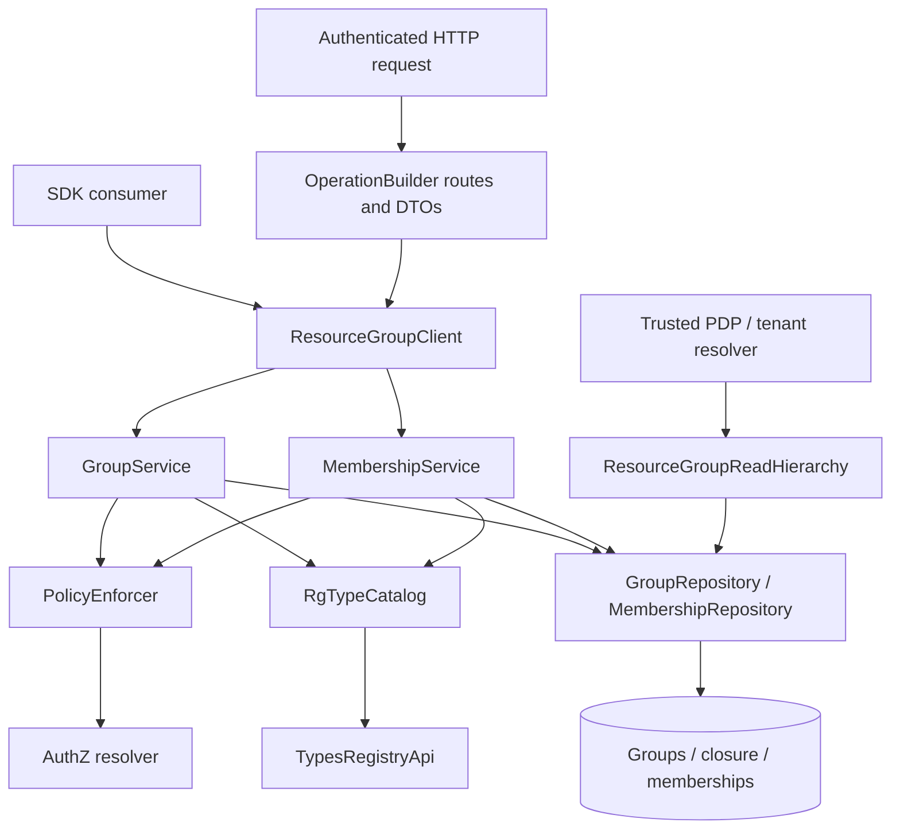
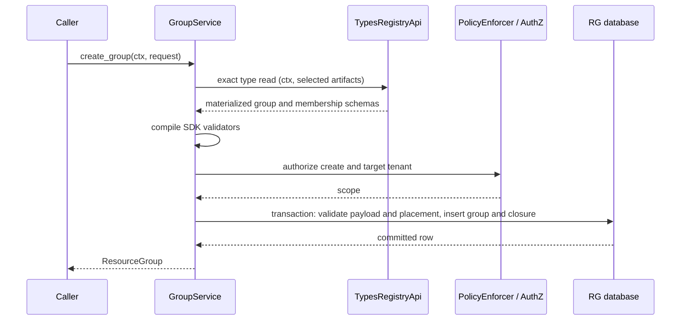

<!-- Created: 2026-04-07 by Constructor Tech -->
<!-- Updated: 2026-11-12 by Constructor Tech -->

# Technical Design - Resource Group (RG)

<!-- toc -->

- [1. Architecture Overview](#1-architecture-overview)
  - [1.1 Architectural Vision](#11-architectural-vision)
  - [1.2 Architecture Drivers](#12-architecture-drivers)
  - [1.3 Architecture Layers](#13-architecture-layers)
  - [1.4 Implementation layout](#14-implementation-layout)
- [2. Principles & Constraints](#2-principles--constraints)
  - [2.1 Design Principles](#21-design-principles)
  - [2.2 Constraints](#22-constraints)
- [3. Technical Architecture](#3-technical-architecture)
  - [3.1 Domain Model](#31-domain-model)
  - [3.2 Component Model](#32-component-model)
  - [3.3 API Contracts](#33-api-contracts)
  - [3.4 Interactions & Sequences](#34-interactions--sequences)
  - [3.5 Database schemas & tables](#35-database-schemas--tables)
- [4. Runtime and Verification](#4-runtime-and-verification)
  - [4.1 Transactions and concurrency](#41-transactions-and-concurrency)
  - [4.2 Errors and observability](#42-errors-and-observability)
  - [4.3 Tests](#43-tests)
- [5. Source References](#5-source-references)

<!-- /toc -->

Resource Group manages a forest of groups and membership links to resources owned
by other gears. Types Registry owns the GTS type definitions that govern group
placement and payload validation. RG persists group instances, their ancestry and
memberships in its own database.

## 1. Architecture Overview

### 1.1 Architectural Vision

RG validates group and membership payloads with materialized registry schemas
read under the caller's context.

| Owner | Responsibility |
| --- | --- |
| Resource Group | Group lifecycle, placement checks, cycle prevention, closure-table maintenance, memberships and scoped queries |
| Types Registry | GTS Type Schemas, inheritance, materialized schemas and traits, admission and type lifecycle |
| Declaring gear | Publication of its own RG types before application initialization |
| AuthZ resolver / PDP | Authorization decisions and constraints |
| RG's PolicyEnforcer / SecureORM | Enforcement of those constraints on RG operations and database access |
| Tenant resolver | Interpretation of tenant hierarchy and barrier metadata |

RG exposes two Rust SDK traits through ClientHub:

- `ResourceGroupClient`: authorized group, hierarchy and membership operations.
- `ResourceGroupReadHierarchy`: in-process reads for trusted AuthZ and tenant
  resolver consumers. The consumer owns scoping on this interface.

HTTP routes expose group and membership operations under `/resource-group/v1`.
The host supplies any outer route prefix, such as `/cf`. Type publication and
reads use Types Registry's SDK and API.

### 1.2 Architecture Drivers

| Driver | Design response |
| --- | --- |
| Consumer-owned type declarations | Managed GTS publication by RG and each declaring gear |
| Caller-scoped type access | Registry reads forward the operation's SecurityContext |
| Atomic forest and tenant invariants | Scoped repositories and retryable transactions maintain groups and closure rows together |
| Registry I/O outside database transactions | Services resolve and validate type snapshots before beginning writes |
| Preserve existing hierarchy during migration | Keep `gts_type` as an identity dictionary (keys, identifiers) and the groups and memberships that reference it; drop only the local definitions |

| Functional requirements | Design response |
| --- | --- |
| `cpt-cf-resource-group-fr-manage-types`, `cpt-cf-resource-group-fr-validate-type-code` | TypesRegistryApi resolves canonical GTS type contracts with the caller context. |
| `cpt-cf-resource-group-fr-reject-duplicate-type`, `cpt-cf-resource-group-fr-seed-types` | Managed publication owns creation/revision admission before application initialization. |
| `cpt-cf-resource-group-fr-validate-type-update-hierarchy`, `cpt-cf-resource-group-fr-delete-type-only-if-empty` | New writes use current snapshots; retained definitions support existing instances after type retirement. |
| `cpt-cf-resource-group-fr-manage-entities`, `cpt-cf-resource-group-fr-enforce-forest-hierarchy`, `cpt-cf-resource-group-fr-validate-parent-type` | GroupService validates immutable types, parent placement and cycles before transactional writes. |
| `cpt-cf-resource-group-fr-enforce-tenant-root-uniqueness`, `cpt-cf-resource-group-fr-tenant-scope-ownership-graph` | Tenant type prefixes and scoped transactional checks enforce tenant ownership and root uniqueness. |
| `cpt-cf-resource-group-fr-delete-entity-no-active-references`, `cpt-cf-resource-group-fr-force-delete`, `cpt-cf-resource-group-fr-subtree-operations` | GroupRepository refuses referenced non-force deletes and atomically maintains subtree closures on moves or force deletion. |
| `cpt-cf-resource-group-fr-seed-groups`, `cpt-cf-resource-group-fr-seed-memberships` | Consumers bootstrap instances through normal authorized client operations after publishing their types; RG has no seed service. |
| `cpt-cf-resource-group-fr-manage-membership`, `cpt-cf-resource-group-fr-query-membership-relations` | MembershipService and its repository enforce allowed resource types and tenant ownership and expose scoped lookups. |
| `cpt-cf-resource-group-fr-closure-table`, `cpt-cf-resource-group-fr-query-group-hierarchy`, `cpt-cf-resource-group-fr-list-groups-depth` | Indexed closure rows support ancestor/descendant reads with relative depth. |
| `cpt-cf-resource-group-fr-query-profile`, `cpt-cf-resource-group-fr-profile-change-no-rewrite`, `cpt-cf-resource-group-fr-reduced-constraints-behavior` | QueryProfile checks subsequent writes without truncating reads or rewriting existing data. |
| `cpt-cf-resource-group-fr-rest-api`, `cpt-cf-resource-group-fr-odata-query` | OperationBuilder mounts group/membership routes; typed OData filters and cursors use stored identifiers. |
| `cpt-cf-resource-group-fr-integration-read-port`, `cpt-cf-resource-group-fr-no-authz-and-sql-logic`, `cpt-cf-resource-group-fr-jwt-auth` | Public writes use authentication and PolicyEnforcer; trusted hierarchy reads bypass the PDP recursion without returning policy or SQL. |
| `cpt-cf-resource-group-fr-deterministic-errors` | Domain errors and registry refusals map to canonical RFC-9457 categories; REST conversion tests verify their wire representation. |

| Non-functional requirement | Design allocation and verification |
| --- | --- |
| `cpt-cf-resource-group-nfr-hierarchy-query-latency` | Indexed closure traversal and depth filters; validate the PRD latency target under the deployed query profile. |
| `cpt-cf-resource-group-nfr-membership-query-latency` | Composite membership indexes and scoped SQL queries; validate the PRD latency target under representative load. |
| `cpt-cf-resource-group-nfr-transactional-consistency` | Group, closure and tenant membership changes share transactions; SQLite and PostgreSQL behavior/concurrency suites verify atomicity. |
| `cpt-cf-resource-group-nfr-deterministic-errors` | Domain errors map to canonical RFC-9457 responses; conversion and REST tests cover the mapping. |
| `cpt-cf-resource-group-nfr-production-scale` | Set-based closure maintenance, indexed keys and cursor pagination bound query work. Projected PRD volumes remain deployment capacity targets, not a claim of a completed scale benchmark. |
| `cpt-cf-resource-group-nfr-compatibility` | SDKs are the public boundary; the deliberate type CRUD/bootstrap removal requires the documented migration and breaking API acknowledgement. |
| `cpt-cf-resource-group-nfr-data-lifecycle` | Scoped membership removal and transactional force deletion support tenant deprovisioning; behavior tests verify closure and membership cleanup. |

The GTS identity and traits basis is recorded in `cpt-cf-resource-group-adr-p1-gts-type-system`. Its earlier local catalog is superseded by registry-owned definitions; the `SMALLINT` surrogate keys remain, as a local identity dictionary that maps keys to GTS identifiers and carries no definitions.

### 1.3 Architecture Layers



Registry reads and payload compilation precede database write transactions. The
transaction works with the resulting type snapshot and current RG rows. Ordinary
group reads, membership reads and cleanup resolve stored type keys through the
local identity dictionary, never through the registry.

### 1.4 Implementation layout

| Location | Contents |
| --- | --- |
| `resource-group-sdk/src/api.rs` | Public SDK traits |
| `resource-group-sdk/src/models.rs` | Group, hierarchy and membership models |
| `resource-group-sdk/src/gts.rs` | Abstract RG group and membership schemas |
| `resource-group-sdk/src/odata/` | Public query fields |
| `resource-group/src/gear.rs` | Configuration, publication, client wiring, migrations and REST composition |
| `resource-group/src/domain/` | Group and membership services, type catalog port, invariants and metrics port |
| `resource-group/src/infra/types_registry.rs` | Types Registry SDK adapter |
| `resource-group/src/infra/storage/` | SecureORM repositories, entities, query mapping and migrations |
| `resource-group/src/api/rest/` | Routes, DTO conversion and canonical error mapping |

## 2. Principles & Constraints

### 2.1 Design Principles

#### Policy-agnostic data model

- [x] `p1` - **ID**: `cpt-cf-resource-group-principle-policy-agnostic`

RG checks graph and membership invariants. The PDP decides who may perform an
operation and returns constraints; PolicyEnforcer and SecureORM apply them.
Consumer-specific authorization policies and barrier interpretation belong to
AuthZ and tenant resolver consumers.

RG's group resource descriptor exposes tenant and resource identifiers. Production
wiring advertises no native group-predicate capability for its own nested groups;
the PDP must expand group scopes into supported predicates or deny the operation.

#### Forest integrity

- [x] `p1` - **ID**: `cpt-cf-resource-group-principle-strict-forest`

A group has at most one direct parent. Multiple roots are permitted. A move must
preserve an acyclic forest, keep tenant ownership unchanged and satisfy the
moved group's placement rules. Closure rows and the direct parent pointer change
in the same transaction.

The group's GTS type is immutable. `UpdateGroupRequest` carries name, parent and
metadata; it has no type field.

#### Tenant ownership

- [x] `p1` - **ID**: `cpt-cf-resource-group-principle-tenant-scope-ownership-graph`
- [x] `p1` - **ID**: `cpt-cf-resource-group-principle-tenant-root-uniqueness`

`tenant_type_paths` classifies tenant group types by GTS identifier prefix. The
default is `gts.cf.core.rg.group.v1~cf.core.rg.tenant.v1~`.

- Creating a tenant-type group opens a tenant scope: `tenant_id = group.id`.
- Other groups are created in an authorized target tenant. A non-tenant child
  must belong to the same tenant as its parent.
- A group retains its tenant when reparented. Cross-tenant moves are refused.
- At most one tenant-type group may be a forest root. Other root types remain
  permitted when their schema accepts a null parent.
- A resource identified by `(resource_type, resource_id)` may have memberships
  in several groups of one tenant, but cannot simultaneously belong to groups
  in different tenants.

Target-tenant authorization is enforced by the create path's PolicyEnforcer
constraints. A caller-supplied target does not confer permission to write there.

#### Registry-owned type contracts

- [x] `p1` - **ID**: `cpt-cf-resource-group-principle-dynamic-types`

An RG type is a GTS Type Schema derived from the abstract
`gts.cf.core.rg.group.v1~`. RG reads its `content`, `resolved_schema` and `effective_traits` from
Types Registry. The group schema validates `parent_type` and `metadata`.
A concrete type fixes the required `membership_type` trait with `const` in
`x-gts-traits-schema` and supplies its value in `x-gts-traits`. A root supplies
`parent_type: null`. The active membership schema selected by that binding
validates the candidate's `resource_type`.

Parent types belong to the RG type family. Member resource types may be any
registered GTS type. RG records the resource identifier supplied by the caller.
The owning gear remains responsible for confirming that its resource exists.

Narrowing the inherited schemas is optional. A concrete group with an active
membership binding can inherit root placement and any RG parent type. If the
bound membership schema inherits its `resource_type` constraint unchanged,
it accepts any active concrete member type. RG enforces the schema as
published and does not check that it narrows anything. This reverses the
legacy default, where an empty rule list admitted nobody. RG applies the published
constraints alongside its forest, tenant and query-profile checks. For example,
Account Management allows root user groups and nesting under other user groups,
with membership limited to the AM user type family.

The registry controls evolution of type definitions. RG applies the definition
read for an operation; publication does not scan or rewrite existing RG rows.
There is no distributed transaction between registry publication and an RG write.

#### Payload and barrier metadata

- [x] `p1` - **ID**: `cpt-cf-resource-group-principle-barrier-as-data`

Type-specific group data is stored in `resource_group.metadata` and returned as
`metadata` in SDK and REST models. Derived GTS schemas constrain that field.
RG validates a payload with the actual `parent_type` and `metadata` when present. It compiles the resolved registry snapshot using
`TypeSchema::compile_payload_validator()` from `types-registry-sdk`.

The SDK validator applies inherited constraints, references and GTS semantics
to the full payload without registry I/O. Existence checks outside the
validator's reference contract are separate.

For tenant types, `metadata.self_managed` can express a barrier. RG stores and
returns it without pruning hierarchy queries. Trusted tenant resolver and AuthZ
consumers interpret it according to their own contracts.

#### Query profiles

- [x] `p1` - **ID**: `cpt-cf-resource-group-principle-query-profile-guardrail`

`GroupService` receives a `QueryProfile`. Production gear wiring currently uses
`max_depth = Some(10)` and `max_width = None`; these are service guardrails, not
fields of `ResourceGroupConfig`.

Enabled depth and width limits are checked on create and move. Changing a
profile does not rewrite stored groups or closure rows. Each write is evaluated
against the active limits; existing data remains available to reads and cleanup.

### 2.2 Constraints

- [x] `p1` - **ID**: `cpt-cf-resource-group-constraint-no-authz-decision`
- [x] `p1` - **ID**: `cpt-cf-resource-group-constraint-no-sql-filter-generation`
- [x] `p1` - **ID**: `cpt-cf-resource-group-constraint-profile-change-safety`
- [x] `p1` - **ID**: `cpt-cf-resource-group-constraint-db-agnostic`
- [x] `p1` - **ID**: `cpt-cf-resource-group-constraint-gts-identifiers`

Authorization decisions and SQL scope generation remain outside RG's domain
services. Query profile changes apply to subsequent writes without rewriting
the existing forest.

#### Storage deviation from Types Registry ADR-0001

Types Registry specifies an opaque SDK-issued UUID for each registry reference.
The T38b amendment of 2026-11-17 retained RG’s numeric foreign keys so deployed
groups and memberships keep their links during the move to registry-owned
schemas. See [ADR-0001](../../types-registry/docs/ADR/0001-cpt-cf-types-registry-adr-storage-identity-query-model.md#decision-outcome)
and the T38b entry in the [Types Registry plan](../../types-registry/docs/p0/todo.md).

Groups and memberships reference their GTS type by a `SMALLINT` key into RG's
local identity dictionary (`gts_type`: key, GTS identifier, creation time).
The dictionary holds no definitions, and a row proves nothing about the type's
existence, admission or lifecycle in Types Registry: every new link is admitted
by the registry first. Keys are created on first use, inside the write
transaction that inserts the referencing row and after every check that can
reject the request (PostgreSQL does not return identity values on rollback).
RG retains dictionary rows when a type is retired, so reads and cleanup keep
working without a registry lookup. Public SDK and REST contracts use
GTS identifier strings only.

Move to UUID references once the upgrade can map stored identifiers (including
retired types and unpublished legacy definitions), preserve membership scope
queries, and serve reads and cleanup during registry outages. The decision and
migration work are tracked in [#6086](https://github.com/constructorfabric/gears-rust/issues/6086).

The implementation supports PostgreSQL and SQLite. Executable migrations and
backend-specific SQL live under `infra/storage/migrations/`. The reference
[schema](migration.sql) describes the current PostgreSQL layout.

RG has no local type-definition mirror or separate type cache. Registry clients
use the public SDK read options. RG's type-definition reads are currently
uncached pending the SDK cache work in Types Registry T36.

Reads and cleanup need the RG database and applicable authorization services;
they do not need a type-definition lookup. Writes that need a type snapshot fail
when that snapshot cannot be obtained. A failed caller read never falls back to
a platform identity.

## 3. Technical Architecture

### 3.1 Domain Model

| Model | Representation |
| --- | --- |
| `ResourceGroup` | UUID, GTS type code, name, hierarchy context and optional metadata |
| `GroupHierarchy` | Direct parent UUID and owning tenant UUID |
| `ResourceGroupWithDepth` | Group representation with relative hierarchy depth |
| `ResourceGroupMembership` | Group UUID, resource GTS type identifier and opaque resource ID |
| `RgType` | Compiled group validator and concrete membership binding |
| `GtsTypePath` | SDK value object for validated type identifiers |

A group references another group through `parent_id`. The closure table records
all ancestor/descendant pairs, including `(group, group, 0)`. Memberships attach
resources to groups; group nesting is represented by parent and closure rows.

### 3.2 Component Model

#### Gear composition

- [x] `p1` - **ID**: `cpt-cf-resource-group-component-gear`

`ResourceGroup` declares database and REST capabilities and publishes the RG SDK
collector through `gts_publication(crates = [resource_group_sdk])`. It consumes
AuthZ and Types Registry SDK contracts. `init` constructs repositories, the
registry adapter, services and the two ClientHub interfaces. It performs no type
registration or remote registry wait.

#### Group and hierarchy operations

- [x] `p1` - **ID**: `cpt-cf-resource-group-component-entity-service`
- [x] `p1` - **ID**: `cpt-cf-resource-group-component-hierarchy-service`

`GroupService` implements lifecycle and subtree operations. `GroupRepository`
implements group and closure persistence together, including scoped reads,
cycle checks, set-based closure maintenance and pagination.

#### Membership operations

- [x] `p1` - **ID**: `cpt-cf-resource-group-component-membership-service`

`MembershipService` authorizes add/remove/list, reads type rules before an add
and enforces tenant ownership inside the insert transaction. Its repository
scopes membership queries through the owning group because the membership table
has no `tenant_id` column.

#### Integration reads

- [x] `p1` - **ID**: `cpt-cf-resource-group-component-integration-read-service`

`RgReadService` implements the trusted `ResourceGroupReadHierarchy` interface.
Its reads bypass PolicyEnforcer to avoid recursing into a PDP that is itself
requesting RG data. Consumers must supply the appropriate filters and validate
tenant ownership. This interface has no separate unscoped HTTP route.

#### Type catalog adapter and repositories

- [x] `p1` - **ID**: `cpt-cf-resource-group-component-type-catalog`

- [x] `p1` - **ID**: `cpt-cf-resource-group-component-persistence-adapter`

`RgTypeCatalog` is a domain port. `RegistryTypeCatalog` implements it over
`TypesRegistryApi`, forwarding the caller's `SecurityContext`. Group type
reads select `Content`, `ResolvedSchema` and `EffectiveTraits`. Each membership addition
uses the current group type to select its membership schema, then fetches that
schema and the member resource type in a batch.

`GroupRepositoryTrait` and `MembershipRepositoryTrait` are injected into services.
Their SecureORM implementations operate on `DBRunner` connections/transactions;
database policy remains with the runtime and PolicyEnforcer.

### 3.3 API Contracts

Paths below are relative to the host prefix.

| Method | Path | Operation |
| --- | --- | --- |
| GET | `/resource-group/v1/groups` | Scoped group list |
| POST | `/resource-group/v1/groups` | Create group |
| GET | `/resource-group/v1/groups/{group_id}` | Read group |
| PUT | `/resource-group/v1/groups/{group_id}` | Replace name, parent and metadata |
| DELETE | `/resource-group/v1/groups/{group_id}` | Delete; `force=true` cascades |
| GET | `/resource-group/v1/groups/{group_id}/descendants` | Descendants with relative depth |
| GET | `/resource-group/v1/groups/{group_id}/ancestors` | Ancestors with relative depth |
| GET | `/resource-group/v1/memberships` | Scoped membership list |
| POST | `/resource-group/v1/memberships/{group_id}/{resource_type}/{resource_id}` | Add membership |
| DELETE | `/resource-group/v1/memberships/{group_id}/{resource_type}/{resource_id}` | Remove membership |

The SDK exposes these operations through `ResourceGroupClient`, including
`delete_group_cascade`. Its fallible methods return `CanonicalError`; callers
may project it into `ResourceGroupError` for typed dispatch.

A group response contains `id`, `type`, `name`, `hierarchy.parent_id`,
`hierarchy.tenant_id` and optional `metadata`. Hierarchy responses additionally
include `hierarchy.depth`: self is zero, descendants positive and ancestors
negative. Database timestamps are not part of these response models.

Create accepts an optional UUID and generates one when absent. An optional target
`tenant_id` is subject to create authorization. PUT requires `name`, `parent_id`
and `metadata`; nullable fields must be present as `null` to clear them. PUT
cannot change the group's type.

List endpoints use `limit`, `cursor` and typed OData `$filter`. Group fields are
`id`, `type`, `name`, `tenant_id` and `hierarchy/parent_id`; hierarchy fields are
`type` and `hierarchy/depth`; membership fields are `group_id`, `resource_type`
and `resource_id`. Type predicates support `eq`, `ne` and `in` with string
values and match the stored key through a dictionary subquery in SQL; no key is
created and the registry is not consulted. An identifier absent from the
dictionary matches no row: `eq`/`in` select nothing for it, `ne`/`not` select
every row.
`$orderby=type` orders by the stored key (stable, not lexical). UUID literals
can be quoted or unquoted. Cursor handling and field validation use ToolKit's OData utilities.

The [OpenAPI document](openapi.yaml) and [SDK traits](rust-traits.md) describe the
transport and Rust boundaries respectively.

### 3.4 Interactions & Sequences

#### Startup and declaration ownership

**ID**: `cpt-cf-resource-group-seq-init-order`

The host runtime starts the system group first. Application database migrations
and registry client wiring precede GTS publication, which completes before
application `init`. RG publishes its base type; gears that use
RG publish their own derived types through their own collectors.

Account Management owns the user-group container
`gts.cf.core.rg.group.v1~cf.core.am.user_group.v1~` and the membership schema
`gts.cf.core.rg.group_membership.v1~cf.core.am.user_group_member.v1~`. AM also publishes
`gts.cf.core.am.user.v1~` as the user resource type for membership links.
Application initialization depends on successful admission of the declarations.
The same declarations are available to the runtime's `publish-gts` deployment
path.

Registry publication can run concurrently across owners. A declaration whose
base is pending is reconciled within the runtime's publication budget. RG
initialization constructs its adapter without making registry requests.

#### Authentication and integration reads

**ID**: `cpt-cf-resource-group-seq-auth-modes`

Public group and membership requests authenticate through the gateway and pass
through PolicyEnforcer. In-process PDP and tenant resolver consumers use the
narrow trusted ResourceGroupReadHierarchy interface to avoid recursive policy
evaluation. An external MTLS-only hierarchy read is a deferred deployment design,
not a currently mounted bypass route.

**ID**: `cpt-cf-resource-group-seq-jwt-rg-request`

A bearer-authenticated request reaches the typed REST handler, then the public
service, authorization and a scoped database operation. A type-dependent write
also reads Types Registry with that caller's SecurityContext before its transaction.

**ID**: `cpt-cf-resource-group-seq-authz-rg-sql-split`

The PDP reads hierarchy or memberships through ResourceGroupReadHierarchy,
interprets them and returns constraints. PolicyEnforcer and SecureORM apply those
constraints; RG's domain services generate neither policy decisions nor SQL scopes.

**ID**: `cpt-cf-resource-group-seq-e2e-authz-flow`

The resource-group integration suite publishes types through the platform API,
then exercises group and membership requests with a tenant bearer. The tr-authz
launcher profile reuses the deployment registry and seeds stable root tenants;
its current reduced feature set and deferred full chain are documented in
`testing/e2e/suites/resource_group/e2e.yaml`.

**ID**: `cpt-cf-resource-group-seq-mtls-authz-read`

The PRD's unchecked p2 dual-auth requirement reserves a future external,
certificate-authenticated hierarchy-only path. Current trusted consumers are
co-located and use ClientHub; this sequence does not claim implemented MTLS routes.

#### Write flows

##### Create a group

**ID**: `cpt-cf-resource-group-seq-create-entity-with-parent`

1. Validate the requested RG type path and name.
2. Fetch and compile the active group and bound membership schemas under
   the caller's context.
3. Resolve create permissions, target tenant and scope.
4. In a retryable serializable transaction, check the payload against the
   actual parent and enforce tenant and profile limits. Insert the group and
   its closure rows.
5. Return the inserted representation.



##### Update or move a group

**ID**: `cpt-cf-resource-group-seq-move-subtree`

The public update path authorizes the caller and reads the existing group under
that scope before returning any type-shaped error. An update supplying non-null
metadata, removing existing metadata, or changing the parent obtains the group's
exact type definition before the transaction. Deleted definitions remain usable
because the registry retains their content. The SDK validates the resulting
group payload and omits the metadata field when it is being removed. With an unchanged parent
and metadata absent both before and after the update, a rename takes the
row-only path without requesting a type definition. If metadata appears between
the pre-read and the locked transaction read, that path returns a conflict
rather than clearing it without validation.

The transaction re-reads the group and compares its type with the snapshot.
A mismatched type is a conflict. A parent change checks the actual new parent,
cycles, tenant ownership, placement and limits, then updates the parent pointer
and closure rows atomically. Type and tenant ownership remain immutable.

Rename/metadata updates use the backend-default isolation with a row lock.
A parent change uses serializable isolation. If the initial parent snapshot
suggested a row-only update but the transaction observes a parent change, it
returns without writing and retries through the serializable path; any missing
type lookup occurs between transaction attempts.

##### Add a membership

The caller is authorized for membership creation. RG first reads the group under
the membership-derived group scope, then reads the active group type and the
membership schema selected by its current `membership_type` trait. RG checks that the resource type
is active and validates it against the membership schema.

A retryable serializable transaction rechecks the group's scope and type, checks
for memberships of the resource in other tenants, and inserts the membership.
The tenant check and insert share a transaction to prevent concurrent first
memberships from assigning one resource to two tenants.

##### Delete and cleanup

Non-force group deletion locks its target and refuses groups with child groups
or memberships. Force deletion removes subtree memberships and closure rows and
deletes groups in a safe order inside one serializable transaction. Removing a
membership is a scoped delete by its full key, with the type matched through
the dictionary (an unknown type deletes nothing). These operations neither
create dictionary keys nor consult type definitions.

#### Registry lifecycle and failure behavior

| Operation | Type-definition requirement |
| --- | --- |
| Create group | Active RG type and active bound membership schema. Validate placement and metadata. |
| Add membership | Active group and bound membership schemas. Validate the active, concrete member resource type. |
| Non-null metadata replacement / removal of existing metadata / reparent existing group | Exact RG type definition, deleted included; unknown type is refused |
| Rename with unchanged parent and metadata remaining absent | No registry lookup |
| Group/membership reads and filters | No registry lookup |
| Membership removal / group deletion, including force | No registry lookup |

An unknown or deleted group type is `TypeNotFound` when an active type is
required. An unknown, deleted, malformed, wildcard or instance identifier used as
a new member resource type is a validation error. Caller registry refusals retain
401/403 unchanged; an unavailable registry (outage, deadline, quota or aborted
read) is reported as service unavailable with the registry's retry hint.
Missing required projections and an admitted schema that GTS cannot compile
are internal errors. An abstract type and a payload the schema rejects are
validation errors.

### 3.5 Database schemas & tables

The RG database contains three domain tables and the `gts_type` identity
dictionary they reference. There is no cross-database FK to Types Registry.

#### `gts_type`

| Column | PostgreSQL type | Meaning |
| --- | --- | --- |
| `id` | SMALLINT identity, primary key | Dictionary key referenced by `gts_type_id` columns |
| `schema_id` | TEXT (≤ 1024 characters), unique | Full GTS type identifier |
| `created_at` | TIMESTAMPTZ | Dictionary row creation time (legacy timestamp preserved) |

No definitions (metadata schemas, placement rules, traits) are stored. New rows
are created on first use by a group or membership write; rows carried over by
the migration are kept as they were, including rows no group or membership
references. Rows are never updated or deleted.

#### `resource_group`

| Column | PostgreSQL type | Meaning |
| --- | --- | --- |
| `id` | UUID, primary key | Group identifier |
| `parent_id` | UUID, nullable | Direct parent; self-table FK |
| `gts_type_id` | SMALLINT, not null | Group's type key; FK to `gts_type`, `ON DELETE RESTRICT` |
| `name` | TEXT, not null | Display name, 1–255 characters |
| `metadata` | JSONB, nullable | Type-specific group payload |
| `tenant_id` | UUID, not null | Owning tenant |
| `created_at` | TIMESTAMPTZ | Creation timestamp |
| `updated_at` | TIMESTAMPTZ, nullable | Last update timestamp |

The parent FK uses `ON UPDATE CASCADE` and `ON DELETE RESTRICT`. Indexes cover
`parent_id`, `name`, `tenant_id` and `(gts_type_id, id)`.

#### `resource_group_closure`

| Column | PostgreSQL type | Meaning |
| --- | --- | --- |
| `ancestor_id` | UUID | Ancestor group FK |
| `descendant_id` | UUID | Descendant group FK |
| `depth` | INTEGER | Distance; zero for self, non-negative |

The primary key is `(ancestor_id, descendant_id)`. Both FKs use update cascade
and delete restrict. Indexes on `descendant_id` and `(ancestor_id, depth)` support
walks in either direction. A subtree move rewrites affected ancestry while
retaining its internal subtree relationships.

#### `resource_group_membership`

| Column | PostgreSQL type | Meaning |
| --- | --- | --- |
| `group_id` | UUID | Owning group FK |
| `gts_type_id` | SMALLINT | Member resource's type key; FK to `gts_type`, `ON DELETE RESTRICT` |
| `resource_id` | TEXT | Opaque identifier in the owning gear |
| `created_at` | TIMESTAMPTZ | Creation timestamp |

The primary key is `(group_id, gts_type_id, resource_id)`. The group FK uses update
cascade and delete restrict. `(gts_type_id, resource_id)` supports reverse lookup.
Tenant scoping is enforced through the owning group.

SQLite uses its backend representation for UUIDs, timestamps and JSON while
preserving the same relationships and indexes. Migrations are the executable
source of truth for each backend.

The UTF-8 byte length of `resource_id` **MUST NOT** exceed 2600
(`MAX_MEMBERSHIP_RESOURCE_ID_BYTES` in the SDK). It is part of the primary key
with the 16-byte group UUID and the 2-byte type key, and PostgreSQL B-tree
entries are limited to 2704 bytes with the standard 8 KiB block size; 2600
leaves room for tuple and varlena headers. The type identifier does not count:
it is stored as a key. Membership admission checks the bound before any
registry read or write; the `ck_rgm_resource_id_bytes` CHECK enforces it on both
backends.

#### Upgrading Resource Group

1. Export custom definitions from the old `GET /types-registry/v1/types` route
   by following `page_info.next_cursor` to the last page, or back up the old
   database. The migration cannot recover or publish those definitions.
2. Replace the leading `gts.cf.core.rg.type.v1~` with `gts.cf.core.rg.group.v1~`
   in group codes, schema references, allowed parent group types and client filters.
   For the standard tenant and its descendants, also change the segment immediately
   following the group base from `cf.core._.tenant.v1~` to `cf.core.rg.tenant.v1~`.
   Update custom `tenant_type_paths` (RG), `tenant_types` (rg-tr-plugin) and
   Types Registry policy patterns that refer to the old family. Use the new
   codes when converting each legacy `TypeDto` to a GTS Type Schema. Set `$id` to
   `gts://<code>` and inherit from the chain parent through `allOf`/`$ref`.
   Constrain `properties.parent_type` to the exact `allowed_parent_types`
   and include `null` when `can_be_root` is true. Copy a non-null
   `metadata_schema` to `properties.metadata`. Constrain the membership
   schema's `properties.resource_type` to the exact `allowed_membership_types`,
   then bind that schema through the group's `membership_type` trait. If the
   old membership list was empty, explicitly exclude all member IDs. The RG
   validation fixtures use `"maxLength": 0` on the required `resource_type`
   string, which no valid GTS ID satisfies. See the
   [type contracts](features/0002-type-management.md).
3. Publish those schemas through the owner's `gts_publication` or the
   platform API before upgrading. Publication after upgrade requires the
   saved export or backup. Until publication, reads and cleanup still work,
   while creates, moves, metadata changes that need validation and new
   memberships fail with `TypeNotFound`.

For Rust SDK consumers, update these imports when upgrading:

| SDK | Previous constant | Replacement |
| --- | --- | --- |
| Resource Group | `TYPE_RESOURCE_TYPE` or `GROUP_RESOURCE_TYPE` | `GROUP_TYPE_ID` |
| Resource Group | `GROUP_MEMBERSHIP_RESOURCE_TYPE` | `GROUP_MEMBERSHIP_TYPE_ID` |
| Resource Group | `TENANT_RG_TYPE_PATH` | `TENANT_GROUP_TYPE_ID` |
| Account Management | `USER_RG_TYPE_CODE` | `USER_RESOURCE_TYPE` (AM user memberships use `gts.cf.core.am.user.v1~` and its descendants) |

The group CRUD authorization target is already `gts.cf.core.rg.group.v1~`.
A single migration rewrites the group prefix in every matching dictionary entry,
then the standard tenant prefix and its descendants. Both updates preserve the
numeric keys and commit together. A destination ID collision or a path longer
than 1024 characters rolls back both updates and reports the conflicting path.

Memberships stored under the former Account Management user type
`gts.cf.core.rg.type.v1~cf.core.am.user.v1~` are not migrated to
`gts.cf.core.am.user.v1~`. The prefix rename turns their dictionary entry into
`gts.cf.core.rg.group.v1~cf.core.am.user.v1~`, which user deletion does not
clean up. Remove such memberships before upgrading.

Stop writes before upgrading and audit legacy PostgreSQL membership IDs.

```sql
SELECT group_id, gts_type_id, resource_id, octet_length(resource_id) AS bytes
FROM resource_group_membership
WHERE octet_length(resource_id) > 2600;
```

On SQLite, use `length(CAST(resource_id AS BLOB))`. Preflight rejects oversized
IDs before any DDL. Coordinate remapping with the owning gear or remove the
affected links through the old API and recreate them with the remapped IDs.
Truncation can link the wrong resource or create duplicates. Retry the upgrade
once the audit returns no rows.

The migration `m20261111_000001_gts_type_dictionary` drops the placement-rule
tables and the `metadata_schema` and `updated_at` columns of `gts_type`.
It preserves all dictionary rows, foreign keys, groups, memberships and closure
rows. PostgreSQL adds the ID size check in place. SQLite rebuilds the membership
table. The migration and its history record commit together. Restore the
pre-upgrade backup to roll back.

## 4. Runtime and Verification

### 4.1 Transactions and concurrency

Multi-statement writes retry transient database failures within a bounded budget.

| Write | Isolation / locking |
| --- | --- |
| Group create, reparent, subtree force delete | Serializable |
| Rename or metadata update without reparenting | Backend default with target row lock |
| Non-force group delete | Backend default with target row lock |
| Membership add and cross-tenant ownership check | Serializable |
| Membership removal | One scoped delete statement |

Retries reuse the compiled registry snapshot. Each attempt rechecks the
group type against that snapshot and uses current rows for profile, parent,
cycle and tenant checks.

### 4.2 Errors and observability

The boundary returns canonical error envelopes mapped to RFC 9457 HTTP problems.
Missing or out-of-scope groups and memberships are indistinguishable. Validation
failures, state preconditions, duplicate rows, authorization refusals, transient
registry failures and internal database failures retain distinct categories.
Raw database diagnostics are logged server-side rather than exposed to callers.

`RgMetricsPort` records write outcomes, operation latency, closure work, payload
validation duration and isolation escalation. The gear installs the OpenTelemetry
adapter; services constructed without it use the no-op recorder. Metrics for a
retried operation are recorded outside the retry closure.

### 4.3 Tests

| Layer | Evidence |
| --- | --- |
| SDK contract | `resource-group-sdk/src/gts_tests.rs`, model and error projection tests; trait builder compile-fail examples |
| Registry adapter | `resource-group/src/infra/types_registry_tests.rs`: projections, caller forwarding, lifecycle, SDK validation of inherited schemas/references |
| Managed schemas | `resource-group/tests/managed_types_test.rs` uses the SDK mock for inherited payload validation and membership bindings on new and imported groups |
| Domain and REST | `group_service_test`, `membership_service_test`, `api_rest_test`, `tenant_filtering_db_test`, `registry_types_test` |
| Database behavior | `db_behavior_audit_test`, `query_recorder_test`, membership tenant isolation tests |
| Backend migration | SQLite and PostgreSQL dictionary migration tests: preservation of rows and keys across the group ID rename, constraints, indexes, preflight refusals and transactional rollback |
| Dictionary use | `pg_concurrency_test`: rejected creates consume no identity values, concurrent and forced-overlap first uses converge on one key; `registry_types_test`: a key admits nothing, reads create no keys |
| PostgreSQL concurrency | `pg_smoke_test`, `pg_concurrency_test` with the `integration` feature |
| End-to-end | `testing/e2e/suites/resource_group/test_type_revisions.py` publishes schema revisions through Types Registry and checks their effect on Resource Group writes. The Resource Group and Account Management suites also exercise publication and consumption over HTTP. |

Focused commands from the repository root:

```bash
cargo test -p cf-gears-resource-group-sdk
cargo test -p cf-gears-resource-group
cargo test -p cf-gears-account-management --lib gts::rg_types
RG_PG_REQUIRE_DOCKER=1 cargo test -p cf-gears-resource-group --features integration \
  --test pg_migration_gts_type_dictionary_test --test pg_smoke_test --test pg_concurrency_test
make e2e-local SUITE=resource_group
```

The E2E suite publishes fixture types through Types Registry's platform API,
waits for admission and exercises group/membership routes through the real host.

## 5. Source References

- [Gear composition](../resource-group/src/gear.rs)
- [Group service](../resource-group/src/domain/group_service.rs)
- [Membership service](../resource-group/src/domain/membership_service.rs)
- [Registry adapter](../resource-group/src/infra/types_registry.rs)
- [SDK payload validator](../../types-registry/types-registry-sdk/src/payload.rs)
- [Executable migrations](../resource-group/src/infra/storage/migrations/)
- [Current PostgreSQL schema](migration.sql)
- [Rust SDK interfaces](rust-traits.md)
- [OpenAPI](openapi.yaml)
- [Authorization architecture](../../../../docs/arch/authorization/DESIGN.md)
- [Resource group authorization model](../../../../docs/arch/authorization/RESOURCE_GROUP_MODEL.md)
