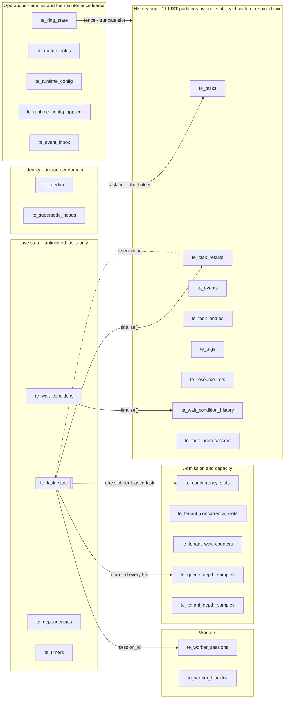

# Task Engine Database

A guide to the Task Engine's storage: which tables exist, how rows move between them, which tables each request and background loop touches, and the rules an implementation must keep. It is drawn from the draft reference DDL in [`migration.sql`](migration.sql) (PostgreSQL form) and the algorithms in [DESIGN.md](DESIGN.md) §3.7 and §4.6, with the decisions of the Task Engine gap review. The gear's own migrations stay authoritative; this file and `migration.sql` describe the target layout.

> **Status: draft.** Builds on the design proposals in #5730, taken as accepted.

## At a glance

- **One database per task domain**, all with the same schema (DESIGN §3.8).
- **34 tables** per domain, **56 secondary indexes**.
- **8 ring tables**, each LIST-partitioned by `ring_slot` into **17 partitions**, each with an unpartitioned `_retained` twin (ADR-0009).
- **No foreign keys** between task tables. Rows that refer to a task are written and removed in that task's transactions; reconciliation reports orphans (`te_orphan_rows_total`).
- **Small codes, not enums**: states, kinds and dimensions are `SMALLINT` codes listed at the top of `migration.sql`, so the same DDL works on PostgreSQL, MySQL and SQLite.

## Where the tables sit

Tables group by how long their rows live: a small set of live tables for unfinished tasks, a partitioned history ring for everything a task leaves behind, and counters and operational tables around them. Inside a group, tables share the task key (`task_id`) unless noted.

`finalize()` moves a task from the live tables into the ring in one transaction; retention later truncates whole ring partitions instead of deleting rows. Claims also read `te_queue_holds` through a node cache, and every state change writes `te_events` in the same transaction.

## Query flows

Each flow is one request or background loop, with the tables it touches in order. **BEGIN** and **COMMIT** rows mark transaction boundaries; *italic* steps happen outside the database.

| Access | Meaning |
|---|---|
| `R` | read |
| `W` | insert or update |
| `L` | row lock or guarded update |
| `D` | delete |
| `M` | move to another table |
| `T` | truncate a partition |

### Create a task

`POST /tasks` · One transaction after the PDP check; depth is checked after dedup so a replay is never refused as full.

| # | Tables | Access | What happens |
|---|---|---|---|
|  |  |  | *Authorize with the PDP · resolve the type from cache* |
|  | **BEGIN** |  |  |
| 1 | `te_dedup` | `W` | Insert the key; a conflict is a 409 replay, or an expired row is taken over |
| 2 | `te_supersede_heads` | `L` `W` | p2 · latest order per supersede group |
| 3 | `te_queue_depth_samples`, `te_tenant_depth_samples` | `R` | Sampled depth, read from the node snapshot |
| 4 | `te_tasks` | `W` | Immutable row in the current ring slot |
| 5 | `te_task_state` | `W` | Live row: queued, scheduled, blocked or waiting |
| 6 | `te_tags`, `te_resource_refs` | `W` | Labels and resource references |
| 7 | `te_dependencies`, `te_task_predecessors` | `W` | p2 · live edges, plus the immutable copy for search |
| 8 | `te_wait_conditions` | `W` | Optional initial wait group |
| 9 | `te_timers` | `W` | Queue timeout, scheduled, lifetime, SLA, wait |
| 10 | `te_events` | `W` | taskCreated, plus the outbox row |
|  | **COMMIT** |  |  |

### Claim work

`POST /tasks/claim` · Plan first without locks, then reserve counters in key order before touching any task row.

| # | Tables | Access | What happens |
|---|---|---|---|
|  |  |  | *Node caches: held queues, saturated scopes, rotation cursor* |
| 1 | `te_task_state` | `R` | Critical probe and rotation through the dispatch indexes |
| 2 | `te_concurrency_slots`, `te_tenant_concurrency_slots` | `R` | Plain read of free slots |
|  | **BEGIN** |  |  |
| 3 | `te_concurrency_slots`, `te_tenant_concurrency_slots` | `L` `W` | Reserve slots in canonical key order |
| 4 | `te_task_state` | `L` `W` | Take picks with SKIP LOCKED; set lease, attempt and execution deadline |
| 5 | `te_timers` | `D` | Drop each queue-timeout timer |
| 6 | `te_events` | `W` | taskClaimed, plus the outbox row |
| 7 | `te_worker_sessions` | `W` | Open or renew the session, last |
|  | **COMMIT** |  |  |

### Heartbeat

`POST /tasks/heartbeat` · One row per worker process; the task rows are only read.

| # | Tables | Access | What happens |
|---|---|---|---|
| 1 | `te_worker_sessions` | `W` | One guarded update renews every lease of the process |
| 2 | `te_task_state` | `R` | Check each listed lease; nothing is written |

### Complete and finalize

`POST /tasks/{id}/complete` · Every terminal transition goes through finalize(); large cascades continue from a cascade timer.

| # | Tables | Access | What happens |
|---|---|---|---|
|  | **BEGIN** |  |  |
| 1 | `te_task_state` | `L` `W` | Fenced on lease token, holder and state |
| 2 | `te_ring_state` | `R` | Fence row, only for a task of an old bucket |
| 3 | `te_task_results` | `W` | Terminal row with state and result |
| 4 | `te_task_state` | `D` | Live row removed |
| 5 | `te_concurrency_slots`, `te_tenant_concurrency_slots` | `W` | Release the recorded shards |
| 6 | `te_timers` | `D` | Every timer except a cascade |
| 7 | `te_dedup` | `W` | Set expires_at for the key window |
| 8 | `te_wait_conditions`, `te_wait_condition_history` | `M` | Conditions move to the ring |
| 9 | `te_dependencies` | `W` | Successors’ outcomes; edges copied into the result row |
| 10 | `te_events` | `W` | taskCompleted, plus the outbox row |
|  | **COMMIT** |  |  |

### Timer fires

`Timer loop · per bg_slot shard` · Each node claims due timers in its shards; a stale timer is dropped.

| # | Tables | Access | What happens |
|---|---|---|---|
| 1 | `te_timers` | `L` `W` | Claim due rows by status, fires_at and bg_slot |
| 2 | `te_task_state` | `R` | Stale check against expected_state |
| 3 | `te_task_state` | `W` | Act: scheduled to queued, queue or lifetime timeout to finalize |
| 4 | `te_wait_conditions` | `W` | Wait timer: resolve due conditions |
| 5 | `te_timers` | `W` | Mark done, or re-arm the wait timer at the next deadline |

### Session expiry

`Session scan` · A session that stops heartbeating takes all of its tasks with it.

| # | Tables | Access | What happens |
|---|---|---|---|
| 1 | `te_worker_sessions` | `L` `W` | Mark expired where lease_until has passed |
| 2 | `te_task_state` | `L` `W` | By session_id, in batches: requeue with backoff, or end timed_out |
| 3 | `te_concurrency_slots`, `te_tenant_concurrency_slots` | `W` | Release slots |
| 4 | `te_worker_blacklist` | `W` | One strike per worker and queue |
| 5 | `te_events` | `W` | taskRetrying with cause liveness |

### Depth sampling

`Maintenance leader · every 5 s` · Depth limits are checked against these samples, never a locked counter.

| # | Tables | Access | What happens |
|---|---|---|---|
| 1 | `te_task_state` | `R` | Count queued and deferred tasks per queue, tenant and domain |
| 2 | `te_task_results` | `R` | Dead-lettered counts per dead-letter queue |
| 3 | `te_queue_depth_samples`, `te_tenant_depth_samples` | `W` | Upsert; tenant rows only at or above their limit |
|  |  |  | *Every node polls the samples into its admission snapshot* |

### Retention recycle

`Maintenance leader · per domain` · Retention empties one partition per bucket instead of deleting rows.

| # | Tables | Access | What happens |
|---|---|---|---|
| 1 | `te_ring_state` | `L` `W` | Mark slot s recycling |
| 2 | `te_task_state` | `W` | Force-cancel live tasks past hard_retention_days, via finalize() |
| 3 | `te_*_retained` | `W` | Rescue rows of slot s that must outlive it |
| 4 | `history ring` | `T` | Empty partition s of the 8 ring tables: PostgreSQL detaches it, truncates it and attaches it again; MySQL truncates it in place (rule 7) |
| 5 | `te_ring_state` | `W` | Slot s active again, for bucket B + N |
| 6 | `te_dedup`, `te_supersede_heads` | `D` | Expired keys and removed group heads |

### Search tasks

`GET /tasks` · Per domain, live and terminal tasks are read separately and merged by the cursor.

| # | Tables | Access | What happens |
|---|---|---|---|
| 1 | `te_task_state` | `R` | Live tasks: tenant_state and tenant_id indexes |
| 2 | `te_task_results` | `R` | Terminal tasks inside the created_at window (and _retained) |
| 3 | `te_tags`, `te_resource_refs` | `R` | has_tag() and has_resource_ref() semi-joins |
| 4 | `te_dependencies`, `te_task_predecessors` | `R` | predecessor_id filter |
| 5 | `te_tasks` | `R` | Input and type for view=full |
|  |  |  | *Merge across domains by cursor* |

## Rules the implementation must keep

These rules carry the correctness of the design. Each links to its source and, where it is not obvious, says what breaks without it. Rules 5 and 7 were checked with load tests against this DDL on PostgreSQL 18, MySQL 8.4 and 9.7, and MariaDB 11.4.

1. **One lock order, counters first.** Every transaction takes row locks in this order: `te_concurrency_slots` (1), `te_tenant_concurrency_slots` (2), `te_tenant_wait_counters` (3), then `te_task_state` rows (ascending `task_id`, or parent before child), and `te_worker_sessions` last (DESIGN §3.7 Lock ordering, ADR-0008; the proposals removed `te_dependency_locks` and `te_tenant_queue_backlog`).
2. **Plan, then counters, then transition.** Read the tasks without a lock, apply the counter deltas in lock order with guarded updates, then run each task transition as an update guarded on the expected state. A guard that matches nothing rolls the transaction back (single task) or skips and redoes the task (bulk).
3. **Claims never use locking reads.** They pick with `FOR UPDATE SKIP LOCKED` and decide with guarded updates.
4. **Releases decrement the recorded shard.** A reservation stores the shard it took on the task row (`queue_slot_shard`, `type_slot_shard`, `tenant_queue_slot_shard`, `tenant_type_slot_shard`); the release decrements exactly that shard.
5. **Counter reconciliation is lock, then count, in two statements.** Per counter row, in its own short transaction: lock the counter row (`FOR UPDATE`), then count the live holders in a **separate, later statement**, then write if different (DESIGN §3.7 Counter reconciliation). Counting first, or one `UPDATE … SET used = (SELECT count(*) …)`, loses concurrent changes and lets a shard admit beyond its limit: in the one-statement form the subquery's snapshot is taken before the statement waits for the counter row, so a change that commits during the wait is overwritten. It is also the form an ORM produces most naturally. Done right, a pass under full claim load makes no corrections at all. On MySQL and MariaDB the transaction runs at `READ COMMITTED`.
6. **Old-bucket writes go through the ring fence.** A transaction that writes a history row for a task of bucket `b ≤ c + 2 − N` first locks that slot's `te_ring_state` row; if the slot is not `active` for `b`, the row goes to the `_retained` twin (DESIGN §3.7 Ring fence). Newer tasks skip the check.
7. **Recycle a slot per backend** (ADR-0009 step 4):
   - **PostgreSQL: detach, truncate, attach again.** Per ring table, `ALTER TABLE t DETACH PARTITION t_pNN CONCURRENTLY` on a connection of its own, outside a transaction block: one statement per round trip, because several statements sent as one string run as one implicit transaction, which `CONCURRENTLY` refuses. Give it a `statement_timeout` of about 2 s. A detach cut off by the timeout stays pending (`pg_inherits.inhdetachpending`); the next attempt finishes it with `DETACH PARTITION … FINALIZE`. Then `TRUNCATE t_pNN` and `ALTER TABLE t ATTACH PARTITION t_pNN FOR VALUES IN (s)`. No other query waits, generic plans included. A long transaction on the table, in any slot, delays only the detach; without one the whole cycle takes tens of milliseconds. Between detach and attach the slot has no partition, which is safe because the fence (rule 6) already sends every write for that bucket to `_retained`. The ring tables have no `DEFAULT` partition, which a concurrent detach would refuse. Do not `TRUNCATE` an attached partition: a truncate waiting behind a reader queues an exclusive lock, and every later reader of that partition waits behind it, as does every prepared statement on a generic plan and every read without a `ring_slot` filter, since those lock all partitions. A lock timeout only shortens each stall to the timeout.
   - **MySQL and MariaDB: truncate in place, and accept a bounded stall.** `ALTER TABLE t TRUNCATE PARTITION pNN` with `SET SESSION lock_wait_timeout = 1`, the minimum the server accepts, retried with backoff and jitter, with the attempts per maintenance run capped (the next run continues). On MySQL, skip an attempt while a session whose transaction is older than about 200 ms holds a metadata lock on the table (`performance_schema.metadata_locks` joined with `events_transactions_current`; `information_schema.innodb_trx.trx_started` has 1 s resolution, too coarse for this). On MariaDB, `WAIT 0.05` and `NOWAIT` fail at once under steady inserts and never get the lock, so use the 1 s session wait there too. The truncate takes the table's exclusive metadata lock, so each attempt that waits stalls every statement on that table, in every slot, writes to the current slot included, for up to 1 s; statements on other tables, `_retained` twins included, do not wait. The pre-check cannot see a long transaction that starts after it, so 1 s stays the bound per attempt. A bounded `DELETE` would avoid the lock but deletes every row of the slot (undo, redo, binary log, purge), so it stays the SQLite fallback only. Keep sessions on the domain database short, and run at `READ COMMITTED`. A deployment that needs steady latency runs PostgreSQL.
   - **SQLite**: bounded `DELETE … WHERE ring_slot = s`.
8. **No partition provisioning.** The partitions are created once by the migrations. The only runtime partition DDL is the recycle step of rule 7, which reuses the same partition, so every ring table keeps exactly 17 (ADR-0009).

## Table directory

Every table with its primary key and secondary indexes, generated from the PostgreSQL catalog after applying `migration.sql`. Ring tables carry `ring_slot` in the key; their `_retained` twins have the same columns, keyed without it.

### Live state

Non-terminal tasks only; small and hot. Rows leave through finalize().

| Table | Holds | Primary key | Indexes |
|---|---|---|---|
| `te_task_state` | Authoritative state, queue, urgency, priority, lease and deadlines of every live task | `task_id` | `task_state_assignment_deadline` (assignment_deadline, bg_slot) WHERE (state_code = 4) `task_state_execution_deadline` (execution_deadline, bg_slot) WHERE (execution_deadline IS NOT NULL) `task_state_handoff` (handoff_until, bg_slot) WHERE (handoff_until IS NOT NULL) `task_state_parent` (parent_task_id, task_id) WHERE (parent_task_id IS NOT NULL) `task_state_queue_dispatch` (queue_id, state_code, urgency_code, priority, created_at, task_id) `task_state_session` (session_id) WHERE (session_id IS NOT NULL) `task_state_tenant_dispatch` (queue_id, state_code, urgency_code, owner_tenant_id, priority, created_at, task_id) `task_state_tenant_id` (owner_tenant_id, task_id) `task_state_tenant_state` (owner_tenant_id, state_code, task_id) |
| `te_wait_conditions` | Wait conditions of live tasks: the current group and earlier, replaced ones | `id` | `waits_children_pending` (parked_at) WHERE ((kind_code = 3) AND (state_code = 1)) `waits_event_subject` (event_type, owner_tenant_id, event_subject_id) WHERE ((kind_code = 4) AND (state_code = 1)) `waits_resume` (timer_resume_at) WHERE ((kind_code = 1) AND (state_code = 1)) `waits_task` (task_id, created_at, id) `waits_timeout` (timeout_at) WHERE (state_code = 1) |
| `te_dependencies` | Predecessor edges while the successor is live, with each edge’s outcome | `task_id, predecessor_id` | `deps_predecessor` (owner_tenant_id, predecessor_id, task_id) |
| `te_timers` | Durable deadlines: queue, scheduled, lifetime, SLA, wait, cancel grace, cascade | `id` | `timers_claim_until` (claim_until) WHERE (status_code = 2) `timers_pending_fires` (status_code, fires_at, bg_slot) `timers_task` (task_id, timer_type_code) |

### History ring

LIST-partitioned by ring_slot into 17 slots; each has an unpartitioned _retained twin for rows that outlive their slot.

| Table | Holds | Primary key | Indexes |
|---|---|---|---|
| `te_tasks` (ring) | Immutable data written once at create: type, input, effective settings, authority | `id, ring_slot` | `tasks_parent` (parent_task_id, id) WHERE (parent_task_id IS NOT NULL) |
| `te_task_results` (ring) | Terminal tasks: state, result, output, error; moved back by re-enqueue | `task_id, ring_slot` | `task_results_dlq` (queue_id, task_id) WHERE (state_code = 10) `task_results_tenant_dlq_from` (owner_tenant_id, dead_lettered_from, task_id) WHERE (state_code = 10) `task_results_tenant_id` (owner_tenant_id, task_id) `task_results_tenant_queue` (owner_tenant_id, queue_id, task_id) `task_results_tenant_state` (owner_tenant_id, state_code, task_id) `task_results_tenant_terminal` (owner_tenant_id, state_code, terminal_at, task_id) `task_results_tenant_type` (owner_tenant_id, type_id, task_id) `task_results_terminal` (terminal_at) |
| `te_events` (ring) | Task history, written in every state-change transaction; the published event id | `id, ring_slot` | `events_queue` (queue_id, id) WHERE (queue_id IS NOT NULL) `events_task` (task_id, id) WHERE (task_id IS NOT NULL) |
| `te_task_entries` (ring) | Immutable entries from the worker or an API consumer | `id, ring_slot` | `entries_task` (task_id, created_at, id) |
| `te_tags` (ring) | Labels for the has_tag() filter | `task_id, tag_key, ring_slot` | `tags_key_value` (owner_tenant_id, tag_key, tag_value, task_id) |
| `te_resource_refs` (ring) | Platform resources a task works on, for has_resource_ref() | `task_id, resource_type_id, resource_id, ring_slot` | `resource_refs_lookup` (owner_tenant_id, resource_type_id, resource_id, task_id) |
| `te_wait_condition_history` (ring) | Wait conditions of terminal tasks | `id, ring_slot` | `wait_history_task` (task_id, created_at, id) |
| `te_task_predecessors` (ring) | Immutable predecessor edges for the predecessor_id filter | `task_id, predecessor_id, ring_slot` | `task_predecessors_pred` (owner_tenant_id, predecessor_id, task_id) |

### Admission and capacity

Exact concurrency counters are locked in claims; depth limits use samples.

| Table | Holds | Primary key | Indexes |
|---|---|---|---|
| `te_concurrency_slots` | Queue-wide and type-wide concurrency, sharded; lock order 1 | `dimension_code, scope_id, shard` | PK only |
| `te_tenant_concurrency_slots` | Per-tenant concurrency per queue and type; lock order 2 | `owner_tenant_id, dimension_code, scope_id, shard` | PK only |
| `te_tenant_wait_counters` | Pending event-wait conditions per tenant; lock order 3 | `owner_tenant_id, dimension_code, scope_id` | PK only |
| `te_queue_depth_samples` | Sampled task counts per queue and state | `queue_id, state_code` | PK only |
| `te_tenant_depth_samples` | Tenant keys whose sampled count is at or above the limit | `owner_tenant_id, dimension_code, queue_id` | `tenant_depth_samples_sampled` (sampled_at) |

### Identity

Unpartitioned, so the uniqueness check is global within the domain.

| Table | Holds | Primary key | Indexes |
|---|---|---|---|
| `te_dedup` | Occupied creation identities: derived dedup keys and caller idempotency keys | `owner_tenant_id, dedup_key` | `dedup_expires` (expires_at) WHERE (expires_at IS NOT NULL) `dedup_task` (task_id) |
| `te_supersede_heads` | Latest order per supersede group (p2) | `owner_tenant_id, group_key` | `supersede_heads_created` (latest_created_at) |

### Workers

Written by claims, heartbeats and the session scan.

| Table | Holds | Primary key | Indexes |
|---|---|---|---|
| `te_worker_sessions` | One row per worker process and domain; heartbeats write only this | `session_id` | `sessions_expiry` (status_code, lease_until, bg_slot) |
| `te_worker_blacklist` | Consecutive worker-attributed failures per worker and queue | `worker_subject, worker_id, queue_id` | `worker_blacklist_until` (blacklisted_until) WHERE (blacklisted_until IS NOT NULL) `worker_blacklist_updated` (updated_at) |

### Operations

Engine-wide state kept by admins and the maintenance leader.

| Table | Holds | Primary key | Indexes |
|---|---|---|---|
| `te_ring_state` | One row per ring slot: the fence between old-bucket writers and retention | `ring_slot` | PK only |
| `te_queue_holds` | Held queues; nodes cache them and skip their tasks in claims | `queue_id` | `queue_holds_until` (hold_until) WHERE (hold_until IS NOT NULL) |
| `te_runtime_config` | Saved runtime config versions (default domain only) | `config_version` | PK only |
| `te_runtime_config_applied` | The version this domain has applied | `singleton` | PK only |
| `te_event_inbox` | Inbound broker events already applied, for event waits | `event_id` | `event_inbox_received` (received_at) |

## Implementation notes

To take into account when the gear's migrations and queries are written:

- **Per-table autovacuum settings** on the hot, update-heavy tables: `te_task_state`, `te_timers`, `te_worker_sessions` and the counter tables (`te_concurrency_slots`, `te_tenant_concurrency_slots`, `te_tenant_wait_counters`).
- **Documented `ORDER BY` choices** in sweep queries (timers, deadlines, session expiry, retention), so the planner stays on the intended partial index.
- **Ring reads name their slot.** Reads of a task's history carry its `ring_slot`, derived from the creation time in its UUID v7 task id (DESIGN §3.7), and union the ring table with its `_retained` twin. This keeps them on one partition and out of the way of a recycle.
- **Load tests to carry into the gear.** Counter reconciliation under concurrent claims, completions and requeues ends exact, with no corrections and no shard over its limit. A slot recycle under steady reads and writes loses no committed row, writes nothing to the slot after the mark, rescues every live task's rows, and leaves exactly 17 partitions; on PostgreSQL no query waits, including behind a slow reader.
- **Not yet measured:** recycle cost at full slot size (millions of rows; the tests used 100,000 per slot), and a MariaDB pre-check that does not need `performance_schema` (`information_schema.METADATA_LOCK_INFO` needs a plugin that is not loaded by default).
