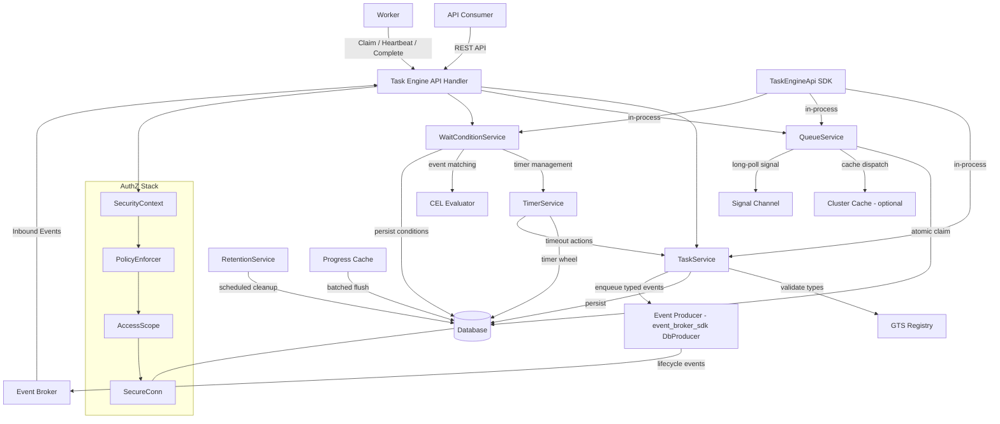
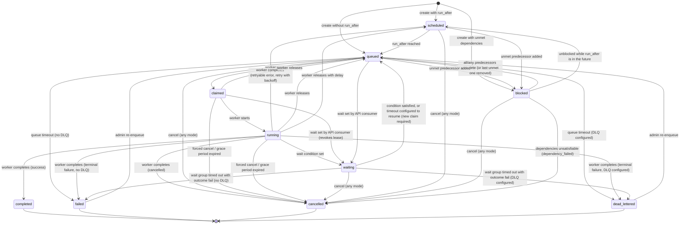

# Technical Design — Task Engine

<!-- toc -->

- [1. Architecture Overview](#1-architecture-overview)
  - [1.1 Architectural Vision](#11-architectural-vision)
  - [1.2 Architecture Drivers](#12-architecture-drivers)
  - [1.3 Architecture Layers](#13-architecture-layers)
  - [1.4 High-Level Architecture Diagram](#14-high-level-architecture-diagram)
- [2. Principles & Constraints](#2-principles--constraints)
  - [2.1 Design Principles](#21-design-principles)
  - [2.2 Constraints](#22-constraints)
- [3. Technical Architecture](#3-technical-architecture)
  - [3.1 Domain Model](#31-domain-model)
  - [3.2 Component Model](#32-component-model)
  - [3.3 API Contracts](#33-api-contracts)
  - [3.4 Internal Dependencies](#34-internal-dependencies)
  - [3.5 External Dependencies](#35-external-dependencies)
  - [3.6 Interactions & Sequences](#36-interactions--sequences)
  - [3.7 Database Schemas & Tables](#37-database-schemas--tables)
  - [3.8 Deployment Topology](#38-deployment-topology)
  - [3.9 Load Management, Admission Control & Backpressure](#39-load-management-admission-control--backpressure)
- [4. Additional Context](#4-additional-context)
  - [4.1 Configuration](#41-configuration)
  - [4.2 Caching Strategy](#42-caching-strategy)
  - [4.3 Metrics and Observability](#43-metrics-and-observability)
  - [4.4 Audit Logging](#44-audit-logging)
  - [4.5 Security Considerations](#45-security-considerations)
  - [4.6 Key Algorithms](#46-key-algorithms)
  - [4.7 Out of Scope](#47-out-of-scope)
  - [4.8 Future Developments](#48-future-developments)
- [5. Traceability](#5-traceability)
  - [5.1 PRD ↔ DESIGN Traceability](#51-prd--design-traceability)
  - [5.2 ADRs](#52-adrs)
  - [5.3 Standards & External References](#53-standards--external-references)
  - [5.4 Companion Documents](#54-companion-documents)

<!-- /toc -->

## 1. Architecture Overview

### 1.1 Architectural Vision

The Task Engine is a distributed, multi-tenant task orchestration control plane implemented as a gear. It manages the full lifecycle of structured work units — creation, queuing, atomic claiming with leases, execution tracking with heartbeat monitoring, durable suspension via wait conditions, retry with backoff, parent/child hierarchies, and structured completion — across a cluster of workers.

**ID**: `cpt-cf-task-engine-design-positioning`

**Control plane, not an executor.** The Task Engine owns task state, queues, leases, timers, waits and history, but **runs no task code and hosts no workers**. Workers are separate processes that claim tasks through the REST API or SDK. Running a gear's own activities and workflows in-process, on a local worker, is the job of the [Durable Execution](../../../libs/toolkit-durable-execution/docs/PRD.md) gear. A Durable Execution activity may be a Task Engine client or worker; the reverse never applies. The two gears share no tables, queues, or state; PRD §1.1 *Boundary with Durable Execution* says which one to use for which work.

The architecture follows a **DDD-Light layered design** (SDK → API/Transport → Domain → Infrastructure) consistent with the ToolKit framework. The system is decomposed into five internal subsystems:

- **Task Service**: Core lifecycle management — creation, validation, state transitions, completion, cancellation, and idempotent deduplication.
- **Queue Service**: Priority-ordered dispatch with multi-dimensional concurrency control (per-queue, per-type, per-tenant), atomic claim with lease semantics, long-poll support, and worker blacklisting.
- **Timer Service**: Multi-type timeout enforcement via a persistent timer wheel — queue, assignment, execution, heartbeat, lifetime, SLA, and scheduled enqueue timers.
- **Wait Condition Service**: Durable suspension management — timer, event, and input wait condition kinds with ALL/ANY semantics, timeout, and resolution.
- **Retention Service**: Background scheduled cleanup of completed tasks, entries, and event history with per-type, per-tenant, and global retention policies.

All five subsystems are implemented as **domain traits within a single `task-engine` crate**, communicating in-process via trait calls. An **SDK crate** (`task-engine-sdk`) exposes the public API surface (client trait, domain models, error types, GTS type definitions) for integration by other gears.

**ID**: `cpt-cf-task-engine-design-operational-core`

Per [ADR/0001-pluggable-execution-backends.md](ADR/0001-pluggable-execution-backends.md), the Task Engine runs all task execution directly in one operational core and one database. It does not use execution plugins, storage plugins, or an external workflow engine. The core keeps the single source of truth and uses atomic database transactions for admission, claim, leases, and the event outbox.

**One true store (the main relational database):**
- The main relational database (PostgreSQL, MariaDB/MySQL, or SQLite) holds all task state: status, claiming, leases, wait conditions, concurrency counters, timers, and all task payloads (within the PRD limit of 64 KB per payload).
- If a database transaction fails, the whole operation fails. No other system can change an execution decision.
- Cleanup is done by the background Retention Service (§3.2). If data is lost, it is restored from database backups and migrations, never rebuilt from another system.

**Offload heavy work to other gears (not plugins):**
- A deployment MAY run a separate search gear, analytics gear, or history/archive gear. They receive data from the Task Engine through published lifecycle events (Event Broker, §3.2), not by sharing the Task Engine database.
- These other gears never hold the true task state and never take part in claim, lease, or concurrency decisions.
- If any of these gears is slow or down, task creation, claim, heartbeat, retries, waits, and completion still work.

**Scaling:** the Task Engine scales inside its own model — hot-row sharding for counters, shard keys for background loops (§4.6), and task domains to route task types to separate databases (§3.8). It does not scale by adding plugins. In the first release, only the main relational database is required; search, analytics, and history offload to other gears is future work under PRD §4.3.

### 1.2 Architecture Drivers

**ID**: `cpt-cf-task-engine-design-drivers`

| Driver | Source | Influence |
|---|---|---|
| Distributed task lifecycle | `cpt-cf-task-engine-fr-task-create` | Full state machine with 10 states and 6 timeout types |
| Multi-tenant isolation | `cpt-cf-task-engine-fr-tenant-scoping` | All data tenant-scoped via SecureConn; per-tenant concurrency limits |
| Queue-based dispatch | `cpt-cf-task-engine-fr-priority-dispatch` | Priority-ordered queues with configurable concurrency limits |
| Durable suspension | `cpt-cf-task-engine-fr-wait-conditions` | First-class wait conditions (timer, event, input, children) with ALL/ANY semantics |
| Atomic claiming | `cpt-cf-task-engine-fr-assignment` | Database-level atomic claim with lease, heartbeat, and long-poll |
| Zombie-worker safety | `cpt-cf-task-engine-fr-lease-fencing` | Per-lease token on every worker write; monotonic lease epoch; at-least-once execution contract |
| GTS extensibility | `cpt-cf-task-engine-fr-gts-task-type` | Task types, queues, and entries as GTS entities; engine-owned finite sets as SDK/domain enums; tags are free-form (non-GTS) |
| Structured retry | `cpt-cf-task-engine-fr-retry` | Configurable policies with backoff strategies and dead-letter queues |
| Cluster-optional caching | `cpt-cf-task-engine-fr-cluster-cache` | Graceful degradation when Cluster gear is unavailable |
| Storage partitioning | `cpt-cf-task-engine-fr-task-domains` | Multi-database routing by GTS task type patterns |
| SDK-first integration | `cpt-cf-task-engine-fr-sdk` | Public SDK crate for type-safe inter-gear communication |

**Architecture Decision Records**:

- `cpt-cf-task-engine-adr-implementation-architecture` — Single operational core in one database; no execution or storage plugins; heavy search, analytics, and history offloaded to other gears via events. See [ADR/0001-pluggable-execution-backends.md](ADR/0001-pluggable-execution-backends.md).
- `cpt-cf-task-engine-adr-state-machine` — Task state machine design with 10 states, terminal/non-terminal classification, and valid transition matrix. See [ADR/0002-task-state-machine.md](ADR/0002-task-state-machine.md).
- `cpt-cf-task-engine-adr-timer-architecture` — Persistent timer wheel with database-backed timers and multi-worker processing. See [ADR/0003-timer-architecture.md](ADR/0003-timer-architecture.md).
- `cpt-cf-task-engine-adr-wait-condition-model` — Wait conditions as fixed domain model elements (not GTS-extensible), with four built-in kinds (timer, event, input, children) and an arm-then-park option. See [ADR/0004-wait-condition-model.md](ADR/0004-wait-condition-model.md).
- `cpt-cf-task-engine-adr-concurrency-enforcement` — Database-level atomic counters, in a cross-tenant table and a tenant-scoped table (optionally hot-row sharded, ADR-0008); no Cluster dependency (PRD §1.4). See [ADR/0005-concurrency-enforcement.md](ADR/0005-concurrency-enforcement.md).
- `cpt-cf-task-engine-adr-blob-compression` — Transparent JSON blob compression for storage efficiency using zstd behind a magic prefix and codec byte. See [ADR/0006-blob-compression.md](ADR/0006-blob-compression.md).
- `cpt-cf-task-engine-adr-event-wait-matching` — CEL-based match expression evaluation for event wait conditions with creation-time checks, a cost budget enforced inside the evaluator, per-tenant condition limits, and a defined outcome for budget failures. See [ADR/0007-event-wait-matching.md](ADR/0007-event-wait-matching.md).
- `cpt-cf-task-engine-adr-atomic-claim-strategy` — **Proposed** (until the ToolKit secure claim primitive exists and the benchmark passes) — claims run through `toolkit_db::secure::claim`: plain scoped candidate streams with a k-way merge, guarded slot reservation **before** any task write, guarded state transition, settle; batch claims and node-local coalescing in the gear; counters before task rows as the engine-wide lock order; no `SKIP LOCKED` and no dialect SQL in the Task Engine. See [ADR/0008-atomic-claim-strategy.md](ADR/0008-atomic-claim-strategy.md).
- `cpt-cf-task-engine-adr-retention-partitioning` — Unpartitioned live tables; history (including tags and resource references) in a fixed ring of `N` list partitions keyed by a time-bucket `ring_slot`; no DB foreign keys; retention from terminal time; rescue-then-truncate of the oldest slot, no runtime partition DDL; SQLite `DELETE` fallback. See [ADR/0009-retention-partitioning.md](ADR/0009-retention-partitioning.md).
- `cpt-cf-task-engine-adr-task-domains` — Route each queue to one configured database with a config-order first-match rule; a task lives in its queue's domain; optional type rules are checked at create time; dead-letter queues are not routed; atomic operations (claim, dependencies, parent/child) stay inside one domain. See [ADR/0010-task-domains.md](ADR/0010-task-domains.md).
- `cpt-cf-task-engine-adr-lease-fencing` — Every worker write carries a random per-lease token bound to the holder's subject; reassignment hands over no token; a lease epoch lets workers fence external systems. See [ADR/0011-lease-fencing.md](ADR/0011-lease-fencing.md).
- `cpt-cf-task-engine-adr-task-deduplication` — Required caller idempotency key scoped to tenant and subject, or a type-declared engine identity, with optional supersession by a newer order value. See [ADR/0012-task-deduplication.md](ADR/0012-task-deduplication.md).
- `cpt-cf-task-engine-adr-worker-transport` — Workers use the REST API with capped long-poll claims, batch heartbeats, and a per-node queue watcher for cross-node wake-up; streaming is deferred. See [ADR/0013-worker-transport.md](ADR/0013-worker-transport.md).
- `cpt-cf-task-engine-adr-worker-identity` — A worker is the pair (authenticated subject, client-supplied `worker_id`), used for assignment, blacklist, and audit, never as a credential. See [ADR/0014-worker-identity.md](ADR/0014-worker-identity.md).
- `cpt-cf-task-engine-adr-gts-hybrid-model` — GTS for open sets (task types, queues, entry types), closed engine enums for control values, indexed base columns plus opaque compressed payloads. See [ADR/0015-gts-hybrid-model.md](ADR/0015-gts-hybrid-model.md).
- `cpt-cf-task-engine-adr-authorization-model` — The PDP sees each task's type and queue; all task work runs on the tenant plane; platform workers are root-tenant service subjects that cross barriers only on `operated_by: platform` queues; workers act as themselves, and creator checks at creation prove the creator's own rights on referenced resources; events are published by a dedicated, narrowly granted publishing subject. See [ADR/0016-authorization-model.md](ADR/0016-authorization-model.md).
- `cpt-cf-task-engine-adr-worker-session-leases` — **Proposed** — One heartbeat row per worker process and domain (a worker session) keeps all its task leases alive; per-task lease tokens still fence every write. See [ADR/0017-worker-session-leases.md](ADR/0017-worker-session-leases.md).

> Event delivery is **not** an ADR: reusing the platform Event Broker SDK is a mandated platform standard (all gears publish through `event-broker-sdk`), not a Task-Engine decision. The managed-outbox producer surface, dedup mode, and partitioning are documented as design detail in §3.2 Event Producer.

### 1.3 Architecture Layers

**ID**: `cpt-cf-task-engine-design-layers`

| Layer | Responsibility | Key Components |
|---|---|---|
| **Transport** (`api/rest/`) | HTTP handling, request parsing, response serialization | Axum handlers, DTOs, extractors, OperationBuilder route registration |
| **Domain** (`domain/`) | Business logic, service traits, repository contracts | `TaskService`, `QueueService`, `TimerService`, `WaitConditionService`, `RetentionService`, domain models, repository traits |
| **Infrastructure** (`infra/`) | Persistence, cache integration, GTS provisioning | SeaORM repositories, Cluster cache adapter, timer persistence, type provisioning |
| **SDK** (`task-engine-sdk/`) | Public API for inter-gear communication | `TaskEngineApi` trait (all methods require `&SecurityContext`), SDK models, error types, GTS type definitions |

**ID**: `cpt-cf-task-engine-tech-dependencies`

| Technology | Purpose |
|---|---|
| Rust / Axum | HTTP transport, async runtime (tokio) |
| SeaORM + `toolkit-db` | Database persistence (PostgreSQL, MySQL/MariaDB, SQLite) via `DbManager` + `SecureConn`; claims through the secure claim primitive `toolkit_db::secure::claim` (ADR-0008; ToolKit work [#5477](https://github.com/constructorfabric/gears-rust/issues/5477), [#5478](https://github.com/constructorfabric/gears-rust/issues/5478)); all dialect handling stays in this layer |
| `event-broker-sdk` (`outbox` feature) | `DbProducer` managed outbox for lossless, deduped Event Broker delivery (§3.2 Event Producer); the `toolkit-db` outbox pipeline it uses is always compiled in |
| `toolkit-db` advisory locks | Portable leader election for singleton background loops (ADR-0008 §No DB-Specific SQL) |
| `toolkit-security` | Bearer token authentication & authorization |
| `authz-resolver-sdk` | `PolicyEnforcer` for PDP/PEP authorization |
| `types_registry` | GTS schema/instance registration |
| `cluster-sdk` (optional) | Distributed cache for ready-task caching |
| `cel-core` (workspace dependency) | CEL parsing and checking for event wait match expressions; evaluated by a budgeted runtime that charges cost from inside the evaluation, as in `quota-enforcement-engine-cel` (ADR-0007); the runtime is to be extracted into a shared crate ([#5485](https://github.com/constructorfabric/gears-rust/issues/5485)) |

### 1.4 High-Level Architecture Diagram

**ID**: `cpt-cf-task-engine-design-overview`



## 2. Principles & Constraints

### 2.1 Design Principles

**ID**: `cpt-cf-task-engine-principle-sdk-first`

**SDK-first public API**: The `task-engine-sdk` crate is the only public API surface. All domain types, client traits, and error types consumed by other gears live in the SDK. The gear crate is private. The SDK trait is **security-equivalent to the REST API** — every method takes `&SecurityContext` as its first parameter, and the local client adapter passes it to the domain services which enforce the same `PolicyEnforcer` → `AccessScope` → `SecureConn` authorization chain as the REST handlers.

**ID**: `cpt-cf-task-engine-principle-secure-by-default`

**Secure-by-default DB access**: All database access uses `SecureConn` with `AccessScope` compiled from PDP constraints. No raw database connections in handler, service, or repository code.

Tenant-owned tables (`te_tasks`, `te_task_state`, `te_task_results`, `te_task_entries`, `te_wait_conditions`, `te_events`, `te_tags`, `te_resource_refs`, `te_dependencies`, `te_timers`, `te_event_inbox`, `te_dedup`, `te_supersede_heads`, `te_dependency_locks`, and the per-tenant counter tables `te_tenant_concurrency_slots`, `te_tenant_queue_backlog`, and `te_tenant_wait_counters`) derive `Scopable` with a `tenant_col`. Every **request path** (REST or SDK call made for a subject) accesses them only under the PDP-derived tenant scope.

**Per-tenant counters are tenant-scoped** (per [`06_authn_authz_secure_orm.md` §Unrestricted entities](../../../docs/toolkit_unified_system/06_authn_authz_secure_orm.md)). Request paths write them under `scope.tenant_only()`, after the task row was authorized with the full scope in the same transaction (the mini-chat pattern). A wrong-tenant write then fails in the ORM.

**`unrestricted` entities** have no tenant column: `te_concurrency_slots` (cross-tenant counts only), `te_worker_blacklist`, `te_worker_sessions`, and `te_runtime_config`. The first three are touched in tenant requests, so they are a **declared exception** to the guide, with these controls ([`16_defect_class_to_control_map.md` §Globally scoped tables](../../../docs/toolkit_unified_system/16_defect_class_to_control_map.md)):

- `te_concurrency_slots`: only through `GlobalCounterRepo` — a guarded `+n`/`−n` on a key taken from an already-authorized task row; no read or list on request paths. `GET /queues` reads it only after a queue `read` decision.
- `te_worker_sessions` and `te_worker_blacklist`: only through repositories whose every request-path statement has `worker_subject = ctx.subject_id` in its guard, so a caller reaches only its own workers' rows.
- Each `allow_all()` call site carries a justification; the lint gate rejects any other `allow_all()` on a request path.

**`allow_all()` on request paths — the complete list.** A request handler may use `AccessScope::allow_all()` only in these cases, and the lint gate rejects any other:

1. The `unrestricted` repositories above.
2. The **ToolKit prefetch read** of one task by ID ([`06_authn_authz_secure_orm.md` §GET prefetch pattern](../../../docs/toolkit_unified_system/06_authn_authz_secure_orm.md)): it reads only the task's tenant, type, and queue, so the engine can ask the PDP about this task. The prefetched row is never returned and never written; the response always comes from a scoped read or a scoped, guarded write (§3.3 Authorization Model).

No other request-path access to a tenant-owned table uses `allow_all()`.

**System background loops (the only exception)**: the timer wheel, the session and deadline scans, retention, slot reconciliation, priority aging, and the event consumer act for the engine, not for a subject, so they have no PDP scope. They read and write tenant-owned tables (for example `te_timers`, `te_task_state`, `te_wait_conditions`) under `AccessScope::allow_all()`. This is allowed only in these named loops, which never take input from an API caller. Each row they change keeps its own `owner_tenant_id`, and any event they write carries that tenant. Request handlers follow the complete list above.

**ID**: `cpt-cf-task-engine-principle-rfc9457`

**RFC 9457 Problem Details**: All error responses use `application/problem+json` format with GTS type URIs. `Problem` type implements `IntoResponse`.

**ID**: `cpt-cf-task-engine-principle-gts-typed`

**GTS-typed extensibility**: Task types, entry types, and queues are GTS entities. New extensible types are registerable without DDL changes. Engine-owned finite sets such as task states, result codes, urgency, wait condition kinds, timer types, timer statuses, dependency modes, and concurrency dimensions are closed SDK/domain enums, not GTS entities. Tags are free-form tenant-scoped strings, not GTS entities (PRD §5.1). Extension data (input, context, output) lives in compressed binary columns (ADR-0006, §3.7 Portable JSON Storage Contract).

**ID**: `cpt-cf-task-engine-principle-tenant-scope`

**Tenant scoping**: Every query is tenant-scoped via `SecureConn` tenant predicates. Tasks have an `owner_tenant_id` isolation boundary. SeaORM entities derive `Scopable` with tenant and resource columns.

**ID**: `cpt-cf-task-engine-principle-operation-builder`

**Type-safe REST**: All endpoints use `OperationBuilder`. Protected routes declare `.authenticated()` followed by a license posture (`.require_license_features::<License>([])` or `.no_license_required()`); the gear registers **no** unauthenticated routes: liveness and readiness come from the ToolKit `Healthcheck` capability and metrics from the platform OpenTelemetry meter (§3.3 Health and metrics). All routes register `.standard_errors()`.

**ID**: `cpt-cf-task-engine-principle-domain-model`

**Domain model enforcement**: All `struct`/`enum` in `domain/` have `#[domain_model]` (`toolkit_macros::domain_model`). CI lint DE0309 enforces this.

**ID**: `cpt-cf-task-engine-principle-fail-closed`

**Fail-closed authorization**: Denied decisions, unreachable PDP, and missing constraints result in 403 Forbidden, except that a single task the caller may not read answers 404, like a missing task (§3.3 *No existence oracle*). PDP internals are never exposed to clients.

**ID**: `cpt-cf-task-engine-principle-fenced-execution`

**Fenced, at-least-once execution**: Execution is at-least-once (PRD §5.6 Execution Semantics). Every worker-side write is one guarded update on `lease_token` **and** `assignee_subject = SecurityContext.subject_id`, so neither an old lease nor a copied token can change the task. Tokens are random UUID v4, returned only to the holder, never logged. External systems are fenced by the monotonic `lease_epoch`. `PolicyEnforcer` still runs first.

### 2.2 Constraints

**ID**: `cpt-cf-task-engine-constraint-single-binary`

Single-executable deployment via Gears framework. No external broker or cache dependencies required (Cluster cache is optional).

**ID**: `cpt-cf-task-engine-constraint-multi-sql`

Multi-SQL backend portability: PostgreSQL, MariaDB/MySQL, SQLite. `toolkit-db` requirement; backend selection via DSN scheme.

**ID**: `cpt-cf-task-engine-constraint-payload-size`

Per-task payload hard size limit: **64 KiB** total (input + context + output combined), measured as **uncompressed canonical JSON** before compression and enforced on **every payload-changing write** (create, checkpoint/context-update, complete). Per-entry payload limit: **64 KiB**. HTTP request body limit: **1 MiB** (configurable), enforced by `Content-Length` when present and by **streaming byte-count** for chunked/HTTP2 bodies with no usable declared length. Payloads exceeding limits are rejected with `413 Payload Too Large`.

**ID**: `cpt-cf-task-engine-constraint-idempotency-key`

Mandatory caller-supplied idempotency key on every task creation request, except for task types declaring a derived dedup identity (PRD §5.1). Unique within `(owner_tenant_id, created_by)`.

**ID**: `cpt-cf-task-engine-constraint-no-workflow-engine`

The Task Engine provides task lifecycle, declarative relationships (dependencies, parent/child hierarchies), suspension, and schedules — not workflow orchestration: it never executes user-defined orchestration logic (no conditional branches, loops, compensation/saga logic, or arbitrary DAG/workflow definitions; PRD §4.2).
## 3. Technical Architecture

### 3.1 Domain Model

**ID**: `cpt-cf-task-engine-design-domain-model`

```mermaid
classDiagram
    class Task {
        +Uuid id
        +Uuid type_id (GTS)
        +Uuid queue_id (GTS)
        +Uuid owner_tenant_id
        +Option~Uuid~ owner_id
        +Uuid created_by
        +TaskState state
        +Urgency urgency (normal | critical)
        +i32 priority (tenant-local)
        +JsonValue input
        +Option~JsonValue~ context
        +Option~TaskResult~ result
        +Option~String~ idempotency_key
        +bool cancellable
        +bool cancel_requested
        +Option~Uuid~ parent_task_id
        +bool wait_for_children
        +bool propagate_cancel
        +i32 attempt
        +i64 revision
        +Option~RetryPolicy~ retry_policy
        +Timeouts timeouts
        +Option~DateTime~ run_after
        +Option~DateTime~ sla_deadline
        +Vec~Tag~ tags
        +Vec~ResourceRef~ resource_refs
        +Option~ProgressInfo~ progress
        +Option~Assignment~ assignment
        +DateTime created_at
        +DateTime updated_at
    }

    class TaskResult {
        +TaskResultCode result_code
        +Option~JsonValue~ output
        +Option~TaskError~ error
        +Vec~TaskError~ warnings
    }

    class TaskError {
        +String domain
        +String code
        +String message
        +Option~JsonValue~ context
        +ErrorFault fault (task | dependency | worker; default task)
        +bool retryable
    }

    class Assignment {
        +Uuid assignee_subject
        +String assignee (worker_id)
        +DateTime claimed_at
        +Option~Uuid~ session_id (worker session whose heartbeat keeps the lease alive; NULL during a hand-off)
        +Option~DateTime~ handoff_until (accept window after a reassignment)
        +Option~DateTime~ assignment_deadline
        +Option~DateTime~ execution_deadline
        +i32 attempt
        +Option~Uuid~ lease_token (v4, holder-bound; NULL while a hand-off awaits accept)
        +i64 lease_epoch
    }

    class RetryPolicy {
        +i32 max_retries
        +i32 max_liveness_requeues
        +BackoffStrategy strategy
        +Duration base_interval
        +Duration max_interval
        +f64 jitter_factor
        +Vec~String~ non_retryable_codes
    }

    class Timeouts {
        +Option~Duration~ queue_timeout
        +Option~Duration~ assignment_timeout
        +Option~Duration~ execution_timeout
        +Option~Duration~ heartbeat_timeout
        +Option~Duration~ lifetime_timeout
    }

    class WaitCondition {
        +Uuid id
        +Uuid task_id
        +WaitConditionKind kind
        +WaitConditionState state
        +Option~Duration~ timeout
        +WaitTimeoutAction on_timeout (fail | resume)
        +Option~JsonValue~ resolved_payload
        +Option~DateTime~ timeout_at
        +Option~DateTime~ parked_at (NULL = armed)
        +DateTime created_at
        +Option~DateTime~ resolved_at
    }

    class TimerWait {
        +DateTime resume_at
    }

    class EventWait {
        +String event_type (GTS)
        +Option~String~ subject_id
        +String subject_type (effective; explicit or the event type's single allowed subject type)
        +Option~JsonValue~ consume_filter (decidable consume constraints from set time)
        +Option~String~ match_expression (CEL)
    }

    class InputWait {
        +Option~JsonValue~ input_schema
        +Option~String~ prompt
    }

    class ChildrenWait

    class TaskEntry {
        +Uuid id
        +Uuid task_id
        +Uuid type_id (GTS)
        +String creator
        +JsonValue payload
        +DateTime created_at
    }

    class TaskEvent {
        +Uuid id
        +Uuid task_id
        +String event_type
        +String actor_identity
        +JsonValue payload
        +DateTime timestamp
    }

    class TaskDependency {
        +Uuid task_id
        +Uuid predecessor_id
        +Uuid owner_tenant_id (same for both ends)
        +DependencyMode mode
    }

    class ProgressInfo {
        +Option~i32~ percent
        +Option~String~ milestone
        +Option~i64~ completed_units
        +Option~i64~ total_units
        +Option~String~ current_stage
        +Option~DateTime~ eta
    }

    class Tag {
        +String key
        +String value
    }

    class ResourceRef {
        +Uuid resource_type_id (GTS)
        +String resource_id
    }

    class Timer {
        +Uuid id
        +Uuid task_id
        +TimerType timer_type
        +DateTime fires_at
    }

    Task "1" --> "*" TaskEntry : has entries
    Task "1" --> "*" TaskEvent : has events
    Task "1" --> "*" WaitCondition : may have
    Task "1" --> "*" TaskDependency : depends on
    Task "1" --> "*" Tag : tagged with
    Task "1" --> "*" ResourceRef : operates on
    Task "1" --> "*" Timer : monitored by
    Task "1" --> "0..1" Assignment : assigned to
    Task "1" --> "0..1" TaskResult : completes with
    Task "1" --> "0..1" ProgressInfo : tracks progress
    WaitCondition <|-- TimerWait : kind=timer
    WaitCondition <|-- EventWait : kind=event
    WaitCondition <|-- InputWait : kind=input
    WaitCondition <|-- ChildrenWait : kind=children
```



#### Task State Machine

**ID**: `cpt-cf-task-engine-design-state-machine`

See [ADR/0002-task-state-machine.md](ADR/0002-task-state-machine.md) for the full rationale.



**Terminal states**: `completed`, `failed`, `cancelled`, `dead_lettered`. Tasks in terminal states do not transition to any other state except `dead_lettered` → `queued` and `failed` → `queued` via explicit administrative re-enqueue (PRD §5.8 Re-enqueue rules). Cancellation is a first-class terminal lifecycle state; `cancelled` and `forcibly_cancelled` result codes record the cancellation outcome or mode. Each terminal state allows only certain result codes (`completed`: `success`/`warning`; `failed` and `dead_lettered`: `error`/`timed_out`; `cancelled`: `cancelled`/`forcibly_cancelled`/`superseded`/`dependency_failed`) — see the pairing table in PRD §5.12.

**State Transition Table**:

Every transition into a terminal state (`completed`, `failed`, `dead_lettered`, `cancelled`) runs the single **terminal transition contract** `finalize()` (§4.6 Terminal Transition), whatever triggered it. For those rows the last column lists only what the row adds to `finalize()` (result code, routing, extra events).

| From | To | Trigger | Timer Action |
|---|---|---|---|
| — | `scheduled` | Create with `run_after` (and no unmet dependencies) | Set scheduled timer; set lifetime timer (and SLA timer if `sla_deadline`) |
| — | `queued` | Create without `run_after` | Set queue timeout timer; set lifetime timer (and SLA timer if `sla_deadline`); emit `newTask` signal |
| — | `blocked` | Create with unmet dependencies (takes precedence over `run_after`) | Set lifetime timer (and SLA timer if `sla_deadline`) |
| `scheduled` | `queued` | Scheduled timer fires | Delete scheduled timer; set queue timeout; emit `newTask` signal |
| `blocked` | `queued` / `scheduled` | Dependencies satisfied, or last unmet predecessor removed; `scheduled` if `run_after` is in the future | `queued`: set queue timeout, emit `newTask` signal; `scheduled`: set scheduled timer |
| `queued` / `scheduled` | `blocked` | Unmet predecessor added (dependency API, PRD §5.9) | Delete queue/scheduled timer; queue-depth admission into `tenant_deferred` (may be refused `429`) |
| `blocked` | `cancelled` | Dependencies unsatisfiable — `ALL`: any predecessor failed; `ANY`: every predecessor failed (`failed`/`cancelled`/`dead_lettered`, PRD §5.9); applied through the cascade mechanism (§4.6 Cascades: inline in the predecessor's terminal transaction up to `cascade_inline_limit`, durably continued beyond it), cascading to own successors | `finalize()`; result code = `dependency_failed` |
| `queued` | `claimed` | Worker atomic claim | Delete queue timeout; set `session_id` to the worker's session and renew it, lowering the session lease to the task's lease (the task's `heartbeat_timeout` if set, else `default_lease_duration_secs`) if shorter (ADR-0017); set `assignment_deadline = now + assignment_timeout` (if configured). Session expiry, assignment and execution timeouts are enforced by the deadline scans (§3.2 TimerService) |
| `claimed` | `running` | Worker start | Clear `assignment_deadline`; set `execution_deadline = now + effective execution_timeout` (always set — every task has one, PRD §5.3; set again on every start, so time spent `waiting` is never counted) |
| `running` (worker, or API consumer); `claimed` / `queued` (API consumer) | `waiting` | Wait condition set (task is **parked**, PRD §5.4) | Admission into `tenant_deferred` (full → `429`, nothing changes); release slots (if leased); clear `lease_token`, `session_id`, `assignee`, `assignment_deadline`, `execution_deadline`; from `queued`: delete queue timeout and decrement the queued backlog; apply optional checkpoint; set wait condition timeout timer (if configured) |
| `waiting` | `queued` | Condition satisfied, or wait timeout configured to resume | Delete wait timeout; set `resume_pending = true`; set queue timeout; emit `newTask` signal (hand-over, never refused) |
| `running` | `completed` | Worker completes successfully | `finalize()`; result code = `success` / `warning` |
| `running` | `cancelled` | Worker completes after graceful cancellation | `finalize()`; result code = `cancelled` (`superseded` when `superseded_by` is set) |
| `running` | `failed` | Terminal failure, or retries exhausted, and no DLQ configured | `finalize()`; result code = `error` |
| `running` | `dead_lettered` | Terminal failure, or retries exhausted, and DLQ configured | `finalize()` with DLQ routing; result code = `error` |
| `running` | `scheduled` | Worker fails with a **retryable** error, `retry_count < max_retries` (retry with backoff) | Increment `retry_count`; delete queue/wait timers and clear lease and execution/assignment deadlines — **keep the lifetime and SLA timers**; release slots; set scheduled timer at `run_after`. `attempt` is **not** incremented here (incremented on next claim) |
| `claimed`/`running` | `scheduled` | **Lease expiry** (the worker session expired, ADR-0017; or an unaccepted hand-off passed `handoff_until`) or **assignment timeout** (`assignment_deadline`), `liveness_requeues < max_liveness_requeues` (or the limit is 0 = unlimited) | Increment `liveness_requeues` (never `retry_count`); release slots; clear lease and deadlines; compute `run_after` from retry-policy backoff applied to `liveness_requeues`; set scheduled timer — **lifetime and SLA timers stay armed**; record a liveness failure toward the blacklist (coalesced per outage, §3.2 QueueService). `attempt` unchanged until next claim |
| `claimed`/`running` | `dead_lettered`/`failed` | Lease expiry or assignment timeout, `max_liveness_requeues` exhausted | `finalize()` with terminal routing (DLQ if configured else `failed`); result code = `timed_out`; `taskTimedOut`; counts toward the blacklist |
| `queued` | `dead_lettered`/`failed` | **Queue timeout** (not claimed in time; terminal) | `finalize()` with terminal routing; result code = `timed_out`; `taskTimedOut` |
| `running` | `dead_lettered`/`failed` | **Execution timeout** (`execution_deadline` passed; PRD §5.3 — terminal, task-attributed, never retried) | `finalize()` with terminal routing; result code = `timed_out`; `taskTimedOut`; **not** counted toward the worker blacklist |
| Any non-terminal | `dead_lettered`/`failed` | **Lifetime timeout** (terminal; overrides retry/lease handling) | `finalize()` with terminal routing; result code = `timed_out`; `taskTimedOut` |
| `waiting` | `dead_lettered`/`failed` | Wait group resolved with `fail` (member timeout, or `eval_budget_exceeded`, PRD §5.4) | `finalize()` with terminal routing; result code = `timed_out`; `waitTimedOut` |
| `dead_lettered` / `failed` | `queued` | Admin re-enqueue (PRD §5.8 Re-enqueue rules) | Move the row from `te_task_results` back to `te_task_state`; DLQ case: set `queue_id = dead_lettered_from` and clear it; reset `retry_count` and `liveness_requeues`; clear the previous result, keep `context`; re-take the dedup identity / check supersession; queue-depth admission; set queue timeout; re-arm lifetime timer from now, SLA timer only if still in the future; emit `newTask` signal |
| `claimed` / `running` | `queued` / `scheduled` | **Voluntary release** by the lease holder (PRD §5.6); `scheduled` when `delay_secs` is given | Release slots; clear lease, `assignee`, and deadlines; set `resume_pending = true`; cancel an armed wait group; apply optional checkpoint; `queued`: set queue timeout, emit `newTask`; `scheduled`: set scheduled timer. To `queued`: re-entry, never refused; to `scheduled`: admission into `tenant_deferred` (full → `429`). No change to retry budgets or the blacklist |
| `claimed` / `running` | (unchanged) | **Reassignment** (admin) to (`subject_id`, `worker_id`) | Set the new assignee, clear `lease_token` and `session_id`, `lease_epoch + 1`, `handoff_until = now + lease` (accept window); enqueue `TaskReassigned`. The old holder gets `LEASE_LOST` |
| `claimed` / `running` | (unchanged) | **Accept** by the new assignee | Guarded update `WHERE lease_token IS NULL AND assignee_subject = ctx.subject_id AND assignee = :worker_id`: new random `lease_token`, `session_id` = the acceptor's session (renewed), clear `handoff_until`, return the `Lease`; no match → `404`. An expired accept window is requeued by the deadline scan, with no blacklist strike |
| Any non-terminal | `cancelled` | Forced cancel (overrides `cancellable=false`); also the hard retention limit (§3.2 RetentionService) | `finalize()`; result code = `forcibly_cancelled` |
| `queued`/`scheduled`/`blocked`/`waiting` | `cancelled` | `requested` or `graceful` cancel — no lease, so nothing to acknowledge | `finalize()`; result code = `cancelled` |
| `claimed`/`running` | (unchanged) | `requested` / `graceful` cancel | Set `cancel_requested` (worker learns via heartbeat); `graceful` also sets a `cancel_grace` timer at `now + cancel_grace_period_secs`, which on expiry applies the forced-cancel row |
| Any non-terminal | `cancelled` | **Supersession** by a newer submission of the same dedup group (§4.6 Task Creation Admission); `forced` mode, or `graceful` mode on an unleased task (immediate), or `graceful` mode on a `claimed`/`running` task (sets `cancel_requested` + `superseded_by` + `cancel_grace` timer now; terminal when the holder acknowledges or the timer fires) | `finalize()`; result code = `superseded`; `taskCancelled` carries `superseded_by` |

**Timer lifecycle across requeues** (PRD §5.3 *Deadlines survive requeues*): the lifetime and SLA timers are armed at creation and are removed only by a terminal transition. Retry re-enqueue, lease-expiry/assignment-timeout requeue, parking in `waiting`, and resumption never delete them; the state-specific timers (queue timeout, scheduled enqueue, wait timeout) are removed or re-armed on each transition, and the state-specific lease fields (`session_id`, `handoff_until`, `assignment_deadline`, `execution_deadline`) are cleared whenever the task leaves `claimed`/`running`.

**Queue-depth accounting** (PRD §5.2): two counted sets, changed in the same transaction as the state. **Queued** (`queued`) feeds `queue_tenant` (`te_tenant_queue_backlog`); the queue-wide and domain-wide limits (`queue_global`, `domain_global`) are sampled ceilings with no counter row (§3.7 Hot-row rules). **Deferred** (`scheduled`, `blocked`, `waiting`) feeds `tenant_deferred`.

- **Admission** (guarded, may get `429`): creation, bulk move, admin re-enqueue, recurring spawn (once PRD §5.22 exists), and deferral by choice — dependency add (→ `blocked`), park (→ `waiting`), release with delay (→ `scheduled`). Leaving `queued` this way also decrements queued.
- **Re-entry** (never refused): retry and lease-expiry requeue (→ `scheduled`), release without delay (→ `queued`).
- **Hand-over** (never refused): `scheduled`/`blocked`/`waiting` → `queued`.
- **Exit**: claim, cancel, lifetime/queue timeout, terminal wait timeout.

Running tasks are in neither set. Re-entry happens at most once per claim with a delay capped by `max_interval`, so only engine moves can pass the deferred limit, and only briefly.

**Lease token / epoch handling** (PRD §5.6 Lease Fencing), applied in the same guarded update as the transition:

| Transition | `lease_token` | `lease_epoch` |
|---|---|---|
| Claim (`queued` → `claimed`) | New (random UUID v4) | `+1` |
| Reassignment | Cleared until accepted | `+1` |
| Accept | New (random UUID v4) | Kept |
| `claimed` → `running` | Kept | Kept |
| `running` → `waiting` (task parked; the next claim issues a new token and `+1` epoch) | Cleared (`NULL`) | Kept |
| → `queued` / `scheduled` (lease expiry, retry, voluntary release) | Cleared (`NULL`) | Kept |
| Admin re-enqueue (`dead_lettered` / `failed` → `queued`) | Cleared (`NULL`) | Kept |
| Worker complete/fail → terminal | Kept (enables idempotent completion replay) | Kept |
| Forced cancel, supersession (`forced` mode), lifetime timeout, other non-worker terminal transitions | Cleared | Kept |

#### GTS Base Types

**ID**: `cpt-cf-task-engine-design-gts-types`

Reference schemas for every entity below live under [`schemas/`](./schemas/) (`types/`, `instances/`).

**GTS entities the Task Engine introduces and registers at startup** (owned by this gear):

| GTS entity | Kind | Usage |
|---|---|---|
| `gts.cf.core.tasks.task.v1~` | Base type | Task type base. Concrete task types are **derived at runtime by consuming gears** (not shipped here); determines input/output schemas; may declare concurrency limits, a derived dedup identity (`dedup`) with optional supersession (`supersede`), progress settings (`progress_events`: `none`/`milestones`/`all`, `progress_flush_interval_secs`), and type defaults (`default_queue`, `timeouts`, `retry_policy`, `retention_days`) via traits. |
| `gts.cf.core.tasks.queue.v1~` | Base type | Queue. `kind` is `dispatch` (default) or `dead_letter`. A `dead_letter` queue (well-known instance `dead_letter`) only holds parked `dead_lettered` tasks: it is never claimable and declares no dispatch settings; the `dead_lettered` state says the task ended and can be re-enqueued, the queue says where it is parked (DLQ listing, metrics, PDP queue constraints). Dispatch queues (well-known instances `default`, `system`; `system` is `operated_by: platform`) declare who runs them (`operated_by`), optional `accepted_types`, concurrency, queue depth limit (`queue_max_queue_depth`), timeouts, retry, DLQ, worker blacklist (`blacklist_failure_threshold`, `blacklist_duration_minutes`), and optional default progress settings (`progress_events`, `progress_flush_interval_secs`). |
| `gts.cf.core.tasks.entry.v1~` | Base type | Task entry type base, with pre-defined derived kinds `entry_work`/`entry_observation`/`entry_issue`/`entry_note`/`entry_measurement`. |
| `gts.cf.core.events.event.v1~cf.core.tasks.<event>.v1~` | Derived types (×22) | Lifecycle event types — derived from the Event Broker base event type `gts.cf.core.events.event.v1~`; each narrows `data` to its payload contract and fixes the `topic`, `partition_key`, and `allowed_subject_types` traits. See §3.2 Event Producer. |
| `gts.cf.core.events.topic.v1~cf.core.tasks.task_events.v1` | Instance | Outbound lifecycle-events topic (instance of the Event Broker topic type). Retention `P30D` is the broker **replay horizon**, deliberately shorter than task retention (100 days): a consumer that falls further behind loses broker events but can recover the authoritative history from `GET /tasks/{id}/events` (`te_events`, kept for the task's full retention). |
| `gts.cf.core.events.consumer_group.v1~cf.core.tasks.task_engine.v1` | Instance | Named inbound consumer group for event wait conditions. |
| `gts.cf.toolkit.authz.permission.v1~cf.task_engine._.<name>.v1` | Instances (×10) | Permission instances: task permissions (`task_create/read/update/delete/claim/cancel/expedite`, `tasks_admin`; resource type `gts.cf.core.tasks.task.v1~`) and queue permissions (`queue_read`, `queue_configure`; resource type `gts.cf.core.tasks.queue.v1~`) per [PERMISSION_GTS_TYPE.md](../../../docs/arch/authorization/PERMISSION_GTS_TYPE.md); fields `id`/`resource_type`/`action`/`display_name`. |

**GTS entities reused / derived from other subsystems** (not owned here):

- **Event types, topic, consumer group** derive from the **Event Broker** base types `gts.cf.core.events.{event,topic,consumer_group}.v1~` (see `gears/system/event-broker/docs/schemas/`). The Task Engine ships the derived event types and the topic and consumer-group instances above; it does **not** define its own event/topic/consumer-group base types.
- **Errors** reuse the platform's fixed **canonical error categories** `gts.cf.core.errors.err.v1~cf.core.err.{category}.v1~` (see `docs/arch/errors/`). The Task Engine defines **no** error GTS types; it maps its failure conditions onto canonical categories (§3.3 Error Response Format).
- **Permission base type** `gts.cf.toolkit.authz.permission.v1~` is owned by the ToolKit authz stack; the Task Engine only registers instances.
- **Tags** are **not** GTS entities — task tags are free-form, tenant-scoped key/value strings (PRD §5.1).

#### Hybrid Storage Model (GTS + Engine Enums)

Task types use a **hybrid storage model**: base fields (state, priority, queue, timestamps, owner, assignment) live in indexed relational columns for efficient querying. Type-specific extension data (input, context, output) is stored in compressed binary columns (ADR-0006, §3.7 Portable JSON Storage Contract). The `type_id` column stores the type's Registry Reference as returned by the Types Registry SDK; the engine never derives it. `type_revision` records the schema revision used at creation. This enables new task types to be registered without DDL changes — only GTS type registration is required.

Engine-owned finite sets **MUST** use stable SDK enum discriminants and compact numeric database columns (`u8` in domain models; `TINYINT` where supported, `SMALLINT` for PostgreSQL portability). Hot predicates **MUST NOT** store state, result code, urgency, timer type, timer status, wait kind, or dependency mode as strings or GTS UUIDs.

**Enum evolution contract** (PRD §5.12, §7.1): discriminants are **stable and never renumbered/reused**; storage and SDK use the numeric discriminant while the **REST/JSON wire form is the stable lowercase snake_case name** for every engine enum, result codes included (e.g. `"queued"`, `"timed_out"`, `"forcibly_cancelled"`) — both map 1:1 to the same variant. SDK/REST decoders that encounter an unrecognized discriminant/name (older client ↔ newer server) **surface an explicit `Unknown` value rather than coercing or panicking**, and a server reading an unknown stored code **fails closed** (treats it as non-actionable). Consequently **adding** a variant (new discriminant) is a **minor/backward-compatible** change given the unknown-value handling, whereas **renumbering/removing/repurposing** a discriminant is **breaking** — this holds across rolling upgrades (mixed nodes) and already-persisted values.

### 3.2 Component Model

**ID**: `cpt-cf-task-engine-component-model`

#### Module Structure

```text
gears/task-engine/
├── task-engine-sdk/              # Public API: traits, models, errors, GTS types, enums
│   └── src/
│       ├── lib.rs                # Re-exports
│       ├── api.rs                # TaskEngineApi trait (async, SecurityContext on every method)
│       ├── models.rs             # SDK domain types and closed enums (TaskState, TaskResultCode, etc.)
│       ├── error.rs              # TaskEngineError with GTS type URIs
│       └── gts.rs                # GTS base type / well-known instance definitions for extensible concepts
│
└── task-engine/                  # Gear crate
    └── src/
        ├── lib.rs                # Public exports
        ├── gear.rs               # Gear wiring, lifecycle, ClientHub registration
        ├── config.rs             # TaskEngineConfig
        ├── api/rest/             # Transport layer
        │   ├── handlers/
        │   │   ├── tasks.rs      # Task CRUD, claim, start, heartbeat, complete, cancel
        │   │   ├── entries.rs    # Task entry create/read/list (immutable)
        │   │   ├── waits.rs      # Wait condition set, query, resolve
        │   │   ├── queues.rs     # Queue introspection
        │   │   ├── deps.rs       # Dependency management
        │   │   ├── search.rs     # Search and filtering
        │   │   ├── bulk.rs       # Bulk operations
        │   │   └── admin.rs      # DLQ inspection, re-enqueue (task `admin`); runtime config (queue `configure`)
        │   ├── routes.rs         # OperationBuilder route registration
        │   ├── dto.rs            # REST DTOs (serde + utoipa)
        │   ├── error.rs          # Error response mapping
        │   └── extractors.rs     # Custom Axum extractors
        ├── domain/               # Business logic (no infra dependencies)
        │   ├── task_service.rs   # TaskService: creation, completion, cancellation
        │   ├── queue_service.rs  # QueueService: dispatch, claim, concurrency
        │   ├── timer_service.rs  # TimerService: timer wheel, timeout processing
        │   ├── wait_service.rs   # WaitConditionService: set, resolve, timeout
        │   ├── retention_service.rs  # RetentionService: partition maintenance, cleanup, slot reconciliation
        │   ├── event_producer.rs # event_broker_sdk::DbProducer wiring + TypedEvent structs + enqueue
        │   ├── event_consumer.rs # event_broker_sdk::ConsumerBuilder wiring (TxConsumerHandler) for event wait conditions
        │   ├── leader.rs         # advisory-lock (toolkit_db::advisory_locks) singleton coordination
        │   ├── local_client.rs   # TaskEngineApi local adapter (SDK trait → domain services)
        │   ├── progress_cache.rs # In-memory progress batching with periodic flush
        │   ├── signal.rs         # Signal channels (newTask, timer, blacklist)
        │   ├── blacklist.rs      # Per-queue worker blacklist management
        │   ├── model.rs          # Domain entities (#[domain_model])
        │   ├── repo.rs           # Repository traits (TaskRepo, EntryRepo, TimerRepo, etc.)
        │   └── error.rs          # DomainError
        ├── infra/                # Infrastructure implementations
        │   ├── db/               # SeaORM repositories
        │   │   ├── task_repo.rs
        │   │   ├── entry_repo.rs
        │   │   ├── timer_repo.rs
        │   │   ├── wait_repo.rs
        │   │   ├── event_repo.rs
        │   │   ├── dep_repo.rs
        │   │   └── entities/     # SeaORM entity definitions (Scopable derives)
        │   ├── cache/            # Cluster cache adapter
        │   │   └── ready_task_cache.rs
        │   ├── compression.rs    # zstd blob compression (magic prefix + codec byte)
        │   ├── domain_router.rs  # Task domain → database routing
        │   └── type_provisioning.rs  # GTS type registration at startup
        └── test_support/         # Test utilities
```

**Crate Naming**: Directory names hyphenated (`task-engine-sdk`), package names `cf-gears-` prefixed (`cf-gears-task-engine-sdk`), library names underscored (`task_engine_sdk`).

#### SDK Security Model

**ID**: `cpt-cf-task-engine-design-sdk-security`

The SDK trait (`TaskEngineApi`) and the REST API handler are **security-equivalent**. Both entry points converge on the same domain services, which enforce the full authorization chain. There is no "privileged in-process bypass".

```
REST path:  HTTP Request → AuthN middleware → SecurityContext → Handler → Domain Service → PolicyEnforcer → SecureConn → DB
SDK path:   Caller passes SecurityContext → Local Client Adapter → Domain Service → PolicyEnforcer → SecureConn → DB
```

Every `TaskEngineApi` method requires `&SecurityContext` as its first parameter (per ToolKit SDK-first pattern). The local client adapter (`domain/local_client.rs`) implements the SDK trait and delegates to domain services, passing `SecurityContext` through. Domain services call `PolicyEnforcer` for authorization decisions and `SecureConn` for tenant-scoped DB access — identical to the REST handler path.

Other gears obtain the client via `ClientHub`:
```rust
let te = ctx.client_hub().get::<dyn TaskEngineApi>()?;
let task = te.create_task(&security_ctx, task_def).await?;
```

The caller is responsible for providing a valid `SecurityContext` (typically propagated from its own inbound request). The Task Engine does not trust or skip any security check based on the entry point.

**Worker lease handle** (PRD §5.6 Lease Fencing / Execution Semantics): `claim()` returns the task together with a `Lease { task_id, lease_token, lease_epoch, attempt, deadline, lost: CancellationToken }`. All worker-side SDK methods (`start`, `heartbeat`, `progress`, `checkpoint`, `complete`, `fail`, `release`, `arm_wait`, `park`, `set_wait`, worker `create_entry`) take `&Lease`, so the token cannot be omitted. `set_wait` and `release` consume the `Lease` (ownership ends, PRD §5.4 / §5.6 Voluntary Release); the handler returns after them, and the task arrives later as a fresh claim. `park` consumes the `Lease` only when the task is actually parked; if the armed group is already satisfied it returns the resolved data and the `Lease` stays valid. The SDK worker runtime is configured with one `worker_id` per process and sends it on every claim (PRD §5.6 Worker identity). It keeps one worker session per domain (ADR-0017) and sends its `session_id` on every claim; it claims with `max_tasks` equal to its free capacity, so a process that runs many tasks fills them with few claims. On graceful shutdown it calls `release` for every task it has not started, instead of letting the leases expire. The SDK worker runtime runs **one** heartbeat loop per session (a batch heartbeat listing all its leases) and fires `lease.lost` when any call returns `LEASE_LOST`, or when `deadline` (last successful session renewal + session lease, measured on the local monotonic clock) passes without a successful renewal; task handlers observe `lease.lost` and stop. `lease_epoch` is exposed for fencing writes to external systems. A `Lease` works only under the `SecurityContext` that obtained it; under another principal it fails `LEASE_LOST`. A reassigned task is taken over with `accept_reassignment(ctx, task_id, worker_id)`; `reassign()` returns no `Lease`. `Debug` output redacts the token. **`LEASE_LOST` is never retried**: the canonical `aborted` category is generally retryable, so the SDK HTTP client and any retry middleware **MUST** exclude `context.reason = "LEASE_LOST"` from automatic retries — the correct "higher-level retry" (gRPC ABORTED semantics) is to abandon the task, not to re-send the call.

#### Internal Services

**ID**: `cpt-cf-task-engine-component-services`

##### TaskService (`domain/task_service.rs`)

Core lifecycle orchestrator. Owns task creation, validation, state transitions, completion, and cancellation.

Responsibilities:
- Accept task definitions, validate against GTS registry, generate IDs, persist
- Resolve type defaults (PRD §5.12 Type defaults resolution) before admission and store the result on the task: queue = request → type `default_queue` → `default`; each timeout field = request → type `timeouts` → queue effective value; the execution timeout then falls back to `default_execution_timeout_secs` if still unset, so **every task has one** (PRD §5.3), and must be ≤ `trust_limits.<global|tenant_owned>.max_execution_timeout_secs` (a request above it → `invalid_argument` `400` naming the setting); retry policy (whole) = request → type `retry_policy` → queue effective value. Later trait or queue changes do not affect existing tasks. A type that declares `dedup.scope = authz_scope` is non-creatable until the ToolKit item below is resolved
  - TODO(toolkit): confirm `AccessScope` exposes a stable serialized form of its compiled constraints (PRD §11 Assumptions, §13 Open Questions); until then `authz_scope` is rejected `invalid_argument`
- Record `created_by` = `SecurityContext.subject_id` of the create request (server-set, never caller-supplied)
- Enforce idempotency via the caller-supplied key (REST `Idempotency-Key` header → `idempotency_key`; SDK `CreateTaskRequest.idempotency_key`), unique within `(owner_tenant_id, created_by)`. Missing key → `invalid_argument` with transport override `428`. The create transaction stores a **request fingerprint** with the key (`te_dedup.request_hash`, §3.7): SHA-256 over the canonical JSON (JCS) of the request **as sent** — task type, `queue` (or `null` when the request named none), `input`, and `context`. A replay is compared against this fingerprint, never against the task's current row: `context` changes on every checkpoint, and `queue_id` changes on bulk move and dead-lettering, so comparing with the live task would turn a genuine retry into a `400`. Duplicate key with an equal fingerprint, task in **any** state (live, terminal, or rescued, §4.6 `find_task_any`) → `already_exists` `409` with `context.resource_name` = existing task ID; the SDK surfaces this as `CreateTaskOutcome::Existing(task)`. Same key, **different** fingerprint → `invalid_argument` `400` (field violation on `idempotency_key`). The key is held per the key window (§4.5 Idempotency window). The caller-key store, request fingerprint, and replay handling map onto the shared ToolKit idempotency primitive proposed in [#5480](https://github.com/constructorfabric/gears-rust/issues/5480); the replay status (`409` vs cached `2xx`) is to be agreed there as one platform rule
- **Derived dedup identity** (types declaring the `dedup` trait): compute the identity from the *validated* input after authorization (§4.6 Task Creation Admission); the `Idempotency-Key` header is not required and, if present, is **ignored** (not stored, not checked; SDKs and gateways attach it automatically). Occupancy lives in `te_dedup` (§3.7); a hit returns `already_exists` `409` + `resource_name`, but only if the caller's `AccessScope` can read the existing task, wherever it is stored (live, terminal, or rescued — under `active_or_succeeded` the holder is usually terminal) (else `permission_denied` `403`, no identifier)
- **Supersession** (types declaring `supersede`): in the create transaction, compare the order value with `te_supersede_heads`; newer → cancel the group's non-terminal task via the cancel path (PDP `cancel` check on that task with the caller's scope first), equal → dedup, older → `failed_precondition` / `STALE_ORDER` (§4.6). Reject `cancellable=false` on these types
- **Urgency** (PRD §5.2): default `normal`; `critical` needs a PEP check for `expedite` (else `403`)
- **Creator authority** (PRD §5.11 Creator authority; §3.3 Authorization Model): for a `creator_verified` type, run the type's creator checks with the caller's own `SecurityContext` **before** the create transaction opens (PDP calls never run inside a transaction); store the verdicts in `te_tasks.authority_json` and the `verified` flag on each `te_resource_refs` row (§4.6 Task Creation Admission, step 0)
- **Queue-depth admission**: check the sampled `queue_global` and `domain_global` ceilings before the transaction, and reserve the per-tenant dimensions (`te_tenant_queue_backlog` for `queue_tenant` / `tenant_deferred`) in the same transaction as the insert; full → `resource_exhausted` `429` (`QUEUE_DEPTH_LIMIT`) (§4.6)
- Validate payload size limits on **every payload-changing write** (create, checkpoint/context-update, complete with output, set-wait with checkpoint): aggregate `input + context + output` ≤ 64 KiB measured as **uncompressed canonical JSON** before compression; reject `413` leaving stored payload unchanged. The size check and the payload write are one **revision-guarded** update (`te_task_state.revision`, §4.6 Payload-Changing Writes); a write that loses the guard to a concurrent payload write is rejected `409` `aborted` / `CONCURRENT_MODIFICATION` and may be retried by the caller
- **Authorize links** (PRD §5.9 Link Authorization), first, in the same transaction:
  - **Parent**: must exist under the caller's scope, be unfinished, not `waiting`, and in the same tenant. Then either `parent_lease_token` matches the parent's lease held by the caller, or a PEP check allows `update` on it.
  - **Predecessors**: each readable under the caller's `read` scope and in the same tenant. Dependency changes also need `update` on the successor.
  - Any failure → the same `not_found` `404` (field violation), never `403` ([`16_defect_class_to_control_map.md` §Information disclosure](../../../docs/toolkit_unified_system/16_defect_class_to_control_map.md)).
  - **Linked rows are locked, not just read** (PRD §5.9 Concurrent end of a predecessor): the parent's and each live predecessor's `te_task_state` row is read with `lock_exclusive()` in the lock order of §3.7, so the link and the linked task's terminal transition serialize. A linked task already terminal is evaluated from `te_task_results` (§4.6 Dependency Graph Validation).
- Validate cross-references after that: same **task domain** (§3.8), no cycle (§4.6; dependency changes first take the tenant's graph lock), not already unsatisfiable; else `400`
- Manage state transitions per the state machine (§3.1); `attempt` is bumped only on claim (not on retry/lease requeue, and not on the claim of a task resumed from `waiting`, marked by `resume_pending`)
- **Voluntary release** (PRD §5.6): fenced like any worker write; in one transaction move `claimed`/`running` → `queued` (or `scheduled` with `run_after = now + delay_secs`), release slots, clear lease and `assignee`, set `resume_pending = true` (the next claim does not bump `attempt`), apply the optional checkpoint, cancel an armed wait group (§3.2 WaitConditionService), and enqueue `TaskQueued { reason: released }`. It touches neither `retry_count`, `liveness_requeues`, nor the worker blacklist. Without a delay it is a re-entry; with a delay an admission into `tenant_deferred` (§3.1)
- **Re-enqueue** (`dead_lettered` or `failed` → `queued`, PRD §5.8 Re-enqueue rules, `admin`): in one transaction move the row from `te_task_results` back to `te_task_state`; set `queue_id` to `dead_lettered_from` (DLQ case) or keep it (`failed` case); reset `retry_count` and `liveness_requeues` to 0; clear result code, output, error and warnings, keep `context`; re-arm the lifetime timer at `now + lifetime_timeout` and the SLA timer only if `sla_deadline > now`; re-take the dedup identity in `te_dedup` (held by another task → `already_exists` `409`) and check `te_supersede_heads` (newer order → `failed_precondition` / `STALE_ORDER`); run queue-depth admission (may be refused `429`); set queue timeout; enqueue `TaskQueued { reason: reenqueued }` with the acting subject; emit `newTask`
- **Fence every worker-side write** (start, progress accept, checkpoint, complete/fail, release, set/arm/park wait, worker entries): one guarded `update_many … WHERE task_id = ? AND lease_token = ? AND assignee_subject = ctx.subject_id AND state_code IN (claimed, running)`; `rows_affected == 0` → `409` `aborted` / `LEASE_LOST` (§3.3 Error Response Format). The state write and its `te_events`/outbox rows share the transaction, so a rejected write leaves no trace
- **Terminal transitions** go through `finalize()` only (§4.6 Terminal Transition), from every service and background loop; no other code path deletes a `te_task_state` row or writes `te_task_results`
- Handle task completion with structured results (result code, output, error, warnings); terminal routing for failure/timeout is DLQ-if-configured-else-`failed`; a `wait_for_children` parent's successful completion is rejected `CHILDREN_PENDING` while a child is non-terminal. **Idempotent completion replay**: if the fenced update matches nothing but the task is terminal with the same `lease_token` and `assignee_subject` and a canonical-JSON-equal result, return `200` with the stored outcome and the platform `Idempotency-Replayed: true` header (no write); a different result → `failed_precondition` `400`
- **Validate the result on completion** (PRD §5.1 Structured Input/Output: schemas "validated at boundaries"), before the fenced write: (1) `output`, when present, against the task type's registered output schema — resolved from the task's own versioned `type_id`, so a task is always checked against the schema it was created with; (2) `error` and each `warnings` item against the fixed SDK `TaskError` contract (`domain`, `code`, `message` required; `retryable` boolean; `fault` ∈ `task`/`dependency`/`worker`; `context` a JSON object); (3) `result_code` consistent with the payload (`success`/`warning` carry no `error`; failure codes carry one) and allowed for a worker: only `success`, `warning`, `error`, or `cancelled` (the last only while `cancel_requested` is set). The terminal state is derived from the code per the PRD §5.12 pairing table: `success`/`warning` → `completed`, `cancelled` → `cancelled`, `error` → retry or `failed`/`dead_lettered`. `timed_out`, `forcibly_cancelled`, `superseded`, and `dependency_failed` are engine-only. A failure is rejected `invalid_argument` `400` with field violations and changes nothing: the task stays `running`, the lease stays valid, and the worker can resend a corrected result or report a failure. No output schema registered → only the size limit applies. Compiled schemas are cached per `type_id`
- Process cancellation (requested, graceful, forced): `requested`/`graceful` honor `cancellable=false`, `forced` overrides it; `requested`/`graceful` cancel an unleased task immediately and only flag a leased one (§3.1, graceful escalates via the `cancel_grace` timer); every terminal cancel of a parent with `propagate_cancel` (the "propagate cancel to children" in §3.1) cancels its non-terminal children through the **durable cascade** (§4.6 Cascades) — guaranteed and crash-safe, never best-effort; a forced parent cancel transitions the parent immediately without waiting for its children to finish
- Checkpoint intermediate state (key-level merge into context; revalidated against the aggregate payload limit)
- Publish lifecycle events to the Event Broker via transactional outbox

Key methods:
- `create_task(ctx, def) → Result<Task>`
- `complete_task(ctx, id, result) → Result<Task>`
- `cancel_task(ctx, id, mode) → Result<Task>`
- `update_tags(ctx, id, set, remove) → Result<Task>`
- `checkpoint(ctx, id, data) → Result<Task>`
- `start_task(ctx, id) → Result<Task>`

##### QueueService (`domain/queue_service.rs`)

Dispatch engine. Owns priority-ordered task dispatch, atomic claiming, concurrency enforcement, and long-poll support.

Responsibilities:
- Atomic claim (ADR-0008, through `toolkit_db::secure::claim`): each queue yields its next candidates in PRD §5.2 order with a plain scoped read, and candidates are merged across queues by `(urgency, created_at, task_id)`; queue listing order has no effect (k-way merge, §4.6 Task Assignment). Concurrency slots are reserved with guarded `+k` updates before any task write; then guarded `queued → claimed` updates assign up to `max_tasks` tasks, each with its own lease, unused reservations are settled, and all of it commits in one transaction in the lock order of §3.7 Lock ordering. Two workers cannot claim the same task. Waiters on one node with the same subject, compiled scope, and queue set share one database claim (node-local coalescing). All queues in one claim request **MUST** resolve to a single task domain (§3.8); a multi-domain claim is rejected `invalid_argument` `400` — exact claim ordering is preserved within one database. `attempt` is incremented here (the single authoritative increment point). The same guarded update sets a random UUID v4 `lease_token` (not v7: its timestamp part is predictable), `assignee_subject = ctx.subject_id`, and `lease_epoch + 1` (SDK `Lease`, §3.2 SDK Security Model).
- Resolve and maintain effective queue-depth limits (config override → queue GTS `queue_max_queue_depth` → config default `queue_max_queue_depth`; `tenant_max_queue_depth`, `tenant_max_deferred_tasks` and `global_max_queue_depth` from config) into the sampled ceilings (queue-wide and domain-wide) and `te_tenant_queue_backlog.limit_value` (per tenant), and keep the per-tenant counters consistent on every pending-set transition (§3.1 Queue-depth accounting); bulk move re-admits against the destination queue per task
- Enforce multi-dimensional concurrency limits: per-queue global, per-queue per-tenant, per-type global, per-type per-tenant — a candidate is assigned only if **every** dimension has capacity. A dimension at capacity blocks only the tasks it governs: the candidate is skipped, the saturated scope is excluded from the rest of the scan, and the claim proceeds to other tenants'/types' tasks (§4.6 Task Assignment). The claim returns `429 CONCURRENCY_LIMIT` only when nothing could be assigned and at least one eligible task was skipped for capacity
- Support long-poll claiming: if no tasks available and timeout specified (clamped to `claim_max_wait_secs`, default 50 s), park (no DB connection, no admission permit) and retry on a `newTask` or `slotReleased` signal **or** on the node's queue-watcher tick, so wake-up works across nodes (§3.2 Signal System)
- Heartbeat processing (ADR-0017): one guarded update renews the worker session (`te_worker_sessions`, `WHERE session_id = ? AND worker_subject = ctx.subject_id AND status = active`), then one read checks each listed lease (`lease_token`, `assignee_subject`, `session_id`, state; mismatch → `LEASE_LOST` for that lease) and returns the control response (cancel flag, current state). No `te_task_state` row is written. Workers holding several leases **SHOULD** use the batch heartbeat endpoint; the SDK worker runtime does this automatically. Session expiry requeues the session's tasks via the **same retry-policy backoff** as an explicit failure (transition to `scheduled` with computed `run_after`, not immediate `queued`) — see §4.6 sessionScan
- **Worker identity** (PRD §5.6): every claim carries `worker_id` (1–128 chars, `[A-Za-z0-9._:-]`; missing or malformed → `invalid_argument` `400`). The engine stores the pair (`assignee_subject` = `SecurityContext.subject_id`, `assignee` = `worker_id`) on the claimed task, and uses the same pair as the worker key in `te_worker_blacklist`, events, and logs. The pair is not a credential; worker writes are fenced by `lease_token` and `assignee_subject`
- Worker blacklist management: track consecutive **worker-attributed** failures per (worker identity, queue) — explicit failures with `error.fault = worker`, lease expiry (missed heartbeat), and assignment timeout each count as **one** failure toward the same threshold (no single-miss blacklist); liveness failures are **coalesced per outage** — one detected within one lease duration of `te_worker_blacklist.last_liveness_failure_at` for the same (worker, queue) does not increment the counter (PRD §5.6), so a worker whose session expires with many leases records one failure per queue; `fault = task | dependency` failures and execution timeouts neither count nor reset (PRD §5.6); reset on next success; blacklist after threshold and emit `workerBlacklisted`
- Reassignment and accept: see §3.1 State Transition Table. Reassignment never returns a lease token
- Queue introspection: depth, executing count, per-state counts

Key methods:
- `claim_tasks(ctx, worker_id, session_id, queues, max_tasks, timeout) → Result<Claimed { session_id, claims: Vec<(Task, Lease)> }>`
- `heartbeat(ctx, session_id, leases) → Result<HeartbeatResponse>` (per-lease result)
- `release(ctx, lease, delay, checkpoint) → Result<()>`
- `reassign(ctx, task_id, subject_id, worker_id) → Result<Task>`
- `accept_reassignment(ctx, task_id, worker_id) → Result<(Task, Lease)>`
- `get_queue_stats(ctx, queue_id) → Result<QueueStats>`

##### TimerService (`domain/timer_service.rs`)

Persistent timer wheel. Owns all timeout enforcement. See [ADR/0003-timer-architecture.md](ADR/0003-timer-architecture.md).

Responsibilities:
- Manage timer lifecycle: create, update, delete, rebuild on restart
- Process expired timers via a multi-worker timer wheel:
  - `tickTimers` loop: sleep until nearest expiry, move expired timers to processing channel
  - `procTimers` workers (×N, configurable): load task, apply timeout action
- Timer type → action mapping (see State Transition Table in §3.1)
- Scheduled enqueue processing (`run_after` timers)
- SLA deadline monitoring with `slaBreached` event publishing

Timer persistence: every deadline is stored in the database — as a `te_timers` row, a deadline column on `te_task_state`, or a worker-session row (see the deadline scans below) — and is picked up again after a restart. No deadline is lost on crash or restart.

**Deadline scans for execution-phase timeouts (write-amplification mitigation)**: assignment, heartbeat, and execution timeouts are **not** `te_timers` rows, because every claim/start/heartbeat would then `DELETE`+`INSERT` a timer row. Heartbeats also do not write `te_task_state`: liveness is tracked per **worker session** (ADR-0017), one row per worker process and domain, so a heartbeat writes one small row however many tasks the process holds.

| Timeout | Stored in | Set | Extended by heartbeat? | Cleared |
|---|---|---|---|---|
| Heartbeat (lease) | `te_worker_sessions.lease_until` | session open / claim / heartbeat: `now + lease_secs` (`lease_secs` = the shortest effective lease of any task the session held) | **Yes** (one write per session) | session expiry |
| Hand-off accept window | `te_task_state.handoff_until` | reassignment: `now + lease` | No | on accept, or on leaving `claimed`/`running` |
| Assignment | `te_task_state.assignment_deadline` | claim: `now + assignment_timeout` (if configured) | No | on `start`, or on leaving `claimed` |
| Execution | `te_task_state.execution_deadline` | start: `now + effective execution_timeout` (always; engine default when no level sets one) | No | on leaving `running` |

Two scans run per background shard (§3.8), each on its own index (§3.7):

```
sessionScan : te_worker_sessions WHERE status = active AND lease_until < NOW()
deadlineScan: te_task_state      WHERE (state_code = claimed AND assignment_deadline < NOW())
                                    OR (state_code = running AND execution_deadline < NOW())
                                    OR (state_code IN (claimed, running) AND handoff_until < NOW())
```

A heartbeat renews the session row only (`UPDATE te_worker_sessions SET lease_until = NOW() + lease_secs WHERE session_id = ? AND worker_subject = ? AND status = active`), so it can never push out an assignment or execution deadline. A session that expires is handled in two steps: mark it `expired` (guarded, so a heartbeat that committed first wins), then requeue its tasks in bounded batches (§4.6 sessionScan). The action depends on the cause: an expired session, an expired hand-off, or an assignment timeout is a **liveness failure** (requeue with retry-policy backoff while the `max_liveness_requeues` budget remains — independent of `max_retries` — and counts toward the blacklist, coalesced per outage); an execution timeout is **task-attributed and terminal** (force-complete with `timed_out`, DLQ if configured else `failed`, never retried, not counted toward the blacklist — PRD §5.3). The scan interval is bounded by the timer-accuracy NFR (default ≤ 1s). All other deadlines — `queue`, `scheduled` (delayed enqueue / retry backoff), `lifetime`, `sla`, `wait`, and `cancel_grace` — remain durable `te_timers` rows processed by the timer wheel (the same list as the `te_timers.timer_type_code` values that are actually stored, §3.7). This keeps every deadline durable while heartbeat writes grow with worker processes, not with running tasks (§3.9 Write budget).

##### WaitConditionService (`domain/wait_service.rs`)

Durable suspension manager. Owns wait condition lifecycle and resolution. See [ADR/0004-wait-condition-model.md](ADR/0004-wait-condition-model.md).

Responsibilities:
- Set wait conditions on running tasks, or — API consumer only — on `queued`/`claimed` tasks (transitions task to `waiting` and **parks** it: releases slots, clears lease and assignee, applies an optional checkpoint in the same transaction — PRD §5.4). Parking is an admission into `tenant_deferred` (§3.1): if full, `429` and nothing changes. Arming does not count
- **Event-wait admission** (PRD §5.4 Bounded per tenant): setting or arming a group with event conditions reserves, in the same transaction, one place per event condition in `te_tenant_wait_counters` (§3.7) on each applicable dimension — `tenant_event_waits`, `tenant_event_waits_per_type`, and, for a condition without `event_subject_id`, `tenant_unkeyed_event_waits_per_type`. Any full dimension → `resource_exhausted` `429` (`context.reason = "EVENT_WAIT_LIMIT"`, dimension only), nothing stored, lease kept. A condition frees its places when it leaves `pending` (satisfied, timed out, cancelled) and in `finalize()`
- Resume by transitioning `waiting` → `queued` with `resume_pending = true`; resolved wait data (event header, input, child counts, timeout indication) is stored on the wait condition and returned with the next claim
- Manage four built-in wait condition kinds:
  - **Timer**: set `resume_at`, auto-satisfy when time reached (via TimerService)
  - **Event**: match incoming events by `event_type`, optional `subject_id`/`subject_type`, optional CEL `match_expression`
  - **Input**: accept structured JSON input validated against declared schema. The schema is untrusted, so it is checked at set time against `input_waits` (§4.1): at most `max_schema_bytes` and `max_schema_depth`; `$ref` only to the schema itself (`#/…`) or to a GTS type resolved with the caller's visibility, never to a URL or file (the workspace `jsonschema` crate is built without remote resolvers); `pattern` / `patternProperties` compiled with the linear-time `regex` engine (`jsonschema::PatternOptions::regex()`), so a pattern that needs backtracking (look-around, back-references) is refused. Any violation → `invalid_argument` `400`, naming the rule; nothing is stored. `prompt` is at most `max_prompt_bytes`. The compiled validator is cached per condition while the wait is pending
  - **Children**: satisfied when the task has no non-terminal children (`te_task_state.parent_task_id`). Checked at park time (no live child → satisfied at once) and after each child's terminal transition (§4.6 Cascades); `resolved_payload` holds the count of children per terminal state
- Support ALL/ANY semantics for multiple wait conditions on a single task
- **Arm, then park** (PRD §5.4 Arm before acting): `POST /tasks/{id}/wait-conditions` with `park = false` (worker, fenced by `lease_token`, task stays `running`) inserts the group with `parked_at = NULL` (**armed**). For event conditions no subscription change is needed: the consumer already covers every waitable topic (§3.2 Event Consumer), so the condition starts matching as soon as the arm commits, and the call returns then. Matches while armed set the condition `satisfied` and store `resolved_payload`, but never change task state. `POST /tasks/{id}/wait-conditions/park` (fenced, optional checkpoint): if the armed group is already complete, delete it, return the resolved data, and keep the task `running` under the same lease; otherwise set `parked_at = now`, start the wait timeouts, and park the task as for a one-step set-wait. Any transition out of `running` other than park (complete, fail, release, lease loss, cancel) sets the armed conditions to `cancelled` in the same transaction. A task has at most one wait group (armed or parked); a second set or arm is rejected `failed_precondition` `400`
- Handle wait condition timeouts per member `on_timeout` and the group rule of PRD §5.4: `all` — the first member timeout resolves the group with that member's `on_timeout` and sets the other pending members to `cancelled`; `any` — a timed-out member drops out, and once every member has timed out the group resolves to `fail` if any member says `fail`, else `resume`. `fail` uses terminal routing with `timed_out` (DLQ if configured, else `failed`); `resume` stores a timeout indication in `resolved_payload`
- Evaluate incoming events against active event wait conditions
- **Event wait authorization** (PRD §5.4). The engine reads events with platform rights, so it must not become a way around event authorization. A wait gives the caller at most what an Event Broker subscription with the same filters, made by the caller itself, would give it:
  - **The subject type is always known.** Every event condition has an **effective subject type**: `event_subject_type` when the request sets it (it must match one of the event type's `allowed_subject_types`, else `invalid_argument` `400` `EVENT_SUBJECT_TYPE_NOT_ALLOWED`), otherwise the single entry of the event type's `allowed_subject_types`. An event type that lists none or several requires an explicit `event_subject_type` (`400` `EVENT_SUBJECT_TYPE_REQUIRED`). The effective value is stored on the condition, and every match checks the event's `subject_type` against it (GTS pattern match, derived types included). A condition therefore never matches an event of a subject type the caller was not checked for.
  - **Set / arm runs the broker's subscribe checks with the caller's context.** Before the transaction opens (no PDP call inside a transaction), the engine makes one `PolicyEnforcer::access_scope_with` call per check, with the **caller's** `SecurityContext`, `context_tenant_id = owner_tenant_id`, `tenant_mode = root_only`, `barrier_mode = respect`, and `require_constraints(false)`: `consume` on (1) the topic (`gts.cf.core.events.topic.v1~`, the event type's `topic` trait), (2) the event type (`gts.cf.core.events.event.v1~`), and (3) the effective subject type (`gts.cf.core.events.subject_type.v1~`). These are the three checks the Event Broker runs when a subscriber joins (Event Broker DESIGN §3.3, *Subscribe path*). They come on top of the task `claim` / `update` check. The engine declares the event envelope properties `owner_tenant_id`, `type`, `subject_type`, and `subject` as the supported properties of these requests. Calls for the conditions of one group run concurrently.
  - **Constraints are enforced, not ignored.** The engine accepts a result only when it can enforce it completely itself (the same rule as creator checks, §3.3):
    - Allow with `AccessScope::is_unconstrained()` → accepted.
    - Allow where at least one of the scope's (ORed) constraints uses only decidable filters → accepted. Filters on `owner_tenant_id` (`Eq` / `In`, or `InTenantSubtree` decided with the Tenant Resolver, honouring `respect_barriers`) are decided once, at set time, against the task's owner tenant, the only tenant whose events can match (§3.2 Event Consumer); a constraint whose tenant filter excludes it can never allow a match and is dropped. Filters on `type`, `subject_type`, and `subject` must be `Eq` / `In` (`ScopeFilter::is_representable_in_memory()`). The remaining constraints of the three checks are stored, ANDed across checks and ORed within each, as the condition's `event_consume_filter` (§3.7) and evaluated in memory on every candidate event.
    - Allow, but no constraint qualifies (group predicates such as `InGroup` / `InGroupSubtree`, or properties the engine did not send) → refused, `permission_denied` `403`, `context.reason = "EVENT_CONSUME_UNVERIFIABLE"`.
    - Deny → refused, `permission_denied` `403`, `context.reason = "EVENT_CONSUME_DENIED"`; the field violation names the condition index and the failing check (`topic`, `event_type`, or `subject_type`), never a constraint value.
    - PDP unreachable → `service_unavailable` `503`.

    A refusal stores nothing, and a worker keeps its lease.
  - **Bounded validity.** The checks run once, when the condition is set or armed. The engine holds no credential of the caller to repeat them later (as for creator checks, ADR-0016). So every event condition has a timeout of at most `event_waits.max_wait_secs` (§4.1, default 7 days): a condition without a timeout gets that value, with `on_timeout = fail` unless the condition sets another action, and a longer timeout is rejected `invalid_argument` `400`, naming the setting. A wait that must last longer resumes with `on_timeout = resume` and is set again, which runs the checks again. A right revoked after set time stops matching after at most `max_wait_secs`; this residual window is accepted.
  - **The match expression reveals nothing new.** The CEL `match_expression` (ADR-0007) sees `data` only in memory, and only for events that already passed the subject-type and consume filters, which are events the caller could read through its own broker subscription. A wake-up therefore discloses nothing about events outside the caller's consume rights.
  - **TODO(event-broker, [#5494](https://github.com/constructorfabric/gears-rust/issues/5494)):** these checks copy the broker's subscribe rules, but the broker does not yet run `subject_type:consume` or apply constraints itself, and it does not publish its policy property names (today it sends `topic_id` and `event_type_id`, not the names listed above). #5494 asks the broker to finish these checks and to offer one shared SDK function that returns a matchable, storable filter. When it exists, the engine calls that function and stores its filter instead of keeping its own copy of the rules.
  - **Header only**: an event condition's `resolved_payload` holds only the matched event's header: `id`, `type`, `subject`, `subject_type`, `time`, and the broker position `topic` / `partition` / `offset`. The event `data` is never stored or returned. The match expression sees `data` only in memory while matching. A resumed worker that needs the data reads it from the event's source with its own permissions; once the broker supports offset reads (post-MVP `GET /v1/events`), it can also re-read the event by position.

##### RetentionService (`domain/retention_service.rs`)

Background cleanup. Runs as a `WithLifecycle` stateful task with `CancellationToken`.

On the PostgreSQL/MySQL production profile, retention is realized primarily by **truncating one slot of a fixed partition ring** rather than by row deletion, on the live / history layout of §3.7 (live non-terminal tasks are never in the ring). See [ADR/0009-retention-partitioning.md](ADR/0009-retention-partitioning.md). The loop follows the Event Broker retention worker's model: a paced tick computes the bounds and runs bounded, idempotent passes; a failed pass removes nothing and the next tick repeats it; each sweep reports what it removed (`te_retention_*` metrics).

**Retention clock**: a task's data expires at `terminal_at + effective_retention` (tenant policy → most-specific config type pattern → type `retention_days` trait → global default, PRD §5.14). Non-terminal tasks never expire by retention; they are bounded only by their lifetime timeout and by `hard_retention_days`.

**Ring geometry** (fixed at installation, §4.1 `retention.ring`): `bucket_days` `W` (default 7) and `ring_slots` `N = ⌈drop_horizon_days / W⌉ + 2` (default 17). Every history row stores `ring_slot = ⌊days_since_epoch(task_created_at) / W⌋ mod N`. The drop horizon (`drop_horizon_days`, default = `global_retention_days`) is deliberately the **common** retention, not the longest one, so one long policy can never block recycling for the whole domain. Changing `W` or `N` is a schema migration that builds a new ring.

Maintenance sequence (per domain), during bucket `c`, for slot `s = (c + 1) mod N` holding bucket `B = c + 1 − N` (its newest rows are at least `(N − 2) × W ≥ drop_horizon_days` old):
1. **Mark**: in one short transaction, read the `te_ring_state` row of slot `s` with `lock_exclusive()` and set it to `recycling` for bucket `B`. This is a fence, not a timer: every write for a task of an old bucket locks the same row first (§3.7 *Ring fence*). So the mark waits for writers that already hold the row, and every writer after it sees `recycling` and writes to the `_retained` tables. When the mark commits, nothing can write into `s` any more, and step 2 starts at once.
2. **Hard limit**: force-cancel non-terminal tasks older than `hard_retention_days` through `finalize()` with `forcibly_cancelled` (§4.6 Terminal Transition), in bounded batches; they then become terminal history like any other.
3. **Rescue**: copy into `te_*_retained` (batched, idempotent) every row in slot `s` of a task that must outlive it:
   - the task is still **non-terminal**; or
   - the task is terminal and `terminal_at + effective_retention > now` — late completions, longer type policies, and **tenant legal holds**.
   The rescued set is small (long-lived tasks and long-retention tenants/types). Live-only tables need no step here.
4. **Truncate** slot `s` in every history table through the ToolKit helper `truncate_partition(table, slot)` (ToolKit work [#5481](https://github.com/constructorfabric/gears-rust/issues/5481); PostgreSQL `TRUNCATE` of the partition, MySQL `ALTER TABLE … TRUNCATE PARTITION`), with a short lock timeout and retry. Then set `s` free for bucket `B + N`.
5. **Expire leftovers**: bounded `DELETE` of expired `_retained` rows, of rows under policies **shorter** than the drop horizon (by `ring_slot` and `terminal_at`), of `te_dedup` rows with `expires_at < now` (§3.7 `te_dedup`), and of `te_supersede_heads` rows of removed tasks (by `latest_created_at`, minus rescued IDs). These are the only row deletes, on narrow rows at the create rate.
6. Capacity reconciliation: read the latest runtime configuration version, update the local concurrency and queue-depth limits for this domain in one transaction, save the applied version number, and retry if this step fails. Then reconcile `used` in the four counter tables with the lock-then-count procedure (§3.7 Counter reconciliation) and report orphan rows (`te_orphan_rows_total`; there are no DB foreign keys)

There is no partition provisioning and no runtime `CREATE` / `DROP PARTITION`: the `N` partitions per history table are created once by the migrations. Outbox row pruning is handled by the Event Broker SDK producer / `toolkit_db::outbox` vacuum stage, not the Retention Service. All Retention Service loops run under the advisory-lock leader (§3.8) so only one instance performs maintenance.

**Legal hold at scale**: if a tenant or type with a long policy produces a large share of the data, rescuing it on every recycle becomes expensive. Such workloads **SHOULD** be routed to their own task domain (§3.8) whose ring is sized for that policy, so the rescue set stays near-empty everywhere.

On SQLite (dev/test/low-volume) partitioning is unavailable: the same tables are unpartitioned with `ring_slot` indexed, and step 4 is a bounded `DELETE … WHERE ring_slot = s` (the Event Broker backend's bounded-pass pattern). Each step runs in a loop with configurable batch size and retry logic.

**Priority aging** (PRD §5.2 `fr-priority-aging`): when `priority_aging.enabled`, a singleton maintenance loop (under the `te-maintenance` leader, §3.8) periodically raises the effective `priority` of `queued` tasks whose queued age exceeds `threshold_minutes`, by `boost_amount` per pass, bounded to the highest priority. It writes `te_task_state.priority` in a bounded guarded batch per tick and emits no event. Priority is tenant-local, so aging never passes another tenant's work; it never changes `urgency_code`. Disabled by default (`enabled: false`).

##### Event Producer (`event_broker_sdk::DbProducer`)

Lifecycle events are published via the **Event Broker SDK managed outbox producer** (`event_broker_sdk::DbProducer` + `ProducerOutboxQueue`, `outbox` feature) — the Task Engine does **not** hand-roll an outbox table, a relay, or a broker-delivery handler. Publishing through the Event Broker SDK is a **mandated platform standard** (all gears use it), so there is no ADR for the choice itself; the producer-surface, dedup-mode, and partitioning decisions below are the only Task-Engine-specific detail.

Design:
- Lifecycle events are `TypedEvent` structs covering the full PRD §5.10 event-type set: `TaskCreated`, `TaskQueued`, `TaskClaimed`, `TaskStarted`, `TaskCompleted`, `TaskFailed`, `TaskCancelRequested`, `TaskCancelled`, `TaskCheckpointed`, `TaskProgressed`, `TaskWaiting`, `TaskResumed`, `TaskRetrying`, `TaskReassigned`, `TaskDeadLettered`, `TaskTimedOut`, `SlaBreached`, `WaitConditionSet`, `WaitConditionSatisfied`, `WaitTimedOut`, `WorkerBlacklisted`, `ConfigUpdated`. Naming: the struct name is PascalCase (`TaskCreated`), the short name used in this document and in the API is camelCase (`taskCreated`), `te_events` stores its enum discriminant (`event_type_code`), and the GTS type-name segment is its snake_case form (`…cf.core.tasks.task_created.v1~`). Each event's `type` is a Task-Engine **derived event type** of the Event Broker base event type — `gts.cf.core.events.event.v1~cf.core.tasks.<event>.v1~` (e.g. `…cf.core.tasks.task_claimed.v1~`) — registered in `types_registry` at startup. Each type narrows `data` to its payload contract and fixes its traits: `topic` (`gts.cf.core.events.topic.v1~cf.core.tasks.task_events.v1`), `partition_key` (`/subject`), and `allowed_subject_types`; see [`schemas/types/`](./schemas/types/). The Task Engine does **not** define an event/topic base type of its own — these derive from the Event Broker base types. Each emitted event also carries a **stable unique event ID** (the `te_events.id` assigned in the same transaction) and `subject = task_id` with `subject_type` = the task's GTS type (task-scoped events allow any type derived from `gts.cf.core.tasks.task.v1~`). Queue-scoped events (`ConfigUpdated` — one per affected queue per config save, see §3.3 `/admin/config` — and `WorkerBlacklisted`) use the queue ID as `subject` and the queue type `gts.cf.core.tasks.queue.v1~` as `subject_type`; `WorkerBlacklisted` carries the worker identity in `data.worker`. `TaskReassigned`, `WorkerBlacklisted`, and `ConfigUpdated` back the "MUST be recorded in the event history" requirements in PRD §5.6 and §5.2. `TaskProgressed` is emitted only by the Progress Cache flush (§3.2 Progress Cache). Task-scoped events also carry the task's current `queue` and, when a subject's API or worker call caused the event, that subject as `actor` (absent for engine-caused events such as timeouts and cascades), so consumers can route and audit without reading the task back. Published events never carry a task error's `message` or `context`, because they are free text that may echo payload data (PRD §6.1 Data Protection); `taskFailed` and `taskRetrying` carry only `domain`, `code`, `fault`, and `retryable`. Task-scoped event payloads carry the task's `resource_refs` (PRD §5.1 Resource References) so consumers can route per resource without a read-back. Consumers dedup on the stable event ID (at-least-once delivery); wait-condition resolution is idempotent so a duplicate event cannot satisfy a wait twice
- **One producer and outbox per task domain** (§3.8), since an event can commit with its state change only in the task's own database. At startup, in each domain database, `event_producer.rs` runs the SDK producer-registration and toolkit-db outbox migrations, builds a `DbProducer` (`EventBrokerApi` from `ClientHub`, `DbDeduplication::managed(ProducerMode::Monotonic)`, identity `task-engine/<domain>`) and binds a `ProducerOutboxQueue` named `<outbox_queue>-<domain>`
- Domain services **enqueue** each event in the state-change transaction on the task's domain producer: `producers[domain].enqueue(&txn, TaskClaimed { .. })`. The SDK does not call the broker while the txn is open. `ConfigUpdated` uses the `default` domain (home of `te_runtime_config`); `WorkerBlacklisted` uses the queue's domain. Per-task order holds, because a task never changes domain; queue-scoped events from different domains have no mutual order
- The SDK owns delivery, idempotent-producer dedup, `(topic, broker_partition)` → outbox-partition mapping (per-task ordering via subject), leasing, backoff, retries, dead-lettering, and vacuum. All backend-specific claiming (`SKIP LOCKED` / single-writer) lives inside the SDK / `toolkit-db`, not the Task Engine
- The gear owns only the producer/outbox lifecycle (build, register, start, stop) per the SDK contract
- **Publishing identity** (PRD §5.10 Publishing identity). Every domain producer is built with `DbProducerBuilder::security_context(..)` set to the engine's **publishing subject**: a root-tenant service subject obtained from AuthN client credentials (`event_producer.credentials`, §4.1), on the tenant plane, distinct from the event-consumer subject. It is never the subject of the request that caused the event. Each `TypedEvent` overrides `tenant_id()` with the task's `owner_tenant_id` (queue-scoped events: the `owner_tenant_id` of their `te_events` row), so the broker attributes the event to the task's tenant, not to the root tenant. The broker checks, per publish, `produce` on the event type and the subject type and `produce` for the event's tenant (`event-broker/src/domain/ingest.rs`). The publishing subject therefore needs exactly these grants and nothing else:

  | Broker resource | Grant |
  |---|---|
  | `gts.cf.core.events.topic.v1~` | `produce` on `gts.cf.core.events.topic.v1~cf.core.tasks.task_events.v1` |
  | `gts.cf.core.events.event.v1~` | `produce` on `gts.cf.core.events.event.v1~cf.core.tasks.*` |
  | `gts.cf.core.events.subject_type.v1~` | `produce` on `gts.cf.core.tasks.task.v1~` (derived types included) and `gts.cf.core.tasks.queue.v1~` |
  | Tenant scope | `produce` for every tenant that can own tasks, including tenants behind a barrier |

  A publish the broker refuses for authorization (`NotAuthorizedToProduce`, `TenantIdNotAuthorized`) is a permanent failure: the SDK dead-letters the outbox row, the task's state and `te_events` history are untouched, and `te_outbox_dead_letters{domain}` rises, which **MUST** page operators (§4.3). Readiness stays green — publishing is not on the task correctness path (PRD §5.10).
  - TODO(event-broker, [#5492](https://github.com/constructorfabric/gears-rust/issues/5492)): the broker's tenant check on publish always uses `BarrierMode::Respect`, so a publish into a tenant behind a barrier is most likely refused, and that tenant gets no lifecycle events. #5492 asks for a publish option that lets platform producers request `BarrierMode::Ignore`, with the policy service deciding who may use it (PRD §13 Open Questions).

> **TODO (event-broker-sdk gap, [#5491](https://github.com/constructorfabric/gears-rust/issues/5491) — must be resolved before implementation)**: two promises above cannot be kept with today's `event_broker_sdk` producer:
>
> 1. **Event ID.** `prepare_event` stamps `id = Uuid::now_v7()` itself (`event-broker-sdk/src/producer/event_factory.rs`), and `TypedEvent` has no way to pass an ID in. The published `id` therefore cannot equal `te_events.id`, which breaks the PRD §5.10 delivery contract ("each event carries the stable event ID from the history") and the consumer-side dedup and history correlation built on it. `ProducerOutbox::enqueue` returns only a `Wake` handle, so the SDK-stamped ID cannot be read back and stored in `te_events` either.
> 2. **Subject type.** `TypedEvent::SUBJECT_TYPE` is a `const`, so every event struct has one fixed subject type. Task-scoped events would all carry the base `gts.cf.core.tasks.task.v1~` instead of the task's concrete type. Consequences: consumers can no longer learn the task type (the event schemas omit it because they rely on `subject_type`), and broker `subject_type:consume` grants (Event Broker DESIGN §3.3) cannot be narrowed to particular task types.
>
> Options:
>
> - **(A) Extend the SDK — preferred.** Add two `TypedEvent` methods with backward-compatible defaults: `fn event_id(&self) -> Option<Uuid> { None }` (`None` keeps today's `now_v7()`), and `fn subject_type(&self) -> Cow<'_, str> { Cow::Borrowed(Self::SUBJECT_TYPE) }`. The broker already validates `subject_type` against the type's `allowed_subject_types` (base type covers derived types), so no broker change is needed for this; its `subject_type:produce` check is documented but not implemented yet. Owner: Event Broker team; requested in [#5491](https://github.com/constructorfabric/gears-rust/issues/5491).
> - **(B) Carry both values in `data` — interim fallback.** Add a required `event_id` (= `te_events.id`) and `task_type` to every task-scoped event schema. Publish the base `subject_type`. Consumers dedup on `data.event_id`, not on the envelope `id`. Costs: two IDs per event (easy to misuse), and no per-task-type consume authorization.
> - **(C) Let the SDK ID be the history ID.** `enqueue` returns the stamped ID and the engine writes it into `te_events.id`. The SDK change is the same size as (A) but solves only problem 1.
>
> **Suggested path:** (A). If the SDK change slips past the first release, ship (B) and record it as a dated deviation. Either way, update this section, §3.7 `te_events`, the event schemas under [`schemas/types/`](./schemas/types/), and PRD §5.10 (only if (B) changes the consumer dedup rule), then remove this TODO.

##### Event Consumer (`domain/event_consumer.rs`)

Event **wait conditions** (§3.2 WaitConditionService, §3.6 Event Wait sequence) require the Task Engine to **receive** events from the Event Broker, so the gear runs an inbound consumer alongside the outbound producer. This uses the Event Broker SDK **consumer** runtime (`event_broker_sdk::ConsumerBuilder` + consumer group + offset manager) — the Task Engine does not poll the broker or manage subscriptions by hand.

Design:
- At startup, `event_consumer.rs` builds a `ConsumerBuilder` (`EventBrokerApi` from `ClientHub`) bound to a **stable consumer group** (`gts.cf.core.events.consumer_group.v1~cf.core.tasks.task_engine.v1`) so exactly one instance in the cluster processes each partition and offsets survive restarts. Parallelism is configurable (`event_consumer.slots`). One group serves all task domains.
- **Static subscription.** One `Interest` per topic in `event_consumer.waitable_topics` (§4.1; ≤ 64, the broker cap). Each interest uses `tenant_id` = platform root, `max_depth = null`, `barrier_mode = BarrierMode::Ignore` (`event_broker_sdk::BarrierMode`; allowed for platform services; the engine joins as its **consuming subject** — a root-tenant service subject from AuthN client credentials (`event_consumer.credentials`), on the tenant plane, separate from the publishing subject — which holds only `consume` on these topics; §3.3 Authorization Model), and `types = ["gts.cf.core.events.event.v1~*"]` (patterns are topic-scoped). The subscription is independent of tenants, types, and waits. It changes only with the topic list (config change), never on arm or park, so waits cause no rebalance.
  - TODO(event-broker, [#5493](https://github.com/constructorfabric/gears-rust/issues/5493), blocks event waits): today the broker delivers an event only when its tenant equals the interest's `tenant_id`; it ignores `max_depth` and `barrier_mode`. Until #5493 is done, this subscription receives only root-tenant events, so no event wait of a tenant task can resolve.
- **Waitable check.** On set or arm, `event_type` is resolved to its `topic` trait. An unresolvable type → `400` `UNKNOWN_EVENT_TYPE`; a topic not listed → `400` `EVENT_TOPIC_NOT_WAITABLE`. Operators list only topics that are actually waited on, because every event of a listed topic is read.
- **Arm before acting** (PRD §5.4). The topic is already subscribed, so an arm returns once its rows commit. Every later-processed event sees the condition, including events still behind consumer lag. An event admitted just before the arm may also match; conditions that must ignore earlier events narrow by `event_subject_id` or `match_expression`.
- **Candidates.** One indexed probe per domain on `ix_te_waits_event_subject` (§3.7), per event or one `IN`-list per batch, with `(event_type, owner_tenant_id = event.tenant_id[, event_subject_id])` over pending conditions. Domains without candidates get no transaction. This is never replaced by an in-memory cache, which would miss arms committed on other nodes.
- **Bounded work per tenant** (PRD §5.4 Bounded per tenant). The candidate set of one event is the pending event conditions of one tenant and one event type, so the per-tenant limits in `te_tenant_wait_counters` bound it: at most `tenant_max_event_waits_per_type` conditions with a subject (narrowed further by the indexed `event_subject_id` probe) plus at most `tenant_max_unkeyed_event_waits_per_type` without one. The worst-case evaluation work per event is therefore `candidates × cel.max_eval_cost`, fixed by configuration, whatever a tenant does. Events of types nobody waits for cost one index probe per domain. A single event whose total evaluation cost exceeds `event_waits.slow_event_cost_warn` is logged at `WARN` with its tenant and type (no payload), so an operator can find a noisy tenant; the metric has no tenant label (bounded cardinality).
- **Matching.** Apply, in memory and in this order, the `event_subject_id` filter, the stored effective `event_subject_type`, and the condition's `event_consume_filter` (§3.2 WaitConditionService, *Event wait authorization*); an event that fails any of them is no match and never reaches the expression. Then evaluate the CEL `match_expression` (ADR-0007; it sees `data` in memory only), under the evaluation budget `cel.max_eval_cost`, which the evaluator charges per node and per byte copied and enforces from inside the evaluation (the approach of the workspace `cel-core`-based `quota-enforcement-engine-cel` runtime; a wall-clock timeout cannot preempt a synchronous evaluation). Result `true` → match. Any other value, or a run-time error (missing field, type mismatch) → no match, nothing recorded. Budget exceeded → no match, and the condition's `eval_failures` counter goes up by one; a matching evaluation resets it. When it reaches `event_waits.max_eval_failures` (default 10), the condition resolves in the same transaction as if it had timed out, with `resolved_payload.reason = "eval_budget_exceeded"`, and its `on_timeout` applies through the group rule (§3.2 WaitConditionService). A match sets the condition `satisfied` and stores **only the event header** in `resolved_payload` (§3.2 WaitConditionService, *Event wait authorization*).

  If the condition is **armed** (`parked_at IS NULL`, task still `running`), the transaction only saves `WaitConditionSatisfied`; the task is not touched, and the later park call picks up the result. Otherwise `WaitConditionService` checks whether the task can wake up:
  - In `any` mode: the first satisfied condition wakes the task. Any sibling conditions still waiting are marked `cancelled`.
  - In `all` mode: all conditions in the group must be satisfied before the task wakes up.

  If the group is now complete, the transaction moves the task from `waiting` to `queued` (with `resume_pending = true`), saves `WaitConditionSatisfied` and `TaskResumed` into **that domain's** outbox (§3.2 Event Producer), and signals `newTask` after commit. If other conditions are still pending (for example in `all` mode), the transaction only saves `WaitConditionSatisfied`, and the task stays in `waiting`.

- **Exactly once per domain** (no cross-database transaction, §3.8). Each domain with candidates is applied in its own transaction, which first inserts the event `id` into that domain's `te_event_inbox` (§3.7) with `ON CONFLICT DO NOTHING`; if the row exists, the event was already applied there and is skipped. Non-`default` domains go first. The `default` domain goes last, inside the SDK `TxConsumerHandler` transaction (`LocalDbOffsetManager`, `WithTx`), which also commits the offset. A crash in between means redelivery, which the inboxes absorb. Only matched events write inbox rows; they are pruned after `event_consumer.inbox_retention_days`. The inbox table, `apply_once`, pruning, and the "offset last" multi-database apply are proposed as an `event-broker-sdk` helper ([#5484](https://github.com/constructorfabric/gears-rust/issues/5484)); the Task Engine uses it once available.
- Handler outcomes drive redelivery: transient failures return `Retry` (SDK backoff); a non-matching event advances the offset (`Success`) without side effects.
- The consumer runs under `WithLifecycle` with a `CancellationToken`; on shutdown it stops the `ConsumerHandle` (drain in-flight, commit offsets) before DB pools close.

Consumer-group offset tables are provisioned by the SDK/`toolkit-db` (via `LocalDbOffsetManager`) in the `default` domain database; the Task Engine adds only `te_event_inbox` (§3.7).

##### Progress Cache (`domain/progress_cache.rs`)

In-memory progress batching to reduce database write pressure.

Design:
- **Fencing on accept**: the progress endpoint checks `lease_token` and `assignee_subject` with a primary-key read of `te_task_state` and rejects a mismatch with `409` `LEASE_LOST` before buffering
- Progress updates pushed to an incoming channel (latest value wins per task ID); each entry carries its `lease_token`
- **Effective progress settings** (`progress_events` mode, flush interval) are resolved per task per PRD §5.7 precedence: `progress_policies.per_type` → `progress_policies.per_queue` → task type traits → queue registration → global default (`none`, `progress_flush_interval_secs`). Resolution results are cached per `(type_id, queue_id)` and invalidated on GTS registration or runtime config change. Effective intervals are clamped to `progress_min_flush_interval_secs`
- Each cache entry carries `due_at = first_buffered_at + effective_flush_interval`. Background `commitLoop` ticks every `progress_min_flush_interval_secs` and flushes only due entries (swap-out under the mutex, then write outside it)
- **Flush transaction** (one per batch): read the persisted `te_task_state.progress_json` for the batch's tasks whose mode ≠ `none`; write the new snapshots **guarded by `lease_token = <entry token>`** — a snapshot whose lease was lost after acceptance matches no row and is dropped (with its would-be event) and counted in `te_progress_stale_dropped_total`; for each task whose change satisfies its mode (`milestones`: `milestone` or `current_stage` differs from persisted; `all`: any dimension differs) append a `te_events` row (`taskProgressed`, snapshot as payload) and `producer_outbox.enqueue(TaskProgressed)` subject to `event_policies` — so an event never exists without the persisted progress it describes, and each task yields at most one event per flush
- Terminal transition: a pending cache entry for the task is flushed inside the completion/cancel/fail transaction, before the terminal event, so the final `taskProgressed` (if any) precedes it
- On crash: uncommitted progress updates — and the events they would have produced — are lost (accepted trade-off documented in PRD §12)
- On graceful shutdown: flush (with events) before closing database connections

#### Signal System

**ID**: `cpt-cf-task-engine-component-signals`

| Signal | Purpose | Producer | Consumer |
|---|---|---|---|
| `newTask` | Wake waiting long-poll consumers | TaskService (create), TimerService (scheduled enqueue), WaitConditionService (resume), queue watcher (below) | QueueService (long-poll claim) |
| `slotReleased` | Wake long-poll claims that were refused for capacity | TaskService / QueueService on any transition that releases a concurrency slot | QueueService (long-poll claim) |
| `timer` | Push timer to timer wheel | TaskService, QueueService | TimerService |
| `workerBlacklisted` | Update in-memory blacklist | QueueService (heartbeat timeout, consecutive failures) | QueueService (claim filtering) |

Signals are enqueued into tokio broadcast channels, deduplicated by type, and dispatched by the signal processing loop. **Signals are in-process wake-up hints, never the source of truth**: correctness and the multi-instance default deployment (§3.8) must not depend on them crossing nodes.

**Cross-node wake-up (queue watcher)**: every node runs one *queue watcher*. For each queue that has at least one parked long-poll waiter **on that node**, it issues a single cheap existence probe every `claim_poll_interval_ms` (default 1000, jittered ±20% to avoid synchronized probing) — `SELECT … WHERE queue_id = ? AND state_code = queued LIMIT 1` on `ix_te_task_state_queue_dispatch` (a `queued` task is always past its `run_after`, see §3.7 `te_task_state.run_after`) — and on a hit raises a local `newTask` signal for the queue. Work enqueued, resumed from a wait, or released from `scheduled` on **any** node (timer shards run on whichever node holds them, §3.8) is therefore seen by every node's parked workers within one poll interval, and a queue whose queued tasks are blocked only by capacity keeps matching the probe so its waiters retry each tick. The cost is `queues-with-waiters × nodes ÷ interval` probes — independent of the number of parked workers, so it is compatible with 5,000 parked connections per node (§3.9) and holds no admission permit. A signal or tick wakes **one** claim per waiter group, not every parked waiter: node-local claim coalescing (§4.6 Task Assignment) serves the group's waiters from that one claim. Same-node events still wake waiters immediately through the local signals. The Cluster gear is **not** required for this; Cluster pub/sub remains only an optional latency optimization (§4.8).

### 3.3 API Contracts

**ID**: `cpt-cf-task-engine-design-api-contracts`

#### REST API Base Path

All endpoints under `/api/task_engine/v1`.

#### Authentication & Authorization

**ID**: `cpt-cf-task-engine-design-authz`

Authentication follows the Gears PDP/PEP model:

1. API Gateway AuthN middleware validates bearer token via AuthN Resolver → injects `SecurityContext`
2. Task Engine extracts `SecurityContext` via ToolKit `.authenticated()` route policy
3. For each operation, `PolicyEnforcer` from `authz-resolver-sdk` calls the AuthZ Resolver (PDP) with the resource, action, and security context
4. PDP returns access decision with structured constraints (predicates)
5. Task Engine compiles constraints into `AccessScope` and passes to `SecureConn` for SQL-level enforcement

Permission model (GTS Permission types, `task_engine` resource namespace). Task permissions use resource type `gts.cf.core.tasks.task.v1~`; queue permissions use `gts.cf.core.tasks.queue.v1~`, so a policy can grant queue visibility or queue configuration without any task rights, and the reverse:

| Action | Description | Required for |
|---|---|---|
| `create` | Create tasks; create entries as an API consumer | Task creation, API-consumer entry creation |
| `read` | Read tasks, entries, events | GET endpoints on tasks (task, entries, events, wait conditions, search); naming the task as a predecessor |
| `update` | Change a task the caller does not hold (no lease token) | Tags, dependency add/remove (on the successor), wait condition resolve (provide input), API-consumer wait set, adding a child without the parent's lease |
| `expedite` | Urgency `critical` | Create or raise a task to `critical` (PRD §5.2) |
| `delete` | Reserved for administrative hard-deletion. Task/entry rows are removed **only** by engine-internal retention (§3.2 RetentionService), never by a client verb, so no client endpoint currently maps to `delete`; it is retained in the action set for forward compatibility and PDP policy authoring. | — (no client endpoint) |
| `claim` | Claim tasks and drive the execution path (every lease-fenced call) | Worker claim, accept of a reassignment, start, heartbeat (single and batch), progress, checkpoint, complete, release, worker wait set and park, worker entry creation |
| `cancel` | Cancel tasks (single and bulk) | `/tasks/{id}/cancel`, `/tasks/bulk/cancel` |
| `admin` | Administrative operations on tasks | DLQ inspection and re-enqueue, reassignment, bulk reprioritize/retry/move |
| `read` (queue resource) | Read queues | `GET /queues`, `GET /queues/{id}` |
| `configure` (queue resource) | Change queue runtime configuration | `POST /admin/config`, `GET /admin/config/{version}` |

> **Worker action set** (least privilege, PRD §5.11): a worker identity needs only `claim` (plus `read` for its own reads). Every worker write carries a `lease_token` and is matched against `assignee_subject`, so `claim` is the only action those writes need. A worker never needs `update`, so it cannot change tags or dependencies, resolve input waits, or reassign tasks. To create children of its own task it needs `create` and its lease. Reassignment is `admin` and returns no lease.

#### Authorization Model

**ID**: `cpt-cf-task-engine-design-authz-model`

See [ADR-0016](ADR/0016-authorization-model.md) and PRD §5.11.

**Resource sent to the PDP**:

| Operation | `resource.type` | `resource.id` | `resource.properties` |
|---|---|---|---|
| Create | the task's concrete type | — | `owner_tenant_id`, `type_id`, `queue_id`, `owner_id` |
| One existing task (read, change, cancel, single worker call) | the task's concrete type | task ID | the same, from the task |
| Search, list, claim, batch heartbeat, bulk | `gts.cf.core.tasks.task.v1~` | — | — |
| One queue (read, configure) | `gts.cf.core.tasks.queue.v1~` | queue ID | `owner_tenant_id` = root tenant (queues are platform-owned) |

- `supported_properties` for tasks: `owner_tenant_id`, `id`, `owner_id`, `type_id`, `queue_id`, `assignee_subject`, `created_by`. `type_id` and `queue_id` are `pep_prop` columns on `te_task_state` and `te_task_results`.
- The PDP returns GTS IDs in constraints; the engine maps them to Registry References before building SQL. A pattern the PDP cannot expand to IDs is a denial.
- A permission on `gts.cf.core.tasks.task.v1~` covers every task type (GTS derived-type coverage), so a policy can grant one type, a pattern, or all.
- Single-task operations use the ToolKit prefetch pattern: read the task's tenant, type, and queue (§2.1, the only request-path `allow_all()` on a task table), call the PDP, then apply the constraints in the scoped read or the guarded write.
- **No existence oracle** (same rule as links, PRD §5.9): a single-task request answers `404` when the task does not exist **or** the caller may not `read` it. So a missing task, another tenant's task, and a task hidden by policy look the same. The engine answers `403` only when the caller may read the task but not perform the action (for example `cancel` without the `cancel` action, or `critical` without `expedite`). When the requested action is denied, the engine makes one extra PDP call for `read` to choose between the two answers; this happens only on the denial path.

**Planes** (toolkit ADR-0008): every task operation uses the tenant plane (`SecurityContext`). Platform services (platform workers, the engine's event-publishing subject, and its event-consuming subject) get it from AuthN client credentials as root-tenant service subjects. The publishing and consuming subjects are separate and hold only their broker grants (§3.2 Event Producer, Event Consumer); neither is ever used to authorize a task operation. The platform plane (`PlatformSecurityContext`) is used only to register the engine's GTS types, instances, and permissions at startup; it never reaches `PolicyEnforcer`.

**Barriers**: requests send `barrier_mode: respect` (`authz_resolver_sdk::BarrierMode::Respect`, the platform default). A claim whose queues are all `operated_by: platform` sends `barrier_mode: ignore` (`BarrierMode::Ignore`); the PDP decides whether the caller may use it. The platform enum has exactly these two values (`Respect`, `Ignore`), shared with `tenant_resolver_sdk::BarrierMode`.

**Worker calls**: each request is authorized once (a batch heartbeat once for all its leases), and the constraints are added to the fenced `UPDATE`. On an explicit denial the engine releases the task on the system path, like a voluntary release (no budget, attempt, or blacklist change), and returns `403`. An unreachable PDP returns `503` and changes nothing.

**Acting for a task**: the claim response carries `owner_tenant_id`, `created_by`, and `owner_id`, all set by the engine. The SDK helper for downstream calls sets `tenant_context = { root_id: owner_tenant_id, mode: root_only }`. The engine never stores or forwards the creator's bearer token.

**ID**: `cpt-cf-task-engine-design-creator-authority`

**Creator authority** (PRD §5.11 Creator authority, ADR-0016). The tenant limit above does not stop a creator from naming a resource of its own tenant that only the worker may reach. Each task type declares the trait `authority` (`schemas/types/gts.cf.core.tasks.task.v1~`):

- `mode: creator_verified` (default) with up to `trust_limits.max_creator_checks` (default 16) **creator checks** `{ source, resource_type, action }`. `source` is `resource_refs` (applies to every reference whose type matches the `resource_type` pattern) or an RFC 6901 pointer to a required string field of the input (the value is a resource ID of `resource_type`).
- `mode: worker`: no checks; allowed only for platform-owned types (validated when the engine first resolves the type, like `dedup`; a tenant-owned type with `worker` is non-creatable).

The checks run at creation, before the create transaction opens, with the **caller's own** `SecurityContext` (the caller is the creator, so no impersonation is needed). Each referenced resource is one `PolicyEnforcer::access_scope_with` call — `resource.type` = the concrete referenced type, `resource.id` = the ID when it is a UUID (otherwise the `resource_id` property), `action` = the check's action, `context_tenant_id = owner_tenant_id`, `tenant_mode = root_only`, `barrier_mode = respect`, resource property `owner_tenant_id = owner_tenant_id`, `require_constraints(false)`. Calls run concurrently, bounded by the check limit and `max_resource_refs_per_task`. The engine accepts a result only when it can evaluate it **completely** itself:

| PDP result | Engine verdict |
|---|---|
| Allow, `AccessScope::is_unconstrained()` | verified |
| Allow, and at least one of the scope's (ORed) constraints has only filters on properties the engine sent (`owner_tenant_id`, `id`) that the engine can decide, and all of them match. Decidable: `Eq` / `In` (`ScopeFilter::is_representable_in_memory()`), and `InTenantSubtree` on `owner_tenant_id`, decided with the Tenant Resolver (is the task's owner tenant in the subtree, honouring `respect_barriers`) | verified |
| Allow, but no constraint qualifies — it needs group subqueries (`InGroup`, `InGroupSubtree`) or properties only the resource's owning gear knows | refused — `permission_denied` `403`, `context.reason = "CREATOR_AUTHORITY_UNVERIFIABLE"` |
| Deny | refused — `permission_denied` `403`, `context.reason = "CREATOR_AUTHORITY"`, field violation names the check and the reference index, never another resource's identifier |
| PDP unreachable | `service_unavailable` `503`, nothing stored |

A refusal stores nothing. Verified references get `te_resource_refs.verified = true`; references no check covers are stored with `verified = false`. `te_tasks.authority_json` records the mode, each check with its verdict, and `checked_at`. The claim response carries `authority` (mode, checked sources, `checked_at`) and the references with their flags; the SDK worker runtime offers typed accessors that yield only verified resources. A worker of a `creator_verified` type acts downstream only on verified resources (PRD §5.11) — the engine cannot observe downstream calls, so this is a worker obligation that the SDK makes the default path.

Checks are not repeated: the engine holds no creator credential after the create request. A right revoked later is not seen by an existing task (accepted; ADR-0016). **Gear-mediated creation** is the recommended pattern for platform-owned work on user resources: the gear that owns the resources authorizes the user with its own PEP and then creates the task as its own service subject with `owner_id` = the user, so the owning gear — the only party that can evaluate its own constraints — makes the decision.

**Type and queue checks on create, move, and re-enqueue**: the type is resolved with the caller's context (not visible → `400` `UNKNOWN_TASK_TYPE`); the type and queue must be within `trust_limits` (§4.1); a tenant-owned type cannot enter an `operated_by: platform` queue; a queue with `accepted_types` rejects other types (`400`). A removed or unavailable type refuses new tasks only; its existing tasks run to the end, and output is validated against `te_tasks.type_revision`.

**ID**: `cpt-cf-task-engine-design-health-metrics`

**Health and metrics** — the gear registers **no** `.anonymous()` route of its own:

- **Liveness and readiness** use the ToolKit healthcheck infrastructure (`toolkit::healthcheck`). The gear implements `RestApiCapability::healthcheck()` and returns one `Healthcheck` (`"task-engine-readiness"`). The API Gateway serves `/healthz` (liveness: shallow, never runs gear checks), `/readyz` (readiness: runs the gear check and takes the pod out of rotation without a restart), and `/health` (detailed diagnostics), on the main listener or on the separate health listener as configured by `api-gateway` `health.serve`. The gear check reports **not ready** while any of these hold: a task-domain database is unreachable or its migrations are not applied; startup recovery has not finished (timers re-read, counters reconciled, §3.8 Recovery); the domain router found a routing change that strands live tasks (§3.8). Event Broker publishing and the ready-task cache are **not** readiness inputs — they are off the correctness path (PRD §5.10, §5.20) and are reported as metrics instead.
- **Metrics** are OpenTelemetry instruments from the platform meter provider (`toolkit::telemetry`, `opentelemetry::global::meter_with_scope("task-engine")`), exported by the platform's configured exporter (OTLP). The gear exposes no `/metrics` endpoint, so nothing about queues, task types, or tenants is readable without authentication. Label sets are bounded and contain no tenant-private values (§4.3).

All authenticated endpoints below use `.authenticated()` + `.require_license_features::<License>([])` (or `.no_license_required()` where no feature gate applies) + `.standard_errors()` on the `OperationBuilder`.

#### Task Lifecycle Endpoints

| Method | Path | Description | Auth Action |
|---|---|---|---|
| `POST` | `/tasks` | Create task. `urgency: critical` also needs `expedite`; `parent_task_id` needs `parent_lease_token` or `update` on the parent; each predecessor needs `read` (PRD §5.9) | `create` |
| `GET` | `/tasks/{id}` | Get task by ID | `read` |
| `POST` | `/tasks/claim` | Claim up to `max_tasks` tasks (default 1, at most `claim_max_batch`) from queue(s) (long-poll). Body carries `worker_id` (required, PRD §5.6 Worker identity), optional `session_id` (ADR-0017), `queues[]`, `max_tasks`, `timeout`. Response: `session_id`, `heartbeat_interval_secs`, `claims: [{task, lease}]` | `claim` |
| `POST` | `/tasks/{id}/start` | Start claimed task | `claim` |
| `POST` | `/tasks/{id}/heartbeat` | Heartbeat: renews the task's worker session (and so every lease of that session); returns the control response for this task | `claim` |
| `POST` | `/tasks/heartbeat` | **Batch heartbeat**: body `{session_id, leases: [{task_id, lease_token}]}` (up to `heartbeat_batch_max`, default 500). One write renews the session; one read checks the leases; per-task result (`ok` + control response, or `LEASE_LOST`) | `claim` |
| `POST` | `/tasks/{id}/progress` | Update progress | `claim` |
| `POST` | `/tasks/{id}/checkpoint` | Save checkpoint | `claim` |
| `POST` | `/tasks/{id}/complete` | Complete with result | `claim` |
| `POST` | `/tasks/{id}/release` | **Voluntary release** (PRD §5.6): give the task back without failing it. Body: `lease_token`, optional `delay_secs`, optional `checkpoint`. No retry-budget or blacklist effect | `claim` |
| `POST` | `/tasks/{id}/cancel` | Cancel task | `cancel` |
| `POST` | `/tasks/{id}/reassign` | Hand a `claimed`/`running` task to another identity (body `subject_id`, `worker_id`); fences the old holder (§3.1). Returns the task, **never** a lease token | `admin` |
| `POST` | `/tasks/{id}/accept` | New assignee takes over a reassigned task (body `worker_id`, optional `session_id`) and gets a lease in its session; anyone else → `404` | `claim` |
| `PATCH` | `/tasks/{id}/tags` | Add, change, or remove tags on an existing task. Takes `set` (tags to add or replace) and `remove` (tag keys to delete). Fails if the same key appears in both `set` and `remove`. Any key not listed is left unchanged. Returns the updated task | `update` |
| `POST` | `/tasks/{id}/dependencies` | Add predecessors (link, cycle, and domain checks, §4.6; deferred admission when the task becomes `blocked`) | `update` (successor) + `read` (each predecessor) |
| `DELETE` | `/tasks/{id}/dependencies/{predecessor_id}` | Remove a predecessor | `update` (successor) |

**Idempotent create**: `POST /tasks` requires the platform `Idempotency-Key` header (PRD §5.1; error mapping in §3.3 Error Response Format) — except for task types declaring a derived dedup identity (`dedup` trait), where the header is optional and ignored if present, and the engine computes the identity (PRD §5.1 Derived Dedup Identity; §4.6 Task Creation Admission). `POST /tasks` may return `429` `QUEUE_DEPTH_LIMIT` (PRD §5.2 Queue Depth Limits) or `400` `STALE_ORDER`.

**Lease fencing on worker endpoints** (PRD §5.6): each claimed task carries `lease_token`, `lease_epoch`, and `attempt`; the claim response also carries `session_id` and `heartbeat_interval_secs` (= `max(1, floor(session lease_secs / 3))`, also returned on every heartbeat response; PRD §5.6) so a single delayed heartbeat never expires the session. `start`, `heartbeat`, `progress`, `checkpoint`, `complete`, `release`, worker wait-condition set / arm / park, and worker-created entries require `lease_token` in the request body and must come from the lease holder; otherwise `409` `aborted` / `LEASE_LOST` (§3.3 Error Response Format). Tokens appear only in claim/accept responses and the holder's requests, never in logs or events. Non-worker operations (create, cancel, reassign, resolve input, API-consumer wait set, bulk/admin) and `accept` take no token.

#### Task Entry Endpoints

| Method | Path | Description | Auth Action |
|---|---|---|---|
| `POST` | `/tasks/{id}/entries` | Create task entry | `claim` (worker, with `lease_token`) or `create` (API consumer, no token) |
| `GET` | `/tasks/{id}/entries` | List task entries | `read` |
| `GET` | `/tasks/{id}/entries/{entry_id}` | Get entry by ID | `read` |

#### Wait Condition Endpoints

| Method | Path | Description | Auth Action |
|---|---|---|---|
| `POST` | `/tasks/{id}/wait-conditions` | Set wait conditions — one request carries the whole group (`conditions[]` + `mode` `all`/`any`, optional checkpoint) and parks the task. With `park = false` (worker only) the group is **armed**: it starts matching while the task keeps running (PRD §5.4 Arm before acting) | `claim` (worker, with `lease_token`) or `update` (API consumer, no token; revokes any lease) |
| `POST` | `/tasks/{id}/wait-conditions/park` | Park the armed group (body: `lease_token`, optional `checkpoint`). Already satisfied → `200` with resolved data, task stays `running`; otherwise the task is parked | `claim` |
| `GET` | `/tasks/{id}/wait-conditions` | List wait conditions | `read` |
| `POST` | `/wait-conditions/{id}/resolve` | Resolve wait condition (input) | `update` |

#### Search & Query Endpoints

| Method | Path | Description | Auth Action |
|---|---|---|---|
| `GET` | `/tasks` | Search tasks (paginated, filtered, sorted) | `read` |
| `GET` | `/tasks/count` | Capped count of the tasks a search would return (same `$filter` and bounds; §3.3 Search Parameters) | `read` |
| `GET` | `/queues` | List queues with stats | `read` on queues (`queue_read`) |
| `GET` | `/queues/{id}` | Queue detail with depth/counts | `read` on queues (`queue_read`) |
| `GET` | `/tasks/{id}/events` | Task event history | `read` |

#### Bulk Operation Endpoints

| Method | Path | Description | Auth Action |
|---|---|---|---|
| `POST` | `/tasks/bulk/cancel` | Batch cancel | `cancel` |
| `POST` | `/tasks/bulk/reprioritize` | Batch change of `priority` and/or `urgency`; raising to `critical` also needs `expedite` per task (else `unauthorized`) | `admin` |
| `POST` | `/tasks/bulk/retry` | Batch re-enqueue of `dead_lettered` or `failed` tasks (PRD §5.8 Re-enqueue rules) | `admin` |
| `POST` | `/tasks/bulk/move` | Batch move between queues | `admin` |

**Bulk authorization & response shape** (PRD §5.18): bulk operations evaluate authorization **per task** via `PolicyEnforcer`/`AccessScope` (fail-closed per task, not whole-batch) and return a **partial-success** body — a per-task result list `[{ task_id, outcome }]` where `outcome ∈ {succeeded, unauthorized, not_found, invalid_state}`. HTTP status is `207`-style multi-status semantics carried in the body (overall `200` with per-item outcomes). Authorized tasks proceed even when other items in the batch are unauthorized.

**`/tasks/bulk/move` semantics** (PRD §5.18): a moved task immediately adopts the destination queue's retry policy and concurrency limits (authoritative `queue_id`/`priority` live in `te_task_state`, §3.7). Only tasks in `queued`, `scheduled`, or `blocked` may be moved; a task holding an **active lease** (`claimed`/`running`) returns `invalid_state` (no lease invalidation, no mid-flight requeue). Source and destination must be in the same task domain (§3.8).

#### Administrative Endpoints

| Method | Path | Description | Auth Action |
|---|---|---|---|
| `GET` | `/admin/dlq` | List dead-letter queue tasks | `admin` |
| `POST` | `/admin/tasks/{id}/reenqueue` | Re-enqueue a `dead_lettered` or `failed` task (PRD §5.8 Re-enqueue rules): retry budgets reset, previous result cleared, lifetime restarted, dedup identity re-taken (`409` if held by another task) | `admin` |
| `POST` | `/admin/config` | Save a new runtime configuration version into `te_runtime_config` in the default domain database, and publish `configUpdated` in the same transaction — one event per queue whose effective settings change (a task-type-pattern override or global default fans out to every affected queue), all carrying the saved `config_version`. Returns `202 Accepted` with the version number. Because each task domain has its own database, the limits cannot update everywhere in one transaction. Instead, each domain's background maintenance job reads new versions and updates its local counter limits and sampled ceilings, records the applied version locally, and retries if a step fails | `configure` on queues (`queue_configure`) |
| `GET` | `/admin/config/{version}` | Check if a config version has been applied across all domains, showing which domains are updated and which are still pending | `configure` on queues (`queue_configure`) |

**DLQ inspection task-domain scope** (PRD §5.8/§5.19): `GET /admin/dlq` is a read/inspection path. Dead-letter queues are not routed (§3.8), so it **fans out across all task domains** and merges results (§4.6 Multi-Shard Search), unless it is filtered by a source queue (`dead_lettered_from`), which names one domain. `configUpdated` (from `/admin/config`) is written to the local event log/outbox like other events.

#### Search Parameters

Search uses the ToolKit **OData** surface exactly as the platform implements it, per [`07_odata_pagination_select_filter.md`](../../../docs/toolkit_unified_system/07_odata_pagination_select_filter.md): `toolkit_odata_macros::ODataFilterable` on the search entity, the handler takes the `OData` extractor and returns a `JsonPage`. The extractor accepts only `$filter`, `$orderby`, `$select`, `$top` (alias `limit`), and `$skiptoken` (alias `cursor`); every other `$` option — `$count`, `$skip`, `$expand`, `$search` — is rejected `400` (`UNSUPPORTED_QUERY_PARAM`) by the extractor, so the Task Engine never relies on them.

**Filtering** (`$filter`): `ODataFilterable` fields on the search entity: `state`, `assignee`, `queue`, `type`, `urgency`, `priority`, `created_at` (age range), plus `tags` (key/value), `resource_refs` (`resource_type` + `resource_id`, backed by `te_resource_refs`), and `dependencies` (unmet / all-met) via dedicated filterable projections. Example: `$filter=state eq 'queued' and priority le 5`.

**Sorting** (`$orderby`): only orders an index can serve at the capacity profile (PRD §5.17):

| `$orderby` | Allowed when | Served by |
|---|---|---|
| `created_at desc` (default) or `asc` | always | the task ID order: IDs are UUID v7, so creation order is ID order (`ix_te_task_state_tenant_id`, `ix_te_task_results_tenant_id`) |
| `terminal_at desc` or `asc` | `$filter` limits `state` to terminal states | `ix_te_task_results_tenant_terminal` |

Any other key → `invalid_argument` `400` naming the allowed keys. The engine always appends `id` in the same direction as the tiebreaker.

**Which index serves a filter** (so a selective filter does not scan a large tenant's whole window):

| Filter | Terminal tasks (`te_task_results`) | Live tasks (`te_task_state`) |
|---|---|---|
| `state` | `(owner_tenant_id, state_code, task_id)` | `ix_te_task_state_tenant_state` |
| `type` | `ix_te_task_results_tenant_type` | applied inside the tenant range (the live set is small) |
| `queue` | `ix_te_task_results_tenant_queue` | applied inside the tenant range |
| `tags`, `resource_refs` | `ix_te_tags_key_value`, `ix_te_resource_refs_lookup`, joined by `task_id` | the same indexes |
| other (`assignee`, `urgency`, `priority`, `dependencies`) | applied inside the range of the index above | applied inside the tenant range |

With several filters in one query, the database picks the most selective of these indexes and applies the other filters inside its range. The live table gets no extra search indexes on purpose (§3.7 *Live table maintenance*). The search-latency NFR is measured with these filters.

**Bounds** (PRD §5.17): a search that can return terminal tasks must have a `created_at` range of at most `search_max_window_days`; without one the engine adds `created_at ge now − search_default_window_days`. A wider range → `invalid_argument` `400`. The range becomes a `ring_slot IN (…)` filter on the history ring (§3.7), so the cost does not grow with stored history and touches at most the slots that cover the window. A search whose `state` filter allows only non-terminal states reads only the live table and has no window. The extractor rejects `$top=0` and does not cap page size, so the handler clamps `$top` to `search_max_top` (`search_max_top_full` at `view=full`).

**Detail level** (`view`, a plain query parameter, not a `$` option): `tiny`, `short` (default), `long`, or `full`; any other value → `400`. The view decides which fields and relations are loaded; `$select` then narrows the item's top-level fields within that view (a field outside the view → `400`). Relations are embedded by the Task Engine at `view=full`, never through `$expand`:

| `view` | Item fields |
|---|---|
| `tiny` | `id`, `state`, `type` |
| `short` | + `urgency`, `priority`, `queue`, `assignee`, `created_at`, `updated_at` |
| `long` | + `input`, `output`, `context`, `progress`, `tags` |
| `full` | + embedded event history (**capped**, see below), wait conditions, entries, dependencies |

**Bounded event history at `full`** (PRD §5.17): because the event log is append-only and `full` applies to paginated *bulk* results, the embedded event history per item is capped at the most-recent `search_full_event_cap` events (default **50**), not the complete log. Callers needing the full log use the dedicated `GET /tasks/{id}/events` endpoint. This bounds a `full`-page response to `$top × (fixed base + capped history)`. The `full`/`long` levels decompress blob columns (input/context/output) on read; the search-latency NFR (`cpt-cf-task-engine-nfr-search-latency`) accounts for this decompression cost.

**Count** (`GET /tasks/count`): a separate endpoint, because a page carries no total (`PageInfo` is `{next_cursor, prev_cursor, limit}`). It takes the same `$filter` with the same bounds and authorization as `GET /tasks`; `$orderby`, `$select`, `$top`, `$skiptoken`, and `view` are rejected `400`. It counts at most `search_max_count` + 1 rows per table and returns `{ "count": n, "capped": bool }`; above the cap, `count = search_max_count` and `capped = true`.

**Pagination**: ToolKit keyset pagination. The response is a `JsonPage` — `{ "items": [...], "page_info": { "next_cursor", "prev_cursor", "limit" } }`. The client passes `page_info.next_cursor` back as `$skiptoken` (or `cursor`). The cursor is an opaque, versioned base64 value carrying the `$orderby` field values and, with several task domains, the per-domain positions (§4.6 Multi-Shard Search); clients never construct it.

**Task-Engine-specific rules on top of the ToolKit surface** (documented so reviewers don't flag them as accidental): (1) the `view` parameter; (2) the **automatic `id` tiebreaker** appended to `$orderby` to guarantee a stable cursor; (3) the **cross-domain cursor decomposition** in §4.6, required only when multi-database task domains are enabled; (4) the **allowed `$orderby` keys**, the **default time window**, the page-size clamp, and the separate capped count endpoint.

#### Error Response Format

All errors use RFC 9457 `application/problem+json`. The Task Engine defines **no** error GTS types of its own — it emits the platform's **canonical error categories** via `CanonicalError` (`toolkit-errors`), so the `type` URI is always one of the fixed `gts.cf.core.errors.err.v1~cf.core.err.{category}.v1~` values (see `docs/arch/errors/`). The HTTP status is the category's framework-assigned status; a call site MAY attach a transport-specific status override (per the errors DESIGN) without changing the canonical category — e.g. to surface `413` for an oversized payload.

```json
{
  "type": "gts.cf.core.errors.err.v1~cf.core.err.not_found.v1~",
  "title": "Not Found",
  "status": 404,
  "detail": "Task with ID 550e8400-e29b-41d4-a716-446655440000 not found",
  "trace_id": "00-4bf92f3577b34da6a3ce929d0e0e4736-00f067aa0ba902b7-01",
  "context": { "resource_type": "gts.cf.core.tasks.task.v1~", "resource_name": "550e8400-e29b-41d4-a716-446655440000" }
}
```

Mapping of Task-Engine failure conditions to canonical categories (`gts.cf.core.errors.err.v1~cf.core.err.<category>.v1~`):

| Task-Engine condition | Canonical category | Typical HTTP |
|---|---|---|
| Task/entry/wait-condition not found, or the caller may not `read` it (§3.3 Authorization Model, *No existence oracle*) | `not_found` | 404 |
| Parent or predecessor missing, foreign, or not usable by the caller (PRD §5.9) | `not_found` (field violation) | 404 |
| Accept by anyone but the new assignee, or nothing to accept | `not_found` | 404 |
| Urgency `critical` requested without the `expedite` action | `permission_denied` | 403 |
| Idempotent create, duplicate key with equal payload (replay) | `already_exists` (`resource_name` = existing task ID) | 409 |
| Idempotent create, same key + different request (fingerprint over type, queue as sent, input, context as sent differs from `te_dedup.request_hash`) | `invalid_argument` (field violation on `idempotency_key`) | 400 |
| Idempotent create without `Idempotency-Key` | `invalid_argument` (transport override → 428) | 428 |
| Concurrent-claim race / lost guarded update | `aborted` | 409 |
| Payload-changing write lost the optimistic `revision` guard to a concurrent payload write on the same task (`context.reason = "CONCURRENT_MODIFICATION"`; stored payload unchanged, caller may retry) | `aborted` | 409 |
| Stale or unknown lease token on a worker-side write, or a call not from the lease holder | `aborted` (`context.reason = "LEASE_LOST"`) | 409 |
| Aggregate payload exceeds 64 KiB / body too large | `invalid_argument` (transport override → 413) | 413 |
| Input fails registered JSON Schema validation | `invalid_argument` | 400 |
| Completion result invalid: `output` fails the type's output schema, or `error`/`warnings` break the `TaskError` contract (task unchanged, lease kept) | `invalid_argument` | 400 |
| Task type does not resolve to a registered GTS task type, is not visible to the caller, or is removed / unavailable | `invalid_argument` (`context.reason = "UNKNOWN_TASK_TYPE"`) | 400 |
| Type or queue outside `trust_limits`; tenant-owned type on an `operated_by: platform` queue; type not in the queue's `accepted_types`; tenant-owned type with `authority.mode = worker`; invalid creator check (field violation names the setting) | `invalid_argument` | 400 |
| Creator check denied (`context.reason = "CREATOR_AUTHORITY"`), or the PDP result cannot be fully evaluated by the engine (`"CREATOR_AUTHORITY_UNVERIFIABLE"`); field violation names the check and reference index only (§3.3 Creator authority) | `permission_denied` | 403 |
| PDP unreachable during creator checks or event-wait checks (nothing stored) | `service_unavailable` | 503 |
| Event-wait limit full on set or arm (`context.reason = "EVENT_WAIT_LIMIT"`, dimension `tenant`, `event_type`, or `unkeyed`; no usage figures; lease kept) | `resource_exhausted` | 429 |
| Too many predecessors, or the cycle check would walk more than `dependencies.max_graph_nodes` (`context.reason = "DEPENDENCY_GRAPH_TOO_LARGE"`) | `invalid_argument` | 400 |
| Worker call after `claim` was revoked (task released) | `permission_denied` | 403 |
| GTS registry unreachable and the type is not cached | `service_unavailable` | 503 |
| Event condition type unresolvable or its topic not waitable (`UNKNOWN_EVENT_TYPE` / `EVENT_TOPIC_NOT_WAITABLE`) | `invalid_argument` | 400 |
| Event condition without `event_subject_type` whose event type does not list exactly one allowed subject type (`EVENT_SUBJECT_TYPE_REQUIRED`), or with a subject type the event type does not allow (`EVENT_SUBJECT_TYPE_NOT_ALLOWED`); event-condition timeout above `event_waits.max_wait_secs` (field violation names the setting) | `invalid_argument` | 400 |
| Caller may not `consume` the topic, event type, or subject type of an event condition (`context.reason = "EVENT_CONSUME_DENIED"`), or the PDP result cannot be fully enforced by the engine (`"EVENT_CONSUME_UNVERIFIABLE"`); field violation names the condition index and the check only (§3.2 Event wait authorization) | `permission_denied` | 403 |
| Cross-domain claim / parent-child / dependency; dependency cycle | `invalid_argument` | 400 |
| Type placed in a queue outside its domain type rule, on create, move, or re-enqueue (`context.reason = "TASK_DOMAIN_MISMATCH"`, §3.8) | `invalid_argument` | 400 |
| Search with an unsupported `$orderby` key, an unknown `view`, a `$select` field outside the view, or a `created_at` range over `search_max_window_days`; a `$` option the ToolKit extractor does not accept (`UNSUPPORTED_QUERY_PARAM`) (§3.3 Search Parameters) | `invalid_argument` | 400 |
| Claim assigned nothing and ≥ 1 eligible task was skipped because a concurrency dimension was at capacity (`context.reason = "CONCURRENCY_LIMIT"`, `Retry-After`) | `resource_exhausted` | 429 |
| Queue depth limit reached on creation / move / re-enqueue / deferral by choice (task unchanged) (dimension `queue`, `tenant`, `domain_global`, or `deferred`; no usage figures disclosed) | `resource_exhausted` (`context.reason = "QUEUE_DEPTH_LIMIT"`, `Retry-After`) | 429 |
| `cancellable=false` on a supersede type; `authz_scope` requested but `AccessScope` not canonicalizable → `internal` | `invalid_argument` | 400 |
| Dedup hit but existing task not readable by caller | `permission_denied` (no task identifier) | 403 |
| Supersede submission with a lower order value than the group's latest | `failed_precondition` (`context.reason = "STALE_ORDER"`) | 400 |
| Caller not authorized to cancel the task it would supersede | `permission_denied` | 403 |
| Rate limit exceeded | `resource_exhausted` (with `Retry-After`) | 429 |
| Successful completion of a `wait_for_children` parent with non-terminal children (`context.reason = "CHILDREN_PENDING"`) | `failed_precondition` | 400 |
| Invalid state transition (incl. repeated complete/fail with a different result on a terminal task); move of a leased task | `failed_precondition` (violation type `STATE`) | 400 |
| Worker blacklisted for the queue | `failed_precondition` (violation type `STATE`) | 400 |
| Bulk per-task authorization denied | `permission_denied` | 403 |

### 3.4 Internal Dependencies

**ID**: `cpt-cf-task-engine-design-internal-deps`

| Dependency | Crate | Purpose |
|---|---|---|
| ToolKit framework | `cf-gears-toolkit` | OperationBuilder, SecureConn, SecurityContext, AccessScope, Scopable, pep_properties, ClientHub, RFC 9457 canonical errors, WithLifecycle, CancellationToken |
| ToolKit DB | `cf-gears-toolkit-db` | DbManager, SecureConn, SeaORM integration, connection pooling, migrations, `outbox` (transactional event delivery), `advisory_locks` (leader election), `secure::claim` (claim primitive, ADR-0008; [#5477](https://github.com/constructorfabric/gears-rust/issues/5477), [#5478](https://github.com/constructorfabric/gears-rust/issues/5478)), `contention` (retry classification), fixed partition ring helpers (ADR-0009; [#5481](https://github.com/constructorfabric/gears-rust/issues/5481)). Planned ToolKit primitives this design maps onto: leases with fencing tokens ([#5479](https://github.com/constructorfabric/gears-rust/issues/5479)), idempotency keys ([#5480](https://github.com/constructorfabric/gears-rust/issues/5480)), guarded counters ([#5483](https://github.com/constructorfabric/gears-rust/issues/5483)), payload column type ([#5486](https://github.com/constructorfabric/gears-rust/issues/5486)) |
| ToolKit OData macros | `toolkit-odata-macros` | ODataFilterable derive for search entities |
| ToolKit domain macros | `toolkit-macros` | `#[domain_model]` enforcement |
| Event Broker SDK | `cf-gears-event-broker-sdk` (`outbox`, `db` features) | Producer: `EventBrokerApi`, `DbProducer`, `ProducerOutboxQueue`, `TypedEvent`, `ProducerIdentity`, `DbDeduplication`/`ProducerMode` — managed outbox event delivery (§3.2 Event Producer). Consumer: `ConsumerBuilder`, `TxConsumerHandler`, `LocalDbOffsetManager`, `ConsumerHandle` — inbound event delivery for event wait conditions (§3.2 Event Consumer) |
| AuthZ Resolver SDK | `authz-resolver-sdk` | PolicyEnforcer for PDP/PEP authorization |
| Tenant Resolver SDK | `tenant-resolver-sdk` | Tenant hierarchy resolution |
| GTS Registry | `types_registry` | GTS schema/instance registration and resolution |

### 3.5 External Dependencies

**ID**: `cpt-cf-task-engine-design-external-deps`

| Dependency | Purpose | Criticality |
|---|---|---|
| AuthN Resolver gear | Validates bearer tokens, produces SecurityContext | p1 |
| AuthZ Resolver gear | Provides authorization decisions and query constraints (PDP) | p1 |
| Tenant Resolver gear | Provides tenant hierarchy, subtree, barrier semantics | p1 |
| Event Broker gear | Receives task lifecycle events; delivers inbound events for event wait conditions | p1 |
| Cluster gear | Distributed cache for optional ready-task caching | p3 |
| Resource Group Resolver gear | Group-scoped authorization policies | p2 |
| CEL evaluator crate | Evaluates match expressions for event wait conditions | p2 |

### 3.6 Interactions & Sequences

**ID**: `cpt-cf-task-engine-design-sequences`

#### Create → Claim → Execute → Complete

**ID**: `cpt-cf-task-engine-seq-create-claim-execute-complete`

```mermaid
sequenceDiagram
    participant C as API Consumer
    participant TE as Task Engine
    participant DB as Database
    participant W as Worker
    participant EB as Event Broker

    C->>TE: POST /tasks {type, queue, priority, input} + Idempotency-Key header (optional and ignored for derived-dedup types)
    TE->>DB: Validate idempotency key (unique in tenant + creating subject) or derive dedup identity (§4.6)
    TE->>DB: BEGIN; [supersede older task]; reserve queue-depth capacity; INSERT te_tasks + te_task_state (state=queued)
    TE->>DB: INSERT timers (queue_timeout, lifetime, sla if set); producer_outbox.enqueue(TaskCreated); COMMIT
    TE-->>TE: Signal newTask
    TE-->>C: 201 Created {task} (duplicate key → 409 already_exists, resource_name = existing task ID)
    Note over TE,EB: event_broker_sdk DbProducer delivers task_events → EB (at-least-once, deduped)

    W->>TE: POST /tasks/claim {worker_id, session_id?, queues, max_tasks, timeout}
    Note over TE: Long-poll: wait on signal if empty; one DB claim per waiter group per node
    TE->>DB: toolkit_db::secure::claim — BEGIN (READ COMMITTED); per queue: plain scoped read of the next candidates; k-way merge by (urgency, created_at, task_id) (§4.6)
    TE->>DB: Reserve: UPDATE counters SET used=used+k WHERE used+k<=limit (sorted keys); backlog −k
    TE->>DB: Win (ascending task_id): UPDATE te_task_state SET state=claimed,assignee_subject=ctx.subject,assignee,session_id,lease_token=random_v4,lease_epoch+1 WHERE task_id=? AND state=queued
    TE->>DB: Settle unused reservations; DELETE queue_timeout; producer_outbox.enqueue(TaskClaimed); renew te_worker_sessions; COMMIT
    TE-->>W: 200 OK {session_id, heartbeat_interval_secs, claims: [{task, lease_token, lease_epoch, attempt}]}

    W->>TE: POST /tasks/{id}/start {lease_token}
    TE->>DB: UPDATE state=running WHERE lease_token=? AND assignee_subject=ctx.subject; producer_outbox.enqueue(TaskStarted)
    TE-->>W: 200 OK

    loop Heartbeat (one session row — no task rows, no timer rows)
        W->>TE: POST /tasks/heartbeat {session_id, leases: [{task_id, lease_token}]}
        TE->>DB: UPDATE te_worker_sessions SET lease_until=NOW()+lease_secs WHERE session_id=? AND worker_subject=ctx.subject AND status=active
        TE->>DB: SELECT lease_token, assignee_subject, session_id, state, cancel_requested FROM te_task_state WHERE task_id IN (…)
        TE-->>W: 200 OK {per task: ok + cancel_requested | LEASE_LOST}
    end
    Note over TE,DB: sessionScan finds lease_until<NOW() → session expired → its tasks requeued (liveness failure)

    W->>TE: POST /tasks/{id}/progress {lease_token, percent, milestone}
    TE->>DB: PK read: lease_token and assignee_subject match?
    TE-->>TE: Buffer in progress cache (with lease_token)
    TE-->>W: 200 OK

    W->>TE: POST /tasks/{id}/complete {lease_token, result_code, output}
    TE->>DB: UPDATE state=completed, result WHERE lease_token=? AND assignee_subject=ctx.subject AND state=running; release concurrency slots
    TE->>DB: move row te_task_state → te_task_results; DELETE live-only rows (timers, wait conditions); producer_outbox.enqueue(TaskCompleted); COMMIT
    TE-->>W: 200 OK {task}

    Note over W,TE: Zombie worker (lease expired, task re-claimed by W2 with a new token)
    W->>TE: POST /tasks/{id}/complete {stale lease_token, ...}
    TE->>DB: UPDATE ... WHERE lease_token=? AND assignee_subject=ctx.subject → 0 rows
    TE-->>W: 409 aborted (LEASE_LOST) — task unchanged (same answer if another principal presents W2's valid token)
```

#### Wait Condition Flow (Event)

**ID**: `cpt-cf-task-engine-seq-event-wait-condition`

```mermaid
sequenceDiagram
    participant W as Worker
    participant TE as Task Engine
    participant PDP as AuthZ Resolver (PDP)
    participant DB as Task-domain DB(s)
    participant EB as Event Broker

    W->>TE: POST /tasks/{id}/wait-conditions {kind=event, event_type, subject_id}
    TE->>TE: topic(event_type) ∉ waitable_topics → 400; resolve effective subject_type (missing / not allowed → 400); timeout ≤ max_wait_secs
    TE->>PDP: claim on task + consume on topic, event_type, subject_type, caller's context (deny / unenforceable constraints → 403)
    TE->>TE: keep decidable constraints as event_consume_filter
    TE->>DB: BEGIN; INSERT wait_condition; task → waiting; release slots, clear lease; checkpoint; wait timer
    TE->>DB: producers[domain].enqueue(WaitConditionSet); COMMIT
    TE-->>W: 200 OK {wait_condition} (lease ended)

    Note over TE,EB: Static subscription over waitable topics; no re-join on arm/park
    EB->>TE: Deliver event (TxConsumerHandler, at-least-once)
    TE->>DB: Probe pending waits (event_type, tenant[, subject]) per domain
    loop each domain with candidates (default last)
        TE->>DB: BEGIN; INSERT te_event_inbox(event_id) ON CONFLICT DO NOTHING (exists → skip)
        TE->>TE: Subject filters; CEL match_expression
        TE->>DB: wait_condition → satisfied, resolved_payload = event header (no data)
        TE->>DB: group complete → siblings cancelled (any), task → queued (resume_pending); enqueue WaitConditionSatisfied [+ TaskResumed]
        TE->>DB: COMMIT (default domain: + offset commit, LocalDbOffsetManager)
    end
    TE-->>TE: Signal newTask for resumed tasks
    Note over TE,EB: Crash before offset commit → redelivery; inbox rows skip applied domains
```

**Arm before acting** (PRD §5.4): when the worker itself triggers the event (for example, it calls another service whose reply arrives as an event), it uses two calls so the reply cannot be missed:

```text
1. POST /tasks/{id}/wait-conditions {park=false, conditions, mode}   -> armed; returns once committed (topic already subscribed)
2. worker calls the other service
3. POST /tasks/{id}/wait-conditions/park {lease_token, checkpoint?}  -> satisfied already: 200 + resolved data, task keeps running
                                                                     -> not yet: task parked, flow continues as above
```

#### Retry with Backoff

**ID**: `cpt-cf-task-engine-seq-retry-with-backoff`

```mermaid
sequenceDiagram
    participant W as Worker
    participant TE as Task Engine
    participant DB as Database

    W->>TE: POST /tasks/{id}/complete {result_code=error, error={retryable, fault}}
    TE->>TE: Classify: retryable iff error.retryable AND code ∉ retry_policy.non_retryable_codes
    TE->>TE: Check retry_count < max_retries (liveness requeues are budgeted separately)
    TE->>TE: Compute run_after = now + compute_backoff(retry_policy, n = retry_count + 1) (§4.6); retry_count += 1
    TE->>DB: UPDATE state=scheduled, run_after; release concurrency slots (attempt NOT bumped here — see §5.6)
    TE->>DB: DELETE queue/wait timers (lifetime + SLA kept); clear lease/assignment/execution deadlines; INSERT scheduled_timer; producer_outbox.enqueue(TaskRetrying)
    TE-->>W: 200 OK

    Note over TE: Timer fires at run_after
    TE->>DB: UPDATE state=queued
    TE->>DB: DELETE scheduled_timer; INSERT queue_timeout
    TE-->>TE: Signal newTask
```

### 3.7 Database Schemas & Tables

**ID**: `cpt-cf-task-engine-design-db-schemas`

All tables are prefixed with `te_` to avoid namespace collisions.

#### Portable JSON Storage Contract

The PRD requires JSON payload storage across PostgreSQL, MySQL/MariaDB, and SQLite; this contract pins the logical types, SeaORM mappings, compression representation, and test coverage so the three backends round-trip identically (CR portability finding).

Two distinct storage forms are used, chosen per column by whether the value is a large caller payload or small engine metadata:

| Logical form | Columns | SeaORM mapping | PG / MySQL / SQLite | Rationale |
|---|---|---|---|---|
| **Compressed opaque blob** | `input`, `context`, `output`, `error_json`, `warnings_json`, `te_task_entries.payload`, `te_events.payload`, `te_wait_conditions.resolved_payload` | `ColumnType::Binary` (`Vec<u8>`) | `BYTEA` / `LONGBLOB` / `BLOB` | Payloads are opaque, size-capped, and transparently compressed (ADR-0006); stored as bytes so the DB never parses them and behavior is identical on all backends |
| **Structured JSON (queryable/small)** | `progress_json`, `retry_policy_json`, `timeouts_json`, `te_wait_conditions.input_schema`, `te_wait_conditions.event_consume_filter` | `ColumnType::JsonBinary` (`serde_json::Value`) | `jsonb` / `json` / `jsonb_text`* | Small engine-owned metadata that may be read/serialized directly; `JsonBinary` gives PG `jsonb` benefits and degrades to `json`/`jsonb_text` elsewhere |

\* Per SeaORM 1.1, `JsonBinary` → PostgreSQL `jsonb`, MySQL `json`, SQLite `jsonb_text`; `Json` → `json`/`json`/`json_text`. We standardize on **`JsonBinary`** for all structured-JSON columns for consistency.

- **Compression representation**: A compressed blob column stores the ADR-0006 wire format verbatim — a 4-byte little-endian `0xDEADBEEF` magic prefix and a 1-byte codec id (`0x01` = zstd level 1) followed by the compressed bytes when the uncompressed value exceeds `compression_threshold_bytes`, or the raw bytes when below threshold. The magic prefix is how the read path decides whether to decompress; this is backend-agnostic since the column is just `Binary`. This format is proposed as a reusable ToolKit payload column type with a codec registry (zstd now, per-tenant envelope encryption later) in [#5486](https://github.com/constructorfabric/gears-rust/issues/5486).
- **Size measurement**: The payload size limit (§2.2) is measured on the **uncompressed canonical JSON** form before this compression step, so the limit is independent of compressibility and identical across backends.
- **Migration strategy**: Columns are created via SeaORM migrations using the logical `ColumnType` above; `DbManager` selects the backend from the DSN scheme and SeaORM emits the backend-appropriate DDL. No hand-written per-dialect DDL.
- **Round-trip test coverage**: Repository tests **MUST** run against all three backends (PostgreSQL, MySQL/MariaDB, SQLite) and assert byte-exact round-trip of compressed blobs and value-exact round-trip of structured-JSON columns, including the below-threshold (raw) and above-threshold (compressed) paths and `NULL` handling.

#### Immutable / Mutable Table Split

The task data is split into two tables — **`te_tasks`** (immutable after creation) and **`te_task_state`** (frequently updated during execution). This avoids touching large rows containing compressed JSON payloads (input, context, retry policy) on every heartbeat, progress update, or state transition. The mutable table contains only small, frequently-changed columns (state, assignment, progress, timestamps). The two tables share the same primary key and are joined on read.

**ID**: `cpt-cf-task-engine-design-live-history-split`

**Live / history split (retention-safe storage layout)**: partitioning is applied only to append-only history, never to the hot dispatch set. History lives in a **fixed ring of `N` list partitions** keyed by `ring_slot` (ADR-0009), and a slot is only ever truncated after everything in it that is still needed was rescued.

| Table | Holds | Partitioned? | Why |
|---|---|---|---|
| `te_task_state` | **Non-terminal tasks only** (the live set, ≤ ~100K rows at the §6.1 profile) | **No** | Claim heads and deadline scans hit one small table with global indexes; no per-partition fan-out on the hot path (heartbeats write `te_worker_sessions`, ADR-0017) |
| `te_task_results` | Final mutable state of **terminal** tasks (state, result, output, error, lease token for completion replay, `terminal_at`) | Ring (`ring_slot`) | Written once, at the terminal transition |
| `te_tasks`, `te_events`, `te_task_entries` | Immutable task data and history | Ring (`ring_slot`) | Append-only |
| `te_tags`, `te_resource_refs` | Search attributes, kept for the task's whole retention | Ring (`ring_slot`) | Truncated with the task's slot, not row by row |
| `te_wait_conditions`, `te_dependencies`, `te_timers` | **Live-only** rows of non-terminal tasks (for dependencies: the successor) | **No** | Deleted at the terminal transition, so they stay as small as the live set; history is in `te_events` and `te_task_results.predecessors` |
| `te_*_retained` (one per ring table, same columns) | Rows **rescued** from a slot before it is truncated, and new rows of **retained** tasks (see RetentionService) | **No** | Holds the rare rows that must outlive their slot |
| `te_ring_state` | One row per slot: `ring_slot`, `bucket`, `status` (`active` / `recycling` / `free`), `changed_at` | **No** | The ring fence: writers of old buckets and the recycling step lock the same row, so no write lands in a slot being recycled (§3.7 *Ring fence*) |
| `te_dedup`, `te_supersede_heads` | Creation identities | **No** | Primary key must be globally unique; narrow rows deleted in batches |

- **Terminal transition** (worker complete/fail, cancel, timeout, dead-letter): in one transaction, move the row from `te_task_state` to `te_task_results` (copying the predecessor list into `predecessors`) and delete the task's live-only rows. A `cascade` timer created in that transaction stays until its cascade ends (§4.6 Cascades). Admin re-enqueue moves the state row back but does not restore dependencies. Idempotent completion replay (§3.2 TaskService) reads `te_task_results`.
- **Partition key = `ring_slot SMALLINT NOT NULL`** = `⌊days_since_epoch(task_created_at) / bucket_days⌋ mod ring_slots`, computed once in Rust from the task's UUID v7 id, for every ring table above (PostgreSQL / MySQL `PARTITION BY LIST (ring_slot)`, exactly `ring_slots` partitions created by the migrations through a ToolKit helper, [#5481](https://github.com/constructorfabric/gears-rust/issues/5481)). All rows of one task land in one slot, a lookup by `task_id` filters `ring_slot = slot_of(id)`, and a `created_at` window filters `ring_slot IN (slots covering it)`. Engine-scoped events with no task (`configUpdated`, `workerBlacklisted`) use their own event id timestamp.
- **Ring fence and retained tasks**: let `c` be the current bucket. A transaction that writes a history row (event, entry, tag change, terminal result) for a task of bucket `b ≤ c + 2 − N` first reads the `te_ring_state` row of the task's slot with `lock_exclusive()`. This covers the bucket being recycled now, every older bucket, and one more bucket as a margin for clock differences between nodes. If the row is `active` for bucket `b`, the row goes to the ring. Otherwise the task is **retained**: its reads and all its new rows use the `te_*_retained` tables, never the ring. Writes for newer tasks, which are almost all writes, skip the check. Only tasks older than about `(N − 3) × W` days take this lock, so it costs nothing on the hot path. Because the mark step (§3.2 RetentionService) locks the same row, no write can land in a slot after it is marked `recycling`, whatever a node's cache or clock says. ToolKit work: [#5481](https://github.com/constructorfabric/gears-rust/issues/5481).
- **No database foreign keys between task tables** (ADR-0009): PostgreSQL needs the partition key in a foreign key to a partitioned table, MySQL does not support them at all, and rescue moves rows to `_retained` tables. Rows that refer to a task are written and removed in that task's transactions; reconciliation reports orphans (`te_orphan_rows_total`).
- **Reads** of a task: `te_task_state` (live) or `te_task_results` (terminal), joined with `te_tasks`, from the ring or, for a retained task, from the `_retained` tables; history/entries read the ring table `UNION ALL` its `_retained` table (the retained side is small and indexed by `task_id`).
- **SQLite**: no partitioning; the same tables exist unpartitioned with `ring_slot` indexed, and recycling a slot is a bounded `DELETE … WHERE ring_slot = ?` after the same rescue (§3.2 RetentionService).

**Authoritative home for mutable dispatch columns**: `urgency_code`, `priority`, and `queue_id` are **mutable** — priority aging and `/tasks/bulk/reprioritize` change them, and `/tasks/bulk/move` changes the queue. Their authoritative copy therefore lives in **`te_task_state`** (which carries the covering claim dispatch index), not in `te_tasks`. `te_tasks.queue_id` is retained only as the immutable *original* queue-at-creation for auditing; dispatch, concurrency, and search always read `te_task_state.queue_id`/`urgency_code`/`priority`. This avoids the divergence that would occur if a mutable value were duplicated into the immutable table and updated in only one place.

#### `te_tasks` — immutable data (written once at creation, updated rarely)

| Column | Type | Notes |
|---|---|---|
| `id` | UUID (PK) | Generated via UUID v7 (time-ordered) |
| `type_id` | UUID | Registry Reference of the task type (from the Types Registry SDK) |
| `type_revision` | VARCHAR(64) | Type schema revision used at creation; output is validated against it |
| `queue_id` | UUID | Registry Reference of the queue instance |
| `owner_tenant_id` | UUID | Tenant isolation boundary (Scopable) |
| `owner_id` | UUID (nullable) | Subject scoping for "my tasks" views |
| `created_by` | UUID | Creating subject (`SecurityContext.subject_id`), server-set |
| `idempotency_key` | VARCHAR(256) (nullable) | Caller key, kept for reference; `NULL` for derived-dedup types. Uniqueness within `(owner_tenant_id, created_by)` is enforced in the non-partitioned `te_dedup` table, not here |
| `cancellable` | BOOLEAN | Default true |
| `parent_task_id` | UUID (nullable) | Parent task reference; same tenant (link authorization) |
| `wait_for_children` | BOOLEAN | Default false; successful completion rejected `CHILDREN_PENDING` while a child (`ix_te_tasks_parent`) is non-terminal |
| `propagate_cancel` | BOOLEAN | Default true; cancelling this task cancels its non-terminal children |
| `input` | BLOB | Compressed JSON (see ADR-0006) |
| `retry_policy_json` | JSON (nullable) | Retry policy serialized |
| `timeouts_json` | JSON (nullable) | Timeout values serialized |
| `sla_deadline` | TIMESTAMP (nullable) | |
| `authority_json` | JSON | Creator authority at creation (§3.3 Creator authority): `mode` (`creator_verified` / `worker`), each check with its source and verdict, and `checked_at`. Immutable; returned on claim |
| `created_at` | TIMESTAMP | |
| `ring_slot` | SMALLINT NOT NULL | Partition key (ADR-0009), derived from `id`; the same column exists on every ring table |

**Indexes**:
- No unique index on `idempotency_key`: `te_tasks` is partitioned by `ring_slot` (ADR-0009), and a unique index on a partitioned table must include the partition key, so it could not guarantee uniqueness across partitions. Idempotency is enforced by the `te_dedup` primary key instead. For the same reason the physical primary keys of the ring tables (`te_tasks`, `te_task_results`, `te_events`, `te_task_entries`, `te_tags`, `te_resource_refs`) include `ring_slot` on partitioned backends; `id` uniqueness comes from UUID v7 generation, and `ring_slot` is derived from the id so a lookup by id alone still prunes to one partition. `te_task_state` is not partitioned (§3.7 Live / history split) and keeps a plain `task_id` primary key
- `ix_te_tasks_parent` — `(parent_task_id)` — parent/child lookups
- `ix_te_tasks_type` — `(type_id)` — type-based queries and concurrency counting

#### `te_task_state` — live mutable data (non-terminal tasks only; updated on claims, state transitions, and progress flushes — not on heartbeats)

| Column | Type | Notes |
|---|---|---|
| `task_id` | UUID (PK) | 1:1 with `te_tasks.id` |
| `owner_tenant_id` | UUID | Denormalized from te_tasks (Scopable; required for tenant-scoped indexes) |
| `queue_id` | UUID | **Authoritative** current queue (mutable via `/tasks/bulk/move`); drives claim dispatch index |
| `type_id` | UUID | Denormalized from te_tasks (required for type concurrency checks during claim) |
| `urgency_code` | TINYINT / SMALLINT | `Urgency` discriminant (`critical` = 0, `normal` = 1, so ascending order serves `critical` first); default `normal`; **authoritative** |
| `priority` | INT | **Authoritative** current priority (mutable via priority aging / `/tasks/bulk/reprioritize`); lower = higher priority; tenant-local (PRD §5.2) |
| `created_at` | TIMESTAMP | Denormalized from te_tasks for covering claim dispatch order (this table is not partitioned) |
| `state_code` | TINYINT / SMALLINT | Indexed stable `TaskState` enum discriminant; one of the 10 states |
| `cancel_requested` | BOOLEAN | Default false |
| `attempt` | INT | Default 0; counts claims (incremented on claim). Not used for retry budgeting |
| `retry_count` | INT | Default 0; explicit retryable failures consumed against `max_retries` (PRD §5.8) |
| `liveness_requeues` | INT | Default 0; lease-expiry / assignment-timeout requeues consumed against `max_liveness_requeues` (PRD §5.8) |
| `resume_pending` | BOOLEAN | Default false; set on `waiting` → `queued`, cleared by the next claim, which then does **not** increment `attempt` (PRD §5.6) |
| `revision` | BIGINT | Default 0; payload-write version. Incremented by every write that changes `context`/`output` (checkpoint, completion with output, wait with checkpoint) and used as the optimistic guard for them (§4.6 Payload-Changing Writes). Heartbeat, progress and payload-free transitions do **not** touch it, so they never cause conflicts |
| `payload_bytes` | INT | Aggregate uncompressed canonical-JSON size of `input + context + output` (PRD §5.1); initialised at creation, updated together with `revision` |
| `context` | BLOB (nullable) | Compressed JSON (updated by checkpoint) |
| `output` | BLOB (nullable) | Compressed JSON (set at completion) |
| `result_code` | TINYINT / SMALLINT (nullable) | Stable `TaskResultCode` enum discriminant |
| `error_json` | BLOB (nullable) | Compressed JSON error details |
| `warnings_json` | BLOB (nullable) | Compressed JSON warnings list |
| `assignee_subject` | UUID (nullable) | Principal of the lease holder (or the reassignment target); part of every fenced write |
| `assignee` | VARCHAR(128) (nullable) | `worker_id` of the current worker; (`assignee_subject`, `assignee`) is the worker identity (PRD §5.6) |
| `parent_task_id` | UUID (nullable) | Denormalized from `te_tasks`; lets the children wait check "any non-terminal child?" on this small, unpartitioned table |
| `claimed_at` | TIMESTAMP (nullable) | |
| `session_id` | UUID (nullable) | Worker session whose heartbeat keeps this task's lease alive (ADR-0017, `te_worker_sessions`); set at claim and accept; `NULL` when not leased and during a hand-off. Written only at claim, accept, and on leaving `claimed`/`running` — never by a heartbeat |
| `handoff_until` | TIMESTAMP (nullable) | Accept window after a reassignment; `NULL` otherwise |
| `lease_token` | UUID (nullable) | Current lease token, random UUID v4 (§3.1); `NULL` when no lease is live; never logged |
| `lease_epoch` | BIGINT | Default 0; `+1` on every claim and every reassignment; never decreases |
| `bg_slot` | SMALLINT NOT NULL | Background slot `0..1023`, computed once at creation from `task_id` (§3.8 Sharded background loops); never changes |
| `assignment_deadline` | TIMESTAMP (nullable) | Absolute deadline for the worker to `start` after a claim; set at claim, cleared at start; never extended by heartbeat |
| `execution_deadline` | TIMESTAMP (nullable) | Absolute deadline for the current claimed run; set at every `start` from the task's effective execution timeout (never `NULL` while `running`), cleared on leaving `running`; never extended by heartbeat. With worker-session leases (ADR-0017) this is what bounds a hung handler in a live worker process |
| `superseded_by` | UUID (nullable) | Set in the supersession transaction (PRD §5.1 Task Supersession); when set, the terminal `cancelled` transition stamps `result_code = superseded` regardless of the result a `graceful`-mode worker reports, and the `taskCancelled` event carries `superseded_by` |
| `run_after` | TIMESTAMP (nullable) | Set only in `scheduled`; cleared when the task leaves `scheduled`. Invariant: a task enters `queued` only when `run_after` is `NULL` or has passed (§3.1 transition table), so dispatch never filters on it |
| `dead_lettered_from` | UUID (nullable) | Set on every transition to `dead_lettered`, which also sets `queue_id` to the queue's DLQ; admin re-enqueue moves the task back to this queue |
| `progress_json` | JSON (nullable) | |
| `queue_slot_shard` | SMALLINT (nullable) | Shard of the `queue_global` concurrency row this task reserved at claim; `NULL` when not leased or the dimension is unlimited. Release decrements exactly this shard, and reconciliation counts per shard from it (§3.7 Counter reconciliation) |
| `type_slot_shard` | SMALLINT (nullable) | Same, for the `type_global` concurrency row |
| `tenant_queue_slot_shard` | SMALLINT (nullable) | Same, for the `queue_tenant` concurrency row |
| `tenant_type_slot_shard` | SMALLINT (nullable) | Same, for the `type_tenant` concurrency row |
| `backlog_shard` | SMALLINT (nullable) | Shard of the per-tenant backlog row this task occupies: `queue_tenant` while `queued`, `tenant_deferred` while `scheduled` / `blocked` / `waiting`; `NULL` otherwise. A task is in one set at a time, so one column is enough |
| `updated_at` | TIMESTAMP | |

**Indexes**:
- `ix_te_task_state_tenant_state` — `(owner_tenant_id, state_code, task_id)` — tenant-scoped state queries in creation order (no JOIN needed)
- `ix_te_task_state_tenant_id` — `(owner_tenant_id, task_id)` — tenant-scoped search in creation order (§3.3 Search Parameters)
- `ix_te_task_state_tenant_dispatch` — `(queue_id, state_code, urgency_code, owner_tenant_id, priority, created_at, task_id)` — `round_robin` probe: one range read returns the next tenant and its best task (§4.6 Task Assignment)
- `ix_te_task_state_queue_dispatch` — `(queue_id, state_code, urgency_code, priority, created_at, task_id)` — `fifo` dispatch scan and queue-watcher probe, already in claim order, so a head read never sorts, whatever the queue depth (§4.6). `run_after` is not in the key: it would break the order and is never needed for `queued` rows (invariant above)
- `ix_te_task_state_session` — `(session_id)` WHERE `session_id IS NOT NULL` — requeue the tasks of an expired session; heartbeat lease checks
- `ix_te_task_state_handoff` — `(handoff_until, bg_slot)` WHERE `handoff_until IS NOT NULL` — expired hand-off scan
- `ix_te_task_state_assignment_deadline` — `(assignment_deadline, bg_slot)` WHERE `state_code = claimed` — assignment timeout scan
- `ix_te_task_state_execution_deadline` — `(execution_deadline, bg_slot)` WHERE `state_code = running` — execution timeout scan
- `ix_te_task_state_run_after` — `(run_after)` WHERE `state_code = scheduled` — scheduled enqueue scan
- `ix_te_task_state_assignee` — `(assignee_subject, assignee)` — worker-based queries
- `ix_te_task_state_parent` — `(parent_task_id)` WHERE `parent_task_id IS NOT NULL` — children wait check (§3.2 WaitConditionService)

The deadline scans filter on `bg_slot` inside the index (it is the last key column), so each shard reads only due rows and never fetches other shards' rows from the table. Partial indexes (`WHERE …`) need a MySQL form (§3.7 Partial indexes on MySQL/MariaDB).

Heartbeats never write this table (ADR-0017); it changes only on claims, state transitions, and progress flushes.

**ID**: `cpt-cf-task-engine-design-live-table-maintenance`

**Live table maintenance (dead rows)**: `te_task_state` works like a queue table: every task is inserted, updated a few times, and deleted at its terminal transition. On PostgreSQL every update or delete leaves a dead row version, and an update that changes an indexed column also adds new index entries. Most transitions change `state_code`, which is in most indexes above, so they cannot be in-place (HOT) updates. If vacuum falls behind, claim and deadline scans walk over dead index entries at the head of their ranges and get slower, although the live set stays small. The same pattern applies to the other live-only tables (`te_wait_conditions`, `te_timers`, `te_dependencies`, `te_worker_sessions`, and the counter tables). Rules:
- **Aggressive per-table autovacuum**, set in the migrations for these tables (PostgreSQL storage parameters): `autovacuum_vacuum_scale_factor = 0`, `autovacuum_vacuum_threshold` of a few thousand dead rows, `autovacuum_vacuum_cost_limit` raised, so vacuum runs by dead-row count, not by table size.
- **`fillfactor = 80`** on `te_task_state`, so updates that touch no indexed column (progress flush, `cancel_requested`, payload and `revision` writes) can stay in-place (HOT) and leave no index garbage.
- **No new index on this table without a write-cost review.** Search over terminal tasks uses `te_task_results` (written once); the live table only carries the indexes that dispatch, deadline scans, and live search need.
- **Monitor**: export dead-row count and last autovacuum time per live table as metrics (`te_live_table_dead_rows{table}`), and alert when dead rows stay above a threshold.
- **MySQL/MariaDB**: InnoDB purges old row versions in the background; alert on purge lag (history list length) instead.
- **Benchmark**: the throughput benchmark (ADR-0008) also runs for at least one hour at 1,000 creates/s and checks that claim p99 does not grow over time.

#### `te_task_results` — terminal task state (written once at the terminal transition)

Same columns as `te_task_state` minus the live-only dispatch/lease columns (`run_after`, `session_id`, `handoff_until`, `assignment_deadline`, `execution_deadline`, `resume_pending`, `queue_slot_shard`, `type_slot_shard`, `tenant_queue_slot_shard`, `tenant_type_slot_shard`, `backlog_shard`, `bg_slot`), plus:

| Column | Type | Notes |
|---|---|---|
| `terminal_at` | TIMESTAMP | When the task reached its terminal state; **retention is measured from this value** (ADR-0009) |
| `lease_token` | UUID (nullable) | Final holder's token, for idempotent completion replay (§3.2 TaskService) |
| `predecessors` | JSON (nullable) | Predecessor list and mode, copied from `te_dependencies` at the terminal transition |

**Partitioning**: ring slot (`ring_slot`, derived from the UUID v7 `task_id`), aligned with `te_tasks` (ADR-0009). **Indexes** (per partition): PK `(task_id, ring_slot)`; `ix_te_task_results_tenant_id` `(owner_tenant_id, task_id)` and `(owner_tenant_id, state_code, task_id)` for tenant-scoped search in creation order; `ix_te_task_results_tenant_terminal` `(owner_tenant_id, state_code, terminal_at, task_id)` for search by finish time and DLQ inspection; `ix_te_task_results_tenant_type` `(owner_tenant_id, type_id, task_id)` and `ix_te_task_results_tenant_queue` `(owner_tenant_id, queue_id, task_id)` for search filtered by type or queue (§3.3 Search Parameters); `(terminal_at)` for retention. Rows are written once, so these indexes cost one insert each and no update churn.

#### `te_concurrency_slots` and `te_tenant_concurrency_slots`

Cross-tenant counters live in an unscoped table, per-tenant counters in a tenant-scoped one (§2.1). All key columns are `NOT NULL` (the dimension says what `scope_id` is), so each primary key is a real uniqueness constraint on every backend; a nullable key column would be rejected or would allow duplicate rows.

`te_concurrency_slots` — cross-tenant (`#[secure(unrestricted)]`, no tenant column):

| Column | Type | Notes |
|---|---|---|
| `dimension_code` | TINYINT / SMALLINT | `queue_global` or `type_global` |
| `scope_id` | UUID NOT NULL | Queue ID or task type ID |
| `shard` | SMALLINT NOT NULL | Hot-row shard index (default 0; see ADR-0008 hot-row sharding) |
| `limit_value` | INT | Effective limit after config/GTS resolution (per-shard when sharded) |
| `used` | INT | Reserved slots consumed by `claimed` or `running` tasks |
| `updated_at` | TIMESTAMP | |

**Indexes**: PK `(dimension_code, scope_id, shard)`.

`te_tenant_concurrency_slots` — per tenant (`Scopable`, `tenant_col = owner_tenant_id`):

| Column | Type | Notes |
|---|---|---|
| `owner_tenant_id` | UUID NOT NULL | The task's owner tenant |
| `dimension_code` | TINYINT / SMALLINT | `queue_tenant` or `type_tenant` |
| `scope_id` | UUID NOT NULL | Queue ID or task type ID |
| `shard` | SMALLINT NOT NULL | Hot-row shard index (default 0; Hot-row rules below) |
| `limit_value` | INT | Effective limit after config/GTS resolution (per-shard when sharded) |
| `used` | INT | This tenant's `claimed` + `running` tasks |
| `updated_at` | TIMESTAMP | |

**Indexes**: PK `(owner_tenant_id, dimension_code, scope_id, shard)`. Sharded by the same rule as the global rows (Hot-row rules below).

**Scoping**: see §2.1 (`GlobalCounterRepo` for the global table, `scope.tenant_only()` for the tenant table). Callers never read either table directly.

Concurrency enforcement **MUST** reserve slots atomically before moving a task to `claimed`, with one guarded statement per counter row (`UPDATE ... SET used = used + k WHERE ... AND used + k <= limit_value`; `k = 1` for a single task, `k` = the planned batch in a claim), applied **before** the task rows are written, and settled on the same row if fewer tasks were won (§4.6 Task Assignment, ADR-0008). It **MUST** release slots when a task leaves `claimed` or `running` for a state that no longer consumes execution capacity — including `running` → `waiting` (a parked task holds no slot; PRD §5.4). See [ADR/0008-atomic-claim-strategy.md](ADR/0008-atomic-claim-strategy.md).

**ID**: `cpt-cf-task-engine-design-lock-order`

**Lock ordering (deadlock freedom)**: every guarded `UPDATE` holds its row lock until commit, so two transactions that lock the same rows in opposite orders can deadlock. All transactions — claim, complete/fail, release, cancel, timeouts, retry, wait (park and resume), create, bulk, cascades, reconciliation — **MUST** take row locks in this one global order (ADR-0008: **counters first, then task rows**):

0. **`te_dependency_locks`** (the tenant's dependency-graph lock), only in dependency-add transactions, and always first (§4.6 Dependency Graph Validation).
1. **`te_concurrency_slots`**, by `(dimension_code, scope_id, shard)`.
2. **`te_tenant_concurrency_slots`**, by `(owner_tenant_id, dimension_code, scope_id, shard)`.
3. **`te_tenant_queue_backlog`**, by `(owner_tenant_id, dimension_code, queue_id, shard)`.
4. **`te_tenant_wait_counters`**, by `(owner_tenant_id, dimension_code, scope_id)`.
5. **`te_task_state` rows**, in a fixed order: ascending `task_id` for claims and bulk operations; for cascades and links, predecessor before successors and parent before children (a link locks the linked parent or predecessors before it inserts or changes the dependent task).
6. **`te_worker_sessions`** last, by `session_id` (claims and accepts renew the session at the end of their transaction). Session expiry locks **only** the session row in its own transaction and requeues the session's tasks in later transactions, so it never holds a session row while waiting for a task row (ADR-0017).

**Plan → counters → transition → settle.** A transaction first reads the tasks it will change without a lock (state, queue, tenant, type, recorded shards), sums the counter deltas per row, and applies them in the order above (admissions and claim reservations with their guard). Then it runs each task transition as a guarded update on the **expected** state. A guard that matches zero rows means the task changed after the plan: a single-task call rolls back and reports the lost race (`LEASE_LOST`, `CONCURRENT_MODIFICATION`, or a retry, as today); a multi-task transaction skips that task and redoes it in a fresh transaction (bulk: within the same request; cascades: the next cascade batch). Finally it settles the difference on counter rows it **already holds** — a transaction never locks a counter row after it has locked a task row.

**Reads that decide a write are locking reads.** When a transaction reads rows that another transaction may change concurrently and then writes based on what it saw — the dependents a cascade will transition, the parent or predecessor of a new link, the counter rows reconciliation rewrites — it reads them with `SecureSelect::lock_exclusive()` (`FOR UPDATE`). A locking read returns the latest committed version on PostgreSQL and on MySQL/MariaDB alike, so the result does not depend on the backend's default isolation level (MySQL's `REPEATABLE READ` snapshot would otherwise hide rows committed after the transaction's first read). SQLite has a single writer, so the call is a no-op there. Claims are the exception: they decide with guarded updates re-checked on the latest committed row (ADR-0008), never with locking reads.

A transaction that changes counters for several tasks (bulk cancel, cancel propagation, dependency cascade, batch claim) **MUST** first sum the deltas per counter row and then apply each row once, in the sorted order above. Because every transaction takes counters before task rows, a claim that holds slot S and waits for task T's row can only be waiting for another transaction that already holds its counters, never for one that holds T and waits for S. Claims additionally rely on `READ COMMITTED` (the `toolkit_db::secure::claim` transaction sets it on MySQL/MariaDB): a guarded `UPDATE … WHERE state_code = queued` re-checks the latest committed row, so a loser moves on instead of failing with a serialization error.

Safety net: the database may still report a deadlock that this ordering does not cover (PostgreSQL `40P01`, MySQL `1213`, SQLite `SQLITE_BUSY`). The engine rolls back and retries the whole transaction a bounded number of times with jitter. For a claim this counts as a lost race and the scan moves on. Retries are counted in `te_txn_deadlock_retries_total`.

**The configured limit is a hard upper bound, not an approximation** (this reconciles the "no more than the configured N" acceptance criterion, PRD §9, with the sharding and drift-reconciliation mechanisms below):

- **Safety (never exceed N).** The guarded `used < limit_value` predicate is evaluated atomically inside the reservation `UPDATE`; a claim can only proceed if it observes free capacity, so concurrent claims can never collectively push `used` past `limit_value`. The cap is therefore an exact upper bound at all times, on all backends.

- **Sharding preserves the upper bound.** With `S = effective_shards > 1` (§3.7 Hot-row rules, ADR-0008 hot-row sharding), the configured limit `N` is partitioned into `S` per-shard sub-limits whose **sum is ≤ N** (the remainder `N mod S` is distributed so no rounding pushes the total above `N`). Because a claim reserves against exactly one shard, the cluster-wide maximum concurrent tasks is `Σ per_shard_limit ≤ N`. Sharding trades perfectly-even utilisation (a shard may reject while another has spare capacity, so effective concurrency can dip **below** `N`) for reduced hot-row contention — it never admits **more** than `N`.

- **Shards are recorded, never guessed.** A reservation on a sharded row stores the shard it took on the task (`te_task_state.queue_slot_shard`, `type_slot_shard`, `tenant_queue_slot_shard`, `tenant_type_slot_shard`, `backlog_shard`), and every release decrements exactly that shard with `used = used − 1 WHERE … AND used > 0`. So each shard's `used` equals the number of live tasks holding it, and a release can never drive another shard negative or let it admit beyond its sub-limit.

- **Drift comes only from bugs or manual edits.** Every counter change shares a transaction with the state change it accounts for, so `used` equals the true count except after a defect. Drift may go either way; an upward drift makes the limiter stricter, a downward one would make it laxer.

**ID**: `cpt-cf-task-engine-design-counter-reconciliation`

**Counter reconciliation** (all counter tables, §3.2 RetentionService step 5; on startup and every `slot_reconcile_interval_secs`). Recounting while claims, releases, and admissions run concurrently is only safe if no change can fall between the count and the write. Each counter row — one `(dimension, scope, shard)`, global or per tenant — is reconciled in its own short transaction:

```
BEGIN
  c = CounterRow::find(key).lock_exclusive()          # 1. lock the counter row FIRST
  n = count(live tasks charged to this row)           # 2. then count, in a NEW statement, from te_task_state
        # concurrency: state IN (claimed, running) AND <scope> [AND <x>_slot_shard = shard]
        # queue_tenant: state = queued AND <tenant, queue> AND backlog_shard = shard
        # tenant_deferred: state IN (scheduled, blocked, waiting) AND <tenant> AND backlog_shard = shard
        # tenant_wait_counters: pending event conditions of the dimension
  if n != c.used:
    UPDATE counter SET used = n WHERE key = ?          # either direction
    te_slot_drift_corrected_total{dimension, direction = up | down} += 1; WARN log with the key
COMMIT
```

Why this is safe on every backend: every change takes the counter row before it writes the task row and holds it to commit (Lock ordering). A change that already updated the counter **and committed** is counted in step 2; a change that updated the counter but has **not committed** holds the counter lock, so step 1 waits until it commits and step 2 then counts it; a change that has **not yet reached** the counter waits behind step 1 and applies its `±1` after the corrected value is written. No change is lost or counted twice. Step 2 must be a separate statement after the lock: on PostgreSQL `READ COMMITTED` takes a fresh snapshot per statement; on MySQL/MariaDB, whose `REPEATABLE READ` snapshot would predate the lock, the reconciliation transaction runs with `TxConfig` isolation `ReadCommitted` (`toolkit_db::secure::TxIsolationLevel`). Reconciliation locks only one counter row and never a task row, so it cannot deadlock with the counters-first order. A counter that needs an upward correction means a release was missed elsewhere — a defect — and pages operators.

**Shard count changes**: when a limit change alters `effective_shards`, the maintenance job creates the new shard rows and gives every shard index `≥` the new count `limit_value = 0` (**draining**: guarded reservations skip it, releases still decrement it). A draining row is deleted once its `used` reaches 0. The new shards' sub-limits sum to at most `N − Σ used(draining)`, so the total never exceeds `N` during the change.

#### `te_tenant_queue_backlog`

Per-tenant queue-depth counters (PRD §5.2), with the same mechanism as the concurrency counters. A separate table because the counted sets (`queued`; deferred = `scheduled` + `blocked` + `waiting`) and the refusal rules (admission only) differ. The queue-wide and domain-wide limits have no counter rows; they are sampled ceilings (Hot-row rule 2).

`te_tenant_queue_backlog` — per tenant (`Scopable`, `tenant_col = owner_tenant_id`):

| Column | Type | Notes |
|---|---|---|
| `owner_tenant_id` | UUID NOT NULL | The task's owner tenant |
| `dimension_code` | TINYINT / SMALLINT | `queue_tenant` or `tenant_deferred` |
| `queue_id` | UUID NOT NULL | The queue, or the nil UUID for `tenant_deferred` (all queues of the domain) |
| `shard` | SMALLINT NOT NULL | Hot-row shard index (default 0; Hot-row rules below) |
| `limit_value` | INT | Effective limit after config resolution (per-shard when sharded) |
| `used` | INT | `queue_tenant`: the tenant's `queued` tasks in the queue; `tenant_deferred`: its deferred tasks in the domain |
| `updated_at` | TIMESTAMP | |

**Indexes**: PK `(owner_tenant_id, dimension_code, queue_id, shard)`. Rows are created on first admission (`INSERT … ON CONFLICT DO NOTHING`, then the guarded increment).

**Hot-row rules** (apply to all counter tables):

1. **Unlimited means untouched.** A dimension whose effective limit is `0` has **no counter row** and is skipped on the create/claim/release path entirely. When a runtime config change sets a non-zero limit, the maintenance job (§3.2 RetentionService step 5) creates the row(s) from a recount before enforcement starts; setting a limit back to `0` deletes them.

2. **Queue-wide and domain-wide depth are sampled ceilings, not counters.** An exact counter for "queued tasks in this queue, all tenants" would be locked by every create and every claim of the queue, and claims would wait on it while holding their other counter locks. So there is no such row. The maintenance leader counts `queued` tasks per queue and per domain every `queue_depth.sample_secs` (default 5 s, index-only counts on `te_task_state`) and shares the numbers through `te_runtime_config`. Admission (create, bulk move, re-enqueue) is refused `429` `QUEUE_DEPTH_LIMIT` (dimension `queue` or `domain_global`) while the latest sample is at or above the limit. A limit can be passed by at most the admissions of one sampling interval. The per-tenant limits (`queue_tenant`, `tenant_deferred`) stay exact, so one tenant still cannot use another tenant's capacity.

3. **Large limits are sharded, global and per tenant alike.** Every concurrency and backlog row uses `effective_shards = min(counter_shards, max(1, limit / 32))` (`counter_shards` default 8). Large limits spread across shards; small limits stay on one row so they are not fragmented into unusable per-shard slices. A claim reads all shards of a scope (plain read), picks one at random among those with room, and then locks only that one; it reports the dimension full only when no shard had room, so sharding never refuses while capacity exists elsewhere (§4.6 Task Assignment). Single-task admissions keep the guarded `+1` on a random shard and try the remaining shards on refusal. The shard taken is stored on the task row and released exactly (§3.7 Counter reconciliation).

4. **Why per-tenant rows are sharded too.** Most tenants are small, and their rows stay on one shard (a limit of 20 running tasks gives 1 shard). But one busy tenant — for example the platform tenant creating all `system` tasks — would otherwise send every create and claim to one row. With `tenant_max_queue_depth = 100,000` its backlog row gets 8 shards. `te_tenant_wait_counters` stays on one row per key: waits are set far less often than tasks are created or claimed.

**Scoping**: as for the concurrency counters (§2.1). Introspection shows only what the caller's scope permits.

**Admission** reserves each applicable dimension in the Lock ordering above with `UPDATE … SET used = used + 1 WHERE … AND (limit_value = 0 OR used < limit_value)`; any `rows_affected == 0` aborts the transaction. Re-entry, hand-over, and exit change counters unconditionally (§3.1 Queue-depth accounting). Because every counter change shares a transaction with the state change, drift can only come from bugs or manual edits and is corrected by the same lock-then-count reconciliation as concurrency slots (§3.7 Counter reconciliation).

**Task-domain scope**: each task domain stores its own counters in its own database (§3.8), and every limit is enforced per domain (PRD §5.2). Routing is by queue (§3.8), so each queue lives in exactly one domain, with one clear set of queue-depth and concurrency counters.

#### `te_tenant_wait_counters`

Pending event-condition counters per tenant (PRD §5.4 Bounded per tenant), with the same mechanism as `te_tenant_queue_backlog`: guarded `used = used + 1 WHERE used < limit_value` at set or arm, `−1` when a condition leaves `pending`, the same hot-row rules (no row while the limit is `0`), and lock-then-count reconciliation (§3.7 Counter reconciliation). Tenant-scoped (`Scopable`, `tenant_col = owner_tenant_id`), written under `scope.tenant_only()` after the task row was authorized.

| Column | Type | Notes |
|---|---|---|
| `owner_tenant_id` | UUID NOT NULL | The task's owner tenant |
| `dimension_code` | TINYINT / SMALLINT | `tenant_event_waits` (all pending event conditions of the tenant in the domain), `tenant_event_waits_per_type`, or `tenant_unkeyed_event_waits_per_type` (conditions without `event_subject_id`) |
| `scope_id` | UUID NOT NULL | Registry Reference of the event type; the nil UUID for `tenant_event_waits` |
| `limit_value` | INT | `event_waits.tenant_max_event_waits` / `…_per_type` / `…_unkeyed_per_type` (§4.1) |
| `used` | INT | Pending (armed or parked) event conditions counted by this row |
| `updated_at` | TIMESTAMP | |

**Indexes**: PK `(owner_tenant_id, dimension_code, scope_id)`. Rows are created on first use (`INSERT … ON CONFLICT DO NOTHING`, then the guarded increment).

#### `te_dependency_locks`

One row per tenant that has ever changed a dependency, used only to **serialize dependency additions within a tenant** (write-skew guard, §4.6 Dependency Graph Validation). Dependencies never cross tenants (PRD §5.9), so a cycle can only form inside one tenant's graph. Tenant-scoped (`Scopable`, `tenant_col = owner_tenant_id`).

| Column | Type | Notes |
|---|---|---|
| `owner_tenant_id` | UUID (PK) | Tenant |
| `version` | BIGINT | Bumped by every dependency-add transaction; the bump is the lock |

Only `POST /tasks/{id}/dependencies` takes it (`INSERT … ON CONFLICT DO NOTHING`, then `UPDATE … SET version = version + 1`), always first in the Lock ordering. Task creation with predecessors and dependency removal never take it: a new task has no successors and a removal cannot close a cycle.

#### `te_dedup`

Occupied creation identities: derived dedup identities (PRD §5.1 Derived Dedup Identity) **and** caller idempotency keys (PRD §5.1 Idempotent Task Creation), stored as `dedup_key = sha256(len-prefixed(["idempotency-key", created_by, idempotency_key]))`. Not partitioned, so its primary key is a true global uniqueness constraint. Tenant-scoped (`Scopable`, `owner_tenant_id`).

| Column | Type | Notes |
|---|---|---|
| `owner_tenant_id` | UUID | Part of PK; also folded into the identity hash |
| `dedup_key` | BINARY(32) | SHA-256 identity (§4.6) |
| `task_id` | UUID | Holder (UUID v7, so its creation time — and therefore its history partition — is known without a lookup) |
| `request_hash` | BINARY(32) (nullable) | Caller keys only: request fingerprint, `sha256(jcs({type, queue_as_sent, input, context_as_sent}))` (§3.2 TaskService). Replays are compared against it, never against the task's current, mutable state. `NULL` for derived identities, where fields outside `key_fields` are not compared (PRD §5.1) |
| `window` | TINYINT | `active` / `active_or_succeeded` (snapshot of the type's `window` policy), or `caller_key` for caller idempotency keys |
| `created_at` | TIMESTAMP | Holder's creation time |
| `expires_at` | TIMESTAMP (nullable) | When cleanup may delete the row. `NULL` while the holder is unfinished: a row is never deleted under a live task |

**Indexes**: PK `(owner_tenant_id, dedup_key)` — the portable uniqueness constraint (no partial index needed, so it works on PostgreSQL, MariaDB/MySQL, and SQLite); `ix_te_dedup_task` `(task_id)` — release on terminal transition; `ix_te_dedup_expires` `(expires_at)` — cleanup in bounded batches.

**Row lifetime**: the row is inserted in the create transaction (conflict → replay path). In the holder's terminal transaction (§4.6 `finalize()`):

| `window` | At the terminal transition |
|---|---|
| `active` | Delete the row |
| `active_or_succeeded` | `completed` with `success` / `warning`: `expires_at = terminal_at + effective retention`; otherwise delete the row |
| `caller_key` | `expires_at = created_at + idempotency_key_window_days`; delete the row at once if that time has passed |

An admin re-enqueue sets `expires_at` back to `NULL` if the row still exists. The RetentionService deletes rows with `expires_at < now` (§3.2 step 4).

**Size**: the table holds the live tasks plus the caller keys of the last key window and the opted-in `active_or_succeeded` successes — not every stored task. At the capacity profile (500 million tasks over 100 days, about 5 million creates a day) a 7-day window keeps about 35 million rows, instead of 500 million if keys were held for the whole retention.

#### `te_supersede_heads`

Latest order value per supersede group (PRD §5.1 Task Supersession). Tenant-scoped.

| Column | Type | Notes |
|---|---|---|
| `owner_tenant_id` | UUID | Part of PK |
| `group_key` | BINARY(32) | Identity hash **excluding** the order value |
| `latest_order` | BIGINT | Highest order value admitted |
| `latest_task_id` | UUID | Task that carries it |
| `latest_created_at` | TIMESTAMP | Creation time of `latest_task_id`, for retention |

**Indexes**: PK `(owner_tenant_id, group_key)`; `(latest_created_at)`. Removed by retention with `latest_task_id`'s task, bounding growth.

#### `te_task_entries`

| Column | Type | Notes |
|---|---|---|
| `id` | UUID (PK) | |
| `task_id` | UUID | Owning task |
| `type_id` | UUID | GTS entry type |
| `creator` | VARCHAR(256) | Worker or user identity |
| `payload` | BLOB | Compressed JSON |
| `owner_tenant_id` | UUID | Inherited from task (Scopable) |
| `created_at` | TIMESTAMP | |
| `ring_slot` | SMALLINT NOT NULL | Partition key (ADR-0009), from `task_id` |

**Indexes** (per partition): PK `(id, ring_slot)`; `ix_te_entries_task` `(task_id, created_at, id)` — list a task's entries by time; the type and creator filters (PRD §5.5) are applied inside this range, which is bounded by the task's own entries.

#### `te_wait_conditions`

**Live-only** (§3.7): deleted at the terminal transition; wait history stays in `te_events`, and `GET /tasks/{id}/wait-conditions` on a terminal task returns an empty list.

| Column | Type | Notes |
|---|---|---|
| `id` | UUID (PK) | |
| `task_id` | UUID | Owning task |
| `kind_code` | TINYINT / SMALLINT | Stable `WaitConditionKind` enum discriminant (`timer`, `event`, `input`, `children`) |
| `state_code` | TINYINT / SMALLINT | Stable `WaitConditionState` enum discriminant (`pending`, `satisfied`, `timed_out`, `cancelled` — member of an `all` group made unsatisfiable by another member's timeout) |
| `on_timeout_code` | TINYINT / SMALLINT | Stable `WaitTimeoutAction` enum discriminant (`fail`, `resume`) |
| `mode_code` | TINYINT / SMALLINT | Stable `WaitConditionMode` enum discriminant (`all`, `any`). **Task-level** combine mode (see note below), denormalized onto each of a task's pending wait rows |
| `timer_resume_at` | TIMESTAMP (nullable) | Timer kind |
| `event_type` | VARCHAR(512) (nullable) | Event kind |
| `event_subject_id` | VARCHAR(512) (nullable) | Event kind |
| `event_subject_type` | VARCHAR(512) (nullable) | Event kind: the **effective** subject type, always set for event conditions (explicit, or the event type's single allowed subject type, §3.2 *Event wait authorization*); `NULL` for other kinds |
| `event_consume_filter` | JSON (nullable) | Event kind: the decidable consume constraints from the set-time checks (`Eq` / `In` on `type`, `subject_type`, `subject`), evaluated in memory before the match expression; `NULL` when every check was unconstrained |
| `event_match_expression` | TEXT (nullable) | Event kind: CEL expression |
| `input_schema` | JSON (nullable) | Input kind |
| `input_prompt` | TEXT (nullable) | Input kind |
| `resolved_payload` | BLOB (nullable) | Compressed resolution data read by the next claim: provided input (input kind), matched event **header only** — `id`, `type`, `subject`, `subject_type`, `time`, `topic`/`partition`/`offset`, never `data` (event kind), child counts, or timeout indication |
| `timeout_at` | TIMESTAMP (nullable) | Set at park time (`parked_at + timeout`); `NULL` while armed |
| `parked_at` | TIMESTAMP (nullable) | `NULL` = **armed** (task still `running`, PRD §5.4 Arm before acting); set when the group parks the task |
| `owner_tenant_id` | UUID | Inherited from task (Scopable) |
| `created_at` | TIMESTAMP | |
| `resolved_at` | TIMESTAMP (nullable) | |
| `eval_failures` | SMALLINT | Default 0; event kind with a `match_expression`: consecutive evaluations that ran out of budget; reset by a matching evaluation; at `event_waits.max_eval_failures` the condition resolves with reason `eval_budget_exceeded` (§3.2 Event Consumer) |

**Indexes**:
- `ix_te_waits_task` — `(task_id)` — per-task lookups
- `ix_te_waits_event_subject` — `(event_type, owner_tenant_id, event_subject_id)` WHERE `kind_code = event AND state_code = pending` — consumer candidate probe (§3.2 Event Consumer)
- `ix_te_waits_timeout` — `(timeout_at)` WHERE `state_code = pending` — timeout scan

> **ALL/ANY is a task-level property, not a per-condition one** (PRD §5.4): the `all`/`any` combine mode governs how the **set** of a task's pending wait conditions resolves the task (ALL = every condition must be satisfied; ANY = the first satisfied condition resumes the task). It is therefore a property of the task's wait *group*, and `mode_code` **MUST** be identical across all pending wait rows of a single task. This holds by construction: a task's whole wait group is inserted by one set-wait call, which parks the task, so rows of one task are never added separately. The column is denormalized onto each row (rather than a separate `te_wait_groups` table) purely so the event-matcher can read the mode from the row it already matched without an extra join; it is not an invitation for rows of one task to disagree. The `WaitConditionService` (§3.2) evaluates resolution against the whole pending set for the task, using this shared mode.

#### `te_timers`

**Live-only** (§3.7): deleted at the terminal transition, except a `cascade` timer, which is deleted when its cascade ends (§4.6 Cascades).

| Column | Type | Notes |
|---|---|---|
| `id` | UUID (PK) | |
| `task_id` | UUID | Owning task |
| `owner_tenant_id` | UUID | Inherited from task (Scopable); request-path timer writes are tenant-scoped, leader loop uses a system `allow_all()` scope |
| `timer_type_code` | TINYINT / SMALLINT | Stable `TimerType` enum discriminant (queue, assignment, execution, heartbeat, lifetime, sla, scheduled, wait, cancel_grace, cascade, children_check). `assignment`/`execution`/`heartbeat` are reserved discriminants only: those timeouts are enforced via the `te_task_state` deadline columns and `te_worker_sessions`, never as `te_timers` rows |
| `bg_slot` | SMALLINT NOT NULL | Copied from the task's `te_task_state.bg_slot`, so a task's timers and its state belong to the same background shard (§3.8) |
| `fires_at` | TIMESTAMP | |
| `expected_state_code` | TINYINT / SMALLINT (nullable) | Expected `TaskState` enum discriminant used for stale detection of **state-specific** timers (`queue`, `scheduled`, `wait`, `cancel_grace`); `NULL` for `lifetime` and `sla`, which survive requeues and are stale only once the task is terminal |
| `status_code` | TINYINT / SMALLINT | Stable `TimerStatus` enum discriminant (`pending`, `claimed`, `completed`) |
| `claimed_by` | VARCHAR(128) (nullable) | Processing instance identifier |
| `claim_until` | TIMESTAMP (nullable) | Processing lease deadline |
| `cascade_kind` | TINYINT / SMALLINT (nullable) | `cascade` timers only: `children` or `successors` (§4.6 Cascades) |
| `cascade_after_task_id` | UUID (nullable) | `cascade` timers only: resume cursor (last processed dependent) |
| `created_at` | TIMESTAMP | |

**Indexes**:
- `ix_te_timers_pending_fires` — `(status_code, fires_at, bg_slot)` — expired pending timer claim scan; the shard's `bg_slot` range is checked inside the index, so only due rows are read
- `ix_te_timers_claim_until` — `(claim_until)` WHERE `status_code = claimed` — abandoned claim recovery
- `ix_te_timers_task` — `(task_id)` — per-task timer cleanup

#### `te_events`

| Column | Type | Notes |
|---|---|---|
| `id` | UUID (PK) | **Stable unique event ID** (UUID v7); the same ID travels on the published event so consumers dedup on it |
| `task_id` | UUID (nullable) | `NULL` for engine-scoped events not tied to one task (`configUpdated`, `workerBlacklisted`) |
| `event_type_code` | TINYINT / SMALLINT | Stable `TaskEventType` enum discriminant (`taskCreated`, `taskClaimed`, …, `configUpdated`); the API returns the camelCase name. A number, not a string, because this table holds billions of rows (§3.1 enum evolution contract) |
| `actor_identity` | VARCHAR(256) | |
| `payload` | BLOB | Compressed JSON event details |
| `owner_tenant_id` | UUID | Inherited from task (Scopable); for engine-scoped events the acting subject's tenant (`configUpdated`: the admin; `workerBlacklisted`: the worker) |
| `timestamp` | TIMESTAMP | |
| `ring_slot` | SMALLINT NOT NULL | Partition key (ADR-0009), from `task_id`, or from `id` for engine-scoped events |

**Indexes** (per partition): PK `(id, ring_slot)`; `ix_te_events_task` `(task_id, id)` — the task's history in order, for `GET /tasks/{id}/events` and the capped history at search `view=full`. Reads always add the tenant scope and `ring_slot = slot_of(task_id)`, so a lookup touches one partition (plus the small `_retained` table).

`te_events` is the **immutable local audit log** and is **always** written (including `taskCreated`) in the same transaction as the state change that produced the event, regardless of the external event-publishing policy (PRD §5.10). The publishing policy (§4.1 `event_policies`, which may be `none`) governs only whether an event is additionally `enqueue`d to the outbox for external delivery — it never suppresses the local log write. `id` is the stable event ID reused by the outbound `TypedEvent` (§3.2 Event Producer), so at-least-once external delivery is safely deduplicated downstream. (Not yet possible with today's SDK, which stamps its own ID — see the TODO in §3.2 Event Producer and [#5491](https://github.com/constructorfabric/gears-rust/issues/5491).)

#### `te_event_inbox`

Per-domain record of inbound events already applied in this domain, so redelivery never applies one twice (§3.2 Event Consumer). Columns: `event_id` UUID (PK, broker event `id`), `owner_tenant_id` UUID (Scopable; touched only by the event-consumer loop under `allow_all()`, §2.1), `received_at` TIMESTAMP (indexed; pruned after `event_consumer.inbox_retention_days`).

#### Event producer/outbox tables — owned by the Event Broker SDK + `toolkit-db`

Lifecycle event delivery does **not** use any Task-Engine-defined table. It reuses the Event Broker SDK managed outbox producer (see §3.2 Event Producer). They exist in **every task-domain database** (one outbox per domain). Two migration sets, run at startup and owned by the platform, provision the schema:

- **SDK producer-registration tables** via `event_broker_sdk::producer_registration_migrations()` (producer identity / dedup bookkeeping).
- **toolkit-db outbox table family** (body, incoming, outgoing, partitions, dead-letters, and backend-specific sequence tables) via the SDK/`toolkit-db` outbox migrations under the configured queue prefix.

Schema, indexes, claiming, dedup, leasing, and vacuum are owned by the Event Broker SDK and `toolkit-db`. The Task Engine defines no outbox/producer DDL of its own; it only declares `TypedEvent` structs and enqueues them in the state-change transaction.

#### `te_dependencies`

**Live-only** (§3.7): a row exists while its successor is non-terminal. The table stays small, and cascades find successors through one global index without scanning partitions. At the successor's terminal transition its list is copied to `te_task_results.predecessors` and its rows are deleted.

| Column | Type | Notes |
|---|---|---|
| `task_id` | UUID | The successor |
| `predecessor_id` | UUID | The predecessor (may already be terminal) |
| `owner_tenant_id` | UUID | Tenant of both tasks (PRD §5.9); `Scopable` |
| `mode_code` | TINYINT / SMALLINT | Stable dependency mode enum discriminant (`all`, `any`) |
| `satisfied` | BOOLEAN | Whether this dep is met |

**Indexes**: PK `(task_id, predecessor_id)`; `ix_te_deps_predecessor` on `(owner_tenant_id, predecessor_id)`

#### `te_tags`

**In the ring** like `te_tasks`, so tags are truncated with their task's slot; rescued rows (and tag changes of retained tasks) go to `te_tags_retained`.

| Column | Type | Notes |
|---|---|---|
| `task_id` | UUID | |
| `ring_slot` | SMALLINT NOT NULL | Partition key, from `task_id` (ADR-0009) |
| `key` | VARCHAR(128) | Free-form, tenant-scoped tag key (not GTS-typed) |
| `value` | VARCHAR(256) | |
| `owner_tenant_id` | UUID | Inherited (Scopable) |

**Indexes**: PK `(task_id, key, ring_slot)`; `ix_te_tags_key_value` on `(owner_tenant_id, key, value, task_id)` (per partition) — tenant-scoped tag filtering; `task_id` last, so matches come out in creation order and a page needs no sort.

#### `te_resource_refs`

Written once at creation. **Partitioned** like `te_tags`; rescued rows move to `te_resource_refs_retained`.

| Column | Type | Notes |
|---|---|---|
| `task_id` | UUID | |
| `ring_slot` | SMALLINT NOT NULL | Partition key, from `task_id` (ADR-0009) |
| `resource_type_id` | UUID | Registry Reference of the resource's GTS type |
| `resource_id` | VARCHAR(256) | Resource identifier within its type |
| `verified` | BOOLEAN | `true` only if a creator check of the task type confirmed, at creation, that the creator may act on this resource (§3.3 Creator authority); otherwise `false`. Returned in search, on claim, and in task-scoped events |
| `owner_tenant_id` | UUID | Inherited (Scopable) |

**Indexes**: PK `(task_id, resource_type_id, resource_id, ring_slot)`; `ix_te_resource_refs_lookup` on `(owner_tenant_id, resource_type_id, resource_id, task_id)` (per partition) — tenant-scoped "all tasks touching this resource" filtering, in creation order. Max rows per task: `max_resource_refs_per_task` (§4.1); excess rejected with `invalid_argument` `400`.

#### `te_worker_blacklist`

| Column | Type | Notes |
|---|---|---|
| `worker_subject` | UUID | Principal of the worker (part of the worker identity) |
| `worker_id` | VARCHAR(128) | `worker_id` sent on claim |
| `queue_id` | UUID | |
| `consecutive_failures` | INT | |
| `last_liveness_failure_at` | TIMESTAMP (nullable) | When the last **counted** liveness failure was recorded; liveness failures within one lease duration of it are coalesced (not counted) |
| `blacklisted_until` | TIMESTAMP (nullable) | |
| `created_at` | TIMESTAMP | |
| `updated_at` | TIMESTAMP | |

**Scoping**: Worker blacklisting is a cross-tenant engine invariant keyed by `(worker_subject, worker_id, queue_id)` (PK) — a worker identity is not tenant-owned — so this table has no `owner_tenant_id`. The entity is `#[secure(unrestricted)]` and is only read/written on the engine claim/heartbeat code path with `AccessScope::allow_all()` (§2.1 Secure-by-default), never with a subject/tenant scope.

#### `te_worker_sessions`

One row per worker process and task domain ([ADR-0017](ADR/0017-worker-session-leases.md)). Its heartbeat keeps the leases of all the session's tasks alive. It lives in each domain database, so session expiry and the requeue of the session's tasks stay inside one database.

| Column | Type | Notes |
|---|---|---|
| `session_id` | UUID (PK) | Random UUID v4, returned on claim; not a credential (every use also requires `worker_subject = ctx.subject_id`) |
| `worker_subject` | UUID | Principal that opened the session |
| `worker_id` | VARCHAR(128) | `worker_id` sent on claim |
| `lease_secs` | INT | Shortest effective lease of any task the session has held; lowered by a claim, never raised |
| `lease_until` | TIMESTAMP | `last renewal + lease_secs`; renewed by heartbeat, claim, and accept |
| `status_code` | TINYINT / SMALLINT | `active` or `expired` |
| `bg_slot` | SMALLINT NOT NULL | Background slot computed from `session_id` (§3.8) |
| `created_at` | TIMESTAMP | |

**Indexes**: PK `(session_id)`; `ix_te_sessions_expiry` — `(status_code, lease_until, bg_slot)` — session scan; `ix_te_sessions_worker` — `(worker_subject, worker_id)` — operator views.

**Lifecycle**: a claim without a valid `session_id` opens a session. Heartbeats renew it with one guarded update (`status = active AND worker_subject = ctx.subject_id`). Expiry marks it `expired`, then the session scan requeues its tasks (§4.6 sessionScan). The maintenance loop deletes expired sessions that hold no tasks. The table is small (one row per process and domain), so its heartbeat writes are cheap even though `lease_until` is indexed.

**Scoping**: like `te_worker_blacklist`, a session is not tenant-owned (a platform worker's session holds tasks of many tenants), so the entity is `#[secure(unrestricted)]`. Request paths reach it only with `worker_subject = ctx.subject_id` in the guard; the session scan uses `allow_all()` (§2.1).

#### Partial indexes on MySQL/MariaDB

**ID**: `cpt-cf-task-engine-design-mysql-partial-indexes`

PostgreSQL and SQLite support partial indexes (`CREATE INDEX … WHERE …`); MySQL and MariaDB do not. Every partial index in §3.7 therefore has a MySQL form. Two rules make the MySQL form give the same range scan:

1. **NULL outside the predicate.** Where a partial index exists only to skip rows whose column is not in use, the column is `NULL` whenever the predicate is false (the transition table clears it). A plain index on the same columns then works: the scan range (`< NOW()`, `= ?`) never matches `NULL`, so the extra rows are never read.
2. **Predicate columns first.** Where the predicate is a state or kind, those columns go first in the key, so the scan stays one contiguous range.

| Index (PostgreSQL / SQLite) | MySQL / MariaDB form | Rule |
|---|---|---|
| `ix_te_task_state_session` `(session_id)` WHERE `session_id IS NOT NULL` | `(session_id)` | 1 |
| `ix_te_task_state_handoff` `(handoff_until, bg_slot)` WHERE `handoff_until IS NOT NULL` | `(handoff_until, bg_slot)` | 1 |
| `ix_te_task_state_assignment_deadline` `(assignment_deadline, bg_slot)` WHERE `state_code = claimed` | `(assignment_deadline, bg_slot)` — `NULL` unless `claimed` | 1 |
| `ix_te_task_state_execution_deadline` `(execution_deadline, bg_slot)` WHERE `state_code = running` | `(execution_deadline, bg_slot)` — `NULL` unless `running` | 1 |
| `ix_te_task_state_run_after` `(run_after)` WHERE `state_code = scheduled` | `(run_after)` — `NULL` unless `scheduled` | 1 |
| `ix_te_task_state_parent` `(parent_task_id)` WHERE `parent_task_id IS NOT NULL` | `(parent_task_id)` | 1 |
| `ix_te_waits_event_subject` `(event_type, owner_tenant_id, event_subject_id)` WHERE `kind_code = event AND state_code = pending` | `(state_code, event_type, owner_tenant_id, event_subject_id)` — `event_type` is `NULL` for non-event kinds | 2 |
| `ix_te_waits_timeout` `(timeout_at)` WHERE `state_code = pending` | `(state_code, timeout_at)` | 2 |
| `ix_te_timers_claim_until` `(claim_until)` WHERE `status_code = claimed` | `(status_code, claim_until)` | 2 |

**Key length.** InnoDB keys are limited to 3,072 bytes. GTS identifiers and event subjects are ASCII (Event Broker event schema), so on MySQL the `VARCHAR` key columns of these indexes (`event_type`, `event_subject_id`, `event_subject_type`, `worker_id`) use the `ascii` character set (1 byte per character); with `utf8mb4` the event-wait key would not fit.

**Cost.** MySQL indexes also hold the rows outside the predicate. The tables involved are live-only (`te_task_state`, `te_wait_conditions`, `te_timers`), so the extra size is bounded by the live set.

**Migrations.** Index DDL is created through one dialect-aware helper, so the gear has no hand-written per-dialect SQL. `toolkit-db` already has this helper for the outbox (`outbox/migrations.rs`, `plan_create_index`: partial filter on PostgreSQL/SQLite, probe-then-create on MySQL), but it is private. **TODO(toolkit):** expose it as a public migration helper that takes the partial form and the MySQL form of an index. Until then, these indexes are the only backend branch in the Task Engine migrations.

**Tests.** The migration tests check, on each backend, that every index in this table exists in its expected form, and that each deadline scan uses its index (`EXPLAIN`) instead of a full table scan.

### 3.8 Deployment Topology

**ID**: `cpt-cf-task-engine-design-deployment`

The Task Engine runs as a single-binary Gears gear. In the default deployment:

- One or more Task Engine instances behind a load balancer
- Shared database (PostgreSQL recommended for production)
- Optional Cluster gear integration for distributed ready-task cache

Multiple instances share the database and coordinate **without any DB-specific SQL in the Task Engine** (see [ADR/0008-atomic-claim-strategy.md](ADR/0008-atomic-claim-strategy.md)):
- **Atomic claim** (ADR-0008, `proposed`): the ToolKit secure claim primitive (`toolkit_db::secure::claim`) reads per-queue candidates with plain scoped reads, reserves counters with guarded updates before any task write, and claims with guarded `queued → claimed` updates; a claim may take up to `max_tasks` tasks, and each node runs at most one database claim per waiter group. The same protocol runs on PostgreSQL, MySQL/MariaDB (at `READ COMMITTED`), and SQLite. The new ToolKit dependency is `toolkit_db::secure::claim` (not yet available; exit criterion of ADR-0008; tracked in [#5477](https://github.com/constructorfabric/gears-rust/issues/5477) and [#5478](https://github.com/constructorfabric/gears-rust/issues/5478)).
- **Events**: the Event Broker SDK `DbProducer` managed outbox (over `toolkit_db::outbox`, one per task domain) owns cross-instance claiming, delivery, and dedup; the Task Engine only enqueues typed events in the state-change transaction. Inbound events come through one static consumer group (§3.2 Event Producer / Event Consumer).
- **Sharded background loops** (timer wheel, session scan, deadline scan): to avoid a single-leader throughput ceiling (see below), the hot control-plane loops are **partitioned into `bg_shards` shards** rather than run on one global leader.
  - **Stored slot, not a SQL hash.** Every `te_task_state`, `te_timers`, and `te_worker_sessions` row stores `bg_slot SMALLINT` in `0..1023`, computed once in Rust when the row is created (`murmur3(id) mod 1024`, where `id` is the task ID for task and timer rows and the session ID for session rows) and never changed. The slot count 1024 is a fixed constant, not configuration. Scans filter with plain column comparisons, so there is no database-specific hash function and the predicate is checked inside the index (§3.7).
  - **Shards own slot ranges.** With `S = bg_shards` (1 ≤ S ≤ 1024), shard `i` owns slots `[⌊i·1024/S⌋, ⌊(i+1)·1024/S⌋)`, and every scan adds `bg_slot >= lo AND bg_slot < hi`. Each shard is guarded by its own advisory lock (`toolkit_db::advisory_locks`, key `te-bg-{S}-{i}`); an instance runs the loops of every shard whose lock it holds. This sharding layer is proposed as a reusable `toolkit-taskward` primitive ([#5482](https://github.com/constructorfabric/gears-rust/issues/5482)); the Task Engine adopts it instead of a gear-local implementation.
  - **Changing `bg_shards` needs no data change.** Rows keep their slots; only the ranges change. During a rolling change, nodes with the old and the new `S` hold different lock keys, so their ranges may overlap for a while. Overlap is safe (every row change is a guarded update, timer claims carry a token and `claim_until`), and no slot is left unowned while old nodes still run.
  - With `N` instances and `S ≥ N`, timer and lease processing scales horizontally to `N` nodes; if an instance dies, its shard locks release and surviving instances re-acquire them. Per-row guarded updates mean no `SKIP LOCKED` is needed inside a shard.
- **Low-frequency singleton loops** (retention/partition maintenance, slot reconciliation): these are cheap and idempotent, so they remain a **single** global leader (advisory lock `te-maintenance`) — sharding them would add coordination cost for no throughput benefit.
- Signal propagation: in-process tokio channels give immediate same-node wake-ups; cross-node wake-up for long-poll claims is provided by the per-node queue watcher (§3.2 Signal System), which needs no Cluster dependency, so multi-instance deployments claim new work within `claim_poll_interval_ms` of it becoming claimable.

**ID**: `cpt-cf-task-engine-design-bg-scaling`

**Timer / lease-scan scaling ceiling**: the §6.1 profile targets up to **100K active tasks** with **≤ 1s** timer accuracy. A single leader bounds all timer + lease work to one node, which becomes the ceiling as active-task count grows. Sharding removes this: at `bg_shards = S` the per-shard hot set is `≈ 100K / S`, and the per-shard scans (`lease_scan_limit` rows per interval) and timer claim batch scale down proportionally. Sizing rule: choose `bg_shards ≥ node_count` and large enough that the due rows of one shard fit within `lease_scan_limit` per `lease_scan_interval_ms`. The session scan reads one row per worker process, so it is far smaller than a per-task lease scan. The heartbeat write path is **not** leader-gated — it runs on whichever node serves the worker's HTTP request — and writes one `te_worker_sessions` row per heartbeat (ADR-0017), never a `te_task_state` row; it does not flow through the sharded loops.

**Backend suitability**: PostgreSQL is the recommended production backend. MySQL/MariaDB 8.0+ is fully supported. **SQLite is supported for development, testing, and low-volume single-node embedded use only** — its single-writer model serializes writes and it lacks native partitioning. This is a `toolkit-db` framework property, not a consequence of any Task-Engine-specific SQL. Consistent with ADR-0008 and ADR-0009.

**Recovery and upgrades** (PRD §6.1 Service Availability and Recovery, Rolling Upgrade): all state is in the domain databases, so backup and point-in-time recovery are database operations. On start after a restore, each instance re-reads `te_timers`, the deadline columns of `te_task_state`, `te_worker_sessions` (sessions whose `lease_until` passed during the outage expire on the first scan), and `te_ring_state` (which buckets are retained, §3.7), and the maintenance leader reconciles `used` in the four counter tables (`te_concurrency_slots`, `te_tenant_concurrency_slots`, `te_tenant_queue_backlog`, `te_tenant_wait_counters`) and takes the first queue-depth samples from task and wait-condition rows (§3.7 Counter reconciliation) before claims are served; until then the readiness check reports not ready (§3.3 Health and metrics). Migrations use expand/contract: a release only adds columns, tables, and enum values; it removes them one release later, once no older instance is running. New enum values follow the evolution contract in §3.1.

**Task Domains**: When configured, different queues are routed to different databases. Each domain has its own connection pool, migrations, retention schedule, event outbox, and `te_event_inbox` (§3.2). A `default` domain catches unmatched queues and holds `te_runtime_config` and the consumer offsets.

**Deterministic routing (`infra/domain_router.rs`)** (PRD §5.19, ADR-0010):

- **By queue.** A queue resolves to exactly one domain by a **config-order first-match** rule over the domains' `queues` patterns; `default` is the terminal fallback. A task lives in its queue's domain. Queues are platform-owned and known from config, so this is fully decided at startup. The same resolver is used by create, claim, search, retention, and the ready-task cache.
- **Dead-letter queues are not routed.** Dead-lettering only sets `queue_id` to the DLQ; the row stays in its source queue's database. One DLQ (for example the shipped `dead_letter`) can therefore serve queues in several domains.
- **Type rules, checked at create time.** A domain may list `types` patterns. A type that matches (first matching domain wins) may only be placed in queues of that domain. Task types are registered at runtime, so the rule cannot be checked at startup. It is checked on every create, bulk move, and re-enqueue, after the type is resolved and before the transaction (§4.6 Task Creation Admission); a violation → `invalid_argument` `400` `TASK_DOMAIN_MISMATCH`, naming the type, queue, and domains. A type whose `default_queue` breaks its rule therefore cannot be created without an explicit queue in its domain.

**Routing changes** (PRD §5.19): a routing change applies only to newly created tasks; rows never move between databases. At startup `domain_router` checks, per domain, the distinct queues of non-terminal tasks; if any now resolves to a different domain, startup fails naming the queues and domains. Re-routing a live queue requires draining it first. A change of type rules needs no drain: it affects only new tasks. A re-enqueue into a queue that now routes to another domain is rejected `TASK_DOMAIN_MISMATCH`.

**Single-domain operation boundary** (independent databases cannot be joined or transactionally spanned):

- **Claim**: all queues in one claim request must resolve to one domain (rejected `invalid_argument` `400` otherwise) — the atomic guarded-update claim and its exact ordering run within one DB. A worker consuming from queues in different domains issues one claim per domain.
- **Parent/child** and **predecessor/successor dependencies**: both endpoints must reside in the same domain (rejected `invalid_argument` `400` at creation otherwise). Child-completion tracking, cancellation propagation, cycle validation, and `ALL`/`ANY` unblocking therefore never cross a database boundary.
- **Cross-domain fan-out** applies only to non-atomic **read** paths (list/search not narrowed to one domain §4.6, DLQ inspection §3.3), never to claim/dependency/parent-child.
- **Events**: outbound events commit in the task's domain; an inbound event is applied once per domain via its inbox (§3.2 Event Consumer).

### 3.9 Load Management, Admission Control & Backpressure

**ID**: `cpt-cf-task-engine-design-load-management`

The §6.1 capacity profile targets **up to 5,000 parallel client connections** per the reference deployment while a single node's database connection pool is necessarily one to two orders of magnitude smaller. Inbound connection count therefore **MUST NOT** map 1:1 to database connections, and the engine **MUST** shed load deterministically (with `429`/`503` + `Retry-After`) rather than letting requests pile up on a saturated pool or a falling-behind control plane. This section defines that mapping and the admission-control layers.

#### Connection → DB-connection mapping

**ID**: `cpt-cf-task-engine-design-conn-mapping`

Three independent concurrency limits sit between a client socket and a database row:

1. **HTTP accept concurrency** — the Axum/hyper server accepts up to `max_client_connections` sockets (target: 5,000/node). Most of these are **idle long-poll claims** parked on the `newTask` signal channel (§3.2 Signal System). A parked long-poll **holds no database connection and no admission permit** — it only touches the DB during a short claim attempt, then releases everything and re-parks. This is what makes 5,000 connections viable on a ~32-connection pool: connection count is decoupled from DB concurrency by design.
2. **Admission permits (per node)** — every **DB-bound** request section acquires one permit from a bounded in-process semaphore (`admission.max_inflight_db_requests`, default 512) before it may touch a domain pool. Acquisition is bounded by `admission.acquire_timeout_ms` (default 100 ms); on timeout the request is shed with `429 Too Many Requests` (`resource_exhausted`) + `Retry-After`. This caps the number of requests that can *compete* for DB connections and provides fast, fair back-pressure well before the pool itself is exhausted.
3. **DB connection pool (per domain, per node)** — `DbManager` sizes each domain pool to `db_pools.per_domain_max_conns` (default 32) with a short `db_pools.acquire_timeout_ms` (default 250 ms). A pool-acquire timeout is treated as an overload signal and mapped to `503 Service Unavailable` + `Retry-After` (fail fast, do not queue unboundedly inside SeaORM).

Because `max_inflight_db_requests` (512) > `per_domain_max_conns × domains`, the admission semaphore is the *primary* shedding point and the pool timeout is the *safety net*; both are far below the 5,000 accepted connections. The permit is scoped to the DB-bound section only — long-poll wait, request parsing, and response serialization run outside it.

#### Admission control on create / write

**ID**: `cpt-cf-task-engine-design-admission`

Concurrency limits (§5.2) and rate limits (§5.21) push back on the *claim/execution* side and on *per-tenant fairness*; neither protects the system when the **write path** (create, checkpoint, complete) outruns the database or the control plane. Admission control adds that system-wide safety layer:

- **Priority of shedding.** When the node is under pressure, the engine sheds in this order so in-flight work can drain: **new `create`** first, then non-critical reads (search), while the **execution path (`heartbeat`, `complete`, `cancel`) is shed last** — dropping heartbeats would spuriously expire leases and amplify load. Each protected route declares a shed-priority class; the admission layer rejects lower classes first.
- **High-water guardrails.** Beyond the permit/pool limits above, `create` is rejected with `429` (`resource_exhausted`) when any of these operator-tunable high-water marks is breached: outbox backlog `te_outbox_pending > admission.outbox_high_water` (the outbox is the durability path for every state change — if it cannot keep up, admitting more writes only deepens the backlog), or per-domain queue depth `> admission.queue_depth_high_water`. (The **hard**, per-queue / per-tenant / engine-wide queue depth limits of PRD §5.2 Queue Depth Limits are enforced separately and atomically in the create transaction, §4.6; this high-water mark is an earlier, node-local, soft signal.) These are **soft** back-pressure signals sampled from the metrics in §4.3, evaluated cheaply (cached gauges), not a query per request.
- **Fail-open vs fail-closed.** Admission is a *liveness/overload* control and **fails open** (if a gauge is unavailable, do not block) — the opposite of the *authorization* control (§2.1), which fails closed. Overload shedding never bypasses authorization, tenant scoping, or payload validation; those run first and independently.
- **Client contract.** All shed responses use RFC 9457 (`resource_exhausted` → `429`, or `503` for pool exhaustion) with a `Retry-After` header so well-behaved clients back off. This is the same canonical mapping already defined in §3.3 Error Response Format.

#### Write budget at the capacity profile

**ID**: `cpt-cf-task-engine-design-write-budget`

Steady-state write rates at the §6.1 profile (100K running tasks, 1,000 creates/s, default settings), so index design and hardware sizing account for them explicitly:

| Source | Rate | Mitigation |
|---|---|---|
| Heartbeats (`te_worker_sessions`, ADR-0017) | ≈ worker processes × domains ÷ 10 s. Example: 100K running tasks over 2,000 processes → ≈ 200 row updates/s (was ≈ 10K/s with per-task leases). Worst case, one task per process: 10K/s on a small table | No `te_task_state` write per heartbeat; the SDK claims with `max_tasks` so processes run many tasks; longer leases reduce the rate linearly |
| Local audit log (`te_events`) | ≈ 8 rows per task lifecycle → ≈ 8K rows/s; ≈ 4 × 10⁹ rows over the 100-day horizon at 500M tasks | Always written (PRD §5.10); compressed payloads; slot truncation is the only bulk removal (ADR-0009). Capacity planning **MUST** include this table |
| External events (outbox) | `lifecycle` preset ≈ 4–5 per task → ≈ 5K rows/s; `all` ≈ 8K rows/s | Default event policy is `lifecycle`, not `all`; high-volume system types narrow further via `event_policies.per_type` |
| Counter rows | 1 update per applicable non-zero dimension per create/claim/release | Hot-row rules (§3.7): unlimited dimensions untouched, `domain_global` sampled, wide scopes sharded |
| **Total per task** | A short lifecycle (create → claim → start → complete) is about 25–40 row writes (inserts, updates, deletes) across task, state, result, dedup, counter, timer, history, and outbox tables, so 1,000 creates/s ≈ 25–40K row writes/s on the domain database. Estimate; the throughput benchmark measures the real figure | All nodes share the domain database, so this rate does not drop when nodes are added; more write capacity comes from more task domains (§3.8, PRD §6.1 Throughput). `te_events` and the outbox both store each published event on purpose: the history is kept for the task's retention, the outbox row only until delivery |

#### Graceful degradation ordering

Under sustained overload the node degrades in this order, each step observable via §4.3 metrics: (1) ready-task cache miss → DB-only dispatch (§4.2, already NFR-bounded); (2) admission-permit shedding of `create`; (3) rate-limit `429`s per tenant/queue; (4) pool-acquire `503`s as the final safety net. Heartbeat/complete are preserved throughout so that admitted work completes and releases capacity rather than timing out and retrying.

## 4. Additional Context

### 4.1 Configuration

**ID**: `cpt-cf-task-engine-design-config`

```yaml
gears:
  task_engine:
    config:
      timer_workers: 4
      timer_channel_size: 10000
      progress_flush_interval_secs: 5     # global default flush interval (PRD §5.7)
      progress_min_flush_interval_secs: 1 # floor for any effective interval; also the commitLoop tick
      progress_policies:                  # overrides GTS traits / queue registration (PRD §5.7 Progress Events)
        default_events: none              # none | milestones | all
        per_type:
          - pattern: "gts.cf.core.tasks.task.v1~cf.ops.*"
            events: milestones
            flush_interval_secs: 2
        per_queue:
          - pattern: "gts.cf.core.tasks.queue.v1~cf.system.*"
            events: none
      max_resource_refs_per_task: 16
      signal_channel_size: 1000

      bg_shards: 16                       # background shards (timer wheel, session scan, deadline scan); 1..1024; each owns a range of the 1024 fixed bg_slots (§3.8)
      lease_scan_interval_ms: 1000        # session scan + assignment/execution/hand-off deadline scan interval
      lease_scan_limit: 1000              # max expired sessions or due tasks handled per shard per scan
      session_requeue_batch: 500          # tasks of one expired session requeued per transaction (ADR-0017)
      default_lease_duration_secs: 30     # lease when the task sets no heartbeat_timeout; a session's lease is the shortest lease of its tasks; workers heartbeat every lease/3
      default_execution_timeout_secs: 3600  # execution timeout when neither request, type, nor queue sets one; every task has one (PRD §5.3, ADR-0017)

      event_producer:                     # event_broker_sdk::DbProducer (feature: outbox); one per task domain
        topic: "gts.cf.core.events.topic.v1~cf.core.tasks.task_events.v1"
        dedup_mode: monotonic             # monotonic | stateless
        outbox_queue: task-engine-events  # per domain: "<outbox_queue>-<domain>"
        partitions: 16                    # producer outbox partitions; drives delivery parallelism
        lease_duration_secs: 30
        lease_headroom_secs: 2
        credentials: task-engine-publisher  # AuthN client-credentials profile of the publishing subject (root-tenant service subject; produce grants only, §3.2 Event Producer)

      event_consumer:                     # event_broker_sdk::ConsumerBuilder (features: db; TxConsumerHandler)
        credentials: task-engine-consumer # AuthN client-credentials profile of the consuming subject (consume grants only); never the publishing subject
        consumer_group: "gts.cf.core.events.consumer_group.v1~cf.core.tasks.task_engine.v1"
        slots: 2                          # consumer parallelism (subscription slots)
        session_timeout_secs: 60
        retry_base_secs: 1
        retry_max_secs: 60
        waitable_topics:                  # static subscription, one interest per topic (≤ 64); waits on other topics → 400 (§3.2 Event Consumer)
          - "gts.cf.core.events.topic.v1~fabrikam.shop._.orders.v1"   # example (Event Broker sample topic)
        inbox_retention_days: 30          # te_event_inbox pruning; ≥ the longest possible redelivery window

      event_waits:                        # PRD §5.4 Bounded per tenant; per task domain; 0 = unlimited (te_tenant_wait_counters, §3.7)
        tenant_max_event_waits: 100000            # pending (armed or parked) event conditions per tenant
        tenant_max_event_waits_per_type: 10000    # per tenant and event type
        tenant_max_unkeyed_event_waits_per_type: 100  # per tenant and event type, conditions without subject_id (checked against every event of the type)
        max_eval_failures: 10                     # consecutive budget-exceeded evaluations before the condition resolves (reason eval_budget_exceeded)
        max_wait_secs: 604800                     # cap on every event condition's timeout (default applied when none is set); bounds how long set-time consume checks stay in force (§3.2 Event wait authorization)
        slow_event_cost_warn: 1000000             # WARN log (tenant, type; no payload) when one event's total evaluation cost exceeds this

      input_waits:                        # PRD §5.4 Input Wait Condition; the caller's input_schema is untrusted (§3.2 WaitConditionService)
        max_schema_bytes: 16384           # serialized input_schema
        max_schema_depth: 32              # nesting depth of the schema document
        max_prompt_bytes: 4096

      cel:                                # ADR-0007; cost units are charged from inside the evaluation (per node and per byte copied)
        max_expression_bytes: 4096        # same as the Event Broker filter limit
        max_ast_nodes: 256
        max_ast_depth: 32
        max_eval_cost: 10000              # per (event, condition) evaluation; exceeded → no match + eval failure

      dependencies:                       # PRD §5.9 Changes and cycles
        max_predecessors_per_task: 64
        max_graph_nodes: 10000            # nodes a cycle check may visit; more → 400 DEPENDENCY_GRAPH_TOO_LARGE

      claim_scan_limit: 32                # page size of each fifo keyset read in the claim (§4.6, ADR-0008)
      claim_scan_rows_max: 1024           # max index rows a fifo stream reads per claim; bounds the walk past saturated scopes (§4.6)
      claim_max_queues: 16                # max distinct queues in one claim request (more → 400 invalid_argument); bounds the k-way merge (§4.6)
      claim_candidate_budget: 256         # max round_robin tenant probes per claim (§4.6)
      claim_max_batch: 32                 # max tasks per claim (max_tasks) and per coalesced claim (§4.6)
      claim_saturation_ttl_ms: 250        # how long a node remembers a full scope; cleared early by a local slotReleased (§4.6)
      claim_max_wait_secs: 50             # cap on the long-poll timeout a claim may request (larger values are clamped); below common 60 s proxy idle timeouts
      claim_poll_interval_ms: 1000        # cross-node long-poll wake-up: per-node queue-watcher probe interval, jittered ±20% (§3.2 Signal System)
      counter_shards: 8                   # max shards for any concurrency or backlog row, global or per tenant; effective = min(8, limit/32) (§3.7 Hot-row rules)
      slot_reconcile_interval_secs: 300   # recompute the counter tables' used values from task rows (§3.7)

      max_payload_size_bytes: 65536       # 64 KiB per task/entry (uncompressed canonical JSON, aggregate input+context+output)
      max_request_body_bytes: 1048576     # 1 MiB HTTP body (streaming-counted for chunked/HTTP2 bodies)
      request_body_warn_bytes: 262144     # 256 KiB warning threshold
      compression_threshold_bytes: 1024   # Compress blobs > 1 KiB
      search_full_event_cap: 50           # max events embedded per item at search view=full (§3.3)
      search_default_window_days: 7       # created_at window added when a search that can return terminal tasks names none (§3.3)
      search_max_window_days: 31          # widest created_at range such a search may ask for; wider → 400
      search_max_count: 10000             # GET /tasks/count is exact up to this; above it the count is returned capped
      search_max_top: 100                 # page size cap
      search_max_top_full: 20             # page size cap at `full`
      idempotency_key_window_days: 7      # caller keys are held while the task is unfinished and at least this long after creation; capped at the task's retention (§4.5)
      shutdown_deadline_secs: 30
      runtime_config_poll_secs: 5         # reload interval for te_runtime_config and te_worker_blacklist (§3.3 Admin, §4.2)
      cancel_grace_period_secs: 60        # graceful cancel / graceful supersession escalates to forced after this
      cascade_inline_limit: 100           # dependents transitioned inside the source transaction; the rest continue via durable cascade timers (§4.6 Cascades)

      blacklist_failure_threshold: 10     # defaults; per queue via the queue GTS registration
      blacklist_duration_minutes: 60

      retention:
        global_retention_days: 100        # measured from terminal_at (ADR-0009)
        drop_horizon_days: 100            # minimum age (by task creation) before history can be recycled; default = global_retention_days
        ring:                             # fixed partition ring (ADR-0009); fixed at installation, changing it is a schema migration
          bucket_days: 7                  # width of one slot's time bucket
          ring_slots: 17                  # = ceil(drop_horizon_days / bucket_days) + 2; partitions per history table
        cleanup_time: "02:00"
        cleanup_batch_size: 1000
        hard_retention_days: 365
        per_type:
          - pattern: "gts.cf.core.tasks.task.v1~cf.system.*"
            retention_days: 7
        per_tenant: {}

      queue_depth:                        # PRD §5.2 Queue Depth Limits; 0 = unlimited
        queue_max_queue_depth: 1000000            # per queue (sampled ceiling), when its GTS registration omits queue_max_queue_depth
        tenant_max_queue_depth: 100000            # `queued` tasks per queue, per tenant
        global_max_queue_depth: 5000000           # `queued` tasks across all queues, per task domain (sampled ceiling)
        tenant_max_deferred_tasks: 100000         # `scheduled` + `blocked` + `waiting` tasks per tenant, per task domain
        retry_after_secs: 30                      # base Retry-After on QUEUE_DEPTH_LIMIT (jittered)
        sample_secs: 5                            # sampling interval of the queue-wide and domain-wide depth ceilings (§3.7 Hot-row rules)
        overrides:                                # most specific pattern wins; overrides GTS registration; runtime-updatable (admin)
          - pattern: "gts.cf.core.tasks.queue.v1~cf.system.*"
            queue_max_queue_depth: 100000
            tenant_max_queue_depth: 1000

      dedup:                                # PRD §5.1 Derived Dedup Identity / Task Supersession
        max_key_fields: 16
        max_key_value_bytes: 4096

      trust_limits:                       # PRD §5.12 Task Type and Queue Trust; a type outside them cannot be created, a queue outside them refuses new tasks
        min_lease_secs: 10                # effective lease of any type or queue
        max_creator_checks: 16            # creator checks per task type (authority.checks, §3.3 Creator authority)
        global:                           # platform-owned types and queues (the only ones that may declare authority.mode = worker)
          max_retries: 100
          max_liveness_requeues: 100      # 0 (unlimited) only together with a lifetime timeout
          max_execution_timeout_secs: 86400   # cap on any effective execution timeout (request, type, queue, default)
          max_retention_days: 365         # never above retention.hard_retention_days
        tenant_owned:                     # tenant-owned task types
          max_retries: 20
          max_liveness_requeues: 20
          max_retention_days: 100
          allow_progress_events_all: false
          max_execution_timeout_secs: 3600    # tenant-owned types: tighter cap on the effective execution timeout

      children_check_sweep_secs: 1        # safety re-check of parked children wait conditions (§4.6 Cascades)

      tenant_fairness_overrides:          # PRD §5.2 Tenant Fairness; overrides the queue GTS `tenant_fairness` (example below)
        - pattern: "gts.cf.core.tasks.queue.v1~cf.system.*"
          tenant_fairness: fifo           # round_robin (default) | fifo

      concurrency_overrides:
        - pattern: "gts.cf.core.tasks.queue.v1~cf.system.*"
          global_concurrency_limit: 100
          per_tenant_concurrency_limit: 20

      event_policies:
        default: lifecycle                 # all | lifecycle | none; lifecycle = all event types except taskQueued, taskClaimed, taskStarted, taskCheckpointed, taskProgressed (§3.9 Write budget)
        per_type:
          - pattern: "gts.cf.core.tasks.task.v1~cf.system.*"
            events: [taskCompleted, taskFailed]

      task_domains:                       # routing by queue, first match wins; dead-letter queues are not routed (§3.8)
        - name: system
          queues: ["gts.cf.core.tasks.queue.v1~cf.core.tasks.system.v1"]   # tasks in these queues live in this database
          types: ["gts.cf.core.tasks.task.v1~cf.system.*"]                  # type rule: these types may only use this domain's queues
          dsn: "postgresql://localhost/te_system"
        - name: default
          queues: ["*"]
          dsn: "postgresql://localhost/te_default"

      cluster_cache:
        enabled: false
        cache_ttl_secs: 300

      rate_limiting:
        enabled: false
        per_tenant_create_rps: 100
        per_tenant_claim_rps: 50
        per_queue_create_rps: 500
        per_queue_claim_rps: 250             # all limits are per node (PRD §5.21); no cluster-wide global limit

      priority_aging:
        enabled: false
        threshold_minutes: 60
        boost_amount: 1
```

### 4.2 Caching Strategy

**ID**: `cpt-cf-task-engine-design-caching`

**Progress data**: Cached in-memory with periodic flush (§3.2 Progress Cache). Latest value wins per task ID.

**GTS type metadata**: Task types, queue definitions, and entry types are resolved from `types_registry` on first use. Schemas and the trait and `trust_limits` checks (§4.5) are cached by (Registry Reference, revision) and checked again when the revision changes — consuming gears register types at runtime, so nothing is fixed at startup. Visibility is never shared between tenants: a create resolves the type with the caller's context, which may be cached per caller tenant for a short time. Background loops resolve on the platform plane. An unknown type is rejected `invalid_argument` (`UNKNOWN_TASK_TYPE`); if the registry is unreachable and the type is not cached, creation fails closed with `service_unavailable` `503` (PRD §5.1). Tags are free-form strings and are not loaded from GTS. Engine-owned enum mappings are compiled into the SDK and must not be loaded from GTS.

**Ready-task cache** (optional, via Cluster gear): Priority-ordered entries with multi-dimensional routing keys `(tenant, queue, priority)`. Three-state availability model: `Unavailable → NotReady → Ready`. Enqueues accepted in `NotReady` (during warm-up from DB); claims require `Ready`. Graceful degradation to database-only dispatch when unavailable. See [ADR/0005-concurrency-enforcement.md](ADR/0005-concurrency-enforcement.md).

**Worker blacklist**: In-memory with database persistence. Loaded on startup, updated on heartbeat timeout / consecutive failures, expired entries cleaned by background task. Each node re-reads `te_worker_blacklist` every `runtime_config_poll_secs`, so a blacklisting recorded on another node takes effect within that interval.

**Concurrency slots**: Stored in `te_concurrency_slots` (cross-tenant dimensions) and `te_tenant_concurrency_slots` (per-tenant dimensions) and updated atomically during claim and release paths. `claimed` and `running` tasks consume slots. Slots never use the Cluster cache (PRD §1.4 limits Cluster to ready-task caching).

### 4.3 Metrics and Observability

**ID**: `cpt-cf-task-engine-design-metrics`

All instruments are OpenTelemetry metrics exported through the platform meter provider (§3.3 Health and metrics); there is no scrape endpoint. **Label rules** (bounded cardinality, no cross-tenant disclosure): no tenant, subject, task ID, or worker ID label; `queue` is a platform-owned queue ID (bounded by configuration); `type` is the task type ID **only for platform-owned types** and the literal `tenant_owned` for every tenant-owned type, so tenant-private type IDs never appear in telemetry and runtime type registration cannot grow the series count; `route` is the `OperationBuilder` path template, never the concrete path.

| Metric | Type | Labels | Description |
|---|---|---|---|
| `te_tasks_created_total` | Counter | `queue`, `type` | Tasks created (`type` per the label rules) |
| `te_tasks_claimed_total` | Counter | `queue` | Tasks claimed |
| `te_tasks_completed_total` | Counter | `queue`, `result_code` | Tasks completed |
| `te_tasks_failed_total` | Counter | `queue` | Tasks failed |
| `te_tasks_cancelled_total` | Counter | `queue` | Tasks cancelled |
| `te_tasks_retried_total` | Counter | `queue` | Tasks retried |
| `te_tasks_dead_lettered_total` | Counter | `queue` | Tasks moved to DLQ |
| `te_claim_duration_seconds` | Histogram | — | Claim latency (excl. long-poll wait) |
| `te_queue_depth` | Gauge | `queue` | Queued tasks per queue |
| `te_queue_executing` | Gauge | `queue` | Running tasks per queue |
| `te_queue_depth_rejections_total` | Counter | `queue`, `dimension` | Admissions refused with `QUEUE_DEPTH_LIMIT` (`dimension` = `queue`/`tenant`/`domain_global`/`deferred`; no tenant label — bounded cardinality) |
| `te_queue_depth_limit` | Gauge | `queue` | Effective per-queue `queue_max_queue_depth` (alerting on `te_queue_depth / te_queue_depth_limit`) |
| `te_dedup_hits_total` | Counter | `type` | Creations answered by an existing derived identity (`type` per the label rules) |
| `te_tasks_superseded_total` | Counter | `type`, `mode` | Tasks cancelled by supersession (`type` per the label rules) |
| `te_supersede_stale_rejections_total` | Counter | `type` | Submissions rejected `STALE_ORDER` (`type` per the label rules) |
| `te_wait_conditions_active` | Gauge | `kind` | Active wait conditions by kind |
| `te_sla_breached_total` | Counter | `queue` | SLA deadline breaches |
| `te_timer_channel_size` | Gauge | — | Pending timers in channel |
| `te_signal_channel_size` | Gauge | `type` | Pending signals per type |
| `te_dlq_size` | Gauge | `queue` | Dead-letter queue depth |
| `te_outbox_pending` | Gauge | `domain` | Undelivered outbox messages (from `toolkit_db::outbox`) |
| `te_outbox_dead_letters` | Gauge | `domain` | Outbox messages in the dead-letter table; non-zero pages operators (for example a publishing grant is missing, §3.2 Event Producer) |
| `te_event_consumer_lag` | Gauge | `topic` | Waitable-topic events not yet processed |
| `te_is_leader` | Gauge | — | 1 if this instance holds the advisory-lock leader for background loops |
| `te_lease_expired_total` | Counter | `cause` | Tasks reclaimed by the deadline and session scans (`cause` = `session` / `handoff` / `assignment` / `execution`) |
| `te_worker_sessions_active` | Gauge | `domain` | Active worker sessions |
| `te_worker_sessions_expired_total` | Counter | `domain` | Sessions that expired (lost worker processes) |
| `te_claim_batch_size` | Histogram | — | Tasks assigned per database claim (batch and coalesced claims) |
| `te_claim_coalesced_waiters` | Histogram | — | Waiters served by one coalesced claim |
| `te_claim_lost_races_total` | Counter | `queue` | Picked candidates whose guarded `queued → claimed` update matched no row because another transaction took them first |
| `te_claim_capacity_skipped_total` | Counter | `queue`, `dimension` | Claim candidates skipped because a concurrency dimension was at capacity (§4.6 Task Assignment); such skips cause no task-row write |
| `te_slot_drift_corrected_total` | Counter | `dimension`, `direction` | Counter reconciliation corrections (`direction` = `up` / `down`); any `up` means a missed release and pages operators (§3.7 Counter reconciliation) |
| `te_creator_checks_total` | Counter | `outcome` | Creator-authority checks (`verified`, `denied`, `unverifiable`, `pdp_unavailable`; §3.3 Creator authority) |
| `te_event_wait_authz_total` | Counter | `outcome` | Event-wait consume checks on set or arm (`accepted`, `accepted_filtered`, `denied`, `unverifiable`, `pdp_unavailable`; §3.2 Event wait authorization) |
| `te_event_wait_limit_rejections_total` | Counter | `dimension` | Set/arm refused with `EVENT_WAIT_LIMIT` (`tenant`, `event_type`, `unkeyed`; no tenant label) |
| `te_event_wait_eval_cost` | Histogram | — | Total CEL evaluation cost per consumed event (§3.2 Event Consumer) |
| `te_event_wait_eval_budget_exceeded_total` | Counter | `outcome` | Evaluations that ran out of budget (`outcome` = `no_match` / `condition_resolved`) |
| `te_dependency_lock_wait_seconds` | Histogram | — | Time dependency additions waited for the tenant's graph lock (§4.6 Dependency Graph Validation) |
| `te_orphan_rows_total` | Counter | `table` | Rows whose task no longer exists (no DB foreign keys, §3.7) |
| `te_txn_deadlock_retries_total` | Counter | `op` | Transactions rolled back and retried after a database-reported deadlock (§3.7 Lock ordering) |
| `te_progress_flush_duration` | Histogram | — | Progress cache flush time |
| `te_blob_compression_ratio` | Histogram | — | Compression ratio |
| `te_db_pool_active` | Gauge | `domain` | Active DB connections per domain |
| `te_live_table_dead_rows` | Gauge | `domain`, `table` | Dead row versions in a live-only table (PostgreSQL); InnoDB purge lag on MySQL (§3.7 *Live table maintenance*) |
| `te_request_duration_seconds` | Histogram | `method`, `route`, `status` | HTTP request latency (`route` = path template) |
| `te_retention_removed_total` | Counter | `domain`, `table`, `how` | Rows removed by retention (`how` = `truncate` / `delete`), per sweep like the Event Broker retention worker's report (§3.2 RetentionService) |
| `te_retention_rescued_total` | Counter | `domain`, `table` | Rows rescued into `_retained` tables before a slot was truncated |
| `te_retention_pass_failures_total` | Counter | `domain` | Retention passes that failed (nothing removed; repeated on the next tick) |
| `te_readiness` | Gauge | `domain` | 1 when the domain passes the readiness check of §3.3 Health and metrics |
| `te_blacklisted_workers` | Gauge | `queue` | Blacklisted workers per queue |
| `te_lease_fencing_rejections_total` | Counter | `op` | Worker-side writes rejected as `LEASE_LOST` (zombie-worker indicator) |
| `te_progress_stale_dropped_total` | Counter | — | Buffered progress snapshots dropped at flush because their lease was lost |

### 4.4 Audit Logging

Structured JSON to stdout, ingested by centralized logging system.

**Logged events**:
- Task created (INFO): task_id, type, queue, tenant_id, idempotency_key
- Task claimed (INFO): task_id, queue, assignee, tenant_id, lease_epoch
- Lease-lost rejection (WARN): task_id, op, assignee, presented lease_epoch vs current
- Task completed (INFO): task_id, result_code, tenant_id, duration
- Task cancelled (INFO): task_id, cancel_mode, tenant_id
- Task retried (INFO): task_id, attempt, backoff_delay, tenant_id
- Task dead-lettered (WARN): task_id, queue, reason, tenant_id
- Wait condition set/resolved (INFO): task_id, condition_id, kind
- SLA breached (WARN): task_id, sla_deadline, tenant_id
- Concurrency limit reached (WARN): queue/type, limit, current_count
- Worker blacklisted (WARN): worker_id, queue, reason, duration
- Runtime config changed (INFO): changed_keys, actor_identity
- Retention cleanup (INFO): domain, deleted_count, duration
- Large request body (WARN): path, body_size (> warning threshold)

**Not logged**: Task payloads (input, context, output), task entry payloads — caller-controlled opaque JSON. Lease tokens — only `lease_epoch` is logged.

### 4.5 Security Considerations

**Tenant isolation**: All tenant-owned database queries are tenant-scoped via `SecureConn` with `AccessScope` compiled from PDP constraints. `owner_tenant_id` is the isolation boundary on every tenant-owned entity, and those SeaORM entities derive `Scopable` with a `tenant_col`. Per-tenant counters are tenant-owned too. Only tables with **no tenant column** are `#[secure(unrestricted)]`; system loops use `allow_all()` as limited in §2.1 Secure-by-default.

**Authorization enforcement**: All authorization decisions via `PolicyEnforcer` (fail-closed). No raw database access outside migrations. Token scopes act as a capability ceiling. Type- and queue-level access uses `type_id` / `queue_id` constraints (§3.3 Authorization Model).

**Input validation**: GTS type identifiers validated on all inputs. Task input validated against the registered input schema on create, and completion results validated against the registered output schema plus the fixed `TaskError` contract (§3.2 TaskService), in both cases when a schema exists. Payload size limits enforced before processing. Dependency graphs validated for cycles on every change.

**Lease tokens** (PRD §5.6): random UUID v4, bound to the holder's subject, returned only to the holder, never logged or published. A leaked token is useless to anyone else.

**Links between tasks** (PRD §5.9): parent needs its lease or `update`, predecessor needs `read`, same tenant, uniform `404`. Links lock the linked task, and dependency additions serialize per tenant, so concurrent changes can neither close a cycle nor strand a successor or child (§4.6 Dependency Graph Validation).

**Cross-tenant precedence** (PRD §5.2): priority is tenant-local; only `critical` (needs `expedite`) ranks tenants.

**Types and queues** (PRD §5.12): resolved with the caller's visibility; declared values bounded by `trust_limits`; tenant-owned types never enter `operated_by: platform` queues.

**Worker principals** (PRD §5.11): all task work on the tenant plane; platform workers are root-tenant service subjects and cross barriers only on `operated_by: platform` queues with PDP consent; workers act as themselves and name the task's tenant downstream; a denial releases the task.

**Creator authority (confused deputy inside a tenant)** (PRD §5.11, §3.3 Creator authority): a worker's rights may exceed its creator's even within one tenant. `creator_verified` types prove, at creation and with the creator's own context, that the creator may perform each checked action on each referenced resource; anything the engine cannot evaluate completely is refused. Unchecked references are stored and published as `verified = false`. `worker` mode is restricted to platform-owned types. Residual risk, accepted in ADR-0016: rights revoked after creation are not re-checked.

**Event publishing identity** (PRD §5.10): events are published by a dedicated root-tenant publishing subject with `produce` grants only, never by the request's caller, and each event is attributed to the task's owner tenant. The consuming subject is separate and holds only `consume`. A refused publish never changes task state; it dead-letters and pages operators (§3.2 Event Producer).

**Payload opacity**: Task payloads (input, context, output) and entry payloads are caller-controlled opaque JSON. The Task Engine does not inspect, index, or log payload contents. Callers are responsible for PII management. Compression is transparent and does not alter the logical content.

**Compressed-blob redaction limitation**: Because payloads are stored as compressed `BLOB`/`BYTEA` (ADR-0006), there is no server-side SQL path to inspect or field-level-redact payload contents. Right-to-erasure / GDPR redaction of a specific field inside a stored payload is only possible by rewriting the whole blob (read → decompress → modify → recompress → write) at the application layer, or by deleting the entire task. Callers requiring field-level erasure must model erasable data outside opaque payloads.

**Idempotency scope**: Uniqueness is keyed on `(owner_tenant_id, created_by, idempotency_key)` (as a `te_dedup` row, §3.7), where `created_by` is server-set from `SecurityContext.subject_id`. Producers (vendors) sharing a tenant therefore cannot squat on, collide with, or read each other's tasks through chosen keys (e.g., a reused artificial UUID); a cross-subject key reuse simply creates an independent task. Keys are held in `te_dedup`, which is not partitioned, so uniqueness spans all `te_tasks` partitions.

**Idempotency window**: the `te_dedup` row for `(owner_tenant_id, created_by, idempotency_key)` is held while the task is unfinished and until `created_at + idempotency_key_window_days` (default 7, capped at the task's effective retention, §4.1). This is the platform's "important operations" tier (24 h – 7 d, `guidelines/DNA/REST/BATCH.md`), held at least for the life of the task. After the window, a replayed key of a finished task creates a new task; callers that retry later must look for the task first. Holding keys for the whole retention would make `te_dedup` grow with every stored task (§3.7 `te_dedup` Size). Derived identities keep their own `window` policy (PRD §5.1).

**Queue-depth admission security**: Per-tenant counters are keyed and scoped by the task's `owner_tenant_id`, so tenants cannot use each other's capacity. Parking, delayed release, and dependency add are admissions, so parking cannot grow a backlog without bound. The `429` response names only the full dimension and never returns other tenants' or global usage (side-channel). Checks run authorization → validation → dedup/replay → depth, so an unauthorized caller cannot probe capacity and a replay never consumes it. Limit changes (config override, runtime update) require the queue `configure` action and emit `configUpdated`; queue GTS registrations that raise `queue_max_queue_depth` are bounded by the engine-wide `global_max_queue_depth`, which only config can change. Capacity is shared among a tenant's subjects (no per-subject sub-limit); a hostile subject can exhaust its tenant's allowance but never another tenant's — isolate subjects with separate queues/PDP queue constraints where needed.

**Derived dedup / supersession security**: (1) The identity follows the caller's *effective access*: if a policy change alters the compiled scope, the identity and supersede group change too, so duplicates can briefly coexist across the change (a missed dedup, never a disclosure — differing scopes never merge). The `authz_scope` canonical form is engine-defined (JCS over the normalized compiled constraints) and depends on `AccessScope` exposing a stable serialization (PRD §11 Assumptions); until confirmed, only `subject`/`tenant` are accepted and a type declaring `authz_scope` is non-creatable. The identity hash folds in the type's GTS id (contract version), `owner_tenant_id` (the *target* tenant, not necessarily the caller's), and the scope component — `created_by` (`subject`, default), a digest of the PDP-compiled `AccessScope` canonicalized (sorted, normalized; `authz_scope`), or nothing (`tenant`, only when the registrant opts in). The identity is not a credential. (2) The engine is not in the type-registration path (consuming gears register in the GTS registry directly), so it validates `dedup`/`supersede` traits against the type's input schema (required pointers, integer `order_field`, field-count/size caps) the first time it resolves the type, caches the verdict keyed by (Registry Reference, revision), and treats an invalid trait as a non-creatable type (fail closed, `invalid_argument` on create); who may register types is governed by the GTS registry authorization. (3) Identity is computed only from schema-validated input after `PolicyEnforcer` allowed `create`; a hit returns the existing task only if `SecureConn` can read it, else `403` without an identifier. This cannot occur under `subject`/`authz_scope` (scope is in the hash); under the opt-in `tenant` scope the residual disclosure (an identical task exists in the target tenant) is accepted. (4) Supersession additionally requires PDP `cancel` on the superseded task with the caller's scope, evaluated inside the create transaction so a denial leaves no change. (5) Fencing interplay: supersession is an ordinary guarded cancel transition (`WHERE state_code IN non-terminal`): `forced` clears the lease token so the holder's next write is `LEASE_LOST`; `graceful` sets `cancel_requested` and the holder's writes stay fenced by its still-valid token until it acknowledges. The `lease_epoch` is not bumped (no new lease is granted). A race with the holder's completion resolves by the guarded update — whichever transition commits first wins; if the holder wins there is simply nothing to supersede. (6) The cancellation is attributed in `te_events` to the creating subject with `superseded_by`.

**Event wait authorization (confused-deputy guard)**: the consumer reads waitable topics with platform rights, across tenants and barriers. These controls keep a wait from giving the caller more than its own broker subscription would (§3.2 *Event wait authorization*):
- events match only waits of their own tenant;
- setting or arming a wait runs the broker's subscribe checks with the caller's own context: `consume` on the topic, the event type, and the condition's effective subject type, which is always known;
- PDP constraints are enforced in memory on every candidate event before the match expression runs; constraints the engine cannot enforce refuse the wait;
- the checks are valid for at most `event_waits.max_wait_secs`, because every event condition's timeout is capped by it;
- only the event header is stored, never its data, and the match expression only ever sees events the caller may consume.

Tenants cannot widen what the engine reads, because `waitable_topics` is operator config (§3.2 WaitConditionService).

**Event-wait isolation between tenants** (PRD §5.4 Bounded per tenant): all tenants share one consumer, so per-tenant, per-type, and subject-less condition limits (`te_tenant_wait_counters`) cap the candidates one event can have, and the per-evaluation cost budget caps the work per candidate. Together they fix the worst-case matching work per event in configuration, so one tenant cannot slow wake-ups for others beyond that bound (§3.2 Event Consumer).

**CEL expression safety**: match expressions are parsed and checked when the wait is set (`cel.max_expression_bytes`, `max_ast_nodes`, `max_ast_depth`; invalid → `400`). Evaluation runs under `cel.max_eval_cost`, charged per node and per byte copied and enforced from inside the evaluator — not by a wall-clock timeout, which cannot preempt a synchronous evaluation. A run-time error is no match; a budget overrun is no match plus an evaluation failure, and repeated failures resolve the condition (`eval_budget_exceeded`). See [ADR/0007-event-wait-matching.md](ADR/0007-event-wait-matching.md).

### 4.6 Key Algorithms

#### Task Assignment (Long-Poll Claim)

Design per [ADR-0008](ADR/0008-atomic-claim-strategy.md): the database part of a claim is the **ToolKit secure claim primitive** (`toolkit_db::secure::claim`), which runs the counter-first guarded-update protocol — plain scoped candidate reads, guarded slot reservation, guarded state transition, settle, commit. The Task Engine supplies the candidate streams, the counter keys, and the transition, and owns long-poll, waiter groups, and node-local coalescing. There is no `SKIP LOCKED` and no dialect SQL in the Task Engine, and **no task-row write for a candidate that does not fit its limits**.

> **ADR-0008 stays `proposed` until both exit criteria pass:**
> - **ToolKit API:** `toolkit_db::secure::claim` (critical path; also intended for Durable Execution): bounded due-row claim [#5477](https://github.com/constructorfabric/gears-rust/issues/5477), ordered queue claim with capacity limits [#5478](https://github.com/constructorfabric/gears-rust/issues/5478), on top of guarded counters [#5483](https://github.com/constructorfabric/gears-rust/issues/5483). Every candidate read and every guarded write carries the caller's `AccessScope`; the primitive owns the transaction and its isolation level (`READ COMMITTED`, set explicitly on MySQL/MariaDB), the canonical counter lock order, reservation and settlement, and contention retry (`toolkit_db::contention::is_retryable_contention`). Backend acceleration (for example `SKIP LOCKED` candidate selection on PostgreSQL/MySQL, as the `toolkit-db` outbox already uses internally) is a ToolKit strategy behind the same contract, enabled only if the benchmark needs it.
> - **Benchmark matrix:** see ADR-0008 Confirmation. **Pass:** the `cpt-cf-task-engine-nfr-latency` and `cpt-cf-task-engine-nfr-throughput` thresholds on PostgreSQL with ≥ 100 workers on one queue; claims/s do not drop from 10 to 100 workers; capacity skips cause no `te_task_state` write.

```
parse ClaimRequest (worker_id, session_id?, queues[], max_tasks = 1, timeout)
  # worker_id required, [A-Za-z0-9._:-]{1,128} (PRD §5.6); 1 ≤ max_tasks ≤ claim_max_batch, else 400
worker = (ctx.subject_id, worker_id)
scope  = authorize(claim) on the base type; barrier_mode = Ignore only if every queue is operated_by: platform, else Respect   # §3.3
session = open_or_reuse_session(ctx, worker, session_id, domain)   # ADR-0017, after authorization; a bad or expired id opens a new one
group = (domain, ctx.subject_id, sha256(compiled scope), sorted(queues))   # waiter group for coalescing
deadline = now + timeout
loop:
  (claims, skipped_for_capacity) = coalesced_claim(group, waiter = (worker, session, max_tasks))
  if claims: return 200 {session_id, heartbeat_interval_secs, claims: [{task, lease}]}
  if timeout == 0 or now >= deadline: break
  # park: holds no DB connection and no admission permit (§3.9). Wake on a local newTask / slotReleased
  # signal for these queues, or on the node's queue-watcher tick (§3.2 Signal System). Signals are hints
  # only; a lost or spurious wake-up costs one extra claim.
  wait until (signal for queues | watcher tick | deadline | ctx.Done())
if skipped_for_capacity: return 429 resource_exhausted CONCURRENCY_LIMIT + Retry-After   # PRD §5.2
return 204 No Content                                                                    # nothing eligible

coalesced_claim(group, waiter):
  # At most one DB claim per waiter group per node (ADR-0008). Each waiter was authorized on its own;
  # only waiters with a byte-equal compiled scope share a group.
  if a claim for group is running: wait for it; take my share if it had one for me, else run the next round
  waiters = this waiter + the group's other parked waiters, in arrival order
  want = min(Σ waiters.max_tasks, claim_max_batch)
  picks = try_claim_once(group.queues, want, waiters, scope)   # each pick is already assigned to one waiter
  hand the picks to their waiters; return my share

try_claim_once(queues, want, waiters, scope):
  reject 400 invalid_argument if any queue has kind = dead_letter         # DLQs are never dispatched (PRD §5.8)
  queues = dedupe(queues) minus queues every waiter is blacklisted on      # ≤ claim_max_queues (checked at parse: 400)
  ex = Exclusions::from(saturation_cache)   # scopes this node found full in the last claim_saturation_ttl_ms:
                                            #   queues{q} · queue_tenants{(q, tenant)} · types{type} · type_tenants{(tenant, type)}

  toolkit_db::secure::claim(conn, scope)                                  # BEGIN, READ COMMITTED (ADR-0008)
    # 1. Candidate streams: plain, SCOPED keyset reads in claim order. No locks, no writes.
    .stream(q, for each fifo q):
        keyset pages of claim_scan_limit rows on ix_te_task_state_queue_dispatch
          WHERE queue_id = q AND state_code = Queued, ORDER BY (urgency_code, priority, created_at, task_id)
          .secure().scope_with(scope)
        rows blocked by `ex` are skipped locally; at most claim_scan_rows_max index rows per claim,
        so a saturated tenant's backlog is never walked to the end
    .stream(q, for each round_robin q):
        one candidate per tenant in turn; u = the most urgent class with a queued task
        while probes < claim_candidate_budget:
          t = TaskState::find()                                             # "next tenant" probe — SCOPED
                .filter(queue_id = q AND state_code = Queued AND urgency_code = u AND owner_tenant_id > cursor)
                .order_by(owner_tenant_id).limit(1)
                .secure().scope_with(scope)                                 # PDP tenant / type / queue constraints apply,
                                                                            # so only tenants the caller may claim from are visited
          cursor = t.owner_tenant_id                                        # wraps once to the lowest visible tenant
          if (q, t) in ex.queue_tenants: continue                           # skipped by seek, its backlog is never read
          candidate = TaskState::find()
                .filter(queue_id = q AND state_code = Queued AND urgency_code = u AND owner_tenant_id = t
                        AND type_id NOT IN ex.types ∪ ex.type_tenants(t))
                .order_by(priority, created_at, task_id).limit(1)
                .secure().scope_with(scope)
    .merge_by((urgency_code, created_at, task_id))                          # k-way merge across queues
    .want(want)

    # 2. Plan (no locks): plain read of every counter row of the candidates' scopes (all shards). For each
    #    sharded scope choose one shard at random among the shards with room. A scope with no room at all →
    #    drop its candidates, ex += scope, saturation_cache.put(scope, claim_saturation_ttl_ms),
    #    skipped_for_capacity = true, metric te_claim_capacity_skipped_total{queue, dimension}.
    #    picks = the first `want` candidates in merge order that fit the plan; give each pick to the next
    #    waiter that is not blacklisted on its queue (waiters in arrival order).
    .counters(|c| [queue_global(c.queue, shard), type_global(c.type, shard),
                   queue_tenant(c.queue, c.tenant, shard), type_tenant(c.type, c.tenant, shard)]   # limit 0 → no row, skipped
              + backlog [queue_tenant(c.queue, c.tenant, c.backlog_shard)])   # queue-wide depth is sampled: no row

    # 3. Reserve, in the canonical counter order of §3.7 (concurrency, then backlog), each row once:
    #      concurrency: UPDATE … SET used = used + k WHERE <key> AND used + k <= limit_value
    #                   0 rows → re-read the row, lower k or drop the scope (skipped_for_capacity)
    #      backlog:     UPDATE … SET used = used − k WHERE <key>                     # `queued` exit, §3.1
    #    Row locks are held to COMMIT. No task row has been written yet.

    # 4. Win: picks in ascending task_id (the SET was chosen in merge order; only the write order is by id)
    .transition(|c| TaskState::update_many()
        .col_expr(state_code, Claimed).col_expr(assignee_subject, c.waiter.subject).col_expr(assignee, c.waiter.worker_id)
        .col_expr(session_id, c.waiter.session_id).col_expr(claimed_at, now)
        .col_expr(assignment_deadline, now + assignment_timeout)                 # NULL when not configured
        .col_expr(attempt, attempt + if resume_pending {0} else {1}).col_expr(resume_pending, false)
        .col_expr(lease_token, random_uuid_v4()).col_expr(lease_epoch, lease_epoch + 1)
        .col_expr(queue_slot_shard, c.queue_shard).col_expr(type_slot_shard, c.type_shard)
        .col_expr(tenant_queue_slot_shard, c.tenant_queue_shard).col_expr(tenant_type_slot_shard, c.tenant_type_shard)
        .col_expr(backlog_shard, NULL)
        .filter(task_id = c.task_id AND state_code = Queued)                     # the guard
        .secure().scope_with(scope))
    #    1 row → won. 0 rows → lost race (another claim, a cancel, a move, a timeout): take the next candidate of
    #    the same scope if its task_id is greater than every row already written, else leave the slot to a new
    #    transaction. Counted in te_claim_lost_races_total{queue}.

    # 5. Settle, on counter rows already held only: used −= (k − won) on concurrency rows, used += (k − won) on
    #    backlog rows. For each won task: delete its queue_timeout timer; producer_outbox.enqueue(&txn, TaskClaimed).
    .on_won(|txn, won| ...)
    #    Renew each waiter's session last (ADR-0017): lease_until = now + min(lease_secs, task lease),
    #    guarded status = active. 0 rows (expired meanwhile) → ROLLBACK, open a new session, retry once.
  COMMIT; fire the outbox Wake                                              # contention error → bounded retry
  return (won, skipped_for_capacity)
```

**Why this algorithm** (PRD §5.2 Priority-Ordered Dispatch, §5.6 Order across queues):

- **Order.** Each stream yields its queue's tasks in claim order straight from an index; the min-heap merge by `(urgency_code, created_at, task_id)` serves `critical` first, then the oldest candidate. Priority never enters the merge. The order is exact among claimable rows: a candidate that another in-flight claim takes is lost by the guard and replaced by the next one; if that claim rolls back, the next claim takes it. A more urgent task committed a moment later is picked up by the next claim.
- **Limits before writes.** Concurrency rows are reserved with a guarded `+k` before any task row is written, so the limit is checked inside one `UPDATE` under the row lock and can never be exceeded, and a full scope never causes a task-row write.
- **Throughput.** Claims that need the same counter row serialize on it for one short transaction, and claims that race for the same head row wait for the winner's commit and move on. Batch claims (up to `max_tasks` per transaction, one `+k` per row), node-local coalescing (about one claim per waiter group per node, so load grows with nodes, not with parked workers; a watcher tick wakes one claim per group instead of a herd), hot-row shards, and "limit 0 = no row" bound that cost. Whether the ToolKit also selects candidates with `SKIP LOCKED` internally is decided by the benchmark, not by the Task Engine.
- **Cost independent of queue depth.** A `fifo` stream reads at most `claim_scan_rows_max` index rows per claim; a `round_robin` stream makes at most `claim_candidate_budget` probes and seeks past excluded tenants. Total work per claim is bounded by these limits and `claim_max_queues`, not by queue length.
- **No wasted writes on saturated scopes.** Saturated scopes are excluded up front (node saturation cache), checked again with a plain read, and finally decided by the guarded reservation before anything is written. A full tenant or type costs reads only. The saturation cache can only skip work; the guarded reservation still decides.
- **Capacity skips stay local.** A full dimension removes exactly the tasks it governs — the whole stream for `queue_global`, one (queue, tenant) pair for `queue_tenant`, one type in every queue for `type_global`. One tenant at its cap can never block the others. `fifo` queues with per-tenant limits still pay a bounded scan per claim, which is why `round_robin` is the default for multi-tenant queues.
- **No deadlocks.** The claim follows the global order of §3.7: counter rows (sorted, each once), then task rows in ascending `task_id`, then settlement on rows it already holds, then worker sessions. Every other transaction also takes counters before task rows, so no cycle can form (ADR-0008 *Why it cannot deadlock*).
- **Tenant round-robin** (PRD §5.2, default mode): each node keeps an in-memory cursor per queue (the last tenant served). The "next tenant" probe is a **scoped** read: it carries the caller's PDP constraints, so it visits only tenants (and types and queues) the caller may claim from. A tenant-plane worker therefore never spends `claim_candidate_budget` on other tenants' backlogs and cannot starve on a shared queue with many tenants, and no unscoped read exists on the claim path. The cursor is soft state, so rotation is approximate across nodes and restarts, but it never skips an urgency class or breaks a tenant's own order, and adds no shared hot row. `fifo` queues use the plain `(urgency_code, priority, created_at, task_id)` stream.
- **Why priority is tenant-local.** Otherwise one tenant could send everything at `0` and starve the rest. Starvation inside one tenant is handled by priority aging (PRD §5.3). The optional ready-task cache (§4.2) **MUST** serve claims in the same order.

**Alternatives considered** (details in ADR-0008):

| Option | Why not |
|---|---|
| Try queues in the order the worker lists them, return the first hit (earlier DESIGN) | Violates PRD §5.6: a `normal` task in the first queue wins over a `critical` task in the second |
| One query `WHERE queue_id IN (…) ORDER BY urgency_code, created_at LIMIT k` | Simplest to write, but no index returns rows in that order across several `queue_id` values, so the database collects and sorts every `queued` row of those queues — O(queue depth) per claim, unusable for queues with millions of tasks |
| A dispatch index keyed on `(state_code, urgency_code, created_at)` without `queue_id` | Global order comes for free, but the index scan then has to skip the queued tasks of every other queue on the way |
| Priority bands per queue (priority stays cross-tenant) | A band per queue and policy, and every tenant still crowds the top of its band |
| Guarded task `UPDATE` first, counters afterwards (earlier ADR-0008) | A full counter is found only after the task row was written, so every capacity skip is a rolled-back write on the hottest table |
| Gear-level `SKIP LOCKED` streams through a new `SecureSelect::lock_exclusive_skip_locked()` (earlier DESIGN) | Puts backend locking behavior into the gear and locks task rows before counters; the same speed-up stays available as an internal ToolKit strategy |
| Candidate spreading: start at a random row of the head page | Order is relaxed by up to `k − 1` tasks; opt-in ToolKit strategy only with PRD sign-off |
| ToolKit secure claim, counter-first guarded updates + k-way merge + batch claim + coalescing (chosen) | Exact order among claimable rows, limits checked before any task write, deadlock-free by construction, portable, no dialect SQL in the gear, reusable by other gears |

#### Task Creation Admission (Dedup, Supersession, Queue Depth)

```
type  = registry.resolve(task.type, ctx)                                 # caller's visibility; not visible → 400 UNKNOWN_TASK_TYPE
queue = request.queue or type.default_queue or default
authorize(create, type, queue) via PolicyEnforcer -> AccessScope        # fail-closed; §3.3 Authorization Model
if task.urgency == critical: authorize(expedite) else 403                # PRD §5.2
check trust_limits, operated_by, accepted_types, authority mode         # 400, names the setting (PRD §5.12)
check the type rule of task domains (domain(queue) vs type rule)         # 400 TASK_DOMAIN_MISMATCH (§3.8)
validate input against the type schema; validate payload size

# 0. Creator authority (PRD §5.11; §3.3 Creator authority) — BEFORE the transaction: no PDP call inside a txn
verdicts = []
if type.authority.mode == creator_verified:
  targets = for check in type.authority.checks:
              check.source == resource_refs ? refs whose type matches check.resource_type
                                            : [input[check.source]]           # required string field
  results = concurrently for (check, target) in targets:                        # ≤ max_creator_checks × refs
              PolicyEnforcer::access_scope_with(ctx /* the creator */, target.type, check.action, target.id,
                  AccessRequest::new().context_tenant_id(owner_tenant_id).tenant_mode(RootOnly)
                    .barrier_mode(Respect).resource_property(OWNER_TENANT_ID, owner_tenant_id)
                    .require_constraints(false))
  for r in results:
    PDP unreachable                     -> return 503 service_unavailable                    # nothing stored
    denied                              -> return 403 permission_denied CREATOR_AUTHORITY (check, ref index)
    not fully decidable by the engine   -> return 403 permission_denied CREATOR_AUTHORITY_UNVERIFIABLE
    else verdicts += verified(check, target)
refs_verified = { ref -> (ref ∈ verified targets) } ; authority_json = { mode, verdicts, checked_at: now }

# 1. Identity
if type.dedup:
  ignore Idempotency-Key header if present                               # not stored, not checked
  reject if type.supersede and task.cancellable == false                 # 400 invalid_argument
  scope_c = match type.dedup.scope:
              subject     -> ctx.subject_id
              authz_scope -> sha256(jcs(normalize(AccessScope)))           # sorted, deduped; non-canonicalizable => fail closed (internal)
              tenant      -> ""                                           # explicit registrant opt-in only
  comps = [type.id, owner_tenant_id, scope_c, jcs(input[p]) for p in key_fields]
  group_key = sha256(len-prefixed(comps))
  if type.supersede:
    O = input[order_field]                                                 # required non-negative integer
    dedup_key = sha256(len-prefixed(comps + [O]))
  else: dedup_key = group_key
else:
  dedup_key = sha256(len-prefixed(["idempotency-key", created_by, Idempotency-Key]))   # 428 if missing; window = caller_key
  # Fingerprint of the request AS SENT (not of resolved defaults, not of the task's later state):
  request_hash = sha256(jcs({type: request.type, queue: request.queue or null,
                             input: request.input, context: request.context or null}))

BEGIN
  # Lock order (§3.7, ADR-0008): plan → identity → counters → task rows → settle. No counter row is locked
  # after a task row.

  # 1. Dedup / idempotency (uniqueness via the te_dedup PK, for derived identities and caller keys alike).
  # Use INSERT … ON CONFLICT DO NOTHING (SeaORM on_conflict().do_nothing(); MariaDB/SQLite equivalents),
  # never a bare INSERT: on PostgreSQL a unique violation aborts the whole transaction. It runs first, so a
  # replay never takes capacity and never locks another task.
  r = INSERT te_dedup (owner_tenant_id, dedup_key, task_id, request_hash /* NULL for derived */) ON CONFLICT DO NOTHING
  if r.rows_affected == 0:                                                # identity already held
      existing = TeDedup::find(owner_tenant_id, dedup_key).secure().scope_with(scope.tenant_only())
      ROLLBACK
      # Caller key: compare with the ORIGINAL request, never with the holder's current row —
      # context changes on checkpoint, queue_id on bulk move / dead-lettering.
      if not type.dedup and existing.request_hash != request_hash:
          return 400 invalid_argument (field violation on idempotency_key)  # caller's own key: no disclosure
      holder = find_task_any(existing.task_id, scope)                     # live, terminal, or rescued (below)
      return 409 already_exists(holder.id) if holder else 403 permission_denied (no identifier)

  # 2. Plan (plain reads, no locks).
  #    a) Supersession (only when type.supersede): head = SupersedeHead::find(owner_tenant_id, group_key).secure()
  #       if head and O < head.latest_order: ROLLBACK; return 400 failed_precondition STALE_ORDER
  #       if head and O > head.latest_order: old = TaskState::find(head.latest_task_id) (plain);
  #          if old is non-terminal: authorize(cancel, old) with the caller's AccessScope (else ROLLBACK, 403)
  #          and plan its cancel (mode = type.supersede.mode, superseded_by = new_id) and its counter deltas.
  #       (O == head.latest_order: ordinary dedup, already handled in step 1)
  #    b) Links (PRD §5.9): the parent and each predecessor are read with the caller's scope (parent: full
  #       scope; predecessors: read_scope); a missing, foreign, or forbidden one → the same 404, never 403.
  #    c) Queue-depth dimensions of the new task's initial state:
  #       queued              -> [queue_tenant (te_tenant_queue_backlog)]
  #                              (queue-wide and domain-wide: sampled ceilings, checked before BEGIN)
  #       scheduled / blocked -> [tenant_deferred (te_tenant_queue_backlog, queue_id = nil UUID)]
  #       dimensions with limit 0 have no row and are skipped (Hot-row rules, §3.7)

  # 3. Counters, in the canonical order of §3.7, each row once with its NET delta: the superseded task's
  #    releases (if planned) and the new task's admission (+1) are summed per row, so a replacement is never
  #    refused for capacity its own predecessor was holding.
  for row in counter_rows(plan) sorted canonically:
      r = TenantQueueBacklog::update_many().col_expr(used, used + net_delta)
            .filter(<row key, shard> AND (net_delta <= 0 OR used + net_delta <= limit_value))
            .secure().scope_with(scope.tenant_only()).exec()
          # admission: a random shard with room (others tried on refusal), stored as backlog_shard;
          # release: the recorded backlog_shard
      if r.rows_affected == 0: ROLLBACK; return 429 resource_exhausted QUEUE_DEPTH_LIMIT(dim), Retry-After

  # 4. Task rows, in the §3.7 order (parent / predecessors first, ascending task_id).
  #    Linked live rows are LOCKED (lock_exclusive) before the new task is inserted, so the link serializes
  #    with the linked task's terminal transition: either we see it ended, or its finalize() sees our new rows.
  if task.parent_task_id:
      p = TaskState::find(task.parent_task_id).secure().scope_with(scope).lock_exclusive()   # full caller scope
      require p and p.owner_tenant_id == owner_tenant_id and p.state not in (waiting) and p non-terminal
          # a parent that ended concurrently is gone from te_task_state → same 404
      require (task.parent_lease_token and p.lease_token == task.parent_lease_token
                 and p.assignee_subject == ctx.subject_id and p.state in (claimed, running))
              or authorize(update, p)
  for pred in sorted(task.predecessors):
      t = TaskState::find(pred).secure().scope_with(read_scope).lock_exclusive()
          or find_task_any(pred, read_scope)                                   # already terminal: no lock needed
      require t and t.owner_tenant_id == owner_tenant_id
  validate cross-refs: same task domain; not already unsatisfiable (terminal predecessors evaluated now)   # 400
      # no cycle check needed: the new task has no successors yet (§4.6 Dependency Graph Validation)
  if old planned:
      cancel(old, mode, superseded_by = new_id)  # guarded on its planned state; result stamped `superseded` at the
                                                 # terminal transition; propagates to children (cascade)
      # 0 rows => old changed since the plan (ended or got leased): ROLLBACK and retry from the top, because
      # the counter deltas of step 3 assumed its planned state

  # 5. Record the group's newest task (every admission, including an equal-order recreate after the
  #    previous holder failed — otherwise a later supersede would target the dead task, not the live one)
  if type.supersede:
      if head is None:
          r = INSERT te_supersede_heads (owner_tenant_id, group_key, O, new_id) ON CONFLICT DO NOTHING
      else:
          r = UPDATE te_supersede_heads SET latest_order=O, latest_task_id=new_id
                WHERE owner_tenant_id=? AND group_key=? AND latest_order <= O
      if r.rows_affected == 0: ROLLBACK; retry from the top            # lost race to a concurrent submission

  INSERT te_tasks (with authority_json) + te_task_state (queued | scheduled | blocked)
  INSERT te_resource_refs (verified = refs_verified[ref]); te_dependencies (satisfied = predecessor already completed)
  timers; outbox events (TaskCreated, TaskCancelled{superseded_by})
COMMIT

find_task_any(task_id, scope):                                            # holder may be in ANY state (PRD §5.1)
  # task_id is UUID v7 → its creation time selects the history partition (§3.7), so each probe is a PK read.
  return TaskState::find(task_id).secure().scope_with(scope)              # non-terminal
      or TaskResult::find(task_id, ring_slot_of(task_id)).secure().scope_with(scope)   # terminal
      or TaskResultRetained::find(task_id).secure().scope_with(scope)     # rescued before its partition was truncated (ADR-0009)
```

Lost-race handling rolls back (undoing any cancel, counter delta, and dedup row) and re-runs the transaction (bounded retries, then `409` `aborted`), so concurrent submissions of the same group always converge on the highest order value, and `latest_task_id` always names the group's newest admitted task. The superseded task's releases and the new task's admission are applied as one net delta per counter row, so a replacement is not rejected for capacity its own predecessor was holding: an unleased predecessor is cancelled immediately in either mode, and a leased (`graceful`) one holds no queue-depth capacity — only concurrency slots, released when it acknowledges or its `cancel_grace` timer fires.

#### Payload-Changing Writes (Checkpoint, Complete with Output, Set-Wait with Checkpoint)

Implements the PRD §5.1 *Payload size enforcement* guarantee: the aggregate limit is checked against the **currently stored** payload and persisted in the **same guarded update**, so concurrent payload writes on one task can neither jointly exceed the limit nor silently overwrite each other.

```
write_payload(task_id, change, lease_token?):          # lease_token present for worker-side writes
  BEGIN
    s = TaskState PK read (secure scope): revision r, payload_bytes P, context, output
    if complete: validate result (output schema of s.type_id, TaskError contract, result_code consistency)   # §3.2 TaskService
      on failure: ROLLBACK; return 400 invalid_argument (task and lease unchanged)
    apply change:  checkpoint → key-level merge into context;  complete → output = result.output;  set-wait → optional checkpoint merge
    P' = P - size(replaced part) + size(new part)       # uncompressed canonical JSON bytes
    if P' > max_payload_size_bytes: ROLLBACK; return 413 (stored payload unchanged)
    r2 = TaskState::update_many()
      .col_expr(context | output, compress(new)).col_expr(payload_bytes, P').col_expr(revision, r + 1)
      .col_expr(<the transition's other columns, e.g. state_code, result_code>)
      .filter(task_id = ? AND revision = r
              [AND lease_token = ? AND assignee_subject = ctx.subject_id
               AND state_code IN (claimed, running)])                      # fence for worker-side writes
      .secure().scope_with(scope).exec()
    if r2.rows_affected == 0:
      s2 = re-read task
      if s2 absent:                                                   ROLLBACK; 404
      elif worker-side AND (lease_token mismatch OR state not in (claimed, running)):
                                                                      ROLLBACK; idempotent-completion replay check, else 409 LEASE_LOST
      else:                                                           ROLLBACK; 409 aborted CONCURRENT_MODIFICATION   # lost to another payload write
    te_events row + producer_outbox.enqueue(...) in the same transaction
  COMMIT
```

`revision` is bumped **only** by writes that change `context`/`output`; heartbeat, progress, and payload-free transitions neither read nor bump it, so they never cause spurious conflicts. A completion with no `output` changes no payload and is guarded by the lease fence alone. The lease check always wins the classification: a zombie worker gets `LEASE_LOST`, never `CONCURRENT_MODIFICATION`, and `LEASE_LOST` is final while `CONCURRENT_MODIFICATION` is retryable.

#### Timer Wheel

```
# Timer wheel, session scan, and deadline scan run under SHARDED advisory-lock leadership (§3.8):
# shard i of S = bg_shards owns bg_slot range [lo, hi) = [⌊i·1024/S⌋, ⌊(i+1)·1024/S⌋) and is guarded by
# lock te-bg-{S}-{i}; an instance scans only the shards it holds. bg_slot is a stored column, so the
# shard predicate is a plain comparison checked inside the index — no SQL hash, no dialect SQL.
# Per-row guarded updates make overlapping owners safe; claim_until still guards a stalled holder.

tickTimers (per shard held by this instance):
  loop:
    # claim a bounded batch of due timers with a guarded update + unique token; update_many has no
    # portable LIMIT, so the bounded claim comes from the ToolKit due-row claim (#5477)
    token = new_uuid()
    TimerRow::update_many()
      .col_expr(status_code, Claimed).col_expr(claimed_by, token)
      .col_expr(claim_until, now + timer_claim_lease)
      .filter(status_code = Pending AND fires_at <= now
              AND bg_slot >= lo AND bg_slot < hi)            # shard predicate (§3.8), on ix_te_timers_pending_fires
      .exec()
    claimed = TimerRow::find().filter(claimed_by = token).all()
    push claimed timers to local expired channel
    sleep until next poll interval or timer notification

procTimers (×N workers, per shard held by this instance):
  loop:
    pop claimed timer from expired channel
    begin transaction:
      reload timer; verify claimed_by = token and claim_until not expired
      load task (across domains if needed)
      if task is terminal, or timer.expected_state_code is set and differs from task state_code → mark timer completed and skip
      match timer.timer_type_code:                 # only durable absolute-deadline timers live here
        queue_timeout    → finalize(t, timed_out, route = dlq_or_failed, extra = [taskTimedOut])
        lifetime_timeout → TERMINAL, overrides retry/lease: finalize(t, timed_out, route = dlq_or_failed, extra = [taskTimedOut])
        sla_deadline     → outbox.enqueue(slaBreached) (task continues; non-terminal)
        scheduled        → transition from scheduled to queued, emit newTask signal
        wait_timeout     → mark member timed_out; resolve the group per WaitConditionService (§3.2) — resume, keep waiting
                           (`any` with members left), or fail: finalize(t, timed_out, route = dlq_or_failed, extra = [waitTimedOut])
        cancel_grace     → finalize(t, superseded_by ? superseded : forcibly_cancelled)
        cascade / children_check → §4.6 Cascades
      mark timer completed or delete timer
      commit

sessionScan (per shard held by this instance; ADR-0017):
  loop every lease_scan_interval (default ≤ 1s):
    expired = WorkerSession::find()
      .filter(status_code = Active AND lease_until < now AND bg_slot >= lo AND bg_slot < hi)   # ix_te_sessions_expiry
      .limit(lease_scan_limit).all()
    for each session s in expired:
      # step 1: its own transaction, locks only the session row. Repeating lease_until < now means a
      # heartbeat that committed first wins; a late heartbeat afterwards matches 0 rows (status = expired).
      r = WorkerSession::update_many().col_expr(status_code, Expired)
            .filter(session_id = s.id AND status_code = Active AND lease_until < now).exec()
      if r.rows_affected == 0: continue
    for each session s with status_code = Expired that still holds tasks (ix_te_task_state_session):
      # step 2: requeue its tasks in batches of session_requeue_batch, each a normal liveness failure
      for t in TaskState::find().filter(session_id = s.id AND state_code IN (claimed, running))
                               .limit(session_requeue_batch):
        liveness_failure(t, guard_extra = (session_id = s.id))

deadlineScan (per shard held by this instance):
  loop every lease_scan_interval (default ≤ 1s):
    due = TaskState::find()
      .filter(( (state_code = claimed            AND assignment_deadline < now)
             OR (state_code = running            AND execution_deadline < now)
             OR (state_code IN (claimed, running) AND handoff_until < now) )
              AND bg_slot >= lo AND bg_slot < hi)    # shard predicate (§3.8), inside each index
      .limit(lease_scan_limit).all()               # plain ORM SELECT, no locking
    for each due task t:
      # cause precedence: an execution timeout is task-attributed and terminal, so it wins over liveness
      if t.state == running AND t.execution_deadline < now:
        r = finalize(t, timed_out, route = dlq_or_failed, guard = guard(t, execution), extra = [taskTimedOut])
        # an execution timeout is attributed to the task and is not counted toward the blacklist
      else:
        liveness_failure(t, guard_extra = <predicate of the cause>)   # assignment timeout or expired hand-off

liveness_failure(t, guard_extra):
      # ONE guarded update per transition: repeats the observed epoch and token (NULL-safe) and the cause,
      # so a concurrent accept, reassignment, release, or completion matches 0 rows.
      guard = filter(task_id = ? AND lease_epoch = t.lease_epoch
                     AND (lease_token = t.lease_token OR (lease_token IS NULL AND t.lease_token IS NULL))
                     AND state_code IN (claimed, running) AND guard_extra)
      handoff = (t.lease_token IS NULL)              # unaccepted reassignment
      if max_liveness_requeues == 0 OR t.liveness_requeues < max_liveness_requeues:
        # requeue uses the SAME retry-policy backoff curve as an explicit failure (§3.2 Heartbeat), on its own counter: scheduled, NOT immediate queued
        run_after = now + compute_backoff(retry_policy, n = t.liveness_requeues + 1)
        # one transaction:
        release slots (recorded shards) and admit to tenant_deferred as a re-entry   # counters first (§3.7)
        r = TaskState::update_many()
          .col_expr(state_code, Scheduled).col_expr(run_after, run_after)
          .col_expr(liveness_requeues, liveness_requeues + 1)            # never touches retry_count
          .col_expr(lease_token, NULL).col_expr(session_id, NULL).col_expr(handoff_until, NULL)
          .col_expr(assignment_deadline, NULL).col_expr(execution_deadline, NULL)
          .filter(guard).exec()
        if r.rows_affected == 0: ROLLBACK; return   # the task moved on concurrently; counter deltas undone
        delete queue/wait timers; set scheduled timer at run_after   # lifetime + SLA timers are KEPT (PRD §5.3)
        # attempt NOT incremented (bumped on next claim)
        if not handoff: record_liveness_failure(worker, queue, lease_duration)
        # no taskTimedOut here: the task did not end (PRD §5.10 publishes it only when a timeout ends a task)
      else:
        # max_liveness_requeues exhausted → terminal routing
        r = finalize(t, timed_out, route = dlq_or_failed, guard = guard, extra = [taskTimedOut])   # §4.6 Terminal Transition
        if r == lost_race: return
        if not handoff: record_liveness_failure(worker, queue, lease_duration)   # still counts toward the blacklist

  record_liveness_failure(worker, queue, lease_duration):
    # coalesce per outage (PRD §5.6): one counted failure per lease window, however many leases the worker lost;
    # all tasks of one expired session are requeued within one lease window, so a session expiry is one strike per queue
    r = WorkerBlacklist::update_many()
      .col_expr(consecutive_failures, consecutive_failures + 1).col_expr(last_liveness_failure_at, now)
      .filter(worker_subject = ? AND worker_id = ? AND queue_id = ?
              AND (last_liveness_failure_at IS NULL OR last_liveness_failure_at < now - lease_duration)).exec()
    # (upsert the row on first failure); rows_affected == 0 → coalesced, nothing more to do
    if r.rows_affected == 1 AND consecutive_failures >= threshold → blacklist + outbox.enqueue(workerBlacklisted)
```

#### Multi-Shard Search (Cursor-Based Pagination)

```
parse the ToolKit OData query ($filter, $orderby, $select, $top | limit, $skiptoken | cursor) and `view`
  # other `$` options were already rejected by the extractor (UNSUPPORTED_QUERY_PARAM)
check bounds (§3.3 Search Parameters):
  $orderby must be created_at or (terminal states only) terminal_at   → else 400
  if the state filter allows terminal states:
    no created_at range → add created_at ge now - search_default_window_days
    range wider than search_max_window_days → 400
  clamp $top to search_max_top (search_max_top_full at view=full)
append `id` in the same direction as the tiebreaker
if cursor present:
  decode the versioned cursor (per-domain positions)
  decompose it into lightweight sub-queries:
    e.g., for $orderby (terminal_at desc, id desc) with cursor (T, 42):
      sub-query 1: terminal_at = T AND id < 42
      sub-query 2: terminal_at < T
domains = the queue's domain (queue filter), or the type rule's domain (type filter), else all
for each domain:
  for each table the state filter allows: te_task_state (live), te_task_results and its
      _retained table (terminal; ring slots limited to those covering the created_at range):
    execute sub-queries with $filter, tenant scope, view / $select projection, index order, LIMIT $top
  merge the tables' results maintaining sort order
merge all domain results via k-way merge (min-heap by comparator)
truncate to $top
next_cursor = encode(last returned row's $orderby values + per-domain positions)
return JsonPage { items, page_info: { next_cursor, prev_cursor, limit } }

count(query):                                   # GET /tasks/count
  same parsing, bounds, domains, and tables; count with LIMIT search_max_count + 1 per table; sum
  return { count: min(sum, search_max_count), capped: sum > search_max_count }
```

#### Backoff Computation

```
compute_backoff(policy, n):            # n = number of this retry or requeue in its budget, starting at 1
  base = policy.base_interval; cap = policy.max_interval      # cap >= base (checked when the policy resolves)
  match policy.strategy:                # saturating integer arithmetic: never overflows
    Fixed       → delay = base
    Linear      → delay = base.saturating_mul(n)
    Exponential → delay = base.saturating_mul(2^min(n - 1, 62))
  delay = min(delay, cap)
  # jitter only shortens the delay, so the result is always in [delay × (1 − jitter_factor), delay] ⊆ [0, cap]
  delay = delay - delay * policy.jitter_factor * random(0.0, 1.0)   # jitter_factor = 1.0 → "full jitter"
  return delay
```

Callers pass the count **after** this failure: a reported retry uses `n = retry_count + 1`, a liveness requeue uses `n = liveness_requeues + 1`. So the first retry waits `base`, never `base / 2` or `0`. Because jitter only shortens the delay, every wait is at most `max_interval`; the queue-depth bound "re-entry delay capped by `max_interval`" (§3.1) holds.

#### Dependency Graph Validation

Two checks that each look correct can still create a cycle together (write skew): with edges added concurrently, `A→B`, `B→C`, `C→D`, and `D→A` can each pass a cycle check that does not see the others. Locking the two endpoints of each new edge is not enough for cycles longer than three. Dependencies never cross tenants (PRD §5.9), so the engine **serializes dependency additions per tenant** with one lock row and checks cycles only on additions — creation with predecessors cannot close a cycle (the new task has no successors), and a removal cannot create one.

```
add_dependencies(ctx, successor_id, predecessors[], mode):        # POST /tasks/{id}/dependencies
  require len(existing + predecessors) ≤ dependencies.max_predecessors_per_task   # else 400 DEPENDENCY_GRAPH_TOO_LARGE
  read_scope, update_scope = PolicyEnforcer (read on predecessors, update on the successor)   # before BEGIN: no PDP call in a txn
  BEGIN
    # 0. Tenant graph lock FIRST (§3.7 Lock ordering step 0): one dependency addition per tenant at a time
    INSERT te_dependency_locks(owner_tenant_id) ON CONFLICT DO NOTHING
    UPDATE te_dependency_locks SET version = version + 1 WHERE owner_tenant_id = ?        # holds the lock until COMMIT
    # 0b. Plan with plain reads (successor state, which predecessors are still live), then counters BEFORE task
    #     rows (§3.7): if the successor will become `blocked`, admit it to tenant_deferred (may be 429) and, when
    #     it is `queued`, release its queued backlog. If the locked rows below differ from the plan (a predecessor
    #     ended meanwhile), the difference is settled on these already-held rows; if the successor's state differs,
    #     ROLLBACK and retry.
    # 1. Link authorization and locks (PRD §5.9; uniform 404): predecessors in ascending task_id, then the successor
    for p in sorted(predecessors):
      live[p] = TaskState::find(p).secure().scope_with(read_scope).lock_exclusive()
      term[p] = live[p] ? none : find_task_any(p, read_scope)      # ended already (or concurrently, before our lock)
      require live[p] or term[p]; same tenant; same domain                          # else 404 / 400
    s = TaskState::find(successor_id).secure().scope_with(update_scope).lock_exclusive()
    require s in (queued, scheduled, blocked)                                       # else 400 STATE
    # 2. Cycle check over committed edges — complete, because no other addition in this tenant can run now
    #    Adding s→p closes a cycle iff s is reachable from p along predecessor edges (te_dependencies is live-only:
    #    a terminal task has no predecessor rows and can never be s, so the walk stops there).
    for p in predecessors:
      visited = DFS(p, next = λn: te_dependencies.predecessor_id WHERE task_id = n, limit = dependencies.max_graph_nodes)
      if s ∈ visited: ROLLBACK; return 400 invalid_argument CYCLE_DETECTED
      if |visited| hit the limit: ROLLBACK; return 400 invalid_argument DEPENDENCY_GRAPH_TOO_LARGE
    # 3. Outcomes of predecessors that already ended are applied now, never left for a cascade that has already run
    satisfied[p] = term[p] and term[p].state == completed
    if unsatisfiable(mode, term):       # ALL: any ended without success; ANY: every predecessor ended without success
      ROLLBACK; return 400 failed_precondition
    INSERT te_dependencies(successor_id, p, mode, satisfied[p]) for p
    if any unmet: s → blocked (guarded on its planned state; delete queue/scheduled timer; counters already applied in 0b)
  COMMIT
```

Why no successor is left `blocked` on an ended predecessor: a live predecessor's row is locked before the dependency row is inserted. If the predecessor's `finalize()` runs first, its `te_task_state` row is gone when our lock returns, so step 1 finds it in `te_task_results` and step 3 applies its outcome. If our transaction runs first, the predecessor's `finalize()` waits on the row lock and then reads successors with a locking read (§4.6 Cascades), which sees our committed rows. Task creation with predecessors and child creation follow the same lock-then-insert rule (§4.6 Task Creation Admission, step 4). The graph lock serializes only dependency additions inside one tenant, an infrequent administrative call; `te_dependency_lock_wait_seconds` tracks the cost.

```
on_predecessor_terminal(pred_id, outcome):            # called through cascade() below
  for each successor s of pred_id in state `blocked`:
    if outcome == completed: mark dep satisfied; if s's set satisfied → blocked → queued
    else (failed / cancelled / dead_lettered):
      if s.mode == ALL or every predecessor of s failed:
        s: finalize(s, dependency_failed)              # finalize() starts s's own cascades through the same bounded mechanism
```

#### Terminal Transition (`finalize`)

**ID**: `cpt-cf-task-engine-design-terminal-transition`

Every transition into `completed`, `failed`, `dead_lettered`, or `cancelled` — worker completion or failure, every cancel mode, supersession, `cancel_grace` expiry, queue / execution / lifetime timeout, liveness budget exhausted, wait group failure (including `eval_budget_exceeded`), `dependency_failed`, and the hard retention limit — runs this one procedure, inside the transaction of its trigger. No other code path deletes a `te_task_state` row or writes `te_task_results`. Steps run in this order, which is the plan → counters → transition → settle order of §3.7 Lock ordering (ADR-0008):

```
finalize(t, result_code, route = none, guard = default_guard(t), extra = []) -> ok | lost_race:
  0. Plan (plain reads, no locks): t's state, queue, tenant, type, recorded shards and pending event
     conditions; for an inline cascade (step 8) also the first cascade_inline_limit dependents and theirs.
  1. Counters, from the recorded shards (§3.7), in the canonical counter order, each row once with the
     summed delta: release concurrency slots if t held a lease (the four recorded *_slot_shard columns);
     release queue-depth capacity of the set t leaves (queued: queue_tenant; scheduled / blocked / waiting:
     tenant_deferred; both via the recorded backlog_shard); release te_tenant_wait_counters places of
     t's pending event conditions; the same for the planned inline dependents.
  2. Guarded update of t's te_task_state row on its expected (planned) state (and the lease fence for worker
     calls); rows_affected == 0 → return lost_race: the caller rolls back the transaction, so the counter
     deltas of step 1 are undone (another actor won; the caller re-reads or skips).
  3. Result: result_code; `superseded` overrides `cancelled` / `forcibly_cancelled` when superseded_by is set.
     route = dlq_or_failed: DLQ configured → state dead_lettered, dead_lettered_from = queue_id,
     queue_id = the queue's DLQ; else state failed. Otherwise the state follows from the code (PRD §5.12 pairing).
  4. Progress: if this node holds a buffered progress entry for t under t's lease token, flush it now, before
     the terminal event. Entries on other nodes are dropped at their next flush by the lease guard.
  5. Live-only rows: delete t's te_timers (except a cascade timer created in this transaction), its
     te_wait_conditions (armed or parked), and its te_dependencies rows as successor after copying them
     into te_task_results.predecessors.
  6. Identity: apply the te_dedup row lifetime (§3.7 te_dedup): active → delete; active_or_succeeded →
     set expires_at = terminal_at + effective retention if completed with success / warning, else
     delete; caller_key → set expires_at = created_at + key window, or delete if that has passed.
     te_supersede_heads is left untouched.
  7. Move: INSERT te_task_results (terminal_at = now; lease_token kept only for a worker completion,
     cleared otherwise — §3.1 Lease token / epoch handling); DELETE the te_task_state row.
  8. Dependents (§4.6 Cascades), with locking reads of the dependents, guarded on their planned state; a
     dependent that changed after the plan is skipped here and handled by the durable cascade batch, and
     the counter difference is settled on rows already held (never a new counter row):
     - successors: on_predecessor_terminal(t, outcome) — always;
     - children: cancel through cascade(t, children) when state = cancelled and t.propagate_cancel;
     - parent: if t.parent_task_id and the parent is live, INSERT a children_check timer for the parent.
  9. History and events: te_events row(s) for the terminal event (taskCompleted / taskFailed /
     taskDeadLettered / taskCancelled with superseded_by) plus `extra` (taskTimedOut, waitTimedOut);
     enqueue to the domain producer per event_policies. The terminal event follows any flushed taskProgressed.
  After COMMIT: fire the outbox Wake handle; signal slotReleased if slots were freed.
```

The State Transition Table (§3.1) lists only what each terminal row adds to this procedure. A test fixture runs every terminal trigger and asserts the post-state of steps 1 and 5–9 (PRD §9).

#### Cascades (Child Cancellation, Dependency Resolution)

**ID**: `cpt-cf-task-engine-design-cascades`

Parent → children cancellation (PRD §5.9 Parent/Child) and predecessor → successor resolution (PRD §5.9 Dependencies) share one mechanism, so both have the same guarantee: **every dependent is eventually transitioned, exactly once, even across crashes** — never best-effort, and never an unbounded transaction.

```
cascade(source_task, kind):                            # inside the source task's terminal transaction (finalize step 8)
  dependents = next cascade_inline_limit (default 100) dependents of source_task, ascending task_id,
               read with lock_exclusive()              # locking read: sees links committed while we waited (§3.7)
  apply each transition inline (guarded update on expected state; terminal ones through finalize();
                                lock order §3.7: source first, then dependents)
  if more dependents remain:
    INSERT te_timers(task_id = source_task, timer_type = cascade, fires_at = now,
                     cascade_kind = kind, cascade_after_task_id = last processed id)
COMMIT

cascade timer fires (timer wheel, sharded like every timer, §4.6 Timer Wheel):
  same body as cascade(): next batch after after_task_id, guarded updates, re-arm the timer if more remain,
  else DELETE the cascade timer
```

- Each dependent transition is a guarded update on its expected state, so a replay after a crash, or a dependent that changed state concurrently, matches zero rows and is skipped — the cascade is idempotent.
- Inline-first keeps the common case (a handful of children or successors) fully atomic with the source transition; large fan-outs are bounded per transaction and continue durably within one timer-wheel tick.
- A cancelled or `dependency_failed` dependent that has its own dependents enqueues its own cascade, so deep cascades also proceed in bounded steps.

**Children wait check (child → parent, PRD §5.4 Children Wait Condition)**: this runs in the opposite direction from the cascades above, so it must not lock the parent inside the child's transaction (the lock order is parent before child, §3.7). Instead:

```
child terminal transaction (any terminal transition of a task with parent_task_id):
  if parent is non-terminal (plain read):
    INSERT te_timers(task_id = parent, timer_type = children_check, fires_at = now)   # no lock on the parent row
COMMIT

children_check timer fires (timer wheel):
  BEGIN
    lock the parent's parked, pending children condition (guarded update on state = pending)
    if NOT EXISTS te_task_state WHERE parent_task_id = parent:                      # ix_te_task_state_parent
      resolved_payload = count of te_task_results rows per terminal state WHERE parent_task_id = parent
      mark the condition satisfied; resolve the group (any / all) and resume the parent as for any other kind
  COMMIT                                                                            # no match → no-op (idempotent)
```

- Park also runs the same check, so a children condition with no live child is satisfied at once.
- A child that finishes while its parent is in the middle of parking can be missed by both checks. The maintenance loop therefore re-checks every parked, pending children condition every `children_check_sweep_secs` (default 1 s, within the timer-accuracy NFR).
- An armed children condition (task still `running`, PRD §5.4) is not evaluated until it is parked, because a running parent may still create children.

#### Blob Compression

See [ADR/0006-blob-compression.md](ADR/0006-blob-compression.md).

```
Write path:
  if blob is nil → nil
  if len(blob) <= compression_threshold → store raw
  else → prepend [0xEF, 0xBE, 0xAD, 0xDE] (LE magic) + [0x01] (codec: zstd) + zstd_encode(blob, level 1)

Read path:
  if first 4 bytes == 0xDEADBEEF (LE) → decode with codec blob[4] (0x01 = zstd) over blob[5:];
                                         unknown codec → error, never returned raw
  else → use raw bytes
```

### 4.7 Out of Scope

Consistent with PRD §4.2:

- **Workflow orchestration** (DAG engine, conditional branching, saga patterns)
- **Message broker replacement**
- **File/blob storage** for task artifacts
- **Custom payload search** (searching within task-type-specific JSON payloads)
- **Slow-query tracing** (platform-wide concern)

### 4.8 Future Developments

- **Recurring / cron tasks** (PRD §5.22, deferred): cron-like schedules with overlap policies (skip, enqueue, cancel-previous). Not in the first releases; no API or table is defined yet. PRD §5.22 lists what must be specified first
- **History / archiving plugin** (out of scope for now): an optional plugin that offloads **only completed (terminal) tasks** to a long-term history/archive store and serves them back transparently through the existing task read APIs. Not part of the current release; adding it would require an ADR update (ADR-0001)
- **Approval wait condition**
- **Cluster-backed signal propagation**: optional push-based latency optimization on top of the queue watcher (§3.2 Signal System) via Cluster gear pub/sub; would extend the Cluster usage scoped in PRD §1.4, so it requires a PRD change
- **Per-tenant database sharding** (horizontal partitioning by tenant)
- **Cross-tenant administrative queries**
- **SSE event streaming**: Real-time task lifecycle events via Server-Sent Events
- **Custom payload indexing**: Searchable fields within task-type-specific JSON payloads via GTS-driven index declarations
- **Sticky assignment**: Preferring the same worker for retried tasks
- **Cluster-wide global rate limit** (PRD §5.21): a single cross-node RPS cap; needs a shared distributed counter, so deferred
- **gRPC worker client** - a streaming worker transport added alongside the REST long-poll claim (§4.6 Task Assignment), which stays the baseline.

## 5. Traceability

### 5.1 PRD ↔ DESIGN Traceability

| PRD Requirement | Realized in DESIGN.md |
|---|---|
| `cpt-cf-task-engine-fr-task-create` | §3.1 Domain Model (Task entity); §3.2 TaskService; §3.6 Create sequence; §3.7 `te_tasks` |
| `cpt-cf-task-engine-fr-structured-io` | §3.1 TaskResult/TaskError; §3.2 TaskService (result validation on completion); §3.3 Error Response Format; §3.7 `te_tasks` (input/output/error columns); §4.6 Payload-Changing Writes |
| `cpt-cf-task-engine-fr-idempotent-create` | §3.2 TaskService (idempotency_key, created_by); §3.7 `te_dedup` (caller keys); §4.5 Idempotency scope/window; §4.6 Task Creation Admission |
| `cpt-cf-task-engine-fr-derived-dedup` | §3.2 TaskService; §3.7 `te_dedup`; §4.1 `dedup`; §4.5 Derived dedup / supersession security; §4.6 Task Creation Admission |
| `cpt-cf-task-engine-fr-task-supersede` | §3.1 State Machine (supersession row); §3.7 `te_supersede_heads`; §4.5; §4.6 Task Creation Admission |
| `cpt-cf-task-engine-fr-task-cancel` | §3.1 State Machine (cancel transitions); §3.2 TaskService; §4.6 Terminal Transition (`cpt-cf-task-engine-design-terminal-transition`) |
| `cpt-cf-task-engine-fr-tags` | §3.1 Tag entity; §3.2 TaskService (`update_tags`); §3.3 tag mutation endpoint; §3.7 `te_tags` table |
| `cpt-cf-task-engine-fr-resource-refs` | §3.1 ResourceRef entity; §3.3 Search Parameters (`resource_refs` filter); §3.7 `te_resource_refs`; §3.2 Event Producer (payload); §4.1 `max_resource_refs_per_task`; §3.3 Creator authority (`verified` flag) |
| `cpt-cf-task-engine-fr-task-checkpoint` | §3.2 TaskService (checkpoint); §3.6 Interactions |
| `cpt-cf-task-engine-fr-priority-dispatch` | §3.2 QueueService, TaskService; §3.7 dispatch indexes; §4.6 Task Assignment algorithm |
| `cpt-cf-task-engine-fr-tenant-fairness` | §4.6 Task Assignment (Tenant round-robin); §3.7 `ix_te_task_state_tenant_dispatch`; §4.1 `tenant_fairness_overrides` |
| `cpt-cf-task-engine-fr-queue-concurrency` | §3.2 QueueService (concurrency enforcement); §3.7 Counter reconciliation (`cpt-cf-task-engine-design-counter-reconciliation`); ADR-0005 |
| `cpt-cf-task-engine-fr-queue-depth` | §3.1 Queue-depth accounting; §3.2 QueueService / TaskService; §3.7 `te_tenant_queue_backlog` and Hot-row rules; §3.9 Admission control; §4.1 `queue_depth`; §4.3 metrics; §4.5 Queue-depth admission security; §4.6 Task Creation Admission |
| `cpt-cf-task-engine-fr-type-concurrency` | §3.2 QueueService; §4.6 Task Assignment (type limit check) |
| `cpt-cf-task-engine-fr-concurrency-overrides` | §4.1 Configuration (concurrency_overrides) |
| `cpt-cf-task-engine-fr-runtime-config` | §3.3 Admin Endpoints; §4.1 Configuration |
| `cpt-cf-task-engine-fr-queue-introspection` | §3.2 QueueService; §3.3 Queue Endpoints |
| `cpt-cf-task-engine-fr-delayed-enqueue` | §3.1 State Machine (scheduled state); §3.2 TimerService |
| `cpt-cf-task-engine-fr-timeouts` | §3.1 State Transition Table; §3.2 TimerService; ADR-0003 |
| `cpt-cf-task-engine-fr-priority-aging` | §3.2 RetentionService (Priority aging); §4.1 Configuration (priority_aging) |
| `cpt-cf-task-engine-fr-wait-conditions` | §3.1 WaitCondition entity; §3.2 WaitConditionService; ADR-0004 |
| `cpt-cf-task-engine-fr-wait-timer` | §3.1 TimerWait; §3.2 WaitConditionService |
| `cpt-cf-task-engine-fr-wait-event` | §3.1 EventWait; §3.2 WaitConditionService (Event wait authorization); §3.2 Event Consumer (waitable topics, per-domain inbox); §3.6 Event Wait sequence; §3.7 `te_event_inbox`, `te_tenant_wait_counters`; §4.5 Event wait authorization, Event-wait isolation between tenants |
| `cpt-cf-task-engine-fr-wait-event-expression` | §3.1 EventWait (match_expression); §3.2 Event Consumer (Matching, evaluation budget); §4.1 `cel`; §4.5 CEL expression safety; ADR-0007 |
| `cpt-cf-task-engine-fr-wait-input` | §3.1 InputWait; §3.2 WaitConditionService |
| `cpt-cf-task-engine-fr-wait-children` | §3.1 ChildrenWait; §3.2 WaitConditionService; §4.6 Cascades (Children wait check) |
| `cpt-cf-task-engine-fr-task-entries` | §3.1 TaskEntry entity; §3.3 Entry Endpoints; §3.7 `te_task_entries` |
| `cpt-cf-task-engine-fr-assignment` | §3.1 Assignment; §3.2 QueueService; §4.6 Task Assignment algorithm (ToolKit secure claim, counter-first guarded updates, batch claim, coalescing); ADR-0008 |
| `cpt-cf-task-engine-fr-heartbeat` | §3.2 QueueService (heartbeat), TimerService (deadline scans); §3.3 Heartbeat endpoints; §3.7 `te_worker_sessions`; §4.6 sessionScan; ADR-0017 |
| `cpt-cf-task-engine-fr-release` | §3.1 State Transition Table (voluntary release); §3.2 TaskService; §3.3 `POST /tasks/{id}/release` |
| `cpt-cf-task-engine-fr-worker-blacklist` | §3.2 QueueService (blacklist); §3.7 `te_worker_blacklist` |
| `cpt-cf-task-engine-fr-reassignment` | §3.1 State Transition Table; §3.3 Task Lifecycle Endpoints; §3.2 SDK Security Model |
| `cpt-cf-task-engine-fr-lease-fencing` | §2.1 `principle-fenced-execution`; §3.1 Lease token / epoch handling; §3.2 TaskService / QueueService (fenced writes, idempotent completion replay), Progress Cache (fenced accept + flush), SDK Security Model (`Lease`); §3.3 Lease fencing, Error Response Format; §3.6 Create → Claim sequence; §3.7 `te_task_state`; §4.6 Task Assignment / sessionScan / deadlineScan |
| `cpt-cf-task-engine-fr-execution-semantics` | §2.1 `principle-fenced-execution`; §3.2 SDK Security Model (`Lease.lost`, `lease_epoch`) |
| `cpt-cf-task-engine-fr-progress` | §3.2 Progress Cache; §3.3 Progress endpoint |
| `cpt-cf-task-engine-fr-progress-events` | §3.1 GTS Base Types (progress traits); §3.2 Progress Cache (settings resolution, flush-time emission); §3.2 Event Producer (`TaskProgressed`); §4.1 `progress_policies` |
| `cpt-cf-task-engine-fr-retry` | §3.1 State Machine (retry transitions); §4.6 Backoff Computation |
| `cpt-cf-task-engine-fr-dead-letter` | §3.1 State Machine (dead_lettered, re-enqueue); §3.2 TaskService (Re-enqueue); §3.3 Admin Endpoints |
| `cpt-cf-task-engine-fr-parent-child` | §3.1 Domain Model (parent_task_id); §3.2 TaskService; §4.6 Task Creation Admission (parent lock), Terminal Transition, Cascades |
| `cpt-cf-task-engine-fr-dependencies` | §3.1 TaskDependency, State Machine (block/unblock); §3.3 dependency endpoints; §3.7 `te_dependencies`, `te_dependency_locks`; §4.6 Dependency Graph Validation (per-tenant serialization, bounded walk) |
| `cpt-cf-task-engine-fr-link-authz` | §3.2 TaskService; §3.3; §3.7 `te_dependencies`, Lock ordering (locking reads); §4.6 Task Creation Admission, Dependency Graph Validation |
| `cpt-cf-task-engine-fr-event-history` | §3.1 TaskEvent; §3.7 `te_events` |
| `cpt-cf-task-engine-fr-event-publishing` | §3.2 Event Producer (`event_broker_sdk::DbProducer`, one outbox per task domain, publishing identity); §3.3 Planes; §3.8 Task Domains; §4.5 Event publishing identity; ADR-0010, ADR-0016 |
| `cpt-cf-task-engine-fr-event-publishing-config` | §4.1 Configuration (event_policies) |
| `cpt-cf-task-engine-fr-authn` | §3.3 Authentication & Authorization |
| `cpt-cf-task-engine-fr-authz` | §3.3 Permission model; §2.1 Fail-closed principle |
| `cpt-cf-task-engine-fr-tenant-scoping` | §2.1 Tenant scoping principle; §3.3 AuthZ |
| `cpt-cf-task-engine-fr-resource-path-access` | §3.3 Authorization Model; §4.6 Task Creation Admission; ADR-0016 |
| `cpt-cf-task-engine-fr-worker-principals` | §3.3 Authorization Model, Creator authority (`cpt-cf-task-engine-design-creator-authority`); §3.2 Event Consumer; §4.5; §4.6 Task Creation Admission (step 0); ADR-0016 |
| `cpt-cf-task-engine-fr-type-trust` | §3.1 GTS Base Types, Hybrid Storage Model; §3.3 Authorization Model; §4.1 `trust_limits`; §4.2; ADR-0015, ADR-0016 |
| `cpt-cf-task-engine-fr-gts-task-type` | §3.1 GTS Base Types; §3.1 Hybrid Storage Model |
| `cpt-cf-task-engine-fr-gts-queue` | §3.1 GTS Base Types |
| `cpt-cf-task-engine-fr-state-result-enums` | §3.1 State Machine (terminal/non-terminal); §3.7 `te_task_state` compact enum storage |
| `cpt-cf-task-engine-fr-gts-entry-type` | §3.1 GTS Base Types |
| `cpt-cf-task-engine-fr-rest-api` | §3.3 API Contracts (all endpoint tables) |
| `cpt-cf-task-engine-fr-retention` | §3.2 RetentionService (partition maintenance); §4.1 Configuration (retention); ADR-0009 |
| `cpt-cf-task-engine-fr-observability` | §3.3 Health and metrics (`cpt-cf-task-engine-design-health-metrics`); §4.3 Metrics and Observability |
| `cpt-cf-task-engine-fr-sdk` | §3.2 Module Structure (task-engine-sdk); §1.3 Architecture Layers |
| `cpt-cf-task-engine-fr-search` | §3.3 Search Parameters; §4.6 Multi-Shard Search algorithm |
| `cpt-cf-task-engine-fr-bulk-ops` | §3.3 Bulk Operation Endpoints |
| `cpt-cf-task-engine-fr-task-domains` | §3.8 Deployment Topology; §3.2 Event Producer / Event Consumer (per-domain outbox and inbox); §4.1 Configuration (task_domains) |
| `cpt-cf-task-engine-fr-cluster-cache` | §4.2 Caching Strategy (Ready-task cache) |
| `cpt-cf-task-engine-fr-rate-limiting` | §4.1 Configuration (rate_limiting) |
| `cpt-cf-task-engine-fr-recurring` | §4.8 Future Developments |

| PRD NFR | Realized in DESIGN.md |
|---|---|
| `cpt-cf-task-engine-nfr-latency` | §4.6 Task Assignment (ToolKit secure claim, slots reserved before any task write); §4.2 Ready-task cache; ADR-0008 |
| `cpt-cf-task-engine-nfr-throughput` | §4.6 Task Assignment (batch claim, coalescing); §3.7 Index design, Partial indexes on MySQL/MariaDB; §3.9 Write budget; ADR-0008, ADR-0017 |
| `cpt-cf-task-engine-nfr-availability` | §4.2 Caching Strategy (graceful degradation) |
| `cpt-cf-task-engine-nfr-timer-accuracy` | §4.6 Timer Wheel algorithm; ADR-0003 |
| `cpt-cf-task-engine-nfr-tenant-isolation` | §2.1 Tenant scoping principle; §4.5 Security |
| `cpt-cf-task-engine-nfr-payload-size` | §2.2 Constraints (payload size); §3.3 Error types |
| `cpt-cf-task-engine-nfr-compression` | §4.6 Blob Compression; §3.7 Portable JSON Storage Contract; ADR-0006 |
| `cpt-cf-task-engine-nfr-search-latency` | §3.3 Search Parameters (bounded `full` history, decompression); §4.6 Multi-Shard Search |
| `cpt-cf-task-engine-nfr-capacity` | §3.7 Index design; §4.1 Configuration; ADR-0009 (partition-based retention) |
| `cpt-cf-task-engine-nfr-recovery` | §3.8 Deployment Topology (recovery and upgrades; shard takeover); §3.2 RetentionService (counter reconciliation) |
| `cpt-cf-task-engine-nfr-rolling-upgrade` | §3.8 Deployment Topology (recovery and upgrades); §3.1 Enum evolution contract |
| `cpt-cf-task-engine-nfr-graceful-shutdown` | §4.1 Configuration (shutdown_deadline); §3.2 Progress Cache |
| `cpt-cf-task-engine-nfr-security` | §4.5 Security Considerations |
| `cpt-cf-task-engine-nfr-data-protection` | §4.4 Audit Logging (no payloads logged); §4.5 Security (tenant isolation, payload opacity, compressed-blob redaction limitation, idempotency window) |

### 5.2 ADRs

- [ADR/0001-pluggable-execution-backends.md](ADR/0001-pluggable-execution-backends.md) — `cpt-cf-task-engine-adr-implementation-architecture`. Single operational core in one database; no execution or storage plugins; heavy search, analytics, and history offloaded to other gears via events (§1.1).
- [ADR/0002-task-state-machine.md](ADR/0002-task-state-machine.md) — `cpt-cf-task-engine-adr-state-machine`. 10-state task lifecycle with terminal/non-terminal classification and explicit transition matrix.
- [ADR/0003-timer-architecture.md](ADR/0003-timer-architecture.md) — `cpt-cf-task-engine-adr-timer-architecture`. Persistent timer wheel with database-backed timers and multi-worker processing.
- [ADR/0004-wait-condition-model.md](ADR/0004-wait-condition-model.md) — `cpt-cf-task-engine-adr-wait-condition-model`. Wait conditions as fixed domain model elements with four built-in kinds and arm-then-park.
- [ADR/0005-concurrency-enforcement.md](ADR/0005-concurrency-enforcement.md) — `cpt-cf-task-engine-adr-concurrency-enforcement`. Multi-dimensional concurrency enforcement strategy.
- [ADR/0006-blob-compression.md](ADR/0006-blob-compression.md) — `cpt-cf-task-engine-adr-blob-compression`. Transparent JSON blob compression with magic-header marker.
- [ADR/0007-event-wait-matching.md](ADR/0007-event-wait-matching.md) — `cpt-cf-task-engine-adr-event-wait-matching`. CEL-based match expression evaluation under a cost budget, with per-tenant condition limits.
- [ADR/0008-atomic-claim-strategy.md](ADR/0008-atomic-claim-strategy.md) — `cpt-cf-task-engine-adr-atomic-claim-strategy` (proposed). ToolKit secure claim primitive with counter-first guarded updates, k-way merge, batch claims, and node-local coalescing; counters before task rows as the engine-wide lock order.
- [ADR/0009-retention-partitioning.md](ADR/0009-retention-partitioning.md) — `cpt-cf-task-engine-adr-retention-partitioning`. Live/history split with terminal-time retention; history in a fixed ring of `N` list partitions, recycled by rescue-then-truncate.
- [ADR/0010-task-domains.md](ADR/0010-task-domains.md) — `cpt-cf-task-engine-adr-task-domains`. Task domains with first-match routing and a single-domain rule for atomic operations.
- [ADR/0011-lease-fencing.md](ADR/0011-lease-fencing.md) — `cpt-cf-task-engine-adr-lease-fencing`. Per-lease token for engine writes and a monotonic lease epoch for external fencing.
- [ADR/0012-task-deduplication.md](ADR/0012-task-deduplication.md) — `cpt-cf-task-engine-adr-task-deduplication`. Caller keys or type-declared identities with supersession.
- [ADR/0013-worker-transport.md](ADR/0013-worker-transport.md) — `cpt-cf-task-engine-adr-worker-transport`. REST long-poll worker transport; streaming deferred.
- [ADR/0014-worker-identity.md](ADR/0014-worker-identity.md) — `cpt-cf-task-engine-adr-worker-identity`. Worker identity as (subject, `worker_id`).
- [ADR/0015-gts-hybrid-model.md](ADR/0015-gts-hybrid-model.md) — `cpt-cf-task-engine-adr-gts-hybrid-model`. GTS for open sets, closed enums for control values.
- [ADR/0016-authorization-model.md](ADR/0016-authorization-model.md) — `cpt-cf-task-engine-adr-authorization-model`. Type and queue in the PDP request; tenant plane for all task work; workers act as themselves; creator checks at creation; dedicated publishing and consuming subjects.
- [ADR/0017-worker-session-leases.md](ADR/0017-worker-session-leases.md) — `cpt-cf-task-engine-adr-worker-session-leases` (proposed). One heartbeat row per worker process and domain keeps all its leases alive; per-task tokens still fence writes.

### 5.3 Standards & External References

- **RFC 2119** — keyword definitions (MUST, SHOULD, MAY): <https://www.rfc-editor.org/rfc/rfc2119>
- **RFC 9457** — Problem Details for HTTP APIs: <https://www.rfc-editor.org/rfc/rfc9457>
- **CEL (Common Expression Language)** — match expression evaluation: <https://github.com/google/cel-spec>
- **zstd compression** — Zstandard, used through the Rust `zstd` crate: <https://facebook.github.io/zstd/>
- **UUID v7** — time-ordered UUIDs for task IDs: <https://www.rfc-editor.org/rfc/rfc9562#section-5.7>

### 5.4 Companion Documents

- [PRD.md](PRD.md) — product requirements, actors, scope, use cases, acceptance criteria
- [ADR/](ADR/) — architecture decision records
